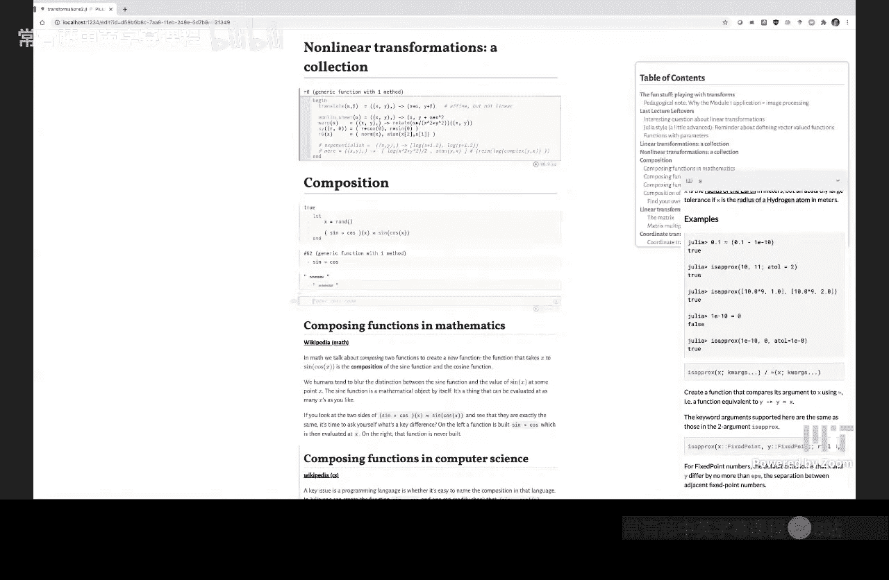
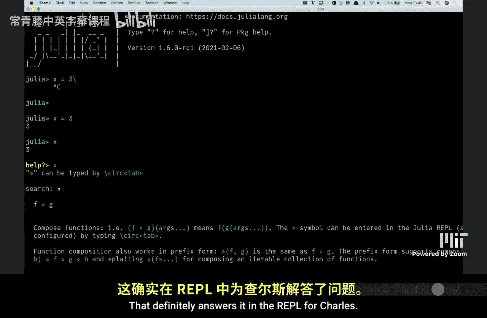
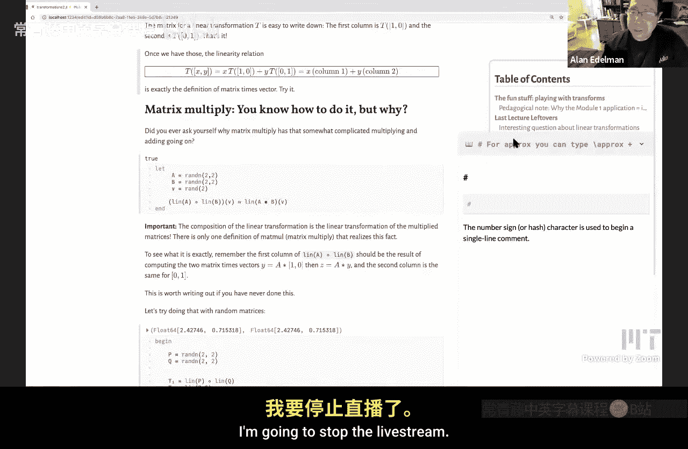

# 麻省理工学院【中英⚡计算思维 ｜18.S191⧸6.S083 Spring 2021, Computational Thinking】 p04 P4 Transformations 2： Composability and Linearity ｜ MIT Computational Thinking S -BV18EqQBQEF3_p4-

Hi everybody out there in internet Land and to the MIT students as well。

 so welcome to this week's Julia Computal thinking class。

So we had a lot of fun putting together this notebook over the weekend。

 so today's lecture is going to be nominally about transformations。

But maybe I'll do a quick sound check， can I be heard？Yes， smilinglingington， great。

 thanks very much。But in addition to talking about transformations and various mathematical subjects。

 we will also talk about composability， composability of mathematics。

 composability in computer science， composability of software is a big topic。

let me start by actually playing with what's in this notebook so we did a little bit of this last Wednesday。

 but I think it's fun just to start playing and so you can go right here to the fun stuff you could click on the table of contents if you like and play with any transformation that you would like let's just start with that so I'm labeling the transformation with a T and a superscript minus one for t inverse I'll explain a little bit later on why that might sound backwards but but there's a reason why we're going to call it t inverse and not T so I made it that everything you need is kind of can be seen in one window so you might want to let's see let's just make it it depends on how you resize it of course let's maybe make it small or so you can see the big picture and then I'll make it larger so we can zoom on in。

But let's see， so you've got the grid lines， which is actually being added to the。

To the original image and the processed image。this thing right here， give you a little more room。

 We've got a zoom that is scable。So you can sort of zoom in， zoom out。With this with this。Right here。

We've got a nice pair。 Can you zoom in on your notebook？Well。

 I was going to do that I' going to do that in a moment， but I want to same。Yeah。

 I wanted to also be able to reveal。Yeah， okay。So just a quick thing just to show you how to use this panning。

 eventually we might want to just do this with a mouse but this isn't so bad and this works with Pluto that you can zoom in the X direction and the Y direction just by grabbing and this scable okay and you've got these parameters these right now we're just applying the warp so you can you know you can kind of bunch up the poor corgi or leave them in good shape。

And of course you could put any picture you like， all you have to do is replace what's in quotes here with whatever particular with whatever picture off the internet you like。

 or of course if it's on your computer， all you have to do is just load the file name so you get to play with all this and what's wonderful is this entire notebook is completely selfcontained。

So whatever however this thing works， it's entirely in this one notebook and there's something very magical maybe the students from previous semesters really enjoyed this that you put together something from beginning to end you feel completely of control in other courses maybe some of you might have taken that people will give you sort of like 80% of the code and you're supposed to fill in the missing part and I understand the reason why people do that but you always feel a little bit out of control like what is it that's there that you didn't understand。

So this entire the entire code for this is completely here and let's just play with some of these functions before we。

Deelve in and so I've got a number of functions you can you can actually click on these linear transformations if you want to see a few of them we have things like scaling and flipping and rotating and shearing these are the linear transformations we also have a bunch of nonlinear transformations Trans is technically nonlinear those fields linear because the definition of linear requires zero goes to zero So in general translate move zero we have this nonlinear shear that we're gonna play with the warping is clearly nonlinear and some other nonlinear functions here are a couple of others we made up and we play with so I would like to encourage everybody to kind of make up a function and just see what it does and again in you know in years and years of math courses people would draw a little diagram maybe they'll just see what happens to a square maybe there'll be a curve I guess with plots you can。

Maybe more clearly see where the contours would be， but I like images。

 I love honest to goodness real images， I think there's nothing like them for building up an intuition as to how transformations really。

 really， really work。So just to emphasize that we are sort of taking each pixel as representing that particular point on the plane and we're seeing for each pixel。

 how does that move around？Yeah， if。If I could， I would actually zoom in on a pixel。

 Let's see if I can。I can actually， oh na， I'd be kidding myself if so I could see the pixels now。

I don't know， see if we can get a little closer even。Going to zoom in some more。

This is about as far as I can go。I， I do almost think I see， yeah， I see the pixels。

 they're like little rectangles。 I don't know if you could see them over my zone。

 can see but you see them as well。 Yeah， so so and actually dealing with pixels it adds a small complication。

 it's not conceptually harder， but it adds a small complication than just dealing with。😊。

With you know， pixels are discrete as opposed to sort of the continuous curves as they would might be presented in a mathematics course。

 So you just have to deal with that， but it's worth it。

 I would say because you get these nice pictures。 So if I may continue to play with some of these。

Just to you know just like I was in Photoshop or something。

 but this is better than Photoshop because I've got control， I know exactly。

How these functions are defined because they're just somewhere down in the notebook all right so I will zoom in here and you know just I want you to I want you to do this with me I don't want to just do it for my own fun and I mean I could do this all day mind you but you know rotate rotate the corgi there we go。

So this is rotating the corgi， it's just taking this parameter alpha。

And just rotating it around and it's pretty fast， I would say so there's the rotate I could instead play with shear again。

 you can make up your own function anytime， So here's the the shear function and what shearing does is a kind of。

😊，Kind of bends the parallelograms， if you will。Okay， so they're almost unrecognizable if you will。

 right we can go the other way with shearing so there's shear but the horizontal lines stay on the same horizontal line。

That is true with share。That is， that is absolutely true。 We can now do。

We could actually define the transformation with any matrix and for that this is where the the matrix over here applies and maybe I'll just go down a little bit。

I feeleel like there's a lot of wasted real estate here I know Dave's going to want me to zoom in。

 but I want you to be able to move the matrix down next to the。

Move the matrix cell down next to the page I could can't I that's true if oh。

 except that I was messsses up， let's do that。That's fixed down， here we go。

It's not a bad idea actually， okay， then I can zoom in。

I keep forgetting that this thing is infinitely flexible。

Right which is actually good to keep in mind。So here we're applying the matrix。

I like to argue and you'll see more about this in the notebook that。In a way。

 this transformation is the matrix。I don't like to think of matrices as just as of numbers。

 I like to think of it as linear transformations。 And if you want some intuitions to the various different kinds of。

Transformations that are available。 You can just play with the different elements of the matrix。

 and you'll see that。You'll see what it does to the point of when you get these parallelograms that are sort of big and needle shaped。

 I don't know what the word is， you can't even recognize the picture anymore。Right， but again。

 you could play with this a little bit and see。What it's doing but one think for sure with matrices is that a grid of rectangles will become the lattice of parallelograms right these these the grid of equal sized rectangles becomes equal sized parallelograms and this is in my mind truly the action of a matrix right not not a bunch of elements but literally this transformation of a corgi or whatever other image you're playing with this is really how I would like everybody to think of matrices and not just as tables of numbers Okay so we'll say a little bit more about that but let's just place the more so。

😊，The symbol here， and it's I mentioned it later in the notebook。

 but just to kind of preview right now， the symbol means compose which it means。

That you're going to share with minus alpha。 Look， I could do these out of the way now。

So put得 back get of the way。Okay， so this says it goes from right to left。

 it says shear minus alpha and then shear alpha and you'll notice that it doesn't do anything so no matter what I change alpha to。

嗯。This operation and this operation cancel each other out。

 we say that these operations are inverses of each other。Okay。

 so that's coming in this lecture as well， let's play。

 why don't we just play with a nonlinear share just this。

Since everything we've done right now has been linear。

 let's see what a nonlinear operation might look like。 So here's a nonlinear share and。

There's something parabolic we could actually look at its definition here。

 but these are actually parabos now， but what I'd like you to notice is that if you just look at sort of a small section。

 it's still just a bunch of rectangles right they're slightly curved and they're warped but if you get smaller and smaller in a small patch in a small patch everything is kind of almost linear and so much of applied mathematics。

Is based on the fact that if you look in just a tiny little region， if you made。

 if I made my original rectangles。Smaller or if I drew more， if I drew more grid lines。

 you would see lots yeah， I guess I could pretend to draw it， I mean， I guess I could really draw it。

 but why don't I just pretend to draw it because it's easy。So I mean。

 I think it'd be easy to just sort of imagine what it would be like there was a grid line I'm just doing this freehand so don't think oh。

I guess I can't do this very well， but you can imagine that these parallelograms。

But the smaller ones。Get more and more parallelogramm like more and more like a linear operation。

 Okay， and like I said， this is what so much of applied mathematics was about that if you。

 if you just look locally， if you just look at a small region。Every map looks linear。And in fact。

 before computers， that was kind of like the only game in town really。

 that pretend everything is linear and hope for the best was kind of the most analytic techniques before computers were invented。

Okay。So that was the big game in town， it's still a bit of a game。Okay。

 some other nonlinear transformations that I had I showed you this last time I'll kind of you could play with them again。

 I have the the polar to X Y which is kind of crazy I mean the corgis are kind of ripped to shreds and put in different places。

The other one that I had was the r theta one。So that goes the other way and you can see the sort of fning out and。

I'm hoping you're playing， you know， you're playing along with me， but if you put the two together。

 actually， let's do it the other way first， if you put the polar coordinates to xy and then go back round trip again。

You'll see we come back with the original picture and so going to polar and going back to X Y coordinates is is is their inverses of each other Okay and here's one that I just made up。

Just for fun， again， you could take any function you want。

It depends on this parameter alpha so we can play with it a little bit。 whoops， whoops， how did I do。

I scrolls。Okay， so let's see。 I'm going to go down one level。 Hope that's okay， David。Okay。

 but you let's let's play with the alpha parameter so when alpha is zero， nothing happens。

But as Al starts to get big， the poor little Corgi gets grrununched and pulled。

 And I don't know what is what's happened to him。 In fact， it gets doubled up， right。

 So that's kind of。 So not all maps are one to one。So if you see when I do this， look。

 this quirky has two heads。 It looks almost scary。And what happens to the parallelograms and you'll start to notice I could zoom in now。

You'll start to notice。That these parallelograms are starting to get really messed up。

 like over here。 what the， the parallelograms get squashed down to to 0。

 And then here you could see the。They look really strange， right。

 And so this can happen to functions。 These are called singularities。

Okay and they correspond to the linear approximation being really weird Okay and so here are some of the things to play with。

 I don't know before I move on anybody have any other functions that you'd like to see I can make I can you do any function you want the functions are going from minus11 to minus11 in the x and Y coordinates。

So if anybody has a function， let's see if there's anything in the chat。Okay， nothing at the moment。

But if anybody wants to just try a function， I don't know it'll happen。Dave。

 if you' got a favorite function you'd like， what about something with something periodic like a sign？

Oh， I have no idea， let's try it。So I guess it would be something like sine of5 x。Sine of alpha x。

 we could kind of Oh yeah， good idea Good play with the parameters Pine of alpha x comm a y Alpenine x comm a y to start to start it。

 and then we can see， see what happens Okay， I've never tried that before。Okay， so let's see。

 so let's start with the alpha。ButWhat。Let's see。 This is。

Maybe I'll move the alpha down now that you taught me that I could just do that。 Let's do that。Again。

 I hope you guys will be doing the same thing， but here let's。So。

I if I guess say make it really periodic， do I want a large alpha or a small alpha to make it really Yeah。

 there we go。ice， gosh， that's so strange。So like I said somebody suggested the Hbert curve。

 I think that might be a bit tricky give me you got to give me the function Yeah。

 youve got to you've got to write down the function you got to write it you write it down I'll type it in I'll copy and past it in Oh this is freaky。

😊，It's too freaky for me Okay， so let's make it freakier put a cosine in Y。😊，Oh no。

Let's saying alpha times y with a 1。Let's try that。

I don't know whether this is just doesn't work but you need， yeah。

 you you can put that alphabet to one， I guess probably。So I'm not even sure if half of one is yeah。

 I don't know what what' going on that yeah it's probably。Oh， wait， I'm getting some。ち等呢。

But you can do arbitsrarily weird things so so white space doesn't mean it's broken it just means。

That呃。Its it's outside the window that we're plotting in。

me it's because our original image is embedded in a white square， correct？😊。

So that's quite cool actually。 Yeah， you could sort of make a kind of。

Tilling pattern or mosaic this way。There you go。 And then you could mix it up so you could， you know。

 you want somehow。10 out of the time next times Y or something I'm that is going to be terrible。

 I think so。一个。I wasn terrible。Yeah， it's kind of nice。う。Okay， last last chance for somebody to。

ToTo mention a function you'd like to play with， but this is maybe I'll just make another pedagogical point where I've seen over the years and maybe some of the students have seen this also that you know professors make these demos in the past they were these Java uplets and you know you' you're。

You're limited to seeing whatever it is the professor wanted you to see。

 So they might have picked a few functions， but we， you know。

 we think that you should be able to have any function that you could dream of。 just put it in。

And have the full power and flexibility of a sexual language。

So often way you I mean you sometimes these applelets have the ability to write your own function。

 but but basically you're writing a string and then that string somehow has to get paused get converted into an actual actual piece of code but here we're just writing the code because we have this interactive basically basically right so it's completely live。

Yeah， all right， so you get the idea we have these， let's go back to identity just a。

Kind of return everything back to normal。 So we've got these images and maybe now one more pedagogical note if I may and say。

 so you've been in this class now we're up to the third week and you've been sticking with us and maybe you're wondering。

Why are we doing image processing is this an image processing class I mean。

 is that there are classes on image processing and。

As you probably picked up on from me already when this is not an image processing class。

 the image processing is merely the motivator， we think that playing with images is just so much fun what we really want to do is teach you this combination of computer science and math and Julia programming that I think could only be done in the way we're doing it and so you know and you'll see that the other modules that come up will have the same motivation so the analogy I try to make in terms of you know as we put this class together is I think about the time I learned a foreign language so I was a graduate student at MIT and I took a French class at MIT and I remember the textbook the textbook know the whole goal was to learn French but you didn't just learn French chapter by chapter that was a French construction but there was also how to offer how to order a coffee in a cafe in Paris or how to go to the post office or how to do your laundry。

Very useful things， you know， if you're in France and you also learn things like。

Like the culture of France right and and you know how people think about things what you know things that are different so in a way that analogy was what kind of stuck with me with you know we want to teach Julia but we want to teach it with an application like like doing a laundry right or ordering a coffee so the image processing becomes sort of the sort of cultural background if you will so that we could present learning Julia in a real life context okay otherwise one ends up with these sort of what seems very dull to me where you know here's a for loop here's an if statement I mean I couldn't imagine to me anything more boring than what's a for loop and what's an if statement。

Okay， so there were a few leftovers from the last lecture and one of the folks I think it was on the Discord。

 I asked， so what is a linear transformation？And there was an interesting wrong answer。

 I love interesting wrong answers， interesting wrong answers are so much better than right answers。

 I wish everybody would always give me interesting wrong answers so so somebody proposed something like this that if a transformation takes lines into lines and perhaps preserves the origin。

 then maybe that is a linear transformation。😊，And I vaguely remember that when somebody said that。

I wasn't prepared to completely agree， I don't know。

 I maybe I go back to the recording and see what I really did。

 but I remember being not so sure about that， that this would be enough for it to be linear in the traditional sense。

And for now， let's think of linear as taking those rectangles into those nice lattice of parallelograms。

And we found this perspective map， I would love to implement it in Julia。

 but we took this one from the Khan Academy and it shows that you know if you have like a nice set of rectangles on the floor and you look at it in perspective。

 some of you might know there's this concept that comes originally from art。

 the vanishing point the parallel lines when when you draw them all meet at a point called the vanishing point and there's this nice demo and I have it right here from the Khan Academycademy so I'll bring it up and again I'd love to get this implemented in Julia。

 it probably wouldn't be that hard but I thought I would just gonna show you I'm going to get rid of the hallway and maybe even the second vanishing point and here you could see that I just love being able to move this。

 so these in the real world in the real worldord plane these green lines would all be parallel and from different angles you'd have a different perspective。

So so。Of how this would look， okay and。Right， the second vanishing point here。

 let's do like this can。You can go like this。 You can play with all sorts of things。

 So you' bring in the second vanish point now。 So the second vanish point has all the diagonal lines right So those are if this was originally a square or a rectangle。

 the blue lines would be the diagonal of the rectangles。 And from this perspective。

 the red lines stay parallel。 They're horizontal。 But my key point is that all lines。

 not just the ones you see but all lines here would actually be linear。

 And so this perspective you know you could always make things the origin goes to the origin So that's not a problem。

 And so that just goes to show you that。Lines going to lines is not sufficient for it to be linear。

 You won't get the the nice parallelograms， right， obviously。

 these are sort of trapezoidal or something。These are not quite parallelograms。

 they're certainly not congruent。By the way， for a quick argument。

 maybe it's worth doing this for a quick argument as to why lines go into lines if you have the。

If you if if you have sort of here's your eyeball right how do I draw an eyeball I don't know here's your eyeball and you have a。

A plane that you're projecting onto another plane， it doesn't have to be parallel right that if you have a line over here and you project it from the point。

Right you create an intersecting plane and there' will be a line over here right this is the image so no matter what line you have in the real world。

The plane between the line and your eye will create an intersection。In the image plane。

 and that will you know， the intersection of two planes is always a line。

 so there's your quick mathematical proof。Okay， but thank you for whoever out there gave this nice wrong answer so that we can actually go and explore that。

Okay， so what else is left over from a previous lecture， let's see what they。

Okay we defined these functions last time and I just wanted to say a little bit about style。

 so this is one of those things where if you only concerned about correct code or getting the answer right。

 then you won't care about this， but if you want to be fancier and get the code to be more readable this is then this is for you。

 so maybe zoom in again gosh it seems so big to my eye but okay。

It's practically now there's like a PowerPoint thing， which is probably the whole point。So。Yeah。

 let's see could almost do this big。 All right， here we go， good， good idea， Dave， thanks。行。

So Phil's got some comments about here。今晚食小少少。I might have to close my door and sorry， everybody。

He's doing it pretty loud。Okay，I'd like to ask each of you to look at。

 say this line versus this line。And tell me which one is easier to read。

 I don't think there'll be much of a controversy。Oh。

 Charles asked a good question about perspective maps， I'll go back to that in a minute。

I like your question， Charles。Yeah， okay， so I believe you'll all agree that seeing。先。

X and y this X and y thing yeah and one of the students as well just agreed that this is so much easier to read again it doesn't matter from a mathematical viewpoint。

 you could index V of one v of two， you can you know you can write the indices it'll work mathematically。

 it'll work computationally， but if you want to actually be a human and read these codes。

There's no question that the second set is easier to read than the first。

 and so I made the choice to actually write them。The codes。

 the functions more like this than like this， there are a couple of other choices。

 but one might ask why would I actually this might be looks a little bit easier to read than this。

 though this one's not so hard to read。This I'll remind you from last lecture this is an anonymous function which by the way we've named I always feel a little awkward saying this is an anonymous function but I've now named it。

 it doesn't feel like it's anonymous anymore but but this is an anonymous function which has now been named F and the reason to do that is these anonymous functions allow you to put in those parameters and so it makes it really fun to be able to rotate by alpha or shear by alpha or warp by alpha so if you go and look at the definitions of the functions and I'll bring them back here with this table of contents so。

Here's my collection of linear transformations， you'll see that when I had a parameter。

 I used the anonymous function format。Okay， so the so this function scale x of alpha will scale the x coordinate When I didn't have a parameter。

 I just did it in the short function format。 So these are in the short function format。

 But whenever I had a parameter。 So this lets you put in the parameter Okay， so that's why。

That's that's why we would use the anonymous form and it makes that possible so let me go back。

 if you will to Charles' interesting question so。So this perspective， so the question is。

 is so Charles said。I thought perspective is a linear transformation。And。

There might be a reason if you've seen these things somewhere。

 you can actually do this with matrices， but the funny thing is if you want to do two by two transformations。

 if you've seen this somewhere， if you want to do two by two transformations for perspective maps。

 you know from R2 to R2 like we're doing in this notebook， you need three by three matrices。

Okay and in fact， if you want to do three dimensional transformations you need four by four matrices and what you do is you end up dividing by something so if you look you'll see that they are。

They have。They've got linearity inside， but they're not linear。Okay。

 so to be linear you have to have these parallelogram I'll give the technical definition of linear in just a little bit。

 but intuitively all of these have to be congrued parallelograms。

 which they obviously are not right this is a big parallelogram this is a tiny little parallel I mean actually not a parallelogram。

These two lines are not parallel it's it's it's at best half a parallel gram。

 which is not a parallelogramm， but these two lines are parallel， these are not。Right。

 and that's big。En trapezia， is that the worst？It's hepat trapezoid。A trapezian。That's。

That's the that's just the British word for what we call trapezoid Oh you got a funny word for trapezoid。

Just like you pronounce a littlezevo there's nothing funny about it。

 I thought it does a trapezoid have to be I guess I'm thinking about sacily stroidites。

 I guess this is a trapreezoid wait a minute， I thought I thought， you know。

 the way you do it is you add one more， you know， you add a constant term right to the vector right is' always X Y1。

Gets mapped with a。right those are homogeneous coordinates that's right that's how it becomes three dimensional right and but but how is it but isn't that a linear then a linear transformation it it's a linear it's it's linear in X Y1。

Right， okay， and then you have to somehow do something to put it back into the plane。

RightSo usually you divide what is it by the sum of the three numbers， I think。

 there's a division in there。And so the combination is technically it's got pieces that are linear on the inside。

 but the collection is not technically linear anymore I don't think I knew that。谁。😊。

Let something new every day。嗯嗯。Allright。I I， I。I had fun working with Dave trying to find a good example of something that sends lines to lines and。

And I came up with all kinds of weird examples that would we had other examples that oh here。

 let me show you another example that we came up with but it doesn't work so here just for fun while we're at it。

And again， this。This is maybe another thing about computational thinking， where。

You can do things with your brain， but you could also do things with a computer。You know。

 I think wisdom is knowing， you know， I know people in the math department would say you should always use your brain。

 And I guess we know other people should say you should always use your computer。

 I think wisdom is knowing。Is knowing when to use what you need I see it， I see it。

What is the common notation after the vector mean Yeah， I wanted to hide that。

 but maybe it's it's to explain it it's because I'm going to it's it's a。

It's a little bit of a obscure Julia thing that makes things work。

 So it's going to deconstruct a vector so that I could give it a。

 I want to be able to give it a vector and a tuple input。So。So， a vector。

 I didn't really want to get into that， but a vector looks like this。And a tuple looks like this。

And I want this to work on both。So it's a little。I if you don't put that comma except it will define a function that accepts two arguments。

 but we wanted to define a function that accepts one vector， one argument。

 which we're going to use as a vector so we're going to as Alan said。

 deconstruct that one argument into those two。I'll use X and Y gotcha yeah so that this is advanced and not so important。

 but he let me did I get this right？So oh yeah， okay this will work maybe actually could let's pour things up down。

 but whatever。Let me maybe in this Yeah， I know。嗯。Let's see if we can。

I don't know it's a little bit trial and error the main thing I want you to see though is that this map E the E to the KX E to the you know KY。

Preserves horizontal lines， and vertical lines。And so you might think， okay， this。

 maybe this is an example， but if you it doesn't preserve other lines and one quick way we can check that is I could compose it with a rotate。

Right， so let's rotated by， I don't know， whatever one。What are I doing wrong。

What wrong can I need to， you need to put the whole no nonlinear transformation in parentheesis parenthesis is what I say。

 Oh no， No， no， more there， no。The the part that you wrote first， yeah， this boat。

The whole whole thing is a function you want to compose two functions but no not there for the Oh oh yes。

 I see。Thank you。Okay， so oh， it looks still straight。

And that's because it's the wrong way around but you'd need to rotate in the other。

 you need to rotate。That's the other thing I guess about。About doing things on a computer。

 you still have to make sure you do it right。There we go。 Thank you。 Yeah， so in fact， I could。

 let's put the alpha over here。And maybe I don't even need the alpha over here。

 let's just maybe get rid of it over here。And you can see that。呃。Thisかマイナス。Okay。

 so you can see that these these lines are anything but horizontal and vertical after rotating。Right。

 and so。It's easy to come up with maps where the horizontal and vertical stay horizontal and vertical。

 but other lines clearly get completely messed up。Okay， I like the way that the lines get thicker。

You like it？So Zoom， because it's it's， it's， it's blowing up， right， I mean。

 it's there's some singularity here that it's heading towards。

 I don't know if I can pan it over a little bit or no， I want her。Can I see more of it。I don't know。

So if I zoom in， will I be able to see more of it？No I think it's do。 Yeah。

 does seem to be doing that。So this is one great way to discover all sorts of phenomena that you never knew functions can do。

Okay， and what else did we have the style？Okay and then yes。

 the functions with parameters here is just an example with functions with parameters Okay。

 so moving along in this lecture， we made up a bunch of linear transformations。

And every one of these could have been just written with a matrix， but in some sense。

 it's not clear that you should write every one of these with a matrix。

In a sense that sometimes a matrix is overkill and those people who know me well know that I love linear algebra if they ever heard me say sometimes a matrix is overkill。

 people would be surprised to hear that out of my mouth。But sometimes a matrix is overkill。

 like if you're swapping X and Y。Or if you're flipping why it probably you don't need a whole matrix for for that one。

 in fact， none of these seem to really require a matrix。However。

 if you do want the general matrix and you saw that happening。

 here's how you would write the general matrix you could put in either the four elements， AB，C and D。

 and you get this is the matrix times vector right so you take this matrix times the vector x and y。

And you get。E。You get A plus By and Cx plus dy or you can actually do the matrix times vector directly and so this is another bit of fancy Julie I don't know whether I should explain it or not。

 but if you'll notice what I did here was I define a linear transformation of a matrix。Okay， I。

I defined it as matrix times。The so it'll take a vector into the deconstructed vector。Okay， anyway。

 that's that's fancy， Julia， let me just say that this this is just。ThisThis just lets me。

You could just write that as V1 V comma V2。Yeah， but I kind of just made the whole point about not doing that。

Right， but I could have right。Right I mean， the point is that we've been using， yeah。

 we've been been using the be constructive form and so we're going to keep it that format。Okay。

 so okay， here's here's my nonlinear transformations。Like the nonlinear shear that that， you know。

 here's the whoops。Here's the warp and the warp is actually nothing other than a rotate that depends on your position。

 so it's actually kind of nice to be able to write it in just that way。

 So the further out from the origin you are， the more you're rotating and so that's why you get the。

You know the big twistings as you sort of move away from the origin， okay。

 here's the X Y or theta here are a couple of other functions I played with。

 but here let's talk about composition composition is a big important simple but big important thing。

Okay， and so。So， so。To talk about composition， let's just talk about composition of elementary functions for starters。

 functions of one variable， so here is a signine of cosine of x。

Here is the function that composes sine with cosine and evaluates it with x。

At the value x and let's just x some random number and in Julia we could do this approximately equals just in case there's a little bit of numerical。

Right， I mean， we could do equals equals， which would actually， it might be false， so maybe not。

Oh actually in this case there's no numerical roundoff so I didn't need the I didn't need the arx but whenever this floating point I just do the arx in this way I don't worry too much because sign compose causes just defined it that defined as this right so's doing the exact same thing period。

That's clear。So， I'd like to emphasize because this is the sort of thing that gets kind of a little bit confused even in math courses。

The difference between。Sine and signine of x。The problem is in math， it gets very， very confused。

 so I'd like to sort of talk about this object in Julia， for example， or in math。

And perhaps this object。So sine of x is a number。Right。

 I put some number x in and out comes the sine of x。 Now， of course。

 this gets a little bit confused if I say F of x equals sine of x。And that， you know， in in math。

 and you might be talking about the sign function in math rather than the evaluation of sign at one number。

 We humans are so good at not worrying about it that we don't worry about it unless we're doing something on a computer。

 But on the computer， there is。A function itself can be an object， like S I N sign。

Right and that object exists， whether you evaluate it or not。

 so if everybody sees what I mean and so this is sort of a little bit of the computer science。

 it's also math， this thing is a function sign okay， it's not been evaluated。

 it's just a thing right it could be composed with a cosine。And this thing now is a function。

 If I want to， I can go ahead and evaluate it， which I did over here。Here， on the other hand。

 this is， you see the difference here， I take a number X， and I get a number out cosine X。

 then I go and get another number out。 the sine of cosine of x。 right。

 It never happened over here that there was the this function never existed。

 Sine composed with cosine。 never existed on the right。 It only existed on the left。

So I don't know if that like Ben's brains or not。But the real kind of stupid question please so when you use special symbols。

 I can see you entering them。Is there a way if I see the special symbol of knowing？

Can you just mouse over it or something and have it tell me the well。

 you could copy and paste it No so that's a great question but the answer because I really don't want to have to go off to other pages if I can avoid it when I'm trying to program by example most in most cases it's the latex thing so you probably you may already know it if you know late is there a way Dave to actually know it seems to me like you should when you mouse over it in Plato or something it should just tell you that would be nice know heres does it actually mouse over's so it might be does can you click there and open the live dons that's exactly what I was going to do is it prox oh but that's not quite answering Charles's question。

So if you go to the Reple， you can do it。Can you try opening the and doing question and that symbol Well then I have to change my screen a terminal Julia when you run Julia from the terminal Dave Dave Dave。

 Dave， that will change my screen sharing I'm only sharing this one browser that was me when you master over it it would just tell you what the that's not a crazy idea。

We should tell funds that it'll probably implement it so what what what we did get when we mouseed over is the name of the function so if if。

So so do you want me to share my screen sure， share that why not， that'll be fun， let's do it。这什么。

Can you see my terminal？We do see your terminal okay， so I just launched Julia。

 however you launched Julia from and you can from in my case from the command line or you know I could do it by searching for Julia my Julia executable and so now I'm running Julia on the command line and set up in Pludto and I'm going to type question mark and then this this symbol that I don't know how to write。

So when I type question mark it actually so this is the normal Julia prompt and you know I can write Julia code here x equals3 and what is x but if I type just type question mark。

 it immediately changes the prompt into this help prompt so we're now in help mode and if I type the name。

 type this Uniiode symbol， it actually tells me the first thing it tells me is how I can type it in Julia。

But wait， can I then do it， let me grab the screen back if I may is that does that answer your question。

 Charles that definitely answers it in the reel for Charles you mutton。

But can I go？Can I go don't know how I don't know how to do the same thing actually straight and Hinduto can I do it it couldn't is doesn't it help Yeah yeah。

 yes know。Is that this is a Pluto problem right now that is a way but I can't think of what it is right now Yeah okay。

 we'll find out and get it and maybe even add the mouse over。I mean， there is something。

I guess the other thing you can do is you， if you go。Yeah。

 it would be nice if when you mouse over because whenever I read something I want to be able to write it right and that's if it's only the translations only going one way and it's effort to go the other way and that becomes。

你要さ。As as I just showed， you know， that information is available and Julia。

 you just have to know how to get to it from Pto rather than from Nick there's another thing you could do which doesn't answer Charles's question。

 but it's not a related question， which is I can call slash colon tab。😊。

And see a list of all sorts of una codedy things and you can pick one that you like， for example。

 you know， you could take a cow and then hit tabab。Right， and you go emji， Yeah。

 and then you can go cow equals 2 and。You can take the square root of your cow and all sorts of things。

So。So。Yeah， so so there's a list of fun symbols and this actually comes in handy for example。

 I saw the instructor in the math department Chris Raockis he shows off differential equations and there are lots of examples of differential equations where there are wolves and rabbits or something like that you know wolves and rabbits so and everybody always goes。

W and R right， but you know Chris has a picture of a wolf and a rabbit it's so much better to have that it actually works for the code so much better than the letters。

😊，Okay， apparently it does work in Pluto already if you click live docs and mouse over the symbol。

You're kidding me。Can you mouse mouse over the sex symbol， okay。Yeah， and yeah， yeah。

 it does say the symbol can be ended in the Julia rebelple。backslash sick。

Oh well maybe you've got what you want let's see so yes I don't think it's I don't think it works with all symbols yeah there's my message depends on how the help documents is written really yeah so when I mouse over that's not happening。

I don't get that thing popping up on the right how did you see the live over here lives below there。

 I see。Oh， okay， very and open it， excellent。Yeah， we should definitely get。For symbols， Okay。

 so somebody else said you can run question mark and then a symbol Yeah。

 but I was a little bit worried about Pluto。But yeah。

 so that doesn't not actually tell you the information for all the symbols。

 so that needs to be fixed。Yep， that would be good。Okay， so right。All right。

 composing functions in math， composing functions in computer science。

 I kind of already almost said that that。You know whether you could actually name the composition in that language right and so just as I showed before。

 we can name the sine cosine function and that's something that is a first class object。

That you can play with Oh， but here， Charles， you're for the arx。

 I don't see where it tells me how to type。 it doesn't。 That's that's what they was saying。

 It doesn't。 So I mean， I will just do this by saying for arx。You can type Flash proxed plus tab。

Yeah， so。Go you。But。Right， but but yeah， it's it's it's it's it's not in the it's something we need to fix。

 that would be good。So， so。So here's a bigger point that is something that a lot of people talk about these days。

 a bigger computer science point which is the composition of software at higher levels and there's a lot I could say about that you could read what I wrote but in a world where everybody's in a hurry and everybody writes code to do the job that their boss tells them you know their supervisor。

 their boss their thesis advisor that says get this thing working get it to do this that and the other。

 if somebody else goes and writes another function。

 it's fairly rare I think it's fair to say that the two functions。

 even if they conceptually work together， they may not work together for example。

 you could have a simple function that put strings together。

 okay but maybe doesn't put numbers together or you know right so having software composed is a really big deal。

 the applications and computational science these days that everybody wants is that you have，A big。

 big。😡，Code maybe written over many， many years and now what you'd like to do is surround it with an optimizer。

 you want to just fiddle with one parameter。 It might be solving a complicated differential equation on the inside。

 It could be doing all sorts of things but all you want to do is change alpha you don't really want to care what's on the inside a lot of code will break if it doesn't break we' are in a happy position of saying that it's composable that the optimizer is composable with the code that's on the inside sometimes people want to do a machine learning neural network and have a differential equation on the outside you see and so all of these sorts of things are know what people want to do these days and。

Really what we're looking for and this is what the Julia community is striving for is for。

 I mean in some perfect world everything is composable with everything I mean that's sort of the dream and and Julia sort of is getting there to some extent where the person writing this code over in Mongolia and this other person writing this code in South Carolina you know it just works together even though these people didn't plan for it。

 they didn't shake hands， they didn't write this they didn't write a spec for it to work together it just does and when that happens that's sort of a very happy position for composing so so the idea of composing whether you were talking about composing a single function of one variable or multivariable or software in general it's the idea that you could do the one thing and then the other thing right and it just goes all the way through。

Okay， so let's。Oh I can let me skip over this and let's talk about you know this is what I said I would talk about in a minute。

 I'm going to run out of time， but let me at least get in the definition of linear transformations and so you've already heard me say that when you see a matrix I would like you not to think of a table of numbers anymore if you can help it here are a few kind of definitions of what a linear transformation can mean officially so yeah you always have to have zero going to zero but other than that the rectangle grid lines becomes a lattice of congruent parallelograms that would be sort of a perfectly good operational definition another sort of algebraic operational definition is。

It's sort of backwards from the way I wish people would think。

 but the definition is linear if it could be defined with a matrix times vector。

Okay here's a sort of scaling and adding definition which will be combined in a minute to become the true mathematicianss definition。

 so if the scaling and adding definition says that if you take a vector and scale it and then transform it that would be the same thing as if you first transform and then scaled right and similarly if you。

Transform the sum。 This would be the sum of the transforms。

And these two combine you actually can combine them into one thing and this is sort of the usual mathematical definition。

 we say that if we call this a linear combination as we saw in an earlier lecture。

 we say that a transform of a linear combination its the same linear combination of the transforms。

 if this is true for all numbers c1 and C2 and all vectors v1 and V2 we say that this is linear and so getting back to sort of Charles's question。

 this property would not exactly hold for the perspective transformation so this would actually fail。

Okay， so so mathematicians love to start with this definition and then grab a matrix afterwards okay and I'll just say no。

 not that matrix， but that was a good movie but if you have the transformation first and you don't have the matrix you can always get the matrix by looking at t on the10ro vector that's that horizontal vector in the x direction and then t on the vertical vector on the y direction because this will be the first column of your matrix and this will be the second column of your matrix and once you know those two columns。

 you can get t anywhere by just doing linear combinations all right。

 I'm going to stop here because I don't want to go beyond two o'clock I probably already used up my microcentury so I'll just start next time with。

The question that let me at least ask you this question， you've all learned how to multiply matrices。

 If you've taken 1802， you've seen it there， maybe sort of somewhere else。

 Did you ever stop and wonder why matrix multiplication has that weird definition like。

You know your matrix addition， you just add all the corresponding elements why can't matrix multiply be multiply the corresponding elements like what who said that matrix multiply was so complicated did you ever ask or maybe you're all such a good students and when your teacher tells you this is how you multiply matrices you just listened okay well if you've never thought about it or even if you have I'll start the next lecture by talking about why matrix multiply really is what it is okay how did it how did it come out to be this important thing。

😡，Okay all right， so I'm going to shout off， I'm going to say goodbye to the to the people out on internet land and you know the MIT students can stick around if they like and we can chat with them for a little while or can I do that or let's say yeah I'm going to stop the live stream all right so goodbye internet land。

