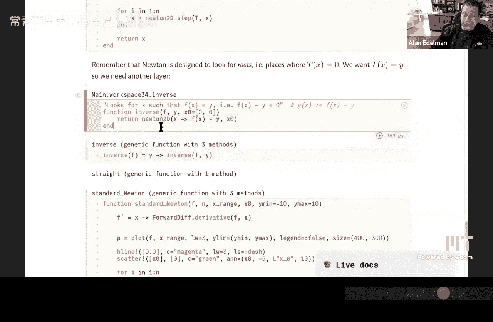

# 麻省理工学院【中英⚡计算思维 ｜18.S191⧸6.S083 Spring 2021, Computational Thinking】 p05 P5 Inverses and Newton method ｜ MIT Computational Thinking Spring 2021 ｜ Lecture -BV18EqQBQEF3_p5-

Okay it's five after the hour let's start so hello everybody out there in Internetland and any MIT students that might be joining us so today the plan is to do the second half of this notebook I hadn't originally planned to spend so much time on one notebook but it's just so much fun and it's so much fun to play with this notebook that I kind of can't help myself and then in the second half of this lecture Professor Dave Sanders is going to talk about how you can invert the maps that we're showing you here today so just a quick mention that the way MIT works next week Monday classes or on Tuesday so what that means is that next week there will not be a lecture on Monday at one o'clock there will be a lecture at Tuesday so to to be。

The lectures next week are Tuesday， March 9th and Wednesday， March 10th。Okay。

 so the amazing thing about MIT is that almost nobody ever gets confused。

 they do this every semester or or every year， every semester I don't remember。

 but it happens regularly and somehow everybody figures it out， nobody gets confused。Okay， so。

Just to a few more nonlinear maps in fact I was playing with this map because it's so freaky so here's a picture of myself Dave Sanders and Mike Corgi who you all have gotten to know already。

 he's behind me somewhere。So here's a crazy map x plus alpha y squared and y plus alpha x squared and oh it's just so freaky that what happens when you start to play with these maps so if alpha gets negative。

Then。嗯。Oh it's just so weird， right， so know you can build these yourself。

SoIt starts off not so weird， right when you have alpha co to over zero。Yeah， no， when alpha is 0。

 it's the identity。 So that is true。 Let's get back to alpha 0。 When alpha is 0。

And we can bring the zoom down。Yeah， this is Alphas 。1。 it's practically David oops， what do I do？

You let me see。Well this way。There we go。 Yeah， so there's Al 0。 we couldn't。

If the pens down and yes， there's the。There go。 So yeah。

 that's not so weird But then as I start doing weird things to alpha。

 these are the sorts of things that happen。诶就发个阿。Yeah， it's just。

 these are the bizarre things that start to happen。We got so So Dave。

 what do you think are two heads better than one？对 here。行。😊。

So I would like to invite the audience out there on Discord either now or later to go and do what I love the most。

 just play with the computer， I'd like to invite you to put in your own image。

 create your own function and you know do some art you know you know we can make this an art contest of some kinds right and maybe display the art that you've created on Discord and share it with everybody and and you know post your function as well as。

So don' don't just show us the art， which of course， is going to be the main thing。

 but if you don't mind， please also post the function and maybe even the URL of the image if if convenience。

 right I would imagine that there are lots of fun things you could do。

 I earlier today I went over and I clicked what is it's it's image warping on the Internet and I clicked on image is and I was kind of disappointed。

 I mean， there's one freaky image over here。 There are a couple over there。

 but I would think that the art world could do a whole lot better than what I see here。

 that just doesn't seem。I don't know I think that we could do a whole lot better and so i'm going to invite the audience out there to go ahead and do that so the other function that I played with and's you can now have it in your notebook is I wasn't satisfied that there was that projection that perspective projection on the internet on Khan Academy so I built one myself。

So here is a prospective projection。 And， you know， you can see here， we could add the grid lines。

 if you like。 You could put the grid lines back in。 And I don't know。 this sort of feels like。

 you know， the opening of Star Wars except it's with an image， not with words。

 right And you can sort of keep on going here and could zoom in a little bit to see how it's going。

 And you know， the question arises。 does this count officially as a linear map， right。

 And we discussed that a little bit last time。 And this led to even more questions。

 I you know this' we didn't put this to rest。And we gave a few definitions of linear I'll kind of remind you of the definition of linear it was well down here。

 but you can you can just click on the table of contents and get there and so the intuitive definition was。

The rectangles become parallelograms and you saw they were trapezoids or trapezians depending on whether you're。

American English or British English another official definition is canopy defined with a matrix times vector and you'll in a moment I'll show you that it's not or they're sort of the built in linearities。

 none of these will happen。So you let's go back up here so here here is the perspective projection and you could see that these are not parallelograms。

 it's also the case that if you look at the function definition here it is you'll see that it is a rational function right it is not linear right so there's a divide by once once you have a divide by whoops once you divide by by your arguments。

Lineniarity goes out the window。 So you're defined by。 So without the beta minus y。

 this would be linear， in fact。If you multiply by beta minus y it would be a shear， and in fact。

 when beta gets very large。You can see that it actually does start to look more and more like a shear。

Right so depending on the parameters， but it starts to look more and more fear like。

For for large beta and so it's kind of you know this is what good applied mathematicians do they try to sort of analyze what happens for large beta small data that sort of thing but anyway this thing does not meet the official criteria of being linear lines do go into lines not just the horizontal and verticals。

 but all lines go into lines but it is not it is not a linear map by the official definition and so and I'll tell you it is pretty fun to do this with your own images so you know you can play with the parameters yourself and kind of see what happens。

All right， so now to get to the part of the lecture I haven't gotten to so here let let me go。

 we saw the definition of linear and I mentioned let me remind you and before Dave tells me that zoom on my screen I'm just going to do it。

 so there it is。Okay， and so I'm going to remind you that basically the definition of linearity leads to the definition of matrix times vector and I know that anybody whoever learns matrix times vector。

 they learn it as a mechanical rule first， but this is kind of the underlying meaning that if you know where the x axis。

 the one0 vector along the x direction goes， and you know where the01。

 the vector along the y direction， then you can figure out where every vector goes just by taking linear combinations。

 and that is matrix times vector and if you've never checked it out， I would encourage you to try it。

So then there's the question of what does matrix multiply？And as I said in the last lecture。

 very few people go back and stop to think where did it come from， they just accepted it。

 you know some teacher or a linear algebra class or an advanced calculus class or maybe an algebra class in high school。

 if you're lucky you may have seen metrics multiply and your teacher said this is how you do it。

 you might have learned to do something with a row and something with a column and you kind of figured out how to do it right and and without telling you why in most cases and the answer is simply here here's the answer is to make this equation true that if you have the linear operator that depended on a that is the operator that takes a vector to a times that vector。

 and you compose it with the linear operator that depended on B。

 then you should get the linear operator that is a times B that is what you want and in this little bit of Julia code I'm just checking that it's true。

 I mean， I guess I could have。You could I mean， I guess I could have just put the two numbers if you want to see them。

Here and we can kind of look at it like this or something。 You can see that you get the same answer。

 right， So here's the， here's the vector。 however you like to see。

 I think this is the better way to see it。 So here's， here's， here is。

A B times V right And here is here is the composition of A and B applied to V。 And of course。

 you get the same answer。 and matrix multiply is completely rigged so that this is true。

 This is the reason why matrix multiply is what it is。 And again。

 I'll invite you to work it out exactly and not going do it during lecture。

 but basically you can check， for example， that if you compose A and B and apply the vector in the X direction。

Okay， see what it would take for you to do it you know first the B part and then the a part and you'll see that you will derive matrix multiply right so do it in the x direction。

 then do it in the y direction and you will derive two by two matrix multiply and then of course you know multiification of higher order matrices is just an obvious generalization。

Okay and so here again， here's the matrix version of this。

Just you know you just do this and you see that you get the same answers and here's the pictorial version of this and maybe that's even the most fun so well I do something with algebra when you could do it with pictures and so。

Here I have a transformation T1 and here I have a transformation T2 right and I actually draw the image of the pictures that we have and。

You know different random matrices can look very very differently right so every time I hit enter I get a different random matrix sometimes I get one that's squashed and I can't really see the picture very well other times like oh here I zoomed in because you know I don't know maybe I'll get some big numbers right here it's a little bit squashed right and so you get all kinds of different effects you know with different random matrices but it doesn't matter which ones you try no matter what you do it's going to be the case whoops I changed A and B to P and Q at one point so youre。

Change it in the documentation。Right， but。It's always going to be the case that if you compose the matrices that is if you multiply the matrices and take the linear operator。

 it'll be the same as if you compose the operators。Okay， so that's where matrix multiply comes from。

All right， next little topic is how did we actually build this demo？Okay。

 and so in the next little bit I'm going to show you。

So here we are in the table of contents maybe around here coordinate transformations versus object transformations and so this is practically philosophical but you know I remember I think it was in high school somewhere along the line。

Maybe I learned， I don't know where this was， maybe in algebra。

 you have a graph of F of x and you ask， what is the graph of F of x plus1？😡。

And the answer is it moves to the left。And like that always bothered me because you just added。

 added should move things to the right。Right like what what's going on here right I always got that backwards。

 I still get these things backwards， but the critical difference is are you moving are your coordinates staying fixed and are you moving your function or is your functions staying fixed and you're moving your coordinates right and these are always completely backwards and always requires a little bit of thought but so。

So you know so in the end the math doesn't care， but from the human interpretation it matters a lot。

 and so let me talk about the various transformations that actually had to happen to go from IJ to X Y so as you've seen Angel Julia images here let's just let's open up a cell in just type IMG。

Images like here's an image。 It's an array， right， You've already seen that it's some kind of array。

 Like if I go type of image， you see it's a two dimensional array made up of some sort of color things。

 right， It's an array。 It has a size。Right it is it has 486 rows and 900 columns right it has discrete pixels。

 I mean I could look at the the upper left elements by  takingping brackets and app parentheses。

I can look at the upper left element， and I get。呃。And I get， oh， is that just an ugly white。

 that's why I don't see it here， let's let's pick another pixel。There we go， there's a great pixel。

So yeah， I could take any element at all of this matrix of colors， and I pluck it out。

 But when I do function transformations， I want to think。

I want to think in terms of kind of spatial core in it， it's much more natural to do， you know。

 X and Y。Right if you're transforming functions， then it is to work on the sort of I and J coordinates that you get with the matrices。

 And this is the sort of thing that you never think about unless you actually transform between the two。

 It's kind of funny， but well humans don't even notice this very much。

 but there's a lot of things on computers that humans don't notice until the fourth to。

 So there's nothing unusual there。 but the row index， of course， you know。

 goes down and it's the J index， the column index goes to the right。

 And so it's kind of freaky because X comes first and it's horizontal I comes first and it's vertical y comes second。

 and it's vertical J comes second， and it's horizontal。 the vertical coordinate is upward。

 the vertical coordinate here is downward。 but the horizontal coordinates to the right and the horizontal coordinates to the right。

 I that not enough to drive anybody crazy。 Well， you have to worry about these things on computers。

So here's the transformation that we're going to doops me。Can I just do this。

 I'm going to make it smaller so you can see this。If I can。Oh， let's who's going to let me do that。

I'm having a little trouble。咁喺你度车度。No， that's odd。 I don't know why I can't zoom right now。

 Dave Sanders is gonna get very angry me。If I can't zoom in， let me try zooming in with the。

This thing， oh， that's working。 Okay， so no why the keyboard truckcut's not working on me。

 but here we go so。Here's a picture of the corn transformation that we need。

 So I've got this corgi picture。 it's just a rectangle。

 it's a matrix right it comes in as a rectangle。 It has so many rows in so many columns I want to imagine this picture as living on an array like a unit square that goes from minus1 to plus1 that seems like a very convenient coordinate system This is what I have this is what I want。

 now I've got a little bit of a problem because this very。

 very long corgi is not in a square picture at all right it's kind of landscape it's not portrait。

 So I have to inscribe it in the square leaving a little bit of extra room above and below if I want to work on a square So first of all what I have to do is inscribe this in a bigger square when I do it up here you have to imagine there's nothing real about it I have to imagine rows going backwards you know back to zero minus1 minus-2 minus-3 right and in this and I also have to have rows that go beyond the rows of the image you know row。

😊，Plus1 row plus two rows plus three I have to keep on going until this is columns by columns if I had a portrait picture it would end up I'd have to make it rows by rows All right so that's one thing I'd have to do but the other things I have to do is swap the x and the y with the I and J and the reverse the direction and so the great thing about having infrastructure is I can do this so I can scale if this is an m by n image or actually M is the maximum columns and rows if this is now an M by M image I could scale from this two by two image to an m by M image by just scaling by M over two Oh and I have to flip the y coordinate because it was upside down no problem I've got it ready and I have to swap the x's and y's that's no problem oh and there's one other thing the middle of this Corgi is halfway with the rows I mean I'm probably have to worry about evens and odds but halfway with the rows and halfway the columns and I would like to set to the Corgi so no worries I have a translate function。

So here's a bit of a computer science idea that's kind of a little bit different from the one off engineering to the really good computer scientist。

 the one off engineer， what he does and I do this all the time too， you'll even find it into my code。

Just kind of hard wires， in other words， you see this cool sort of combination of composed operations。

You know， the one off engineer doesn't do that the good computer scientist does the one off engineer can you zoom in again to notebook。

Okay， I tried to catch you on this， but you you keep catching me back yeah so i'm emphasizing this method of writing code Okay。

 so it's no longer about getting the answer right okay it's about doing it with style。So you see。

 I could have just worked this out and in fact， in my first version I probably did。

 where I just sort of hardwired all this。😡，But the problem with hardwiing is sure I've got it working and I've got it working here and if my mindset is all I want is this thing to work。

 I'd be happy， but you know I can now do but you see a good computer scientist anticipates the future they say oh but I might want to flip other things I might want to swap other things and so you create the swap function you create this flip function so that you can now use it over and over again and thereby you save a lot of work later on it's not that different from when I might tell students and even faculty to bookmark bookmark the links for this for this class so you don't have to next time you're going to need it。

 you don't have to go looking for it right and so what you always want to do is anticipate the future you know the funny thing is that sounds complicated at first because you have enough to think about when you do it。

When you do it right now， but the truth of the matter is is that you make a habit of this and all of a sudden you find that so much works better for you into the future。

 so there's my little bit of computer science advice right there just because we name these functions instead of hardwiring the answers I think I could have even done a better job。

But some of the other things you have to do is not only do you have to apply this to every pixel but you also have to make it an integer because that's what matrices require and then finally if you're in bounds you could grab the color of the pixel but if you're at a bounds you need to make it you know I went back and forth between black and white you could try whatever you can make it whatever color you like but so that's why the background now is black if you go back to these pictures here the background is black here just for fun I can switch back to white。

So Dave would tell me I shouldn't scroll， but I should open up another image。

 but here let's let me make it white now。So here， actually， I'll， I'll， I'll do it the Dave way。

 So here， let's， let's， let's open up this an acute little thing in Pluto is you actually can have another image open。

 So here， let's， let's open it over here。 Now you can see the background is white here。

 let's go back to this over here。😊，Just fun things you could do。Right， so here。

 if I comment out the white， I make it black。There's the black background comments at the black and make it white and there's the white backgrounds Okay。

 so you could change it between the buffers and it just works pretty fun to do once you sort of master doing these sorts of things。

Again， always play with the code while you're students especially。呃。Oh， oh。

 I'm not sure the screen shut up， but anyway， yeah， always play with code。

 get make think ask yourself fun questions， that's always the best。Okay。

 where were we so that's the transformation between X Y and IJ， so let's bring that back over here。

 so now I want to talk about inverse functions。Okay， so inverse functions。 So an inverse function。

 and this is sort of a mathematical definition， says that if you have F to some function。

 it could be from two vectors to two vectors， but that's not particularly important。

 We have an inverse denoted by this superscript minus-1， but it's pronounced usually as F inverse。😊。

It's the property that that undoes the effect of F。

 that is if you apply this inverse function and then apply F。

 you get back to where you started or you could do it in the other order。

 you could apply F and then f inverse and this equation is something that should be true。

 at least in some region of it might be true in the whole plane。

 but it might be true in some region of the plane and so for example， scaling here's a random vector。

 but if you scale up by two and then scale by a half。

Then the result is that you've gone nowhere right so I'm checking that transform vector is the same as the original vector Okay。

 so。You， you can also try a backwards scale of a half comp scale of two。

 and you could see that it comes out to be the same as the original vector。 again I could have。

Sometimes I actually like to look at numbers。 You could actually see the numbers coming out the same if you want to。

And so you know， here's here's。That the vector going in and the vector going out are exactly the same。

 Okay， I mean， there are a lot of examples I could come up with。 You can rotate by 30 radians。

 I don't even know what that means。 That's like that's not quite 10 pi but less than that。

 But anyway， and then you can rotate by。But does somebody in the chat want to tell me what to put in here to make this a know op an operation that does nothing？

This is where I missed like the large audience。啊。Anybody want to tell me？I'll just do it。Mus 30。

 minus-30 will rotate。Minus30 will rotate which way， one of them' clockwise。

 one of them' counterclockwise。Yeah，30 is counterclockwise， so the first one's clockwise。Okay。

 so that again， is an inverse operation。So what does inverse really do？

As a matrix you see it's when we do it with matrix C's。

 we want to find the matrix that undoes the transformation defined by that matrix。

 so ultimately what we would like is B times a and a times B to be the identity and this is what we call a matrix inverse okay and so in Julia you can just type in vvet there's a formula out there if you want to know the explicit formula for the inverse of a two by two matrix it's something you learn in a linear algebra class。

 but basically what I want to do is just show you that again we can could do it with a comma。

So you can see the numbers that the linear operator。

 if you apply a as a linear operator and then apply the same linear operator to the inverse of a。

 you're going to get the no op， right the I love that word no op， you know， nothing happens。

 no operation。Right， that's that's a no op。 You know。

 I almost know feel like when we go to the grocery store， we get a lot of food。

 and then by six days later， it's all eaten up。 that's a no up。 right。

 the combined result of buying the food and eating it is maybe not completely a no op。

 but mostly a no op Okay， so what about inverting nonlinear transformations。 Well。

 that seems like a much more complicated thing right to be able to invert aline transformation。

 But here， let's show you that we can do that in Julia as well。 It might be a little slower。

 but we can do that。 So here let's let me go back to the top of this notebook here where we played with transformations。

 maybe we'll pick a different picture and a different， just to make it interesting here let's。呃。

 what's a good， what's a good。嗯。Wait， what's a good image here， Let's see。So。Here， let's。

 let's do it here。 Al right， I'm going to go back to， I think I'm going to go back to this image。

 the， the original set of corgis that I used before。 There they are no。Wait， where did my quirks go。

That's weird。Okay， how about this Corgi then， is that going to work？All right， I'll give up。

Let's go back to this one。We'll use this one。Okay， so。My corgi seem to have disappeared。

 but in any event here， let me make this shorter。 and let's take a。嗯。Let's take a nonlinear shear。

 Let's do a nonlinear thing just to show you that it's possible。

 So let's do a nonlinear sharear with parameter alpha。And。😊，What？😮，I don't know。

 what's happened this worked like five minutes ago。Oh， oh， no， I can't have two of these。

 There you go。 that's that's my my bad。 sorry， okay， so。Let's see。 here's some。

 here's some nonlinear shearing of。You know， of this picture， I know it's a good version to use。

 but here here's a nonlinear shear and here is an inverse function that we defined a little bit below and just a little bit。

 Dave's going to tell you how this is implemented， but you see we can actually calculate a we can calculate the inverse of this nonlinear shear。

And did it do anything。Did it work。Lets take look again。I still thinking。Okay。

 so here you can tell because you can tell because of the dotted lines on the left of the image okay。

 I thought I saw it stopped when yeah when processing yeah now I thought I saw it stop but that's my bad Okay。

 yeah so it's still computing the inverse okay and there you see it kind of flipped the other way and。

What I'd like you to do is remember this picture， you don't have to remember it very I'm going to actually switch the comment to the nonlinearar shear of minus alpha。

 which I know happens to be an analytic inverse， so I'm going to comment this out and I'm going to put this one in and you can see nothing has happened because the inverse actually computed it directly。

Okay， so let me just do one more little thing and then I'm going to hand it over to today。

 if let's kind of put together the whole story of how this thing。Works。

 so here's sort of the big picture of transforming images as we do it in this codem and we're going to zoom in again。

 Yes， we will。I think what we need to do is implement a。

Automatic Dave Sanders Zoom detector will know when I need to zoom in and when I don't that's what I really need。

Okay， so。So here's the big picture we start out with some long corgi and then we're going to embed it like I said it's going to get warped in some way and this is what we're going to display so how does this really work Well。

 as I said we're going to apply T inverse we're actually going to go backwards we're going to go pixel by pixel in this image here。

And we're going to find out what the color is where it came from So for example here the suppose I'm up to this pixel right so I imagine I'm just stepping through one by one by one here and I get to the corgi's nose and I want to know what color it should be Well what I do is I apply the map onto this square This is a conceptualual map from the minus1 minus1 to minus1 minus1 and look it landed over here and then here we see there was a black nose so that's how I know to put the black color here and so I did this pixel by pixel if I land outside the corgi I just you know get a background color like white if I land inside the corgi I used that color and then finally this is an abstraction in a way this is just an idealization from minus1 to one So what I have to do is render it again as an image in this code we've actually hardwired I'm probably not the best idea but we then took this and we turned it into an 800 by 800 image which you can now know。

You can now index into and do whatever you would like to in the future Okay。

 so there's this whole picture of what's going on that in some sense the input and output happens out here。

But the actual sort of math of it all happens down here and this is very。

 very common for transformations where you turn something into sort of an idealization。

 you work on that idealization， and then you go back to the thing that really works Now of course。

 funny things could happen if youve already seen it for example。

 t inverse of two points can collide and that's when you get some of these visually interesting know maybe even freak diagrams。

 and so if I'm moving along and I get to this pixel and it goes here。

 and then I move learn further here and this pixel also goes here I mean functions have the property。

 you know when you apply t inverse， it could be that that you know that the t inverse of this and t inverse of this are the same。

 I mean， if you want a one- dimensional example， think of f of x equals x squared right if you took minus1 or plus1 or minus-7 and plus7 you know you're going to end up in with 49 right they're both going to land in the same place So functions can and will point to the same place。

And when you do that you get these sort of funny looking effects and somewhere in the middle like I mean。

 just to go back to the analogy of f of x equals x squared， somewhere there's like that middle point。

 x equals0 that's kind of neither positive nor negative right it's the one place where it's the one it's the one value of square that doesn't have a plus and a minus right and that you could tell that's going to correspond to what's going on somewhere down the middle here where you know where Philips paw is sort of connecting and you know here somewhere in the middle there's like one pixel rather than appearing twice if you see what I mean。

and so that's kind of why these things can happen and so you might ask why are we doing this backwards and the answer has to do with the discretization of pixels that it's kind of a lot easier to go pixel by pixel by pixel and see what color it should have come from when you try to go forward which is something that we've done and we play with you can get gaps because the pixel spread out or you can get collisions that are different from these collisions they're just things are compressing a lot closer and so youve got to deal with that like if you've got gaps you can interpolate and if you've got sort of these collisions you can take an average。

 but I wasn't ready to write all that software just for this kind of purpose so it was easier to go backwards and that's why in fact all the maps here as you saw from the beginning and this is the last thing I'm going to say and I'm going to pass it on to you all the maps here as you notice that called them t inverse and they really are going exactly in the wrong direction and they do have the property that。

I'll just say one more property out loud， which is that if I have it's always the case that if I have inverse of。

T1。Composed with T2， just like matrices， but this is true for all functions。

If I have the inverse of T1 composed with T2， it always goes backwards。

 It'll always be the case that it's inverse of T2。Composed with the inverse of T1， right。

 And that's you know you're supposed to think about。

You know putting on your shoes and socks right you you put on your socks and then you put on your shoes。

 but then you take off your shoes and then you take off your socks， right mean。

That sort of thing going on。 Okay， enough of shoes and socks。 Dave， you want to take over。

And talk about how do you solve these how do you solve nonlinear equations everybody I need to。

同我 came on。Okay， can you see me and hear me。Okay hi everybody yeah so I'm going to talk about how do we actually do this inverse that that Alan was just talking about so basically what we're trying to do is solve some kind of equation and that will be like finding an inverse and to do that we're going to use this algorithm called the Newton method that indeed Newton had a at least a version of。

And it's been rediscovered a lot of times and it's used all over the place nowadays Newton wrote the code and Julia is that I heard a rumor。

 I think he did yeah， yeah。😊，So so what does it mean to calculate an inverse just to re what Alan was saying。

 so you know， we have something like。Y is F of x， so you can think of x as the input and y as the output。

 but what if we are actually given y and we want to reconstruct x so we want to go backwards so now sort of we're given the output and we want to find the input in other words it input and output if you like a swapped over。

😊，And so we actually want to solve this equation and this equation。

 you know this F might be one of these complicated nonlinear transformations of an image。

 so the x and y here might be vectors in two dimensions or in n dimensions。😊。

So how are we going to do that in general， it's not actually possible as Alan showed。

 but I will so we'll try to do it。And so we're going to use the Newton method。

 so suppose we want to solve an equation like f of x equals g of x for one variable x。😊。

So a useful thing to do is actually just rewrite that equation so that all of the terms in which involve x are on one side。

 so we'll get something like h of x equals zero so in this case we can do that just by defining H as F minus G。

😊，And then we'll call so we want to solve this equation and that a solution of this new equation h of x equals0 will give us a solution of the previous equation。

😊，And a value of x for which this holds is called a root or zero of the function H。

 so h of I call x star so h of x star equals0 it's a special value where of x where the function become zero so how can we actually go about finding one of these zeros or roots and thereby solve this one dimensional equation so that's what the Newton method does。

 there are various methods to find root they're called root finding algorithms。

But the Newton method is sort of special。😊，And it's very is very neat so let's look at what it does and then we'll try and understand how it works so here's a function is just x squared minus2 one of my favorite functions and so we know that you know when I try and solve that function equals zero there is a value of x where that occurs in fact there are two plus the square root of  two and minus the square root of  two and you can just about see that on this graph that where it crosses this horizontal line is about 1。

4 and it's about minus1。4 which of the square root square roots of two。

And so we want to actually find that that that point without knowing where it is。

 so we're going to start somewhere， which we'll call x0。And then we're going to do the following。😊。

So here's an animation using plot。jl for the plotting and Pluto's interactive facilities for the interaction。

 of course。So what are we going to do， we're going to move upwards until we hit the function。

 curve the graph of the function， so at this point where are we， we're at x0 comma F of x0。

So the value of y here is f of x， and then we're going to construct this tangent line at that point。

So how do we do that we know that the slope of that tangal line is the derivative of the function at that point。

 so we are going to need the derivative to run this algorithm and I'll talk a bit so Alan's already mentioned automatic differentiation and that's what we'll use you could do this with finite differences instead。

😊，And so now what we're going to do is follow that tangent line down to the X axis。

 so basically what we're trying to do really is actually follow the function downwards if we could if we could slide along this function you know as I'm sort of indicating and then there's nonlinear way like as if it was literally a slide in a children's playground we would actually you know slide down and hit the X axis but we can't do that and so instead we'll slide down this linear version or if you like aine version of the function so we're approximating the function by the straight line。

 we'm going to slide down the straight line instead because we know how to do that。😊。

I'll show that in a minute。 And so that gives us a new estimate x1 of the root right so this x0 is like a guess or approximation of the root and we want to improve that So here's an improved version and now what can we do Well we can just do the same thing again So I'll take that X1 and we'll go up to the function at you know F of x1 and we'll construct the new tangent line there and slide down that new tangent line until we hit the new root with the new guess x2 and we'll carry on doing that and you can see that very rapidly what happens is that all of these labels and all of the points accumulate on top of each other and that's why we get this thick darker line for the tangent。

😊，And so we've actually found a root or found you know a very good approximation of the root so that's exactly how the Newton method works that is what the Newton method is so let's look at that again on a different function which is now a cubic so we know that it has three roots here's the formula and we're going to do exactly the same thing again so let me move these slide sliders down。

😊，So I'm going to do exactly the same thing， we'll start at this point over here。

 even move it a bit further out。And now we'll start doing the Newton method exactly like we did before and we can see that indeed。

 oh great， it converges to that root over there， but what happens if you know this this route here。

 what happens if I start somewhere over， you know， over here。😊，So we can actually move x0 around。

 so let's unfortunately the picture so move sorry about that， so let's start with x0 earlier。

Let me try and fix that。Okay都。So。Okay， that's good。

So let's move x0 around so here's x0 I'm going up to this point and when I take its intersection you see that I have failed to sort of slide down this curve properly and now I've gone to this other point over here and as I carry on with more and more points actually this one now sent me zooming off over here and you know the intersection is over here so you can see that the newton method actually can go quite wrong。

😊，And whereas if I start over here， I actually zoom into this route so the Newton method is you know great if you start close to a route。

 but if you're too far away， it can actually do nasty things。😊，Okay。

 so let's try to understand what's going on so there has just been a new package release called symbolicjL and we can do actual symbolic calculations in Julius and a instead of numerical calculations we'll do symbolic calculations so let's define two variables called Zeta and Z and Eta sorry。

And a function which is x to the m minus2， so it was like x squared minus2。

 but I can change the power。And I'll define F primeed of x to be the derivative of F at x using this forwardative package。

 I can write that prime as backslash prime tab。😊，Okay， so for example， let's start with M equals1。

 So my function F of Z just gives me Z minus2 right so I have x to the power 1 minus-2。

 and I'm applying it at the point Z that gives me Z minus2 and Z here is a symbolic thing。

 so I literally get the symbolic expression Z minus2。😊，Now I'll do F of Z plus Eer。And that gives me。

 of course， z plus E minus2。And great。 And so what is the derivative at Z。

It's one derivative of this function， aZ is one。And so if I take the sort of linear or aine approximation to this function。

 which is just you know wherever F takes the original point Z and then this so I'm thinking of Eta as a small perturbation so it's Eta is supposed to be we're thinking of sort of moving a little bit away from Z。

 then approximately we expect f of Z plus Eta to be this this expression so that's basically the by the definition of the derivative so Eta times f prime of Z and you see that in this case when M equals1。

The function is linear and so the derivative gives me actually everything and so when I subtract this linear approximation from f of Z I actually get zero。

😊，Now we're going to， let me just zoom out of bit maybe。Now I have Alan's problem。

sameme problem as we've been saying all the time that the screen is not big enough。

 So now I'm going to change m to 2。 So now my f of Z is z squared minus2。

 and when I do f of z plus my little bit my little perturbation Eta I get it's called Z plus Eta all squared minus2 and you can see that now we're doing symbolic symbolics again and now what I'm going to do is actually expand that So I wrote this little expand function。

 hopefully that will be included in the package and so that just expands out these brackets and so now I have a sort of polynomial expression and you see that I have this Eta squared and the Z times Eta。

So the thing is that Eta we're thinking of as being so this is an exact expression right now。

 but now we're going to think of Eta as being small and so Eta squared is tiny this is you know these arguments had that you saw in calculus1 except that now we're actually doing it symbolically。

😊，On my computer and so so what I want to do is ignore the Eta squared term so I could there are various ways I could do that with the package I didn't manage。

😊，To actually do it in time for the class。So let's calculate。

 let's ask for if what it thinks the derivative is and it thinks the derivative is to Z。

 so the derivative of this function is indeed to Z at the point Z。😊。

And now we're going to construct this linear approximation where we take just f of Z plus。

Eta times the derivative and Z。 And we get this， this thing。 And you see that there are no。

 there is no Eta squared in this expression， of course。

 So the difference between F as Z plus Eta with this linear expression is all of the nonlinear terms。

 And so， you know， we can actually see as symbolically that indeed， the effect of this derivative。

 the way it works is to basically ignore all the nonlinear nonlinear terms。

And we can carry on changing am and you can play with that like。

And everything updates automatically and you can see that， oh yes， indeed all of the again， here。

 they all the nonlinear terms in Eta are what's left after I have this linear approximation。

Yeah let me and eat。Okay， so now let's use that to understand how to how the Newton method works。

 so basically if we go back to this original picture。Something like this and。

So what are we actually doing？So you know we know that the slope of this straight line is f primed at this point x0。

 the derivative at x0， that's the slope， and so using elementary geometry we can work out given that slope and the height here。

 what is this distance between x0 and x1， which I'm calling deelta。

And so we can write that mathematically as follows。

 so x1 I'm going to define to be x0 plus delta x0 is my initial approximation that Im just guess。

 you know I might take 37 as my initial position that I'm guessing for my root and now deelta is an unknown distance that I want to find once I found Delta I'll call x1 x0 plus that change。

And so I want x1 to be a root， and so I'm going to impose that f of x1 is0。

And that is a condition now on Dlta， so f of x0 plus delta is approximately0。

And so now if Dlta is small then the idea is I'm going to expand this using the definition of a derivative as this so that's basically what we just did we showed with the symbols that when I do this expansion at least for polynomials。

 I get this sort of sequence of terms with which might have higher powers of delta and I'm just going to throw away all those higher powers and be left with just the terms with no delta in the content and with one you know factor of delta so this is a term that's sort of linear in Dlta。

And so once I have this formula now I can know use elementary algebra to isolate Dlta to rearrange the formula and I get delta is minus f of x0 divided by the derivative at of x0 and so that is the expression that you would get from elementary geometry as well for this distance delta in the triangle I just showed。

And so when we put that in back in the definition of x1， which was x0 plus delta。

 I get this formula for x1 in terms of x0， and that is the ne method basically。😊，So starting from x0。

 I calculate this new x1 and then I can repeat or iterate this is an iterative method。

 I'm going to take the x1 and put it in this same formula and get out the next estimate x2。

 etc ceter。 So in general， I have X n plus1 is xn minus F of Xn divided by f prime to x and that is the one dimensional ne method。

😊，So it's pretty easy to implement that in Julia， as long as you have this， you know。

 nice forwardative package to calculate the derivative for you or。You can implement it by hand。

 which will be in a problem set during the course， how to。

Do know doing finite differences that A has already showed。So here's my starting point 37。

 and I'm going to create a vector that starts off with just that point。

And then I'm going to do this iteration in a folder。And there's minus equals。

 I'm not sure we've actually mentioned that yet just means so x minus equals a。Is the same as。

Writing x equals x minus a， but it just you know prevents prevents me from having to repeat the name of the variable。

 so it's actually more readable because it tells you， oh。

 you're going to you update the value of x by subtracting from it A if you have a long variable name and you write it out twice is you don't necessarily you can't necessarily tell visually if those two names are actually the same。

Okay， and then we're going to return X so that's just exactly what I just said we're just going to iterate repeat this。

This。This step basically and so when I do that and I pass in this anonymous function x squared minus2 with my initial condition 37。

 what do I get I get this this value and that is almost exactly the same as the square root of two that Julia gives。

😊，And in fact， how do you implement square root2 on a computer。

 it actually ends up doing a Newton method at the end， exactly like this just a couple of steps。

 so you start off with a very good approximation and then you clean it。

 you sort of refine it with a Newton method。Okay。So what does that all tell us。

 it tells us how to actually solve a one dimensional nonlinear equation。

And to find the endverse that I was talking about。So。

So what about in two dimensions it's a bit harder？We're going to try doing the same thing。

 so I defined a transformation T， sorry。That lost in where that got defined。对对。二的嗯。

so here's my transformation， the same nonlinear transformation that Allen was using T of alpha is this x plus alpha y squared and y plus alpha x squared so it's a transformation that takes a vector in two dimensions to a vector in two dimensions。

And it's the one that gave you two heads yeah so when alpha is zero it's just the identity transformation just leaves everything the same as alpha changes it deforms things so here I've taken for example the input 0。

3。4 we can see the output 0。311 and 0。40。And then what I've done is as Ier the inverse of this function。

 you know at 0。3。4， and so that's sort of the opposite transformation and then I I。

Took this composition of the function and on the map and its inbox。

And that sends it back to the same place。So how do I calculate this inverse using the new method in two dimensions now。

 so let's look at two dimensions。I'm trying to solve the equation for map T from r squared to r squared。

 I'm trying to solve this equation T of x equals y， so somebody gives me y and I need to find x。

So let's do exactly the same thing as we did in one dimension。🎼And first of all。

 let's look at it symbolically。 So here's my map T。 I have this parameter P that is currently zero。

 So it's currently the identity transformation。 So if I apply that to the vector A plus delta and B plus epsilon。

I get a+ del from B plus epsilon back symbolically because I'm doing these are all symbols。

And now if I ask forward if， what the Jacobbian of this map is。

 is just the identity transformation that is going to leave all the vectors the same。

And so I can actually do that yeah， and then the linear part is you know take that matrix and multiply it by the vector delta and epsilon。

 and that gives me just delta and epsilon back。And so when I subtract just like I did with the。

Just like I in one dimension when I subtract these two。

 because currently the map is just a linear map， when I subtract these two I actually get zero and zero。

😊，But now I'm going to change P to 0。1 say。And what happens。

 So now I'm doing a no nonlinear transformation， The one I said， which was no x plus alpha squared。

Alpha times y squared。And y plus alpha times x squared。That is T of x。And so now what happens。

 well when I do。Is that working correctly？Yeah， so this。Sorry。

 so this is just take T of P and apply it to a plus delta and b plus epsilon and then expand everything and so you know we're just squaring things and so you just get you know。

诶。We're evaluating at a plus delta， and we're squaring y。 we're squaring b plus epsilon。

 So we get b squared plus epsilon squared plus2 B times epsilon and all of that is multiplied by the 0。

1。And it doesn't seem to be expanding correctly。Yeah， I'm not sure this is going to work。

 but I seem to be working。 So the Jacobian， this is the symbolic Jacobian， again， using forward div。

And this is what happens when you multiply that Jacobovbian by the vector delta epsilon。

 so this is the sort of linear part of the map and now here。寻时先咩。AndNow this is the linear。

 what is that no？Yeah， it's not managing to simplify in the right way。

 but well okay when I actually manage to simplify in the right way。

 I'm subtracting the image of so this is t of P applied to a plus delta and B plus epsilon minus the map applied at the original point So again what I'm doing is you know I'm trying to apply it at the point A B and apply it at a nearby point to delta and epsilon are perturbations of a and B in the x and y directions and then this is the linear part and when I subtract the linear part from the total thing I get just the parts of the expression which have these nonlinear terms So again what is the derivative in two dimensions doing it's also just sort of removing these nonlinearar parts and' just giving me a linear approximation to the function so we can actually see that symbolically so almost run out of time So we do the same thing in two dimensions with Newton and what we end up needing to do is this delta instead of becoming instead of being just。

St in one dimension is now a step in two dimensions and to find out we actually need to solve this system of linear equations and so we need to invert this matrix J I would say the big takeaway if you can see it is that the two dimensional one and the one dimension one are really the same I mean it's just it's kind of the grownup version because instead of dividing you apply the inverse but it it's really the same and if you see that then you you know then you're a real expert at systems。

So there's this strange notation backslash for basically solving this system of linear equations。

 j times delta equals t of x。W solves J times Dlta。Equals here。Okay， and so just to finish。

 so it's also relatively easy to implement just like this and then。Andss that's exactly。

 and then we need to define the actual inverse function and to do that， we need to apply Newton。

Newton looks for solutions of you know something equals zero g of x equals0。

 and so we actually want the solution of f of x equals y。

 so basically we're going to define g of x to be f of x minus y and then when g of x equals0 f of x is equal to y。

So it's the same thing I started off with。And so we're just calling Newton to find a root of this equation and the root of that equation is a value of x such that f of x equals1。

 and that is exactly what we mean by the inverse of f and y。

 and then we define the inverse of a function as this enormous function taking y to the inverse of F evaluated at the point1。

😊，And that is exactly what Alan showed actually applying to the images so the point is just to finish that you know。

 we cannot necessarily invert functions analytically。

 we cannot necessarily find an actual expression for the inverse function。But even so。

 computationally， we can always try to use Newton to find the inverse function if it actually exists。

Okay， we're doing office hours at four o'clock today， even if people hear this later。

 and we should say goodbye to the folks in Internet land。

And I'm also going to have to disappear now too。So Dave。

 can you make sure that the YouTube is shut off yeah？Take bye everybody。All right， bye bye。

