# 麻省理工学院【中英⚡计算思维 ｜18.S191⧸6.S083 Spring 2021, Computational Thinking】 p06 P6 Dynamic Programming and Seam Carving ｜ MIT Computational Thinking Spring 2021 -BV18EqQBQEF3_p6-

Hello everybody out there on the internet as well as MIT students。

 so welcome to today's class on Introduction to Computal Thinking with Julia。And。

Today is Monday at MIT， I know that might seem very strange。

 but they do this every semester to kind of balance out the Monday。

 Wednesday and Tuesday Monday was a Friday and Tuesday， Thursday classes。

And so this will be the only time during the semester when Monday will be on a Tuesday。

 strangely enough， I've been at MIT many years， almost nobody ever confuses this。

 you think that this would create a lot of confusion， it actually does not， at least not at MIT。

But let's start today's class， so today's class， the plan is to do a quick introduction kind of maybe not so quick。

 but an introduction to dynamic programming。And then what we are going to do is play with that for a really fun application called steam carving so what I'd like to do in today's lecture is today I'm going to start by I have a little demo here for of a dynamic program。

 at least a concept of a dynamic program and then what I'd like to do is actually illustrate steam carving with an example and then play with you a fantastic video。

From last semester when Gr Sanderserson gave a lecture on exactly this material seam carving。

 I think you're gonna to love listening to this lecture I mean I suppose I could have leave it to you to watch at twice the speed but I'm telling you this is one worth listening to at the regular speed So I hope you'll enjoy it and then when we're done with the video if there's still time and I think there'll still be a little bit of time we'll place some more with these notebooks so to begin dynamic programming so if you haven't heard of dynamic programming before I gather that this is a standard example on a lot of interviews like know if you interview for Google or something knowing if they ask you to write code it's very often you're supposed to recognize that this is a dynamic program So what is a dynamic program Well first of all。

 the word program itself is kind of misleading it's rather archaic but here the word programming means you're solving an optimization。

Problem' you're trying to minimize or it could be maximized。

 but in this case we're trying to minimize something and so if you've ever heard of terms like linear programs or dynamic programs。

 the word program there does not mean what you probably think it means it doesn't mean like writing code in Julia or Lsp or Fortran or Python it means it's an optimization problem and dynamic programming is a real staple of know real real major part of algorithms classes and so if you ever take an algorithms class you probably see you know entire segment of your semester just talking about dynamic programming so here we're going to use a dynamic program and so it seems sensible to kind of give you a little bit of the feeling for what a dynamic program is and also as part of computational thinking。

Just to show you just how much fun it is to make your own little demo and explore what's going on so let me。

Let me phrase a problem。 Let's create a matrix。 It actually doesn't have to be square。

 but in this case I made them square。 Let's create a random matrix。

 I took a matrix here with the digits 0 through 9 if you can see and if you use the slider which should be working on the web you can make the matrix smaller or bigger you know I made it go up to 12 you can go higher if you like I guess eight makes me think of a checkerboard so maybe I'll do an eight by8 in this case so here's an8 by8 matrix and what I would like to do is minimize something So what am I going to minimize well it turns out that there are 11814 paths on this checkerboard that have the property that here's let me draw on these paths。

 maybe you can see the property yourself it has the property that as you go from top to bottom。

 your steps are only southeast， south or southwest okay so those are your choices。

 You want to take paths。That are south southwest or southwesster or let's move along a little bit so if you could look at the black paths。

You'll see that what they all have in common is you're starting at the top and you advance downward one row each time。

 And as you go downward， it's kind of like a queen on a chess board moving only downward， right。

 It can go down， you know， to left and to the right or southwest， south and southeast， right。

 And so so these， all of these 11814 paths on an8 by8 board。

Have this property that they're going south， southwest and southeast。 Okay。

 and what we're going to do is we're going to add up the numbers visited along the path。 For example。

 on this black path here， you see 0 plus 9 plus5 plus 3。 it's actually listed up here。

 And for those of you who can't add any more like me， the sum is 34。 And what our goal is。

 is to find the path。That has the smallest sum Okay， so does everybody understand， So for example。

 on the start at the far left， the sum is one plus 5 plus9。 the adds up to 30 okay， but。Yeah。

 it adds up to 30 and the at the other extreme， I'll go to the far right， we're going down this way。

 it adds up to 29。But there is a path you can see this winner over here。

 I've kept the winner kind of fixed so you can kind of keep track is adds up to 12 and the winner actually I computed here so the winner actually for this matrix was number 3899 so if I can sort of move my slider to 3899。

 you'll see the actual winner。So let's get to 3899 kind of hovering on that I love playing with this。

 by the way。So。I mean， I sort of wonder whether it's as much fun for you to watch me as it is for me to press the buttons but but I love pressing the buttons。

 maybe maybe the moral the story is that you folks should absolutely play along and through the buttons as well。

 So here I lined up the black path with the pink path and you could see you know1 plus1 plus3，2，2。

3 adds up to 12 and that will be the minimum on this particular8 by eighth board。 Of course。

 if I run this again， I mean， I could。😊，Take get another 8 by8 board。

 and you see the pattern is completely different。 Here's the the the minimum is 39。

 and it's this path， right， or I could generate another board。

 and you could see that this time the path goes this way and it's 36。

Okay so you know these are the different paths you know I could generate a new board each time just by sliding that slider okay and so the goal is to find the minimum and obviously one way to do it is to generate all 11814 paths and add them all up right that would be straightforward that would be a simple naive algorithm relatively easy to code up though you'd have to be a little careful when you do the paths that you don't hit the borders you know all that usual sort of stuff but check basically fairly easy to code up you can go and check all 11。

814 paths。I actually have done that， you know what I didn't do。

 but I should have done as histograms all the answers just to see kind of the distribution of right。

 Yeah， can you do that right now？I'm scared to。 let me see， did I call it values？嗯。No。

 what did I if I have to remember what I called it， you could tell me to look at my code。

 but I'm embarrassed to look at my code。Let's do it。 Yeah， okay， hold on， let me， let me have a look。

Vues is is a local variable in here。 That's why I don't have it handy。So。No。

 no values is just along this one path。If you want to think about it， well， I mean。

 it's hard to do that while on live television。I have it here somewhere， though。

 I must have it right here because the winner， all right， one more second， just for fun。

Here's the winner。I have to remember where I put it。 I've asked， I've asked the author of Pluto。

 and he's going to do it， which is going。 if you find the variable and then you want to know where it's defined。

one an number is right at the bottom， yeah， there it goes。Okay， so。

What whatSo this is actually probably all I need right these are the values。 yep， yep。

 these are the values。 Al right， here we go。 All valves。Since you asked for it。

 I will do it Might be fun to see。Okay， so。You're going to need to run plots。And I've got plots。

 So what do I do， I just go， can I go histogram of all values。That would be fun。 All right。

 histogram of all valves。What do you expect？Yeah， that's that's what I was about to say you were about to say a bell shape curve。

 yeah。That's kind of interesting here that's a little obvious Yeah， so what Dave is doing here。

 this is completely not scripted is a computational thinking。You've got a computer in front of you。

So why not just explore and play around and see what's happening Yeah sugarial right sorry itd be binommial。

So it any does it look to others that's a little bit more heavy on the left and on the right。

 a little bit skewed。Can I actually calculate the skewness， is that a word in Julie。

 I don't even know No， you I would have to load the stats package right using statistics。

 Troy but should I just do it。So this is computational thinking where you play around。

Why do you say it would be binomial？Because you're sort of at each point you're。

Oh oh this is of the all of the values not of the no these are the sums along the path the sums along the path and the sum but the sums are chosen randomly right the values are chosen values are randomly these are chosen randomly but there's no there's no independence。

Right because yeah， there's no independence these paths， the very point of dynamic program。

 not arguing it's a binomial， I'm saying it。I'll give you some I would have said I know Ne ish。

I'll tell you what I would say in Charles's place， which is that everything in the world is a bell shapeped curve you know with high probability right that that's just a sort of not a theorem but an observation of nature right but it's a shame we didn't guess that actually and say that before the big oh well。

 but it's Sness a word in Julia now that I have statistics I don't know if it's if it's。😊。

Or ketosis anyway these are the ways you measure these things All right we're going to get into a statistics module pretty soon。

 but that's not today， but yes， this is fun to see that there there there are all of these how many did I say there's 11。

814 paths on an 8 by8 square and here's the distribution of all of these sums and of course the minimum right over here at number seven is this little point where on the left。

😊，Right and there are always other possible sums okay。

 but let me get back to the problem so those all of the sums actually interesting in some some way。

Or all of them interesting I don't know you mean is that that an interesting question to ask sort of what what does the mean the mean sound for example or something like that Yeah I'm sure somebody's thought about it if not there's a master thesis to be had。

 you know， maybe if somebody wants to work on that。

 but it sounds like the sort of thing that probably someone would have analyzed。

But it is true that in if you take a computer science class that's focusing on the dynamic program。

 you would probably be your mind would be so focused on the minimum。

Probably that's sort of the real applied problem like you know you're sort of like you're traveling from here to there and you know you have restrictions and so you need the minimum to minimize some cost in some sense so so anyway that's what you'd be focused on and it could be that you know you're picking up your Mario and you're picking up gold coins。

Right。But it's also possible that knowing about these other ones。

 the distribution might also be useful for some other purpose。

 I don't immediately know what that would be。But it would be interesting to know you know what where that could come up。

 but anyway let's make sure everybody understands the problem so yeah we're taking all of the paths that can go south southwest or southeast。

And we're finding the minimum sum as you go okay， and on an8 by8 square like a chessboard there's 11。

000 pairs， but if I go to up to a 12 by 12 you see that there's already is this。15 million， right。

 I should put， I should have put the comm as it。 it 1。5 million。 I think it's 1。5 million。1。

5 million。 Okay， and these things grow quite， quite quickly， exponentially。 So， you know。

 the truth of the matter is at a 12 by 12 square level。

Checking all the paths is actually not all that prohibitive。But at least with Julia。

 I'm not so sure about other languages， but in Julia。

 it wouldn't be that prohibitive to just do the naive thing。

 but there's a lot more clever things you can do and to illustrate how clever you can be here let's go down to six just to sort like 30 by 30 would be prohibitant。

Yes，30 by 30 would be prohibitive on any computer to do it naively。 That is probably true。 In fact。

 I think I was kind of scared to even go up to 20。😰，When I was starting to play with this。You know。

 you know， when you do this live， you want to be able to just sort of move along like this without any without any friction at all。

So here， let's。Let's rather， oh maybe an odd number might be nice， so let's go to n equals 7。

 let's do that。Okay， so I'll make a 7 by7 checkerboard， so to speak。

 And now what I'm going to do is I'm going to fix one， I'm going to fix a point on my path， right。

 So I've got with the scible。 I can actually take any point I want， where I could take the 2，6 point。

 And then now what I'm gonna do is look at all the paths that goes through this one point。 You see。

 I've taken a subset of all the paths。let's go to the middle because the middle is pretty。

 So here let's go to the fourth row and the fourth column， there's a symmetry to that。

So let's do that。 Yeah， so let's look at all paths that goes through the number 7。 Okay。

 and so here I'm going to start stepping along and you could start to see all the paths that go。

 remember， you go south， southwest and southeast at each step， and go all through the  point7。 Okay。

 and you could see what they look like。 right， I'm dancing along， moving around， right。

 You could see I'm just moving。😊，In fact， let me do one other thing。

 Let's actually go through the points。 Actually， let me go to the sixth row rather。

Maybe that'll be even more interesting。 And yeah， so here I am。

 I'm looking at all paths that goes with this number one。 In fact， now I look at this example。

 Let's go。 I've got too many ones around。😊，嗯。Oh， well， yeah， I've got way too many ones here。 Let's。

 let's， let's actually go to the one in the third column。That'll be better for。

Could you zoom in on your notebook I will yes。I will make it nice and big。There you go， nice and big。

Okay， so now what I'd like you to do is let's look at all the paths that goes through the number 8。

 Okay， and let's see what happens。 Well， if I go through the number 8， well， let's see， I hit 0，1，4。

 Okay， Oh，0，1，4。 the black moved。 Watch the black above the8。 Okay， that's moving。

 the one after the8， which is in blue， going 0，1，4，0，1，4，0，1，4，0，1，4。 Do I really have to try。

 suppose I actually looked at all the paths through 8。

 just so I really have to add them all up over and over again。😊，I mean， this seems sort of silly。

 I know that the minimum is going to be the one with the0， right？

 So why am I bothering calculating it three times when I know that it's good enough to use the0。

 right， you see it， right，'s so So so the the cleverer idea would be， well。

 don't repeat all of those0，1，4s。 just do the0， well now let's take that idea up a row。 Okay。

 so let's， let me actually go up a row and look at pass through the number 4。 Okay， well。

 you're going see that if you just look at the ones that follow for。

 you're gonna to see sort of 9 things repeating themselves。 right， there's。

 I'm just going call them 1 through 9。 Here's one。And都。Click on this，1，2，3，4，5，6。

 You could see the pattern，7，8，9， and then the pattern could repeat itself 1，2，3，4，5，6，7，8，9， right。

1，2，3，4，5，6，7，8，9。 So you start to realize that。You know。

 once you were down here and you realize that the zero was going to be the smallest。

Right let's see which one of these was actually the smallest， I'm not even sure anymore。

 but probably this one here， actually the two。Right for this number four。

 I'm pretty certain that that the one and the one would be the smallest。

 So you see of all these nine possibilities you know you could see it again， this is 146，7，8，9，122。

5 and 2 you get to pick which two you want you could take this one or this one right the two is going to be the minimum you don't have to look at all nine possibilities right and then as you move up the chain。

 you start to realize that there's a much， much better way to compute the minimum rather than simply looking at all the paths forward instead what you can do is you can work your way backwards and you could see for every for every box you could see what is the minimum below it and the minimum below it will actually have the solution readily available So you're gonna see this again I just kind of right now I'm not spilling up the full idea It's a little vague。

 you're gonna see it again in a minute， but the key。

Words are the idea of overlapping sub problemsble。 I'd rather sort of get that main point into your heads right now。

 the idea of overlapping sub problems， you know， when I did these nine steps。

 you know from here to here， there were nine overlapping subproble。

 And so it's not necessary to repeat them each time right and as you go up higher。

 there'd be like 27 of you we're getting the edge effects it'd be 27， there'd be 81。

 there's a factor of three each and every time that you don't have to repeat and so the idea of dynamic programming is to somehow remember the subproble so that you don't have to repeat these subprom So keep that in your mind。

 we' kind of drill down some point。 but what I'd like to do next is give you a really cool application which is the scene carving And as I said。

 I'm going to show it to you quickly and then we're going to watch this video from last semester that was just amazingly wonderful。

 I think you'll enjoy it that talks about exactly this， but。

Let me mention the idea of seam carving so in fact I'm going to switch for a moment so there are a few images here and of course you know how to take your own but I am going to take the home of MIT's computer science this is the state building at MIT so if you've ever been to MIT you'll recognize this very very funny looking building so this is a gearary building which kind of has no right angles hardly some people describe this building as non Euclidean tourists come by just to walk down the street just to see this building and in my own family I have a 20 year old son but when he was four years old we drove by the building was probably brand new at the time and we drove by and he said to me dad that building is broken and so in my family this was called the broken building ever since but this is the thing。

发讲了嘛。And that's so true， it is true。😊，So let me cut to the chase at the bottom and tell you what this seem。

The same algorithm is going the same cutting algorithm is going to do so at the bottom lets I actually have let's go all the way down here we go at the bottom I have this slider and what's going to happen if you look at on the right we're actually going to cut out a path at every step we're going to cut out a path that's just like the path I showed you the dynamic program this sort of lightning bolt in purple that's on the right here at every step there's a pixel that goes only south southeast or southwest okay and it's an optimal path and what it's doing is it's removing one pixel from the row at every step okay so we could keep on going。

And you could see what it's doing。 It's actually compressing the image。

 It's reducing the number of columns。 And so one original motivation for this is to be able to take an image that might have been designed for a computer screen and maybe display it on a telephone right something with a different aspect ratio。

 And so what you'd like to do is。😊，Somehow compress the picture， but not compress it by just。

You know， chopping pixels off the edge or or removing some pixels in the middle。

 but somehow removing the least important pixels by some measure。

 right the ones what you really like to do is remove pixels that somehow don't matter to the image。

In some possible way and this is what the scenem carving algorithm is going to do。

 It's going to do a dynamic program and it's going to remove one pixel every time and the way it does is roughly what's going to happen。

 you'll hear about this in a second it's going to look for these sort of lightning bolts that kind of have minimal changes to them and just a small side story about this algorithm。

 I really love this algorithm I first found out about this algorithm because oh I don't know。

 maybe it was around five or six years ago， I was invited to a meeting in computer science where they were thinking about what language to use for the introductory courses and they were talking about Python and a few other languages and one of the questions Julia was still young at the time and one of the questions that came to me is can Julia do can Julia do what can Julia do and I said。

 well， Julia will run fast And so one of my colleagues mention this algorithm I haven't seen it。

And we went home and tried it and the difference between doing this in。

I'll just say language X which is being used a lot these days and being able to do it in Julia is incredible so in language X they took very very tiny little images and it took forever apparently to carve the seams but in Julia you know you could just do this is running live and so it's pretty fun to be able to do this sort of thing I think it's running live after check。

But it's certainly very very fast to be able to do this sort of thing in Julia。

 which makes it more fun right so part of computational thinking is to be able to interact in real fast time and so you really see what's going on。

Okay I think that's enough of a sort of quick introduction now what I'd really like to do is just play the video i'm telling you you're going to you know I could describe this algorithm but I think that Grant was just just did such a phenomenal job and so I'm going to go to the video here and I'm just going speak when you're going to bes to be about Phils let me just。

I'm just going to play this video I'll put it on full screen and this video is 27 minutes and I absolutely think you'll love it so please listen okay this week we're going be talking about an algorithm for resizing an image but without resizing the objects within it so I've skipped all the way to the bottom of a notebook that you're going to go through this week and what you'll see is we've got this very famous image the persistence of memory on the left all the melting clocks and then on the right is going to be a squish version of it and based on how I tweak this slider we can squish it to be narrower and narrower but if you'll notice even as I get it to be about half the width that it was before the clocks themselves haven't actually changed their width nor has this weird monster looking creature instead the algorithm is smart enough to kind of kill the dead space inside the image without killing any of the content。

And if you contrast this with how you a lot of design software handles things。

 if I were to open up you know illustrator and I take the same image and I say I want to rescale it。

 I want to make it half the width it squishes all of the contents inside it sort of deforms it Other pieces of design software actually have different defaults so if I were to go to Figma。

 for example， and I take the same。Same image。 And I say， okay， let's try to rescale it。

 What it defaults to doing is cropping it， so it'll take out some of the content on the left edge。

 but if you want to somehow get the best in both worlds where you're not getting rid of anything on the inside。

 but you're not deforming anything on the inside。 this tactic。

 which is called scene carving is kind of a shockingly effective way to do that。

So I'm going to give the high level view of how this algorithm works in this lecture and start to go through a bit of this notebook kind of from the bottom to the top at first and as the week progresses with the other lectures we're really going to dig into the code for how this is possible。

So the first step， I'm going to go ahead and change what's displayed here。

To give a little inkling of what's going on on the right。

 you'll notice these sort of pink lightning bolts， what's happening is that with each step as we're making the image smaller。

 the algorithm decides on a seam to remove from the image。

 So this is a set of pixels where there's one pixel per row that forms this continuous path from the top to the bottom。

😊，And it has to somehow decide what path is the one that's most okay to get rid of。

 so you'll notice right here it's this path that's avoiding the branch it's avoiding the clock。

 but it's just going through the sky and the ground and it's saying that's probably something that we can cut out and it keeps the image looking largely the same。

And as I keep shrinking it further and further， it's choosing these other scenes which look like these pink lightning bolts。

So question is， of course， you know how do we find that， what is it actually doing？

And the tactic here is going to be to assign some kind of importance to each of the pixels in the screen and then find the path from the top to the bottom。

 which passes through the least important pixels or if we were have a number associated with that importance。

 as you add up that number from top to bottom， it should be minimizing that total quantity。

And there's different approaches that you can take and the original paper on this describe several different ones。

 but what we're going to do in conjunction with what we were talking about last week is a kind of edge detection so skipping up higher in the notebook here've got the same image on the left and on the right you'll notice that we've pulled out all of the edges into this really kind of pretty looking pencil sketch view and what we're going to say is that the importance of a pixel is going to be the extent to which it sits inside an edge so all of the white ones that we see on the right here would be considered important they shouldn't be cut out but anything black so you notice that's coming from the sky it's coming from the ground all of that where there's not any sharp edges。

 those are the pixels that we okay removing。Now in the last lecture。Alan。你com瞄着走。Alan。

 we have lost some。Alan， can you hear me？Fitting is something that produces positive values wherever the blob image was fading from bright towards darker and then negative values where it was fading from dark towards bright。

And if that seems like the opposite of what you might expect thinking of this kernel。

 remember that with convolutions we actually think of turning that kernel upside down before it marches across and again this was all in the last lecture if you want to we lost town for a while because you instead if we were to filter it with the other。

Did the sound get lost？Should I go back like a couple of minutes， I think so sorry， everybody。

Would you remember when place to go back to or？I don't know， it is a bit biful that I think。

Should I go back to the beginning of the segment， maybe here all right， sorry can you go back sorry？

你打冇噶。I can't hear you， I'm sorry， can you go back further go back further， Okay。

 let's go back further。It was about that I think all right。

 sorry everybody a kind of edge detection So keeping up higher in the notebook here we've got the same image on the left and on the right。

 you'll notice that we've pulled out all of the edges into this really kind of pretty looking pencil sketch view and what we're going to say is that the importance of a pixel is going to be the extent to which it sits inside an edge So all of the white ones that we see on the right here would be considered important they shouldn't be cut out but anything black So you notice that's coming from the sky it's coming from the ground all of that where there's not any sharp edges those are the pixels that we're okay removing。

Now in the last lecture on convolutions I touched just a tiny bit on edge detection with sobel filters。

 but let me switch to another notebook here to go into a little bit more detail on that。

 So I've got a very simple image here， which is just a white blob in a blue background and what we're going want to do is somehow pick up on all of the edges which should just form a circle around it。

In this out here I'm looking at the kernel library and I'm calling Sobel which if you'll remember pulls out two little three by three arrays。

 so if we were to just look at the raw data for one of those arrays。

 the one that i'm naming Sx you'll see it's a three by three array it's got values zero down the center column and then positive values on the right negative values on the left and if we just pull up a simple function to visualize that we're looking at it as blue on the right and red on the left and if we look at the。

Other one， SY， same deal， but it's just kind of pulling out from the top and the bottom。

And now let's say we were to do a convolution with one of these filters。

 so maybe I'll take this one in the X direction， so a simple three by three grid and I'm going to do this convolution against the blob image at the top。

 which as you might remember from last lecture means we sort of take this kernel and have it walk across every pixel and take a weighted sum。

What we end up getting is something that produces positive values wherever the blob image was fading from bright towards darker and then negative values where it was fading from dark towards bright。

And if that seems like the opposite of what you might expect thinking of this kernel。

 remember that with convolutions we actually think of turning that kernel upside down before it marches across and again this was all in the last lecture if you want to look at that with more detail now instead if we were to filter it with the other one。

 the one that was in the Y direction and if I go and change what's going on down here。

We see that it picks up on the top and the bottom。Now I actually want to visualize this in a slightly different way。

 so what I'm going to do is let me go ahead and hide this cell and I will also get rid of this cell。

Here let's look back at the kernel in the X direction and then what I'm going to do is look at a bunch of little vectors on the screen that indicate how strong is the convolution of this image with that kernel at various points and then it gives a little direction to it so at points where the convolution pops out positive。

 it'll be vectors pointing to the right and where it pops out negative its vectors pointing to the left。

And then if I were to do this in the Y direction， which would correspond to convolving with that SY kernel。

Same deal， basically anywhere where that convolution is positive。

 it'll be vectors this time pointing up and otherwise pointing down。

And then the main idea here is going to be to add those two vectors together so if I were to just take the ones pointed to the right so just the ones pointed to the right and I add them with the ones that are just pointing up what we get are these ones that are pointing away from the brightness towards the darkness and any of you familiar with multivariable cculus might find this very familiar notion and' something known as the gradient where if you have a vector that has an x component telling you how much a value changes as you move from the left to the right。

 which we might call the partial derivative with respect to X。

And then the Y component tells you how much you change as you move up and down the partial derivative with respect to Y when you package those together。

 it gets you a vector that points kind of in the direction of greatest change so often is described as the direction of steepest ascent and actually in that sense I should be honest that the vectors that you're seeing right now are technically in the negative direction of the gradient because the gradient proper goes from the low values towards the high it'll point from low to high and this is doing the opposite for our purposes the direction actually won't matter that much all that we're going to care about is the magnitude of the vectors that we're looking at and the reason that it's defaulting to this is just because when you do the convolution with a sobel filter it flips that filter around first so it's sort of doing the negative of what you might expect for the reasons that you know I talked about last lecture。

Now while we're here， it might be worth really digging into why this particular filter。

 this shape of values is a reasonable way to try to measure something like a derivative， you know。

 a partial derivative in the x direction or in the y direction。

So if we go over and we just picture a grid of values。

 let's say we want to understand the rate of change around the pixels surrounding what I've labeled as E here。

 the first dead simple thing you might think to do if you want to know what's the rate of change in the x direction is to just look at the value of that pixel F and then subtract off the value of pixel E and honestly that would probably work you could have an incredibly simple kernel that was just adding up the value to the right。

 subtracting the one to the left and that would get you some notion of a partial derivative。

But if you want more of the information in what's going on。

 you might also want to maybe average this or simply add it to the difference between E and D。

 you know what's the change？Between this pixel and what's happening just to the left of it。

 so we might add on you know the difference between E and D and potentially divide the whole thing by two or average it it doesn't really matter in absolute terms all we care about at the end is the relative terms what's the relative change around one pixel compared to the amount of change around another。

And if you look at this of course we can just cancel out the minus E and the plus E going on so it's just taking this right value minus the left one and again that would probably work pretty well as an edge detecting filter if all you did was take that F minus D。

 but with the soble filter effectively what you're doing is taking a kind of average with what's going on on the top row and the bottom row or at the top you know we would be taking the same deal but the corresponding terms are C and A here and at the bottom it would look like I and G。

And really what a sobo filter does is it gives more weight to this middle one since after all that's where the pixels we care about is so it gives kind of half weight to the ones on the top and bottom and then more weight to that middle one and if you unpack what this is really saying in terms of where you add and where you subtract it gets you exactly this shape that。

We were calling Sx over here， and if you just look at its values。

It's exactly what I just described you're taking in that middle row， something on the right。

 minus the part on the leftmost， and then the top and bottom rows do the same but scale down by a little bit。

The whole point here though is that when we use those sobo filters to get a notion of partial derivative in the x partial derivative in the y。

 and that gets us a gradient vector， if we just look at the magnitude of that gradient vector and I'm going to plot it down here where white means a higher magnitude。

 black means a lower magnitude， what we've done is picked up on the edge of this circular block。

And this becomes a little bit more interesting if we take something that's different than the disc and we have another very pixelated image like Mario in here。

So here again， we're doing the same thing where we have all of the rates of change in the X direction。

 we're adding them to all of the rates of change in the y direction。

 and then if we just look at the magnitude of those gradient vectors。

 it picks up on the edginess of Mario and more than that it tells us that the brightest pixels are the ones where there's a really sharp edge and then the ones that are kind of a lighter gray are an edge but ones that don't correspond to as much contrast。

Now digging into the code for what this is actually displaying。

 you'll notice that I've got a Dell X and Dell Y being defined as the partial derivatives of this image and that partial derivative function as I've kind of been describing is basically just applying sobo filters it takes the Sx and S Y the kernel do sobel that we were just looking at and depending on what I have toggled here it will populate the Dell X term to be a convolution of the brightness of the image with the sobo filter in the X direction and then the Dell Y term is a convolution of that brightness but with the other filter so that's all the partial derivative functions are doing but this is just a nice abstraction so that we don't have to think of the convolution necessarily。

And you know， if I have both of my buttons tod here to say， yes。

 we're taking into account the x and the y direction。

What it does is it basically just takes the magnitude of that vector， you know。

 it takes the del X direction squared， the del Y direction that's squared。

 and then square root of all of that that is going to be the notion of importance that we assign to each one of our pixels。

So jumping back to our Salvador dolly example that's exactly what's going on with the image on the right and if I open up a little under the hood here you can see that we're pulling out these two different kernels。

 the sobel filters， we are taking a convolution in this case with the brightness of the image and then taking the square root of the sum of the squares of those values that's what's determining the value of each pixel and if we scroll up a little bit we can see kind of all of that broken down a little bit more this image on the left is the convolution with the Sx filter the one on the right is the convolution with the SY filter so kind of the edginess in the X direction edginess in the right direction。

But thinking back to our end goal here， which is the really clever way to shrink down an image by cutting out the unimportant seams。

 this still leaves an open question of what's the best way to find that scene from the top to the bottom。

 find some path from the top to the bottom which we consider to be passing through the least important of all the pixels。

Well， for that again， let me shift to a smaller example that might be a little bit easier to think about。

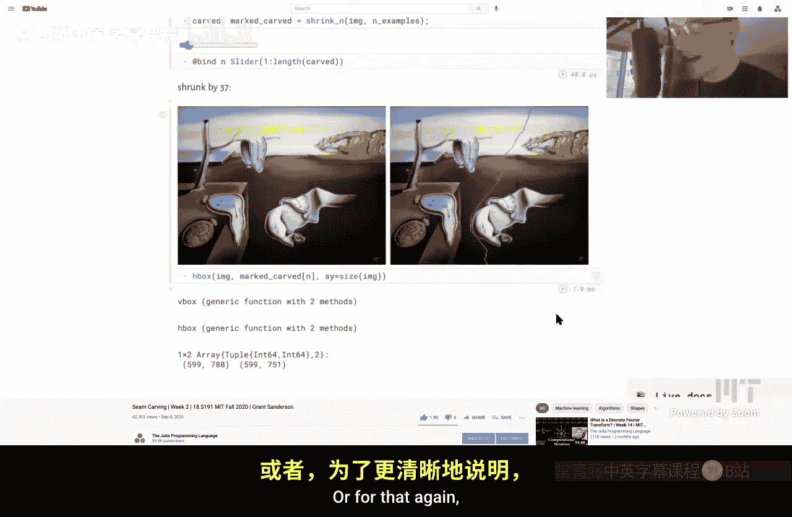

Okay so here I've got a grid and I've associated a value with each element in that grid and let's say I want to start at this one which is 0。

3 and I want to find a path to the bottom that passes through the the lowest valued pixels now what approach might be a greedy algorithm where we look at the three below it and this is going to be our notion of connectedness is that each pixel has to be connected to one of the three below it you can't jump more than that we can talk more about what might happen if you try。

But if we take a greedy approach， you would just choose the one that's the lowest value so in this case it would choose the pixel with value0 and then we look at the three below that。

 it would choose the one with 0。2 the three below that， the smallest is 0。

4 and we continue on like that and this would be sort of a greedy algorithm way of finding a seam down the image where the total value of all the pixels that it touches is pretty low and in this case if we add them all up thingss will be 1。

 But the problem with3 algorithms like this is that you can't be sure that you've actually found the best scenem from the top to。

And in fact， for this example it's not the best and we can see that with another much less efficient approach where we search through all possible paths from the top to the bottom and then we consider the sum of the values that it passes through each one and we're just going to keep track of which one is the lowest after searching through them all so here it search through them all in this small example there were around I think 200 examples that had to search through and it found one that isn't the greedy algorithm notice as it goes from the first pixel from the first row down to the next row it doesn't take the smallest choice it takes that 0。

1 because that gives it access to much lower values on the way down and here it was a total of 0。

6 in contrast to the 1。3 that we had from the other example。

But if you start to think about computational complexity on doing a tactic like this where we're searching through every possible path from the top to the bottom。

Remember， each step involves three different choices。

 so you're taking basically three to the power n where n is the number of rows。

 that's going to be on the order of the number of steps that you have to take。

 which for any reasonably sized image is going to be completely untenable。

But if we notice what's actually going on here， there's a lot of repeated computation in doing all of these。

 so for example， while searching through these paths， you know on this one it has to add up 0。

3 plus 0。0 plus 0。4 plus 0。0 on and on。😊，And then on the next one， it takes pretty much the same sum。

 but it's only changing that last part。 and then on the next step。

 it again has pretty much the same sum for the beginning with just changes at the end。

 So going through all of these and redoing that sum every single time is clearly pretty inefficient。

 There is a lot of room for improvement here。 So the actual algorithm that we're going to use which falls into a family of what we might call dynamic programming will make an effort to memorize some of the sums that it needs along the way so that it doesn't have to recompute things needlessly。

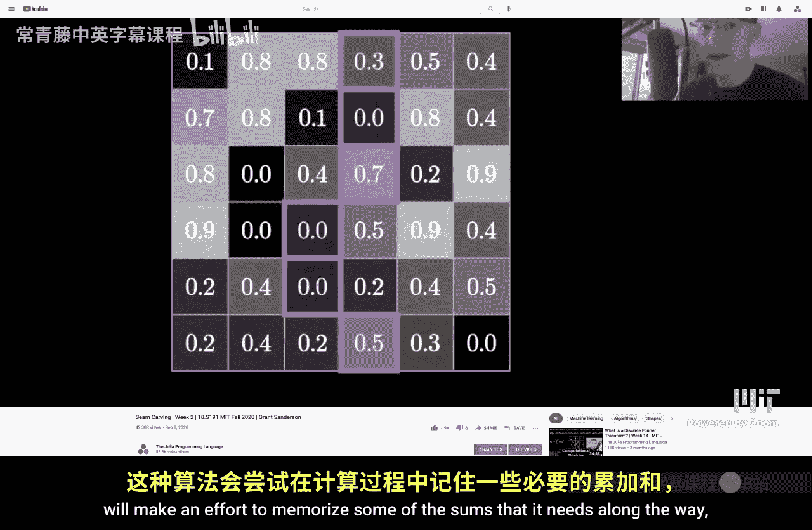

So pulling up the very last animation here before we jump back to the notebook。

 I'm going to have that grid of values on the left。 and for lack of a better term。

 some people often just call these values the energy。

 So we're trying to find a path of minimal energy and on the right the goal is going to be to populate this in a way where each value will tell us the minimum possible total energy of some path towards the bottom So for example。

 this 1。7 at the top is telling us no matter what path we choose to get towards the bottom。

 it has to have a total energy of at least 1。7 So you know maybe involves taking this 。4 plus 。

4 plus 02 on and on it's something that's relatively high whereas this little value here， that's 0。

3 tells us there's some path from this pixel towards the bottom where the some cumulative energy is 0。

3 and looking over at the corresponding point we can probably see what that path is It's the 0。

1 plus0 plus 0 plus 0 plus 0。2。Now as far as how we actually form this。

 we do it from the bottom to the top so the first step is going to be to simply copy that bottom row since once you're at the bottom that's the best that you can do whatever the energy of the pixel that you're on that's going to be the minimal total path。

And then for each pixel above it。All we do is say what's the smallest number below you and then I'm going to add the new energy of the new pixel that I'm on plus the minimal energy below it so know maybe I'll scoot it over to a more interesting example like this one where it's got three possible energies below it 02。

5 and 0。3 obviously the step that it would choose to take is to get to that 0。

2 and to get the new cumulative energy we take the energy of that corresponding pixel which is 0。

2 and that gives us that 0。4 and so that's how we fill out that row and then we do precisely the same thing for the next row so。

Let me jump to another maybe interesting this is a sufficiently interesting pixel so this one we see that it's got three choices for where to hop below it and now it's not looking at the energy of the pixels below it but it's saying once I get to that pixel below me what's going to be the sum total energy of the minimal path to the bottom from there So in this case the best option would be this 0。

2 and then we add that to the value of the pixel which is zero and we get that point2？

So we keep doing this iteratively on the way up and what it means is the number of steps required is just three times the total number of pixels in the image。

 which is dramatically better than the three to the end that we were getting by doing the exhaustive global search the inefficient way。

 but this still gives us a way of finding the globally optimum choice for a path from the top to the bottom because for example。

 let's say I'm starting from the pixel we were looking at earlier， this 0。31。

All I have to do is look at that and with each step on the way down， simply go to the lowest。

 so I go to the lowest neighbor here thats 0。3， the lowest neighbor there， that's 0。

2 and keep doing that And what I'll find is a minimal path， which you'll notice that 0。

6 should be familiar from what our globally exhaustive search doing it the inefficient way ended up finding after it looked through all of them and did all of these computations。

 it sniffed out the one that was in fact， total energy 0。6。

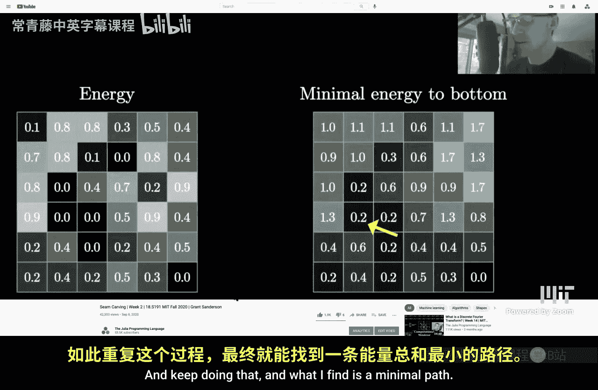

So that's what we might call the dynamic programming approach where it's kind of keeping track of values on the way。

 not having to redo computations and let's see what it looks like in the context of our notebook So what we're going to do is look at each pixel and ask hey。

 what is the path with least total energy towards the bottom and in this context what we mean by energy is the ediness of that pixel measured with the gradient like I was just describing So if you say hey。

 what's the minimal total energy for some path from this particular pixel towards the bottom and then you assign it to color this is what we get。

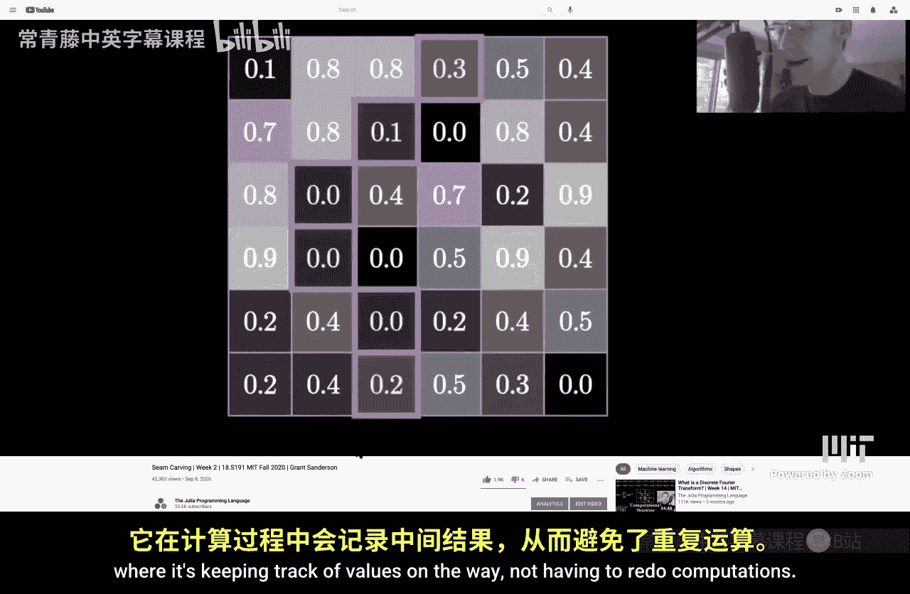

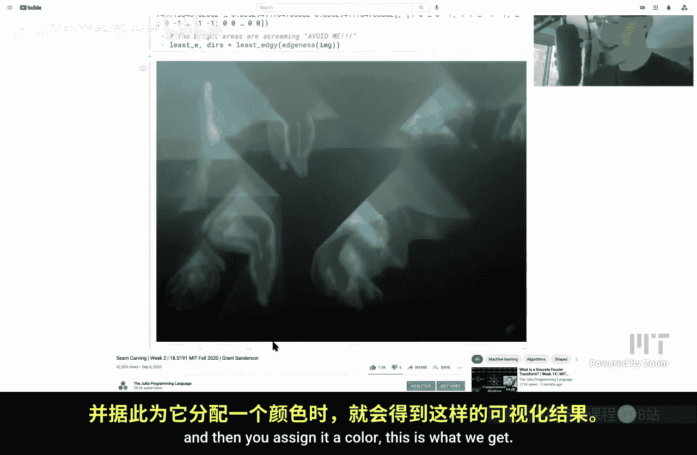

So just to be clear， this image right here is kind of the scaled up version in the context of the melting clocks image of what we were building up in a much smaller example over here from bottom to top where the pixels which are increasingly teal are the ones that don't really have a good path from the top to the bottom so to speak so over here in our notebook everything which is a really bright pixel is kind of screaming out do not touch me if you have a scene that ends up where I am right now there's going to be no way towards the bottom that doesn't involve cutting out things that we want to keep so if we you know compare this to the actual image that we have。

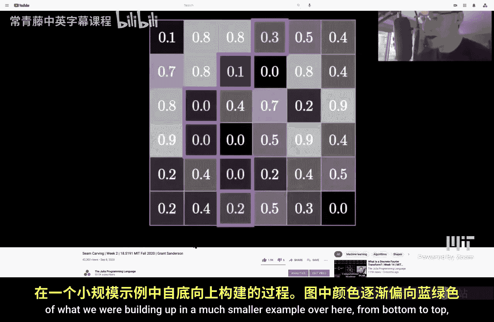

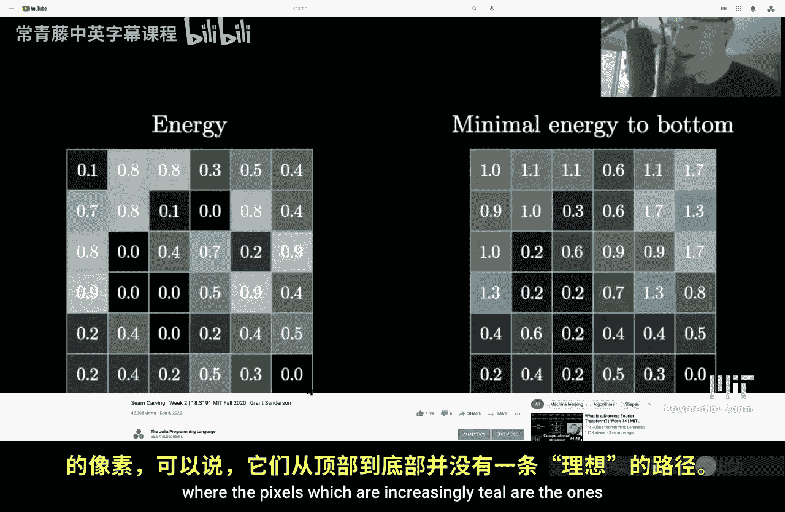

You'll notice that we get these kind of triangle shapes above all of the content so above the strange monster creature here we have these triangles which is a way of saying don't let a scene get into this point because once it gets there any path towards the bottom of the image will have to pass through something which is full of edges。

 something which has high energy， something that we don't want to get rid of you'll be going through more of the implementation details in the next lecture with a live coding session featuring the great the one and only James Schloss but for right now let's actually take a little bit of a peak behind the hood to see what's going on in generating this array of values which again is exactly what we were looking at with this animation over here where we're kind of going from the bottom to the top thinking term by term building up values based on just adding the energy of a given pixel with whatever the minimal term sitting right below it was but let's think through that in more detail。

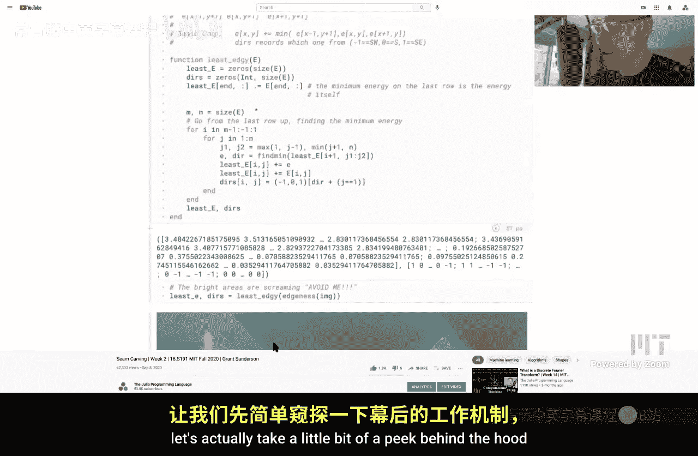

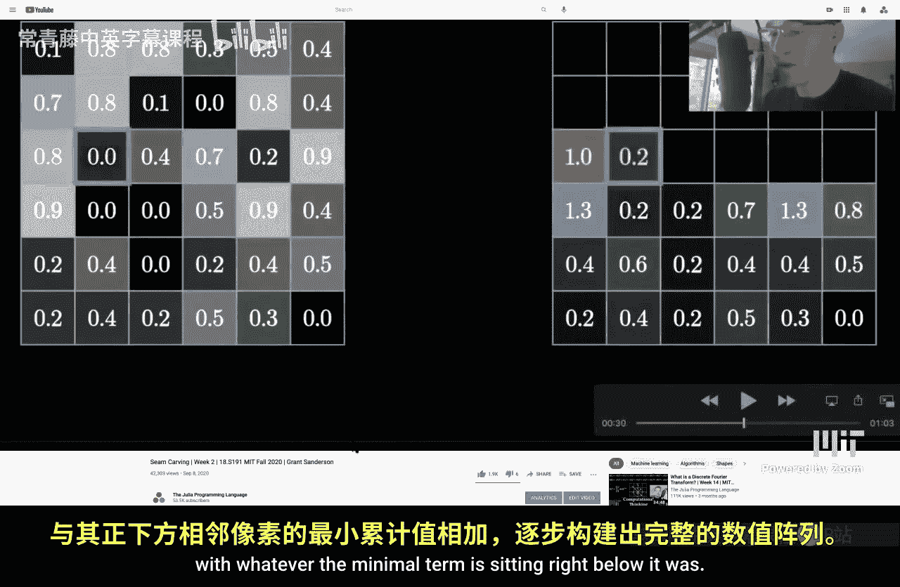

So we've got this function here， which is trying to find the least edgy path。

 you know the least edgy values for a given array of energies or ediness or whatever we want to consider E to represent here。

So we start by creating array of zeros with the same size and then we're also actually going to keep track of the directions。

 so what direction should we step from each pixel to get to that optimal path that actually makes us so that we can draw one of these seams。

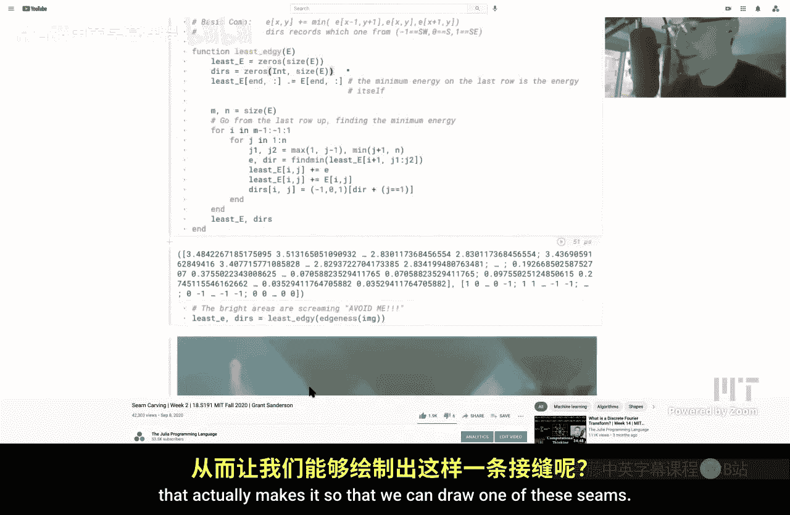

Now if you'll remember the very first step before we did any of the recursive looks was to copy whatever the bottom row in the energy matrix was over to this new one that we're generating and so that's exactly what we do here。

 we take whatever that bottom row is for E and we fill that into the least E matrix。

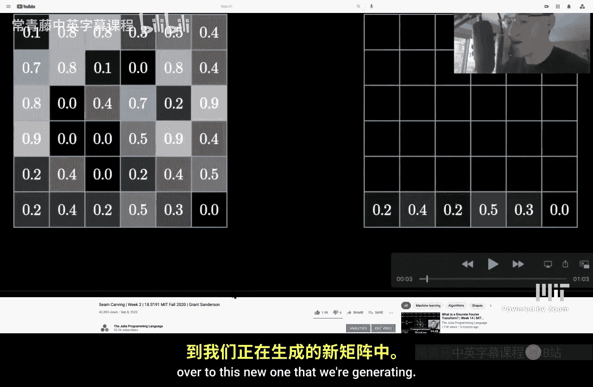

From there， we have a loop that goes from the bottom to the top。

 And then we're going to go from the left to the right。

And essentially what we're doing here is we're just finding the minimal value from the least E matrix that we've already been building。

 and then we add that together with the corresponding energy value of the original matrix。

And then what we're also doing is keeping track of the directions， so for example。

 if we were to pop over here and we imagine while we're populating this。

 you know we're populating let's say。

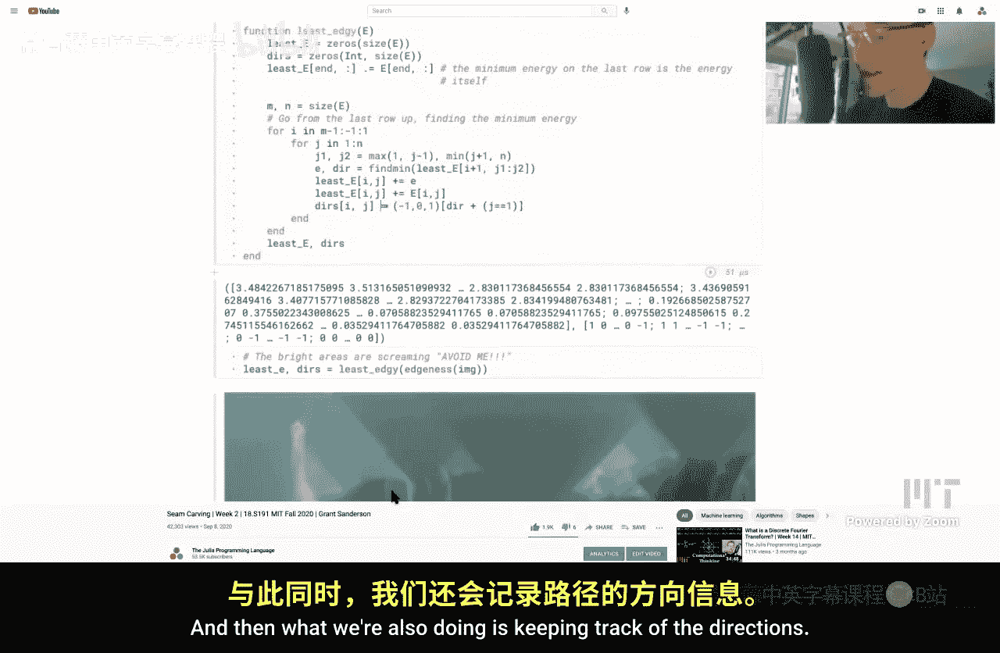

Yeah this pixel here so it looks at the three below it it see 0。

2 is the smallest one we want to remember that that's the direction it's going to walk and so here we're going to assign an index of negative 10 and1 for the three possible directions that you can step as you go down and we're filling out this matrix of directions what we're calling DRS。

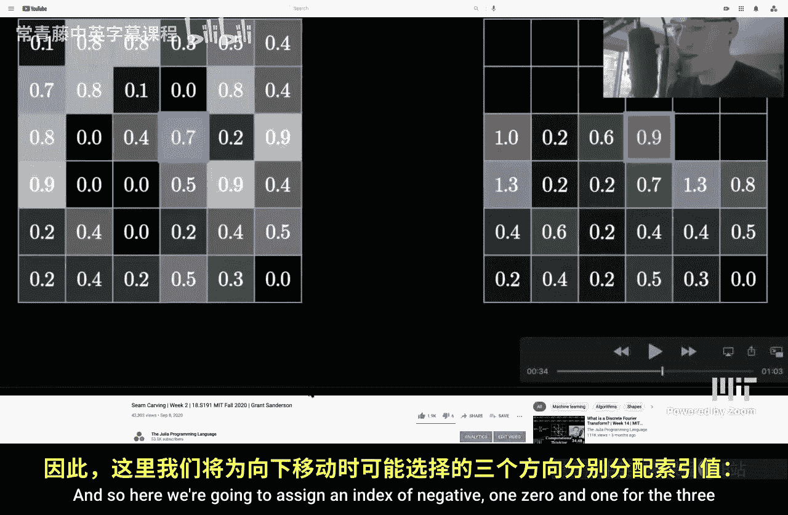

And what this line says is essentially feel like either with a negative one， a0 or a1。

 depending on what the minimal value that we found was。

So once we've built up this matrix of directions， we could actually visualize it with a bunch of little arrows if you wanted。

 So this is what comes out from a sub portion of the Salvador Dolly image where we're stepping either a little bit tone to the left a little bit down in the pure direction or down to the right。

 and that effectively is the same as having seams for our image。 So over here。

 we've got another little slider， which is basically telling us what is the best possible seam from a given pixel on the top towards the bottom。

 And it's using that directions matrix。 And you'll notice on the right。

 what is passing through are all the darkest。😊，It's the ones that。

Involve low energy so as we kind of play with the slider and walk it across。

 it's showing us the best paths from top to bottom that hit low energy pixels。

 which again means hitting ones that don't have edges。

 which is the metric that we're using for whether or not we want to include a pixel。

And so that effectively is the algorithm， once you have these seams。

 you choose the seam with the smallest possible energy and with each step you snip that out of the image and as you snip more and more of them out。

 we get a narrower and narrower image， but it's kept all of the content。

Now this works particularly well for our melting clocks image。

 but I want to show you an example where this fails。

 what are the times where cutting out the nonedgy pixels might not actually give us something that's visually what we're going for。

So I think one good example here would be looking at starry Night because just based on the style of this painting。

 all of the stuff in the background， pretty much all of the things in the image are edges。

 there's a lot of changing in color as you move a little bit from point to point and we can see this when we do our two different filters and compute our two different gradients in this case it's just tons of edges left and right and when we put them together to get our pencil sketch。

 we see that the background know the sky is full of whiteness。

 it's full of high energy things that we would potentially not want to remove。

So when we build up that matrix with our dynamic programming approach that says what should I not be touching。

 almost everything in the sky in that actual background it seems to want to avoid and the one region that it seems okay going through is what actually sits more in the foreground of the image。

 this sort of bush figure。And when we actually apply the scenem carving you can see that in action we can see how the slices that it wants to take out disproportionately include that dark foreground image simply because it has fewer edges than a lot of the things in the background So for something like this the performance it still produces something pretty but maybe it's a little bit less impressive if our goal is not to distort the objects within the image。

 but that doesn't mean this whole algorithm is out the window what it means is that the energy function that you're assigning the way that you're putting importance to each pixel hole might need to change。

 but then you can apply the same basic idea of finding。Okay， so in the interest of time， I mean。

 we're actually almost done with this video， but I think I'm just going to sort of artificially bring it to an end。

 but I will， if you do get a chance to listen to it yourself。

 it's in the notebook so you can see it there are a number of grant it's a nice job sort of picking things out from the paper to see what would happen if you tried some alternative algorithms that just pick out sort of the maximal pixel per row and you'll see that you get these sort of。

Strange effects and then there's this really fun thing that comes up in a little bit further where if you assign certain weights to。

 for example， a person and an image you can actually remove that person from the image in a way that barely looks like you've removed any of the other content from the image and last semester there was an example of somebody out there on the internet who took our code。

 our Julia code and reproduced exactly this phenomenon and kind of med it to us was pretty pretty fun to see so we do have a notebook as you know to try these things yourself and so I absolutely encourage it and I think the last kind of message I'll say is you know there are a lot of ideas here there's dynamic programming you know minimization there's gradients one thing I will mention and let me see if I could find the picture maybe it's further up。

I in terms of computational thinking， I mean a typical multivariate calculus class where you learn words like gradient would never actually show pictures like this。

 but to me this is like the most terrific way to learn about gradients I mean here you could see that here this is the data picture again and the horizontal gradient will picks out the vertical edges as you could see so well right and the vertical gradient picks out the horizontal edges right and you sort of put the both together and you get the biggest gradient and boy isn't that a really cool way to think about gradients as compared to you know what might be done in certain math classes your livess out of a three- dimensional surface。

😊，I don't know， I hear people say that humans are not good at three dimensions。No。

 but now we've seen it in two dimensions and it might， you know， give a useful point of view to see。

 I feel I feel like I should get those like red green glasses， you know。

 those polarizing glasses and look at the two pictures at once。Yeah。But yeah。

 that could be pretty fun。Having said that， I think now what I'll do is thank the viewers out there in internet land and we could stick around a little while for the MIT folks if people wish to continue to stick around。

 but let me can I do this or Dave， I think again once you。

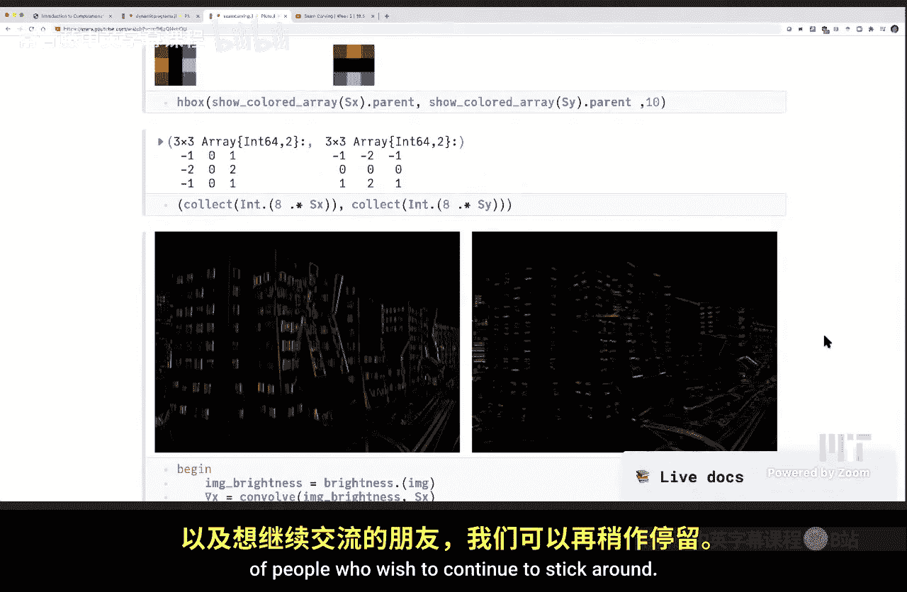