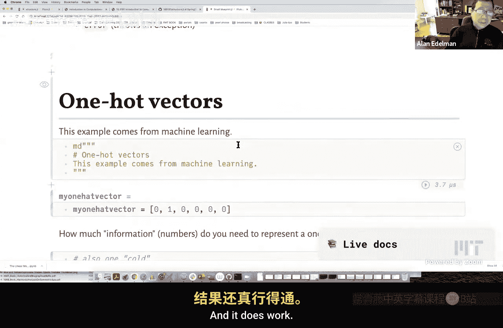
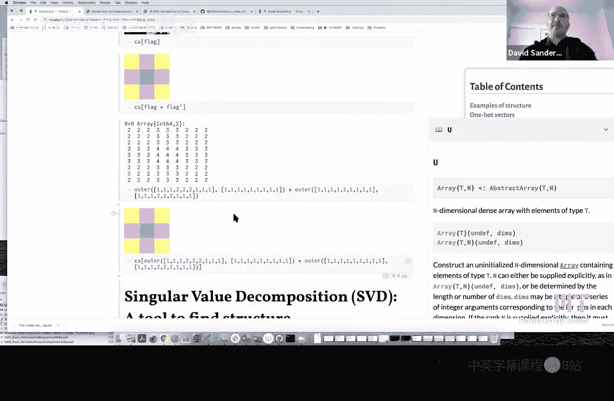
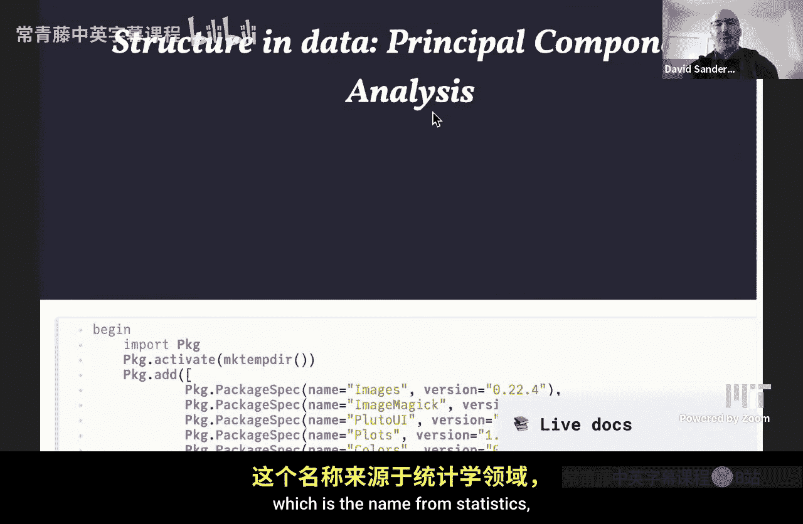
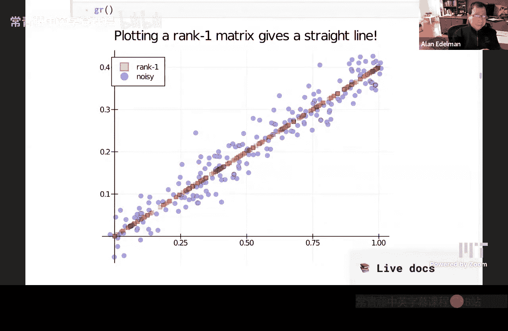

# 麻省理工学院【中英⚡计算思维 ｜18.S191⧸6.S083 Spring 2021, Computational Thinking】 p07 P7 Structure ｜ MIT Computational Thinking Spring 2021 ｜ Lecture 7 -BV18EqQBQEF3_p7-

Let me just start with this。Welcome everybody out in Internet Land and anybody from MIT as well。

 and let me mention that this Saturday night or Sunday morning， I guess officially Sunday morning。

 much of the United States is going to be changing the clocks。

And so if you're somewhere that isn't changing the clocks。

 you might want to keep that in mind if you're looking for us Monday。

 1 pm Eastern it might will be an hour， I never remember whether it's earlier or later for you than it usually is I know the rest of I know most of Europe is going to be doing it two weeks from now and so I guess it will be an hour earlier for those of you in Europe for example。

Okay next thing is we seem to have had a little bit of a problem with the website so I was going to just try quickly to see what I think would work。

 but Dave tells me won't work but I want to see it for myself so I'm going to go to Pluto and i've gotten into the habit of putting URLs right here so I。

I thought that this would work， but David tells me， no， and David is usually right。

 but I'm going to try it anyway and see if it will work。And it does work， okay， this time。

Dave， I guess this time it worked Okay I'm glad to know that right so the。

The the actual URL， which let's see what is the。Could we put it in a discord or something so that people can find it？

How are you you already did even better Okay， so this will be the first notebook for today。

 the structures do JL and what I'm going to be doing is talking about。

A real computational thinking idea which is taking advantage of structure and structure can be many things and I'll give you a few examples and then depending on how the time goes。

 we're also going to talk about a particular kind of structure which is principal components analysis and that's this over here so this is this particular notebook which I gather Dave has already put into discord so you can find that as well So let me start with talking about structure and there is a new feature that is going to be in the notebooks and we're going to work backwards and get them in the old notebooks as well。

 which is what are the Julia what are the Julia commands structures that。

Are going to appear in this notebook。 And so I made a list here。

 You could see four items basically struck down， you know， Dggagonling spaa。

 I'll count as one item and error。 So we're gonna make an effort to put this at the beginning of every notebook。

 So you could figure out what little bits of Julia。

 you'll be learning in this in this particular lecture at the same time。 So thanks， Charles。

 for that nice idea。 Okay， so structure， examples of structure。 So let's see。

 I see if this is too big， the table of contents。Let's say， is this too small for you， Dave。

 Should I make it bigger， you always like me to zoom in。

But I also like the table of concepts on the side。Yes， it's okay。Al ready。😊，Okay， so structure。

 so the best way to talk about structure is to give some examples。

 but let me say that even if if you were around for the last lecture of this semester。

 we talked about dynamic programming and you might remember that the structure that we took advantage of was the common subproble right so that there were these paths that would go left down and right or I call them southwest。

 south and southeast，And these were doctors sort of random paths。

 but these were paths that had a structure to them that is actually a common。

 They had a common substructure。 So that's perhaps one example。

 But let me kind of go a little slower and talk about other problems that have structure。

 So here's a really simple structure。And this is the so-called one hot vector it's a name that comes from machine learning。

 It's a very simple idea。 I really like the name one hot vector Heres here's an example of a one hot vector okay this is a vector that's made up of zeros and ones but only one of the elements is hot right the rest are cold okay so what that means is exactly one element is one and the rest are all zero okay and so that is a one hot vector in linear algebra it might be called a column of the identity or a coordinate basis vector but none of those words seem as good to me as one hot vector I really like that name so I hope you like it too and why Allen doesn't say one hat vector my one hat vector。

😊，Yours says one hat。Yours says one hat。Well the name of the variable says my variable one。

 I don't know。But we could change it。Well， it's being defined again below， so be careful。

I don't know。Is it been my one hot vectors over here？

Yeah oh I wonder if that happened because we didn't want to clash yeah。

 that's what I'm wondering that's probably what happens I don't remember it him I wrote it last that's a funny way to do it。

 though。つって。呵。😊，I don't remember my own sense of humor if it was even me。Okay。

 that' because that's the American pronunciation。One heart vector。There you go。

 So I would like to ask a question which is for everybody to think about is how much information you need。

To。Represent this vector， obviously it's made up of six elements。

But do you really need six numbers to represent this vector。 So is it， you know， if n is6。

 do you need n do you need one， do you need two， I mean， really， how much。

 what is the information content， Okay， and I'm sure you can all realize that two numbers ought to be enough。

 right， there the the size 6。And the position of the one，2 kind of tells you the whole story， really。

 right？ So it seems sort of like， it seems silly to write out a vectors 0，1，0，0，0。

0 in the context of one half vectors because two numbers will do the trick。By the way。

 just to mention that there's also the word one cold。and a one cold vector is again。

 a vector of zeros and ones， but only one of the elements is cold that is zero。

 but we're going to concentrate on one hot vectors。

 and I'm going to show you how you create a structure in Julia that takes advantage of the structure in you know coincidentally enough to create something in Julia that takes advantage of structure。

 it's called a strut， right this is a new type in Julia that you get to create yourself。

And so this part you could ignore right now if you find it a little bit confusing。

 but basically we're going to say that a one hot， I'm going to create a one hot。

And it's going to be made up of two things。 It's going to be made up of of an integer and and an integer K。

 And that's it。 So a one hot is going to be two integers。 it's not going to be。

 there's there's nothing more to one hot， really， it's just these two integers。

 And just to tell you what this is。 in case you're curious。

 we're saying that this will be a subtype of an abstract vector of ints。

 And so that it behaves in many ways， like a vector of integers。

 even though it's not a vector of integers。 It's a one hot。Okay。

 but it'll be a subtype that's this funny punctuation is subtype。

Of an abstract vector made out of in。Okay， and。A couple of quick things that are actually useful to have if you're going to create an abstract vector。

 and it's going to be handy here is to define the size of we want to see。

 we want to pretend this is a vector， even though it's not exactly a vector。

 So what could you do with the vector， Well， you can get its size。

 So this says that if you ask for the， the size of。Of a one h。You should give me back the N， right。

 So the N is actually the size。 This this is just the way here。

 Maybe I'll go over here and put this in。 If I were to do the size of my one hat vector。You see。

 I just got a6， right And so we want this to behave in the same way。

 even though we're not storing all those zeros and ones。 Another thing we want to do is get index。

 right， So we want to do things like we want to do the analogy of my one hat， by the way。

 I just hit tab to make that faster， right， if I type my one of two， I'll get the one。

 but if I do any other thing， I'll get a0， right， if I， if I call it with any other index， I get a0。

So a valid index。 I'll get a0。 So I want that behavior， too。 And so the command there is get index。

 Maybe I should have added size and get index to things that we are showing up in Julia today。

 And we need a one hot vector and an I。 And basically， what we're going to check is whether the。

What we're checking is whether the number k in the one hot vector is equal to I right and we'll turn it into an int。

 so this is a truer or a false， which becomes a zero or a1 as it's turned into an int。Okay。

 and so to actually pull this off。I could create a one hot vector by just typing1 hot of 6，2。

 And you see， it actually gives you the illusion of a vector， right， I mean。

 it even looks to Julia as if it's a vector， right， but。😊，嗯。Yeah， let's see。 My one hot vector。right。

 and if I actually index it， for example， if I index it with two， I get the one。

 but if I index it with four， I get the zero， this completely has the full illusion of being a vector of zeros and ones。

 and yet it actually takes advantage of the structure and one way you could actually see that is I'm going to mention the the dump and with a small D and a capital D in capital D actually prints in Pluto without without any fuss。

 the small D you have to do this silly Pluto thing with terminal。

 but I actually think it looks very nice it kind of highlights it sort of like to me it looks like a blackboard。

 So I think I actually kind of like the with terminal just to highlight it but in any event dump what dump does is it kind of tells you everything that's going inside that object So if I dump my one hot vector you'll see that I'm getting two integers。

 the six and the two so you can use the capital D if you like and it'll just print it sort of the boring。

Or you can use the little D and if you just do the little D， I'll show you。

 Pluto kind of ignores it a regular Julia repple wouldn't。But if you add this with terminal。Do thing。

 then you get this sort of nice blackboardy thick。Okay， so there you have it。

 my one hot vector is storing the two pieces of information that are critical to defining without wasting any space at all right。

 And so that's structure。 that's taking advantage of structure Okay， and I don't know why。

 but I like to do visuals。 So here's visualizing a one hot vector and is the。N is the size。

 So here I'm just making N B 13 here。 you could actually see it。

 and then K specifies where the one is。 And so here's just a little visual。

 I don't know if this adds much to the story， but。It's fun to look at。So。

The heres some1 have vectors okay， but let me move on now just to comment that basically what we're saying is that this one hot object behaves as if it were a vector。

It has the same behavior you could not actually tell when you're indexing into it or when you're doing length of it。

 you can't actually tell how it's being stored internally it has exactly the same behavior to the user and we already saw another example of that which was range objects also behave like that you can index into ranges and you can take the length of range is and you don't know if how many pieces of information they stored。

Oh， let's do a dump， let's go dump of one colon seven， though I we may have done this before。

 but let's just do it again a Yes， we do or I have to do that with terminal。

So there you see this also has two numbers that start and stop。Right if on the other hand。

 we took a range that was。You know， like even numbers from two to 17 or something。

Then there's three numbers that store this， the two， the two。

 and it's clever enough to know that if you're starting at an even。

 you're actually literally stopping at a 16。so诶。That's actually what's stored inside the computer is basically just these three integers for array。

Okay， by the way， something that came up the other day and you'll see it in your MIT X homework also inspired by Charles is if you。

If you actually dump this thing， you'll see that it is a vector that actually contains the range right and so there's a difference and we'll explore that in the MIT exome。

 there's a difference between this， which is just a range and this which is here let's make a vector that has a couple of ranges in it。

So this is a vector of size2， and you could see that each element is itself a range。Okay。Allright。

So that's enough of that stuff。 Let's do another example of structure that。

Let's take a diagonal matrix。Okay， so here is a diagonal matrix that I don't know if people see matrices in high school anymore。

 as you might see in， let's just say， I think it's better say an elementary linear algebra class。

I think that would be a better way to say it。 So here's a diagonal matrix。

 of it's a diagonal matrix is one that。Only has non zeros potentially off on the diagonal， right。

 all the off diagonal elements。Are zero。 So this is a diagonal matrix。

 But for a three by three array， I think you could see that I only needed three numbers to represent it right。

 for an n by n matrix， I would only need n numbers to represent a diagonal matrix。

 And so I don't know if your linear algebra class that make you write out all the zeros or put in the dots。

 but it is silly to store the on a computer， especially if the matrix is large， guess if it's small。

 it doesn't really matter。 but。Ju has a。a type called a diagonal。

 and it even prints them out kind of pretty， you can see there's dots where the zeros would be， okay。

And let's do the dump right now of the I can't know if I did it later， but let's do it right here。

 you could see that the numbers that are stored are the five。

 the6 and the minus10 right there's no there's no zero stored that that's to be contrast。

 if you will with the if I dump the density， the one that I first defined。

And as you probably would expect， this one is storing all of these numbers。

 the zeros are stored so again。Structure， the structure of this diagonal matrix is just to have these numbers 5。

6 and minus-10， Okay， and so。As I was just showing before。

 you could could you could take a full matrix or sometimes called a dense matrix。

 sort of a matrix in regular format。And you can。Cast it to being a diagonal using diagonal。

 or you could actually create it。By just simply saying what are the diagonal entries， okay。

 I put it over here as well。呃So。Yeah， I guess this is sort of always a good idea。

 It's kind of an obvious idea， but。Well， for any kind of data structure at all。

 any kind of algorithm， we're always trying to look for structure where it exists。

So let me now introduce the idea of sparse matrices， which is kind of what we've been doing already。

 but there's sort of a more general concept a lot of people would not call a diagonal matrix a sparse matrix though technically it fits in。

 but you know maybe a lot of people wouldn't call a square a rectangle though technically a square is a rectangle I mean if something's a square you should call it a square because that gives more information so what's a sparse matrix。

So， so a sparse matrix is。Is a different， yeah， as sparse matrix。As far as matrix is。

 let's give the official definition is a matrix that has many zeros worth storing。

In a sparse structure。 And I'm going to tell you what that means in a minute。Okay， that's。

 that's sort of what a sparse matrix is。 Yeah What did I do， Do I have too many quotes here。You know。

 let's put it。 Could do this。O。All right， so as part and so here's a very simple example。

 here's a matrix that obviously has three non zeros。Okay the 12。

 the9 and the four and here's a sparse representation of the same matrix。 and for the human eye。

 this is actually not how it's stored but for the human I you could say。

 well the IJ you know the row column index for the9 is31 and sorry the third one first column is the 12。

 the first run third column is the9 and the bottom right。

 the three3 entry is a4 right and so and all the other entries are presumed to be zero and if you use the sparse arrays。

 Julia package you can go and see what's inside one of these matrices and it's a little bit tricky and I wasn't really planning to go into this but it's not that bad So I think I will show it to you to show to see how a general dense sorry a general sparse matrix is stored and maybe this is why I don't think of diagonal matrices a sparse matrices because they have a special storage。

Right， so so they they're somehow， that's why I don't like to think of them as a general sparse matrix。

 but if we dump the。If we dump the sparse matrix。What we see is besides the sizes， you the m by n。

 the rows and columns being three by3， there are three other vectors stored on the inside a column point or a row value and the non-zero values and it's kind of better to go from bottom to top which are done over here So the non-zero values are easy to understand they're just the 12 to9 and the4 those are the non-zero values。

 that's the easiest。 This is how it's stored internally。

 it's called CSc or compressed sparse column format。

 There are other formats this one is become the most common for certain applications because it kind of generally is good for matrix vector products and column slicing and so forth but yeah so it's made up of 1294 the non-zero elements and the row values are just the indices the i indices 313 the same 313 that you'll see over here its the first column right so the 12 is in the third row the 9 is in the first。

Row and the four is in the third row， but instead of storing J， we're storing something a little bit。

Different， we're storing the column pointer thing is。

 is always of length one more than the number than the N Z valve。 So if this is 3。

 this is of length 4。 And what it's doing is it's a pointer into N Z Val。

 which tells you where the first non zero is in that column。

 And that might even be in the next column。 So， for example， because。Yeah， I should。

 let me put an eighth here and then I'll change it back。So you can actually follow this along Yeah。

 so oh I want to be able to see this at the same time can I do that I'm to make it one smaller。

 but you'll be able to still see it。 Okay， so what this says is you'll notice that the the I let's put a few more entries in maybe here。

Okay， so the one points to the first entry of this vector and it says 12 and the 12 is the first non zero in this column。

2 points to the second entry， and 8 is the first non0 of this column。 Okay。

4 says we're going to look at this， the 9。And the9 is the first entry in the third column。

And six actually doesn't point anywhere at all， right， It kind of falls off the end。

 and it tells you that it's the way of indicating there's no further columns。Okay。

 that's kind of the way it's done。So I guess you could have just stopped with n。

 but this is the way it's done' it's pointing to the one column afterwards Okay。

 now the fun happens if if I zero out the second column， which is how we started out。

If I zero out the second column， then something interesting happens， it says， oh。

 the first nonzero is a9 for the second column。 It's the second entry and by the way。

 for the third column as well。 I wasn't going go too far into this it is a little bit tricky but this is how sparse matrices are stored So the main point here is we store the values。

 we store the I and we do something a little bit tricky that's somehow equivalent to getting the j but I'd like to show you an example where this may not be a particularly good storage the here I'm going to create a sparse matrix that is a million by a million。

 it actually is if you thought of it as a matrix it has a million rows in a million columns and the way I did that was I just created an entry where the million by million the I equals a million j equals a million entry is the number9 So that automatically creates a million by million matrix and even though we only have three non0。

And they're in three rows。This thing here actually has to create。An entry for each and every column。

So it's actually one more than the， I mean， it's not one more than NZ Val because it has an entry for each column。

It's actually one more than the number of columns， so there's actually a million in one entry stored here。

 which seems crazy， but that's exactly what it is。Okay， enough with sparse matrices。

 Let's go on to a different kind of structure。 So up until now， in this notebook。

 I was kind of thinking about。S structures where you can somehow save。

You don't have to store everything because like the zeros were implicit。

 Okay now I would like to talk about a different kind of structure that that's not a storage structure。

 It's the kind of structure that comes from randomness。 And we're right now for this course。

 we're in the transition from module 1 to module2 wherere in module2。

 we're going to be talking about statistics and probability。

 And so this is kind of a perfect segue between the two modules So let's talk about how much structure there is in a random vector right so here I'm going to create this is Julia's command to create。

 and again， maybe I should add this， but I think we've seen it before。

 I'm going to create a vector with 1 million entries。And all the digits are from one to 9。 Okay。

 so here's a bit of that vector V。 There's a more if。Here's if。

Kind of one way of displaying it if you， if you want to see it， But a million entries， there's。

 you know， the top 20 in the bottom 10。So。Yeah， there's a million numbers and the first thing you might say when I ask how much structure is there in a random vector。

 you might say there's no structure， it's a random vector I mean it's random。

 it has no structure I actually like to say that randomness is itself a structure I don't tend to think of random objects as nothing special objects or objects with no structure they have a lot of structure and so much of science and algorithms is based on taking advantage of the structure or randomness the word random in common English almost suggests that that it's the opposite of structure but it's just not true so for example we could take the mean and the standard deviation and some would say that there's a structure right there for example I took the mean of this vector and I' want to compare it with the number five and know of four digits it's's just about the number five you could take the standard deviation。

I happen to know that it's the square root of 23s and I could calculate you could see to a couple of digits it's right there。

 so this random object I could get a new one here， let's get another one， I could do it many times。

There's something structured about this thing， right， to three or four digits。

 the main and the standard deviation are not changing。Right so there's some structure right there。

I mean， sometimes statisticians and maybe professors who've just graded exams would say that the mean and the variance is the structure and the rest is not even relevant。

 so sometimes people will sort of write down or note the mean in the standard deviation and in some instances just throw out the rest because that's perhaps all you really want to know so in terms you might want to know how many fives there are in the list。

Well， then I would have to not throw out my data。Right。

 but you could reduce the data by just counting the number ones the number of two is the number of threes。

 et cetera。Yeah， you don't want me to do this do you， here's how many five were in this data set。

So but I could also， how do I do this can I go， I'd have to have statistics to go history。

You you probably won box， you probably don't want how would I do this？

This will be more fine for I equals zero through nine as long as your the city goes from one to nine。

I'm going from one oh and that's fine it'll count as zero two oh that's why I say that's why I got like one ninth of a million aha I was wondering why I didn'm getting like 10。

000 or 100，000 okay， some of the is equal to I。Okay， so here are the actual numbers。有有。

So I remember when I was a kid that used to publish like the powerball numbers in the newspaper。

 whatever the lottery was， and like people would you know oh， this one seems to have more。

 so we should go for that or something。Or this one the or this one is this one may be the biggest one nope I can't spot it quickly i'm sorry this one seems to be the biggest one yeah so maybe the number four comes up a little more often so maybe you should choose the number four of course that's ridiculous。

对呃。So but yes， that this might be something you might store away， for example。

 and then throw away the rest of the data。Okay， so for those of you who don't know what the mean is。

 but I bet you everybody does， that's just the sum of the over the length of the and the standard deviation is maybe a little bit less familiar。

 what you do is you take your vector than you demean it。

Right and you subtract the mean from the vector and then you take the sum of the squares which kind of gives you sort of a distance from the mean squared thing and then there's always that mysterious and then you don't take the average by length but you subtract one and people owe that to the degrees of freedom I always hated that explanation but that is what people do and that is the variance and then to get the standard deviation you take the square roots and by the way that's what really it does when you take SeDV you get the exact same number it it's exactly this formula。

To get this standard deviation leadershipship。Okay， so yeah。

 sometimes the summary statistics are all you want， but sometimes not。All right。

 let me go to another kind of structure， multiplication tables。

Okay so I'm going to an outer product function of two vectors and all I'm doing is I'm taking all the possible ways of multiplying an element of V with an element of W okay。

 for example， if I'm taking outer of one through 10 one through 10。

 I would get what would be an ordinary multiplication table and I think Ive。

Kind of added it to a slider， which is more fun， so here's the 10 by 10 multiplication table。

Last time when I did this last semester， David told me that in England。

 everybody learns the 12 by 12 multiplication table。Right so but nonetheless。

 here's the multiplication table， you can let us know what you I in my school it was 10 by 10。

 I cant go to it as good as school。谢け个对。You know， you rapidly forget it soon after after your learn。

 oh， I know that I my on multiplication table， it just wasn't going in my school。

I've never forgotten this。然。I forget what happened yesterday， but my 12 by12 multiplication table。

 I got done Pat。That's a problem。So but just to look a few more outer products instead of going through one through 10。

 for example， you can take 246 and 1000，000 and you can see all the possible ways of multiplying a number here with a number here。

 okay and so this is a multiplication table is a kind of structure but it's not sparse。

 I mean there are no zeros， it's not a diagonal matrix。But。

It's clear that you don't need n squared numbers to represent the object right it's got structure but it's not a sparse structure。

 the interesting thing is that in many many applications of matrices there is structure but it's not sparse structure that turns out to be truly important it's sometimes a slightly more hidden structure but here you could see that the structure is that of a multiplication table。

😡，Sometimes it's not obvious that it is a multiplication table， for example。

 here is a bunch of numbers made up randomly and。I don't know， maybe you're better than me。

 but I look at this three by four matrix and I'm not sure I would recognize that it is a multiplication table that comes from every product of one vector and another I。

Maybe you could look at the magnitudes and start to guess。

 but it's not so easy just not by the human I here's a sort of picture of a 10 by 10 version and maybe it's a little bit more obvious with the picture because multiplication tables sometimes tend to have this sort of stripe structure so you might guess that it's a multiplication table。

But what we're going to do is actually factor out the multiplication table if it's there and so here's a little code that will factor it out and more or less doing the obvious。

 which is a multiplication table can be obtained by taking the first row and the first column and then kind of dealing with the11 elements and so。

So here I'm extracting the first row here I'm extracting the first column and I'm dividing the first row by the first element as long as I can and then I'm just and now I want to see is it really a multiplication table and so if the outer VW is about the same thing I'll say it did otherwise I'm going to call an error and so here's where exceptions are thrown in Julia this is a way to kind of talk about exceptions if this doesn't work out we'll say the input is not a multiplication table okay and so you could see I can factor for example1。

2，3 times222 but when I do that I may not get my inputs back right and equally valid V and w would be246 and 111 right because every time I。

But I've just I've doubled this one and I have this one which amounts to the same thing right there's this entire there's always sort of like an infinite number of things that could have worked out and it doesn't really matter which one but look if I try to factor a random two by two matrix the error is working like I want now I know when you see this black and these lines one through three you think oh my God I have a above but no I actually cause the that and this was deliberate right I am calling it with a random matrix and it is not a multiplication table right most matrices are not are not multiplication tables。

Okay。However。Yeah， so the question is can we find the structure can we find multiplication tables is there a way to do it and the truth is we could do even better than that if we have something that's for example the sum of two multiplication tables there is a technique for finding。

Both of them actually to find two outer products and the magic thing that does that is the very famous similar value decomposition which you may see in another course or you know you you may see it in an upcoming course you might have seen it before but it is probably the single most used linear algebra thing it's one of the most important certainly being used in statistics these days there are some people who would say that starting linear algebra classes with gaus elimination is no longer the right thing to do because the SVD is the big thing these days so the singular value decomposition actually finds the structure so before I even tell you what it is let's just do it and just see what happens so here I'm going to take this matrix。

Okay， and I'm going to， you know when。There are a lot of times I actually run a function before I even know what the name means。

 I'm doing that with you， I mean maybe that's a kind of computational thinking which is just play with something right so I'm going to play with the SVD。

😡，And I guess you could see how it's called， you could see that it has three output arguments z thing is in front of me。

 I can't quite see this but。You could see an example somewhere here。Here you know。

 US comma B is usually three outputs to the SvD so you can see that over there。

So going I'm going to use a common notation which is U stigma and V okay and i'm going to check that I found two outer products。

 so here look outer of this plus outer of this。And this should recover my original matrix。Which is a。

 you see， so this this magic thing is actually extracting the multiplication tables that are sitting inside of a matrix。

Okay。And the cool thing is is it could be done approximately as well。

 I'm going skip this just for a moment because I think Dave's planning to talk about flags。

 but let me show you what happens you know you know mean by now I like to take SDs I like whatever you can do with matrices I like to do it with images so I think it would be fun to do this with an image so here's an image of a tree and what I'm going to do first of all is separate out the red green and blue components。

Okay and then what I'm going to do is separately add the multiplication tables and so when I go to the end I've got sort of the full tree when I do one I've got the I've got the one multiplication table in linear algebraeral language it's called the rank one matrix right so the red and the green and the blue or separately multiplication tables and it comes out plaid like you saw before it could have the rank two tree and this looks sort of minecraft like right I mean everything's sort of rectangular I guess。

So if you've ever played Minecraft， I think this is what my kids play all the time。

 I see on their screens， this is what it looks like。

when you get to the sum of three multiplication tables， it's officially called rank three。

 you start to get a couple of more boxes and then as you start adding a rank you can see that we start to get a better and better version with the tree with some artifacts。

Whi start to disappear as you add more and more rec。Okay。

 so this is sort of meant to be the quick introduction to the SVD。

 there's still much more that can be said about it。

But right right now for the purposes of this lecture。

 I want you to understand that the singular value de competition is a way of breaking up a matrix into a sum of multiplication tables and by a multiplication table I just mean outer products right and the SVD does it in such a way that if you。

If you only have rank one you've got the best possible rank way of doing it if you if you have rank four it's the sum of the best possible by some sense of multiplication tables so I'd like to leave it that at leave it at that for now like I said there's so much more but I think you just you can just talk about flags something you want going talk about flags all right I will do the flags then right let's go back up to the flags and talk about flags。

So where we left the story is here， so let's see where was I？Or I can， whatever。う。Yeah。

 I think I think yeah， why don't you go ahead， Dave。

 I'm going to turn this over to you and for those of you who joined late。

 let me again remind you that if you're watching us，On Monday。

 you might want to keep track depending on where you are that we are going to be pushing the clock one hour forward in most of the United States on Sunday morning。

But Europe is doing it two weeks later and other places may not do it at all， most of Europe。

 not all of Europe。Okay， Dave， if you want to take over， take over the screen。Yeah。嗯。

诶，系错好。

ok。Can you hear my screen？We do。Hi everybody so yeah we're carrying on the same kind of topic as Alan said we're transitioning into the second module of the course on data and probability and statistics and so。

Let's look at this very nice subject called Pri component analysis。

 which is the name from statistics， which is basically the same as the SVD that Alan was just talking about in linear algebra。

So what we want to do is understand data if we've given some data。

 you know we've been thinking of images as our input data。

 but of course theres lots of other kinds of data in the world that are often in just sort a big matrices full of numbers and we want to somehow extract information from those matrices and that's the goal of this method of principal component analysis that we'll talk about in detail next time but let's start off by thinking again about these multiplication tables that we've just been looking at or outer products so here's this table of。

Again of just at the same alga product that Alan was just talking about。

 so here's a multiplication table， it doest not have to be square you could multiply the numbers from one to 10 by the numbers from one to 12 and then we get this dense matrix but it has a lot of structure in the sense that the whole matrix can be reproduced from just these two vectors so instead of 120 numbers I just need you know 10 numbers plus 12 numbers and the information。

 the extra information that。To you know that this matrix is created by doing this particular operation。

 so if I have those pieces of information， then I can reconstruct the whole matrix and I don't have to store the actual matrix。

😊，So you could just store those two vectors and do something very analogous to what Alan did with one hot vector and make a new type where you defined get index to you know to extract the six。

 nine component by it would actually in the moment multiply those numbers together and return that value so exercise the reader。

 implement that you know outer product or what or multiplication table type that does exactly that。

So the point is that each column， if we think about what is the structure of this。

 what is this matrix to look like， is it what is a an outer product or a multiplication table。

 it means that each column is just a multiple of any of the other columns so in this case you know this eight column is a multiple of this six column which multiple is it。

H divided by six times this column， so that's one point。1。26 or something times this column。

And each column is actually a multiple of any other column。

 and each row is a multiple of any other row。😊，so it has this sort of very nice structure。

 but as Alan said， it's not obvious just by staring at the table that that's the case and so we want a way to actually realize that that's the case。

And flags， as in flags of countries， provide a pretty visual example of this。😊。

So here's a flag that you know corresponds not with those colors but that kind of shape corresponds to various different countries。

 flags and not regular with flags so I don't actually remember which countries go which way round but you know you could either have these horizontal stripes or vertical stripes and if you think of those as numbers like this matrix this table of data here you see that oh yeah that is a rank one matrix that's what we're going to call matrices which are just out of products。

Which are given by exactly an alpha product， right。

 So what is this Al product is is just given by the vector 1。1 and 2。0。😊。

On the in the vertical direction and then in the horizontal direction in this particular case I'm just multiplying you know each column is exactly the same and so I get exactly just repeating the same pattern in each column and so I get these three colored stripes that are exactly the same all the way along but a more general rank one matrix or outer product would have different values right so I'm actually multiply I can multiply。

😊，As I said， each column by different amounts。And then if I draw that I get a different kind of flag that I don't think corresponds to any country。

 which is particular this this kind of thing so a more general outer product looks like this and you have to get this blocky structure that Alan was talking about so let's just generate some bigger matrices with this outer product or rank one shape or structure and look at what they look like so they look something like this。

So you see that we get this kind of nice， you know。

 you could probably sell this in a modern art gallery but it has this this this very particular structure with these columns of color and then there's rows of color and this sort of checkerboard shape。

And that's what a rank one matrix looks like so you know if you if someone gives you a picture like that you could sort of try and guess oh yes。

 that is a rank one matrix in other words， I could write it just using one single column and one single row and multiplying them in this way。

But now what about what if we start doing this reconstruction that Alan just mentioned and we start and we now look at a rank two matrix。

 so that means we take one of these checkerboards， one of these algebra products and we add another one to it and that looks like this。

So you can see that。Well， we're starting to lose some of the checkerboard structure。

 but it's still sort of there right So if you sort of see checkerboard structure。

 you might imagine that it's。Just a sum of two outer products， or maybe three。And you know。

 if I run this cell again， we can see in a different version of that picture and each time we run it we'll just get different pictures。

 the colors correspond to the values， you know， I guess yellow and red are high values so close to one and blue is close to zero。

😊，And。Yeah。And that also depends。On how， of course， on how much randomness you have。

So it starts to look less regular， but it still sort of looks has basically the same structure and so you could visually guess。

 oh you know maybe maybe I can represent this matrix with less information than the whole matrix and so you know if you needed to transmit this data to somebody you want to send an image over the internet。

 can I actually reduce a part of the question is can I reduce the amount of information I need to send to somebody right and then I can I can have better video because more people can send video over the internet at the same time because I'm actually being able to compress the amount of data ready need to send that's sort of in the background of all of these questions。

Okay， as。Now what about- so there I took two rank one matrices and I added them together。So again。

 rank one， the rank is how many。Mulipplication tables or outer products do I need to add to exactly reconstruct a matrix that's called the right。

So now let's do something slightly different。So now let's take a rank one matrix Here it is the same one。

 and we're going to add random noise to each element separately。 that's what this is doing。

 this round end function means。A random number with a Gaussian distribution or normal distribution。

 so it's center at zero has standard deviation1 and it has a Gaussian shape and we're sampling noise from that distribution so we're choosing noise in such a way that the probability that we choose the value is given by this Gaussian distribution and we're adding that separately to each pixel in this image and what do we get we get something that looks like this。

By the way， it's commented on the YouTube channel and I have to agree that these pictures kind of seem reminiscent of。

 you know pictures of CPU， you know， the chips， pictures that you see or that's true， yeah。

 yeah because somehow CPUs are made in a square grid， right？So you know， if I add more noise。😊。

If at a higher intensity of noise， then the image starts to degrade and you get it looks literally more noisy。

And but， but it still kind of has this structure。 So again， you would， you would sort of like to say。

 well， this new matrix is close to this， this structured matrix， even though this one actually。

If you try to use the SVD to exactly reconstruct this image。

 you will need to have to sum a very large number of outer products， which is equal to。

The dimension of the size of the matrix， in other words， the smallest one of these。

What would you call that， Alan， the minimum of the width and the height of the matrix？X。Yeah。

 so but but you know it still looks like the original one and you would really like to say。

 oh well it's it's basically just this this one and so the question is how can we actually do that？😊。

How can we decide that this matrix is just a noisy version of this。

 in other words it close to this one， so we need some note notion of how far two matrices are one from the other。

😊，And then we need to be able to say， oh， yes， know the rest is just noise。

 and so that's the goal of PC。Which is principal component analysis and so what we're going to do is think of these images so so far we've been thinking of images as。

Visual。Objects that that we like to look at， but now we're going to think of an image as just a matrix and the matrix represents data and really what we're thinking of is oh。

 actually I'm getting some data in a table from somewhere in which we'll call it data matrix。Okay。

 so。So let's just take two rows of the image。And think of that as some data so this is my original image which I created as a rank one matrix so as an outer product I you know again taking a multiplication table of this vector and this vector that's how I created this image and then then we'll also take the noisy version of that that I just made and I'm going to put the noise back down the magnitude of the noise back down so it's just a bit noisy。

Okay and what we're going to do is extract the first row of this image as a vector of data and the second row as another vector so here you know this is one of the rows it's just literally a vector of floating point numbers between zero and one and we're going to think of that as the data that's coming in that represents you know some house prices in Boston that's a famous data set or you know some medical data on patients。

Lifepans， et cetera， any kind of or 52 cents。Yeah， so there's some normalization going on。

 so you actually have to multiply these these numbers by one。Two or$ three million。

 and then you'll get the correct house prices。So so what are we going to do。

 we're actually going to view these this data in a different completely different way。

 we're going to you know move to more more a kind of scientific point of view。

 maybe we're actually going to plot the data。😊，So so what is the representation here so on the X axis I'm plotting you know I'm plotting points at positionss x comma Y on where I literally take the x value as being the first you know coordinate in this in this image in this data matrix so these are the x values in the first row and the y corresponding y values in the second row so the columns I don't know how to highlight a column there is some way I looked up the other day but anyway the first column is a pair that I'll represent you know as that x comma Y coordinate on my on my plot and what I get is this so what are we looking at。

The original rank one image is exactly these red squares and they lie exactly along a straight line。

So what does that mean it means that。In the original image。

 each Y coordinate is some number times the corresponding x coordinate。

 and that number is the same for all of the points why is that because because it's an algebra product。

And so， yeah， there is this exact relation that each column is a multiple of the other column。

 And so when I divide the Y and x in each。😊，Row in each sorry in each column given in a given column when I divide the y value by the x value in that column。

 I always get the same result and so they lie on a straight line y equals that number times x。

And then the noisy image， I'm adding noise to basically the X and y coordinates。

 and that spreads out slightly into this blue set of data。

So basically what I'm trying to say is that the data that's coming in from my data source。

 it probably looks like this blue data。And if I were just to see that blue data， I would see， oh。

 that seems to be clustering around a straight line and so actually what I would like to do is extract what straight line it seems to be clustering around and quantify what is the width or the sort of spread around that straight line。

And say， oh， that is actually small， but width is small compared to the length of the data in the other direction。

 and therefore I would like to conclude that， oh yes。

 maybe this data is basically just a straight line plus noise。

And so that's the idea of the idea behind principle component analysis and we'll see a computational thinking way to approach that algorithm in the next lecture。

Great， thanks， Dave。 So I think， again， we'll say goodbye to the folks on the Internet。

And we'll keep the zoom open a little longer to see if anybody wants to chat so see everybody on Monday 1 pm Eastern daylight time。

で。