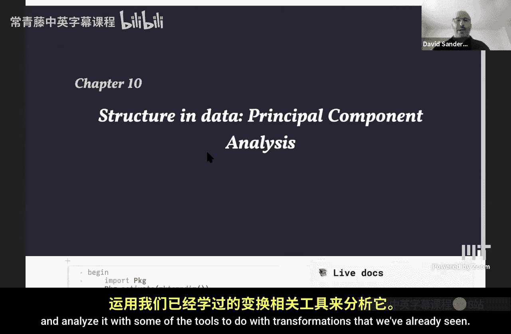
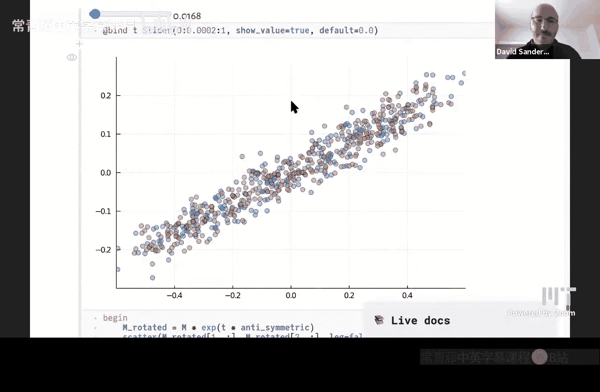

# 麻省理工学院【中英⚡计算思维 ｜18.S191⧸6.S083 Spring 2021, Computational Thinking】 p08 P8 Principal Component Analysis ｜ MIT Computational Thinking ｜ Spring 2021 ｜ Lec -BV18EqQBQEF3_p8-

Okay。So yeah， we were talking about images and how we can interpret images as data。😊。

And now we're going to be transitioning towards the second module。

 which is going to be about sort of data， but viewed from the point of view of more of statistics and probability and this is kind of a nice bridge topic between those two where we'll look at a matrix as data or data as a matrix and try and analyze it with some of the tools to do with transformations that we've already seen。

So let's just recall what we were doing want so we want to understand some some data in some way and so we were looking at this this kind of。

This kind of matrix， and you'll be looking at this in the homework as well。

Which I think is going to be released very shortly。So we were looking at outer products。😊。

And what is an outer product again it's just a multiplication table， so we have on， you know。

 if we look at the first column， we have the numbers from one to 10 and then in the second column we have a。

Two times that same first column。 And in the third column， we have three times the same first column。

 So basically that we have the same information， if you like， in each column of the matrix。

And similarly， if you look at each row， we have the same information。

 just each row is just a multiple of the previous row。

 and those multiples can of course just be real numbers， they don't have to be integers。😊。

So this is what we call， you know， this is。Basically， what we're going to call a rank one matrix。

 So rank one matrix is just。What we mean by that is we basically just have one vector worth of information。

In in the matrix， so you know we just have the same column repeated each each time basically。

 but we actually have two vectors involved， one which is you know this the column and then one which are there sort of this other vector which tells us how what the multiple of that first column is in each other column。

So we need two vectors to store a rank one matrix。And then the matrix will actually be produced as this just taking products of each element of each of the two vectors and so in the homework you're actually going to make a new Julia type which does this。

 so you inside your object you will store only two vectors but then when you index into this object it will behave like a matrix so it's another example of an abstract array it's an object which you know looks to the user like an array in this case like a matrix you know this is similar to the one hot vector that Alan was talking about last time。

😊，That that was an object that stored only two numbers and looked like a vector when you index into it and here we have an object that only stores two vectors and looks like a matrix when you index into it。

 so it's a very good example where you know there are no zeroes in this matrix。

 so it's not you know a diagonal matrix it's not sparse it's not any of the maybe more usual kinds of things that people think about when they think about a matrix with structure but it definitely has a lot of structure in the sense that we only need a small amount of information to actually reproduce the entire object。

😊，Okay， and so yeah， so well we're calling this a rank one matrix because it basically just has one column thats that's where the one comes from。

 even though we actually need two vectors to store it。

And so I showed these last time these are examples， you visual examples of that。

 so flags are often have a similar kind of you know sort of。😊，Low rank structure so in other words。

 so for example， rank two matrix will be a sum of two of these things and we always get these chiboard kind of of patterns when we look at rank one matrices as we saw last time so let's just remember what that looks like。

😊，Here here is a rank one matrix and there sort of checkboard because you know again in each column we have each column looks the same。

 but it's scaled by some number and so if we draw that with colors。

 you we'll get some kind of repeating colored pattern and the colors change according to the intensity of you know how big the numbers are in each column okay。

And then when we start adding another one on top， so we start with one rank one matrix and then we add another rank one matrix on top of that。

 we get something like this and we can see that that checkable pattern starts to disappear and at the end of last lecture element was showing you know that there's this tool which we'll come back to later in the lecture。

 the SBD a tool from linear algebra， numerical in the algebra。

 which actually enables us to take a matrix and decompose it into basically a sum of rank one matrices。

And so that's enabling us basically to sort of extract， you know。

 give a matrix to get back to the structure of that matrix。😊，You know。

 one interpretation of the word structure in that matrix。

 and then we started to add noise and see what what that did。

And so now then we started to do this transition towards away from images and towards data。

 so we're going to take what we did last time again the end was to take rows of the image and think of it think of those as coordinates of some data right so we're just。

know take some some piece of the image and just look at the numbers that created that sort of image。

And then we'll just take the first row of the image as x coordinates and the second row of the image as y coordinates。

 and we'll plot those on a normal kind of。you know scientific computing kind of growth right so again what what are we visualizing here so I'm plotting you know each of these points is a column of this two two row image。

So each column has two data points in it， an X coordinate and a Y coordinate upstairs and downstairs。

So the first row is the xordinance， the second row of the Y coordinates and I'm just going to plot those as X Y pairs on my graph so that's what these points are and the red points are for the first version where we just took a single rank one matrix a single multiplication table and the second version is where we took that same matrix and then added just added noise to each element separately。

😊，So noise just means a random number。you know， distributed in some way we took a normal distribution and I think I don't remember and yeah with mean zero basically and so the points get scatter sort of scattered away from the line。

 but it's clear that they're close to the line and so you know if you think about this new matrix as just some data that somebody gave you and you want to understand that data。

Then the first thing you will do is probably plot the data and you'll see you know this the blue curve right so if I remove for a moment this red red one。

Hopefully that'll look。Howhy don't I remove the wrong one， sorry？

So somebody gives you this data and you plot it and you look at it and you'll probably say， oh。

 that looks like it basically lies along a straight line and what you would like to find which straight line it is and you know give some estimate of how far away from the straight line you might be so that's what we're going to do right now。

So suppose we don't know that this data comes from this underlying straight line with noise and we want to actually reconstruct that and that's the idea and so of course this is the whole subject of statistics and these days machine learning which is sort of the same as statistics。

😊，That's a big debate。So we want to sort of find， you know。

 what is the best straight line in some sense that fits this data and then how far away does the cloud of data go away from the straight line？

How can we do that so one your first reaction might be oh well I've heard of this least squares fitting procedure where you sort of try a straight line and you drop you drop down。

 you measure the distance of each you say I choose some straight line and then I measure the distance of each point from the straight line vertically。

In a vertical direction that's important last at least squares fitting and then I take the sum of all of those and I try to minimize the sum of the squares sorry of all of those distances。

 the vertical distances to the straight line so I basically have two parameters of my straight line and intercept and a slope and I can I should have actually done this animation sorry and exercise。

 try and do the animation is pretty neat to see。😊，And so as you're changing these two parameters。

 the intercept in the slope of this straight line， this sum of squares of these things will actually be changing and you're trying to find the value of the intercept in the slope so two parameters which minimizes this sum。

😊，That's one way you could do it， that's not what we're going to do right now。

We're going to do something slightly different， which is to try and minimize the square distances when you take perpendicular distances from the straight line instead of dropping the straight line vertical。

So it's a different idea and how it generalizes nicely。😊，Okay， so。😊，So let's just think。

 let's go back to this， add back this straight line。So why did we get a straight line here。

 and let's just think about that a bit more carefully。

So this straight line in red in the red squares is the original image。

 so basically if I have I'm saying that you know if I have a column in the original image here。

 let's say it's basically 0。5 comma 0。2。😊，And another one here that's basically a 0。25 comms 0。

1 Well the fact that they lie on the same straight line through the origin is actually the same as saying that you know y divided by x is the same number a constant and so all of these have the same you know value of y divided by x because。

Each of them is a multiple of the others right so mathematically you just have if you have two columns x1 y1 and x2 y2 and you know x2 is some constant times x1 and y2 is some constant times y1。

 of course if you now divide x y2 by x2， then it's the same as y1 divide it by x1 and so they lie on the same straight line with this particular slip。

Okay。So how can we actually you know go think about this cloud of blue points and we want to measure its size somehow basically right so how could we so let me remove it again？

😊，How could you how could we actually measure the size of this object so the first thing you could think of doing might be to take this cloud and just sort of say oh what is its width so that's the first thing we would like to measure the width of the cloud and so we're just going to sort of ignore how tall it is for the moment to start with and just calculate it width so what would be a natural way to do that oh well you just find the maximum value here and the minimum value here。

And so you subtract them and that gives you the width of this cloud。😊。

But that's actually not such a good idea why， because there might be a point sort of way over you know at 100。

000 that suddenly somehow got into your data for some reason。

 so we call that an outlier that sort of isn't really doesn't really belong to the data and there was some measurement error or there was some error and transmission of the data or something and or it might even be valid a real data point actually but it's sort of away from the main bulk of the data and so we want to exclude that or we want to sort of temper we want to weight the how influential that point is in our measurement of how big the data is so were actually going want to use a statistical technique instead of just taking this maximum minimum。

So basically， we want some kind of average measure of how far away these data points are from from from。

😊，so the first thing we're going to do is just find where is the center of this cloud in other words the mean and so that's just know it's another statistical measure so it's just sort of take the sum of all of the data and divide by the number of data points。

And so there is a function mean in Julia to do that， of course。

 you can easily define your own and in fact you did in the first problem set。

So this function mean comes from the statistics standard library， which we imported at the start。Hi。

 Alan。So。So what's the first thing we're going to do just subtract the mean from each data pointer so we just use this broadcast or this pointwise minus。

 so you know we have x's and y's are these separate vectors of data and we'll just take the mean off each of those。

😊，And then so we just get the same cloud when we plot that we get the same cloud but' now sent it around0 zero and now we can now we're in a position where we can do this calculation of the width so what would a natural way to do that be so。

You know you might think oh， I need some kind of average again。

 so if I just take the average of this new center data， if I just take the standard mean。

 I'll just get zero because I just you know the mean of something minus its mean is zero。

So I have to do something a bit more clever， a bit more interesting。😊，So we're thinking of the width。

 so what we're really doing is taking all of this data and projecting it down perpendicular to this X axis。

In other words， the line y equals0。So here are the perpendicular projections in these dotted lines and then we get this new cloud of data which is just the X coordinates which just lies along the x axis and so we want you know basically to measure sort of how wide is that in a statistical sets and so the problem is we have these negative values and positive values and when we take the mean they cancel each other out and so but if you think about know the words what would you really like to find you would like to find something like the mean distance from the origin and so distance we usually think of as a positive number so these negative numbers over here we need to convert into positive numbers asks a quick question Yeah of course so so if I look at the x axis there are some of these orange circles look darker I guess that's because there are a lot more points kind of right above that's a great question so we're using transparency so each of these orange points is actually this very faint orange color and then when several of those accumulate on the same place。

😊，Overlap and you get a darker orange color so yeah the nu darkness is in sort of how many points。

 so if you can， if you look here， for example， there's sort of a quite dark orange that's because many。

 many points are accumulating with roughly the same value of X and they're just being superposed。😊。

Down here， yeah。You get to get a darker color， so that's that's some kind of measure。

 it's like a sort of kind of kind of histogram of how many points are actually at that value of x。😊。

Yeah。AndSo that we have to take that into account when we calculate this average。

Just another question， Dave， in the code here， I see where Xx and Yy got defined。

 but I don't see where XS got defined。Okay。That's right here you said， oh there it is， okay。

so I just other way we have a feature request to Pluto that you can like highlight a variable and see where it's defined。

 you know， move to that place。So for example， if you if you if I'm down here and I see excess。

 I should be able to sort of click on it and then do something and jump to where it's defined。

 that would be nice。Does that answer you your question， Yes， thank you。So yeah。

 so okay we want to find some yeah I was saying we want the average distance from the origin and so one way we could do that is to literally take the distance。

 what is the distance is just the absolute value of you know the data point minus zero in this case and so it's just the same as taking the absolute value of all of the x's。

😊，Once I've sented them。And then calculating the mean and that gives me 0。

25 let's say and that's roughly here and indeed if you think about it。

 basically the data set is sort of symmetrical， it's not actually symmetrical about the you know it's not quite rotationally symmetric but if you rotate it in 180 degrees it almost basically lies back on itself and so we basically have some kind of  symmetry。

😊，And so basically if you sort of take these values and just reflect them over there's Y axis land them back on here。

 then you get a cloud of just positive numbers， we can actually draw that so let's do that。This one。

So I'm just going to take the absolute value of each of them again， using this dot broadcasting。

And that is what the cloud looked like once I've folded it over onto itself。

 and let me even use a smaller value of alpha so we can see it a bit more carefully clearly。😊。

So I don't know if you can see that there's a cloud of blue points and again some of them are darker and now we want to find the average of those those distances and it gave me 0。

25 which is somewhere like here and that indeed is's sort of halfway along this data you can you do what can I ask you what you asked me last week。

 can you histogram these？😊，So， great， idea did。Yeah， so basically， I mean。

 what I'm hearing you say is you've got some data which an absolute of values between zero and f roughly and you're telling me that it's kind of like a quarter。

Which might be true if it was uniformly distributed。Can I get more bins or is it？不是。Yeah。

 so that's between that that's that there I have not taken the absolute value and so let me take the absolute value as well and。

Again something like this。And yeah， so it's quite unevenly distributed， if you like。😊。

I don't know if you smoothed it out， it might be even。

So humans actually have a pretty bad intuition about what random means and so this is actually a pretty random uniform distribution meaning well make it one nice thing let's try bins equals 20。

😊，No maybe not so uniform yet there's not of course there's not so many at the edge。

 but apart from that it's maybe uniform its so we'll be discussing this more in detail what uniform means maybe in next lecture。

😊，Yeah， great idea。And we can do the same with why of course。

 and we should probably expect something similar and again at the edge right so this is now I've taken the absolute value so this is both edges actually and we see that there's definitely fewer values right at the edge。

😊，Yeah， okay， so maybe it's not uniform anyway， it also depends how exactly I generated the randomness。

😊，Okay。So this is just a measure of how many of the points fell in each of these bins in each of these boxes。

 so between 0。1 and 0。0。1 and 0。15。0。12 or something， how many points。

 how x coordinate in that range， that's what I'm drawing here and that's this number。

 the height of the bar。🤧So。So that's one way we just take the absolute value of these distances。

That's actually not the way that we usually do it， we usually take the absolute value or take take a different measure of distance。

 which is this root mean square distance called the standard deviation which I'm sure many people have heard about so we literally take these values and square them first and then take the mean of that and so again we can actually draw that。

😊，Something that people do not usually do。But you could do a histogram of the squares and that looks something like this。

😊，So that has a very different kind of shape， that's definitely not uniform and。😊，I didn't know。

 is that some known as probably some known distribution as well？Like a case qued is， I don't know。

 we'll have to think about what that is。Now we're going to take the mean of that。

 so why do we square these numbers？😡，Well， basically it's a way of sort of giving。

I was going to say giving less weight to the larger values。

 but actually maybe it giving it's giving more weight to the larger values。Anyway。

 it's just a different way of basically we're giving weight to how far things are away from the origin and actually yeah the data points with larger values are getting more weight than they did before because well okay the value is here less than one。

That was confusing。I guess if they're less than one， then。It's not clear to me what happens？

And then okay， anyway， so that gives us what something called the variance。

 this mean of the squares of the data， once we've centered them around zero。

 and then we take the square root and that gives us the standard deviation。

Which is usually called Sigma。And so here I've drawn the same data again。

 and I've calculated these sigma x and sigma Y， and maybe I can add in to this picture。😊，嗯。

Lines at Sigma x and Sigma Y。So currently these lines are at two sigmas and two sigma Y。

 and we see that that basically encloses almost all of the data there are some data points that sort of stick out。

😊，That are slightly beyond two Sigma X or two sigma y。

 but basically so usually if if the data has a sort of some in some sense， a normal distribution。

 we would expect about 95% of the data to be within a distance two sigma of the mean。

On Tuesday on either side。David， can I imagine that I'm in a class and I have some kind of score on two exams。

Where it looks like on the first exam my score could never been better than like 60% out of 100 and on my the second exam。

 the top student only got like 21%， maybe。thatAnd so what you plot is you're score the two exams and you're saying that all the students are pretty much all inside this box。

Because the professor always gives you the standard deviation， I mean that's or the variance， right？

Because that what did you say every every student is familiar with getting you know the standard deviation of the variance for for exams okay。

 oh I don't I didn't realize that you usually just talk about those okay sure I don't know I don't know whether people know the the precise definition or not but I know that you know it's a standard thing to okay tell people in a class you know what the scores are and what the。

What the standard distribution is。But so yeah， so if you just do the standard one standard deviation instead of two。

 then you'll only expect something like 70% of the data。

People to be less than one standard deviation away from the mean and so the sort of good students will be between one and two standard deviations away basically。

Okay。So but if we， yeah， if we look at this box， you know so far we've calculated these two numbers which are the widths。

 the width and the height of this data in some sense。

 but it's clear that we have not captured all of the information about the data because we don't these numbers don't tell us how this data is arranged inside this box it could be going from the you know the top left corner down to the bottom right and that would mean something very different about how these two tests that Alan was talking about are related so here you can see that you know if you did well on one test you pretty much did well on the other test but if the data with the other way around。

😊，It would be the opposite if you did well on the theoretical test。

 you did badly on the practical tests and vice versa， maybe。Which was my case。So， you know。

 we want to actually track those that relation or so we call that correlation。😊，But it's basically。

 is there a relationship between the data if I know that x is big。

 do I know that y is big or maybe I know that y is small if x is big。

 so how can we actually grab that information from the data？😊。

So you know it's clear that we the just calculating these two widths that we did so far is not enough so what could we do instead well we somehow want to sort of。

Rotate our point of view and line up our point of view with the data somehow and so that's what we're going to do。

😊，So of course， there are stand ways to do this in statistics。

 but you we're trying to understand from a computational point of view of what would you want to do and then how does that relate to what you would do in statistics？

😊，So one idea would be literally， let's rotate our axes。So that's the first thing we want to do。

 let's try rotating our axes。So somewhere there's a plot。Where啊。

So here's a plot of the same data set。And let's start off aligned with the data。 So here。

 so this red arrow is supposed to be a new axis。 So I'm literally of rotating my head and lining this arrow up along what seems to be the direction of biggest。

 you know， growth， biggest extent of the data sorry。 And as I then rotate around this axis。

And so again， I'm now projecting the data， but I'm projecting it perpendicular to this arrow or perpendicular to this new axis。

 so this is different from least squares。And as I， you know， rotate round。 So I'm also， again。

 showing the projection of each point on this new axis。 And as we rotate round。

 you can see that the projection changes how wide it is。 So basically。

 what I want to do is measure how wide that projection is。 And now we know how to measure know。

 width of projection we're just going measure the standard deviation。 But in that direction。😊。

So that's one way we could look at it， we're rotating an axis。

 but the other way an alternative way is equivalent is instead of rotating the axis let's rotate the data so here's the same picture。

😊，But now I'm rotating the data。😊，So I'm sort of fixing the horizontal X axis now as what was the red arrow above and if data is rotating it's basically the same。

 but it may be easier to see in this case and it's certainly easier to calculate。😊，So again。

 you know the same picture， but as I rotate the data around。

 we measure the width just in the x direction now in this point of view or along the arrow in the other point of view。

 and we want to know well， how does that width change as the angle changes？😊。

And so we can plot that curve and here it is， so this is the variance in direction the and you can see it's some kind of curve sine wave。

😊，Or something like that， signusidal as a function of the angle feet in degrees around the circle。

So in particular， there are two directions where we get the biggest variance。

 which is when the arrow is pointing along this sort of long axis of the data。

 and there are two directions where we get the smallest when it's pointing around basically perpendicular to that long direction。

😊，So what we need are actually to just extract these values of theta where it takes a maximum value and a minimum value and so one way of doing that a computational you know thinking kind of way of doing that would be literally oh well I just calculate all this data now I literally you know just find the one which is the max find the two values which are the maximum and find the two values which are the minimum and so when you do that。

😊，So this is what I've done here， so there's this agonm function in Julialia which calculates， sorry。

Which tells me which is the maximum？Which， which value in the array gives me the maximum value of。

Yeah， sorry， I'm trying to， I'm not finding the maximum value yet I'm finding which you know which position in the array gives me the maximum value。

So here I've calculated the variance in each direction and I'm calculating which one is the maximum and then I'm taking that I'm evaluating theta there and then I'm taking the variance at that point and that because I need both of those pieces of information to draw this point on this graph。

 which theta where I am in theta and what is the value there。😊。

So and some some of the folks in the audience may have heard of probably have heard of。

OfOf fitting a line the least squares line I mean， I think I already talked about that oh sorry。

 then I missed that okay， and you're right this is not least squares， right？

This is something different， right， because。Did you mention because we have errors in X and Y？

I didn't actually know Yeah， so the the key difference is least squares is gimmked up for when you have no error in the X direction and only one you know every everything X is considered fixed like like you know。

 maybe prime or something where you know exactly what time it is。

But principal components is what you do when both there are errors in x and in y。

So are uncertainties， I should say， in X n and Y， and it's a very commonly used method these days。

That's good point。Yeah， so here I've， you know again。

 same data set it' always the same data set and then I've literally taken。

 you know vectors at these directions and at these directions that I just calculated numerically just by taking this maximum and I'm just plotting vectors in those directions of in those values those directions theta and these lengths are the size that we calculated in each of those directions。

 I think。😊，Or is it two times that yeah， two times that length？

So again there's two sigma in each of those directions and so we have kind of solved the problem of characterizing you know this data set as in which is the which are the important directions。

 which is the maximum， which is the minimum and how big is the data set in those directions。

 you know， in a quite numerically intensive way。😊，And so another way of visualizing that is actually to put this ellipse on top of the data。

😊，So basically what we did is calculate the semi major axis length of the ellipse and the semi minor axis length of the ellipse and then literally draw an ellipse with those semi major axes and that particular rotation angle。

 and then we see that basically what we have done is in some sense。

 although Alan doesn't like this interpretation we have fitted an ellipse to that data。😊。

You except that we haven't because there are some data that's outside so what does it actually mean to fit an ellipse to the data it's not too clear and so that's you know there are better interpretations where what we actually have is some kind of two dimensional bell shaped curve normal distribution and we're fitting that to the data I'll accept the fact that that ellipse seems to capture most of the blue dots it's good yeah yeah。

😊，So。So yeah we've done this in a pretty numerically intensive way where we sort of rotated this thing around and we calculated all the values and then we took the maximum is there a better way to do this and so the answer is yes there is unfortunately unfortunately so that is。

😊，You。So this is the idea， know the intuitive idea behind this method。

 principle component analysis so what does why is it called that because you can think of this sort of this direction that I drew here that is the principal component the longest direction but does that mean it means if I know if we sort of change coordinates if we rotate round and and you tell me how far you are along this direction。

 I basically know everything I need to know about the data point not quite because there's this sort of error in the other direction or this width of the distribution in the other direction but basically I know everything I want to know I distinguish the data best by moving along this direction if you just tell me where you are in this other perpendicular direction I know almost nothing about where you actually lie on this two-dimensional plane but if I know the X value of the x value the value along this direction。

 this long direction then I know almost everything about where you are on the plane I。😊。

Ex if I might provide an interpretation with the two test scores。

If I know where I am along the principal component that is the long red arrow then you know I think I kind of know my standing in the class right that if there was one number that kind of captures the two exams。

 it would be sort of the distance along that line right and then you can ask what is this perpendicular distance then that's the detail of you know how did I do on my first or second test relative to each other。

 maybe less important it's arguably not as principal component after all right the principal component is probably the big is the long red arrow and that tells me how I'm doing in the class。

Yeah， great， great interpretation， thanks。😊，Okay， so how can we actually calculate this in some other way Oh okay。

 before we do that so let's let's think about what happens in higher dimensions。😊。

So so far we've just been working in two dimensions we if I had data that lives in two dimensions。

 what about if the data lives in three dimensions？😊，Then sorry， they got things out of order。

Oh maybe I just deleted the relevant。I had a visualization of what these rank one matrices looked like in one and two dimensions that seems to have disappeared。

 sorry about that。Okay， so well so the answer is that a rank one matrix in three dimensions。

 so again where we have you know the same effectively the same column。

 now three dimensional column repeated in my matrix a lot of times with different multiples。😊。

When I plot that in three dimensions， all the points will lie along again a line。

 a single straight line， but now in three dimensions that passes through the origin in some direction and if I add noise。

 then I'll get some kind of cylinder that surrounds that line with some points distributed inside the cylinder whereas if I take a rank two matrix then what I basically have is some rank one matrix pointing in one direction and some rank rank one matrix pointing in another direction and when I add all the combinations of all the points along each of those lines。

 I'll get the plane that contains the two lines and then when I add noise to that I'll get a sort of fat plane。

😊，Thick plane。And that was a nice visualization of that that got and somehow disappeared， sorry okay。

😊，Yeah， so what is the singular value decomposition so that is the mathematical or numerical technique algorithm that enables us to actually calculate this whole information that we just did of spanning all of these angles in two dimensions and to work out which the important directions are。

😊，So the singular value decomposition enables us to write any matrix in terms of simple matrices。😊。

Simple， you know simpler kinds of matrices and if we think about linear transformations。

 we know that any matrix corresponds to a linear transformation。

 then what it says is that a linear transformation。

 any arbitrary linear transformation can be written can be decomposed as first do a rotation。

 then stretch， then do another rotation。😊，It's pretty surprising that， you know， oh。

 and I guess there might be a reflections as well。 sorry， I where I said rotation。

 it's actually rotation or and or reflection。So if we think about writing that in matrix language。

 if we have a matrix M， then it's possible to find。😊，Three matrices， U sigma and V。

 such that when we multiply those matrices together which corresponds to this composition of transformations。

 we get back to the original matrix and these matrices have particular structure U and V are both orthogonal matrices which means they are rotations and or reflections and sigma is a diagonal matrix with just numbers just down diagonal which are called the singular values which which are the stretch factors and the way Id like to describe this thing for twodimenal data I'd like to point out that you've already seen this if if you remember back when I was doing various transformations of images you know I was having a lot of fun right do you remember all I was doing warps and I was doing perspective projections but two of the simpler things that I did if you recall was I defined a rotation and I also defined that x and y scaling right？

So what this says is that every image， every picture of corgis， if you will。

 or any other picture for that matter， can be written as remember the compose symbol with a little circle。

 it could be the composition of rotation， stretching and rotation。

 we could have showed it to you in that notebook right there。Yeah， we probably should have。

 but what I'm doing now is taking。this particular matrix， 2，1，1，1。

The famous matrix and context of dynamical systems and I'm writing it as the combination of you know as I just said of the rotation stretch and the rotation and so I'm actually so what does the rotation matrices look like in two dimensions is just cause of some angle theta？

And then sign over the same angle。And then。Sorry。Minus s of theta and causal theta。

What the rotation looks like and then the stretch looks like sort of。So I'm seeking one。

And0 and0 and Sigma 2。So this is what we're actually visualizing。

Right right here so I'm starting with these points in the unit disk so firstly we need to know how to sample point randomly inside a unit disk so one way to do that one way to do that would be to use polar polar coordinates where you say oh I need a radius between zero and1 and an angle between zero0 and two pi and generate points that way so you know this we're going to talk about random sampling so this is maybe a good moment to point out that you what happens if we actually do that。

So let's say row， sort of let's say radii Rs are going to be random points between zero and1。

 and I'm going to take sort of capital n of those。Let's say a thousand and then Peters。

Ire going to be random angles between0 and  two pis。

 So I'm going to generate n random numbers between 0 and one。 So round。Generates。

We've seen there' already random uniform， random numbers between zero and one， real numbers。

 reflecting point numbers， and then we need to multiply this by two pi。

Point element ways to get angles between zero and2 pi。And so。I's I going to work。

 do I have I've already used the word feets， that's called feta。Ftas in wordss。Okay。

 and now we want to take R dot times。All we want to do。Oh， its not so easy as like thought。

 it's going to be ourz number I times。You could go Rs dot times cosine dot of thes and rs dot times sine dot of thes。

 Okay， yeah dot times times cosine of thes and Rs dot times sine of thes you have to you have to go cosine dot。

Thanks， cosine dot， sine dot。 and now I want to plot this， so I'm just going to scatter。

These positions。 And again， I need a ratio equals  one。 And what I should see is that effect。 Yes。

 that's all I was looking for。 So what is happening there。Let's generate more points。Okay。

 so hopefully you can see that there are sort of it's denser in the middle and less dense around the edge。

 So if we did a histogram of how many points have given radius，😊。

That's easy to do now so they have the radiI。We'll see that there are actually more points。Oh， no no。

 the uniform， it's a two dimensional phenomenon。Yeah， that's not what I wanted to do， right？Yes。

If you actually if you plotted the X coordinates or something， it's or I don't know。But we all see。

 we all see that it's yeah， yeah。 Yeah， that's a good idea。 That's probably X， yeah。

Even that's not a perfect thing to do。 But anyway， we all see that it's darker in the middle that you just can't take a random。

Raddius and a random angle and expect to get。It even in the disk。Yeah， and that's the same you know。

 if you want to generate。Yeah there we go nice if we want to generate random points。

 for example uniformly distributed on the surface of a sphere it's actually you know more complicated than you think you might think you generate random angles The and phi with spherical coordinates serical polars。

 but that's not actually right if yous a random latitudes and longitudes everybody would be on American polars right。

😊，Yeah， okay， so that's not what we do， so what we actually do is generate points uniformly in a box from minus one to one that surrounds the disk and then we reject those that lie outside the disc。

😊，So that's called rejection sampling， and it's useful to produce these kind of weird you know sampling sample from weird weird shapes。

Okay， so。So that's what I've done， so I generated these points in the unit disk。

🎼And then so let's start yeah so now now what we're going to do is we're going to work up to that transformation 2111 bit by bit and so I've got this slider which is starting at the identity transform and ending at this 2111 and as we move the slider it's a bit slow but this circle sort of。

You know on the left I'm just looking at the stretch component of this transformation and on the right I'm stretching it and rotating it in other words I'm applying this transformation that the matrix and basically to all the points to each point in the unit so as Alan said you know we could of course do this with corgis and that would be nice but I think it's also nice to not have the corgis in the way and just to have corgis in the way。

😊，都可以。😊，So you know， we're getting this kind of picture of Saturn on one plane and then this is actually what Saturn looks like。

 you know， rotated when you look at it。😊，Yeah， so so。So how am I calculating these stretch factors？😊。

So you can see that the effect of applying the whole matrix is you visually it's clear that it is。

 I'm stretching the y coordinate by this particular factor and the x coordinate by that other factor I'm squashtting the x sorry the other way around I'm stretching X I'm squatting y and then I'm taking the result and I'm rotating it。

😊，And that gives me the effect of the full transformation。😊。

So how am I calculating those stretch factors， that is what this you know that's what we did before by scanning all the directions and choosing the maximum one and the minimum one。

 but now I'm doing it using this this。😊，This algorithm called the singular value decomposition。

 so I'm literally taking the singular value decomposition of this matrix。😊。

And that gives me back three matrices， so let's look at those matrices。😊，So I've got my matrix 2111。

 and I'm taking the SVD of it and I forgot。And so what it returns are three things， the U factor。

 which is this two by two matrix， the set， a vector of two singular values。

 just numbers and positive numbers and this other matrix here and so if we look at these two matrices in this particular case I chose a symmetric matrix maybe that wasn't the best ideal is you we can also choose a non symmetric matrix that。

And。So these are actually the columns of this U matrix are pointing in the directions of this maximum and minimum stretching。

Facts so if I might just sort of interject just a little， I mean。

 I don't you know some of you may have taken a linear algebra class， maybe yes。

 maybe know or maybe you will someday。 and you might hear about the singular value decomposition and you'll hear about it being connected to these scary things called eigenvalues。

 they're probably not that scary but in a way， you know when we think about computational thinking。

 I think it's more interesting to just sort of see what this SvD thing does。

 I mean it's kind of nice to drill down and get the whole math of it all and you know you can get that in a linear algebra class。

 but really I think when you just experiment with the computer and you see that that you know a circle is becoming an ellipse and there's two stretch factors。

 you know one in one direction， one in the other right if you look at the ellipse that's on the right。

 the Saturn on the right I mean it's clear that's theres some there's an ellipse it's specified by the length of the axes and the directions of the axes and。

The SVD is giving you that information right I mean you know if you take a linear algebra class you learn how to calculate。

 you could get an A on your exam by you know calculating the eigenvalues。

 but you you may or may not get the intuition of the thing， but you hopefully you will。

 but it's the stretching of the data in this case that it's completely captured by the SVD and that's why it is so critical for the statistical approach or principal components analysis。

い、な。Yeah， because basically the stretching is somehow the main thing that's going on and there's rotation。

 it's sort of light changing coordinates。😊，Yeah， so these singular values are the distances that it got stretched so here we see 2。

6 and 0。38 and if we look at this lefthand picture we see indeed that this sort of extum of the ellipse landed around 2。

6 and this one landed around 0。4 so this is actually capturing these stretching factors and these as I said these columns of these u matrix are giving me the vectors。

 unit vectors pointing in the directions of the maximum they correspond to those stretching factors。

😊，So just to finish off the class。So you know this SVD applies to any matrix and we have a matrix that is actually in you know two times 300。

 that's the size of this image matrix。😊，If I just look at the matrixes。Two rows and 300 columns。

And so we can take the SVD of that matrix and so what what is that doing it's sort of telling us how to think of that matrix you know what is the effect of that matrix is it actually in some sense we are working in 300 dimensions so another way of thinking about this matrix is that instead of 300 points in two dimensions it's two points in 300 dimensions and so that's somehow what transpose is doing if we know took this matrix and thought of it as。

😊，Two columns of 300 points， then we're now living in， we have two points in 300 dimensions。😊。

so what we can do is actually do a rotation in 300， that really grggles my mind that like。😊。

That there's like a duality between 300 points and two dimensions and you know which I mean。

 it seems like a lot of points， but I could kind of see it in front of my eyes or two points and 300 dimensions。

 which in a way sounds simpler like it's only two points。

 but you know I can't see it in front of my eyes like 300 dimensions， we could see that。

But it's amazing that you can go back and forth and they're both sort of， the math doesn't care。

 it's kind of the same thing to the math。I just that boggles my mind。

 some of you might think about that a little bit， yeah indeed。

Yeah so what can we do so in the SVD we have this other matrix V that we actually sort of did not capture in the pictures that we've just been looking at and that's another rotation in this case it's going to be a rotation in those 300 dimensions and so how can we actually what does that even mean it sort of literally means you know you're in 300 dimensions and you'll just sort of rotate your head a bit and but you're doing a transformation which preserves sort of all the lengths or whatever in 300 dimensions？

😊，And so we can actually generate one of those things so first we're going to generate a random matrix in 300 dimensions 300 by 300。

 and then we're going to make it antisymmetric by remove it by subtracting the transpose of that matrix。

😊，🎼And so it looks like this and so we transpose it， so we flip x and y in the matrix。

 and then we subtract one from the other and we see that indeed we get zeros all along the diagonal and then it's antisymmetric which means that the IJ element is minus the JI element。

And you can see that that's the case for all of these elements that you can see。

And then we do something called the matrix exponential on that anti-ssymmetricmetric matrix and that actually gives us let's let's see let's rotate as the result looks like this So if we start picture at zero so we have again a sort of a path of matrices is in this space I don't know why sometimes it does this where you can't actually see strange so here we go this is the same cloud of data yet again。

 300 points in two dimensions but now we're thinking of it in this three dimension 300 dimensional space and we're going to rotate around in that space and see what it looks like as I move this slider so you can see that the points are sort of starting to sort of dance around so each one moves away from where it originally was and it looks kind of like it's some kind of rotation but we're actually predicting from So I feel like it's ceial rotate around this is sort of like the stars in the sky and we're seeing seeing。

😊，One of these time lapse photos every day as they move around。

 but they're moving around you know sort of each somehow independently and that's what we're what we're seeing here。

😊，if you couldn't visualize your rotation in 300 dimensions， you know， you can go and say， oh。

 I just did， I just thought one。So what we're seeing is somehow a projection from the 300 dimensional space down to these two dimensions。

😊，Okay， so I guess we've run out of time yeah， so from now on we we'll be talking more about these random。

 how do you generate random objects， what does that mean and how do you analyze randomness using probability theory and some statistics and apply that to data analysis。

Okay， see you on Wednesday。

Okay， have you disconnect。