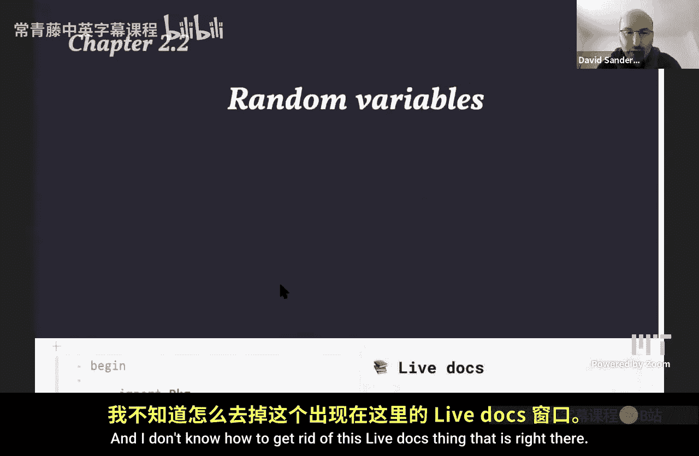
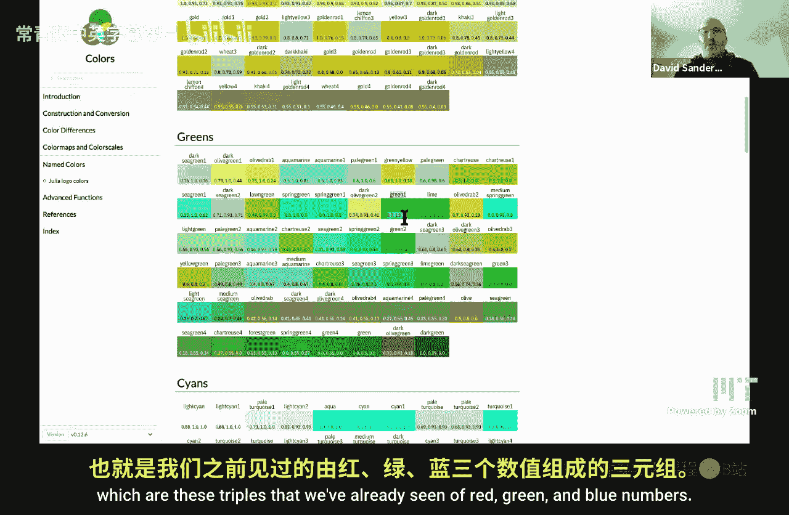
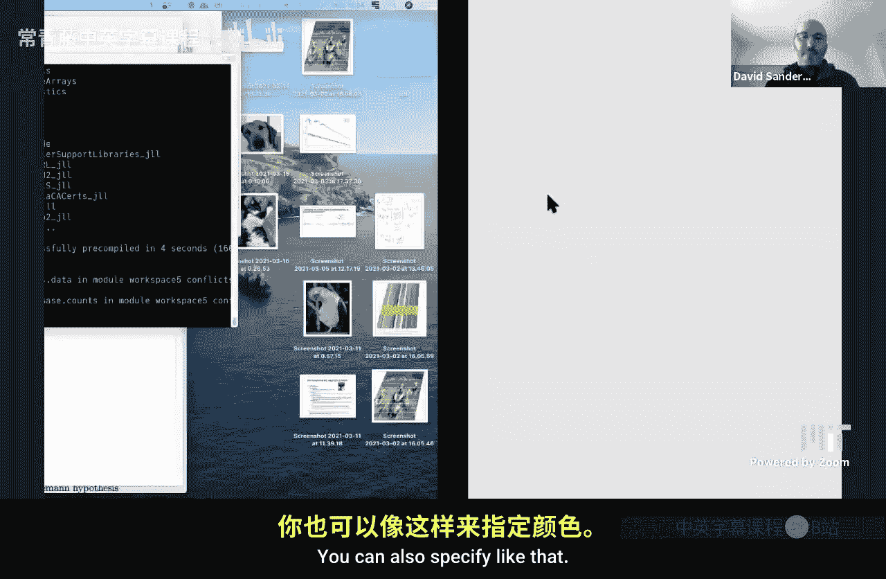
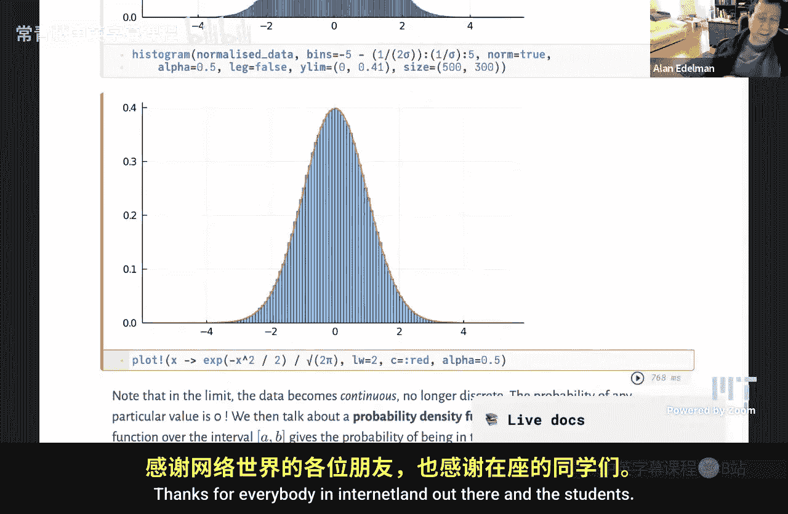

# 麻省理工学院【中英⚡计算思维 ｜18.S191⧸6.S083 Spring 2021, Computational Thinking】 p09 P9 Sampling and random variables ｜ MIT Computational Thinking Spring ｜ Lecture 9 -BV18EqQBQEF3_p9-

Two random variables Okay， hi everybody， so welcome back to another lecture in this computational thinking course in spring 2021 semester。

😊，AndToday we are going to start talking more in more detail about probability randomness。

 which you can also call stochastic behavior， so stochastic is just another word for random basically。

 and so we'll be talking about what you could call random variables and I don't know how to get rid of those live docs fig right there。

So。So let's start off by looking at a few of the Julia。

 just summarizing a few of the pieces of Julia that we're going to see today。

 there are a couple of functions like sum and which takes the sum of a collection of so in all of these。

In all of this description， capital S is some collection of data which lives。

 for example in an array there are various types of container object that it could live in so sum of S will take the sum literally the sum of all of the values contained in this collection in this for example array。

Random S will will do some kind of draw something randomly from that collection mean and standard deviation will calculate those statistical quantities and so some of these functions that will look at come from different packages and so we're trying to be more explicit about which packages you need to load to get each function so for example。

So when you load Julia， there's a library called base automatically loaded so you don't need to do anything special and all of these things will be available。

 but if you need the mean function for example， at the moment。

 you need to load the statistics package。And it turns out that that is actually a standard library package in Julia。

 which means that it comes preloaded with any Julia installation。

 so all you need to do to load it is do using statistics。😊，With a capital S。You know。

 the name of the package and we put using and then the name of the package to load the package and that will bring into scope all of the the names that are exported from that package and mean and STD for standard deviation are two of those function names。

😊，And then there are various other packages that we're going to use and so this first cell up here is actually loading in specifying some versions of packages that we need and loading in all of the packages that will be used during the notebook and that's what if you've been wondering what this strange syntax is and so we're working on a better mechanism first but doing this package specification。

😊，So we're going to use a function called count mapap and that lives in Stat space doj so this is separate from the statistics package and this is actually a separate package that does not come pre-installed so you will need to do you know package add stat space which we did in a cell I just showed and then using stat space to load it in but anyone using this particular pluto notebook doesn't have to do anythings actually this b term but also automatically loads all of these packages for you so we've already used the plots jail package a few times today will look at histograms and bar charts which have these functions defined in that package the colors do jail package we've used as well and we'll be looking at using the distinguishable colors function and then that's probably all we'll have time for so let's start off by talking about randomness so how can we get random numbers or random objects in Julia。

So by the way， what does random actually mean， that's a very difficult philosophical discussion and actually we can't really generate true randomness in a computer。

 but there's something that's almost as good which is sort of something that just looks very random。

😊，we won't enter into the details right now about how that works。

 but maybe we can I can't have random bugs all the time what do you mean that can't get randomness on my computer？

So actually one of the ways of getting randomness on a computer is actually just to track。😊。

All of the processes that happen from the time you turn the computer on and when exactly all of the key presses happen and that will effectively generate some randomness for you because the next time you turn your computer on you won't have exactly the same sequence of key presses at exactly the same moment so you can actually use that as a source of kind of true randomness on a computer。

😊，So Juliet has sort of abstracted that all away and it just gives us this function called RA。😊。

And round is actually a very versatile function， so what does it do so if I give it a collection so here's a collection one colon6 we know that's a range。

😊，So that contains in some sense all the numbers between the integers between one and6 So when I do round of one code and6 it will pick one of these at random so one of the objects in this collection it will pick at random and return it This is a strange function from a mathematical point of view because I'm giving it the same input but it gives me a different output every time so actually what's happening is there's some other implicit hidden function which is sort of some random number generated to object and that is actually being modified and so thats that's hidden from us so it looks like it's just generating random numbers so I'm just gonna run this a few times and you can see that sometimes it spits out the same number twice in a row anyway it's giving me random numbers between one and six and yeah。

😊，And so of course I can give just some other vector of random numbers like these few prime numbers here and the round of that vector and it just picks one of these numbers at random。

 one of these five numbers and so you know you can ask well how often should I expect it to give me the number two and we'll discuss that in a bit。

What are they kinds of containers or collections？Can I use it can actually use a string so here's just a normal Julia string。

 the string MIT and when I do random of that string it just treats the string as a collection of characters and so it just gives me a random character from the string and so note that a string in Julia has these double quote a character has single quotes and it's a special different object called char which we've already seen so we've already used dysfunction you know quite a few times especially in the homework on language languages。

But now we're saying in want detail so you can also do this this cute thing where you can take the character a colon the character Z so that gives me a range so what is this this object here it's actually a kind of range right so type of this is a so good step range with the char inside so characters inside。

And then so that's， you know， the collection of all characters from A to Z。

 and when I take a random element from there， it just picks one you know equally likely and returns it。

Now what about if I don't put anything inside here， there's actually a default value。

 so there's a default here which is actually float 64 as it going to take it's going to give us a random number between zero and one。

 a random real number or rather a random floating point number with 64 bits of precision so you'll be working a bit with floating point numbers on homework5。

😊，And。We'll talk about it more later in the course。What happens if I do brand without parentheses？

Oh yeah， great great question， so what happens if we type RA without parentheses？😊，Well。

 we're referring to a function called RAand and when I execute that cell， indeed it tells me that。

 oh， you know that thing that I just asked for is just the function called RAand and it tells me。

 oh look， it has 190 methods， so I'm not sure have we talked about methods before。

So what is a method it's just a version of the RA function。

 so you know this RA that takes in a sequence of characters is actually a different version of the function or a different method than the RA that takes in you know some other object like a string。

😊，And so there are actually all these different versions or methods of the RA function and we can see them all with methods of RA and it just gives me a list of all the different ways that I can call RAN。

😊，And you can go and see exactly， you can click on one of these and go and see exactly how it's defined in the source code。

Which we won't do right now。Okay， so yeah， so ran is that's why I say it's very versatile these are all the different things that you can generate randomness from basically so for example。

 here we took distinguishable colors of three So what does that do it's from this colors dot JL package we've already used it a couple of times it's just a function which returns。

😊，A vector of this many colors and using some particular algorithm to make them distinguishable。

maximally distinguishable for a human being sort of visual visual。Mechanism in our eyes。

So if I do distinguishing colors of 10 it just literally returns me a vector of colors so if I do type of this thing。

 it'll tell me that it's a vector of color objects。Oh， I guess I should just make a new sell of that。

And so now we can choose since as's a vector we can just do the same as we did before and just choose a random one of those。

 even though these are color objects it will just return you'll choose one of these colors at random right so that might be something so and just re-evaluating the cell running the cell will shift enter several times and I see again it sometimes reproduces the same sometimes gives me the same color and often gives me a different one of these three random colors。

ok。So so far we've only generated one random object from a collection。

 how about if I want you know to generate 10 random objects from the same collection。

 I can do that easily， so I could do that just by making my own comprehension。

 array comprehension like this a random one cone6 will throw a roll a six sided die and then I'm going to repeat it 10 times with with the usual array comprehension syntax that we've been using a lot。

And that will produce an array of10 items and when I rerun it because Rand is generating new randomness every time I'll get a new random vector of 10 items。

But actually you know the people who wrote Julia realized that this is a very common thing to want to do and so you can just actually add another argument to Rand like this。

 so RA of one round of S， this collection capital S and then N is number of elements will actually do that for me third you know I don't have to write this comprehension myself。

😊，And actually it's even more general than that you can make arrays of random numbers so here's a random matrix of one through six so again I give one through six and then I give the dimensions of the array。

 for example， 1012 will will make a random 10 by 12 matrix of you know these dice rolls。

Dy rolls and when I run that again and again， I get a different random matrix each time。

And of course I can do the same with colors and so here's a nice color matrix and you can see that you know sometimes you get these sort of connected regions of colors and sometimes you don't so you could start to ask questions like how likely is it that I get a region with sort of what is that six connected cells of the same color for example。

 so you can start to ask questions like we've been doing in the previous few lectures about know what is the historytogram what is the distribution。

 how many how likely is it that know how many clusters of size one do I have how many clusters of size two whereby cluster I mean these connected colors and that's actually very super important question for example in statistical physics。

And percolation problems so for example you know is it possible to get one single one cluster of a single color that crosses the whole system from one side to another that's the key question in percollation theory and you can investigate those questions numerically what yeah if I make so for example could I make yellow be more probable than the other colors and then how probable how likely does it need to be in order to span to have a cluster that crosses the whole system。

This is totally relevant to virus transmission， yes， yes。

Very good point yes so if these are people in a city and we're representing the space you know space in a city then and you you have connections to your neighbors because you go and have coffee with them or you talk to them over the fence and you might end up sort of。

😊，Unfortunately， projecting some some。😊，So with droplets from your mouth towards them。

 then you can represent that as a connection on this space and as Charles says that that can model can a virus actually cross the city and so we'll be going into that subject in much more detail during the course。

😊，And in the context of networks， so this is basically some kind of network and you want to know how connected is the network。

Okay and and just for fun， we can also use random images right so here's an image of a US penny for some reason。

 the quality of the。Picture is less good than it was okay so。

A US penny has heads and tails just like any other coin and so we just downloaded an image and split it into the head piece so that that image actually contains both the head and the tail and we using our image tools that we've looked at in the first couple of lectures we can just split that into two pieces and call them head andtail and then I can make an array of this head image and the tail image and I'm just going to sample from that and make a five by five matrix of those images and this all sort of just works in Julia it it's pretty neat and that can give us a nice intuition for sort of randomness。

Can you execute that line a couple of times？Yeah。Exactly so we I don't know I just enjoy the movie Yeah yeah that's a good idea yeah so were sort of it's as if we're shuffling around actually it looks like visually like we're shuffling around you know which ones are pennies and which ones are heads but actually what we're doing is sort of randomly flipping each one independently and you know whether whether this particular one comes out heads or tails next time is independent does not depend on what the other values are in this simple way of sampling we point to our sound effects to Pludo not now and not now。

😊，And I'd like to hear good idea but that you could， of course say， oh， well。

 I actually want to do some process where I flip this this coin depending on what its neighbors are and that is again。

 a very important kind of process in many different contexts for example， in statistical physics。😊。

Okay。So what' what we're doing here what we've been doing is what's called uniform sampling so what we mean by uniform we mean that each possible object that we're choosing from has the same probability as as the other ones and what do we mean by sampling we just mean picking a random object but that picking might actually be you know we might actually want to pick different objects more often certain objects more often than others and we'll see you how to do that in a minute。

So what do we want to do so we've got our collection of objects and we're generating a lot of。

 you know say let's think about rolling a die， we have six possible values。

 six possible outcomes and we want to know if we roll the die 100 times how many outcomes our head our one。

 how many or two etc， so let's start off with just a coin so we can flip a coin with heads and tails with a string heads and tails and we'll take 10 tosses and sorry I can't put a space there I can put a space there。

And what we're actually doing is we want to count how many times we get heads and how many times we get tails。

😊，So here's the result of tossses it' just a sequence a vector of Julia vector of strings containing strings。

 so it has the string head， then head， then head， then tail， etc ceter。

AndWe want to count just how many times does head occur and how many times does tail occur so you can probably think of various ways to do that counting and we'll do that in a minute as well but let's just see that we can actually load in a package that does it for us and gives us kind a nice answer which is this count map function so you know it's called that because it's counting and somehow mapping that count over the data。

And so I called the vector of outputs of outcomes tosses and the result of this counting is toss counts and we can see what type is that outcome it's actually a new type called diic for dictionary so if you're familiar with Python for example you probably use dictionaries a lot because it's very important in Python but in Julia it's not not so not used so much as in Python but is definitely used in many circumstances so you can see that what is a dictionary well it takes some label called a key and a value that we have assigned to that label and we write that with this arrow which in Julia you would actually write as equals an equal sign and then a greater than sign and so you can actually。

Make an object which is tail arrow3 and that particular object is called。

 that type of that object is actually called a pair and so a dictionary contains a sort of you can think of it as containing a sequence of pairs。

And we can ask is？We can ask for。What is the value of tail that corresponds to the key tail inside this dictionary by indexing as if it were an array。

 but the sort of index is now the string itself。So that's got a key in computer science。Okay。

 so so countmap is just designed to return a dictionary which gives us。

 you know the numbers of value or the number of times at each of these。Because。Can you once again。

 just run that a couple of times？Yeah， so I was just going to run that several times we' you know generating new data。

 you can see the data up here and then we're counting it down here because we're using Pluto everything just updates when I rerun this。

So you can see that okay so you might expect to have roughly the same number of heads and tails and often we do have roughly the same number。

 but sometimes it gets more extreme and you know again you can ask the question how often will you see for example82 so we haven't actually seen 82 although we we saw82 how often are we now going to see 91 there was a 91 how often will we eat n0 which is possible but very unlikely。

So that's the kind of question that we want to ask。

And so we can actually calculate that probability right this is just the number of times so we have if we had the number of times that the outcome was tails as four。

 then we can call the probability4 divided by 10。And so we can calculate that like this。

And as I was generating the data over and over again， so let's go up to now 100， for example。

 and so there were 45 tails on this run and the probability is therefore 0。

45 and so of course we all know that you know intuitively that we expect that as we run more and more simulations。

 so if we go up to sort of 10000 we expect the probability of getting tails。

To somehow become closer and closer to one half and that seems to be what's happening and so again we want to ask the question well how far away from one half might it be？

ok。🎼So so far we've only been doing uniform sampling where all of the options。

 the possible outcomes have the same probability or they're chosen you know in an equal even way how could we do the opposite how could we actually make it so that I chose one possible value more often than another one so we can literally think of a physical coin where we tape you know some extra piece of lead or something on one side of the coin so when I flip it it's more likely to land on one side than another so that's literally what we mean by weighted or biased coin。

And you know， if you're an unscrupulous casino， you might do that。And actually， I mean。

 they in Roulette， for example， you know， you would expect all of the values。

 all of the positions of the roulette wheel that it could land on to be equally likely。

 but the casino guarantees that it makes money on average by adding a zero or an even a double zero where nobody makes money except the casino。

😊，So they're effectively making the game weighted in their favor。

 so we shouldn't you know play Roulette basically because we're guaranteed to lose on average。So。

How how can we model that So what we want to do is say something like okay。

 the probability that I'll get heads I want it to be 0。7 and the probability that I get tails。

 I want to be one minus that so probabilities always have to sum to one because of the way we define them as just dividing the number of outcomes by the total number of outcomes So when we sum up all of the possible outcomes and divide them by the total number we should get one。

And so so a simple way to do that would be to say， oh， well， if I toss 10 coins。

 what I want is for on average seven， so basically I assign the outcome， you know。

 the word head to seven of those outcomes to seven of those possible。

Values that I'm going to generate out of 10 and tails to the other three so one of the ways to do that in Julia would be like this so'm defining a function called a simple weighted coin and I'm generating a random number random integer between one and 10 so that's going to as I said。

 generate those with uniform probabilities or equally likely but then I'm saying if the outcome is between one and7 if it's less or equal to 7 and I'm going to return the string heads otherwise I'm going to return the string tails。

So just a couple of points about Julia here。So we have if else and which I'm not sure we've actually seen before that's how you do an if sort of if then else and Julia so if this then do this this else otherwise do this and you could have an else if something something as well with。

So。That could have if that's actually one single word elsesif。

That's another option and then otherwise we'll return tails and so you see that this if statement is actually going to return a value。

 return either this sort of or has a value this the statement has a value heads or tail so basically all statements in Julia have a value and you can use that value so I could actually even say sort of outcome equals and then put the if statement here and then outcome would sort of collect that value from inside the if statement and then I could return outcome like that。

😊，But I haven't done that。Well， let me leave that in and then I'll make a new cell without those。

🎼So the question is， is this simple way to going to， okay？😊。

So either two different versions I can't have two different you know definitions of the same function in Pluto in two different cells。

 so that does actually return a value so what's going on the if statement returns a value and then the function itself returns the last value that was calculated inside that function so you don't even need this return statement actually you could just put outcome and it will return that value but I find it better more readable to actually explicitly tell it the what I want to return。

And by the way， one exception to this， everything has a value there a for loop。

 the value of a for loop is actually nothing。😊，So if I do four I one to 10。Sort of whatever nothing。

 And then I say result equals that what is the value of result is actually empty。But that's actually。

 you know。There's a special value in ju nothing and the value of result is actually that nothing。

 but that nothing is displayed as literally empty。😊，Okay。Are you getting something from nothing？哼。

No I' getting nothing from something。Okay， so。Yeah。

 so that was an example where okay it it was easy to do because we had this sort of seven tenthth。

 you know I could have written this as a fraction actually seven tenth and three1th and so it's clear that oh in that case I just generate you know random integers between one and whatever the denominator of my fraction is and then it's sort of it's clear that hopefully that thats that should be the correct thing to do but what if I have a you know just an arbitrary real number P between zero and1 how could I generalize this。

😊，And so what we actually want to do is generate you know some uniform values that can be anything between zero and one and the way we do that is with this RA with nothing inside that as we saw gives me you know uniform random numbers。

 real random numbers or floating points， random numbers between 00 and1。

 and then I just want to check when is that actually when is that output actually below 0。7。😊。

And that should occur fraction 0。7， a proportion 0。7 of the type， in other words， with probability 0。

7。And so if I do run their cell again and again， I should get some truths and some falses and the proportion of crews should be about 0。

7 and the point is I can you know make this like 0。

314159 and then I should get truths and falses that proportion of the time so of course we want to check if that's actually true。

But before we do that。This is called a beerulli trial with probability P after the Benernoulli family in the 17th century basically were some of the creators of probability theory and so benoulli of P is a function that I'm going to define where I pass in the value of P I want and this is a much shorter version of the code that we just had right so what am I doing here I'm saying generate a random uniform random floating point number between their own one check and check if it is less than p。

And as I showed up as I showed up here and forgot to mention just now。

A comparison like Le than in Julia also returns a value so I don't have to check is this equal to true it just sort of is true right and so what I'm doing here is this is returning true or false and I'm assigning that as the output of this function and so if I actually run this function once。

With some input value like 0。7。It does return true all falses when I run it a few times。

 you know it mostly returns true， but sometimes it returns false。

So that is a nice short way to write that function and you should sort of process what's going on here step by step to make sure you know so this。

 you know again， we've seen this before， I guess， but this says defining a function with this short form syntax where equals defines this function name with this input argument to be the output with output。

 whatever is on the right hand side of the equal。So here is where we're actually computing you know using countm to count up how many times we get false and how many times we get through when we flip its biased or weighted coin with probability TP or we do a benoulli trial with probability TP a thousand times and I can you know just in Pluto make a nice slider so with 0。

7 I get approximately 700 out of1000 being true and let's just run that a few times and so we can see that this number is always hovering somewhere near 700。

😊，And the other number is hovering around 300 if I move that down to 0。23， oh let's say 0。1。

You can see that about one10 of the time， indeed I get true coming out， which is what I wanted。

 so we have successfully generated a non uniform。Thing so what is that thing that we're generating is actually what we call a random variable。

 which is what was the title of the lecture。So what is a random variable it's a bit of a bad name in my opinion。

 so random is okay because there's something random going on variable is a bit strange because it's not really a variable in the sense of computer science。

 it just means an object a thing such that it takes on it can actually take on different values every time we sort of run an experiment。

 there's some experiment somewhere and we're running it and there's some output and that output is the value of that output is one of the possible values of this object called a random variable and then what were interested we are interested in is the probability that that random variable object takes each possible outcome and that set of correspondences between the possible outcomes and the probability of those outcomes is what we will call the distribution。

 the probability distribution of that random variable。

So how can we so that all sounds very abstract so how can we actually make it more concrete well we can visualize it of course that's always what we want to do you know we've just been playing with all these numbers if they don't make much sense we actually want to see something so how can we do that we'll use both bar charts and histograms for that。

😊，🤧So。We want to count， we've been counting how many。So comment。

So we've been counting how many times things have occurred so let's actually try and visualize that as I just said。

 so let's roll a die to start with so a normal fair die so itll generate uniform random outcomes between one and six integers between one and6。

 100 times。And so。By the way。Excuse me if we don't know about the function count map。

 how can we actually count up do these do these counts by hand well we could literally just you know write some little piece of Julia code so here's an example of one of those pieces of Julia code so there's another function count that we forgot to add to the list of functions that we're using What does counts do it actually takes in a vector of Boolean values。

Trues and falses。 So let's look at that。 So what are we doing here So this dot equals equals so when you want to check if two things are equal in Julia you do equals equals so double equal side and then the dot I guess we've mentioned a few times does something called broadcasting So we're doing elementwise comparison So we're comparing each element of this output vector rolls with one And when we do that we get a vector of trues and falses。

 So it's the first one equal to one no is the second one equal to one no etc cetera。

 we get falses until this one here and then we get a true。

And now we're just going to count how many of those are actually true。

 that's what this count function does。So you could also use some actually when I do some I get the same answer。

 but it's just sort of conceptually a nicer to do count。あ。

It counts how many of them are equal to one and so that's what we've done here。

 we've done that for each eye in one to six and put that in an array comprehension。

 and so we get out all of the counts。But if you think about it from a point of view of computer science。

 if you have a very big vector。😊，Of data， you know。

 maybe 100 million maybe it doesn't fit on your desk。

 you know maybe actually 100 million is pretty small these days maybe。100， you know，000 million。

100 billion bits。Da that's pretty normal size for， you know， for example。

 click data from big websites， you could have 100 million clicks a week or a day even maybe sorry billion I mean。

😊，And so you want to go through and see， well， how many people clicked on this element of the website。

 how many people clicked on that element， so you literally want to do this count。😊。

But what we're doing is very inefficient actually， because we're looping through the whole data set and just picking out the ones。

😊，And then storing that number， and then we're looping through again and storing just the twos and then again and storing just the threes。

And so you know the computer scientists on on the call will think that's a terrible idea and we should just be looping through the algorithm a single time sorry the data a single time and each time we see a value we should store that in the appropriate place and so of course that would be a more。

😊，A better algorithm and that's what Countmap actually does。

 so you should think about how could you actually implement that yourself？

And we'll probably put that on the homework。So。Now we want to plot these numbers right so I have six numbers which are the numbers of times that one。

 two， three， etca appear in my data my dice roll data now I want to plot that and so we'll do that in a bar chart so I'm sure everybody has seen bar chart before。

So there's two different concepts that we're going to use a bar chart and a histogram and they are actually different。

 so a bar chart is for data which is categorical so it has categories， discrete values。

 discrete categories， so in this case the discrete categories are just the numbers one two three。

 four， five and six。😊，And so you can see that the bars are separated and the width for the bar really does not mean anything in a bar chart。

But the height of the bar tells me how many of that category I saw so in this case I saw you know 21s and well some number of it's actually going off the top。

So why is it going off the top， oh good of it？Yeah， so very good， that's the complete distribution。

And so。This is telling us you know just the height of these bars is telling us how common each one is and then we added this horizontal line which tells us what we actually expect the result to be right we expect I was claiming that these generate uniform random random variables。

 random numbers， random variabless， sorry and so they should each be the same height and that height should be the total number of di rolls divided by six and we're seeing that actually well we're pretty far away from that。

And so now I'm just going to pull down that slider。

And I don't have a slide there sorry gonna pull down this data generation cell so that we can just change that number andrun I'm just going to first rerun the cell a few times。

 and we see that know this histogram update and actually when we have a very few di rolls we can be pretty far away from this sort of average value but if I just fix my intention on this six column and I rerun it a few times you can see that sometimes it's below the average。

 sometimes it's above the average， so you can imagine that if I rerun the whole experiment about you a thousand times and I sort of averaged over these histograms you would found an average histogram that was around bar charts sorry that was around this middle value。

So again， that's something you can do on for add some more zeros and now I can add another zero exactly。

 so if I add one more zero， oh， it seems to be closer to that mean value。So the scale changed。

 by the way， right？So I'm just going to regenerate things with a thousand and it doesn't get so far away。

 you know， when we zoomed out it looks still the same but it doesn't get so far away and when I add another couple of zeros。

 it's actually really pretty close to this average。

 but it's still's still not exactly equal to the average right on it's sort of almost never going to be exactly equal to the average。

So you know that's what we're seeing there is basically what's called the law of large numbers。

That as you。Increase this value， you should get closer and closer to the mean or expected value that we think should occur。

Even though in principle， you could in principle， even in 100，000 roles。

 you could get zero6es coming out， you could be all the way down here。

 it's just extremely unlikely that that would happen and we'll never actually see it when we run as simulation。

Because we can't do enough iterations。Okay， so that's that's nice， so that was a bar chart。

For categorical data of a data which lives in discrete categories now we're going to change to think about actual numbers so here we were just thinking of the labels of a face of a die as labels we're just thinking of labeling the faces of a die so we could have called these you know cow sheep pig go to whatever on the different sides of the die and we're just saying which one came out now we're actually going to move to thinking about those as actual that numerical values。

So we're going to roll multiple dice and then we're going to think of the outputs as numbers without we're going to sum so let's write a function called roll dice with an argument N where we're going to sum sum up n。

Dice rolls。So rolling n random dice between one and six that gives me a vector and then we're going to sum over that vector so'm actually doing arithmetic so we're really thinking about you know real isle numbers and yeah。

😊，And then we're just going to write a function called experiment which is roll dice of n。

 and now n is a variable that I'm going to change with this slider。😊。

So I'm also going to have a number of trials， so we'll start with a small number of trials 100 again。

Tend to the power too。As so here is the output of my data when I run the experiment a certain number of times trials and I make another array comprehension。

 so let's actually look at what that data looks like。

So that data looks like this it's basically currently it's the same basically the same plot because I'm using n equals one。

 but now I'm using a different function， which is this histogram function and so a histogram is like a bar chart。

 but now the width of the bars actually matters so what we're measuring with a histogram is areas the area is now supposed to be proportional to the value of。

😊，嗯，第一。The the you know。Yeah， so what we're actually doing with the histogram is saying there is this that。

😊，Oh对呃。And。The area of this bar。Is。Let's say equal to or proportional to the yeah the number。

 the total number of data points that fall into the bin or you know region defined by the bottom of the bar。

 that's what's happening。So what happens when I take this N and move it around？

So let's go to two dice so I'm rolling two dice and I'm summing up the results so I have the minimum possible value I can get is one plus one which is two and the maximum possible is six plus6 which is 12 so here here's a 12 you know somewhere in here there's a two and there's100 of those numbers and I'm just going to see how likely each of them is and you probably know that the answer is that the most likely is set always seven。

Because there are basically six possible ways you can get seven and there are only there's only one possible way you could get two out and so we should have bars which are height one and seven right so here I have approximately two outcomes and here I have approximately 20 something outcomes so in this particular case I actually have more sevens than I was expecting or fewer twos maybe than I was expecting。

AndSo of course， what we need is more data， so let's just up the number of trials to1 to four maybe。

And then we see that now I have something like 2502s and I have something like 1，507s。

 and so there's a ratio of about six。Okay。And so。🎼And so we actually end up with this sort of triangular shape for the the probability distribution of to the sum of two dice。

 so I'm just going to keep on adding more dice。And this is the sum of three dice and the sum of four dice。

And probably。😡，Maybe know what to expect as I add more and more dice together。😡。

U what we're seeing is that the shape of the resulting curve is seems to be， you know。

 something that is after I reach a certain number of dayss， basically stops changing too much。

And it looks sort of bell shaped and let's actually add even more trials。That was dangerous。啊。

And as I add more trials that really， you know gets nice and symmetrical and nice and sort of almost smooth。

 I could probably add more bins now。😊，200 and we start seeing a pretty nice bell shaped curve。

So here's， by the way， a picture of a bell and indeed it looks pretty similar to this skirt。And so。

 yeah， and so。Again， what is this histogram doing it's counting the number of data points that fall within the width that defined by this bin bottom。

😡，Okay。So。😊，So let's do that again， so as we change the number of dice， the picture。

 you know the graph seems to be sort of settling down to a particular shape。

 but everything else is changing the y axis is changing and the X axis is changing。

So somehow it seems like， well there's something interesting going on it seems to be converging to a shape but I'm not respecting that because my axes are changing so what I need to do is actually find the way to scale the axes or scale the data so that I get something which sort of really stops changing and if I can do that then I've actually sort of discovered a mathematical truth or mathematical idea in this data which is that there's some limiting distribution going on and and this distribution is actually converging in a sense to like a function and the shape of the function is converging to another function so what is that function is the famous normal distribution or Gaussian distribution which has and hasn't an actual analytical formula so how can we do this scaling so that's what we're going to do now。

😊，So the first thing to do is that we can look at the Y axis and we see that the Y axis is just growing and growing because it's the sum of more and more dice so that you know when I sum up。

10 days or some up 20 days， obviously 20 days is going to give me a sum of something like twice as big as sum up 10 days。

So the first thing to do is well then I should just divide by the number of dice basically。

 so that' that's effectively what we're going to do。

and so there's but what we're actually going to do is divide by the divide such that the total area of all of these bars is one。

 so that is basically what I just said so effectively we have to divide by the number of dice。

 but then we have to worry about the width of these bars as well。

And so there's an option to this histogram function， which is norm equals true。

And that will actually normalize the output so that the total area of the bars is one。

So there are various other options for this histogram function and I sort of summarize them a bit further down in the notebook just let's just comment what they are so I pass in the data I want to take the histogram of then alpha is the transparency so you can see that the grid lines are showing through slightly I hope you can see that behind the data so that's useful just to sort of see exactly how high we are this legend equals false if I put legend equals true it puts this key thing back on with the labels of the data and not's sometimes useful to have but often it isn't so useful so I'll just turn it off and then bins is the number of regions that I'm splitting this x axiss up into and I can actually specify either a number of bins that I would like or the actual sort of edges of the bins themselves。

So yeah， they're often called bins， I think that's the standard term for this。

And then I can specify color for the bars with a C or color keyword。

And there are actually a zillion different possible colors you could use so here we did light salmon one。

 so there's a link to further down in the notebook to the colors do jail documentation where you see all of those color names whenever I look at that link I feel like I'm in a pink store you know like you've got more options。

You never know maybe I should just go to that link， but。Where did I put that？

I guess further up or did I get rid of it？It's too easy still too easy to accidentally delete cells。

 unfortunately and oh there we go here you got it Here is a list of name colour right so let me just put a little title here options。

😊，🎼For the histogram options for plotting functions。

 there's really options for general plotting functions and there are a couple that are specific to histogram so I was trying to separate out which ones are specific and which ones are general yeah so。

And I go to this link and you see， as Alan said。Here's。

 you know like these paint swatches or whatever they're called there's all these different colors and they all have these names and so you can just call them by name。

 but also you can just give the RGB values which are these triples that we've already seen of red。

 green or blue numbers， you can also specify like that。😊。

Okay， so sorry， I'm now lost my window， that's the problem when I do that。What， where is it。你这这。

Oh oh， oh oh， did you，um I close back from the paint， just your， I just have to right， I'm sorry。

Yeah。Okay， great。We don't自己 yet。You don't see it， that is hard。Yeah，那 with。So yeah。

 so just to finish off so we're going to normalize the y axis by by that trick。

 so when we do that and we you know change let me drag this n slider down again。

And we we add more more and more dice， so here's a number of dice because either the Y axis basically has stopped changing。

 I mean it's changing a bit， but basically the scale is now pretty much fixed。So I could actually。

Fix the scale， maybe 0 to 0。05。And so when I do that， you can see that。As I add more and more。第。Okay。

 it's it is it is changing a bit， but but gradually it sort of settles down there's the X axis oh no。

 it's not settling down。 Yeah， it's not settling down Yeah。

 so the problem is it's spreading out more and more because on the X axis。So actually。

 I was saying the wrong thing。Where you just do both the Y and the X axis will see now so now the problem is。

 so what I was saying before was that the values were getting bigger and bigger that's on the X axis sort。

Yeah so now we need to normalize the x axis as well。

 so how are we going to do that well we see that this distribution now has some kind of width。😊。

And we already know about width of distributions from last lecture on PCA and so we know that what we need is the standard deviation or any other measure of the width actually will also be fine so for example that mean absolute value that I did last time。

 but if we take the standard deviation we can do that with this STD function that I mentioned from the stats statistics package。

Itton at the library。I'm going to call sigma that standard deviation so here are the mean and date and standard deviation of this data so the mean is 168 that's roughly here that's that seems like the mean the average value of this distribution and the standard deviation says that it's 11 and that that's about this sort of。

with of sort of half width of this distribution that's good。

 And so what we're going to do is demean the data and then divide it by the standard deviation and that's something again you're going to do in homework。

And so when we do that， I'm going to drag the end down yet again。You can see that now， basically。

The distribution is pretty much fixed in place。And it is actually converging to some limit。

Some limiting shape that gets sort of smoother and smoother and more， more， more more be like。

 basically。And and so as I take n higher and higher。

 that is actually something happening where it's literally converging to some sort of limiting distribution and that is the normal distribution or Gaussian distribution and what we're plotting is called the probability density of probability density function of that distribution and here it is in red is given by this explicit analytical expression exponential of minus x squared over two。

😊，All divided by this normalization constant square root of two pi to make the area one。

And you may well have seen that before， and you see that it really does fit extremely well to this sum of dice。

And as we take more and more dice and we normalize， we scale everything in the correct way。

 we see that we actually do really get closer and closer to this limiting Gaussian distribution。😊。

That curve just hugs the histogram just so beautifully， it's just a pleasure to look at。

So actually that's really why the normal distribution is so ubiquitous。

 so common in nature is because actually if you take almost any sequence of independent random variables with certain technical conditions。

😊，And you add them up， the result will be will have this kind of distribution。

 and that is the content of the famous central limit theorem。So it's a theorem about the limit of。

 you know what we just did was take a limit as we're trying to do is take a limit as the number of dice goes to infinity and when we scale everything in the correct way and this turns out to be the correct way。

Everything converges to this sort of this this distribution at least you know close to near enough to zero everything converges to this distribution far away from zero is not as different you mean it's not only special for a six sided dice that's right it's yeah if we if we went back and now did you know three sided dice instead of six sided dice we would get the same thing happening we could actually do that。

So let me just do three sided advice。And the same thing happens right so that that' was pretty nice。

 but that doesn't work on12 said advice。So the only problem might be if。

If we ever summing up too many things then we get an overflow but I don't think that's going to happen so12 days yeah。

 so here like this distribution is a much wider and flatter than it used to be because we're summing up bigger numbers。

 but when we scale everything in the correct way。😊，Suddenly it pops back into this normal shape。

So yeah， so it's right， you know。This is something that of course you see in a probabilityty class。

 but personally， know I saw this in a probability class and I had no idea what was going on。

 but if you actually see it numerically in a computational thinking kind of way。

 it's suddenly pretty intuitive as to what's actually happening to some extent。😊。

So we've that's the end of the hour， so I think that's a nice place to stop let me again remind everybody that there's Monday is a holiday at MIT I guess it's。

What replaces what we used to call spring break but we don't have one this semester so the next class will be Wednesday a week from today so it was actually no class on Monday March 22nd。

And the next class will be Wednesday the 24th of March， one week from today。Okay。

 thanks about internet land out there and the students？

