# 黑帽亚洲大会2024全集-•-中英｜Black-Hat-Asia-2024-p03-P04-LinkDoor---A-Hidden-Attack-Surface-in-the-Android-Netlink-Kernel-Modules--BV1oyX7YnEhN_p3-

Hello， everyone。 Welcome to our talk。 Liing hiddenden attack service in the Android netlink modules。

😊，In this talk， we will discuss the landing attack service buried deep in the Android ecosystem。

First of all all， let me introduce ourselves。 We all come from Baid度 A O T security team。I'm Cha。

 I focus on the Android and Linux bug hunting and exploit it and have already found more than 100 vulnerabilities in the last eight months。

Ining Linux kernel， Co， medium tech and so on。 Han Yan is more interested in I T and platform security。

He was a blackhead USA speaker。 Tim Sha is our leader。

 He focused on the system and software security solutions。 and was a p and H I T B speaker。

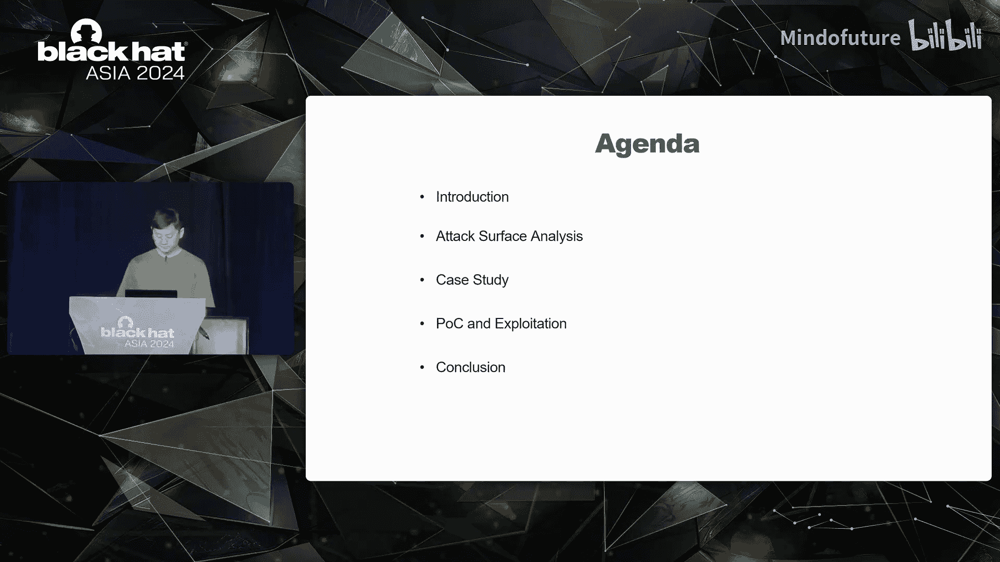

Okay， next， we will first introduce the concept of net link。

 You will learn what the net link is in this section。

 and then we will analyze the attack surface of net link。

 You will understand the underlying principles behind the formation of net link vulnerabilities。

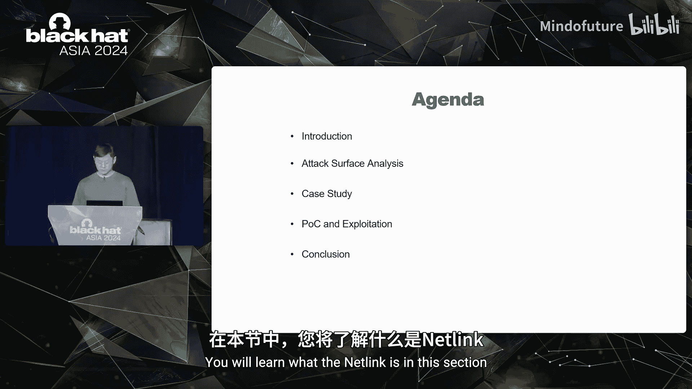

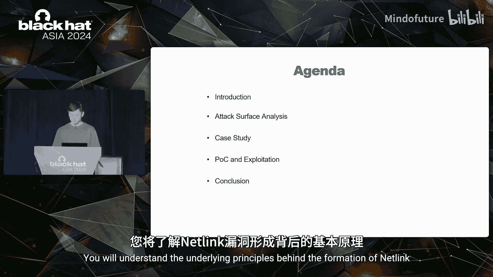

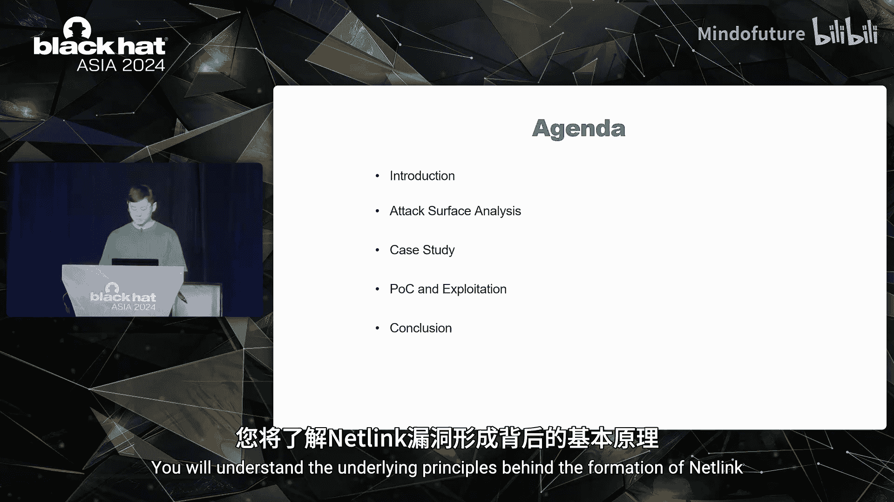

Next， we will show you four typical vulnerabilities scenarios。

 You will get the vulnerability money methodologies in the real world。

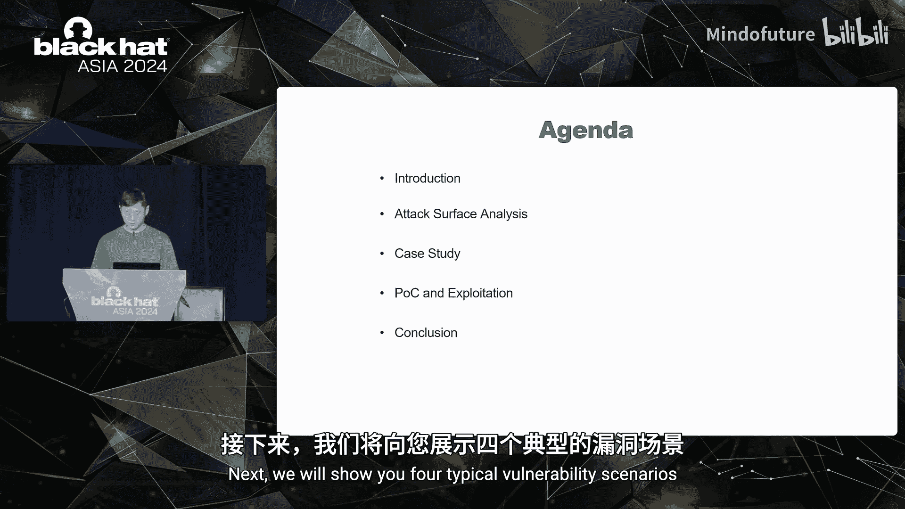

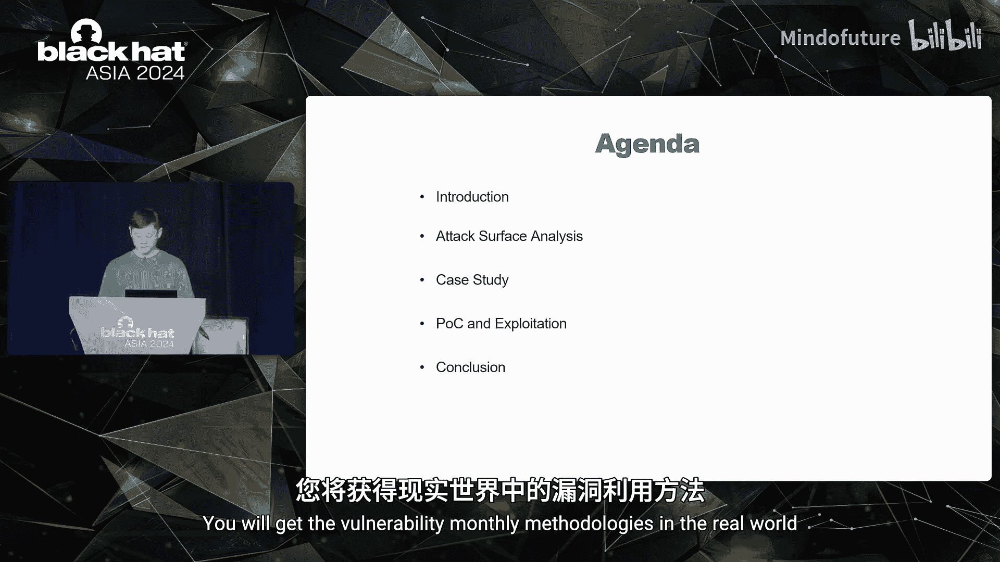

After that， the P O C templateulator and solutions to come vnerability verification programs will be given。

 Finally， we will provide vendors with some security suggestions for customizing that link。😊。

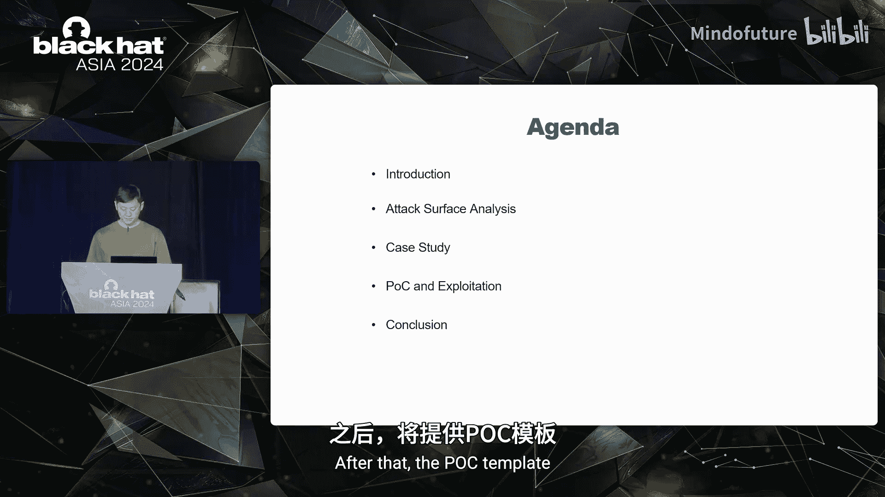

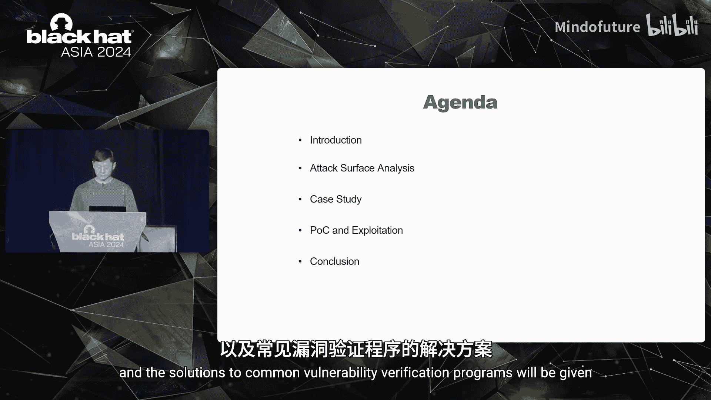

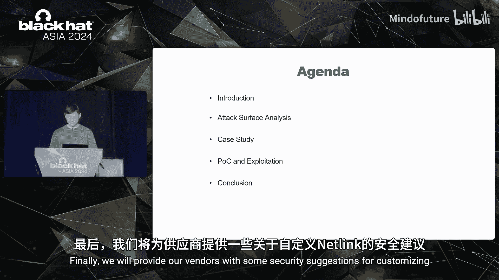

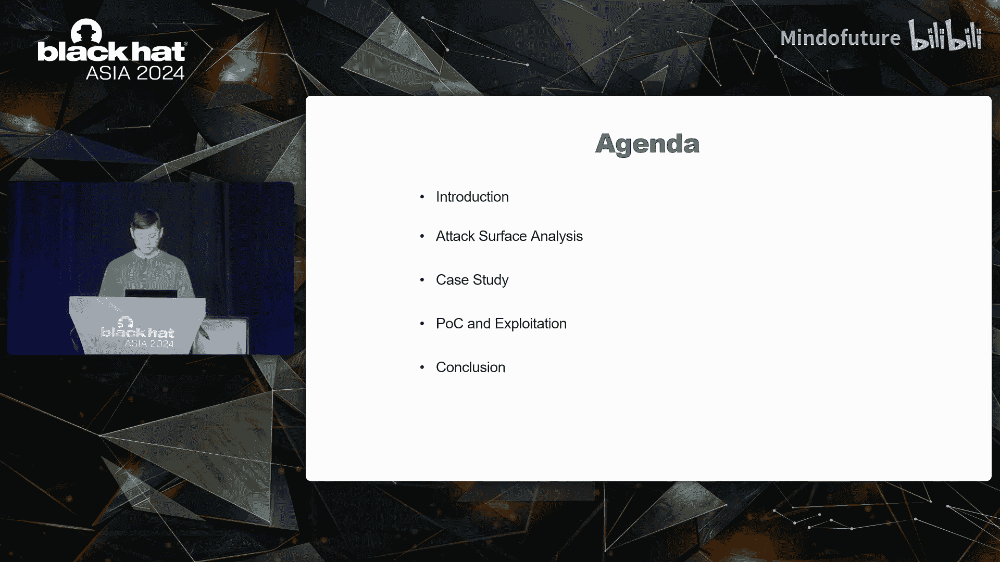

Okay， let's start with the introduction。

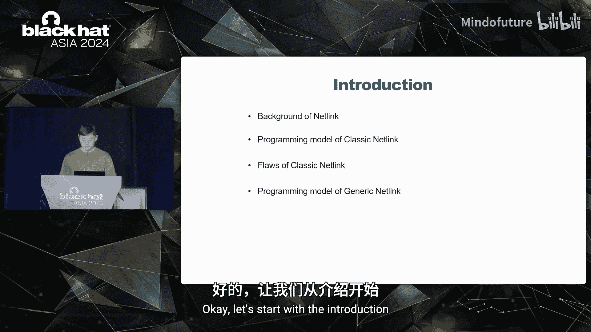

So what are the local attack surfaces in the Linux kernel。

 The possible answer may be operations such as our controller， readr， device files， system files。

 process files and so on。But today， we will introduce a commonly overlooked attack surface netlink。

 thatlink is often described as an our control， our controller replacement。

 which mainly used for bi directional communication between the kernel and user space processes。

Certain communication between user space processes is also applicable。

That link has some features that are different from our controller， such as for duplex。

 acycloneous and multicast， just like the finger below。We divided thatlink into two categories。

 according to its usage。Classic net and generic net。 as shown in the right finger。

 the generic net particle I D is 16。O。Is 16 and。The others are classic net ideass。

A classic soet soet is supported since 1999 with Linux 2。2 as shown in the following finger。

 it is a socket family。 So its user space programming model uses the Linux soet API。

Due to the feature of four duplex communication， that link transform message has two directions top down and button up。

In the left finger， we can see the landing link kernel create function will reject the input function。

 The input function is to pass the message received from user space。

 It receives S KB as the input parameter。 The S KB contains the landing link transfer message。

In the right finger， the N message Uni or N message multicast function is to send the building message to user space。

Okay， the programming model of classic netlink seems to be perfect。

 but why was genericlink introduced later， Let's take a look at the classic net kernel registration function netlink kernel create。

In the right figure。 itss second parameter is unit， which represents the net practical I D。

 If we want to custom customize a classic net， we need to add a new political I D。

In the Linux kernel， the maximum number of practical I is 32。And the kernel has already occupied 22。

 So the kernel leaves only 10 for customized usage。 Of course， we can enlar the max。

 but this doesn't seem a good idea。In addition， classic net is more complex to use because it requires passing the net message by ourselves。

The passing macro in the writer button figure。Therefore， the generic come into existence， existence。

 okay。generic landing socket is supported since 2006 with Linux 2。6。15。

 All the customized usage can share a single practical I D 16。 when passing the user space messages。

 we only need to focus on the payload。 Also known as attributes。In the left finger。

We can see that the junior register family function will register the ops and small ops。

 The difference between them is that the small ops provides few message handling functions and is simpler。

 Both ops and small ops contain the do it function。

The do it function is to pass the attributes received from user space。

 It receives an SB under an in as the input parameters。

The info contains the user payload or attributes。In the right finger。

 four functions is to send the building attributes to user space。Okay。

 after introducing the net usage， let's analyze that attack surface in depths。

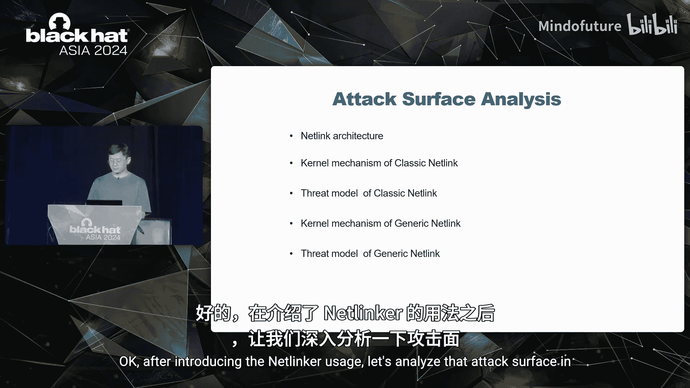

First of all， let's take a look at the net architecture in user space。

 an application can directly call or indirectly use the Lib N L to call the Linux soet API to send the net link message to the kernel space。

After receiving the message， the kernel will route it to the landing sub systemt。

 the subyst will handle it according to its usage category。Next we。

 we will focus on the message handling mechanism of the Linux subsystem。

A classic net link transfer message may consist of multiple net link messages。

 You can see it in the first line。 each message contains net link message header use the payload and their pendings。

 the head size and payload size should be4 by un。 The N message header structure contains consists of five fields Me length content type additional flag sequence number and process port I D。

The message lens is the total size of an dynamic message。 The port I D is usually set to the process。

 on E D。The classic landing link transfer message is send from user space to kernel space by send to or send message function。

 The S KB will contain the transfer message。 It is an input parameter of the input function。

 The input function registered by landing link kernel create function We pass this transfer message。

 We can get the transfer message from the X KB data。The question is。

 what checks does the Linuxux kernel netlink subsystem do on the transfer message。

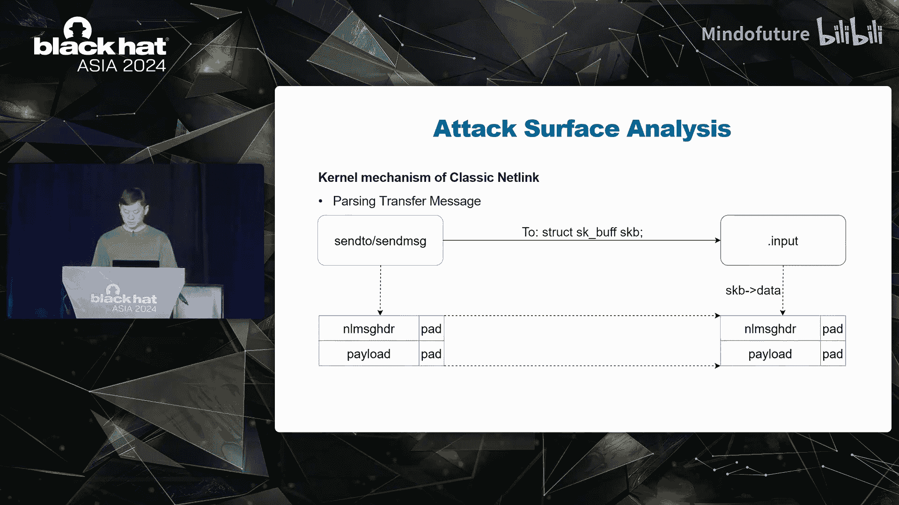

The answer is， check nothing。Which means we need to check the link message header by ourselves。

It is a dangerous behavior to leave the checking to the developers。

So how should we securely pass the top down transfer message， not knowing the attack。

 not knowing the defenses。 We summarized three possible attack vectors。

 The first is the developers don't have a great understanding of the relationship between S KB lens choose message lens and message headlines macro。

 So they don't do any checks at all。The S K S KBs is Trans messages total size。

 It may consist of multiple net link messages links。

The N I H is N I message lens is the one messages total size。 The N message header。

 head lens Mac is one message header size。 It is a fixed value。嗯。

A convenient way is that we can do those checks by the N message， O Mac。

The second attack vector is the developers start passing the pilotload structure without checking the payload lens。

 And the third attack vector is the developers don't fully check the validity of the pilotload content。

In contrast， do how do we attack the building of classic mess as to user space。

 All we think we can think of is combining it with other kernel attack surfaces such as fine operations。

 socket and so on。 We can reverse deduce the source through the classic building message。

 and then we do we can do vulnerability money。After analyzing the attached surface of classic netlink。

 let's continue to analyze the generic netlink。😊，The first the message format of generic net is as shown in the finger below。

 We can see that the generic net is created based on classic network because their general message format is the same。

 You can see the first line。The difference is that the payload composition。

 which contains a generic landing message header， a family header， attributes and their pens。

 Each attribute contains a land attribute header， an attribute payload and their pens。

The family header is optional and customized。 So let's focus on the generic landing message header and attribute header。

 The junior message header structure can consists of three fields。

 commander version and reserved the commander field will instruct the kernel to call。

 which do it function。The N L NL attribute structure consists of two fields that link attribute length and type。

 together with the attribute payload， they form the T， L V structure。

The net attribute lens is the total size of an attribute， including the size of net attribute header。

 The net link attribute type is the index of attributes a real。

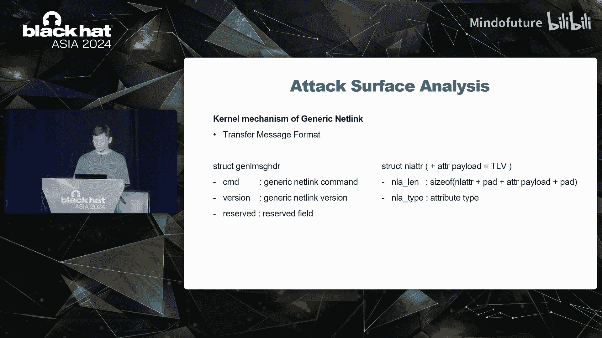

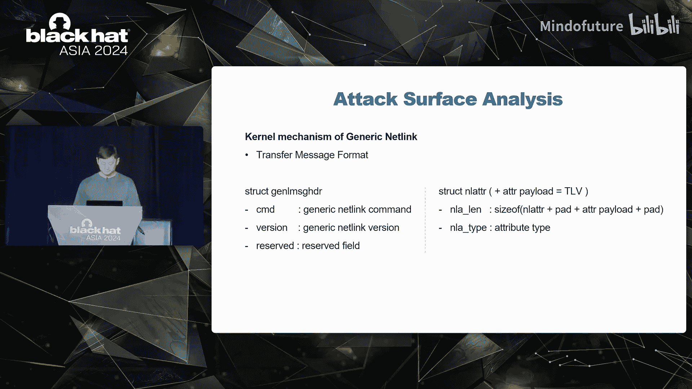

The generic transfer message is also sent from user space to connect space by send to our send message function。

 The infer will contain the transfer message。 It is an input parameter of the do it function。

 The do it function register by family function We pass this transfer message。

 We can get the transfer message from the infer attributes field。The same question is。

 what checks does the Linux kernel net subsystem do on the attributes， The answer is。

Check by NLA policy。The N L policy， namely net attribute policy。

 is registered in the junior family structure or juniors structure， the junior ops。

A policy tax tax precedents over the junior family's policy。

We can see the N L A policy contains an attribute type， lens， union and so on。

 The attribute type here is the data type of the attribute payload。 The lens has different means。

 depend on the attribute type， for example， If the type is N L string。

 The lens is the maximum length of the attribute payload。

 The union is also used to check the validity based on validation type。

All checks on the attributes are done in the validate N， L A function。

So does the top down generic land link transfer message passing have no security issues。

 Of course not。Let's take a look at some attack vectors due to developer oversight。

 The first is that the developers neither don't set a policy at all or set set an increased policy during the policy registration phase。

 second the second attack vector is the developers don't check if the attribute is long during the attributes passing phase。

The third one is developers don't fully check the validity of the attributes pilot contained during the attributes passing phase。

In contrast， how do we attack the building of generic landing messenger。Send send it to user space。

 same with class classic， we can combine it with other kernel attack surfaces such as fires。

 Socket and so on。 We can reversely deduce the source through the generic building message and then do vability money。

Okay， from the preview section， we can conclude that both classical and generic net have some possible security threats。

Now let's take a look at some typical net link vulnerability scenarios in the real world。

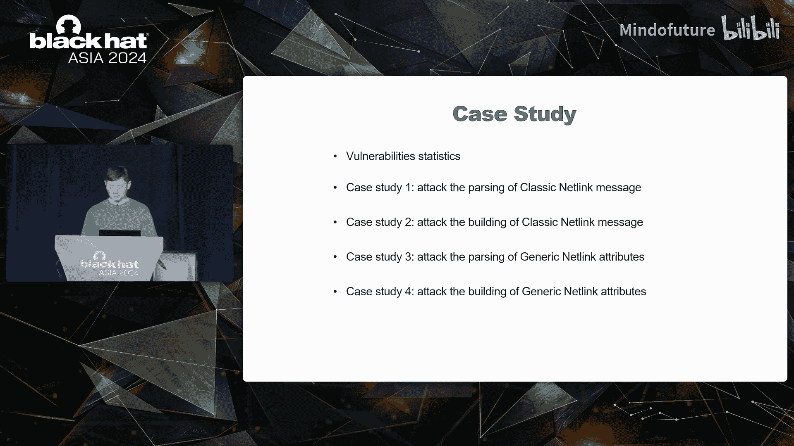

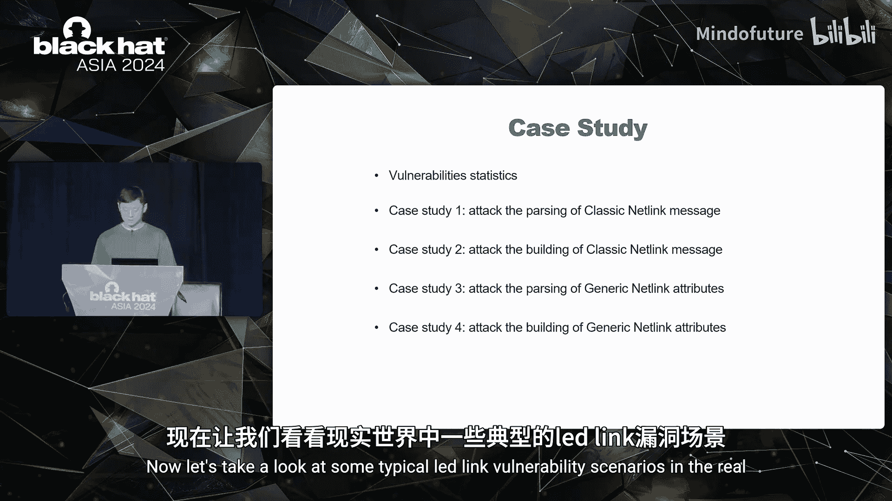

Okay， based on the attack surface， we investigated link relateds from four well known vendors and discovered 38 vulnerabilities and obtained 19 Cs all the vulnerabilities have have been fixed by vendors。

In the left finger， we can see that there are more vulnerabilities related related to classic。

 and there are also more several。It suggests that we should consider using generic net for customization instead of classic net。

In the right finger， we can see that both the upstream and downstream kernel may have vulnerabilities。

But the downstream kernel is more likely to generate net related vulnerabilities。

Let's take a look at the first case。 The first case is attacking the passing of classic dynamic message。

In this scenario， the classic landing message is sent to is sent to kernel space by send to center to function。

The kernel will invoke input function to passing this message。 as shown in the right finger。

 M T K gauge net handler function is registered as the input function by net kernel create function。

When receiving a message， it will call MK a battery net handle function for further processing。

The M T K battery link handler function gets get the handleer namely N I H from S KBs data field first。

 Then it gets the user payload namely date from N I H。

 The date will be passed into M T K battery demon handler function。

 This function will further pass the payload content namely message。

It will copy the messages and FGD date field to another variable。The question is。

 how many security vulnerabilities exist here。Based on the attack vectors， weviewed we prevailview。

Smard， this case has at least two vulnerabilities。 The first one is that it accesses land link header without checking。

The， the headline， the second one is that it accesses net link payload without checking the payload lens。

 Both vulnerabilities will result in out out bounds read。For seeking。Are all all the O。

 O B read data located in the receive buffer。The answer is， not necessarily。

There are two ways that may result in O O B read outside the receive buffer。

The first method is calling set socket option a function to set or minimize the receive buffer size。

 The minimum receive buffer size is typically a few kilobs。

The second method is carefully constructing pilots that precisely fills the receive buffer。

 This can cause the outer bounds read data to be the receive buffer outside。

Just like showing in the right button finger。The second case is attacking the building of classic message。

 The vulnerability money method is tracing the message sending into user space。

 as shown in the finger below。 we first located the message sending function on message Uni。

Then we can describe the entire lifecycl of this message。Firstly。

 an user space process sending sends a D E K encrypt D E K request to kernel space by our controller function。

After receiving the our controller request， the kernel allocate a request and send the request to user space by N message Unicur function。

Then it will wait for the processing result After receiving the request from the user from the kernel space。

 the user space process will handle it and send the processing result to the kernel through classic net link。

The kernel will call input function to cancel the weight， Then the request will be released。

Now we understand the entire process flow。 Let's take a look at the implementation of the input function。

We can see that before canceling the wheat， it will find this request from the global variable GPub crypto controller and copies the processing result to the request。

The problem is that the request isn't protected in any way。

 which means we may still access this request， even if it has already been deleted and released in another thread。

 Finally， an use after free vulnerabilities is triggered。

This case combines classic net and our controller function。

 The root cause is a protected global variable。The third case is attacking the passing of generic net attributes。

KSM D is a Linux kernel server， which implements symbol 3 internal space for sharing files of network in this scenario。

 The input is a TC P request。 The request will be by K SMD PC read function the K SMDRP read function will call message Uni to send a request to user space。

 and then it will wait for the response。The user space process receives and handles the request Then it will send the response to the kernel by the generic net。

The kernel will call doit function to cancel the weight。 Then the memory copy will be performed。

Now we understand the entire processing flow。 Let's take a look at the implementation of the do it function。

The do function is implemented as handleer generic event function。

 It will pass the attribute payload and pilot size from the info variable。

 and that call handle response function。 The the handle response function will copy the attribute payload to the response and then cancel the weight。

Once the weight is considered， the K SM BD R PC read function will return。

 The response will be passed to the I PC response pay and its size。However。

 the size of IP PC response payloader doesn't be checked。Which may lead to an O， O。

 B reader occurring in memory copy function。 This case combines generic and T C P。 It root cause is。

Developers don't check the validity of the attribute payload content。

The last case is attacking the building of generic attributes， similar to classic network。

 The vulnerability money method is tracing the attributes sending to user space。

As shown in the finger below， we first locate the attributes sending function Gen message Uni。

 Then we can describe the entire life circle of those attributes。As shown in the left finger。

 firstly， an user space process will send a right request to kernel space by right function。

Then the receiving function F LP write will be under the right request and send the result to user space by junior message Uni function。

 as shown in the right finger。Let's take a look at the request processing function。 FLP， right。

The header parameter is copied from the user space。Get data from M。

 C U function Doesn't check the validity of length from the header。Which may lead to an O。

 O B read to the header during memory copy。 This case combines generic and right function。

 as root cause is developers don't check the validity of the writing。Okay， now we have understand。

 understood for vulnerability scenarios in the real world。 The question is。

 how do we very far and exploit those vulnerabilities。

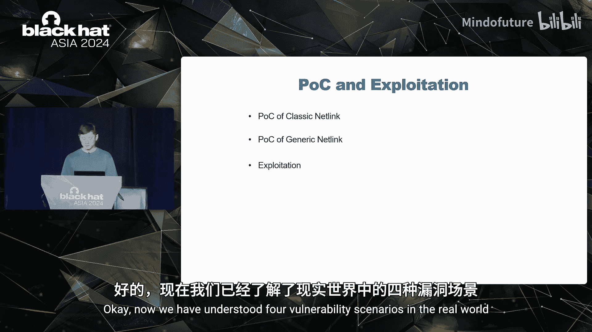

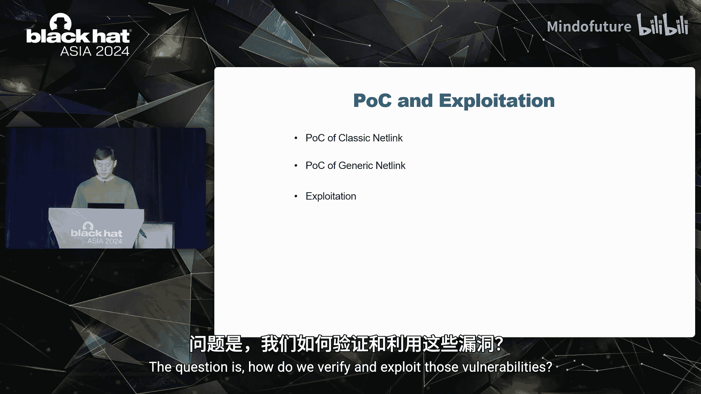

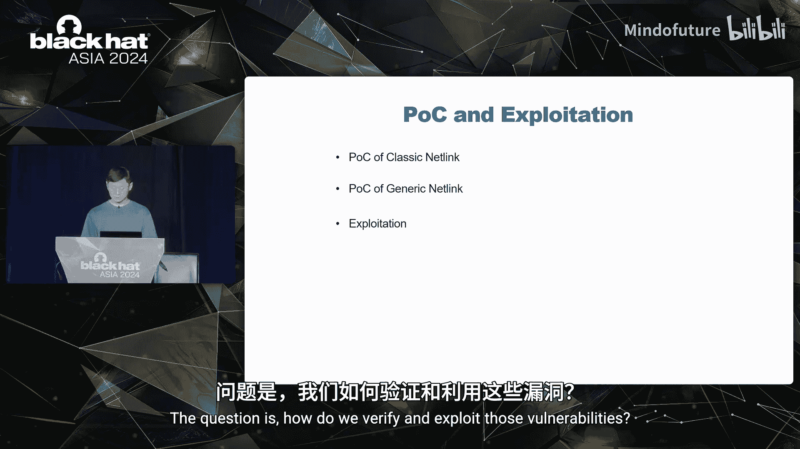

The first thing is verification。 When we want to trigger risk condition。

 we often encounter the source port occupation problem。The solution is simple。

 Neither use the process I D as port in multi process or try a valuable port to bend in multi thread。

The P O C template of classical Ne is shown on the right finger。We need to fill in a message header。

 and piloted by ourselves。For generic network， in order to verify the vulnerability。

 the first thing is solve the family I D acquisition problem。

Because all the customer customer generic shares a practical I D 16。

 They are distinguished by their family name。 We can get family I D by sending the message on the left finger。

We need to fill in message header， junior message header and attribute by ourselves。

 The right finger is the P O C template of a generic network。

 We need to pay attention to three functions。AG send message function is used to build and send generic landinglink message。

The junior get family I D function is to get family I D by calling junior send send message function。

 The junior receive message function is used to receive generic message。

How we use an we use an arbitrary rate vulnerability and right word will vulnerability to obtain privilege ecalation。

 The exploitation is very simple。 Firstly， we use the arbitrary rate vulnerability to obtain the address of credential that we can modify the credential by using the right what where vulnerability。

 last but not least。 How are that related vulnerabilities mitigated。For the Android system。

 we can set the target class net link socket permission by S E Linux。Rulers。For the Linux platform。

 we can check the cabinet admin permission by landing capable function。Through the above analysis。

 we can conclude that landing is a hidden attack surface。

buried deep in the Android ecosystem when customizing classic net。

 the kernel will do no checks on messages one we customize generic the kernel will do checks by attribute policy。

 generic doesnt does more than does more than the classic net， but it also introduce。

new secure security threads。We have also prepared some suggestions for vendors。

 The first one is try to customization using generic net instead of classic netlink。

The second one is understanding understanding net mechanism and Is before using them。That's all。

 Thank you for your listening。 Any question， please tell me or you can also contact with me a workcard。

 Thank you very much。

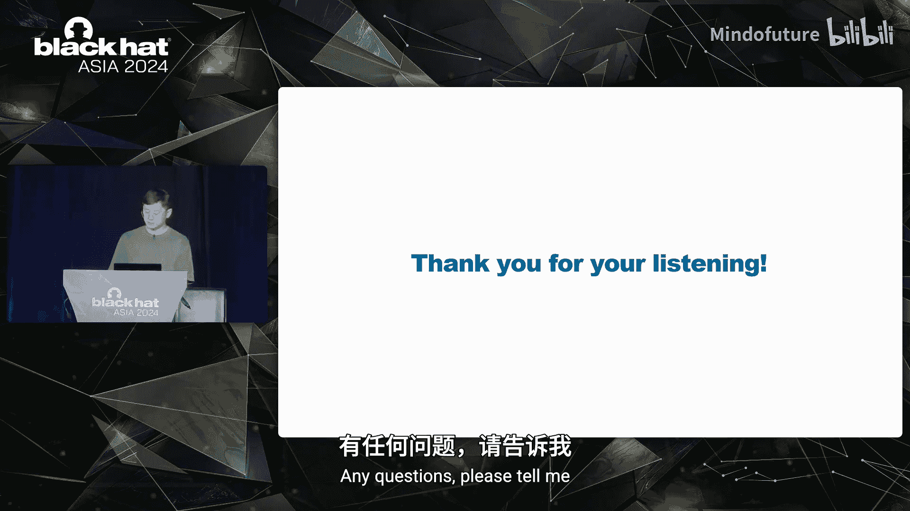

