# 黑帽亚洲大会2024全集-•-中英｜Black-Hat-Asia-2024-p05-P06-What-the-TrustZone-M-Doesnt-See,-the-MCU-Does-Grieve-Over---Lessons-Learned--BV1oyX7YnEhN_p5-

Okay， welcome to our session。 So my name is Sandra Pto。

 I'm associate research professor at the University of Mino。 Today with me， I have Christiano。

 which is currently doing Ph under my supervision。 So this is my third time at Blackhead Asia。

 Always a pleasure to be here。 And the second time for Christian。

 So the title of the talk today is what trust on M doesn't see the M CU does gr over。

 lessons learned from assessing a microcontroller T。😊，So the formal acts。

 This is the agenda for today。 I will start with a brief introduction just for the motivation set of observations。

 Then I will hand over to to Cro， which will discuss the part of of the work。

 And I will get back near the end just to provide some advice and lessons learning and to conclude with the final thoughts and the black some bites。

Okay， so we are currently living in this internet things era where the overall idea is to connect every single device to the Internet。

 I mean， in the past we used to have like this embedded embedded systems which were somehow disconnected from the Internet。

 but nowadays， the trend in many industries is to connect every device to the Internet。

 and for example， one one one very application at the moment is this AI enable edge device。

 where we currently are shifting the AI from the cloud to the edge we want to protect the I and from the external aers and attackers。

Well， these are just numbers。 I I， I mean， this graph here is the first on the left is was from arm。

 I do remember when I was at Ar techcon in 2017， that they released the projections of the commulative number or an all productions of I O TV device that is expected to reach 1 trillion by 2035。

 And yeah， we this basically states that this trend is going to increase and accelerate。

The problem is that what we are witnessing is this by connecting in I O T device or device to the Internet。

 we have seen witnessing more and more acts and， and attacks。

We are currently leaving the age of the cyberwifi。 And with that， I mean。

 Ms or microcontroller units， which are different from the application processors that you use on your mobile device。

 Harm is the main designer of these Ms。 I'm talking about Cortek M0 M0 plus M3 M4 and M7。

 and armfield the need of implementing like security mechanism on these Ms to basically provide security at scale。

 And that's why arm decide to shift trust on technology that is been around for more than two decades to protect your mobile device from like mobile to these embedded and I O T device。

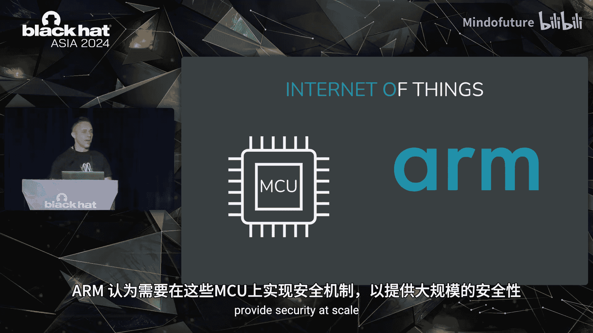

Well， as I said， Armtroson has been around for more than two decades。

 mostly to protect mobile device。 I mean， you may not be aware。 But every day。

 if you are using an Android device， you are using Android TVma， you are using a fingerprint。

 So you are using trust on technology。 and this technology also being used in a tablet and also on。

 on smart TVs。Trust zone is centered around the concept of two protection domains or worlds where you have the security state where you place your security critical applications。

 and then you have your non- world or the normal world where you put your main operating system。

 I mean， if you refer to your mobile device， typically you have like your Android。

 which is the rich operating system， And then you have a T that maybe in several form shapes and flavors。

 depends on on the vendor， which in by the security critical applications。Well， and as I said。

 arm shifts trust on technology from this mobile device to these Ms and the new generation of cortex M。

 which are the R VHM Cortex M23 M 33， already embedded by this technology in its core。

 So for those who are familiar with these arm V6 R V7 architect。 And I mean， cortex M0 M3 and M4。

 you typically have two processors mode3 and thread and anr。

 you have two privilege lever and privilege and privilege， which means that at the end of the day。

 you have three based privileged lever and privileged thread。

 privileged thread and privileged angler。Well， basically。

 we transform on what I did was to create this orthogonal world where you basically replicate by two。

 And at the end of the day， you have this completely replica of， of the privileged state。

On the non secure side or the nons state and also on the secure state。And basically。

 what I did comparing to the cortex implementation of thrust on was to optimize life the context switch。

 basically for this resource resource constrain device。 For example。

 you don't have any more the secure monitor， which has been used to basically interface between non- secure state and secure state。

Well， in terms of memory access control， while interest on A。

 you typically add like the trust on address based controller or a memory controller at the platform level on on RMV8M。

 you have controllers which are called secure attribution unit and implementation defined attribution unit。

 but at the core level that work as the first layer of filewall that is then we then have a second layer。

 which is the traditional MU， which is then replicated on both the secure state and on the non- secure state。

Okay， so well， the CPU protection from Tson is at the CPU level。 I mean， the system level protection。

 you have these memory controllers， which mean that for example if you set the access policies of the S and the MP and you for example。

 if you want to access the address0 x100 from a secure and privilege since you have defined the policies of S NC M to be secure and privileged。

 you will not be able to access that address。 Well。

 but because these controllers are just at the CPU level。

 if you basically have a DMA capable device on your platform。

 which is very likely on these sort of microcontrollers。

 you have tons of peripherals and a lot of DMA device Well。

 you can use a secure andprivied application to basically be assigned with DNAA device and on。

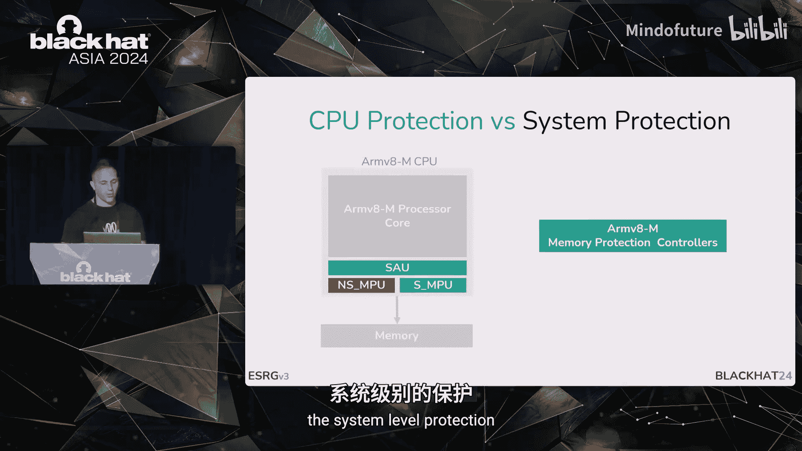

Of of instead of going through the normal flow of the CPU。

 it basically differs the access to memory through the DM MA。

 And because the M access are not checked by the same memory controllers as as as the core。

 So it is possible to access。 So what， what what trust on or arm states is that these system level controllers instead of being specified by the trust zone itself are specified at left to the implementer of of the S O C or the M U to to to。

 to embedded those and to implement those。And yeah。

 in case you have these memory protection controls at the system level， you can。

 you can also enforce policies。 And if those policies are enforced。

 you cannot anymore have the DNAMA device to access the memory on behalf of the secure application。

Well， this leads to the conclusion that。Trust zone is focused on CPU only protections and not as a systemwide protection view。

 which we will see maybe a problem。 At the same time。

 Arm decide to boots these platform security architecture movement is a joint initiative between arm and other or other partners that basically defines a set of thread models。

 then architect set of protection levels to be linked with these trade models and provide a reference implementation of a secure source code。

 Well， part the P definition， there are basically three PA levels that enforce protections with the different capabilities。

 Let's put in this way in PA level1， you just have the normal division between non secure world and secure world。

 But then the software on the secure world typically consists the trusted kernel some trusted service that belong to the kernel。

 but also applications developed by。

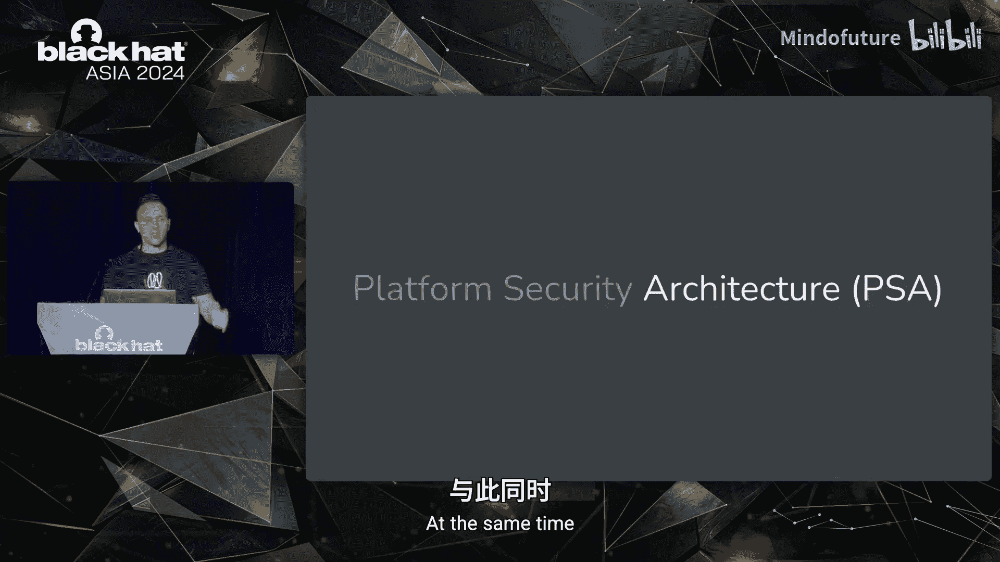

Third parties that want to to develop security， critical applications in the P A lingo。

 you have like these R ros， which is stands for application root of trust and the P ros that stands for P A root of trust and then the kernel itself。

 So based on these， they define a second level， which not only provide separation between normal word and secure world。

 but also compartmentalize the code inside the secure world is this principle of micro kernels where the more you compartmentalize。

The more you reduce your TCB， which means the better for security。Well。

 and we still have a third level of in in the PSA， which not only split like ROs from the POs and the kernel。

 but you also isolate the different ROs from the different parties O O AMs。

 which mean basically you can have multiple and those cannot assess each other。Well。

 our main major observations was that， okay， trust on them just as a CPU centric view。 and per。

 he only defines protection controllers， which are the A U， E D O and MPU。

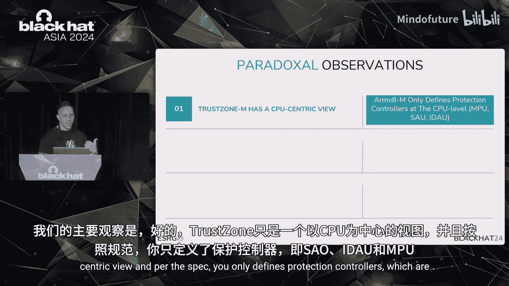

System oil protections are proprietary， which means this left to the vendors to decide and define what they should embed。

And there is a kind of mismatch between the。Trust on M and the PA levels。

 because the trust on M doesn't enforce like system level protections。 but part of the P A level。

 you may need like this system level protections。 Well， so we put tie that based on this d。

 which together with the lack of understanding of the different P A isolation levels。

 it could be a major catalyst for the existing of unknownsecurity holes in modern trust on M system。

 So and we tried to find evidence about about these hypothesis policies。

 So now I ended over to Christian， and I will get back near the end。Thank you， Sand。

So now I will show you the evidence of。That supports this。

 this hypothesis and show you a bumpy but revealing journey。 I will。

 I will guide you from what you find to be a weak hardware protection。 And then we go to。

Assess1 T E that is specific target for microcontrolls。

 And I will show at the end what was our responsible disclosure journey。So2018。

 Miship partnered with trustonic to release a secure solution for IoT devices。

 These make waves on several news outlets and create a lot of hype for this IoT community because it was bringing security for this resource constraintstrain devices。

 Miship on this partnership release Sam L 11 that is a microcontroller based on trustone。

And that is a specific target for resource constraint， IoT devices。

 and Traonic release K EVM that is a trace cushion Iran that specifically runs on this platform。

So here we want to dive a little bit deep and try to what was the secure guarantees and the extras of these guarantees in each side。

 And we start by looking at microship some Ali1n。And this is a board that has a cortex M33 and is marked by microce as a robust secure solution。

 And has a lot of security features like arm thrust zone， secure boat， cryptoization。

 secure case storage and ship level， Tm protection。

 But we find here at first something missing at the memory protection。

 So we went a little bit deep and we went searching at themat from data sheet for the microcon。

 And here you can see that there is a memory protection Unity。

There is a dress on controller Sa and itda， but we don't see any ma controller。

 If I first a little bit strange。 but then we we thought， okay。

 maybe this is just a misrepresentation of onnda smatic。 and we ski through the lattice sheet。

And find a bunch of find a bunch of security features。

 And there is one that they called a peripheral access controller that is like a basic PC that can assign a peripheral either to secure world or nons world。

 And here。We， we find something missing， too， because they they say that we can assign a approval to secure and unsecure。

 But what about the privilege and nonprivilegge And what about the memory protection at a system level。

 so。You are here more confused。Because this is a acon that is cell as a specific solution for security and I T devices。

 and they don't implement a critical implement critical piece as memory protection at the system level。

 And what this means on Xmatic is there is no MPC。there is a pack that lets the pre be assigned either to the non secure or secure world。

 and when a secure unprivileged application wants to access privilege memory。

 you already know what happens。At the car level， it may be blocked。

 but it can bypass that using a DMMA。This per C is not a problem and is justified because some L 11 is certified for PEa level1。

 which means they can separate nonseed from school world and the hardware can enforce this。

 the problem here starts when we want to join K EBM to this solution。

 and here the they they claim that there is a pestas certification level 2。

Watch tries to separate application root of trust from the privileged software。

And with this kind of word， we find this a little bit difficult to， to enforce because there is no。

 no MPC。So we argue that the lack of an MPC may open unknown securitycur hall specific particularly when you want to implement P level 2 entry。

 and we report this to microship to trying to raise awareness for this problem。

 But microship just points us to trustonic。 So let's see that the second puzzle。

 a piece of the puzzle。The Treton Kib VM is a trust crucial environment that is tailored for resource constrained devices。

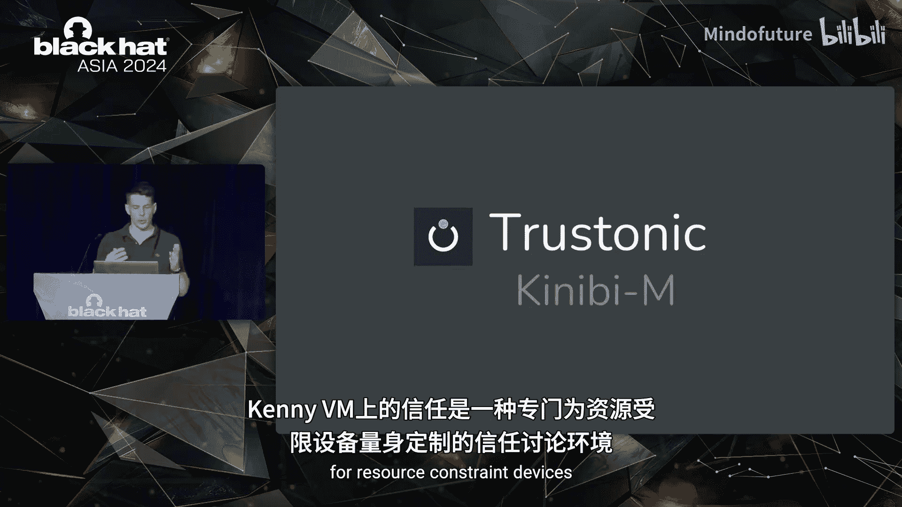

And they official claim that they can have Pel level 2。

 So let's try to map this to our understanding of what is a Pel level 2。 So they。

 they have a non secure software。That runs untrusted software。 And and inside the secure world。

 they have the kernel that is called Kiibbi O。 They have secure service。 that is on the Paling。

 the PA route of trust。 and they have thirdpart application for Os that is on similar to the ROs on PA level。

But they， they say that the secure mode can run on or every secure mode runs on on privilegeed mode。

 So this means that the peia hood of service runs side by side the application Ho of thrust。

 and we now start to find a little bit difficult to map this to a PEa level too。And further。

 they also say that they use a memory protection unity and that a secure model。

Cannot read other good models code or run。 So this looks more like a PC level tree。So。

Kibm seems more than pest element， because they。Put the secure services at the same level of the application hotel trust and try to delete Hall of time。

 And when we add this with the fact that microship some L 11。

 just a support for best L level 1 and no PC。 we think I here at time bomb ready to explode。

So this leads us to one first observation that an application Hotop trust or a secure mold that has been granted a DmA device can fatigue bypass alkinibBM enforcement policies and shape a rate right of e capabilities report this to Tstoonic and now I want to show you what was our response disclosure journey。

And we start by reporting and at January 10， then at January 12。

receivedce the first acknowledge of our report。 and the first feedback was coming on January 30 it which we respond the next day。

 Then we have another。Step on on this responsible disclosure between February 9 and February 14 and a last iteration with Rotonic on February 16。

 and we end up ripping up all of these responsible disclosure on March 2010。

 So now I want to focus on each iteration and lay down some of the most important topics。

 There is a lot of conversation going on。 But I think this is the main ones。So first， Tonic says was。

 okay， you are using only the K VM evaluation version because the production version has a lot of security feature that you don't have access。

 so want have here a biggest disclaimer at how our conclusion are derived from this evaluation SDK。

 but to respond to Traonic that we still think。That a commercial version may suffer from the same problem because the underlying hardware is the same。

 They implement the production SDK on the same controller that has not the memory protection control unit。

 There is also a topic about the atation because they okay， you are they say to us， okay。

 you are using the the evaluation SDK and you can play around with the moduleulus。

 but on the production SDK， you need to be trust party and need to be signed to be to have their。

Code running。 So I want to do a second disclaimer that is kind of related to the first one that evolutionistic app that we did use does not support at station。

 But we still think that this is a orthogonal problem。

 So you can still have effectss on these kind of third party applications。

 even if they are signed and validated。And， and unless there is formal verification on that。

 you cannot， you should expect bug。So there was another topic about demi informationations。

 The Traonic site was that。And agree with with our our our take that a secure mode with access to the MA canny fatigue bypass our memory protection and have access to the full system。

 But they don't seem that as a open door， what we find a little bit contradictory because you give access to our memory and you don't see the open door。

 so。We found that a little strange。 Then there is。Another iteration that they say， okay。

 you should grant access to Dmia， but that demya is locked down on the production X D K。

 And we argue that you should not grant， but you should mediate。

 So other responsibility in our perspective should be on a part of CanadianibBM to have some kind of module that enforces that on software。

And we propose also to share mechanism to implement that mediation。So here one。

 in the first iteration， want to lay two takeaways。 First。

 that there is we argue that is a na trust on O M developers that even if they don't have any intention to。

InIn malicious code， they could have do do that by introducing books that all other people can exploit。

 And there is also。A lack of understanding of the limitations of the hardware and what we can or not cannot do at the software level and what we should do to enforce that policies。

In the second iteration， there was a lot of things going on with Taiwan just to focus on this one on the non nativeative M port because K Triton say that Kna does not ship with a secure world EmA model and that is left up to the OM developers and OEMM developers should provide the the mediation and we don't think this is a good security practice because typically OM don't trust each other。

 So when you have multiple OMs on the same。Devicice。

 they should be isolated and protected and not accessed to a core device as damemia。

So here one play two takeaways too， there is a lack of understanding of the multi OEMM threat model because they don't trust each other。

 they should be not granted permission to aA or to deploy EMA per them。

 and we argue that there is also lack of understanding of the critical of such service as adeA。

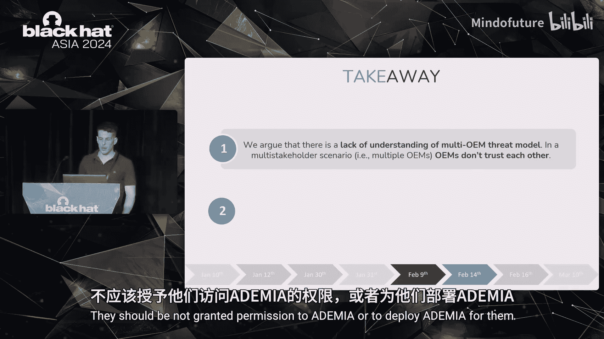

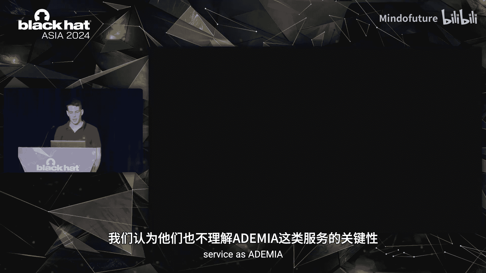

And there is also a third iteration that was the last one。

 and it was most of in a aspect of clarification and when we reach a common ground about what we are discussing。

And first， Tson clarifies to us that KiibM predates R PSA。 and in some points。

 they do more than PSA in other ones， they do less than PSA。

 So there is no one0 one connection between the PSA levels and what canibM does。

And on clarification also about who should provide MM mediation。

 Tson said to us that this NBM Tra environment is tailored for resource consent devices and that most of the customers dont don't use the MEA screen mode。

 but the ones that use may have problems。So they they also say that theA access should be mediated by a system model。

 but that should be provided by OM， and we strongly believe that this is not the right way to do and is not a good securityy practice。

And that that not providing the mediation in one side you are hindering the capabilities of the system and another side。

 letting hope on threat vector hope。Underwild。And the last thing that I want to highlight is some request to Tsonic just to ease a school advisor to clarify all of these protection gap that there is and clarify difference between evaluation and a production SDK and provide us access to the commercial SDK for internal assessment。

 Tonic in our sponsor disclosure were very willing to talk with us and sometimes we have different points of view。

 but we reach a common ground， but on this specific three questions we didn't receive any response and let the audience take the conclusions about that。

To suming up。 And if you take something about this responsible disclosure， I want to be this slide。

 First， we could only validate on evolution SDK， but we， we don't be was granted with the。

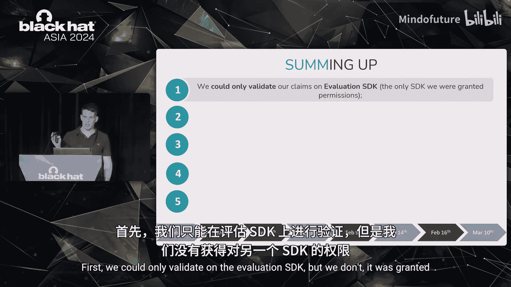

Permissions to the other one。The s modelss are only sign and validated on the commercial version。

 but we think that the atation is orthogonal to the problem that we present here。

An official KibBM claims that it has PE cell level 2。

 but its correct status seems that it wants to offer more than that when there is no hardware enforcing that。

And there is no DM media that is delivered by Kib BM and is left for O O Ms。 Now。

 I will present you one way that you can do to mitigate this problem that is use a DM mediation that we think is。

Pative simply to implement。 and basically， you can use previous。

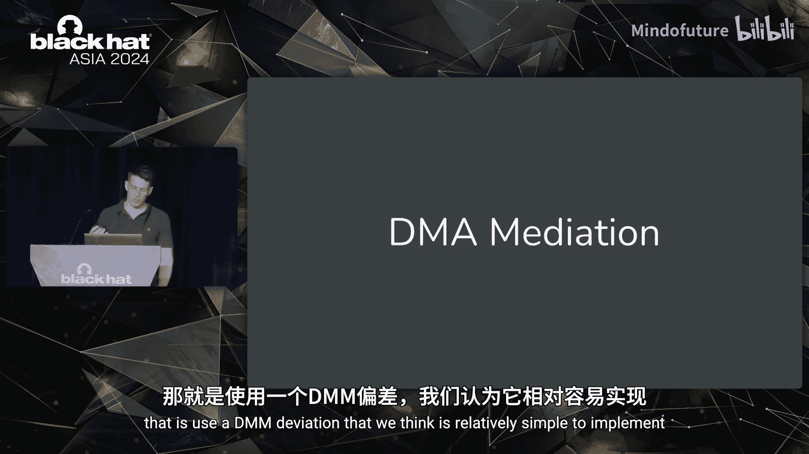

Application from as a secure service that as a DmM D that has a white list and we can put in a white list。

 the application that can access the thememia and when that application in this case。

 R one wants to access， they just request that access to DmM D and if that access is granted the DmM D will do the access on behalf of the application in the same way if the application of Ts2 that is not on the white list once to assess it will be blocked。

 So in this way you can simply implement and and emulate memory protection controller on software and prevent this kind of。

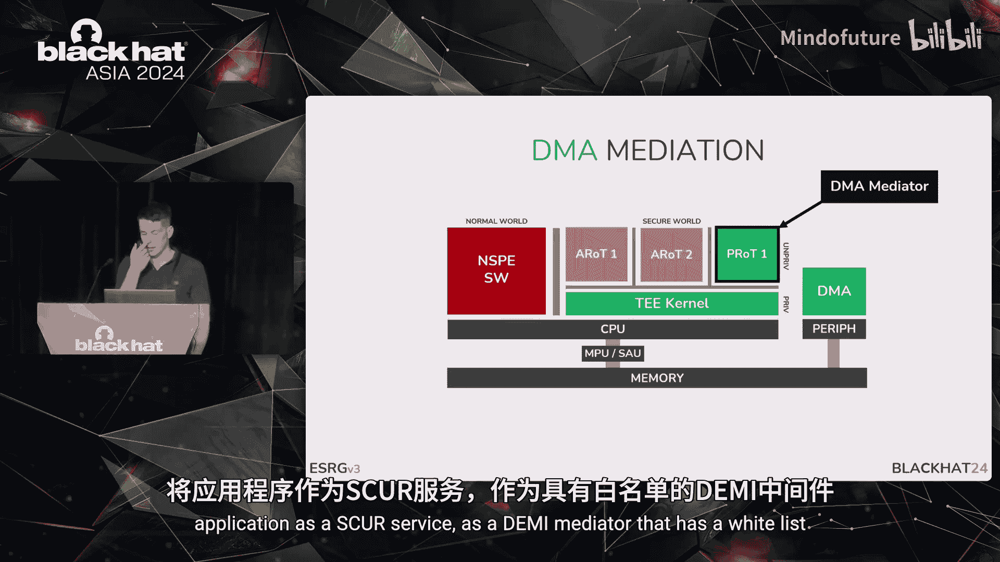

Gap， so now you we show evidence of the problem， but you are maybe asking。

 but to what what can be wrong with this。 So to what is as a consequence。

 So when we want to have probably more than pestta level to3 and the M M has no MP and the firmware has no the M deviationtion。

 Yep， you are your are screwed。We implement three exploits， one that。

We want to demonstrate that we can have secure privilege in cushionition and tamper with Canadianav M。

Then another one that we want to steal code from other school partition。 And remember。

 they should be separatedd and one school partition should not be assessed to another one。

 And the last one， we still put to have keys accessing that member that we should not have permission to。

 I will focus just the last one。 they are very similar in the way that they run。

 but here we are limited on time。 So if you understand this one， the other one will be very similar。

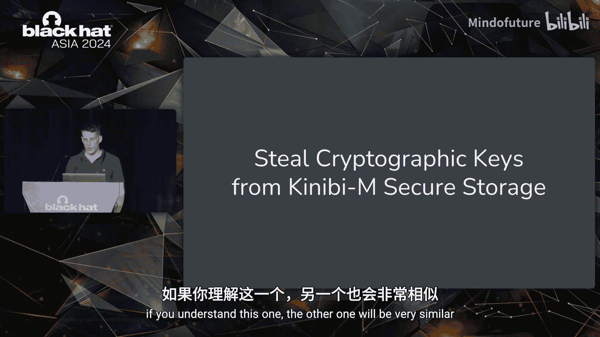

And。Here there is two parts where there is one application。

 Moic application that has a front end and a backend。

 The backend is a third part party application Hotel thrust that has access to Dma。

 and there is other。

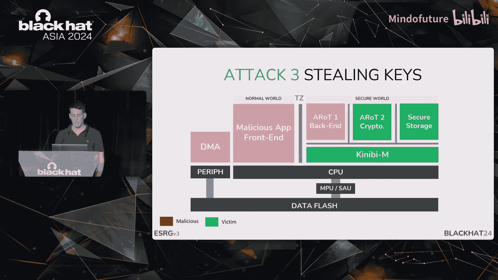

Application hot of thrust that do some cryptographic。Comput that is from other party。

 And here we just change this application and hardwi the key that that beefs to be easily mounted proof of concept attack to Sil the key。

 And basically the， the steps of this attack is the。

I wrote two requests school storage to store dead beef。

 Then the aition application wants to steal this dead beef。 And Canadianbeian specifics say that。

Scho mode cannot read other mouse memory。 So we just tried to do that using the gap of protection that we show you and we use the dememia and we could bypass all M and so protections and retrieve the school degree。

 So here its a quick live demo here we are dumping our secure memory from a secure and previous application that we should not have access。

 And on this。

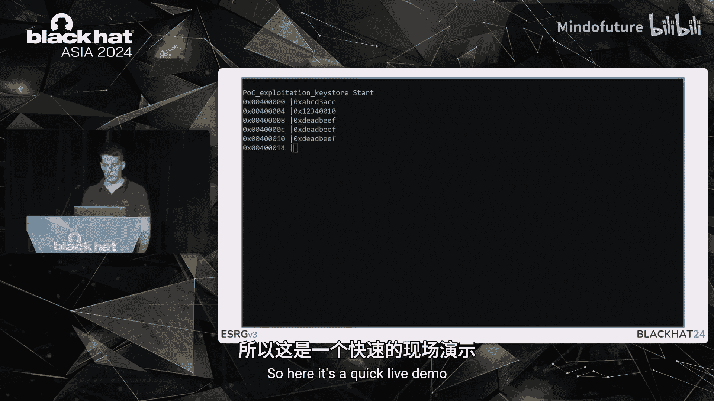

Dump is also the security key， the the eptographic key that is here on top。 can you see that beef。

 And you basically bypass all the the protection。 Now， I will hand the presentation back to Sand。

 You， it will do some final。

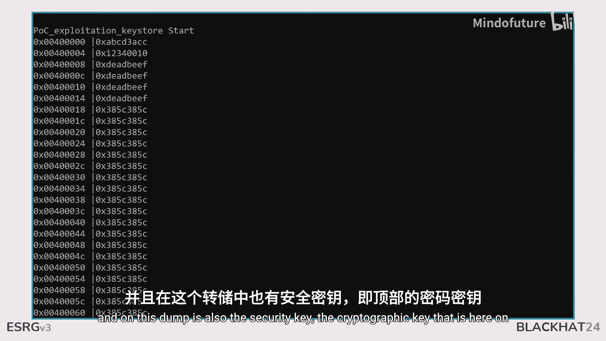

呃 dos。Okay， thank you， Christian。 So well， with this overall journey， we。

 we have some lessons to share with different players。

 So we have lessons for hardware providers about trust on CPUs。

 we have lessons for firmware providers ranging from key to operating systems to even environmental code that is intended to be used for security。

 and we have also a few lessons for system designers architects as users。

 So the first one is that for hardware providers， they should implement protections at the system level。

 and they should implement these memory controllers not only enforcing permissions between trust secure and unse。

 but also to take into account these privilege and unprivileleged mode。 So one。

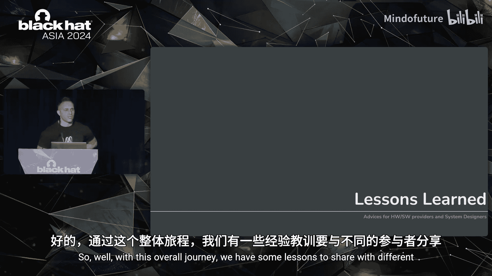

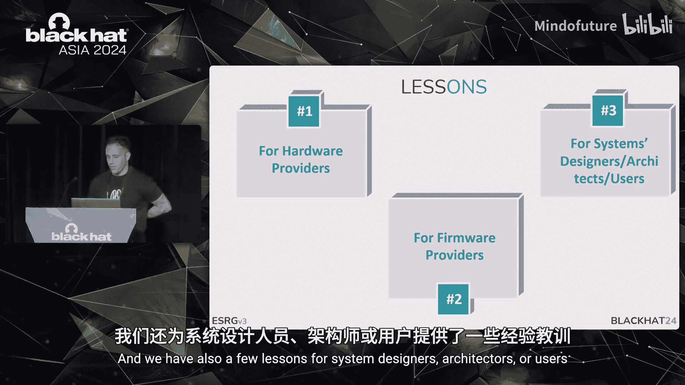

Very good example is this N X P L PC 5，5，0，0， Cortex and33。

 which has a bunch of NP and Ps that you can， in fact， enforce not only secure versus non secure。

 but also privilege versus nonprivi。 And， of course。

 one not so good example is these micropss L 11 that we have discussed so far because yeah。

 of the limitations that we point out。😊，Well， for Fware providers。

 I think the main takeaway is that from one side， they need to try to keep the language of the PSA standard and also to try to to enforce like the the isolationol that is required by providing the means and facilitate the life of of the different parties involved on building a system And by that。

 for example， multizones that the intended for resource constrain device that already provide built in these DMA mediator capability。

 and yeah can be left or Traonic say that it is left to the O M or to the customer to decide or not if have these DMA mediator which may end up if history repeats itself by opening security laws in different products。

Well， for system designers and architectures， you should really understand which platform you are using and which software you are using and the combination of both should have a very system level view in the way that you should be careful about access control policy is is set up And one last one is about like these PSA levels。

 as we have seen like key EM use this micro kernel like architecture。

 which not only split like or isolates the kernel from from the application route of trust。

 but else it moves like this extra trusted service。

 the privilege them to unprivid secure and privilege and then enforce isolation between them。

 So this is we believe this is the way to go。 and yeah have an architecture like this and have a PSA level like this。

 Of course， micro kernelnal architectures have。A little bit of performance degradation。

 but if done well， it can it can be not so so bad。 Yeah， in the meantime last week。

 Ar at these PS SA level 4， which is not about what we do we did。

 but basically they designed a model where they have a secure elementilment per se secure elementilment is an extra component that is typically embedded by hardware wallets。

 for example， for crypto and tokens， whatever。 So we will say that PSA level 3 plus is something that we are proposing in between the tree and the new one four。

So just to conclude， I just want to， to summarize like what was this responsible disclosure process。

 So we reported to Michi basically to raise awareness about the potential problems。 Okay。

 immediately microchips say okay it's not an hard problem。

 speak to the software people always like that。 Then okay， we spoke with we said okay。

 but its a good security practice to have these MP。

 Then we went to to speak with Trasonic and Trasonic said， okay， you use just the evolution as。

 But at the end of the day is left to do O to decide if they have this model or not but we said。

 okay， but it would be a good security practice to provide these DM mediation。 and they say no。

 but we have at the station and we said， okay， but that the station is an orthogonal problem。

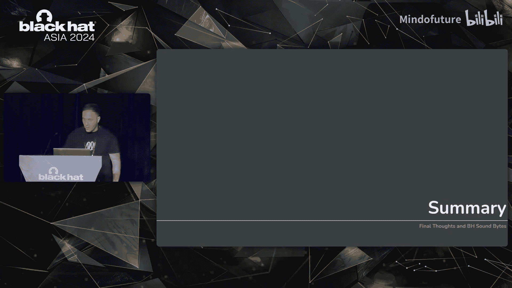

And they say， okay， but you are using the evaluation SK and we said， okay。

 can we have access to the commercial SD K。 And yeah。

 we never get a reply back I by no means want to diminish theonic because I want to say， okay。

 during the these responsible disclosures that was like three months。

 they were somehow interacting with us。 And they also we let them the chance to review the presentation to make sure that we were not providing a super nonvi view。

 and they have reviewed and say， okay， this is the nonbias view of what you have done。 But yeah。

 regarding this access to the commercial SD K。 we， we asked。 But。They didn't reply。Okay。

 just to complete， these are the last sound bites。 we basically shared our journey on fully accessing these M C U based T。

 in particular， the CanadianM for this very specific platform， the Sun L 11。Well。

 we demonstrate what are the problems of not having a system level view。 and we explained okay。

 what kind of software solution you can implement when you don't have the hardware capabilities。

 but we stress out that it's better to have the hardware capabilities because facilitate a lot the software built at top。

And yeah， just to create awareness， we shared some potential attacks that can be mounted if you don't have this sort of mechanism into into place。

 and you can basically bypass the full isolation boundaries of the system。With that。

 I thank you very much for your time and for your interest。 And we are to。

 to answer some questions that you may have。

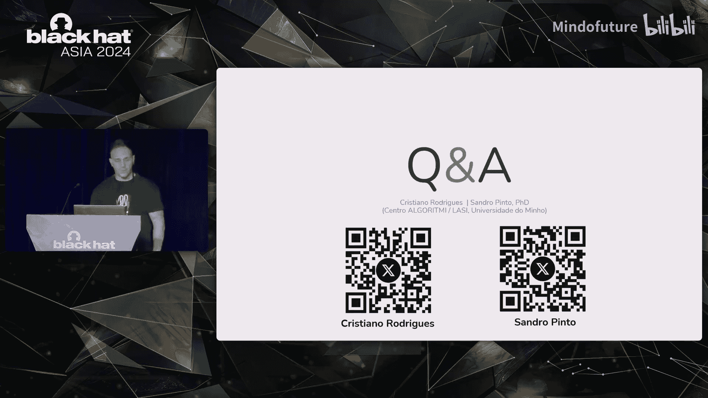

ok。I think we have one question。Sorry， I think the mic is not working because。Can you try again。

Hello， my name is Os， I'm a research fellowlow at Singapore In Technology and Design。My question is。

 if you want to protect the microprocessor and the platform， you need to put extra hardware in it。

 for example protection units and something but， but when we introduce more hardware it takes resources and due to addition of new resources。

Maybe we introduce latency in the computation， so maybe the developers of microprocessors are afraid of putting more hardware because it degrades their performance。

 but at the end we need security So what do you think。Yeah， thank you I mean。

 when you build a product intended really for security。I's a trade off that you as you say。

 it's a trade off that you do。 I mean， performance on one side area on another side because you need to put the hardware on on on the ship itself and security on the other side。

 But， I mean， if you take into consideration that you are not embedding an hardware piece that at the end of the day makes your product at designer and developed intended for security to be not secure at all。

I think it's better to have。 Of course， if you， you have the option as we showed to to implement in software。

 the problem in software is that the latency， which translate which translates then in performance overhead。

 And then in this sort of device in mobile consumption is even worse。 So if I have to say。

 like between different trade off options， I would say it is better to em on on the hardware itself。

 But I think the the question is， is very nice because yeah， at the end of the day。

 full system designers are all trading off different different metrics， Let's put in this way。

Thank you。Don't be shy。 I need to have Christiano reply basically answering one question。

 who to hard one。Okay， so if you don't have more questions， thank you very much again。

 and yeah hope to see you around。 And if you want we can have a chat on the coffee break Thank you。

