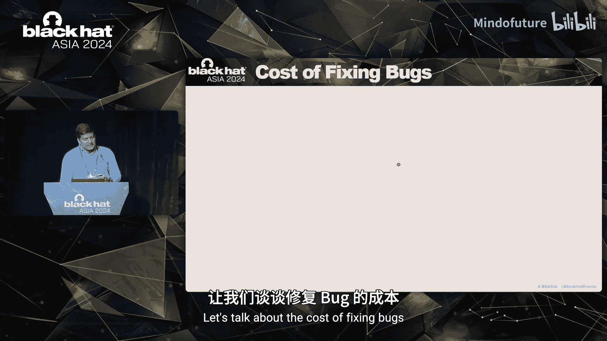
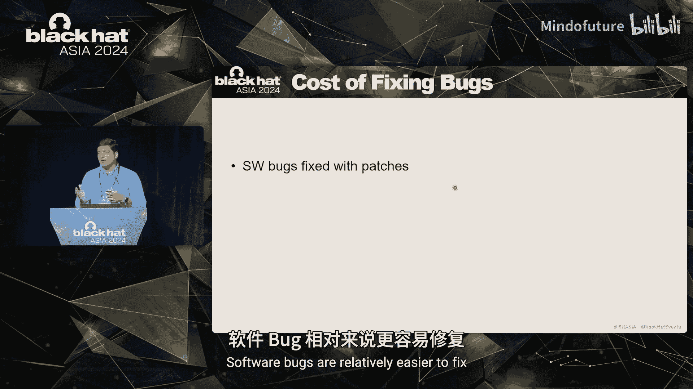
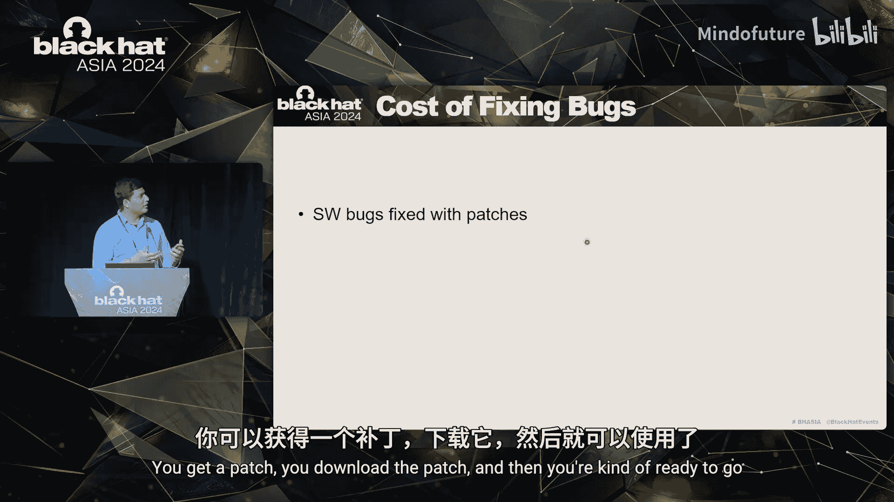

# 黑帽亚洲大会2024全集-•-中英｜Black-Hat-Asia-2024-p06-P07-The-HackDAC-Story---Learnings-from-Organizing-the-Worlds-Largest-Hardware-Ha--BV1oyX7YnEhN_p6-

Good afternoon everyone， I'm Aron Knaery， I'm with Intel Corporation in the USA。

 I am here to talk to you guys today about the hackCC Ag D story。

 our learnings from organizing the world's largest hardware hacking competition。I have our co-auors。

 our collaborators in this work， Harsh Kathri and Jason Fung， also from Intel。

 and Professor J V Rajendran from Texas A&M University and Professor Emmet Sadei from TU Dastart in Germany。

A little bit about our team， Hari and I are principal engineers and offensive security researchers at Intel in USA。

 and Jason is a Se director in the same offensive security research group。

Together we have over 50 years of combined offensive security research experience working on various Intel products such as CPUs。

 servers， clients， cellular products， networking products。

 storage Intel security technologies and so on together the three of us have identified over 500 vulnerabilities in Intel products spanning hardware。

 firmware software。And in addition to vulnerability identification。

 we also specialize in vulnerability root causing and categorization the three of us serve on MITters hardware。

 common weakness enumeration or CWV special interest group Jason additionally serves as a board member on the same。

We have collaborated with two eminent professors， Professor J V Rajnran from Texas A&M University in USA and Professor Ahmamed Sadagi from Ti Dmster。

So both have a combined security research experience of over 35 years in areas spanning。

 circuit security， system security， network security， cryptography， microarchitecture， and so on。

Their body of work has an impressive 44，000 citations， and they really know what they're doing。

We would also like to acknowledge the student collaborators from our broader team。

 the students from both the universities， as well as our partners from synynopsis who are collaborating with us as the cloud partner。

 so synynopsis as most of you know is one of the largest ADA tool vendors。In this talk。

 I will introduce by talking about hackett D and also I will identify what kind of led to creation of this contest。

We then proceed to talk about the value of organizing hardware CFs in general。

 right and what's in it for different stakeholders， for academia， for industry and so on。

And we then talk about how Haett D is unique。 There are lots of hardware security CTFs and competitions out there and trainings。

 how Haet D is uniquely positioned versus all these other CTFs that we have。

Next we proceed to talk about how we organize HaettDAC what are some of the challenges and what are some of the key learnings finally I conclude by highlighting some of the impact that the competition has had on the industry and what are the key takeaways for various stakeholders academia security researchers and chip design companies as well as tool vendors and I conclude。

So hacket DAC is a competition is a hardware hacking competition specifically focusing on pres right before the chip gets manufactured。

 we started this competition about seven or eight years ago and our the reason for starting this were like basically three main challenges that we have observed and seen over the course of our security assurance careers at Intel。

So I'll start off by talking about these three challenges and how they kind of motivated us to organize Haet D。

So before we go there， let's get a quick refresher of what the computing stack looks like right so we have the application。

 algorithm， programming languages and operating system。

 all of these are broadly acknowledged as software right below that you have firmware and then there is hardware。

Right so。If we unwrap hardware we have four more levels within that we have microarchitecture。

 register transfer level or RtL， we have gate level and we have the transistors below that so microarchitecture is what captures your design intent what is your design supposed to do it describes all the detailed structures and so on。

Then we have the register transfer level， which is a language which is the behavioral description of the intent of the microarchitecture that is captured in or designed in languages or design hardware design languages such as We log。

 system， where log， VHTL， and so on。Once you have the RTL designed and verified you then proceed to that gets translated into an interconnection of logic gates。

 so these logic gates are further built using transistors right so this is what the four different levels of hardware are。

As you all know， there have been lots of attacks that were published over the several past several years on all of the levels of software and firmware right so and recently attackers has started breaching into the hardware domain with the emergence of microarchitectural attacks so the race is clearly on to the bottom of the stack right and we have published a paper in 2019 at Eic security called hardwarefields what this paper talks about is that bugs in hardware can actually be exploited by software right and when we published this paper。

 the amount of response， the kind of response we got through the number of emails and pings and so on was massive right so people said hey this is great。

 we had no idea that such issues in hardware derooted in hardware could be exploited by software and that's when we realize that this is number one challenge that there is limited awareness as far as hardware security weaknesses are concerned。

So that's challenge number one。Next， let's look at the state of the art as far as security tooling is concerned for hardware and software。

There are lots of tools that we can think of when I ask you to name some tools for software or firmware security。

 these can be code scanners， binary scanners， right reverses engineering tools， protocol checkers。

 configuration checkers， whatnot right I may have missed some here。

 but there's lots of tools and lots of categories of tools。

What about hardware right hardware you there can really count on your fingers。

 the number of tools that are there at a registered transfer level for implementation right for checking of hardware。

So what do we need， What kind of tools do we need right， So we we for for that。

 we need to kind of have an appreciation for the kind of security properties that we typically see in hardware。

Here is one such property， right， So assume that you have a key。

That is stored in some internal register inside the inside the chip right So one typical hardware security property is that this secret key。

Should not leak out to any attacker observable interface right Maybe it's softwareservable software visible micro software visible architectural register or through any debug port or anything else it could be anything but this key should not leak over to an attacker observable interface that's one kind of security property the next kind of security property is for certain for certain scenarios such as Fips compliance right you need these secret keys in the chip to be cleared or zerovis under certain conditions right and how do you know that the key has been cleared not just from its primary storage area but also from all the intermediate structures through which it passed to finally get to its location right how do you ensure that。

So right now there are very limited number of tools that can actually do these kind of tests and for certain synergies that I described there are no tools right so there is a clear clearly a need for security aware design automation tools and that is our challenge number two。

Let's talk about the cost of fixing bugs。

RightSoft bugs are relatively easier to fix right you get a patch。

 you download the patch and then you're kind of ready to go with hardware it's a little complicated The reason being hardware bugs are its not they're not easy to fix in the sense they are time consuming they are expensive and they have the potential to cause brand damage to all the parties involved right the chip designers。

 the OEMs everybody。

So。To understand why we let's take a look at the hardware design process right so once you have the microarchit logged in。

 you proceed to to start coding up the chip using RtL right that's what we call the RTL design phase once you verify the RTL you proceed to what is known as physical design that's where your RTL gets translated into gates and later into layout and so on。

 Once your physical design is kind of ready， you start verifying it for timing and all all other functional correctness and so on。

 and this whole phase is what constitutes the pres phase。Once the pres phase is done。

 you send the design over to the factory or a foundry as is known in chip power linesance。

And you there you actually manufactured the chip once you manufacture the chip。

 you proceed to what is known as the post silicon phase where you start again running a whole bunch of tests on top of it once all these tests pass you then ship it to the customer now the chip is in the field right so bugs can occur。

Can or can be identified in any of these phases。 right Any guesses on where it is cheaper to fix the bug。

R T L， yeah， of course， right， So it's， it's cheapest to fix it at the R T L design phase， right and。

😊，And you you'll not be surprised to know that the cost of fixing a bug in later stages exponentially increases right and if you end up finding a bug in the customer phase that's when you have maximum brand damage right you do not want that so the challenge number three is we need to kind of develop a shift left mindset where we want to encourage everyone to kind of detect and mitigate as many bugs as possible at the RTL design level itself。

And yeah fix bugs here， long story short， and that's challenge number three。

So with these three challenges， right， raising awareness for hardware security assurance。

More security design automation tools and shift left to detect and fix bugs early at the RTL design phase these are the three challenges that we observed over over the duration of our careers。

So when we work within Intel from product security assurance perspective we do lots of like the security design lifecycle and so on right as part of that we also do hackathons with various products and we find lots of vulnerabilities we work with product teams to fix those vulnerabilities and as a retrospective we then kind of analyze what is the root cause that is leading to these vulnerabilities。

Then we train offer trainings to the product teams。

 we offer trainings to the product teams and make sure that these bugs recurrence of these bugs does not happen in the next generation of products。

That's that's what we what's what we learned These are really good and over the duration of time we have seen how these design teams which had limited to no security mindset have developed a security mindset over the period of time and have started building more secure products right we really loved that approach and we wanted to share it broadly with the general audience outside Intel as well。

😊，How do we do that， We obviously cannot give out In designs to and say， here's our source code。

 Let's find bugs in this。 So we went out looking for an open source。嗯。

We went out looking for an open source hardware that we can use as a target right so again for open source target there were not many designs out there that had lots of security features so we thought hey we can add these security features and we can give out these designs how do we teach them how do we teach the participants and what better way than to teach a man how to fish than a CTF and that's how we ended up with hardware CTF idea right so all the concepts of new weakness types or hardware how hardware weaknesses look like we can also raise the awareness for custom tools and maybe even repurposing existing design verification tools or design automation tools for security and also develop best practices for shift left and identifying the bugs as early as we can so all of these three culminated in what became hackett deck？

So that's our motivation right so let's talk about the value of organizing such hardware CTfs。

CTFs in general are a fantastic community building exercise right we all know that CTFs bring passionate people together and the team makeup typically comprising members from different organizations and sometimes they come with different experiences excellent expertise some folks come from a design expertise some come from a verification background someone comes with a security background all these three experiences from different streams results in cross pollination of ideas and sometimes you have some excellent output coming out of these CTFs right and theyre obviously a fun way to learn share all the kind of best practices and hacking techniques and so on with one another。

😊，The CTFs also in general can be used to raise or foster awareness for hardware security assurance in general right so we have seen previously how there is this continuous race between attackers and defenders in trying to get to the bottom of the stack right Aters are looking to get more out of the bottom of the stack and defenders are trying to secure it right from the attackers。

And as we are seeing the attackers seem to be winning right now and its that why that's because attackers have unlimited time and defenders have to work within the constraints of their product time timeline right so they can do only so much but they need to do more or better within that limited time budget。

So hardware CTFs are a great way to kind of foster this awareness about common weakness types and also what are the while working within the constraints that chip design teams usually have。

So what's in it for academia and for the industry， right。

 why Why should academia participate in such hardware Cs， Why should industry care。

So we at Intel we fund or sponsor lots of academic research and especially in security right and we get the common request that we get is hey。

 can we get some access to Intel designs？That's not always possible， right。

 So they want something that's closest or closest to a commercial chip design available。

So what if the industry gets a buggy system on chip framework that has realistic security features。

 realistic threat modeling and security objectives that can be found in commercial chip designs right。

 what if this buggy SOC。Does not have like toy bugs， but really has bugs inspired by real world CVEs。

 product security advisories and so on。What if this also comes with open source tool support as well as commercial tool support that people in chip design industry use？

And that is what we offer， right， we offer a buggy system on chip。

And this system on chip can be used for furthering innovation in hardware security assurance。This。

This framework or this system on chip design can also be used as a benchmark for developing and testing new hardware tools right so this is the closest that is available to commercial chip designs。

 There are a lot of existing benchmarks for testing security tools and so on within the trust hub framework but these are really small benchmarks right so you have like one AES IP that has a bug somewhere or you have like a hardwaretron or things like that。

 but this is the benchmarks here in trust hubub are nowhere close to what you see in commercial chip designs。

The next one is people。You need participants to gain hardware security assurance experience right You need to develop that hacker mindset。

 lots of companies do not have budget to hire many security researchers right So the best way to do it is to train people who are already doing some sort of verification these are like folks doing the functional verification right to train them to step up and start doing more security assurance work right and also there may be lots of researchers from adjacent areas such as firmware they want to do more about hardware Why do they care Well firmware for firmware to work properly。

 there are lots of guarantees that hardware needs to provide right and they don't know how hardware does this and they want to know what it looks like hardware is closed right So what if you have you get an opportunity to look deeper into how these security features that you are depending on look like in Rt right that is what is in it for adjacent research areas it may not also be very accessible or。

Easily available for adjacent areas to start firmware， start doing more hardware research work。

 and that is where a hardware CTF can serve as an easy launchpa for folks from adjacent areas。

So when I talk about realistic security features， threat models and security objectives。

 what do I mean？Right， so let's take a look at that with with this。Hypothetical system on chip。

RightThis is the security features that I'm going to talk about here are realistic right this is what you see in any commercial chip that's out in the market。

And you have security objectives like data confidentiality。

 where you have to protect secrets from unauthorized access。

 you have data integrity where you have to again protect these assets from modification by untrusted agents that are not in your trusted computing base or TCB。

Then you also have to protect against availability right you want to make sure that attackers cannot damage your system by burning it up or causing it to accelerate run at an accelerated aging chip fails earlier than than anticipated and so on。

So。To achieve these security objectives， lots of security features are implemented in these system on chips right some examples include execution core and debug privileges。

 privilege checks so you you have your core and the core is running at different levels you have ring zeroing three and so on right theres so many different privilege levels within that and also debug privilege levels so who is debugging this chip is it the manufacturer is it your OEM who actually selling you the laptop or is it an end user who is actually using the laptop Each has their own different assets and one should not be able to see another's assets right so that's why there need to be lot of debug privilege checks inside the chip。

There are lots of peripherals here right you see hard IPs， soft Is。

 and you have like memory networking interfaces， storage devices， debug modules， RA。

 third party IPs and so on， lot of these peripherals。

 all of them are connected through an interconnect or a fabric。

like a bus right and you want the assets that are stored in these devices to be accessible only to certain agents not everybody right there needs to be some sort of access control implemented here then you have memory encryption and integrity features such as that then you have data eras from nonvol memories and you have turn trip protections for voltage and frequency limitations and so on so this is what I'm talking about when I'm saying realistic security features realistic security objectives and so on so where do you get this this kind of level of detail in an open source design nowhere。

Right。So that's where hackett deck is unique。 So let's talk about how we kind of position ourselves versus other CTFs and hardware trainings that are out there。

There are lots of popular hardware CTfs which we call closed box。

 What we mean by closed box is these are hacker centric CTfs。

 which means they not they do not provide insights into how the chip is implemented but they actually give you the final chip and say here you go hack it right I want you to extract the secret key。

 There is some data going over this bus that is encrypted can you sniff it and extract the key so you do this by probing and prodding the chips and like input input output ports and you do stuff like desolddering the chip reverses engineering Deing all these kinds of physical attacks right you start doing physical site channel attacks like power differential power attacks electromagnetic attacks fault injection attacks and so on So all of these provide no insights into the Rtl of the chip they just want you to break it and that is where what we call it does not address the shiftless challenge because you are。

Actually looking at the final chip right do not make a mistake that do not this is very important area of research。

 This needs to be done。 This is absolutely relevant。

 but what we are really trying to address here is to be able to find bugs early。

And that is where hacket that comes in。 It serves as an open box CTf。

 It comes as a open box CTf where the participants are given a buggy system on chip design with all these fancy security features that we talked about and offers them a much finer grain scope to look at how these security features that actually implemented in RTL the participants then get to break these security features through existing design verification techniques such as RtL simulation emulation。

 formal verification static analysis and God forbid even manual code reviews if time permits right all of these techniques and this is what we call a designer centric approach right so if you have like a red team blue team kind of approach。

 the blue team is designing the chip they have a very good understanding of what the chip is supposed to do how it is implemented and so on and then the red team with a similar background starts looking at the source code and tries to identify weaknesses or vulnerabilities within that that is how we are unique and we try to position ourselves。

😊，So let's quickly take a look at how we organize the competition。

So we divide ourselves into two teams。 This is the design team and the judging team。

The design team starts off with an open source system on chip。 We pick one open source design。

And then we start adding security features to it， and then we define threat model。

Well look through different CE security advisories and create a bug list。

 a list of bugs that we want to insert into this design。And we come up with the buggy art here。Right。

 and we we update the specification and we also update the tool set with open source tools as well as commercial tools to work with this chip design。

 Once this is ready， we start advertising， the participants start registering and that's when。

The phase one of the competition happens right so phase one is when we have so everybody register。

 we typically have about 50 to 60 teams in phase one， they register， they'll get the design。

 they start looking for bugs and submit the bugs once they submit the bugs we start scoring them and evaluating the bugs and we put a live scoreboard on the website and that concludes phase one right that goes on for about two months and the top 10 participants from phase one are invited to participate at phase two which is the finals live at the conference。

For phase two， since we have fewer participants， there is more control and we can also offer better features and better experience to the finalists。

 So what we do for that is we add fPG based support we we provide support for popular fPGs on how with the buggy design and that's where also our cloud partner comes up synopsis synopsis puts all their fancy tool suite on the cloud and we port the buggy design onto the cloud make sure everything works and we offer trainings to the participants and then then again we go back to bug submission bug evaluation and finally the scoreboard once the competition or phase two concludes the finalists are announced they get some cash prize and they also get to present their work at the conference in a special session and they also get they have also been approached winning participants have been approached by hiring managers from top chip design companies with job opportunities So that's like。

The whole process， the hack and deck process。 So now we'll go into details of each of these different stages。

The first one is the selection of the target， right we need to pick some open source design。

What we do here is we survey various open source designs and we pick one that offers a full system on chip that is functionally working。

 that has no inherent bugs， and we obviously give a priority to designs that come with ready with some kind of simulation or some kind of open source tool support。

Then we obviously again give priority to tools to designs that have some sort of stability that do not break while running which results in a bad experience for everybody involved。

For all the versions of all the editions of the competition we have picked open source risk architecture and risk architecture based SOCs。

 these includeino P Piimo， Open Python which comes from Princeton and Open Tiytan。

 which is Google's hardware security module。The open source one。Right。

 so here is what a palpi Smo design looks like。 This is what we used in one of the early or editions of Haet tech。

So as you can see， it consists of a risk5 core with a debug interface， a bootom。

 a bus interface connecting all of these peripherals。

So once we kind of download this open source design。

 we go about adding security features into it right some of the security features that you saw are adding cryptographic modules。

 we added the Hmax Sha AES and so on and we add a fuse module to store some secrets that can be used things like keys and so on and we added a DMM module to copy stuff over from memory into various Is。

 we added a password based checking for instance to ensure that the correct entity is unlocking the chip for debug and around the core we added a proxy kernel to be able to do lots of other fancy things such as enabling virtual memory to physical memory translation and as well as selftest of all the crypto engines and so on。

Right， so once we add all of these security features， we proceed to add。

D threat modeling and and call out a list of security objectives for this chip。

So here are some sample threat models and I have only listed two security objectives here。

 one being code running unprivileged code running on the core should not do some kind of privileged escalation and get to like super user mode or machine mode or something like that。

And another sample security objective that's listed here is that the internal registers of the cryptographic blocks should not be accessible by a physical attacker who is trying to attack or extract secrets from the chip through the debug interface is this is just a list of sample objectives。

 but the full list of security objectives can be obtained from the website。

Right once we define all of these security features。

 the next step is to insert the vulnerabilities right so as I mentioned before we look through CVEs。

 we look through product security advisories and we also dig in from our own experience of having looked at so many classes of Intel products and we start inserting vulnerabilities throughout the chip。

And once this is done， the bugge RtL is ready， we call out we start advertising the call for participation。

 people start registering phase one begins。So phase one as I mentioned earlier is offline right you have over two months participants have over two months to start analyzing various entry points for attacks。

 identifying the different assets in the system and also developing security test cases and to kind of break the security features right so they also get to develop custom tools to detect these bugs and finally they submit all the bugs through a web interface for evaluation by the judges。

So let's look at an anatomy of of a bug submission。

so this is what it typically looks like right so the participants specify what security feature they think they have bypassed and they add a little bit of a description on it and they point to the exact location or the in the RTL like which line which code and so on。

 what is the buggy piece of code。Once they do that。

They describe what methodology was used to bypass this security feature， right， Was it simulation。

 R TL verification simulation， formal， whatever means， Did they happen to create a custom tool。

 so on。Once that's done， they also talk about what is the security impact of bypassing this feature right does it give you total confidentiality。

 control or total integrity bypass and everything things like that。

We also asked them to describe a mitigation， what would a correct code look like if this were instead of indeed a bug。

 then they describe like how to fix the issue。And they also talk about the CBS S details， right。

 how do you score this， how do you score this， How do you rate the severityity and so on。

Then we come in， we start evaluating the issues and we give points based on various factors the first one is the validity of the issue is it really a bug right we look at that then we look at the novelty of the methodology used most likely we are only offering support for simulation but maybe the teams went one step ahead and started doing stuff like formal verification or they created their own tools or maybe they did something fancy right for all of those we get we look at they considered that。

We considered the correctness of the security impact， the scoring。

 and also the mitigation that was proposed。We offer a conference theme based bonus score right so for a design automation conference where the focus is on design automation and tooling if you have created a custom tool to detect classes of bugs you get a bonus right for the first kind of first few bugs that you find。

If it if we are doing this at a security conference such as Es or Enis or chess。

 we offer bonus for exploits or bypassing cryptographic protocols and so on。

sometimes we offer give out a special award for cool finds so what are these cool finds so we have seen several instances where participants submit bugs that we have not inserted right and it's a challenge for us to start looking at that and say okay is this really a bug and we go looking at it and sometimes the participants submit some really cool bugs and we they may not be on the winning team but we really want to honor them for their for looking in areas that we have not considered and that's how they get all these honorable mention awards。

As you can see here we are using Google sheetets for this bug submission which is very manual and time consuming process。

 we have also used an automated approach using CTF Damon for where participants can submit the bugs。

 but if they cannot kind of submit a flag， they use this automated they use this manual scoring approach to submit the bugs。

So once all of this ends the scores are out， phase1 is done。

 participants from the top 10 teams are invited to participate in the finals which is live at the conference and again I talked about the partnership with synopses how they put the tool on the cloud and how the design is on the cloud。

 they also offer trainings on how to use these commercial tools and we offer demos of how to catch one or two bugs using these tools once that is done up and we also offer travel grants to the US based students to attend this in the finals。

The competition runs for 33 hours nonstop starting from 8 am today to 6 pm tomorrow and once the competition concludes we honor the awardees right so every hour we have a live scoreboard that keeps ticking and you see some of the students participants working hard here and it's also a great opportunity for us to meet with our collaborators who come from different parts of the world。

Once the competition concludes the winners are honored on stage at the conference award ceremony and they also get to present their research at a special session in the same conference right they also get an opportunity to publish their research in an ITP ITP special edition in this case we worked with ITP design and test which is one of the premier ITP journals out there and they had dated a special issue on Haett D right so the winning teams from Haett D presented published their work in this ITP journal。

So far we have extended we started off with Haettac， we ran it for over seven years。

 we extended this to other security conferences such as Uic security as well as chess for a few years in between。

And so far we have over 300 teams participating from all over the world right we have seen participation strong participation coming from Asia。

 Australia， Africa， North South America and Europe pretty much every continent has been covered and we have seen industry participants too coming in to learn more about hardware security assurance and what we have seen is the past winners are now working at top hardware design companies in security hardware security roles。

So， let me come to the final。Final part where I'll talk about the impact that the competition has had and what are some of the key takeaways for various stakeholders。

So let's recap these three top challenges right so we set out with Haett D to kind of address these three challenges right raising awareness for hardware security weakness。

 we need more security aware design automation tools and we also need to kind of develop that mindset where we catch more bugs with the shift with the shift left ideology。

For the first challenge。嗯。This is the MITR hardware CWE right for raising awareness of hardware weakness types we approached MITR in around 2019 and said hey。

 we have this huge database of hardware weaknesses and we have done some initial categorization。

 but none of these seem to kind of fit with your existing software CWV that you have。

Right Miter said hey that's great， let's do rather than force fittingitting this into the existing software view。

 let's do something absolutely new for hardware and it were great。

 we found this we found a miter started this hardware CWs special interest group and with the initial view for hardware CWEs this was actually done in collaboration with Intel right after now you have lots of weakness types in various areas spanning core and compute memory and storage peripherals on chip fabrics and so on weaknesses of these you can you can go to Cw。

m。or to learn more about this and as you can see each entry is very similar to what you see in the software Cw right there is a description of the issue and extended description and what is not shown here is this large corpus of database has vulnerability v code examples as well as the correct or mitigated bug mitigated examples as well。

snippets，This is a great step forward， as far as raising awareness for hardware security weakness。

 because。😊，Chhiip design companies are typically very。

 very secretive about any kind of security issue in in their products。

 especially hardware issue right so hardware is already very secretive and if it's a security issue it's even more secretive There's no way you can you can ever come across like a root an issue that was root cost in RTL you will never see a code saying hey this is how it was done So from that point of view you now have like over1 hundred different hundred10 different entries。

110 different ways in which things can go wrong in hardware and out of these 75 of them have come from Intel and a large number of these entries are now kind of populated with vulnerable code examples coming from the hacker D framework。

So that's how we kind of addressed the awareness problem。Next。

 both challenges two and three combined security of tooling and bug detection。

The framework that we provided to the students or the participants over the last seven or eight years has been used to kind of develop so many tools。

 flows and methodologies over the last few years right so what we see here is a list of several publications that appeared in top top venues right so these include security test case generation automatic test case generation using large language models automatic bug fixing in the RTL level itself by going through various CWs formal verification we have static analysis tools that code that scan your code look for known CW types within your code。

Then there is concolic testing as well as hardware information flow tracking which makes sure that if which makes sure that a key does not propagate from an asset to an attacker observable interface and so on there are many more papers that have obviously not listed them all。

 but a good some of the most recent work has been called out here。

And the great part is all of these work on artTN right you don't really have to wait until the chip is manufactured to kind of test this and if your existing tools don't work out of the box。

 you can kind of leverage these tools to start doing more work。😊。

So that's the impact so what were the take what are the key takeaways for academia right the framework itself has been used as we talked about has been used has been used as a vehicle for furthering security research in especially hardware security assurance and since it's the closest available to commercial chip designs it has also been used for creation of new tools lots of teams are using this to uncover new classes of vulnerabilities and that are not already there in MITter CW database and they have already approached MITR to add new classes of hardware weaknesses。

Also the student participants， they gain invaluable hardware security assurances skills because essentially they' are mimicking a security design team at a chip design company right and they also get to develop the hacker mindset in the process。

The takeaways for industry right they get to improve in house security assurance best practices right they get by getting exposure to all these new kinds of weaknesses。

 how they look like and so on and they also get to plan for survivability features so what do I mean by survivability features earlier teams did not have a methodology to patch a hardware bug right if a bug was identified in the hardware。

It was game over， but now teams have developing this mindset like hey。

 I need to kind of reserve some patch space so that I can kind of put the patch there and start reworking my hardware around it right so that's the kind of mindset we are seeing in chip design companies today。

It's also's also easier for functional verification teams at chip design companies to attend training such as Haet D or CTs such as Haet D。

 learn more about security assurance and then step up at their company to start doing more hardware security assurance work。

We have seen new tools that companies creating new tools to identify weakness classes。 In fact。

 some companies have also published guides on how their security tools can。

Detect several classes of hardware hardware CWs right that is again， pretty amazing。

And for tools that are there today which are used in functional verification or design verification。

 they can be augmented with certain features of plugins to do more security security work and we are seeing that coming more and more in income of some of the newer generation of tools。

Overall， Haett D has received lot of love and coverage from the media and press。

 right some popular media here。And this has largely been due to the participation of lots of enthusiastic students and researchers from all across the world。

So with that I would like to conclude with the black hat soundbits right so we have seen the three key takeaways right so we have increased hardware security assurance。

 we have seen that coming through the MIter hardware CWE。

 we have seen this large corpus of weaknesses as well as code examples through the establishment of the hardware CWE。

We have released this open source buggy framework that is being used by researchers all over spanning academia。

 industry and so on with this， again， framework has realistic security features。

 CVE inspired vulnerabilities and a complexity that matches commercial chip designs。

And this has kind of spurred innovations in hardware security tooling at the RTL level。And overall。

 we are so glad that so many participants have developed a hacker mindset。

 specifically working on hardware。With that， I shamelessly invite you to join HaettDAC 2024。

 register， click kind of take a picture for that QR code。

 you can get more instructions on how to register and if you want to learn more about the competition visit the website。

Questions about the competition。 again， you can email us over here。Thank you。Hi。

 so I was just wondering， do you post the designs from previous competitions online？cool， thanks。

Okay， awesome， thanks。