# 黑帽亚洲大会2024全集-•-中英｜Black-Hat-Asia-2024-p07-P08-Privacy-Detective---Sniffing-Out-Your-Data-Leaks-for-Android--BV1oyX7YnEhN_p7-

Good afternoon， everyone。Thanks to Blackhead for invitation。 and thank you all for attending。

 And also， thanks Lucas for teaching us tune our presentation。And today。

 we are going to introduce our new research privacy detective。 It's a dynamic privacy analysis tool。

 based on freedom。So considering our company's main business。

 this tool is designed only for Android devices。 but this innovation algorithm could be commonly applied to multiple platforms。

 and we hope our insights will inspire you some new and productive ideas。 Let's begin。😊，Okay。

 let me talk about ourselves for a little bit。 I believe the development of this tool。

 and he specialized in reverse Linux and So security。

 He has a longstanding interest in mobile security and privacy and he enjoys car racing and salesgo during his free time。

 So'm Maggie a security researcher at oppo and I special in security certifications and over security compliance。

 I've played a role in this tool and I'm currently got an interest in AI security and can talk offline we are interested to。

 So I also enjoy sports who I'm stressed out and I especially like hiking and city work。😊，Beside us。

We also have three very great contributors， Warnie Wang。

 she is a master student from School of Cysecurity at Huazhong University of Science and Technology。

 and Xian L Wu， a cybersecurity expert， he had his CVE contributor to Qcom Media tech and Android。

 and we got Daniel Chen， he has more than 10 years experience in security。ok。

Now that you have a better understanding of us， let's exploring why we're doing this and what we are going to achieve。

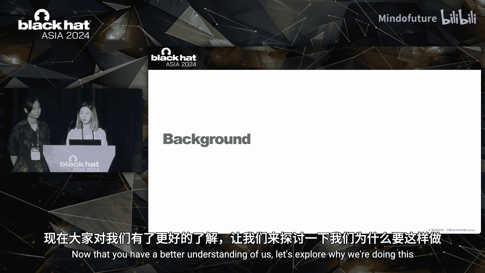

By designing and developing this tool。

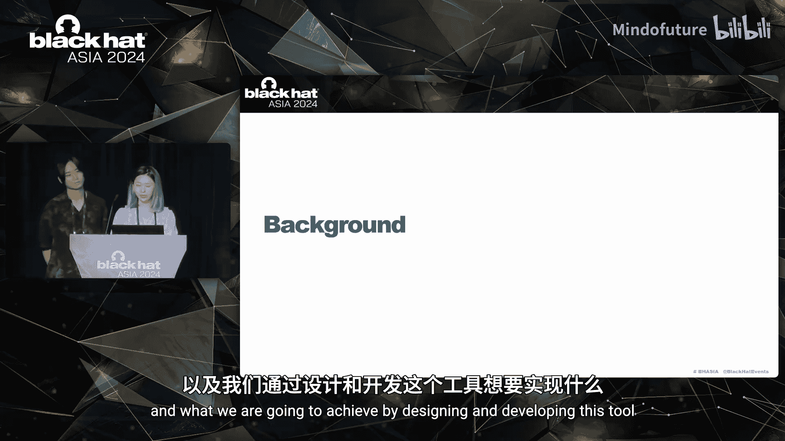

So for our company， we are facing the trials from GDPR。

 GDPR imposes stringent requirements for data protection。

 complying with GDPR regulation is crucial for not only protecting the privacy of individuals but also maintaining trust among our organizations。

 there are increasing amount of regions have published GDPR like regulations after 2018。

 and about 83% countries have enacted data privacy laws by March 2023。 they very greatly in。

 but many continue to show the strong influence of EUs GDPR。

 So at least 20 other countries without data privacy laws currently have bills for such new laws。

 So here are some laws and regulations that you may be familiar。

And it's also important to recognize the serious consequences of noncompilance。

 GDPR violations can result in hefty fines， which have severe impact of company' finances。

 the maximum fines of GDPR violation is 20 million or 4% of a company's global annual revenue。

 whichever is higher。 So they can have long lasting effect on a company's bottom line。

 from the cumulative graph on the left on the bottom left， you can see that by December 20 to23。

 though the number of fines are increasing， the sum of fines have been growing dramatically So it won't speculate here but you can do the math。

 and beside this， we also see that the inspections are not only enforced in telecoms。

 but also all areas companies even a closed factory who violate the data protection have been fine more than 3 million。

 Therefore it。that we take GDP components seriously and prioritize the privacy and security of personal data in everything we do。

 So the consequences of noncomp are simply too great to ignore。ok。

So here's the end of our company's challenges。And my company have already dived deep into the regulations for year。

 and here are the main requirements that our tool can guarantee。

 So by using this tool that we are going to introduce， any noncompance behavior like using T S 1。

1 and transport private data with all the double encryption should be detected and reported clearly。

Moreover， as a user， imagine a scenario when you talk to your friend like share something and some 3p comments apps can sometimes pop up the exact items that you may require。

 Like personally， Ive once talked to my friend that I'm heading to Singapore and my flight app just pushed the notifications about Singapore's tickets on sale。

 So it's kind of creepy for me and it seems there is an eye on me。

 So we did curious about how does these apps get my demand at the very first place。

 So I have already turned since I have already turned off all the unnecessary permissions。And also。

It turns out not only my concern， I did a little background research according to global Consumer In Surve June 2023 from PwC。

 nearly half of customers said that they are extremely or very concerned when engaging with social media considering about the privacy and the concern is also high regarding the retailers。

奇。So in conclusion， the motivation of this research comes from the company's global strategy and part of our curiosity of how this push notifications accomplishments。

In order to solve our questions， we aimed to capture all the transportation data and detect any violations。

So before we explain our research， you may need the following preparations that I show on the slide quite easy。

 right， And the most expensive but important one is we highly recommend you to have an emotional stable security researcher。

😊，企。In this part， I will introduce the functions and architecture of the privacy detective。

 Then we will explain why we build each functions and how it works。 For your understanding。

 we will explain the order of data collection， data processing and data analysis。Here。

 the function that private detective supported the simple architecture diagram is on the right。

 you can see in diagram data flows from Android system to our tool。

 and we divided our tool into three parts in orange blue and pink blocks respectively it follows the order of our explanation that I just mentioned the collection processing and analysis。

 The main point lies on data processing。 So you can see that our supported functions in the middle3 comes from data processing section is decpt Tls decpt nest encryption and deccode H2 header。

So generally， we try to hook TC P， T， R， S and cipher data by Frida from Android Runtime and native libraries in the data collection layer。

Okay， after that， it goes to the data processing layer for decryption。 and finally。

 the tool will scan and generate the output files。So first， data collection。

In order to get the whole TCP traffic data， we we hook the socket output and input stream at Java donet in Android run time。

Then we invoke the following method to get the TCP information like Is and ports shown here。

 as we show on the right， you can see how the data flows from Android wrong time。

 indicates in yellow block to our tool， which are showing orange gray。

 Please note that we get the thread I D from Android OS S here。Right， okay。

After we do this things here shows one of our captured TCP package you can notice in the last line tag S T R string。

 its value is some encrypted data， right， So which is obviously a T S data。

 So the next step is to get the T S data by hook S SL read and write。

And we invoke some other functions to get more SL info as we done in TCP hook。

 We obtained SL sequence number through I D and T L S version in this part。

 If you remember carefully in the background section I just read in order to comply with GDPR。

 we need to detect all transmissions whose T L S version is lower than 1。2。😊。

So same here on the left， you can see in purple block， we get SL info from Le SL。

 and the data flows from native library to our tool。Not again。We get a thread I D from Liip C。

 in this part。And here is our captured S SO data In the last line tag S TR。

 You can see that not like the the last T CP package。 its value is plan test。

So and everywhere unveil the secret of thread ID D in the next section。

 but we can keep on data collection here。Let's assume that we have captured all the TCP streams and decreed TL S connections in them。

 so we will get the TCP data， which is totally planned test， right。

 But do you remember that GDP requirements we mentioned apps are suggested to double encrypt personal data during transportation。

So which means we may find a lot of nested encryption within T， L S。

In addition to obtain plan test for double encryption， we hook the cipher class。

A update and do final functions in case other demands。

 we also hook the choose provider to get safer parameters。

Update is the function that used to encrypt the trunk block while thefin applies the requested pending to the last block。

And one small tip here。High level speaking， we can hook those two functions。

 then get the plan test and cipher from its input and output hook point。 However。

 there is one tricky problem that I want to emphasize here。The cipher class may invoke bad buffer。

The better buffer inherents from Java class buffer。 It has three essential properties。

 and we would focus on position。Sorry， a buffer a buffer position is the index of the next element to be read。

 as shown just now in the animation in original workflow。

 it starts from the position and read the requested lens Mo position return and array when it's doing reading。

 So whats the hook hook flow should be。So once we hooked it。Right。

 and in order to get a return array， we will invoke bit buffer to read the cipher block。

Then issue occurred here。After a hook， the original code will deal with the wrong position and get the wrong cipher。

 therefore small but important。Please always remember to reset the position to its original workflow。

ok。So after we obtained all blocks， we split them together to get a cipher and plan test。

 and here is one of our results。😊，You can find the plan hacks with its matched crypto。 Also。

 we add the decoded stream in the middle。Other text shows the encryption parameters such as algorithm in the first line。

It's AE S and the A V in the last line。 So guess what。 If you noticed carefully。

 you may find that there is a nested encryption within a nest encryption。 It's a tri encryption。

 So don't panic。 You actually can find the plan test of this weather location in the same report under another bracket。

😊，And here is the end of our data collection。 Let's collect our thoughts。 So what did we get so far。

 We got the TCP stream with IP port and thread I D。

 And we also got the T S stream with sequence number， S L version and thread I D。 Lastly。

 we get the split cipher block， and it's matched the plan test。😊，I'll pause here， move Mi to Aby。

 and he will introduce our core innovation about how to decry the TCP。Okay， thanks， Maggie。

On the last section， we have captured all data what we need。

 Then it's time to discuss how we use this data to unlock the encrypted treasures。

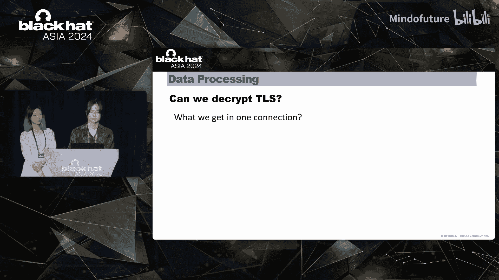

Obviously， the most glittering treasure is T O S。 and here is the time based T C P and T O S data sequence in a single connection。

Nevertheless， how do TCP and T S relate to each other They dive into TCP and T S workflow。

So in a single TC P and T S connection， imagine that I'm the client and I want to send something to the server by T S。

Then what happens in this process。 Firstly， I need to prepare the plain tax。

And then input it into access right。After completing at least one blocking。Eryption。

 I will obtain the cipher tax。Finally， I will invoke T% to send the software to the server。

Then the server receives my packet， it will send back a response。

 And as I as I get the response by TP receipt。I need to input the cpher into a C array to decption。

Then I obtain the plain text for response。After I explain what is in a single T S connection。

We can find that there are four different types of packet。Two of the T CP types。

 T C P receive and TCP send。And the other two。Are essential types， necessary and necessary right。

In conjunction with what I briefly described on my previous slide。In the context of TCP sequence。

 one TCP save will follow one or multiple accessory and one or multiple access right must follows a TCP send。

Thus， based on this conclusion， we can list four possible combinations that will occur like I on highlighted on the right。

So when we get a time based data sequence。We can use combinations to pair T S and TCP data for re in a single connection。

Just like the animation shows， I think we have opened the treasure of T O。Maybe。But it's true。 No。

 it's too young， too simple， and sometimes not ill。

When you use the key to the open the treasure confidently。We will get a time based data sequence。

On the right。And you should notice that it's disorganized。 So what happened， why。

Because in a real world， one airport service may have multiple TP connections。Therefore。

 we get a disordered sequence， which is combine all data of different connections。

And if we want to describe the T O S data as a method on last slide。

 we should divide a sequence of different connections into single connections。So as far as we know。

 TCP is a stateful connection。 One TP connection just has the only group of Is and ports。Thus。

 we can uniquely identify。Identify one TP connection。 Use good for things。

But does our division problem get solved。theoreticaloreically。

 we can match the I P and port in T O S and T C P。However， said no bro。When you want some red wine。

 you found just rough green。In practice， we get the IP and port easily in layer。

But we can't obtain the IP port in ands opens the cell。

And then we try to get socket as due to parts the IP port。Nevertheless。

 the Sock F always returns now。And we also try to use a more fundamental information blocking I O。

 but it can't pass IM port yet。After experiments about Bob， we found that for some reason。

 Android doesn't give any information about I and port to open the cell。

So it is time to give up the treasure in front us。Don't give up， ma。You are an emotional。

 stable researcher。Why don't we go in another direction？

ForForget the IN port and think about why we need them。Yes， sure。

We use them to divide the Tp connections。 And if there is another thing could connect the T its data。

Should we suppose that C P layer will invoke open C in same thread。

Let's move to thread ID and take an experiment。As what you can see of the result on the right。

The thread I D does divide the Tp connections into connection segments。

So we can imagine that in one thread， only one T connection happens。TCP and T are sexually involved。

As the animation shows。But please be careful。 when when T connection is not necessarily happened within a thread。

Please be careful， yes。Uing the T S decpt algorithm with the connections divided by thread I。

 we have opened the treasure of T Os。We have got all the plain text from T CP。However。

Some strange data are in our output file。Does there is any other encryption ignored by us。

Then we analyzed the context of this connection。We confirmed that it's H2 connection。

 and the strange data is head compressed by H2， which is a major feature of it。

So for a more convenient experience for the researchers。

We decide to provide a decompress function in our tool。

But we don't suggest you to implement the algorithm to decompress the H header as RF 75，40 defined。

 Why do I say that。As I were an emotional stable security researcher， I tried to implement it。

 and I think you can guess the rest of the story。So let's use the existing libraries。

 the H T library。It's designed for forward communication。Actually， weve got the data in reverse。

Therefore， we need to divide one connection into two parts。 one is client。

 and the other is server to simulate a real communication process。For more convenient， oh sorry。

Then we get a decompressed header， like the picture shows。You can see that as a tag of string。

 it's a decompressed actual header。And let's move on。Lets review the results we have gotten so far。

 a plain text of TCP data， which has been deced， the T O S and nested encryption。

And decompressed the H2 header。So it's time for some analysis。Because this data is too massive。

 we used a self developed raex based scripts to scan the plainex。😊，It included the patternss of I D。

 GPS， URL， I P， keys and so on。But we highly recommend researchers to have their own scan rules for a more customized scanning experience。

😊，And now it's time to share our findings。By the way。

We have hidden a few sensitive information in the ps we display。So as you can see。

 some application transmitted a list of apps in double encryption。

When you have installed the given apps。It will perform different actions。In this list。

 you will find that there are so many apps relating to secure analysis and privacy protecting。

Like X privacy。It can prevent you from privacy data leaking。

 and the application seems to seems are applying anti analysis techniques。This bad app。

May detect its environment， compare it with the list and and hide the malicious code to evade the analysis。

😊，But we can refuse the permission of access package list yet。In addition。

We found that some apps circle command directly。The developers may believe that the transmission of nested encrypt circle commands is secure and reduce the risk of attack。

However。Allowing direct execution of circle command still raises the risk of circle injection。

So personally， I recommend。Developers to use parameterized query， instead。And in this app。

 as we show。The big brother is watching it， bro。It's tos try to get a huge number of I such as Android I。

 business I， Mac， Iime and so on， although the privacy policy on Android 14 has reject some access of the tracking tag。

But the app is working really hard， and it still gets some usable text。However， thanks heaven， ma'am。

 do you judgedge a bullet that the tanks were double encrypted before sending。

There are too many negative examples。 Let's say a sample， which is not bad。

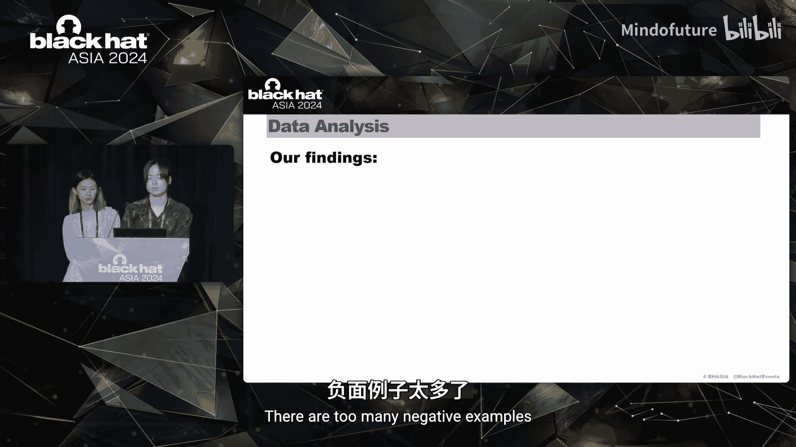

From the host name and pass， we can presume that it's a weather app。As the weather app。

 it used a key exchange algorithm to implement to implement implement the nest encryption。

And instead of collection other tags that could be used for checking。

It simply collected the information about localization。Sure， as I said。

 that auto tool can decrypt the nested encryption， you can find our GPS coordinates。

 which are highlighted on the screen。嗯。Wait， one more thing。As we will open source a tool letter。

 we have prepared a auto deploy scripts for researchers， one click to install。

 one click to push and one click to run。The scripts will auto will also automatically disable US features for stability reason。

Next。Those are all the things we have done， as we are going to do the following。Firstly。

And UDP support to that we just supported TCP now。 Secondly， add a Chrome and Firefox call support。

 Meanwhile， we need to add a P format file output for its powerful analysis capability。Finally。

 just for me， I want an exposed version for its stability reason。😊。

Then please take a quick look at the detailed architecture of all two。You can get this diagram on。

Black has website in our slides， and。I give you one minutes to watch this diagram。

On the left is the Android system。 and on the right， it's our2。

We hooked the Android runtime and native libraries to get information from Spher。

TCP and T O S and the thread I D。After we get this data， we have a data processing。

And then we will analyze these informations。So， let's move on。Our speech is almost over。

 There are three main takeaways of our presentation。

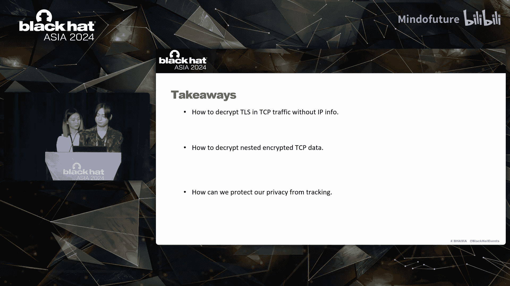

Firstly， with a T S description problem。We can use thread ID and package a sequence number as a feature to divide chatic TCP data into a single connection。

And then we use the algorithm to dec the T O traffic on Android without I P and port。Furthermoremore。

For decption of nest encryption， we hooked most implementations of cipher class to get all data about the cipher。

Then we restored the double encrypt content。By the way。Please be careful with the bad bathroom。

For its feature of reading position。In some cases， you need to receive the position after reading。ok。

The last but not least， to prevent privacy tracking。As shown on the post slides。For Android user。

 we highly suggest you to use the latest version to obtain the newest security and privacy strategy。

Because almost every major release has the enhance of privacy protection。

And and I recommend you to practice the principle of this privilege。For example。

You should always use longtime permissions， as you can。And closer permissions like nearby devices。

 body sensors， at least。And provide the rough location， if possible。

So this is the end of our presentation。 We are open to any valuable comments。

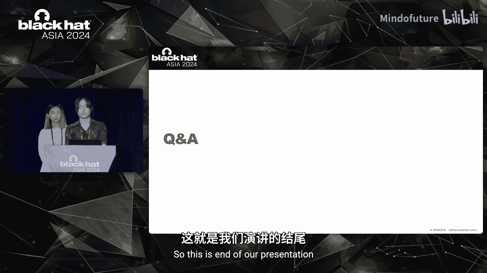

And any question？

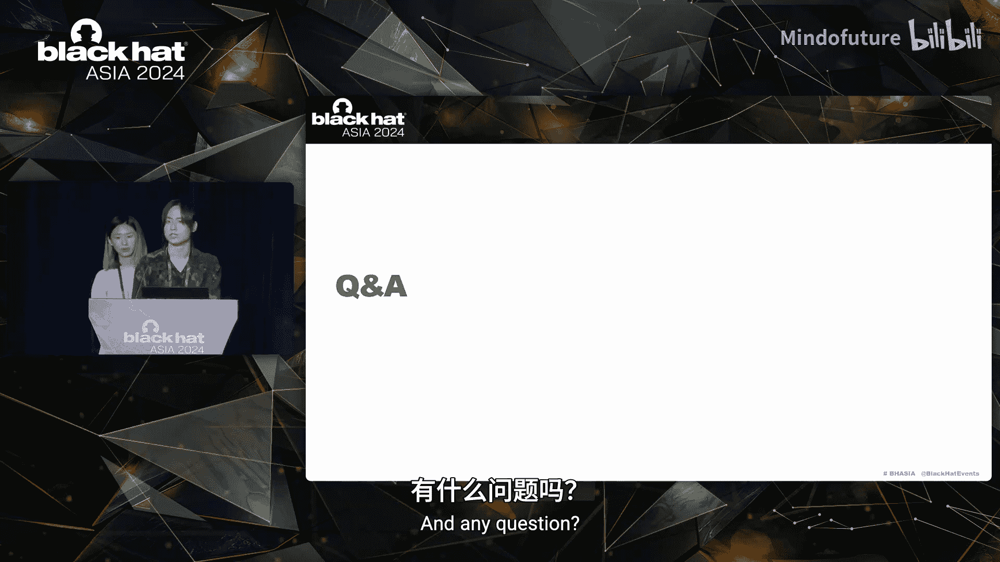

Any question。Okay， please。家va。

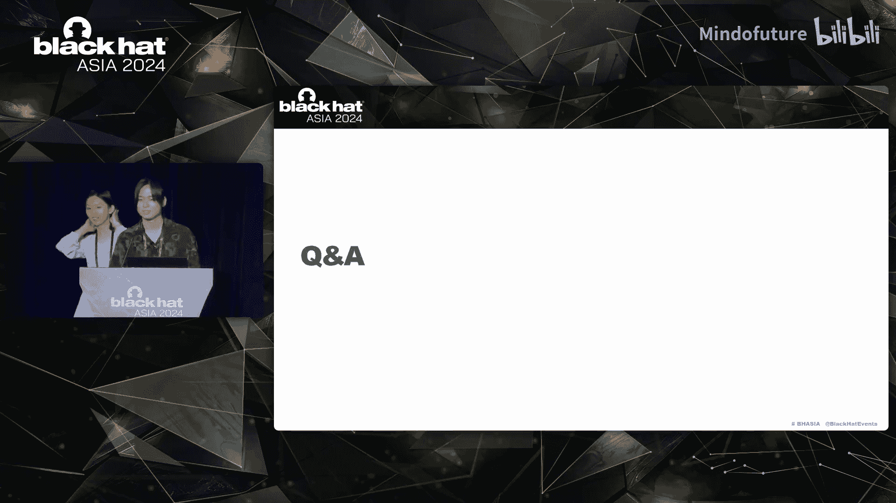

Yes， in some cases， the app uses a self developedO to do the encryption。

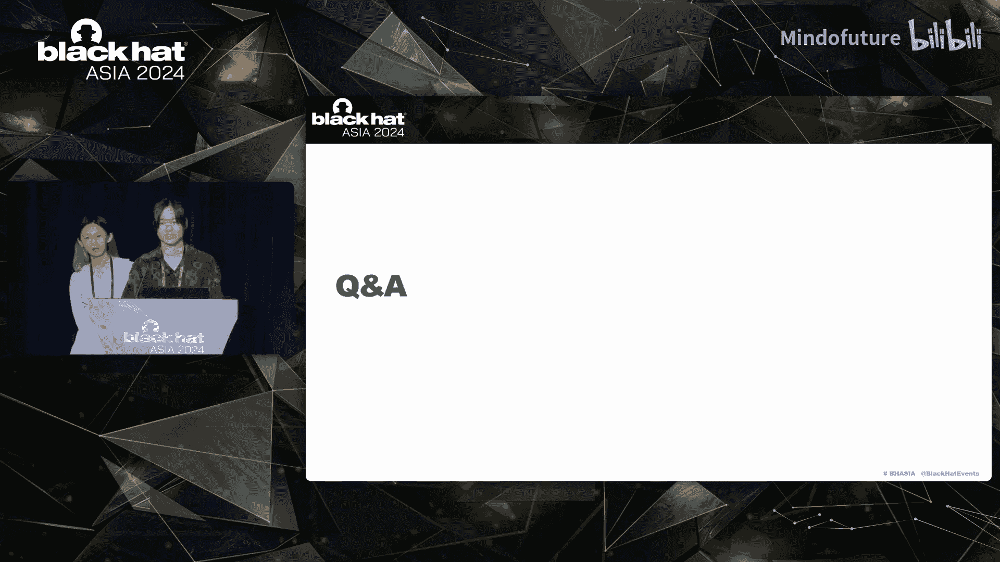

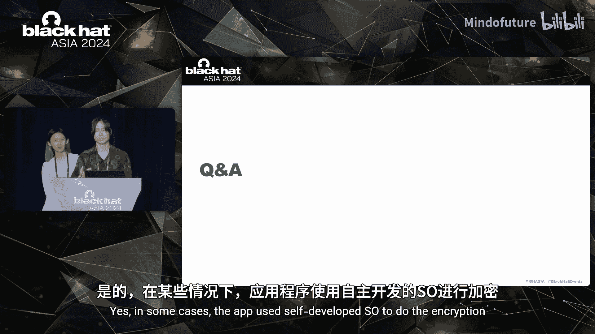

呃。Oh， you need to。

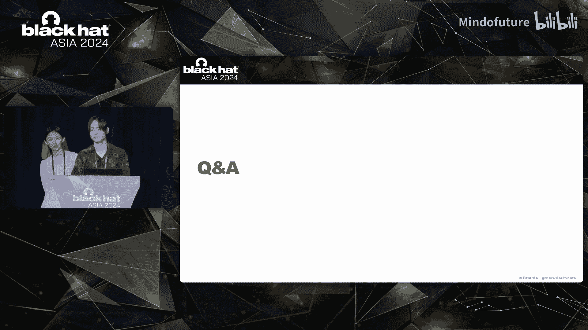

To customize for a single app， but it's。

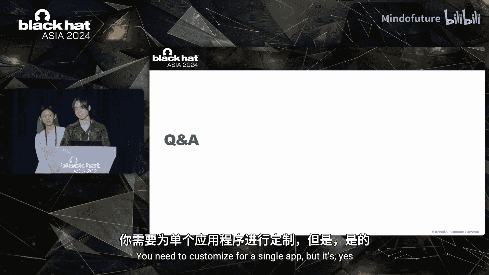

Yes。

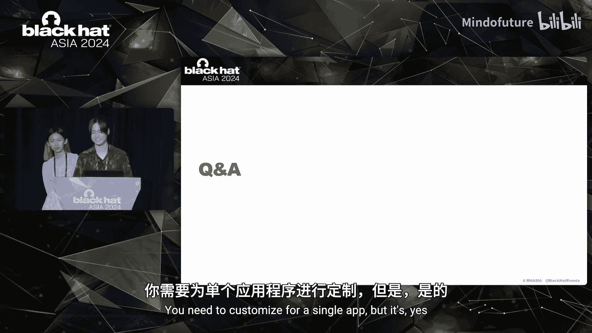

And other questions。

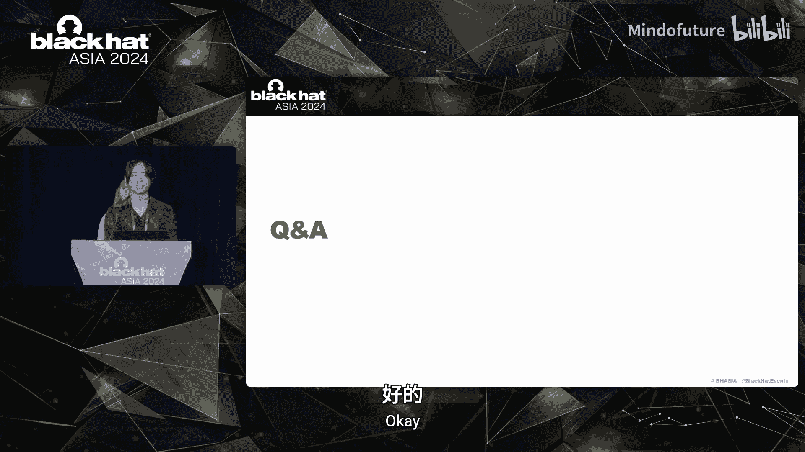

佢。

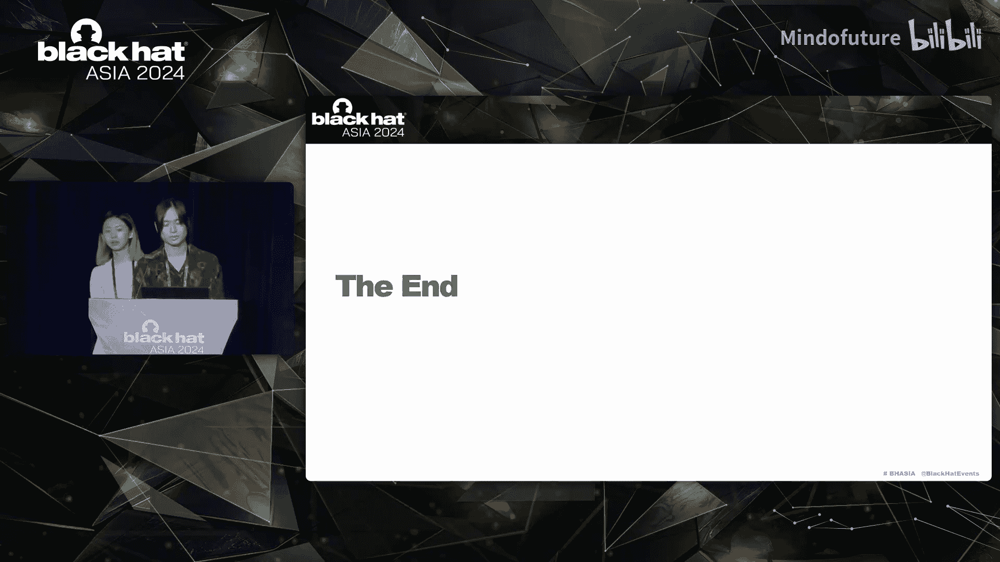

So， no question。K。Due to your time limit， this is the end of our speech。 Thank you for all。

 and wish you have a good day。

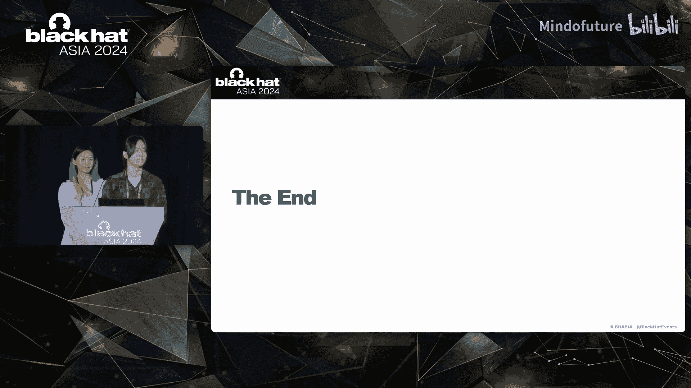