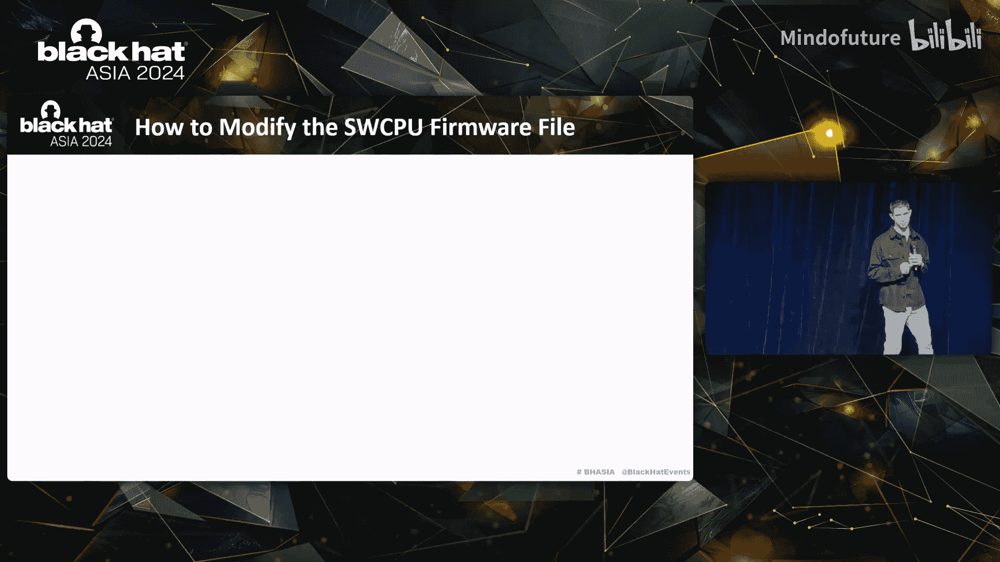
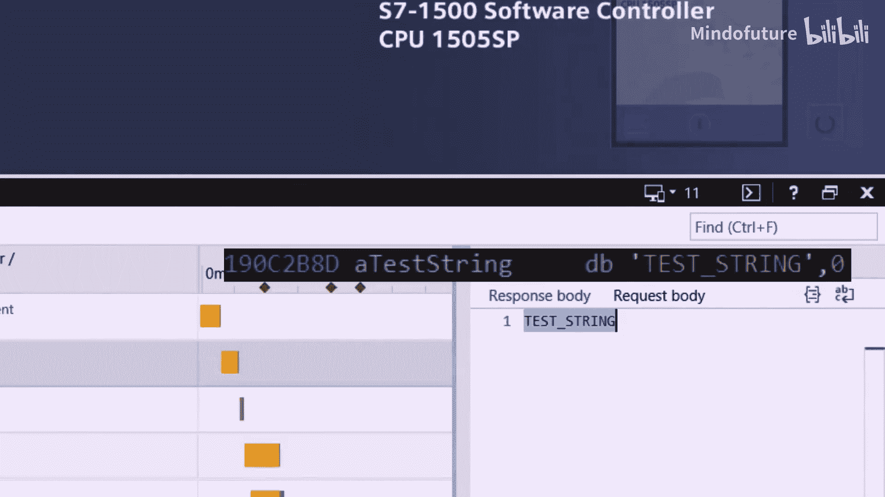
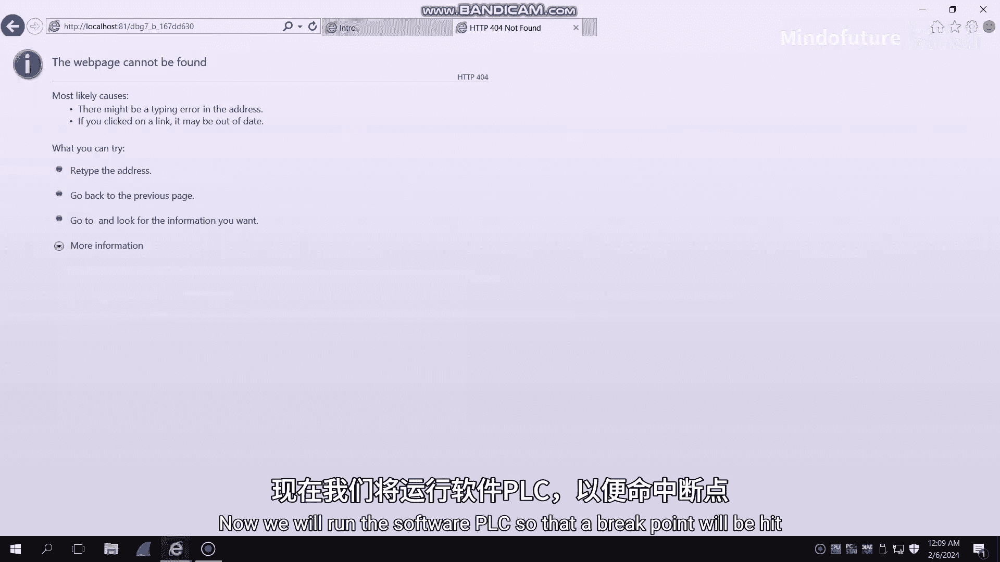
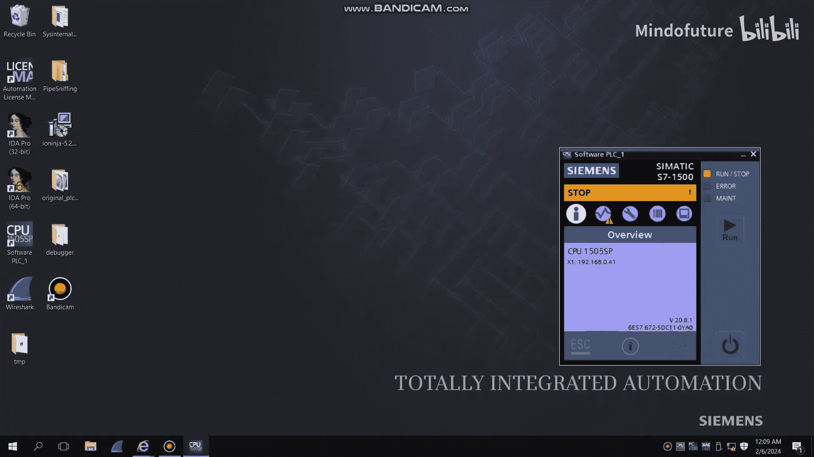
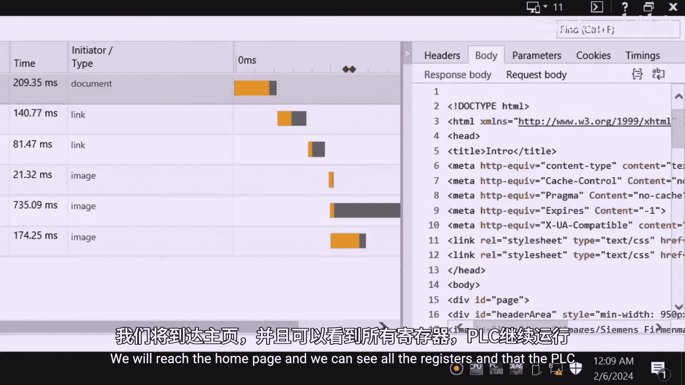

# 黑帽亚洲大会2024全集-•-中英｜Black-Hat-Asia-2024-p08-P09-Debug7---Leveraging-a-Firmware-Modification-Attack-for-Remote-Debugging-of-S--BV1oyX7YnEhN_p8-

Hello， everybody。We're very， very， very excited to be here today。

 also because I almost didn't make it， I was stuck in Dubai for like 32 hours on the wayover。

We're going to talk about the firmer modification attack and remote debugger we developed for the Simmons S7 PLCs。

And before we begin， I just want to say thank you to Professor Eli Bam， Dr。 Sabitang。

 and Aone Dner for the joint work。And also a very special thank you to Dr。 Marina Ktofi and Dr。

 Ali Abassi for the dedicated mentorship。So I'm Ron Semel。I'm Ael Samuel。

 as you can see we're brothers and been collaborating for almost 25 years together。

I'm a software engineer at Microsoft and also a security researcher at the Tannum。

 and I'm a security researcher at the Tannum。So we're not the first to research Simmons PLCs。

 Many people have done it before us。 So our first topic will focus on previous research so we can build a strong foundation for the rest of our talk。

We're going to talk about the runtime manipulation of Simmons S7 PLC firmware and how we leveraged it to develop a remote debugger for the Simmons S7 PLCs and finally a video demonstration and conclusions。

So can anybody here imagine life without water， transportation， food， or even our Amazon shipments。

So today。Our lives and necessities are made accessible via highly automated industrial control systems。

And these systems include wastewater treatment plants that purify our drinking lot。

Our traffic is managed using complex signaling systems。

Even our food is grown using automatic irrigation systems。

And our online purchases are managed in automated warehouses。

And these smart control systems include mass integration of Io T devices。

 extensive cloud communication and smart automation。

But all these cool features come with a lot of risks。

And cyber attacks on critical infrastructure can be devastated， for example。

The Triton malware was specifically designed to disable safety systems。

 which can prevent industrial accidents。It was first discovered in a Saudi petrochemical plant。

 just think how deadly this kind of attackque can be。And due to these consequences。

 we have a great responsibility in securing these system。Now。

 a PLC is a very rugged computer used in industrial automation。

 and it's the core component of an industrial control system。

It reads input data from field devices such as sensors。

And then it triggers outputs based on pre program code。

 So you can kind of think of it as a bridge between the virtual and the physical world。Now。

A little off topic here。 We're from Israel。 It's very， very hot over there， kind of like here。

 And you can just imagine yourselves like walking down the streets。In the summer， 100% humidity。

 everybody's always sweating it's sticky， so we love ice cream。

But the problem is they all here would always finish my ice cream going on。So at a very early age。

 we understood that ice cream factories are critical infrastructure that must be protected。

And here's an example of how an industrial control system would work in an ice cream factory。

So the factory has these industrial tops， which the ice cream is prepared。

And each type is connected to appeals。And the PLC gathers data from the top during run times such as its temperature。

And then based on that data， it can change the tub's behavior。 for example， it can tell the stop。

Additionally， the statuses of the tubs can be viewed remotely in an engineering workstation。

 and the PLC's custom control logic can be updated remotely from。

And here's some very important and relevant previous research regarding Simmons PLCs。

The doors of Trantine discovered a special access feature to the Simmons S71200 KLCs bootload。

 which was exposed via the UR interface。And using this special access feature。

 they were able to upload firmware directly to the firmware flush and thus bypass all the integrity chain。

The Rogue 7 team discovered that all the Simmons S7 PLCs are the same model share a single。

 hard coded， private keys for communication。And this motivated teammate to a clarity to actually discover these keys。

 and once they did， Simmons updated their communication protocol， TLS。

And Colin Think and Tom Doman showed that even a decade after Stocknet and all the security improvements that came with it。

 that the Simmons S7 PLCs are still in the attacker's heaven， and we'll show you why。

And because PLCs are the main target of attacks on critical infrastructure。

 we focused on the largest PLC vendor， which is Simmons。And also。

 because they invest the most in securing their products。More specifically。

 we focused on the Simmons ET 200 SP Open controller， which is a next generation PLC。

It was specifically designed to match the growing needs of Intry 4。0。

 and it serves as a platform for modern software application。It overrun some serious design changes。

 which opened it up to new attack vectors and methods。And it also runs on standard hardware。

 in this case it runs on Intel atom CPU with four cores。

 and it's one of the leading PLCs in the market。It also includes a built in software pill。

 which is called S71，500 software controller， and basically it's a software application that simulates the functionality of a traditional hardware pill。

And just to be concise throughout the talk， we'll call it the SW CPUPU。Now for years。

 Simings has kept the firmware of their S7 PLCs a secret。And they also invested。

 a lot of resources in protecting their intellectual property。For example。The Simmons S71。

200 PLC self destructs if a watchdog discovers that one of the cores was halted via the JTG interface。

And this was first discovered by Thomas Weburn in 2019 and reproduced by Ali Abas in 2020。Additional。

The software PLC we talked about earlier is encrypted on the open controller。

 and this was discovered by the So 17 in 2022。Now， we introduce a revolution in the research of these Simmons S7 PLCs。

 and for the first time in S7 PLC history， we move from these PLCs。

 there are many layers of obscurity。We introduce a powerful。

 remote tool to dynamically analyze their firmware。

 and we can easily expose secrets that have been kept secret for years。

And as a byproduct of all this， we managed to install persistent malin on the PLC which can communicate with the remote command and control server。

So at the lowest level of this PLC， we have a bare metal hypervisor。

And it launches two guest operating systems。The first operating system is the software PLC。

 and its main responsibility is to communicate with the field devices。

 like the industrial T in our example。The second operating system is the Windows embedded operating system。

And its main responsibility is to communicate with the engineering workstation。And naturally。

 these two operating systems communicate between each other using inter OS communication。

And the isolation between these two operating systems provided by the virtualization is a very important security layer。

 and this is because if the Windows operating system is compromised。

 we still want the field devices controlled by the software PLC to remain safe。

The boot process is fairly simple of this open control。

 We have a bio which loads the broad boot loader， which loads VMM first stage。

 and it's the first part of the hypervisor。 It's mainly responsible for setting different configurations。

VMM first stage loads VMM's second stage， which accesss the brains of the hypervisor。

It loads the Windows embedded operating system and also decrypts the encrypted software PLC and loads it into memory。

Now， our research continues where the Soft7 research end， and that's Laout USA 22。

Remember that in the previous slide， we showed you that the hypervised encrypts encrypted software PLC and loads it into memory。

The So 70 managed to extract the plain textex software PLC file。

So now we could start studying its assembly tool。And additionally， but also very， very surprisingly。

 they discovered that the hypervisor and software PLC firmware files can be easily accessed from the Windows file system。

Which means that these two operating systems aren't that isolated if the files of one can be accessed from the other。

And by simply dragging and dropping， we can easily replace these。As a side note。

 replacing the hypervisor is easier than the software PLC， but we'll touch up on that later for now。

 just a video demonstration of how we replace the hypervi。So。Here on the left。

 we can see the original， sorry， the modified hypervisor。And on the right。

 we can see the original one， and as you can see by simply dragging and dropping and giving admin privileges。

 we can easily replace the original hypervisor。And when the PLC reboots。

 the modified hypervisor will be the one that's loaded。

And they leverage this new capability to crash and bug the hypervise。And what do I mean by this？

So for example。How could they know who calls this function？

They started by overriding an instruction from the Hy advisor with the N3 committee。So in our case。

 they overrode the first instruction of the function within three。

They then replaced the original hypervisor with the modified version。

Using the drag and drop method we showed you in the previous slide。 And finally， when N3 executes。

A crashdown will be produced。 And this is kind of a hidden feature of the skills。

If we look at the top， we see the PLC， and on the bottom we see the crashing。

And if we zoom into the crashdo， we can see the hypervisors， registers and staff。

 if we look at the top of the stack， we can see the functions return address。

And that's how they discovered who calls this function。

Now before we continue to the rest of the talk， just a quick recap。

The Soft7 research enabled us to study the software PLC's assembly code。

Easily modify the hypervise via the Windows file system and crash above the hypervis。

And going forward， we'll be presenting our contributions。And what will we show you。

 So we'll show you how a bad actor， Er nation she said。

 could persistently install malware on the PLC。How to set up communication with a remote C2 server。

How to remotely and dynamically inject commands to the software PLC， how to exultrate data from it。

And if you're a researcher like us。We'll show you how to read runtime information from a software PC。

How to get a better understanding of the code for。Finally。

 this will all expedite your research process exponentially。Now。

 our research process was kind of like robbing a bank because it had kind of many steps and challenges。

 so took a gaming approach doing it。And that's why we developed a game called Bank He and we'll be playing it throughout the talk。

 I hope you enjoy it。And now we can actually start to talk about the runtime manipulation of the software appeals。

 which leads us to the first level of our game。Which is to gather intelligence about the bay or in our case。

 research the firm room。But we encountered a slight bump in the road。 So remember that earlier。

 we showed you that the So 17 was able to easily modify the hypvisor and run it。

We wanted to do the same， the software appeals。But the problem was that the software PLC is encrypted。

On the open controller。And the So 17 didn't discover the decryption method or key。

So after we would modify the plain text software PLC。

 we didn't know how to reencrypt it to match the hypervisor's decryor。

And if we were to just replace the encrypted software PLC with the plain text version。

 it should just crash， right？So what we did is we started by reverse engineering the code in the hypervisor that loads the software PLC。

And we discovered that the hypervisor can load any arbitrary L file as a software PLC。

 which is crazy。 It just be this。 And it kind of looks like a back door on the code。

Let's take a look。Here on the bottom， we can see the if clauses。

 which loads the encrypted software PLC file。 it just checks for a specific magic number at the beginning of the file。

 magic stream。But here on the top， we can see the vulnerable， which enables any e file to be loaded。

 just checks for the Elf Mag streamre at the beginning。This， of course， shouldn't be。

And let's take a visual look at this。Any amins？On the Windows operating system can easily replace the original software PLC file with a modified version using the Dr and drop method we showed you at the beginning。

And when the PLC reboots， the hypervisor will load the modified version。

Without checking for authenticity。And this undermines one of the key advantages of virtualization。

 which is isolation。This can be done remotely if an attacker gains admin privileges to the Windows operating system。

And the changes are persistent， so it will withstand a power outage。Now， as a side note。

 we owned the PLC that we were researching， so obviously we had an admin user which we could use to run all the experiments and needed that required admin privileges。

And that's how we gained the first point of our game。

 which is very exciting was the first vulnerability we found， and we were ready to continue。

And now that we could export this billion， we can modify the software PLC to our liking。

What do we make it do？So I like money， I wanted to make it mine Bitcoin。

 itall's a little more ethical than me， he wanted to modify so you can better understand internal logic。

Unfortunatelynately， his approach。And to better understand how the software PLC works during runtime。

 we needed basic runtime information。Like its registers instead。But how could we do it？

So what we did is we began with a very， very naive and simple approach。

And we continue to improve and build on top of it throughout our research world。

So remember that earlier we showed you that the So 17 was able to easily。

Generate a crash on by injecting an n3 command into the hypervisor。

What if we could do the same to the software PLC？What if by simply injecting an N3 command into its code。

 we could generate a crash。That way we'll see its registers instead。But obviously， this didn't work。

 Its just too easy。ItAlways has to be hard。But it was a good starting point to build on top。

And we looked for ways to improve this approach。As a reminder。

 the hypervisor launches software PLC and during runtime control is shifted back and forth between them。

 there are many context of。And we started to ask ourselves。

 what does an In3 command actually do when it executes in the software PLC？The previous slide。

 we thought it generates a crash。But obviously， that was wrong。But after a lot of research。

 we actually discovered that it shifts control back to the hypervisor。

And that's when we asked ourselves the following fundamental question。

Can we leak software PLC runtime information？To the hypervis'ors craft。

And here's a visual explanation。While running within the software PLC。

 will shift control back to the hypervisor using an N3 commander。And after the context switch。

 the hypervisor's registers will be identical to the software PLC's registers。

And this is because the hypervisor is a bare metal hyper。

Which means that it shares its physical registers with all of its guest opera。Afterwards。

 we'll crash the hypervisor using another in three command。

And the registers in the Crdo will be identical to the software PLC's Regs。

And that's how we found a cool way to actually leak runtime information from the software PLC to the hypervisors crash。

And let's actually take a deep dive into the code re injective to make this happen。

Let's begin by looking at a snippet of code of the software piece。😡，When looking at this code。

 we asked ourselves。What function is called here， which basically means what's the value of RAX？

Nobody here knows what it is because it's only determined during gunf so we couldn't really follow the flow of the code what we could do is inject these commands。

Dead beef is a magic number we chose to tell the hypervisor that it's actually time to crash。

And N three shifts control back to the hyperlyome， like we explained earlier。

And after N3 executes and control is shifted back to the hypervisor， we end up on this line of code。

And this is the code that we inject。Basically， what we do。

We first took if E D X is equal to dead beef， the same dead beef we placed in it earlier。And if so。

 we'll craft a hypervisor using another in three command。But otherwise。

 we'll just resume the normal flow。And that's how we actually discovered the value of R E X in the crashman。

 as we can see here on the left。Now。This was a tremendous。

 tremendous breakthrough for us because for the first time in our research process and probably all the research process of this software PLC。

😊，You could actually see what goes on inside during runtime。And up until this point。

 all we could do was statically reverse engineer the assembly code。But it was very。

 very frustrating because for some reason。Stop working at some parts of the code。

 like could work here， work there。Random places stop working。

So we tried to actually pinpoint the point of failure， see where this stopped working。

And using binary search attempted to crash the software P until we actually found the point of failure。

And the point of failure turned out to be this L IDT command。

 which modifies the IT that interrupt the scriptor two。What is this IT anyways？

It's a kernel structure pointed to by the IDTR register。And each entry points to a different in team。

So in our case， when N3 is executed， the N3 handler shifts control from the software PLC back to the hypervisor。

But if the IT has changed。And the handlers change can prevent control from shifting back。

So we overcame this by replacing the N3 instruction with the VM call instruction。Basically。

 VMC does the same， it shifts control back to the hypervisor， but without going through the ID team。

So before our breakpoint used to look like this， like in the example we showed you。

 well we changed it to use Z call instead of in three。

And that's how we gained another point in our game and actually leveled up。

 and we were ready to continue to the next part of our research。

 but just before we continues do a quick recap of what we managed to do up until this point。So first。

 fear of vulnerability in the hyper that we found。We were able to easily modify the software PLC using the drag and drop method we showed you in the beginning。

😡，And by modifying the hypervisor software PLC， you're able to leak runtime information。

From the software PLC。And this expedited the next part of our research a lot。

Now I'll be handing themic well to explain how we leverage this。Thank you。So you might be wondering。

 how did this runtime information actually expedite our research？So during our research。

 we found out that static analysis can't always be enough。For instance， at one point。

 we wanted to see which files were opened during runtime。

So we did use static analysis in order to find the obfuscated Cis call table and map out several of its functions。

 but it was still hard to see which files were always opened only through the assembly code。

So what we did is hook the open Ci call such that the file name will be copied to the registers and then a crash dump will be initiated。

So as you can see in the example here， this file name is ASI encoded and saved in the registers in the picture。

And that's how we could extract the filing that was opened。So for future researchers。

 here's the obfuscated statistical table that we found with several of the functions that we mapped out。

Now these were really tough times because each of these crashes took about five to six minutes to reproduce。

 they were extremely error prone and very tedious， but they were crucial for allowing us to debug our debugger as we built it。

So now we'll get into the actual implementation of our debugger。Now， in order to build a debugger。

 we need a couple of things。First of all， we need to be able to send Debook commands to the software PLC。

And then we also need to be able to get debug information from the software PLC。Now。

 a lot of you might be thinking， this sounds a lot like a CO2 server。And you'd be right。

 and that's exactly what we're going to do。 We're going to build a seat user。

So that leads us to level 2 of our game， which is breaching the vault or injecting data to the software PLC。

So like most people， we do our best to avoid hard work。But developing a C2 server is extremely hard。

 it would require a lot more research and development like finding more Ciscos in the Cisco table。

But what if I told you that the PLC comes with a C2 server preinsal？

That would save us a lot of development time， and it even comes with a nice goy。

So let me introduce you to the PLC's web server。Now the PLC exposes a web server via the software PLC。

 and this makes a lot of sense and has legitimate purposes， for instance。

 that the commission can connect to it via his cell phone during maintenance。

But how can we use this in order to inject data to the software PLC？

So we'll show you here on the top， we have our web client and on the bottom， we have the PLC。

Now the web client can request any file from the web server， including non-existing pages。

 for instance， DBG7 hellello， which obviously isn't a real file。

 but when that request gets sent to the web server。

 the web server will attempt to open this so-called file。And when that happens。

 that will hit our open。So our open hook will check if the so called file name starts with a DBG7 prefix。

 and if so， we will save it in the memory for later use。And otherwise。

 we'll just continue with the normal open flow and retain its original functionality。

So this might have seemed easy， but we just gained a point and leveled up。

 and for the first time ever， we could now inject data to the software PLC。

 and we're basically halfway through implementing our C2 server。Which leads us to level three。

Escaping the bank without getting caught。Or exfiltrating data from the software PLC。So once again。

 we have our web client on the top。And the PLC on the bottom。Now。

 the web client in this case will request the homepage， which is the legitimate page。

 and when this happens， several CSS files will be read as well。

And that's where a hook on the Rita Cisco will come into action。

Our hook will check if the file that's being read is the miniwe CSS file。And if so。

 instead of returning its original contents， we will return the data that we saved earlier into the memory。

And then after that happens， this modified CSS file will be sent to the web client。

And just like before， if it isn't the menu web CSS file。

 just return its original contents in order to retain the original functionality。

So here are the results on the left we can see that the Min web CSS file is open in the browser。

 and on the right we can see its contents， which is DVG7 hello。

 which obviously isn't its original contents。So we just leveled up。And we got an extra point。

And we just built a C2 server for the PLC。But we're not done yet because we need to finish the final level of the game。

 which is defeating the boss。 We need to build our debugger。So now we'll get into the implementation。

So first of all， in order to build a debugger， we need to be able to add our own code and data without interrupting the normal flow。

So here is the basic layout of any L file remote most L files， including the software PLC's L file。

And what we did is add a whole new malicious section to it。We called that section hooks。

 and we gave it， read， write and execute privileges。

 So now we could add our own code and data and manage our own memory during runtime。😊。

We also wanted to give right privileges to the tech section so that we could add a breakpoint during runtime。

 but lucky for us， the tech section was already writeriable， which obviously is a huge security flaw。

So now we'll get into the implementation and the architecture of the debugger。 So once again。

 we have the Web client on the top and the PLC on the bottom。

Now this time the web client will request this funky looking file name。

 which obviously isn't a real file， it's a debu command。

And when this de command gets sent to the PLC。It will hit our open hook。

And our open hook will take this deA command and send it over to our command parcel。

The command person will identify that this is a debug command， thanks to the DBG7 prefix。

Who identified the title of the command， thanks of the type's character。

 which in this case is a capital R， indicating a read stream command。

Now the read string command has only one parameter， the address from which to read the string。

So now thanks to the type， the appropriate handler will be invoked with the parameters。

 and in this case， the read handler will read the string from that address and save it into the new section that we added for later use。

And then after this happens， the web client will request the homepage。

 and just like earlier we will leak that information through the CSS file to the Web client。

So that's basically how our debugger works， the right handler operates in a very similar fashion to the Read handler。

 and the breakpoint handler simply copies all the registers and any other information that you would want to the CSS file。

 sends it to the web client and then continues with a normal flow。

So now we'll show you a video demonstration of our debugger。

 so here is the PLC's web here on the left we can see that the mini web CSS file is selected and on the right we can see its contents right now it's empty because we didn't write anything to our memory yet。

Now we'll go to our second tab where we'll enter our commands。

We will start with the Read string command that we can see in the URL。

We can see that the papers are indicating a registeristertry command。This command has one parameter。

 the address from which to read the string。Now we will go back to the web server， refresh the page。

 check the contents of Min Web CSSS， and see that pestering appears。

 just like it does in the software PLC。

Back to our command tab， we have run a right string command。

 this time we're going to overwrite the previous string with Pd。After this。

 we will reread the previous ring and go back to the homeage。Now， after we refresh the homepage。

 we can see that it's pod。Now we will enter a breakfront command。

We can see that the tape is indicated by the letter B and that we enter the breakpoint's address。

Now we will run the software PLC so that a breakpoint will be hit。

We will reach to the home page and we can see of all the registers。And that the PLC continues。

So the audio got cut out a bit in the end， but we just refreshed the homepage and can see that all the data in the registers appear in the miniwe CSS file。

I不 to。So finally， after a lot of work and a lot of effort。

 and as you can see a little bit of shooting， we finally defeated the boss and we won our little game here。

 and we finally developed our debugger。But this little game has real implications on the real world。

And this must be mitigated。So what can be done in order to mitigate what we showed you here today？

So first of all， just some common good practice security mitigations should be instate。

 such as using an ASLR and not allowing the text section to be writeable。Additionally。

 the hypervisor should be an ironclad wall between the two guest operating systems。

Simmons gave us an elegant backdo that allowed us to modify the software PLC via the Windows operating system。

This so called feature must be removed。And as a matter of fact， Simnings did attempt to remove it。

What they did is release a new version of the hypervisor that doesn't allow any unencrypted L file to run as the software PLC。

 but rather only encrypted ones。But the only problem is that we can use the same dragon drop method we showed you earlier to perform a downgrade attack on the hypervissor and use the hypervisor that we used in the example here。

Which means that effectively， this doesn't really stop any attacking。

Which leads us to our next point。There must be a secure boot chain because a secure boot chain is the only real way to prevent from a firm modification attack on the PLC。

So what is the impact for future researchers。So you may not have noticed。

 but we just entered a whole new age of PLC research， and for the first time ever。

 the software PLC can be dynamically debug and researchers can thoroughly examine and investigate the software PLC's firmware。

But that's not all because all of Simmon's Smatic S7 product line share most of their code。

 which means that all of Simmon's latest and newest PLCs are now much more vulnerable。

And what is the security impact of what we showed you here？

So we showed you how a persistent Trojan horse could be developed through one of the leading PLCs in the market。

This smell is persistent， it can withstand a reboot， and it can't easily be detected。

 and we know for a fact。That bad actors， such as the actors in the Triton attack。

 have been seeking these kinds of capabilities， and we now know that it's possible。

The longer the industry fails to properly secure PLCs， the greater the risk。

There are already many PLCs out in the wild that are vulnerable to what we showed you here today。

 but they can't be updated since they operate critical infrastructure and they can't afford any downtime。

So you may want to ask yourselves。How safe do you really feel？You should feel safe。

 What you should do is demand secure products and ensure that our modern world stays safe and secure。

Thank you all for your time and if you have any further questions。

 please feel free to contact us or separate up to the microphone。Thank you。

 thank you for the information so critical， as you said。

7 PLs are being worldwide and so much critical plans PLs are being used。

One question here this when you mentioned is a secure board chain is it a former integrated check if it are done in the beginning this should this made difficult for you to extract that content I'm not sure if I the former integrity check during boot time so now there is there ist a secure bill。

Yeah， the secure board is there now no there ist a secure okay okay because usually when then this kind of PLCs are inclined devices during in the boating the form at least if not a secure secure secure board。

 at least they will the former integrity check they will do the court signing and the former court signing and then check the court sign before voting。

Maybe it's not there now。 that's why you were able to crack that you were able to put that dummy code in the malware。

 The second thing is， have you got any C for this， You published this thing and got C。

So we did contact Simmons and they did patch the hypervisor， like we said， like they all also said。

 it didn't really fix it。I'm so not sure if there's a CV we're waiting for them to get back to us on that。

 Okay now usually with the responsibility of the researchers like you to publicly apply for CV and get CV from Mi then then tell to the vendor saying that okay we publish the C it would help the industry like they will get to know because once the Cs are there publish Ns at least the customers will get an okay there are new C are coming in the P that create awareness in the。

Yeah the public order。 We did go through a responsible disclosure process。 Yeah。

 I'm just not sure yet if A C V has been。Thank you。发不行。Hi， thank you。 Inter， very interesting work。

 frightening work。So what's the current state of affair and what is your policy with respect to the tool you have done so is it now available to external researchers and how long do you think Sieems would reasonably take in order to do anything to secure there S7 so we won't be publishing our tool because we think that it may be dangerous right now to send it out to the world and regarding Smons I think you should ask your questions directly to them we'll probably no better than。

But you said in your last slide。we have opened a new era where it's going to be available tool the researchers to blah。

 blah， blah， but if the tool is not available that there is no new era right so the tool isn't available but we believe that people can develop it we don't want to give it rust out to everyone。

 we want to show like you want to make PLC safer so we did publish our research but we still want to give the tool right out to everyone because that would still be dangerous you could still probably develop it we showed you have just shown to those who have the right resources that it's possible just do it this way in particular the people behind Triton。

RightYeah， but we also showed a Simmons and just oh， it's fine， I mean I'm not taking position here。

 I'm just asking what is yours？As a policy of our research lab， it really depends。

 but as a general policy， we don't release code。Yes， like you said。

 we know that it can be easily reproduced。So I think it's kind of like a balance。

Actually displaying this research so action can be taken because if nobody knows about this。

 it won't be fixed because it's really hard to fix it's really hard to patch this kind of。Bg。

 even if a secure bootcha is。Initd and developed for future PLCs。

I don't really see how this can be updated in current PLCs in the wild because it requires physical access to the PLCs and like installing。

the keys and everything。嗯。But still yeah I believe in this research。

 so at least people know what there are because maybe some of these attacks already exist in the wild and it's better to know it。

 It know。Thank you。Okay， thank you everybody。