# 黑帽亚洲大会2024全集-•-中英｜Black-Hat-Asia-2024-p09-P10-The-Final-Chapter---Unlimited-ways-to-bypass-your-macOS-privacy-mechanisms--BV1oyX7YnEhN_p9-

Alright， hello again， Blackhead。 Our today's talk is the final asterisk chapter unlimited limited ways to bypass your Mac privacy mechanisms。

😊，My name is Vicha Heragua and I am head of Mo security at Seuring。

 I'm an author of certifiedified iOS applicationp Security Engineer course。😊。

And I'm mostly focused on iOS and MacS application security。

 and somebody of you may also know me from my blog that I run in my spare time。

 which is Vigoa that blog where you can， of course we can read about Apple security。😊。

My name is Chaboitzitzel， I currently work at Country as a Pri Par MacWas Security and researcher before that I created a training for MacWS pen testing and exploitation。

 even before that I worked as a blue and red teamer。I do bug guarantee us as a hobby。Currently。

 I have like 80 plus C from Apple， and I also run a blog on Apple security。

So this presentation is a research continuation that we are doing for last four years or something last four years the time passed fast。

 and we presented our first TCC talk on Blackhead US 2021 that was 20 plus ways to bypass your Mac privacy mechanisms。

And after this talk we found again， 20 more TCC vulnerabilities and that resulted in our second blackheadstock。

 which was knockout win against TCC APA 20 plus new ways to bypass your Mac privacy mechanisms。

 so we wanted to create third presentation because we found another 20 vulnerabilities in the TCC and you know just not to be the same。

 this title is different， so it's not 20 new new ways to bypass your Mac bias mechanisms。😊。

And the plan for this talk is that because this is the first edition of this TCC talk。

 I'm just quickly remind you on how this all TCC and privacy fundamentals work。

 then we will go through TCC bypasses， quick spoiler we did again some TCC bypasses with simple graphapping so stay tuned。

At the end， Chaba will talk about dead and dying techniques。

 and we will cover also the TCC and security in general improvements in Macs So noma。

So to quickly introduce you to privacy fundamentals， that will be just a quick reup quick reminder。

So on Macs， the most crucial， let's say mechanism is system integrity protection is turned on by default。

And on Mac OS， whenever you are rude， you are not a gut。

 you cannot do everything with your Mac if the system integrity protection is turned on because system integrity protection。

 which is based on Sandboxs kernel extension， so it's a really low level mechanism。

 it restricts many it restricts access to many directories to files。

 it will also deny a debugger whether you would like to debug or inject code to Apple signed processes。

 so as the name says it protects the system integrity。

And the very important thing to understand is that even if you have root。

 you cannot do like inject to Apple processes to bypass TCC。

 this is all protected by system integrity protection。

And when sip is turned on that TCC comes into play。

 So that's why it's also really important to have the set enabled for all the time。

 And that TCC stands for transparency， constant and control and the main。

The main thing that TCC does is it protects users privacy。

And because SIP will protect the TCC databases where all the permissions are stored。

 not even a route should be able to approve TCC permissions whenever your application wants to get access to privacy sensitive resources。

 you will see such a prompt。And Apple in here wanted to make sure that there is a clear user consent wherever the user clicks the Allo button。

 so even if you are root， you should not be able to access privacy sensitive resources without getting the user clicking allow if you find a way not to sp this problem and get access to private sensitive resources。

 you probably find a zero day。And the， the interesting thing is from Macs Venura。

 the TCC protects also containers of sandboxed apps。😊，And this is a new feature introduced。Recent。

And that TCC protects a lot of privacy resources now， as you can see。

 every picture shows another resource and the number is still growing。And TCC in general。

Became really， really big。 if you go on your Mac to settings and privacy and security。

 you will see plenty of resources that are now protected。 and even if you go to automation。

 you will see that now you can specify which particular app can control another particular app So it's really granular and because the TCC mechanism itself grew that match。

 the attack surface of course， is is big also so there is a lot of ways you can you play with TCC and probably find some more vulnerabilities。

So let's now talk about TCC bypaes。Yeah， so let's start with some easy one with some info leaks。

 so it's all started with me reading a blog post back in 2020 about MacWs database which contains basically a whole lot of private data now you would expect like your contacts information which is considered private data is inside the addressbook directory and it's protected by TCC。

But turns out that your contact details are asked on like five other places on the system。

 and Apple didn't think about this。So I started to grab for private information on the fire system and it just was all over as of today。

 I think I submitted like30 leak infofo leaks。Apple does a minimum pay out 5K US for vulnerabilityity and TCC league is considered vulnerabilityity。

 you can do the math， how much a Gr worths。Fire system leaks are going away because I think we found most of them nowadays。

 but looks are the new place to search for。So with some notable leaks the key value service database。

On the file system contained email addresses known with hotspots。

The game Center cache database was really nice because when you start Gamecent。

 it basically made a copy of all of your contacts and all of their details so you could just access the database and you get full contact information。

The par， this was a fun one， so this demon created very short lived cash fires。

 so I think grappling this was a bit of luck like daily for a few minutes。

And they actually logged your Ga location so you could find the actual user location。

And it also did a keystr logging in safari。 So whatever I typed in in Safari。

 it was key logged in a cache file that was like a system provided key logger。

 pretty nice screen time core dislogged phone numbers in the。Lgues， maps。

 this was us really fun because if you started Apple Maps with a GPS coordinate or a location of your choice。

It logged the distance to that location from your current location。

 so with opening a couple of coordinates， you could do either triangulation or some other calculation and basically you could precisely locate the user based on the logs。

啊。But logs in general， so Apple tries to filter out private data from the system logs。

 so they mark it as private in the logs， and most of them are redacted。

You can enable it back with a user profile， but the problem with user profiles is that it requires a lot of user interaction to install a profile so as an attacker you cannot really do that。

 but it turned out that if you install this profile，At the background， the system。

 the only thing it will do is enable a setting in de logging preferences。And basically。

 it will enable all the private logs， so you just restart LoD after setting the preference and you get all of the private data in the logs。

As we see or so it can include a lot of。Data， yeah。

 and grabapping is the help be that we share with Chava。

And this vulnerability was also found in the logs， to be more clear， it was iny log。😊。

So the web application to create a forecast for you。

 it must know where are you located right so it sends your location to the Apple server and the forecast is returned from the server but the problem was that whenever the internet connection was broken the full error was locked and the full error included your location because it was what was locked was the full HTP request so you could just you know break the internet connection and get your location without getting you consent for the location permission。

The second leak also in the logs was an I messageage， so whenever you opened eye messagesage。

 all the emails of contacts you chatted with are just looked。It was that simple。

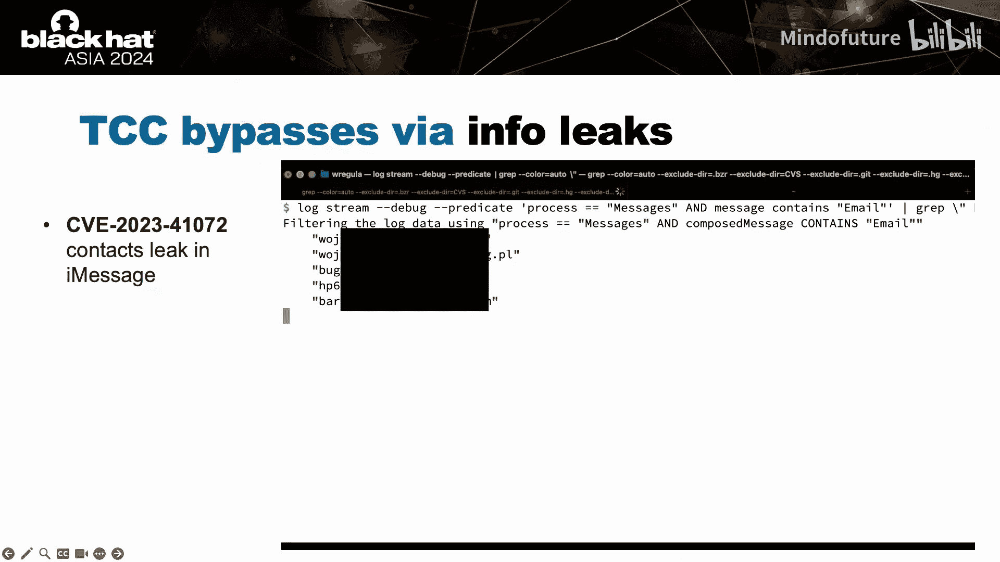

So that's about leaks let's get into some real stuff because we are here for like generic bypass TCC so in the past it was a common technique to change the user's home directory with a custom TCC database so one of the TCC database sits in the home directory in a specific folder and by changing the home directory we could drop basically a new TCC database with new permissions Now this was pretty well closed down by Apple。

But there was one thing Miss， we could still create a new user on Mac OS with a custom home folderer。

 and basically we could drop a custom TCC database。So the program was that back in Macs Venura。

 a TCC。Entry， even in the user TCC database still kind of global。

 so if you allowed Termin to access your documents。

It allowed it to access every other user's documents as well。

 assuming you were rude as well at the same time。It was changing Sonoma。

 so in my experience in Sonoma if you grant terminal access to your documents。

 terminals still cannot access other people documents， so the steps to actually exploit this。

 we create a new custom PCCC database， we either create a new user or we enable a root user which is disabled by default。

With the database。Loin as the new user， we steal whatever information we want and we reboot now this can be entirely automated。

嗯。The way I will show it in the video， but it the first few steps will be very quick。 So essentially。

 I enable the root user with the custom TCC database。 I install some。Ato run scripts。

Wwhich we steal the other user documents， I also enable auto login。

 so I don't need to interact with the GuUI， the root user will log in， steal the data。

Remove auto reboot， and basically we are back to the user。So this is what we actually see here。

 We have a secret document at my user。And of course， to create a new user， I need to run a route。

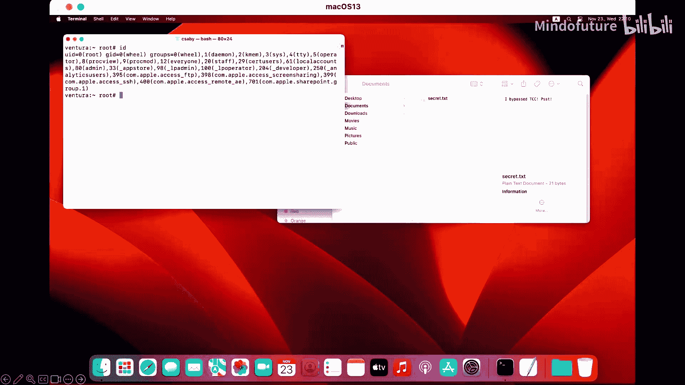

that was the exploit now， the system boots。And because auto loging is enabled， we notC。

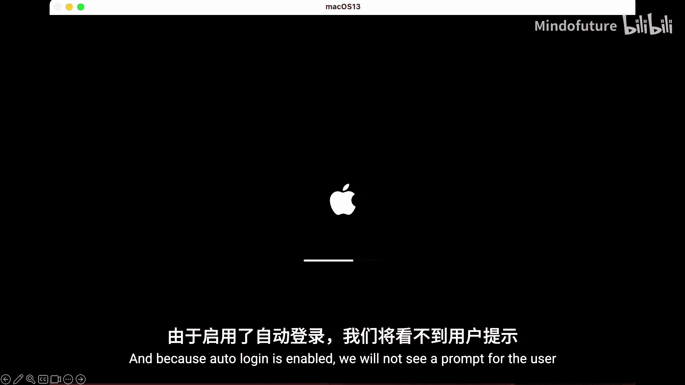

A prompt for the user。

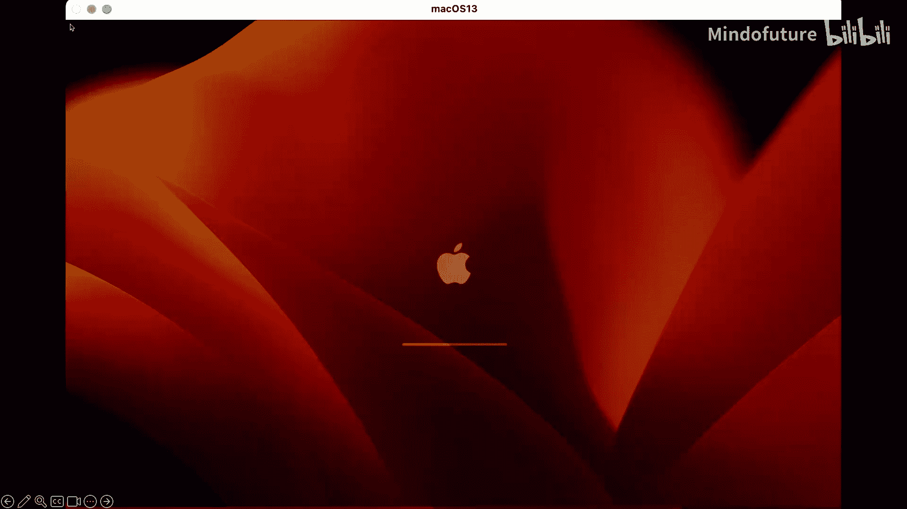

So str now with just a blank screen， basically in the background there is a process which is grabbing that secret TX day。

 it's done， it removes out or and now it's rebuting again。

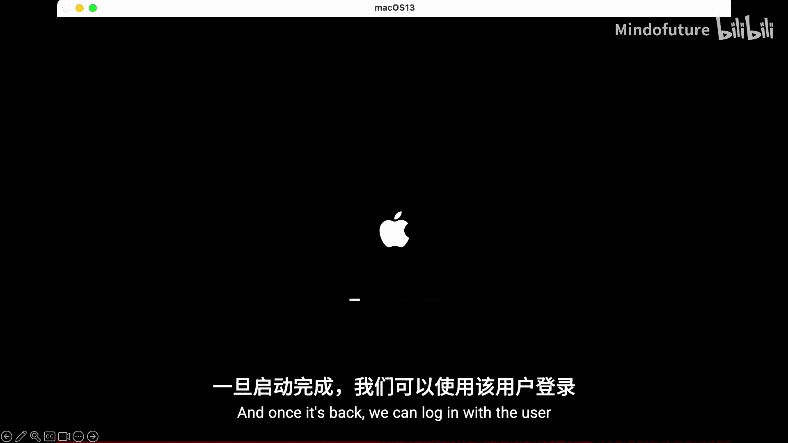

Once it's back， we can log in with the user。B log in as back as root。Just to verify that， I got the。

Document。

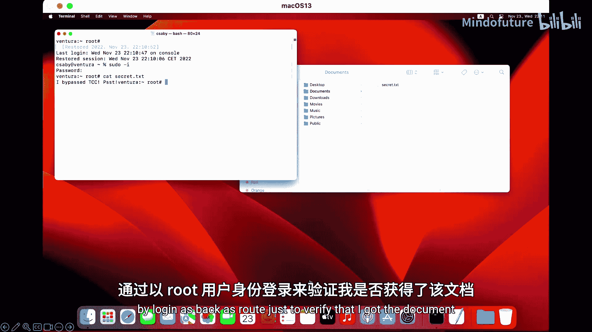

So， the next。Generic bypass was used by the Safari sandbox process Safari sandbox broker is the process which is responsible for unzipping zip files when you download them with Safari now there is a feature on MacW or in Safari that it will auto open save files。

 like unzip zipip files， this is the first feature I think you want to disablebra on Macquest for your own security。

And this process has full disk access permission， so basically it means that it can access all of your private data。

 I don't know why it needs that， but it has it。So the way the unzippping process happens is this process will create a directory。

Inside the downloads folder， name find name。ziip。 download。Download the zip file there。

 then it will create another directory with six correct random name and extract the contents into this director。

Now， how we can exploit this process to drop our custom TCC database to the user because this is our goal again with full disk access permissions。

 we can。Override the TCC database。So we create a large zip file。

 like a really large one to actually slow down the decompression process and we add our custom TCC database into this file。

Then whenever user downloads a zip file， we quickly overwrite it。

Although Safari will continue to write to this file because after the zip trailer。

 everything will be considered a chunk， it's not a problem。

And whenever Safari creates this six Corlon directory。

 we replace the directory with a symbollylink pointing to the TCC database folder。

 and so the third step is a race condition， but by having a large zip5 with large files。

 it will be slow enough that we can trivial in it every time and once the extraction is done。

 our TCC database will be overwritten。So this is demo。

 so we can see the terminal has access to the downloads folder。

This is a period visit because we need to operate on the downloads folder， we start our exploit。

It will start creating。Like one and half gigek random content file。

 it's actually pretty slow so I will。啊。Speed the top。 So it's done。

 It I think it's still creating it。And。Whenever it' done， yeah， it's done。

 I will start downloading a zip file。诶。And。The exploit will detect the zip file。

 it will overwrite it。And now we are waiting for the extraction to start。

Yeah I also downloaded the large zip price so it was though the extraction is happening。

 so we replaced the folder with a symbolic link and we can see that all of our files are being extracted into the TCC database location as well as the new TCC database。

So it's always dropped that's done and now if refresh。Permissions。

 we can see that now Termin has all sorts of new access。

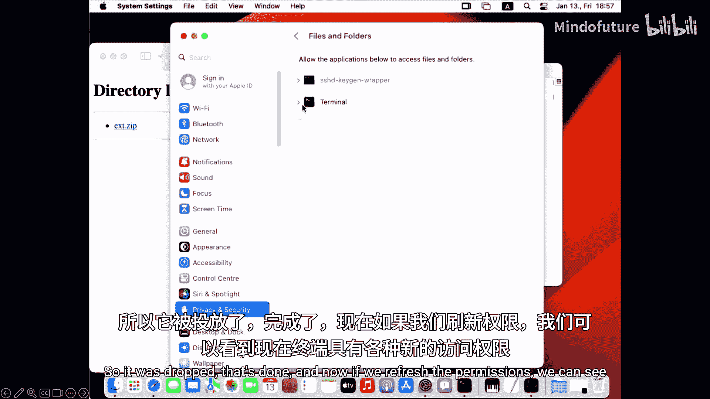

And。The third generic fund is using an installer。 Inst assistant is the。

Is the Mac OS installer you can download from Apple？Now。

 the good thing about Mac E sign installers that they will be run。

With the system installed the process and that process has see bypa permission。

 so it can rise to see protected locations it also has the heritable。Part of this right。

 which means that any of the child process will inherit that permission。

 So these packages has often installed our scripts inside。

Wwhichch means that all of those scripts we run with C bypass permissions so if those scripts have issues we can potentially bypass C now it turned out that all of these packages had this link shared support script inside this is like a 15 line script containing three different vulnerabilities I highlighted two of them the first one is the Ellen command which creates a hard link so what it did it took the package name。

 the package pass which is under our control because we installed the package。

And linked it to shared support Now what the way we can exploit this is we can replace the package with a symbolic link pointing to a sip protected file and in that case a hard link will be created。

To the C protected file and because C protection is based on file parts。

We will be able to overwrite or modify this file through the new hardlink。Now interestingly。

 the last line was also an issue because what it also did is removed the restrict flag from the file。

 which means it remove C protection at all so even if we wouldn't have the hardlink C protection was removed from the file so we can just operate on it and override so we could either target the TCC database or I choice I choose the。

LO application P list file， which is considered as an other TCC database in a P list format。

So just here's a quick demo of this， I try to list the desktop。

Whater with terminal and I don't have access to it。

 then I try to I log in a route to access other locations as well。

 and I try to access the main TCC database。 Now this database is。Protected by S as well。

And we cannot even read it if we don't have permissions。So now we run our exploit。

 this is lucky pretty fast， we place the symbolic link and now we wait for the installation to finish and that's done we updated the L application list。

P list。 and now。We can access。All the other five is because I granted full disk access rights to Ter。

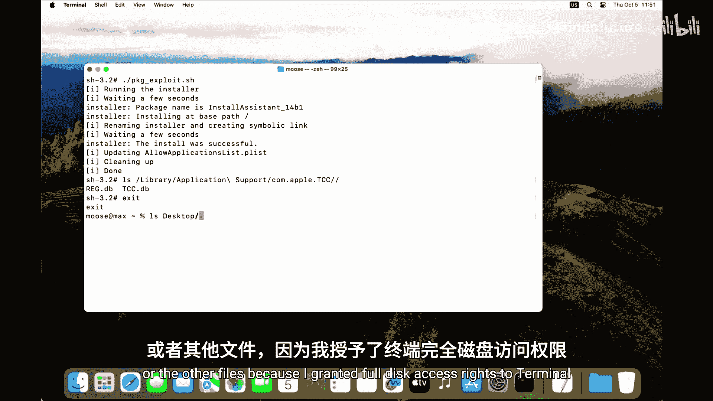

Okay， my turn。 so I spotted a command line tool， CPL diagnosis。

 which diagnoses mostly icloloud related services。 And as you can see at the screenshot。

 it is heavily entitled with private Apple Apple permissions。

 even theres come Apple private TCC allowo entitlement which looks like a sweet spot to to reverse engineer。

 but without reverse engineering， that tool requires root permissions to be executed。

 but please keep in mind that when a system integrity production is turned on and TCC is also on even with root。

 you should not be able to access user sensitive data， right。😊。

So now let's read it together the output of this command line tool。

Because you will see that even Apple engineers knew that this tool can be potentially harmful。

The photos the diagnostics may contain some of your personal information。Including your location。

 IP address， crash logs， iCloud accountant information and photome data such as file names。

 the names of your shared photo streams， the names of people and related information。

 including addresses， emails and phone numbers， from contact data database locations。

 object and scenes。In your photos and calendar events associated with your photos and memories。

 statistics about your photo libraries， such as。Cs and titles of photos。

 moments and the age of your photos， information related to each of your memories。

 information about your recent and or past Apple Music listening activity， so on and so。

 so many sensitive data， right。And there is a protection that you need to press enter to continue。

And what is funny with this tool is that when you provide dash H。You will see that， oh。

 so there is a flag。Output file， where you can specify all this diagnostic。

 sensitive information will be saved， right， so。Just by using this sophisticated exploit。

 I was able to get all those data。So， but we have the enter protection， right， but you know。

 just to bypass it， just Eho pipe。And Rnda， right， And that's， that's it。And the。

Pro of concept you can see at the screen。 it was just like that。You open these。

 you execute this bash script， you can see the locations。

 the dumping color the dumped I message color Is and of course， full photo libraries。

 So that was fun。 It was really good tool and it was like not even hidden。Especially。Okay。

 so now let's talk about a quatz scorere framework。

 which is a standard low level framework built into MacS for processing and rendering graphical data。

And generally， it will be loaded by all your Mac OS applications with graphical user interface。

 It doesn't mean it doesn't depend on programming language， every application with user interface。

It doesn't matter if it's Apple's application or a third party application will probably rely on。

 on this， on this framework。 And even if you use dialip tree on App kitt。

 which is the stand standard framework used by applications。

 you will see that in the tree of loaded libraries， there is quatz score indeed loaded。 So this is。

A sweet spot to， to hunt。And the quatz core framework， because this is the whole 2D drawing engine。

 it has a lot of functionalities and a lot of environment variables that can control the behavior of the framework。

So there is really a lot of anverse， but I spotted。2 are actually three interesting n vs。

 The first one is quartz score log file or X log file， because in the end。

 those two nverses do the same。 And the second one is X log file open。

 So let's start some reverse engineering to see what they do。😊。

So the quartz score log file or X log file， when set to a file name。

 it will make your your graphical user interface application start logging the quad score events that were happening during the rendering of Windows。

And whenever you set the X log file open to one after you close your application。

The log file will be automatically opened by the default text editor。Can you spot the back here？

I will give you like5 seconds because we don't have much time。Any idea。Okay。

 so there is a string concatenation passed to the system command。

RightSo that means that we have command injection in all graphical applications on Mac OS with graphical user interface。

 This is really huge， right。😊，So what happens next。

 so the system function will spawn a child process that will execute our command because we have the command injection and the TCC is based on responsible processes and because the child will be spawned by the parent who is TCC entitled that TCC will grant also the permissions of the main app to the application we executed。

And you can confirm it with such a command， so I just open the find my。

 I pass the quardtz score log file， wavea the command injection in here。And I。

And I set also Xloify open to one to make the operating system launch the or open the the file that was the lofi that was created。

 And as you can see in the red Can Mac monitor， the find my eventually opens the say command I injected in here。

So let's take a look at the demo。There is no TMP desktop S file。 so now I'm running my exploit。

 I will be using Gar band to inject my command。It has been launched。

Now the application it closes the garbage band and the command injection is triggered。

So as you can see on the TCC prompt， there is information that Carageband wants to access the privacy data right。

 because we inherited its permissions and now you can see that TmpP desktop L file is filled with the LS of the desktop。

 which should not be possible。

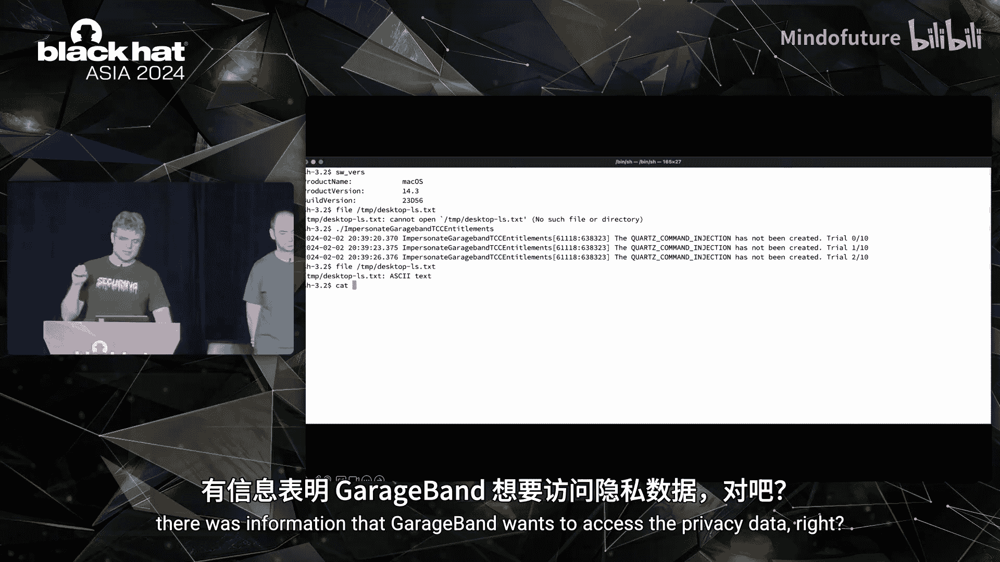

this proves that T C bypas。Great， so now let's talk about Co Foundationund network。

 which respects a variable C network diagnostics， when which set will make the process log every HTTP and HTPS request and you know what it was in the Apple's documentation I haven't reverse engineered。

 I just read the documentation。So Co Foundationund Network is a framework that is used widely in the Mac OS。

Even if you use a dialip on foundation， you will say that in the， you will see that in the end。

 theres their C F network framework linked。 And whenever your application uses the standard Mac networking API。

The Cf network functions will be used。Under the hood。

 So most of the Apple internal apps were were vulnerable to build in， to the Macs。

So let's take a look at the demo。

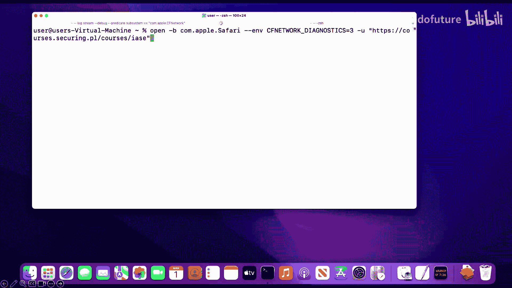

I'm launching safari with this set and everything by Car Foundation network is being locked。

So what I was able to get， of course， like in here such an ID of my company's Jra was logged。

 but it was of course the injection in Safari， I also do the same injection and the maps which of course need to know your location in order to show you where you are。

 so I was able to leak the location。

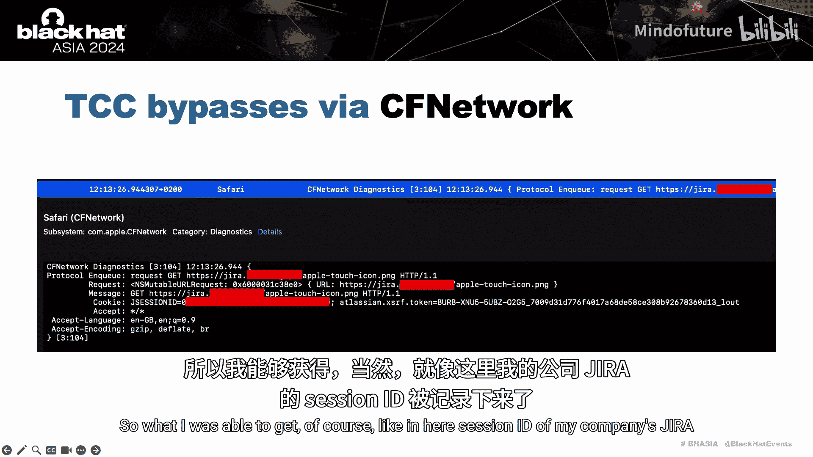

Also， I used it on find my， which includes the icloloud token。Which。

Can be used later to get your iCcloloud synchronized data。 And as I proved in my talk。

 what happens on your Mac space on Apples iCcloloud when you have this token。

 it's possible to derive the TCC protected sensitive entries that are synchronized with icloloud。

 and they consist that data of find my contacts， calendars， reminders， node， photos。

 I message and more。Just to show you the demo。That it actually works。 I coded a tool。

 which takes the location。 I pass the icloud token。

Under the hood that will refreshes the find my location。

 and then it adapts your location directly from the i cloudud。Now。

 where you can see in that huge Jason， there is your location。

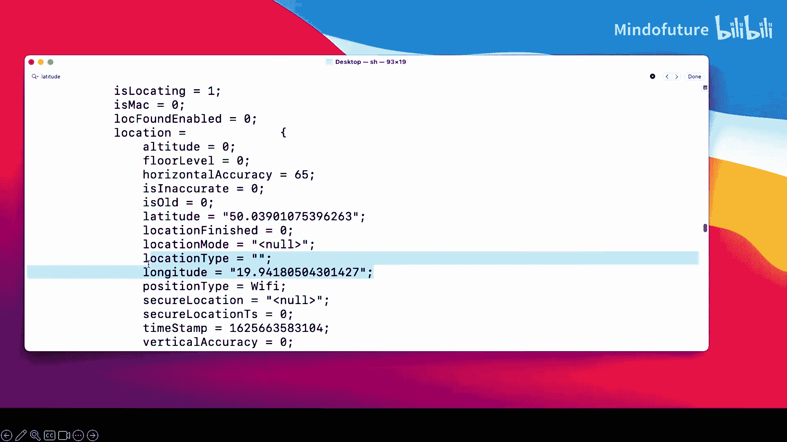

So， yeah， accessing this， this tokens is really。It's really bad for the TCC and your privacy。

And the next slide is， is a bit hard because I want to be fair both with you and with Apple。

I don't want to disclose any zero days。And and you know， because that that could harm you。

 me and all Apple's customers。 But in the very same time I with Chaba。

 we've made a submission to Blackheadt where I， where I promise that I will show you one more back。

But unfortunately， this bag is not yet fixed。I。Reported severe and major TCC vulnerability back in January 2023。

And unfortunately， it's still unfixed。And I told Apple that I won't disclose this vulnerability in November 2023。

 So I think they have sufficient time to fix a major privacy vulnerability on Macs。

 But unfortunately， they didn't。 So maybe on the next talk， I will present it。 I will disclose。

So let's quickly talk about how PCCC has improved over the past four years。

So some of the techniques used in the past are actually dead or dying going away。

 mounting over directories was a common technique， Apple protected many files from being overwritten。

 read， whatever， but you could easily mount over the directory and either get the system to write a file in there again or drop a new config file。

 whatever this is mostly done， Apple learned the lesson。

 many of the CAmin tools tools which had very strong entitlements they are either hardened or have been removed from the system。

The plugin techniques like injecting plugins to garage banks， image and depth。

 all sorts of application on MacWe to gain access to their entitlements。

 that's mostly done due to the launch constraint feature that was introduced in Macwet Venura。

All the other apps are signed with hard and drunk time。And。

Instead of demons loading external plugins， now， it's basically。Moved into an external X PCC service。

 which doesn't have any rights anymore， and that we load the plugin。 So these are mostly gone。

Or the gring or the infofolics， I think file system buys there。Almost gone。

 really hard to find any new ones。Nowadays， and I think the log leakaks also going away。诶。

Also the application data protection。Makes it harder because you don't necessarily have access to their container where there might be some private data。

Also， the installer script buns。Are mostly going away due to the new installer script action and mutation protection。

诶。As of one some of the。Improvements。Launch constraints， this was not a TCC specific mitigation。

Basically， it will a control。Who can launch an application， How can。It launched。

 and from where can you launch an application， So for example。

It was a common technique to take an application， copy to the temp folder。

 maybe put in a plugin into this application and then launch it from there。

 This no longer works so you cannot take。An application copy it out and launch it from there also so you cannot launch demons from the command line。

Only launched them as a demon and so on， this was a really， really good。

Improvement and I think it's a really great engineering effort from Apple。 It makes our life harder。

 Also the application bundle and data protection， probably that's the。

Most impactful TCC protection since Monteterrey。It protects the application。

 data and the application itself at this stage， so it's nice but it's trivial to bypass at this stage。

 which many of our bypasses are still being fixed and again overall there are like 16 new TCC categories in Monterey。

So as a closure。PCC is a person attempt to protect private data。

 which is not unseen in Linux or Windows environment。And the past five years， it travel overed a lot。

Really， and it's getting harder and harder to find vulnerababilityities so like three years ago it was easy to find the generic bypass nowadays you need to be creative and really tricky to find them。

Still， only two of us， we could feel like three conference talks with just DCCC bugs。

 and there are other people finding this is vS， so that's not even included。嗯。

So we say setting the title， its final chapter， yes。It's been a nice triology， good research。

And threeoies don't get the fourth chapter。What do theies get？A sequel。

So were happy to introduce return to TCC land it's under heavy development and hopefully。

We can present it next year and we will bypass again everything。

 I think you already have enough content just for that talk。Yeah， hopefully next year。Thank you。

Are there any questions？Oh， there's one question okay。You have a microphone in there。So I'm Xu Xiang。

 I'm just do TCC research and find some abilities。 we， we just in two years ago， we， we report。

 similar abilities。 but I find it's very hard to use in iPhone or iPad because Apple store just a big problem。

 do you have any idea about。This this this one。question to you or me。

这这 just just TCD TCD bypa can be used in micro eyes and but is hardly to use in iPhone。

good okay so I think on iPhone you don't have many of the features or applications you have on Mac which allows you to bypass with specifically targeted Mac but I know some of our reports showed up in the iOS advisory as best I guess they were applicable for iOS I think I in general it's much more lockdown than MacOS so probably there it's harder to find these issues。

Yeah， and on this， keep in mind that on。Ihone or or on iPad or generally on i。

 you can that freely spaed processes like you can do on on Mac。

 So the attack surface is a a bit lower， right， It's a bit dire yeah。따 was 잘요。

Are there any other questions？Hello Raymond here。 I'm just wondering in terms of。

 I saw some of the things like geo locations being sort of leaking。 The question I have is。

 if you set your locations to be off。Right， Z有， you're supposed to not。all this data。

Whereas in logs or whatever， right， Yes， do you see any of this， Like， even if you set it to off。

 it is still on。 I mean， it is still sending it just， you know， no， I， I didn't notice such。

 such examples。 like if you turn off location services。

 your location should not be sent to to Apple servers。 So theoretically。

 such vulnerabilities should not exist。What saying is it's not in the locks that this data is recsitiding once you switched off。

 Am I right to say that you haven't seen any of this， Of course， if you， if you bypass the。

 if you have compromised the Tcc that what you have guys are done。 then， of course， you know。

 whether you you set it to off or all doesn't matter。 But if you set it to off by right。

 those locks and those data should not appear at all， right there means T C works something's。

I think you're out of time if you have any other questions， you can find us。Yeah。

 and stay tuned for the sequel。Thank you。