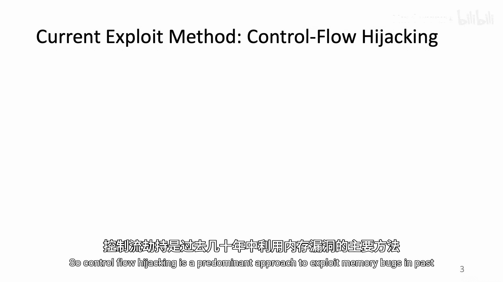
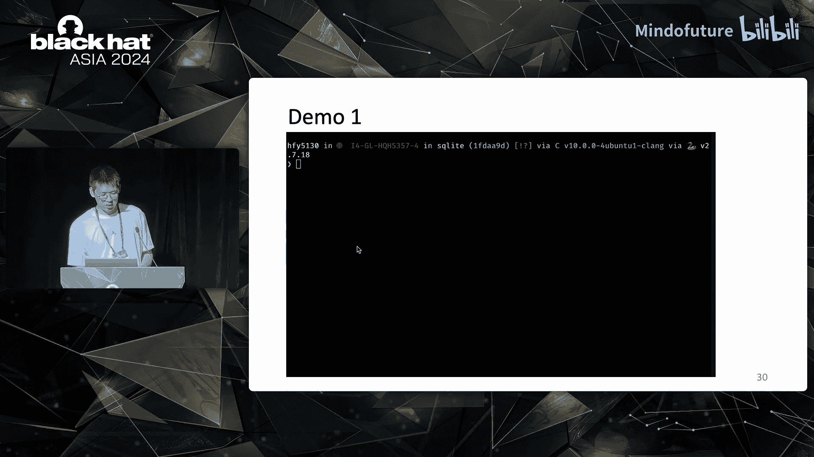
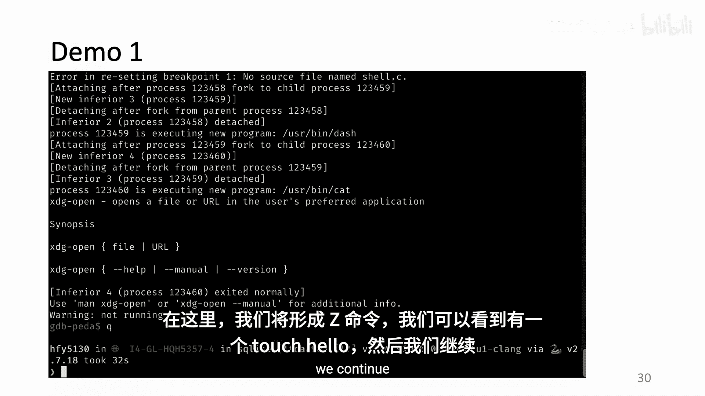
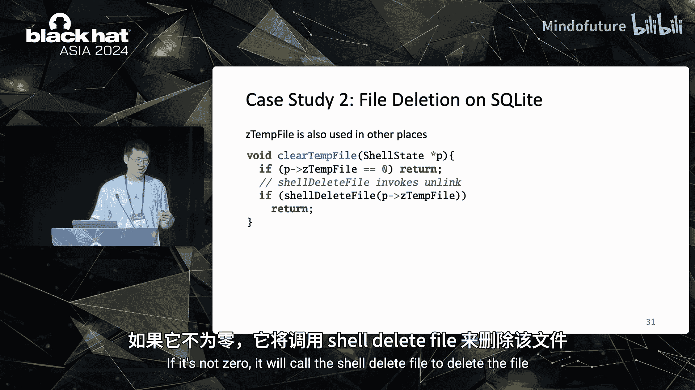
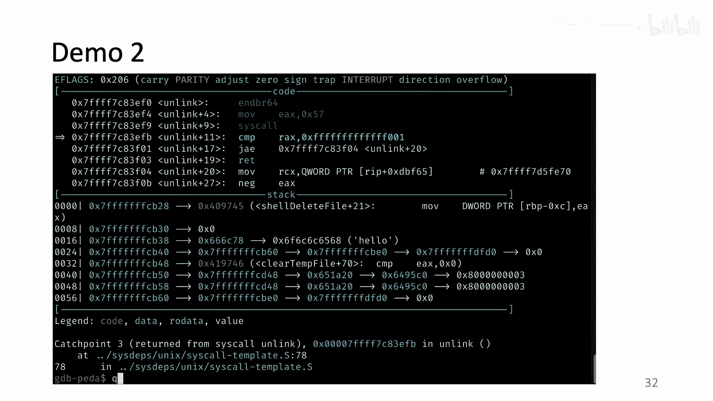
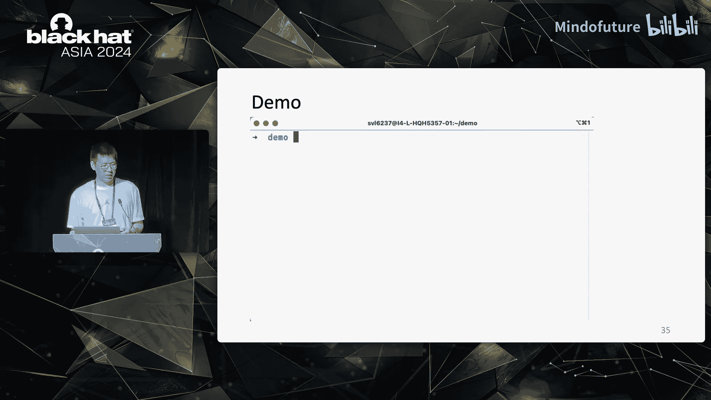
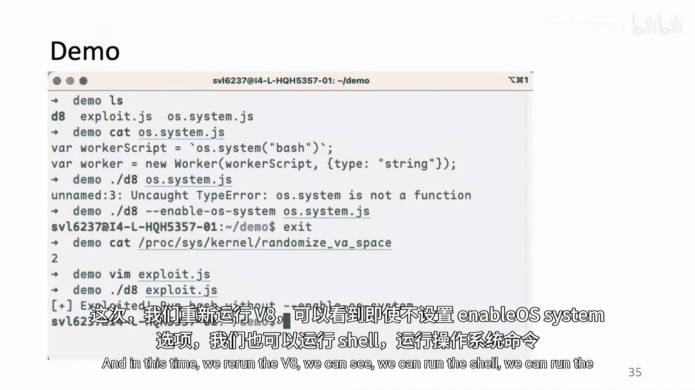
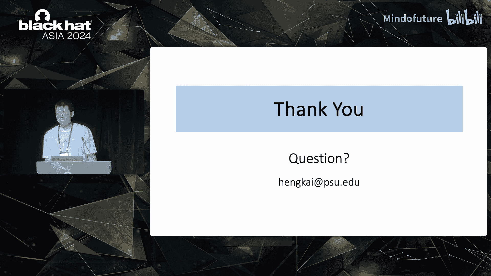

# 黑帽亚洲大会2024全集-•-中英｜Black-Hat-Asia-2024-p10-P11-One-Flip-is-All-It-Takes---Identifying-Syscall-Guard-Variables-for-Data-Only--BV1oyX7YnEhN_p10-

Hello， everyone， welcomee to my session。My name is He Kaiye。

 I'm a PhD student from Pennsylvania State University。

 And today I'm going to give a talk about how to identify the critical data for data only attack generation。

So a little bit about our team。 we are systems security researchers from Pennsylvania State University。

 and our research interests include availability detection， exploitation and defense。

Song Zhechang and I PhD students。 and Professor Hong Hu is our advisor。 So， okay， let's start。

So control flow hijacking is a predominant approach to exploit memory bugs in past decades。

So， in control jacket。Attackers first leave with your memory bug。

To to gain some memory assets primitives like arbitrary or write。

 and then leverage this memory assets primitives。To crop some control data like a return address or function pointer。

 and which first can divert control flow to achieve malicious goals like arbitrary code execution。

So in past few years， attackers can build some attacks like code injection attacks or called reuse attacks。

However， researchers have proposed many different solutions to prevent such attack。For example。

 a called pointer integrity can protect the control data。

And control flow integrity can prevent abnormal control flow being executed。So nowadays， actually。

 it is difficult to hijack the control flow。But at the same time。

Data only attack shows great potential to be the next generation method。

 So unlike control for hijacking， Ha relies on the control data。

 data only attack only new to crops noncontrol data。 but I can achieve similar malicious goals。

 like arbitrary called execution。 So in previous works。

 there there are some work like data oriented programming and block oriented programming shows that the data only attack can be to complete。

 and。And can achieve automatically。So that attack shows so powerful。Is such a thing even possible。

 Yes， it is。So let's， let's start from a classic data only the attack。

 which need to crop the C G I beam configuration string in long H TBD long H T T BD server。

So actually， the attack is pretty simple and straightforward。

 And here is an example to show how a normal C G request works。

The first was the server initial in the server initialization。

 it will first lose the C J configuration from the configuration file。And here。

 the file is called the C G I B configuration is user local H T T B D， C G I B。So。

 what is what is C G I B。 actually， CG I is also known as a common getaway interface。

 So its a standard for running the excables on the server side to for data processing and C G configuration is a string of a directory that contains all valid excable。

 So in this case， the client will send a post request and follows a string called CG I bin and calculator So when the server receive this request。

 it will first pass this string and get the first part， which is C G I。

 So it knows that this is a C G I request。 So it will pass the later part to get the excable name。

 So in in this example， the exccutable calculator。So it will search the calculator in the preload C J I B configuration。

 and if found it will run the calculator for the client。So we can see in， in this case。

 the configuration is pretty important because it can just decide which excecutable can be executed by the client。

So what if the configuration gets corrupted actually resists how the attack does。So in this attack。

 attackers first leverage a a hip corruption override to overwride the C G bin to a forward slash bin。

And then it will still post a C J I B request。 In this case， it will try to run the share。

And follows a comment to re remove or delete a file called root private file。

The server received this request。I identify this is the CG I being request and identify that the client want to run the share。

It will search share in the stash bin directory instead of， instead of the preload one。

And will give the share permission to the client and delete the file。Actually。

 there are many other powerful data on attacks， for example。

like copying the argument of set E U I D to get the root privilege in W UF TP T server。

And in blackhead USA 14， Yang Yu proposed a attack。

 which only need to crop one variable called safe mode。

 and it can turn on the gold mode in the Ie browser。 So the， the。

 the gold mode actually allows the unsafe active X controls to run and which equals to arbitrary execution。

And other text attacks like bypass the E， M， E T in Windows and bypass the control flow guard in Windows。

So from previous example， we can see that unlike control flow hijacking that need to build a complex attacking chain like R O P to bypass the defense mechanisms。

 data only attacks are really just simple and straightforward。 So in most case。

 attackers only need to corrupt one variable or sometimes even one bit and the attack is done So why data only attack is so powerful。

 but it is still not as pervasive as control flow hijacking attack nowadays。

So we think the most the most important reason is that the non control data actually is not hard to identify is hard to identify。

So the question now is， how can we identify automatically identify security critical non control data。

Or critical data for short to build the data on the attacks。呃，First呃。

Sing the critical data is challenging。 So unlike control data have common low level properties。

 For example， specific data type or memory locations。

 critical data are defined based on their high level semantics。However。

 a general analysis to infer the high level semantics is impractical。

 especially on the large applications。So in previous work。

 researchers try to manually inspect the code base to identify the critical data。

 and which is tedious require large human efforts and not scalable。

A flow stitch can identify the critical data with explicit things。

 source or things like the argument of Cisco。And clearly can only identify critical data related to the error calls in Linux kernel。

So our contribution in this paper， we first identify an important category of critical data called Cis guard variables。

And we desire the branch force to identify them。And we also assess their probability because in previous work。

 they just assume there is a arbitrary memory primitive。

 but we want to assess their probability to see whether these variables are， indeed。

 can be corrupted。And we implemented a framework called Viper。

 We identified 3434 unknown Cico guard variables from 13 programs。

 and we built four new data on attacks on C light and V 8。And we open source out， too。

Let's start from a classic data on the attack。 And also， this is our motivating example。

 The code is for open S S H server to authenticated users。

 So we can see there is a flag called authenticated with default value 0。And there is a。

 while loop to keep retrieving the username and passwords。And verify them。

 And if the password is correct。It will break the loop， set authenticity to one， and log in。However。

 actually， there is a memory bug in the function packet read， which can provide a。

memorized primitive。 and the attackers can then say authenticated to one。So in this case。

 even provide a wrong password。The attacker can still log in the server。

So we consider the authenticated is the critical data here。And the question is。

 how to identify the authenticated automatically。So we first。

 checked the previous data on the attacks and get two observations。First。

 most data on the attack relies on security related calls。 So in this example。

 once it breaks the loop to log in。The server will finally execute the execute for the attacker。

The second is security related ci scores are often guarded by security checks， actually。

 in the form of。Chysical guard branch。That as a conditional branch here at 9 11， the E statement。

And we consider the variables in this branch is a Cis guard variable。So we implement。

 we implemented v to automatically identify system guard variables。So before going deeper。

 we want to know whether Cis guard variables really matter in that on the attacks。So check。

 we checked existing 17 data only tank and found that 11 variables are system guard variables。

Aissco arguments and all other six ares guard variables。However。

 it is still challenging to identify Ci guard variables。

 And the first challenge is how to identify the sole contribution of each variable。

Symbolic execution can identify a complete path to trigger the cisco。

 but it cannot tell us which variables are more critical compared to others。

And the second challenge is how to make the analysis efficient and scalable。

A static static analysis can help， but it has some limitations on like handling the indirect calls and perform the interprocedural analysis。

So to efficiently locate the Cisco Guard branch， we desired branch force。And the core idea is。

We flip every branch during the execution。We hook the cis codes to see whether there are new security related ci code get triggered。

And if yes， we consider the flipped branch is a Cisco guard branch。And for illustration here。

 we have a program and an input。We first run the program with the input。

 and we record all triggered branches and cisco。And then we rerun the program with the same input。

But this time， we will forcefully flip the first branch during the execution。

 and we also record all triggered ci calls。If there are new Ciscos get triggered。

 we consider this branch is the Cisco Guard branch。

So we sleep every branch in the execution and get a bunch of Cisco guard branches。

Through the branch force， we can obtain a bunch of potential cisco guard branches。 However。

 we don't know whether they can be really flipped in the real world scenarioereo。

 So that's why we want to investigate the variables in these branches。So actually。

 we perform the backward data flow analysis of each variable in these branches and generate the data flow graph to see for these fiscal guard variables。

😊，We in our assessment， we have two metrics。So the first metric is the memory location。

 we consider global variables are easier to be coped compared with hip variable and stack variable。

And the second metric is the， the number of memory right instructions among the lifepan of the variable。

So we assume that every memory instruction can be could be abused。 And therefore。

 as if there are more memory instructions among the leftpan。

 we consider it has a highly higher likelihood to corrupt them。And here is a workflow of v。 though。

 given a program and input， the branch force will first drive on the program to collect the triggered cico and branches。

And then it will flip every branch during the reex and identify potential ci cause。We use the。

 we only flip the unique branch triggered by new Ciscos。

 and we use For server to speed up the re execution。After getting the branches sit code and input。

 we will feed them to the variable rate。Vator will first record the execution。

 the execution trace of these input on the LL VM I R level。

 and we will simulate the execution based on the recorded trace and perform the backward data flow analysis。

And finally， a v will report the cisco guard variables with a high probability。

We evaluate Web on 20 programs。L programs with northern Dayton attacks like the Open S H and7 programs from fast Bench。

including the S light and four other well tested programs like jascript engine B it。

So we realize that one important factor is we want a corus to achieve higher coverage。

 because only when our input can achieve this trigger branch。

 we have the chance to flip it during the dynamicle execution。 So we actually。

 this is quite similar to theing。 So actually we are first try to search the test case in the source code in the source called repository。

 like in light。 we found a bunch of。A great test cases。 if we cannot find。

 we will search online to see whether they are ready to use coppers like the fastbe data case。

And if we cannot fund from the previous two methods。

 we fast program with AFL plus plus to try to get a relatively robust corus。

We totally identified 36 Cico guard variables from 14 programs。

And this chart shows the cisco distribution。15 variables are related to on link。

 which can delete or overrite files and 10 variables are related to execute。

 which can execute arbitrary code。 and others are like change mode， change owner。

 which will change the file permission and change route。

 change D IRlink set groups set R E U I and import protect。

And we also investigated the explainability， so。We first emulate the memory primitive in GDP。

 So we want to see whether confirm that all 36 ci guard variables can indeed trigger a security related cause。

 And then we conduct a C investigation。 we search the historical vabilities。

 and we confirm that for 16 variables。 there is a indeed once there is a C that can provide the arbitrary provide memory primitive to crop them。

 And finally， we build for data only attacks。Here is a time cost。 So in most programs。

 Vper can finish analysis within five minutes， and we also compare vper with flow dish。

 which is an exploit generation tool for dead attacks。

 and we can see the time cost is at the same level so we can combine vor with other tools for the automatic exploit generation。

Okay， so in the following talk， I will show three data only the attacks we built and two on Cite。

 one on Viet。ASite is the most widely deployed database engine used in Android I O S Chrome safari。

And。We use a v to test the sco light。 Vap reports 7 cisco guard variables in scoite。

And we build three new data attacks on the top three Cisco Guard variables。

So the first variable is called do X DG open。 And by set the do X DG open to1。

 we can achieve the arbitrary command execution。And we will show a demo later。

 And the second is called Z time file， which can achieve arbitrary file deletion。And the last one is。

 is delete。 It can also achieve the arbitrary file deletion。Okay。

 so a little bit background about our first attack， so。When C light processed a query。

 it has multiple ways to present or handle the output result。It can the result to the。

 on the standard output。Or it can also save the result to a file。However， more than that。

 sometimes you may want to edit the results before saving them into file systems。And no problem。

 S light also has this less feature。So it can， you can edit it before saving。 you for example。

 with the dot ones dash E circle that will send the output to the system text editor。

 and with dash X， it will send the output to a spread like Excel。So the。

 the red code shows how S that opens the system text editors within the function called output reset。

 And we can see there is a if statement will check the value of do D G open。

 As long as the value is not 0。 it will move to forward the command string。

 which is based on the Z temp file and called the system to run the command。

So how we identify do X DJ open。The branch force flips the if statement and catch the execute。

And the variable generates the data flow graph for the P D X DJ open and the temp file and found that they are really they。

 they are highly cr。Here is the first graph of generated by the variableator。

 which is the data flow graph for the USD Open。 And we can see although it is a stack variable。

 it has a really large number of memory instructions。

And we checked the code found that dual A D G Open is a variable stored on the stack of the main function。

 and it assign value at the very beginning， but only used here。

So we consider there is a large chance to crop it。And this is the data photograph for the G T file。

 And we can see Z T file is also stored on the stack of may function and has a long leftpan。

So after identifying these two interesting critical data。

 we need to one memory bug to build our the the attack。 So through the C investigation。

 we identified there is a type confusion bug proposed by Kun Yang at Blackhead USA 17。

 So with with this bug we can get the arbitrary right primitive。

 and it also shows that bypass AR is feasible。And here is the attack demo。

Oh。We can see here is a P O C。 We first infer the address of do a D open and other address user to create the bug exploit the bug。

 And we first time we use the bug to set do a D open to one。And we set the temp file to toch hello。

 which will generate a hello。 and we store the payload to a file。And we can see currently。

 there is no hello。In the system。 and we generate the payout。And we try to run it。With a pout。First。

 as for better presentation， I will set a back point as a if do as open the statement and feed the payload。

We can see， currently。The du X D Open will be set to one。And we continue。 We can see。哦。Here。

 we form up the Z Z command， and we can see there is the Toch hello， and we continue。

And check the file。 We can see how it' generated。Actually。

 we can also like sponsor a shell as long as we crop the Z temp file the stream and。

Well in the first attack， Z temp file is only the Cisco argument。 So the main part is dual D open。

 but also identified another use of Z time file in the large database。 code base。

 So as this code shows there is another function called a clear temp file。

 It will check the Z temp file value first， If it's not 0。

 it will called shell delete file to delete the file。

So we catch this by flip the if settlement and catch on link gets triggered。 And in this case。

 both Cisco guard variables and Cico arguments are the temp file。 So unlike the previous work attack。

 we need to leverage the bug twice in this attack， we only need to grab the temp file。

 and this is the one shot exploit。And here is the example。Similarly。

 we refer the address of Z T file and other objects。 And in this case。

 we only need to crop Z T file to like hello， which is the file name。And a safe to the pilot。

 a safe pilot to fire， also。We can see currently there is a hello， and we generate a payload。

And we try to write。So actually， the clear time file will be executed several times。

 So we first set a break break point as a bug。Yeah。

 and then we set a break point as a clear tempifier。And， we continue。

We can see here the Z time file will be set to the hello。

And we catch the cico of a link to see whether it is actually gets triggered。 Yeah， and yes。

 it triggered。 and we can see the argument is also hello。 So the hello should be deleted。

And we check it when see hello is deleted。And the third attack is on the javascript engine V8。

 So Vet is used in many popular applications like Ch， E， Op and node J S。

 And it has a very large code base， more than 3 million lines of3。

3 million lines of code in the latest version。So we Web can also test V8。

 and it shows that there are two potential physical guard variables， and one is highly。

 So this variable is a。Global variable， and with a very large number of memory rights instructions。

And here is the code about this variable。 The variable is called enable oil system。

So we can see only when its value is not 0， where it can spun a shell。And we use an old C V。

 E to bypass A CLR first。And then we use reuse the C V E to set the options。

 enable oil system to one to get to run a shell and execute the arbitrary command。

And here is the attack demo。We will first show the normal ja file。

 which try to run the O system with a shell。And we write it。

 we can see it is not We are unable to write。 And only the only way is write with the option。

 which called enable a system。But the呃。But for attackers。

 it is not possible because you need to rerun the server the engine and with a specific option and which is too difficult for attackers。

So we build our attack with fully SR。And here is our。POC。

We leverage the bug to bypass the S LR and set enable a system to， to one。And in this time。

 we rearrun the V， we can see。

We can， we can run the share。 We can run the oil system。

 even without setting the enable a system option。And in summary。

We implemented a v which can automatically spot the fiscal guard variables for dead only attacks。

And we design the branch force， and we also assess their capability。

 We had 34 previous unknown Ci guard variables。And build four new data on attacks on C light and V 8。

And we open source our tool and attacks。Thank you。 I'm ready for questions。

。🎼这。You mean how， how long we takes to evaluate a program。 So actually。For most programs。

 we can finish the analysis in five minutes， including the。But for large programs。

 more larger programs like。With， it takes。I， I think it's about half half an hour hour。

 But during the Philippin。 But for generation， the data flow analysis the data flow graph。

 it sometimes take longer time。 but for most programs， it should be within five minutes。

