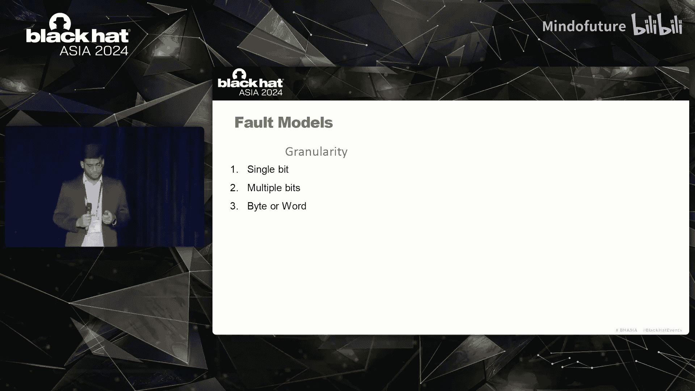
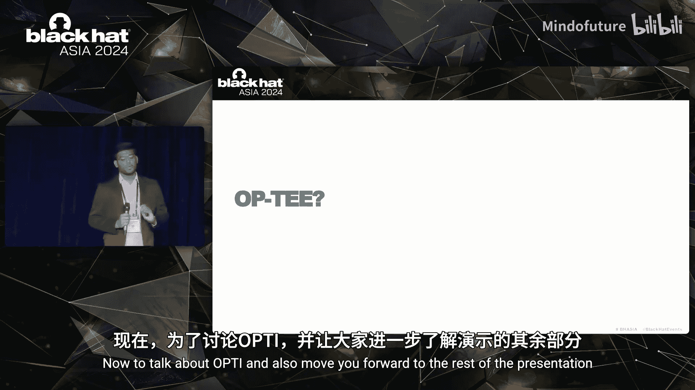
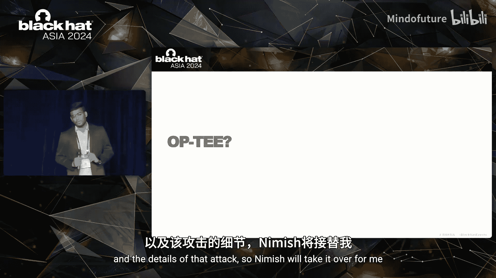
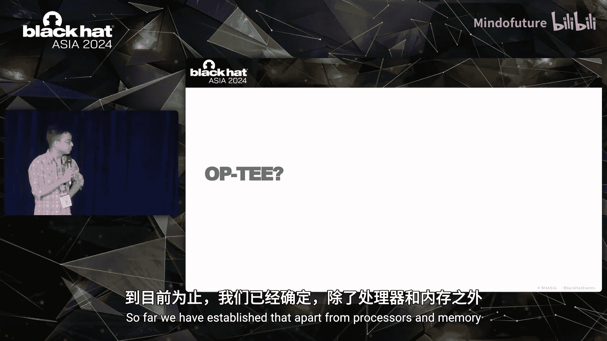
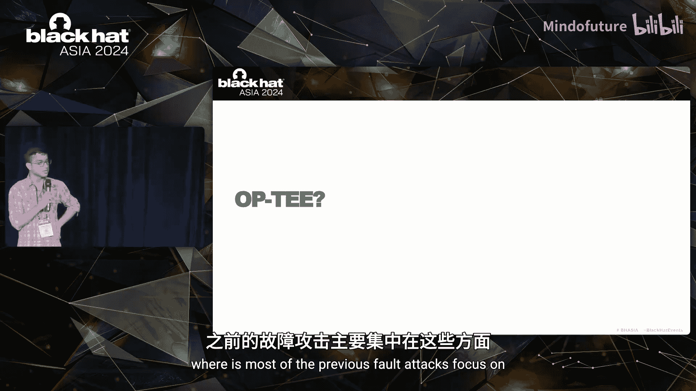
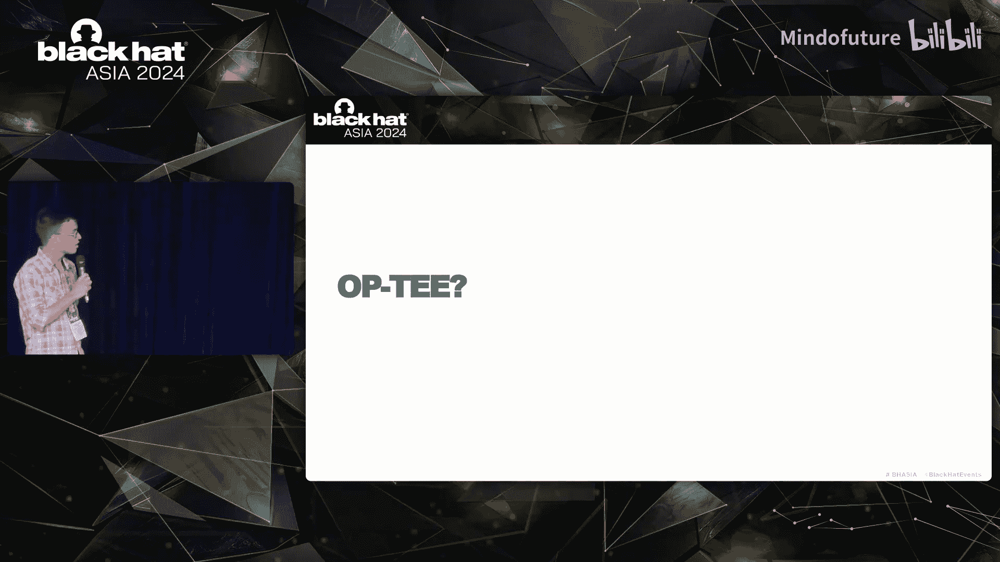
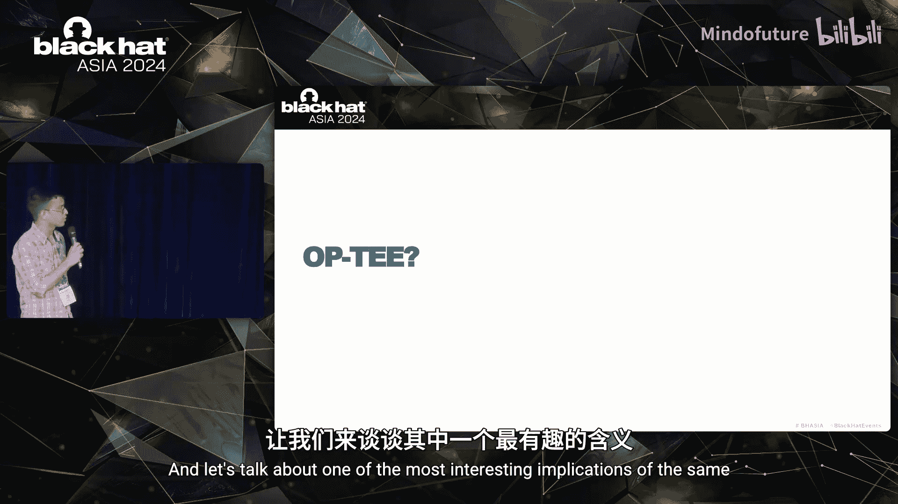

# 黑帽亚洲大会2024全集-•-中英｜Black-Hat-Asia-2024-p11-P12-Faults-in-Our-Bus---Novel-Bus-Fault-Attack-to-Break-Trusted-Execution-Enviro--BV1oyX7YnEhN_p11-

Hello， everyone。Welcome to our talk so T will talk about our paper faults in our bus so this talk is regarding fault attacks more specifically bus fault attack where we use this bus fault attack to break the security of armtra zones。

😊，So before we start as a very brief introduction of ourselves， so I'm Aned B Haesniish。

 so we are PhD students from the Indian Institute of Technology Corrupur， India。

 and this work was done in collaboration with Professor Deputy Mukgat there from IIT Corrupur。So。

 here is a brief outline of our talks so first we will start with a brief history of falses and literature survey on falses then we talk about the traditional fault points on em systems and SOCs and then we present our proposal there a new fault point on SOCs。

😊，Then we discuss about optti and why it is relevant with respect to our talk and then finally we talk about our end to end attack where we demonstrate。

😊，A complete hijack of the system。Through fall attacks。

 finally will end our talk with the impact of our research work and also the takeaway from this。

So what are falses faults are basically system errors where the adversary actively pers either the data or the control flow or the system。

😊，In order to gain access all information through the faulty responses。

So why are falses catastrophic， you know， so actually in digital systems。

 faults do occur although they are rare and mostly they occur through accidents but。😊。

They if they can be controlled and if they are induced purposefully。

 then these falls can cause errors and these errors can be exploited to hijack the system or leak secret information from the system。

😊，Now fault attack also along with that， fault attacks sometimes if combined with other kinds of attack primitives。

 like for example， side channelnel information， as we will show in this talk。

 that can lead to much stronger attack。😊，So， the literature on fault attack is pretty vast and for the last around 25 years there have been lot of research on fault attacks。

😊，But broadly classifying fault attackss can be actually classified into two subclasses where the fault injection techniques actually concerns itself with on the actual hardware。

 the way you want to induce the faults in the hardware and fault exploitation or the fault analysis which actually after it comes after you actually injected your fault。

 it actually depends on the type of the type of target that you are trying to attack。

 maybe it just could be RSA or AES， but then the analysis technique will depend on the type of target。

😊，In this talk， well mostly focus on four injection technique。

So how do we or the attackers actually do the faults？

So we there are multiple ways of inducing faults， but in this talk we will mainly focus on electromagnetic fault injections。

 so we use this special kind of probes。😊，That when a current flows along this probe it creates a magnetic field around itself and if we go back to our elementary physics class from the maxverse left and rule if there is a magnetic field going on it creates an induced current right and that induce current if you place this probe next to next to an SOC or an embedded system where some computation is going on it actually interferes with the circuit or where the current flowing through the circuit and then can actually create false。

😊，For example， if you see that for some computation， if there is no electromaggarary pulse。

 it creates a non 40 execution， but on introduction of this electromagtic pulse it might behave weirdly and it might create bit flips in it。

😊，So there are different types of fault models。Depending on how you want to look at it， for example。

 if if you look at from the granularity， there could be single bitfalls。

 there could be multiple bitfalls or there could be multiple by or even the word itself but。

In the literatureeration， also in the the fall community， it was considered that。

For the entire register 64 bit register， it is difficult to actually have the faults in the to control the entire 64 bit register。

 but in this work we have achieved that entire 64 bit register can be actually faulted。😊。

And then it also depends on how what type of fault you are inducing could be stuck at 0 where a particular bit is either stuck at 0 or such at1。

 it could be some random bit flips， a0 goes to1 or it could be totally random and then it also depends on how the attacker is able to control it it could be precise so for example if you are using a laser fall laser injection to induce a fall it is more precise and if you are using something like EM probe EM radiation that does not give that much precise control over it。

And then it also depends on the duration of the fall。

 the fall stays or whether the fall refreshes for every session。

 or actually it stays for the entire lifetime of the device。😊。

So what are the traditional fault points that we have in literature and that is commonly considered in the community so if we actually look at SCs and look think about all the literature that has been available to us。

😊，There are mainly two folded attack points， one is the processor itself and the other one is the RA。

😡，From the processor perspective， you can induce faults through external interfaces， for example。😊。

You can change the voltage you can introduce clock glitches which are mostly through the hardware and also from the software perspective you can actually change the dynamic frequency voltage scaling or the DVFS where you can change the frequency in the voltage that will lead to race condition inside the processor which might lead to faults and when you look at RAs there is a row hammer where you access the memory very fast that can induce bitfs because of losing charges and then also there are EM and laser weight faults which can actually induce flip in the memory。

However， if we look from the Asive perspective。You cannot have external interfaces in an S C。

 And also， the DVF itself is a privilege。 And if you go into the Ram。

The AM itself sometimes predicted through multiple checks some error connectinging checks and also there are casings on top of it which actually requires invasive depack and also sometimes that deeppack process might actually destroy the chip itself。

😊，So we ask this question， are there any architectural aspects？Which can be use for faults。

Where there are no known countermeasures already employed。To answer this question， we say yes。

 and we find out a new fault point on SCs。Wwhich is a system bus so if we a look at a very commercially available SOC which is raspberry Pi Model 3 so we can see that the system bus itself is totally uncased and is exposed basically it is printed in a PCB and you can totally observe it from top of the PCB and why it is important because it is involved in all load and store kinds of instruction where both the memory and both the memory address and also the data flows between the processor and the memory all the time。

😊，So for this is a real life view of our setup where the probe is attached next to the Raspberry Pi board so now let us take an example of a load instruction where we are loading something from the memory address into the destination register so how does it work basically so first the processor will send the memory address to the DM to a system bus and then the D sends the data in that particular place into the processor itself however if you induce a fault in the system bus at that point。

😊，So the original original data that is in the memory that has got no effect。

 however the data is faulted in transit so basically you actually induce a fault but there is no trace of the fault。

 but the computation with that faulty data that itself is affected。😊，So in this case。

 since we are targeting the system bus， there could be two types of force。

 One is on the data bus where you actually it results in incorrect data。

And then there are address was falses which actually lead to set fault because I mean because of bit5 changes。

 you access some I mean， maybe nonexistent or maybe unprivileged locations memory and you get set false。

 However， the important thing to note here is that。😊，For 35% of the time。

 we actually get all zeros in the register for the data fault。

 This is something which was not reported in literature earlier。

 and this was also considered that it is not possible to do it。😊，So。

 we call this as a register sweeping fault model where it cleans the entire value for the load register。

😊，Now， the point is it seems like a very， I mean。Integrity issue， right， I mean。

 the data is not there。 but how does the integrity issue lead to a security event。

 So this we show in this case that a register sweeping event。

Actually can lead to an end to end attack on an open portable trusted execution environment。

 which in short is called optT on a armed trust zone。😊。

Now to talk about the Opti and also move you forward to the rest of the presentation and the details of that act。

 so Nimiish will take it over you。😊。

Thanks Ed。So。So so far we have established that apart from processors and memory。

 whereas most of the previous fault attacks focus on。

You can still find a new architectural aspect on embedded systems。

 which is the system bus which is also vulnerable to external fault attacks and let's talk about one of the most interesting implications of the same so optte。

So it's a trusted execution environment for Embed systems that closely follows the global platform API spec and is being maintained by trust and firmware with a lot of stakeholders including Google Ar。

 Learo， N XP and the rest and just like any trusted execution environment。

It splits the applications you have into two world。The normal world where most of the applications。

 the kernel resides and the secure world where the most security critical applications， for example。

 cryptography APIs in the rest would reside。So the T or the trusted execution environment would be would have certain features like the memory storage would be encrypted。

 the peripherals would be securely isolated the context which would be secure just to make sure that even if the RE or the rich execution environment which is the one to the left to your right marked in red。

 even if the RE is compromised by some adversary by which I mean even if the adversary gains complete control over the RE kernel。

 anything that runs in the T is still isolated and secure so in some sense。

The entire idea of trusted execution environments is to give you security。

 even if the kernel on the RE is compromised。And I must mention that anything that runs inside the T is。

Yeah， is。Cded and loaded into the T by the original equipment manufacturer and there are integritygr checks for the same which make sure that you and I cannot run our own code into the T。

 the T will expose its own APIs and the most we can do is write applications in the RE which will interface with those APIs and perform whatever tasks are needed。

So from an adversarial perspective。If we are able to load our own code into the trusted execution environment that amounts in some sense to code execution in the T and breaks the security guarantees that come along from the trust zone that we are working with。

So let's contextualize these goals a little bit more。We want the entire attack to be online。

 which means that we do not want the device to be offline at any point in time。

 the reason being that in modern IoT networks and the sorts there are SCa systems and other mechanisms in place which make sure the availability of the devices。

 the em embedded systems in place so。This has certain implications like， for instance。

 we cannot attack the secure board feature。Because doing so would take the device offline。

 and it's a bit harder to do in the sense that。Prior works have actually targeted secure boot and now it's been like patch against these kind of attacks。

 So instead of going for secure boot， we go for the loading of trusted applications in the tea。

And the second is。So when we talk about fault attacks we need to make certain changes in the physical environment of the embedded device at a certain point in execution so we need to know when that execution is coming up so usually what people do is they use some code based triggers that inform when to inject the fault。

In our case， this cannot be done because or the vulnerable position that we want to inject the fault at is deep inside the trusted execution environment and we cannot inject our own code to trigger the fault injection at that point。

 so we come up with a combined adversary that I'll talk about in a bit that combines certain passive information with active adversary and then construct completely noninvaive way of injecting faults。

And as I mentioned， attack must be noninvasive， which means that we should not be doing any irreversible damage to the device。

 like depackaging the upper layers over the processor that mainly to evade detection later on and also to make sure that the device is not damaged without beyond repair。

And this means that trivial attacks like skipping instructions will not work in our case。

 So that's where the the new fault model which we just spoke about a while back where you can。

Zero out the entire value of a register while the system bus is operational。

 that's where we can use that。So this is the abstraction of the trusted execution environment we are dealing with。

So execution begins on the exception level zero in the normal world that would be the upper right corner and through a series of system calls。

 we go down to the very bottom which is a secure monitor layer that is the highest privileged layer which performs a secure context switch to the left side and then through a series of calls we go back again up on the upper left corner which is where the trusted applications are loaded。

Now in case these trusted applications require some more help from the exception level one on the left。

 for instance some cryptolib invocation of the sort that's denoted by a key here I believe so it can again use those API endpoints to get its operations done and once the tasks that the T needs to do there over we can follow the same path in reverse and send back data to the normal world side so that's how the communication between the two worlds work。

And this is where we are focusing this is where the attack shall be mounted so when a T is loaded as I mentioned only the original equipment manufacturer can run its code in the trusted execution environment。

 so an integrity check is done which is just a signature verification if the binary succeeds the verification in that case zero exit code is returned otherwise some error is raised and execution is a。

So let's say if we want to load our own trusted application into the trusted execution environment。

 in that case， we need to somehow do something with this signature verification。And。

Just like we mentioned some of the other fault texts like which could help us by skipping this verification or like polluting the results of the execution mainly are not available in the context of SOCs like raspberry pi and the sort and one thing I want to mention is that the signing key is not stored on the device by the manufacturer so there is no question of stealing those keys and signing our own applications。

However， we want to mention that if the signature verification fails。😊，In that case。

 the fault model that we just discussed where we fall the system bus itself。

 it could actually be used to convert a non0ro value to0 and thereby bypass the integrity check completely。

 note that this is not an instruction skip we are not skipping the check we are changing a non-0ro exit code to 0 and by standard Linux convention 0 means a success。

So this is how it looks like we have a ACcipher RSA verify function that stores and following it is a store instruction that stores the exit code somewhere on the stack and later on this same address is being loaded back into w0 and compare with with an immediate value of zero workers and if that works fine then if that works fine then the execution proceeds just normal otherwise itbos。

So， we mounted the attack on this particular point in execution and sometimes no effect happens。

 sometimes there is a partial success， which means the value did change but not zero。

 but sometimes we did observe the registered value w0 to be completely zero or to be completely changed to 0。

And this allows us to mount an end to end attack， so basically load the adversarial T into the trusted execution environment through false。

And then redirect communication that is meant for other Ts to the maliciously low T that we have and then decrypt that so basically this means that any other T in the system its communication is it encrypted communication is now available to the adversary。

So the first phase。As I mentioned that。We need to understand when exactly to inject the fault and we cannot use any explicit code triggers in the optic kernel to inform fault injection so what we do is we attach a separate set of instruments that allow us to observe the power consumption of the emit system under question。

And this helps us identify when exactly in execution the RSA signature verification is happening here' is a oscillloscope output of the same。

😊，And this allows us to inform fault injection which is on the right here so to unpack the first signal on the top and the second peak of the first signal is where the instruction execution is happening。

And the last instruction sorry the last signal， the third signal is the fault injection basically。

 so you can see the second peak of the first signal is more or less aligned with the last signal that we have and the last signal is the set of pulse strains which actually amount to the fault injection。

What we propose is that if we use a parite channel as on the left。

 then we can use that to inform and align our fault injection with the move instructions or the store or the load instructions in place。

And this is a schematic of the same， so with fault injection we change a non0 value to 0 which is later loaded and compared for the signature verification to succeed and as evident this fails and loads the malicious T into the troz zone as we have。

And this is the entire combined adversary that we talk of。

 so we use both the par side channel analysis plus fault injection to load the T into the system。

And this leads to code execution in the trusted execution environment that we have and amounts in some sense to privilege escalation。

So。Now we have code execution in the trusted execution environment。

 we like to use that to compromise the communication that is meant for other Ts in the system so how do we do that so a brief on how communication or how execution happens in the trusted execution environment。

The insecure world if it wants some help from the secure world for like operations like cryptography or the sort。

 it invokes a certain TA which is uniquely identified by a UUID， a unique identifier。

 and that TA is loaded into that trusted execution environment and performs its task。

Now the API spec on which optT and many other trusted execution environments for embedded systems are constructed。

 they give the responsibility of choosing the UU IDs or the unique identifiers of the Ts to the equipment manufacturer now here is a very important assumption that is in play so recall that in the in the trusted execution environment only the OEM or the equipment manufacturer can load their own code。

So it makes sense that the OEM will choose the identifiers that will not collide with each other or will be unique。

And as a result， the behavior of the system when two Ts they share their unique identifiers or when the unique identifiers are same that's undefined and in our experiments we found that if this situation indeed arise。

 then a non-pers trusted application is preferred for execution over a persistent trusted application where persistence is just like a server client scenario whether you shut down or whether you like remove the resources that the server has after the client closes the session so the persistence is defined in the same sense。

And this is where we change the two attack vectors。

 so from the first attack vector we load a T into the system。Make it non persistent。

And make its identifier collide with another identifier in the system and redirect communication meant for some other TA to our own TA。

But I must remind that this communication， even though we have been able to redirect it。

 this communication is still encrypted。 so now comes the question of decrypting it。

So there exist third party extensions， which do key management， symmetric key management。

 which is used to protect this communication。These extensions they do not allow adding debugggerers or just reading of the key。

 they do not allow unauthorized reachs to data pages that hold the key and they look something like this on the left so whenever keys are needed。

 a key transfer request goes to the extension the keys are transfer。And after the operations。

 a key surrender happens and post that the application can proceed with sending the encrypted in the signed communication to wherever they want to。

However， our observation here is that this does not。

extend to segmentation falses and recall that the attacks that we discussed that sometimes through bus falls when the address of the memory being accessed is incorrectly faulted。

 we were able to handle 6F signals。So it turns out that if this situation does arise。

Before key surrender， then in the codems file that follow we have the entire key readout and again since the communication channel was protected by symmetric key management。

 doing this on the normal world side where the adversary has control over the kernel also compromises the keys on the secure world side。

So a bird's eye view of how the entire three attacks are chained together。

 So assume you have a T machine learning maybe that you want to compromise the first step is。

On the very left， where you use the falses。To load your own T into the trusted execution environment and gain and gain code execution there。

The second step in the middle is to make sure that the identifiers for the T that you have loaded。

 it collides with the identifier of the victim T that allows。

Redirection of communication and the third step is to induce these segmentation falls before key surrender to get the signing keys and the encryption and the decryption keys and from there you can simply just decrypt communication and if needed resign it also and forward it if needed so that's how the entire three attacks chain together and they break the security guarantees of OpPT which transitively follows the global platform API spec so we found that any any any interest execution environment that follows the spec is also vulnerable to the same attack。

So a very quick note on the impact， we reached out to Learro which maintains optti right now。

 we have a C here and we also work with them to deploy a countermeasure for the same in the optT kernel。

So， this is a snap of the countermeasure that we jointly developed and I like to draw attention to the last function call here。

 so in some sense it's a mitigation set check result not zero。

So this is in response to the fault model that we introduced。

And the idea is to maintain some stateful information and check when the error code or the result of some operation is。

Not zero when it shouldn't be 0。 So that's the exact thing that we were trying to do。

And a very quick idea about some other implications of system bus faults。

 specifically in the context of embedded systems， we were also able to re enableable attacks on AES that follow T table implementations。

They were in some sense， prevented ever since defenses came out against fault attacks on processes and memory。

And we were also able to use the address plus false which was the segmentation fault attack。

 the third attack that I just discussed the same attack can also be used to break mass PqC implementations like KIber and the same so PQC implementations like KIber the other standards as we move to the postconm world that NIST has already standardized and it seems like that although algorithmically everything is fine but when we go to implement the same we implement all the shares of the secret key1 c or c plus plus like structure。

 so one fault will be able to leak all the members of the C or C plus plus structure and you get all the shares and if you get all the shares you can combine them will leak the key directly。

So takeaways。When designing the system it is not just the system but also the execution environment that comes along with it。

 this is specifically important in the context of embedded systems which are supposed to be secure even without human supervision so that's where physical adversaries come up side channels fall and these kind of attack vectors are also there。

Secondly， the new fault model that we came up with on system bus so prior to this only faults on processes and memories were considered。

 but system bus is also something that we show can be faulted so that's also something that needs to be kept in mind as I mentioned we did it on OpPT which is just one implementation of trusted execution environment spec but what are the implications for other systems that also run on similar embeddedted devices。

And， thirdly。APpiI spec should be or rather be propose to be rethought in light of adversaries that can do SC and F the reason being as I mentioned。

 the reason we could do the second attack was because the API spec was assuming that only the OEM or the equipment manufacturer can load their own code into the trusted execution environment and they left the responsibility of identifier。

Collion onto the OEM basically， but if that assumption is voided because of some attack like this。

 then any security that that is derived from the assumptions that stands void。

And I'll end with the so this is the setup that we used for this entire work and the capabilities of this setup。

 they have like site channel analysis， power and both electromnetics， side channels， fault attacks。

 fault analysis， and to some extent also microarchitectural attack analysis。So thank you。

 and if there are any questions， then we can have them and thanks a lot for listening Yeah thank you。

