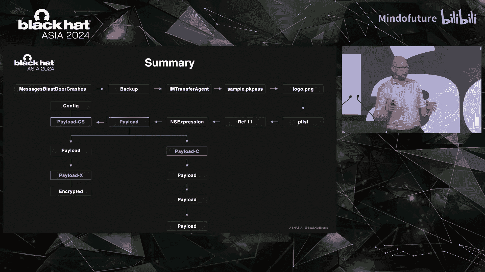

# 黑帽亚洲大会2024全集-•-中英｜Black-Hat-Asia-2024-p12-P13-You-Shall-Not-PASS---Analysing-a-NSO-iOS-Spyware-Sample--BV1oyX7YnEhN_p12-

Welcome to my talk。You shall not pass analyzing an NSL virus sample。It's a pleasure。

 and it's an honor for me to be able to stand here on the stage at Black Ha。

My name is Mattias Friedensstoff， and I'm the VP of research at the company I verify。

 My main research directories are I Ma and mobile device security in general。On September 7 and 2023。

 Apple released a kind of emergency patch for Ios 16。 6。t1。Closing two specific vulnerabilities。

 which have both been exported in the wild。One of those vulnerabilities， the first one。

 got pretty famous just a couple of days later， and it was called EP vulnerability。On the same day。

 citizen La。Published the latest research about the Pegazo blastpa export chain。

On this specific sample， NSO used。A basket attachment。

 which was delivered over eye messages to infect iPhones with a zero click export chain。

The specific target here was a person working for a Washington DC based civil society organization。

And the exploit valve found during a routine forensic analysis that has been done on the specific device。

The attribution was made to an。There is a couple of Aza BP reports which are available。

 our own block， which is featuring a preview for this specific talk。

 and then once again there is also another report which has been done by Amnesty International about the sample。

Today。I'm not going reveal any more zero days， and I'm also not going to leak any weaponized sample of this export chain。

But。We're going to go on a journey on how we've discovered and analyzed the latest sample of NSO's Pgazo's exploit chain。

What I want you to remember about today is that detecting I was as me with forensic analysis as possible。

 and I'm going to show you the step which are necessary to unveil the final payload of the sample。

 And we're going to discuss some more specific indicators of compromise for this specific sample。

 which haven't been discussed in public before。So this means we're starting right now here on this little map。

 and the only thing that we have is our knowledge about this Bpa sample。Last year in October。

 a customer reached out to us。And they told us that they found a potentially compromised device。

So if a customer reaches out， we're usually trying to do a forensic analysis on the specific devices。

 So that means a customer gave us some data sources in this particular case。

 we got access to crash logs and iTunes backup and some telemetry data。

Then you're using normally a couple of twos for crash logs。 you have manual script that you can do。

 There is not a well known tool already available， but for an iTunes backup。

 you can resort back to MVT， which is your mobile verification toolkit。

 which is developed by amnesty and the de facto standard for analyzing iTunes backups for compromises。

And for telemetry data， you will wrote back to scripts。

But what are we trying to do with the data sources。 So in the essence。

 were looking for examples of suspicious activities。

 This could be a process which is starting from private for temp。

It could be a process that is doing network calls or a process that is running with elevated privileges such as route。

Additional indicators of compromise of file that have been wrote to disk。

 or if a process is crashes repeatedly。And the first glimpse that I'm normally doing is I just scrolled through the list of available crash logs。

 and then in this particular case， there was one pattern which was pretty obvious。

So we had a couple of home D crashes， which were about 25 times。 Then there was a little break。

 And then afterwards， we had 35 messages blast or service crashes。

And messages blastor is in particular interest here because the of the citizenitize app report was named Bpass。

 and messages Bor is C service which is responsible for unpacking eyes attachments。

 and to make sure that those are rendered safely。So。This is suspicious。

 and that means we should take a little bit deeper look。

So if we're looking at the first home dec crash， what we can see is， of course。

 the name of the process we can see is this particular device is running IO 16。6 and 16。

6 for still vulnerable for blastpas。And then we could see also that this process is just crashing with。

 with a normal thickboard。At this time， I was believing that this particular crash was actually not part of this export chain。

 but it resolved to another export chain， which is called Poia Home， which was valid until iOS 161。2。

So it looked to me pretty obvious that the attacker might have been just tried to use an old exploit。

 This failed at first， and then they changed to the newer exploits or not burning any new chains。

If we're looking into the message of blastor service crashes。

We can see that the exception type is already much more severe because this is a bad access and it's a kernel protection failure at a specific memory address。

 So something was clearly going wrong。If we're looking into the threat that actually crashed。

 what we can see here is that on line 6，7， we started to see that there's an NSSQ archival。

 which was decoding a couple of objects。 And if it's scrolling down on this one。

 we can see that this goes up to line 510。 So this has to be a very， very large Q archivr。

 which has been archived。 or maybe something is still wrong with the sample。For me。

 that's suspicious as well。 So I had a couple of crashes which were all going on on specific time frames。

 This is the perfect starting point。 If you want to look into an iTunes backup for further analysis。

And if you're quickly checking the backup at this specific point in time。

 we also saw that there is a couple of that there is a process。 I am transfer agent。

 which did a couple of network calls。This process is responsible for downloading eye messages attachments。

 so this makes sense if we have a message just blast or crash and we have a process which is downloading an attachment before。

But the question is， can we also see that specific attachment in the datata？And， yes， we can。

We can see that there is a sample of P K pass file， which has been downloaded eight times。

 It could be all the same sample。 It could be different samples that have been downloaded。

 We don't know that yet， but we do know we have。This specific mention in three times。

This is very suspicious as well。But they golden question， are those files actually in the backup。

And yes， they are。Sarah。At this point， we're mostly done with a certain state of forensic analysis because we've already found a specific sample that is interesting for us。

 So what we're doing next is now， trying to figure out what is a P care pass sample first。

And there's an expert that we since probably last year I can always ask。

 which is always a good choice， we just asked ChaGPT。And the。

 the actual response that we get here is not that all that that awful or wrong。

 So it tells us at the， the second paragraph at the bottom that a P K pass file is actually。

 or essentially a zip archive。And it contains a couple of Json files。Well， of course。

 we always should validate。 So let's check it with file。 And what we can see here。 Yes， indeed。

 it's a zip archive， and the zip archive is roughly 175 kB large。

So let's uncovercarve it and see what's inside of this。If we look inside。

 we find a couple of Json files as predicted， but we also find a file。

 which is a logo dot P And G that directly stands out。 And that's not only because it has like 5。

8 MB of a size， which is quite a lot。So that logo is definitely huge。If we file again。

Then we can see that this logo is actually not a P G file。 It's a V P file。

And this is where it gets really interesting， because this ties us back to the V P vulnerabilities that we've talked in the very beginning。

This particular vulnerability is not really solved yet。

 And there's already a lot of talks that have been going on here。

 And I'm not going to add any more details to the specific vulnerability today。

 But I I do want to make at least a little bit of note that there is an upcoming talk by E And B。

 who is probably going to talk a lot about the specific vulnerability。

 And it's uncovering a couple of like unknown questions at's a moment。Now。

 let's take a closer look at a sample。 And what is usually the best tool for variable analysis。

This is very obvious。 Of course， it strings。So if we run strings on this。

 what we only get is a couple of As。So that's not really happening。

 But maybe we should have started to look at the very beginning of this file。

And if we look at the strings here， there's， theres two things that directly stood out to me。

 The one is there's a binary P list which is embedded in this file。

 And the other one is there's a couple of function function functions in the bottom。 And， of course。

 there's a couple of different strings like an N S called like A。

 like D L open Me copies So it's a force that you would never expect to see in a P And G file or even in the V P file。

Okay， so we definitely need to investigate further。At this stage， I could have gone multiple ways。

 so I could have decided to look more into the VP vulnerability， how it was constructed of。

 but I was more interested in getting to that stage where the NS expression is and working on the binary Plist file。

So let's extract this B list file。It took me a little bit of try and error to get this actually fully extracted。

 and it was not fully clear if the binary P list is actually just starting somewhere in the file and it goes to the complete end or there is some other part at the end which is not belonging to that But is the end if you do it with DD。

 it works pretty well and you get to be P list Now what's a B P list and how can we read it and once again chat GT is a very good help here。

 We have tools which are very good for that。Let's start with PL YouTube2。

If we start here directly at the beginning of the file， what we can see is once again， another。

 like a lot of A's。And then if we go to the bottom。

 we can see that this specific B P list has like 13000 entries。

This is not really helpful for analysis。 So let's see。

If P list body itself does any better here we can already see that theres a couple of dictionaries and N errors which are contained in the specific P list file。

 but there's a lot of unprintngeable data as well。 And that's the very bottom of the file。

 we can see there's even more of that。This is not going to help us here。

We need to understand this a little bit better。So binary Plists are very often something which is called an NSQ archiveivr。

 and this is a concept which has been used in iOS and MacWs very frequently。

 and this is essentially a method of serialization and desialization of data。In NSP archiveivs。

 they will always start as a root object。 And at this root object。

 you have a couple of objects which are lying like basically in line below it。

 Those objects can be an array， a dictionary， an integer。

 a string or any other kind of complex object structure。

And those objects itself can then include other arrays， other dictionaries or other objects。

 but all of those objects are essentially back referenced back to those first objects that we have in line。

So this makes it actually very easy for us in this particular analysis。

 because the only things that we need to care about。Is all those top level objects。

And that means it's time for some Pythson magic。So what we essentially want to do is import your favorite NS SQ archival app。

Read and understand and secure it a little bit， say from break points。

 and essentially just replace array objects and dictionaries with our top level keys and do not recursively go through the file。

And at the end， you print the result。And it should be all。So if we do this。

 what we're getting back is essentially a structure of just looks like that。

 So we can see a couple of the objects。 And if we go to the end。

 we already see that we're down to passing objects， which is like at the end of reference to 63。

 So are we better off here。Yes， we are because we're down to 264 individual objects that we need to analyze。

 And then afterwards， we can figure out the structure。So let's look at a couple of those。

And one of the first ones， which is in particular interest， is object reference 8。

And this one starts with a reference to 9。 Then you have a lot of references to 10。

 which are repeated。 then you have 15 times object reference 11，10 again，11，10，11。

 and then at the N towardss 0。So 11 seems to be important， So let's give this a closer look。

And inside of 11， we can actually see that we once again see our N S expression the function function。

 function function。😊，Okay， so this is good。That's our payload， essentially， at the end。

If we're looking at some of the other interesting ones we can already see here that we have another object reference to a lot of A's。

 and then we have another one for a little bit less A's， still quite a lot。

What makes it a little bit interesting here is that because you have all those A's。

And this is something which has been used in every single basic exploitation class。

 If you're trying to exploit the buffer overflow， you fill it up with Ace until you know that you can essentially compromise the stack pointer or the return pointer and then you know where you are on memories。

 So this is whatever people tell you at first always put this Ace on。

So it seems to be that the people who are buildinging this export for NSL are still sticking to as primitive。

 So I could have used some whatever random strings they didn't have to use Ace。But apparently。

 this is still the same。 So essentially， it could have detected the samples if you would have unpacked it and just looked for 152025 or even 250 a in common。

And probably， this is not the last time we're going to seize this even in weaponized exploits。

Object reference 259 then contained another times the payload。So if we sum this app。

 our payload 11 was used two times by objects 8 and 259，259 was referenced by 2，42。

 And then it gets back to the top level。 So this is great。

 So we only know that the only object reference that we need to take care of is essentially object 11。

So let's inspect and payload。The payload itself is structured， and I'm making this very easy here。

Its。You have some binary data at the very beginning， which is a couple of bytes。

 Then you have a couple of bytes， and then you have the embedded strings that we've already seen。

 This is followed by the N expression。Some bys later and some strings again。 And then again。

 it closes with a lot of null bys。 And then everything else just repeats exactly as like the first half。

But， of course， the remaining questions are， what do all these sections actually do。

And what I focused on here is once again， the N S expression。

So we've uncovered the payload right now until the specific exam， and once again。

 of course we can go into different branches and I took the branch of just looking at the NS expression。

 but what is an NS expression itself？And if we're looking at Apple's documentation。

 we can see that Apple is designing this essentially as a function。

 This allows you to filter arrays or searches or sorts。

 the overall or like the larger category of that is called NS app predicate and those NS predicate can have those NS expressions。

 which allow you to execute certain logic operations。So essentially you have this function call。

 then you have a receiver， a selector name and an argument， and let's look at an example。

 so you can have a string which is developer tools O test。

 and then you have the selector which which is named lastpa component and this should resolve them into O test。

 which is the lastpas component of the string。And that's in a very essential household endless expressions are built up。

If we're looking at the structure of this payload， and I'm a bit sorry because this is so small。

 but it's going to get better。 what we can see here is we have a couple of casts。

 casts to NS thread and the NSR dot class。Then we have a couple of references to an dictionary where different parts of payloads are going to be stored。

 and I'm calling those payload CS， payload C and payload X because they are stored in the keys for the dictionaries X C and CS。

 and at the very bottom we have a larger payload which is the one that is executed first。

But there's a first question that we need to answer。 Why is this still possible。

And I want to be done now。When I was 15。1， Apple introduced a mitigation that should。

Prevent any of those specific casts for， for classes like N S F to still be able to execute。

INB already introduced in a talk about NS expression that those mitigations are only implemented by a specific flag。

 which is set like to false a memory， so that means if NSO found a way to set this flag back in memory with memory corruption back to one。

 they can execute those classes again。But I haven't found any specific evidence on this export sample yet。

 but I like I said， I didn't go in much detail about the specific corruption that has been going on。

If you're looking at the slide deck when you're don't look it later on。

 you will find a lot more references to NS S expressions and how they have been appusd in certain exploits before。

 because it's not the first time we've seen that。 And forced entry。

 there was another NS SO Exp who which used already NS S expression。

 Then there is a great talk by and B at last year's O B T S about a sandbox and rep which used this as well。

 And there is a great talk by Austin and at last year's blackhead about how you can use N S expression for exportation。

 And I don't think this is going to get away。 So it's a perfect time if you're interested in that。

 just looking some of this up。Okay， so let's get back to it and let's talk about this first executed payload and let's look at it in a little bit more detail。

So the structure that we can see here is that this is essentially a large base 64 encoded string。

 and so why don't we be naE and just try to do this？And this is not working。And why。

Because I've overlooked that。Is a specific example。

 that' is using a little bit of compression methods。

So we need to do this decompression first and we need to understand how this works until we can actually decode it。

And let's be know if2。 So we already used our expert for a couple of things。

 And why don't we try to do this once again with an N S expression。And here's the interesting thing。

 because large language models are very great at taking languages and translating it into other structured languages。

 This is a good opportunity to justize this out if they can actually turn an N expression and turn it back into objective C code。

 So I just。😊，Basically cutddles the payload。 I put the O N expression in。

 and I put it into T GBT and ask it if it could transform it。And yeah， it's bit pretty。

Tretty good first response。 It wasn't perfect。But the only question that remains is， does it work？

And yes， it does。So if we're looking at these and decompressed string。

 what we're getting back to is essentially lot another very， very large N expression。

And this was so large that it was just not easy readable。 if you just tried to go through it。

 So it's time again for some more pythson magic。And if we do this。

 we result to a nicely formatted N expression that we can start to go through。 This one has actually。

2530 line lines of formatted N S expression。This is going to be fun。Okay。

 let's look at a couple of the first lines that we're seeing here。

 What's the first one of the first things that this N expression did is actually load another framework。

 and they' loading a framework which is called the office import framework。

 And this office import framework contains a very specific object， which is called an O C mapper。

And this LC C mapper has a very nice functionality because it has always a map for the current threat。

So that means this object is always going to be the same if you're still executing this in the。

 the same threat。And this is perfect if you want to store something and use variables and N expressions。

 N expressions itself doesn't allow you to do any kind of variables to do computing。

 but if you have a dictionary that you can always refer to。

 you can store something in this dictionary was a key and then you can get it back and you can do computations on it。

And we're going to see that in every part of the specific N expression。

You can see the store value at the very bottom， and you can see that this is used again on the next lines for computations to be able to add or sub something。

 they're going to use something which is called an astraic utilities。

 which allow you to do some very， very basic calculations。And then directly in the next lines。

 what we can already see is that they're starting to decoding some of those other payloads that we've seen on the first slide。

So this one seems to be once again， a base 64 encoded string。And then they're sting this one in。

And another variable in the dictionary。And then afterwards。

 they're using Plist decialization to get to the unpacked part。Okay。

 so that also means that payload C， S is a P list。 That's interesting。

 So let's try to decode it once again。And that didn't work。We forgot something。

And if you look back again， at the。Overall structure。After the payload CS in the very first slide。

 what we can see here is that this payload is base 64 decoded。

 but it also has something which is called a cutdi compression。

 and then once again it uses some AAF base 64 decoding。I have no clues on what this is。

 So what's AAF to base 6040 coded data。And this time， I didn't revert to Cha GPT。

 but I just wanted to find out if Google knows anything about this。And they don't。So second try。

 what about cut decompressed data。Maybe we're a little bit more lucky here， and we are。

So we can already see that we have one specific head。

 which is on GitHub in the core foundation framework。 Okay， that's good。

Why don't we just try this in once again and let's search on Github also for AAF to base 64 decod data。

And if we do this， we get a couple more hits， which once again refers to you to another framework that is used。

I could have made my life so much easier at the specific point because think about it。

 The specific N S expression is executing in a process。

 So that means that the specific N S expression is only able to execute functions which are available in this process。

 So that means if I would have just taken the a messages B or sample less or service process。

 and I would have looked at all the libraries which are potentially loaded into it。

 I could have very easily just found one of the potential libraries where this is it and just inspect those。

Okay， but why goes the easy way if you can do it hard。Okay， now let's import this frameworks。

 and that's try again。And then we're getting to the binary repeat list。

 we can already see there's a couple of text inside of that。Which is very nice。

 And then we can have a very close look at a specific Plist file。And if we。

 we also do the property list deization， we're getting to a very nicely structured dictionary where we can actually see that there is like an iPhone model。

 there's a couple of references and on these references。

 and you have a couple of variables with some integer values to it。Okay。

 so these integer values look like some kind of for computation or some potential memory offsets。

And some of the interesting things here， what we could see is there's。

No reference to any kind of iPads。 So either this export is not valid for iPads at all。

Or they have a completely different exp。And it's also only valid between i 16 do 4 do 1 and 16。6。

 So anything later is actually not in this config file。This is great。Now。

 we have two of those payloads already done， and we have two to go。So let's look for payload C。

And we can see is that payload C is mentioning in our first initial payload in lines 99 19， sorry。

 lines 99 to 115。It's using a slightly different compression mass format。

 and it's also once again uses property list serialization。

So this should be pretty easy to decode that。 and we can also see in the overall structure at the very beginning that it's using the same kind of AF and cut decompressed。

 And once again， AF compression method that the previous sample pilot has used。

So if we are decoding this， then we get once again a property list。

 And this contains another N S expression。 And this another N X expression has another payload。

 which is inside the payload C。Okay， so we have a compressed payload。

 which is inside compressed payload C。 If we decompress this compressed payload inside compressed payload C。

We're getting into compressed payload inside compressed payload inside compressed pilotload C。

 And if we do this。Once again， we're getting into compressed pilotload inside compressed pilotload inside compress pilotload inside compress pilotload C。

But then actually it stops。 So after we have decompressed the last one。

 were actually down to a very very end where we only have like one remaining N S expression。Right。

Three are down， one to go。But there is no mentioning of payloadics in neither payload or in any of the payload Cs and the subsequent payloads in it。

We probably forgot something。 and what we forgot is that there is another payload。

 which is inside our initial payload at the very， very bottom of this file。

The compression ft is something that we， we already know about。 So we just have more payloads to do。

 but hopefully， this one gets a little bit easier。 And yes， indeed。If we decompress this。

 we just get one very nicely structured N expression。

 and what we can see here is there is a mentioning of payload digs at the very， very bottom of it。

Great， this is perfect。Unfortunately， not at all。Because this specific payload is AES encrypted。

 and even though there is the variable which is in the key。

 which has a specific entry in our dictionary， if you're trying to follow this variable through the whole NS expression。

 we don't have any specific mentioning of the key， so there's no key in clear site。

 probably the key is somewhere else in this whole payload or maybe the key is downloaded from the internet I don't know this yet。

This leaves us to a part where we did some part of the payload analysis already。

But we reached a point。Where we're not able to progress any further。 So NSO just hit roadb for us。

Is this the end？Maybebe。Because there's a lot more to discover in this specific sample。

We still have the Home D crashes， where my initial assumption was。

That this has been another export chain。But MnesT also found in their forensic investigation of the specific sample。

That there was also a call and invitation， so maybe this is the first part of the chain。

 and we also have a couple of the other things not really accounted for。

 So where's the NS expression bypass。If there's another sandbox escape。

Is there is a packed bypass in all of those？Is our encrypted structure really the implant or is there any other mentioning of a command and control structure that we haven't figured out yet？

So what I can already tell you is the story for this sample is not over。

 and it's going to be to continue。Alright。Let's summarize what we did today。

We started with a couple of messages， blast or service crashes。

And those LED us to investigate the backup。 And in the backup。

 we found that at this particular point in time。There was an I am transfer agent process。

 which was downloading a couple of I message attachments， which were sample of Pca pass files。

If we investigated the sample P pass files， we found the logo dot PN G。

 was which was actually a VP file， and it was not a PNG file。This contained a binary P list。

 and this binary P list is if we de archived it contained an object at Ref 11。

 which contained an N S expression。Which then once again had a couple of different payloads on the first payload we had。

A reference to those payload C， S， which contained a config file。And another reference to payload C。

 which then contained another of payloads subsequently， which we already decompressed。

And then it contained another payload。 And this other payload did have the reference finally to payload X。

 which is our。Enncrypted sample。那。

This is already， it's a good starting point。 Of course， the analysis is not done。

 But the great thing about this is we have a， we now have a couple of very interesting sample points where we can already have a couple of I O Cs based on that。

😊，So the repeating messages， blaststock service crashes are definitely an interesting sign。

 And theyre definitely suspicious。 It's not a clear I O C for the specific sample。

 but it's always worth investigating。The specific sample or PA Pass file。

 it's definitely ionN IOCs that you can easily check with an MVT and automatically alert on。

Then for a couple of times now， we have seen that attackers are using file extensions。

 but the actual file type is not matching those extension。 So once again。

 this is not a perfect indicator， but it's a good starting point for investigation。

Then if you look inside the P list， you will see all those A's。And this is also a very。

 very clear indicator。 So even， even just taking those a is probably a good starting point to just investigate this particular file a little bit further。

And what I can tell you is if you ever find an eye message attachment。

 which should be a picture which contains a couple of strings， which are just called function。

 function， function， function function。This is most likely malicious。

 I haven't seen a single case where this is not true。

So just taking those particular samples like the Ace and the function。

 And if Apple would have just implemented a function of looking into any eye message attachment。

 just trying to search for this and learninging on that。

 they probably could have found a lot of expertss already。

Just by doing this' probably not so much of a performance cost。And then of course。

 we have seen these specific payload， which are also very visible and clear text。

 even just by running strings on the sample， and those are very， very clear IOs。All right。

 Aqui is this slide。 if one of you will ever get into the situations that you're receiving in specific Apple threat notification。

 or if you believe your iPhone is compromised and you want help in doing the analysis or even protecting you further。

 please contact us at In verifyified。 reach out to a couple of other sources like Nnestytation Citizen app access now or feel free to contact me directly on Twitter or on LinkedIn。

Okay。What I want you to remember from this talk is Iowa's forensic investigation works。

But we need much， much more scale。We are doing way too less forensic investigations on particular example。

 which is an advantage for attackers。And then also， if we're looking at ios vulnerability mitigation。

 such as the mitigation， Ios 15 dot1。 So mitigations are just bypassed with even more vulnerabilities。

 So I'm not completely sure if this approach is always going to be the best in trying to tackle the specific problems of mercenary spyware。

And what we could also see here is that sp vendors tend to reuse very。

 very complex exportation frameworks。 So there is a very high upron cost in developing those。

 But if you can just reuse those over time， this makes the whole exploitation process a lot easier for them。

 but it also makes it a lot better for us as defenders。

Because then if we can find the same pattern of behavior again。 And now。

 if we just search for every N S expression inside of an eye message attachment， we have a very。

 very good starting point for analysis analysis。Thank you very much for listening to me today。

 And now we have a couple of minutes left if you have any questions。Yes， please。Yes。

 so the question was if we know is the sample executed correctly？I honestly can't tell you。

 I tried executing the sample on my own， and I observed that there was at least a couple of those crashes which were resulting as well。

 but I also observed that there was a couple of behavior on my phone。

 but I couldn't really tell you if this sample executed correctly or not because we probably missed the first stage of the exploits that set up the stage correctly for this NS expression。

Yes。先てく。嗯。Yes， so the question was how much time did it take me to do the work of decompressing those N expressions One of the first roadbls。

 of course， was this cut decompression， which took me a couple of days to figure this out。

And then I probably spent two or three weeks， like in full of trying to to get a very first understanding of this one。

 And then I unfortunately had to stop。 But the investigation is still continuing。Yeah。

 so the question was， we haven't seen it for the first time that attackers use NS expressions and people are trying to do the tedious work of decompressing it。

And if it would be good to develop a framework or a tool to do this。 Yeah， absolutely。

 I started doing this very little bit on myself。 And maybe it's time to release some of that and try to do it in a more general approach。

 But I also know that I think I and B already did that himself。

 So maybe we just try to reach out if we can like disclose a tool for that or like make an open source。

😊，The question was if I know the mechanisms that triggers the execution of the NS expression in this particular case。

 no， this' is just still an open question to me， but I very much have hope that Ian is going to disclose more about this in his talks that is upcoming。

Does this work， Okay， thank you for the excellent talk。 really enjoyed it。 quick question about like。

 it'll show like multiple really， multiple layers of compression and enco。

 What's the logical explanation of why do they need so many layers。😊。

Are those different components glued together or what the purpose to complicate your life。

I have no clue about this one。So if you look at it。

 you will see that there's a couple oferernary operators which essentially are like if clauses。

 and you can see that the sample is trying to calculate also how long it took to calculate certain things and if some of the parts before that are ready or not maybe it's because say chain together certain elements and build that in like an exportation framework。

 or maybe they just wanted to make the work of export research is harder。

I don't really know at the moment。 So if they change together。

 that means they probably on the every level， they have multiple other components to。

 to be chain alternatively。 So that just gives a bit of scale of their other capabilities。

I iss that what you're saying， Yeah， so what it looks like that this is pretty much very modular in states you have a face where you have this config file which is used。

 then you have another phase where you check if the config is actually existing and if it doesn't exist。

 then you're just you're exiting and you're not executing anymore。

And you're also having a face where you're then loading like the additional encrypted payload。

 And I've also seen that they' doing X PCC communication to other processes。

 even though we haven't fully figured this out yet。 So it's definitely a very， very modular approach。

 Allright。 Thank you very much。All right， I think we're at the end。 once again。

 thank you very much to listen to me。 and I do hope you will have a wonderful black hats。

