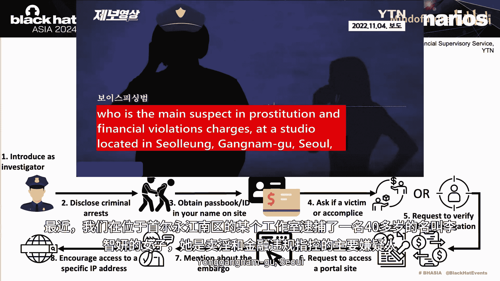
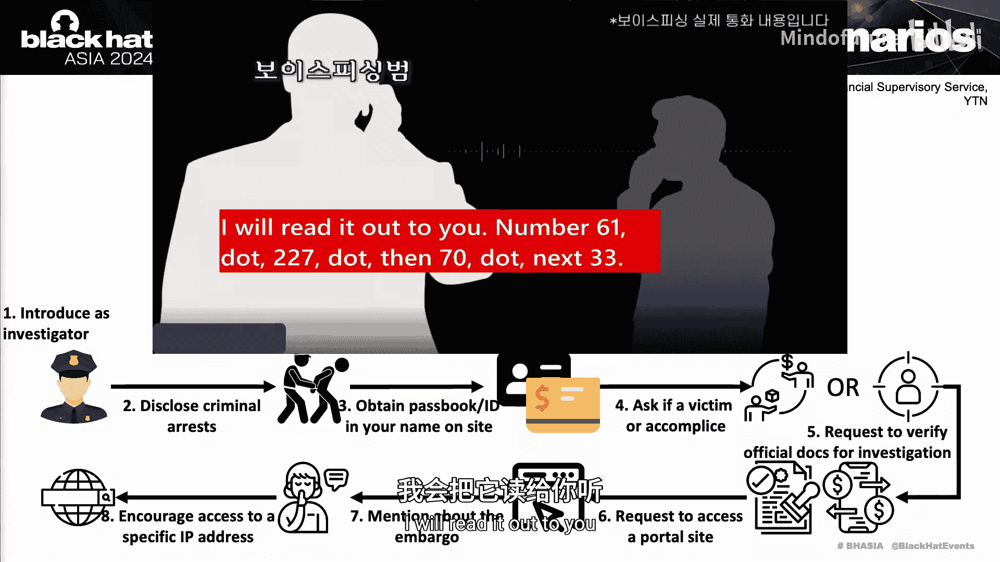

# 黑帽亚洲大会2024全集-•-中英｜Black-Hat-Asia-2024-p13-P14-Voice-Phishing-Syndicates-Unmasked---An-In-Depth-Investigation-and-Exposure--BV1oyX7YnEhN_p13-

Today， we are going to talk about some voice fishing groups and focus more on the malicious app used by the group called the secret Cols。

My name is Sozu， and this is Yong Jiexin， who is speaking with me。

 We are from SW a cybersecurity startup in South Korea。

Although Yang Zeie is with a different company now。

 we have been tracking voice fishing groups together for the past two years。

This session can be seen as an extension of the presentation when voice Sping map Ma shows arated app at Blacktaceia。

 2019。For his fishing crimes have been identified in South Korea in 2006。

 and they are still occurring today， their goal is to ex to money and they'll do anything to get it。

As it is money making business。More people are doing it。

 more South Korea and also performing these attacks and move abroad and operations there。

 run operations there。Here are statistics for voice fishing between my。 As you can see。

 the number of victims and the amount damage picked in 2019 and then dropped significantly。

This is likely due to the nature of these attacks where the group members work together in physicals and the impact of CoVd night。

 Of course， there was a lot of credit to the active investigation from law enforcement agencies。

However， despite this effort， the damage increased again last year after the pandemic ended。

The increase in the amount of money as by the decrease in the number of victims means that。

The damage per victim has increased。嗯。This means that voice fishing groups extract the maximum amount of money from their victim through various methods。

 such as taking out additional loan。 What about biotech type。In Korea。

 we usually divide them into three main categories， messenger fishing。

 Ves for repayment and institutional impersonation。If you look at this。

 youll see an increasing number of attacks that involve runs for repayment and impersonation in institutions because impersonating law enforcement gives the attacker complete control over the victim's cycles。

 it is on the right。So how exactly are voice fishingish groups organized and how do they carry out their attacks。

The structure of a voice fishing group is more complex than you might think。

The reader is usually based overseas， and the separate body under him operating in South Korea。

This is the structure of the so called Miningjas group arrested in 2022。

The Co Center is first frontline making course and conducting voice fishingishing attacks on large number people with personal information。

The administration department is responsible for recruiting and managing people。

 There are rules for withdrawing the exted money from the target。

Exchanging money and managing Bangkok account and laundering the expted money by converting it into gift cards。

 luxury items and gaming tokens， etc。With ph groups can collaborate with teams responsible for each or without directly operating an IT department。

 they can work together with a Sboxax operator who converts international number to Korean number。

 and with teams that acquire personal information on databases。

 develop Maic and build Internet phones。Let's take a look at the actual content of the submission。

For law enforcement impersonation cases， the send follows disguise as an officialsre document about the case。

 along with a message saying that the registration has been written and request contact them with a specified number。

Once people grew， the crew enters start their attack scenario。In this case。

 the scam SMS S disguised as an Korean Internet bank and used keywords such as last minute's special first conference first served in the tax with the intention of tracking targets。

Honestly， when I first received the S M S， I seriously concerned calling them the interest rate on my loan at a time of 6%。

😊，Here are some tech scenarios including rooms for repayment and impersonation of institution。

 all which start with a submissioning or directal。In loans for repayment。

 the groups try to convince the target to take out the government backlog loan。

 then they demand of fee would alone if the target respond。In other cases。

 the other member of the post is an employee of an existing lender an extra money by telling them it's a breach of contract and you need to pay a fine。

In this， in the case of impersonation with institutions。

 the groups often impersonate law enforcement and regulatory agencies。

They then threatened the target account has been improving in a crime and there will be consequences if they don't cooperate with the investigation。

To improve their credibility， they utilize Fite， resemble law enforcement and display pages that look like career official ladder to pressure targets。

Then they ex cash for the investigation purposes or to protect their funds。In case 1。

They trick the target into downloading a malicious APK through a messenger account posing as low enforcement。

They then persuade the target to make thecc themselves。

 which is forward to another member of the group using forwarding features supported by the AK。

Case 2 uses a combination of both of the previous two methods。

They first scaled them with fake documents， and second。

 they encouraged them to call the institutions after installing the A K。

Each stage in this diagram is progressively dark in color from top to bottom。

 indicating that the target will be more and more psychologically controlled by the attacker。

We'll cover the crew folding in more later。This demo shows two similar impersonation cases the attack flow is shown below in this video。

 they originally spoken in Korea， but I used AI to do into English。Yes， are you， Mr。 Xx， yes。Yes。

 thank you。 I am calling from the detectivetective division of Gzio Police Station。

 and I am Inspector Hunzhuhan。 Yes yes， I am contacting you regarding a witness inquiry related to the Financial Transa Act violation。

 I am wondering if you'd mind speaking with me for a moment。 yet， tell me about it。 recently。

 we arrested a woman in her 40s named Li Ji Y， who is the main suspect in prostitution and financial violations charges at a studio located in Seulyong Gangnamgu Seoul and I was wondering if you knew her。

😊。

🎼Investigation， I will visually show you any official documents issued in your name or transactions from the bank account that have been used。

 Are you able to view these on your phone through neighbour right now， Yes， Yes， you know。

 the address card not the search bar on neighbor， right。🎼Yes， please delete all of that。

 including the w do Have you ever heard of the term embargo like a publication ban Yes yes。

 it's a term used by media outlets to mean a publication ban until a certain point in time right within the prosecutor's office we commonly refer to ongoing investigations as embargoed This case is also under investigation due to concerns about accompliceses fleeing or concealing criminal funds therefore I will inform you using the internal IP of the prosecutor's office I will read it out to you number 61 do227 do then70 do next 33。

Well， you are someone you know， recognize that glance that this is a scam。

 it would be hard for numerous people to tell the o is getting more sophisticated。Now。

 let's look at the infrastructure used by the voice fishing attacks。

The malicious infrastructure is available as thus from providers。

Our operator groups pay the provider to get the fishing site。

 and they are given an amin panel to control the devices infected by the AK。

Providers are building Mar infrastructure and fishingish site。

 we identified and lead three providers using the Supreme Pro seeks of his the as an example。

 they have built pages that identical to the ready to site。

The purpose of this site is to trick the target into accessing their site and redirect them to a fake case inquiry page to convince them that a real investigation is underway。

All of this site is4 under case two of the attack scenario。

 and each provider distributes their own malicious app with a cool formating feature。

Among them provider A impersonate sume Pro and so district Pros office。And the Kia。

 the Is used for their ph used for their fishing site， all belong to A S 346，2。

The site shows vague fewer letters and search warrant to track targets。

These sites are not directly dising Ape case but are assessed to be dising the secretical family from same infrastructure。

Next， provider B impersonate the Sehou district Pros office。

Their infrastructure mostly belong to ASS3462 and use For document。

 they distribute the Sincoro family on the same infrastructure。

Provider C differs from other providers with most of each infrastructure falling under AS S 13319，9。

 They use the Suprememe Pros of the theme and use3 document。

 This distribute the micro family from same site。After the target enter their personal information on the phishing site。

 they are presented with this fake document。It is enough to secure the target because it mentions the case number。

 the target name and severity of the instant， even though older version of the C is used。

This vis won't cost panic because the words are very unfamiliar and scary to the average rich person。

Provider B and C use bank statement。 This statement contains randomized transaction that the target doesn't recognize。

Provider B also shows on endA document this prevent the target from disclosing the situation to their acquaintance。

All of these providers have a history of this malicious app disguised as voice fishing detection app called Po Anti。

Connecting to the IP provided by the attack will lead the target to a fake fake place tour page as follows。

This app called the police Cy Cup and the site looks very similar to the real place tour page。

With the same title， description， ratings and excluding the capture area。

This app is called fishing ice。 Some of the content is outdated。

 but it's made to look real enough to deceive the average person。I， ironically。

 both of these F are be from police。For detecting voice fishingishing attacks， however。

 Sna attackers are using these thems in rivers and exploiting them in attack scenarios。

That's the overall approach of boys fishing groups operating in South Korea。

 and Yong J will give you a detailed analysis of the secret family。 Thank you。😊，Now。

 I will talk about Cycrical family。According to the statistics from 2019。

 campaign using for APK in financial fraud damage is 10 times higher than those without。

And these highlight the inclination of voice fishing groups using AK。😊。

Theres some reason to using AK in both fishing campaigns。

Take control of a phone and allow them to send photos and personal information stored inside。

And men a victim is sp monitoring。And redirect the call to their call center to gain full psychological status。

However， Sical has more advanced features than typical voice fishing of publication。😊。

Here are notable features of secure calls。They employ various methods to threaten user or defend their app from being analyzed。

And now I will introduce these features 1 by one。When we met the secret calls。

There is some problem to handle it。Typically， the APK file format is similar to your file。

Cycrl modified the specific header in the Z48 in two offstructs being analyzed。Firstly。

 it used a batch compression， manipulating the compression method to beyond on the typical value 8。

Secondly， you manipulate the timestamp， if the timestamp exc visual range。

 it becomes impossible to with analysis or some compression program。

We can handle this problem by modifying the value manually or using open source tool。

The cyclical compris two5 structure， external and internal。

 and we call them as loader and cyclical respectivelyably。Secret call is located within。

 within the la。And all of them have increased class file for performing malicious activities。

As well as。Pishion resource is the user。Let me show you how secret coal has various file structure for each type。

For the first。The synical has extension of AK。E pitch resource is compressed the requiring password with the。

The SD extension。And the password here is the Korean profanity。Second。

 and the pitching resources are is rolled。And the AK is se to being compressed。

 The password is the same。Third。Both of them are raw data cyclical is in the form of APK when patient resource are in the resource area。

I showed you the structure of a secret calls。 One of key components of secret call is encrypt class file。

The increased classifier is for both， loader and cigarette coal。

Its secret and load into memory before code execution。😊。

And their name is changing throughout our tracking， specifically secret， kill and bulk。 for sure。

 Bo is not my typo。Until 2023， secret was used for class file。Until October， they all the kill。

And from October onwards， both of the bulklkans secret were used for a class file。

An each name of class file is different for saving their key and native library。

You can compare the full features of whole history in the change of4。Theyre a cloth file。

We have also offered a change the descriptionpt key for class file。The interesting thing is。

 for the past three years， the only A S algorithm has been used to encrypt it。😊。

And the only key value in Israelzure vector is change it is also remarkable。In the networking。

 T used two web protocol。A web soet and H T TP when communicating with since sober。

The Riest body contains the infected device status， including FID field。It indicate the request type。

And then I relies on the value of app I D。 It is hard code in the source code。

It might be version of secret calls or some target， which they disguises。

When SQl send the data to the CNC， there's a unique prefix in front of transmit data。😊，Currently。

 the prefix is a plus times stamp。😊，A company user database with encryption。We in the past。

 it used keyword of post bar。At the end point of C server is designed by request type。

There are up to certain possible paths， and each path consist of a maximum5 characters， mixing。

 letters and numbers。For the results of request， the CNC respond with config for a analysis activities such as Col4ing。

😊，Because receiving config from the server， Zer could collect various information for mal activities。

😊，For example， a list of phone numbers to curvi direction or blocking。

A server others there only for uning images。And ready profile to get extra since suburb and Ea。

When user make a legitimate cold using their infected device。

 the call will be canceled and new call crs soon to attacker。

Is fool user into thinking they are making a legitimate call when they're actually connecting with voice fishing group' call center。

The new course screen resembled to the original。And the user is actually looking at the F screen。

 but the call to their call center is running in the background。

If Z can't communicate with sense server， does it host execution。Actually。

 the secret code tries to retrieve bankruptcyancy from a certain red profile。

When the CN is server is not available。If the extra changes or go offline。

 it is updated accordingly on the site。Andcyclical typically use firebase to receive command from the CN。

When the anniversary sent the some command from this fireb。

 events from All activities are triggered in secret calls。😊。

Initiating another data extorion or determining as some c end point or whatever they wan to do。

And secretly monitor user by using commercial service called as Jun。

Juufuun is a service for streaming video and audio to connect to some others who want to talk with you。

😊，It's like a software for making a phone call。The in device bicyclical can stream camera and audio in real time using the authenticationable anniversary。

So user has infected bias can be exposed their privacy and whatever they do。

And you find out the custom made application utilizing Joeng。

When adversy type user I D into this application， it is ready for watching。😊。

This monitoring program could make device run camera and microphone for monitoring。😊。

And we discovered this custom made application when the a uploaded their pitching site inadvertently。

😊，Is I to say。We are trackingcyclical for two years。

And now I will talk about how we can analyze it such a long time。

And some slide is only for attendee in this video。Let me show you。

We have collected over the 64000 secret calls。And we categor into over the 15。

The categories include the law enforcement， e-commerce and courier service and banks and video players。

 and among others。Over the 50% of secure coal mustqueed as law enforcement。

Wil over the 20% in person at a financial institute like banks。If you analyze the4 each。

 the number of secure coal is about 60 to analyze for all day。D to the sheer volume of synicalles。

 doion analysis becoming impractical。We have to find an necessaryces efficient way。

We analyze the secret cost behavior based out of some criteria。

And you find some paran for each type of secret calls。

Biner patterns or ready profile a native library and C subscribe and their poll number。😊。

And how to do crypto class file。We can consider the two stage of a process to analyze it。

The thing is a factor for static information is in secret calls。

Let me extract the information from secure calls。We can request mal conflict to。

And this process called us communicator。This made us a complete automated process to analyze it。

obtaining a new information about adversary like CN server。

 Read profilele and phone numbers and some i Os and etca。😊，Finally。

 we have analyzed over the 99% of wascyclical automatically。😊。

We find out more than 130 of CNC server。We discovered the most of original were in Hong Kong and Japan。

And most of another is in Asia。And we get the over the 25 ready profile。

And it allowed us continuously to discover new CN。We got some poll numbers used by boy fishing group。

Most of the number is used in Korea。But some number stands for China。It is using China Uniicor。

It might be means that a anniversary might be Chinese or based on China， without thought。

And this is our key takeaways。 This is what I want to say for this。

We presume the attackers are prop shot in Korea and have their root in East Asia。Throughout research。

 we aim to eradicate the patient campaigns and write awareness through the IU。

And track their infrastructure continuously by our automation process。

Here's a list of I for fishing site operated by each boy fishing group。

And this is the hash and CN of Se coal with different rate profile for each other。

We didn't say everything we wanna say。You can check rest of them in our white Paper later。

I would appreciate if you have any question。 and thank you for listening our presentation。

🎼Is there any question？Okay， thank you for listening。Yeah。Hi， here is one question。🎼Yeah。

 and one more。🎼So can sorry， I just have one question。

 I noticed that you are saying that a number of。Tings has gone down， but the value has gone up。

 I just curious whether youre the cold relation。On the age of the victims。

 that means in the old days。The the spread of the victims is， okay。

 so what I'm trying to drive that is perhaps the number of victims went down because the population as a whole has solved age。

And usually， the bad guys usually targets the old guy。Right。

 so I don't know whether you do this kind of correlation and it could be because the organ are also perhaps more resource got more a little bit more resource。

 So they target the older people with higher resource。 and therefore。

 when the victims suffer damages， they will be higher。So it's just curious。

you the understand my question， That means you have， you have a slide， right。

 that says that number of you will have 50000 over victims last time。

 Then you say that the per victim。How much they suffer in terms of damage。Weserv recently。

 the per victim losses or the amount of money lost is higher per victim。

 So do you manage to do a cold relationship in terms of victim age。

The the number of eight case we collected means。It's not all distinct organized by Asian。Age age。

 how old are you？A young and know。No， I think age is not points so that's where I'm driving I mean if you perhaps do that maybe you will occur that the number of victims actually were more older yeah。

 we didn't put the slide in this presentation， according to the article。

 the younger 20 generation is。And the 50s are the voice voice fishingish Rule's major target because they don't have enough society experience because and as we said。

 they impersonate law enforcement one， so they are very sense very unfamiliar they lower wording。

Yeah， it's。Especially the2 girls， womens are major target is。 Thank you。Good presentation， thank you。

So everyone can hear question as well How did you guys build your automation in order to analyze the APKs and feed it into your database to use Python or AI or Yeah we written。

😊，Scr in Python， and we extract the characteristics and encryption key with manually analysis using Python code。

So we emulated the behavior of the Se Criker family in the code。

 and we featured the phone number and S server and Ready URL from thanks to the script。

