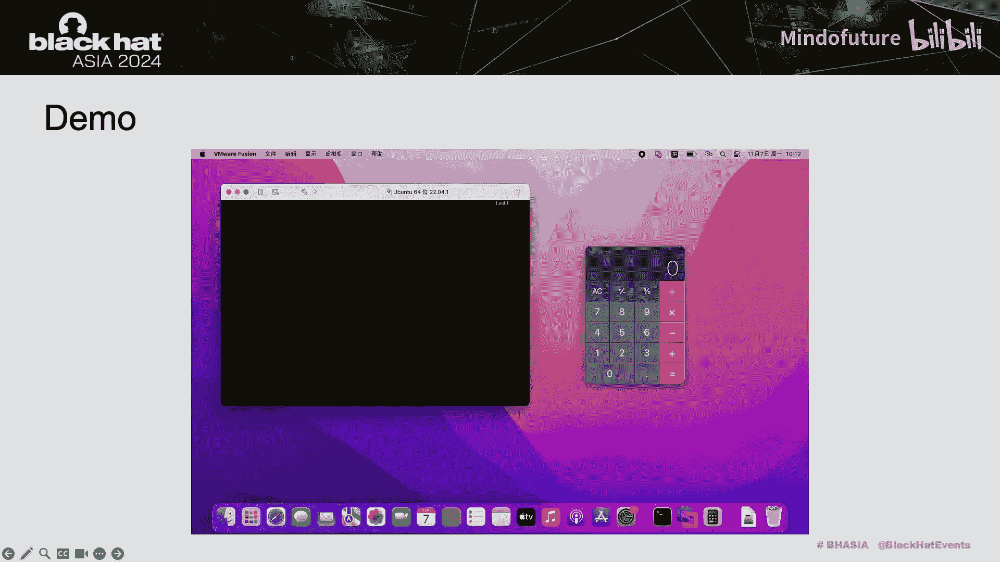
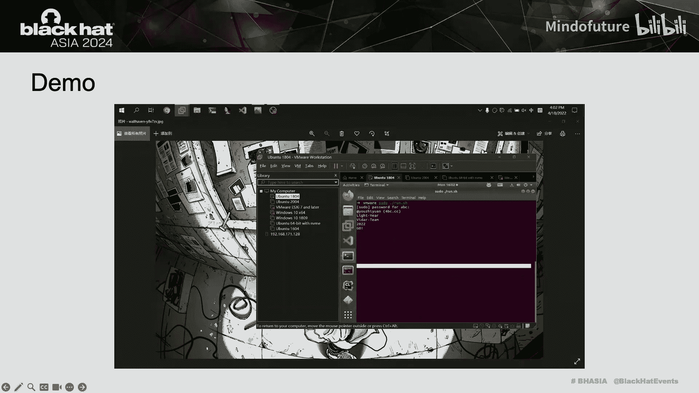

# 黑帽亚洲大会2024全集-•-中英｜Black-Hat-Asia-2024-p14-P15-URB-Excalibur---The-New-VMware-All-Platform-VM-Escapes--BV1oyX7YnEhN_p14-

Hello， everyone。 I'm L。 Today， My colleague， Dennis and I will give a presentation on U RB exccalable。

 the new Yuwhile4 platform virtual machine escape。😊，First， who are we。

 We are security research at enter group that year security lab。

 and we escaped from virtual machine many times。What's more We won a pun award last year。

This is a roadmap for our talk。 First， I will share a introduction to V M escape and V Wales H weather。

In the second part， we will share a journey of winwhile Hypers vulnerability discovery。

 The last part is about our efforts in the exploit development of。😊，Whenwhile V M escape。

 where we will share a new set of exploitation parametersitives and how we use them to develop exploits for all when hypothesisvisors。

😊，What is V M escape and what are its stingers。 V M escape refers to an techer launch attack from inside virtual machine using vulnerabilities in the hypervisor to escape and control the host。

A Japanese cloud platform may run a large number of virtual machines and service。On， on one host。

 which can cause significant harm。It can be said that V M escape is one of the most catditrophic threats。

To the cloud。This diagram is。Taken from a paper whenwhile published many years ago。

 we can see whenwhile hyper weather consist of three parts VM， X， VM， M driver and VM M。

As for the virtual devices， we are most concerned about。Their code exists in VM M and VM X。

 Most part is in VM X。So what are the attack surface of V V wire hypervis。I have a list a table。

 and almost all of the modules on it have had vulnerabilities in the past， even leading to VM escape。

Except for the VM M， I believe that VM M may also have vulnerabilities， just like K VM。

 but the difficulty of finding vulnerabilities in VMM may be too high compared to the one above。

On the right side， I have listed all the publicly disclosed V M escape from 2021 to the present。

 not increasing the escape completed at Panong this year。It can be saying that， in recent year。

Security researchers have mainly focus on researching USB attack surface。Now。

 let me share how we start the journey of vulnerability discovery in V Waless hypervisor。

Having already analyzed Vwise's architecture， attack surface and story vulnerabilities。

 we choose an interesting and potentially risky attack surface on to focus on E， H I controller。

To beginning reserve engineering， then was have weather， we needed an anchor point。

 Researching for specific strings is a simple and effective way by researching for E H I in I D A。

 We can quickly locate the code for E， H C I implementation。From there。

 there is a matter of understanding the EH CI specification and Q E M U code will。

Reverse engineering， VN S code。First， I need to take a few slides to introduce the E HC I and USB to controller。

 The dagger on this slide is taken from the E H C I specification。From this diagram。

 we can see that the E H I specification is responsible for the communication protocol between the system software and the USB controller。

 the USB controller。S converts the data into。USB2 packets to communicate with the USB。

Devicice can can connect to it。Therefore， during the reverse engineering process。

 we focus on understanding。How E H C I commands and data packets are handled by Vwise code and converted into USB data packets to be sent to the USB device。

The slide introduce the basic data structure of E H I packets and the state machine of the E H I controller。

We can say that E H I consists of Q H and Q TD。Along with their structure like I TD。 But today。

 we will focus on only Q TD。Q H is stands for Q head， which promotes a singlely linked list。

 each Q H carries a linked list of Q TDs。 and Q TD is a smallest structure in E H C I data transfer。

The Q DD has a bufferuff point array where Buff point Stone's physical memory address。

From the diagram on the right， we can see that USD controller first pass the Q H3 process and transfers the Q D within the Q。

 H。When the transfer is complete。It tricks if there are any Q TDs that need to be written back Afterwards。

 it moves on to the next Q H and continuous this group。Finally， there one more slide。

 we need to know what E H I data transfer looks like。

 A USB device will have multiple endpoints for transmission。

 and each endpoint will have a unique pipe。😊，The control pipe is used to configure the USB device。

This， and it is present。On every USB device， then there are three tokens for Q TD set up in and out。

 Among them， the setup Q TD is responsible for describing the entire transfer queue。Ultimately。

 a transfer queue will looks like the diagram on the right with a setup Q DD followeded by many in Q Ds and out Q D Ds。

Here， I show the execution flow of Ko and thenware we can see the difference in how they handle E H C I data transfers。

QE MU processes each Q TD as a single unit。Treating each Q DD as a packet。

Depending on the token type， setup packets will execute do token setup。Will in packet。

 We execute do token in。On the other hand， Vwhile treats an entire EH3 transfer queue as a whole。应。

It considers the entire Q as a single U RB。And then submits the U RB to the USB device by U RB submit function。

Data transfer and processing are likely。To have a。第二天是。For example， the well known CVE 2020。1，4，3，6。

4 in Q E M U occurs in the hand handling the handling of each packet type。

So could there be bugs in V well function， function， E， H C， I control transfer。

Which also process data。So安卓 is yes。We discovered a critical vulnerability here， and。

Accomplished a series of interesting things through it。The vulner we discovered is C V E 2022，3，1，7。

0，5。Which is a hippo outbound， right。That affects Vware， E， S， X， I， workstation and function。

Affect all of W US hyperviss。Whenwhile assigned this vulnerability， a score of。男跑 three。

The code on the right is the E， H I control transfer function。I need to note that， since。Wwise。

 hyperweer is a closed source software。There are symbols， including function name。

are named by ourselves in each side control transfer。

 There is a loop that pass all Q TDs in the Q H and process them based on the Q TD token type。福德。

For the setup Q TD， which is beginning of transfer Q。Meanwhilewhile I a new UB。

The size of URB depends on the set set line file in setup Q TD。

Which represents the total length of data to be transferred in the queue。

Next are the out Q DD and in Q DD。We can say that when processing the out Q D D。

 there is a trick to see if the teabits is a illegal value。 Tbits is a number of Q DD used in。

Dicate the length of the date carried by the Q DD。Se up plans here。

Represents the remaining length that the。Current U RB can transfer。

If teabs is greater than setup length， meanwhile， will only transfer the length of setup lines。

We can see that finally， the E H C I read TD buffer data is read from the physical address carried by the Q TD and return the。

PUB data course设 point。Of the UB。The process then continue。Subtracting TB bites from setup lines。

To update the remaining transfer length after processing， it will。

Enter the next Q DD process and pass the next Q DD。The in Q D is similar。

 but since the direction of the in Q TD is from the USB device to the system software。At this stage。

 the USB device has not received and processed this packet。

So they won't have any data for us to transform。In E H I control transfer。

 it will directly execute the next operation。So now， the question is。我要意识到bug。We can see。

That in the processing of。Out Q TD， there is a trick for tea bite。

Which ensures that there will be no issue when set of less is。Subertractck get by tea bites。However。

 when processing in Q DD， there are no checks at all。

The code directory subtracts tea bytes from setup length。

Which means that if setup rice is smaller than teab， setup lines will become a。

Negative number after processing C Q， TD。It calls an inteage of flow。

Now that we know there is a in over from bug when processing in Q DD in this code。

 let's see how to upgrade this ability。When set lens is negative。It can。

 it cant pass the check during auto Q DD processing。We need set lines to be a positive number。

 which is easy。 We just need to set up a large number of in Q Ds。Each with a tea based view value of。

0 x 7， F， F， F。The blue part below shows the value of set length at each stage。 Finally， we can。

Subtract， set up lines to an large integer。At this point。

Sa set up lines will be much larger than size of U RB。

 We can pan a out Q DD with a size larger than the URBs date。Size at and。

Which can pass the code check。Thus， leading to a hip out of bound right。

 this is a vulnerability we discovered。In addition to C VE 2022。3 won 7，0，5。

 We discovered a new other bug。Such as out of bounds read， information disclosure， which have。

Which have all been fixed。 We will give two example here。First， there is an out of burden rate。

Vulnerability caused by pipe， pipe type confusion。 We can choose a control pipe in the。

Process and should hand a。I saw， I saw Corronels pipe， although they are。Data structure are the same。

They I used the。Differently， which leads， which leads to problem。

We can see the image in the right showing。That during the transfer process of。I sawrons and point。

 the U RB will have multi。Multiple packet。And P， U R B cur will be increased。However。

A control part U RB will not have a mon。Multiple packets。So是。Cron packet have actually already。

Pu to the data。 when the U RBs number package is 0。This won't directly cause a problem。

或者说 issue is that the number packet of。Control types。URB is always win。

Which means says code block will be always。安特的。Ultimately。

 causing P URB data cur to be increased beyond the。Range of U RB resulting an autoboard read。

Another one is an information disclosure vulnerability that exist in multiviual USB devices such as USB。

 audio， USD， video， USB R， N G。The cost of vulnerability is that when creating a new U RB。

 being well didn't use catalogello or before the。A perform the memory set function on the U RB data。

ADa array。This leads to the data array， carrying memory information。Many virtual devices will set。

Rightr back length to date length， by default。Which allow all this information to be disclosed。

The next part is how to develop the exploit。 I will leave the following time to my colleague， Dennis。

😊，Thanks， Lance， I'm Dennis， and I will share the remaining part of our our talk。First。

 when we have a new zero day vulnerability， what difficulties do we still face？

The VNY hypothesisor are close source， which create many difficulties for both vulnerability。

 discovery and explosion。 Moreover， this is no， there is no publicly available exploit code and very few public exploit flows。

 What even more challenging is that the VNware plays great importance on the security of its software。

Almost all public exploit primitives are being patched。

 making it difficult to continue using historical exploit flows。Finally。

 due to the nature of V software V Nware virtual machine software。

 only a small number of code paths can be fully controlled by who is in the guest O。

 which greatly reduce the number of modules where exploit primitives may exist。

Despite these challenges， we conduct further research and discovered a new set of general primitives that helps us achieving V M escapes。

😊，Before sharing the， this new explosion approach， let me first share some of the past exploit primitives and how we well catch them。

😊，This slide list multiple historical public exploit primitives and how we will fix them。

 But due to the time constraints， I will not go into detail。

 After searching and analyzing this historical exploit flows。

 We found that there was no exploit primitive that could be used directly。

 So we had to look for it ourselves。 Fortunately， we find finally find a new exploit object。

This powerful ael we is UB。The object we mentioned earlier when analyzing the vulnerability。

The U RB USB request block is an universal object for transferring USB packets in VNware and is used by all virtual USB controllers。

 Since almost all virtual machine configurations include USB devices。

 This also means that the primitives built around it are very generic。

The diagram on the right shows the data structures of the U RB and its related objects。

After our previous introduction to the vulnerability。

 I think there's no need to explain each member here in detail。 However。

 there are two new objects that we haven't mentioned before。 One is V USD V USB device。

 which VNware creates when each USB device is connected。 It includes the pipe array of this device。

The another object is D EV device。 This object is located in the program's data segment and contains related function pointers。

Therefore， we can see that U RB is a very ideal exploit object。 Firstly。

 it can be arbitrary allocated and freed， and its size can also be arbitrary controlled by us。

 Its members include a variable lens data array， a member of control the lens to read the the right lens a point to data and point to a a pipe。

Through the Pi pointer， we can index the device object and obtain the program space address。Next。

 I will explain in detail how we can use the URB and related objects to construct primitives and build our exposure approach step by step。

First， we need to convert the out of bounds right vulnerability to an out of bound V。

We can rent the memory， According to the diagram on the right。

 I will introduce the memory grooming method， at the end。First。

 allocate U RB 1 and U RB 2 and ensure they won't be fully processed and free。

 This step requires the right balance of this U RB to have a value。

 and we don't use in Q D D to read it back。 So it will be reserved on the memory。

The second step is to create an E H I control transfer and allocate the U RB in front of U RB1。

 Then use the out of bound right to override the right back of U R B1。

 once right once the right back length of U RB1 is overwritten。

 we can use U RB1 to read more content， including the pipe address and buffer address in U R B2。

And next part is arbitrary address read。 So it is very easy because we already have the hip address。

 We can just override the U R B ones P R B data cursor to any location。

The next step is arbitrary address， right。 Initially， I encounter difficulties here。

 although we can modify the P U P U B data cursor of the U RB to an arbitrary address。

 But once the U RB is created and sent to the USB device。

 it cannot be written again by the system software， If we send a new transfer queue。

 it would naturally create a new U RB instead of obtaining the original one。

So how can we achieve arbitrary dress right， I thought of pipes。

 We can modify the pipe pointer of the U RB through an auto bound right。

 Is there any right operation that can be performed through a pipe。

I found this primitive in the UHC I check and write function。

 The check and right by function is executed once before and after the transfer function to check the transfer status and write the return data from the USB device to the physical address in the guest。

I found this primitive in USHCI， which is the USB1 controller。

 Since a device is connected to the UHCI controller by default by default configuration。

 this can be triggered by default。The pipe parameter of the US CI check and red function comes from the U RB pointer。

We can see that the frame in the function comes from the pipe。More interestingly。

 the function writes the content of the 4 by pointed by the one pointer in the frame to another pointer in the frame。

 Since both frame and the pipe are forked by us。 This allows us to perform a 4 by arbitrary address。

 right。This image the image in the button right corner shows the assembly code for this line of the code。

After achieving arbitrary。Address read and write， the next step is to find primitives to control the IP。

What kind of targets do we generally look for。A dynamic dynamically allocated object with a function pointer where we can invoke the core of the function pointer。

The object closely related to U RB， is a pipe。Fs this cr， a cr。

In the pipe release function cancel pipe， the very first instruction is to call a function pointer from the B USB device in pipe。

 And we can also control the first and second part parameters。 That is very great。😊。

If we can for a pipe and trigger cancel pipe， we can achieve arbitrary code execution。In this regard。

 I found two approaches to utilize。Pa one is to， as we can see from the image in the EH C I check and right function。

 the pipes comes from the U R B。 Then under certain condition。

 when E H C I check modified setup returns an error， it will execute cancel pipe。

When we forge the pipe through an out of bound， right， we can achieve arbitrary dress call。

Sometimes we may not be able to use pass one， for example， the in case of V NY fusion。

 the default configuration uses a USB video device。 In my attempts。

 I found it difficult to retain the E H C I U RB。 So I had to see other ways。However。

 since we can achieve arbitrary dress rights， we can do more interesting things。For instance。

 we can directly write a forged pipe object into the of BB device。

 then by triggering a port reset through the EHCI registerors。

 it will call destroy all pipe and eventually release all pipes in the USB device。

 including our For pipe。Finally， let's talk about the primitives required for hip grooming。

 This part is not all our own finding， but comes from the content of the Black Europe talk using the shader object in the SVG model can help us compete hip sprayraying and grooming。

 It can be specified to any size and can be arbitrary allocated and freed by us。

The below are the comments requiring to allocate and freeze the shadow object。

For the more details about S VG， I've also attached the link to the white of this talk。

With sufficient。Primitives， our explosion becomes feasible。 Here I share my actual explosion plan。

 which may seem complex because we chose the past two method to control IP。

 which also requires us to leak more information。The good news is that after each year's C。

 I control transfer is completed， the U RB will be freed。

 and the next allocation will still be in the， in this free position。

 So there is no need to message the hip again。😊，However， the actual explosion does not stop here。

We still face a big problem。The problem comes from Macos itself。

 The Macs S melo uses magazines to manage heat blockss， which。

With each CPU core having a unique corresponding magazine， when a program execute melo。

 the malloc finds the corresponding magazine to complete the hip trunk allocation based on the current CPU core of the process。

 This means that every time we allocate a hip trunk。

 the corresponding magazine and memory area are random。This caused a very big problem for us。

And the diagram in the lower left shows the hip management of lip malllo。Therefore。

 we can find that the memory areas of the magazines corresponding to each CPU core are different。

 and the allocated hip trunks are not together at all。

And the diagram on the right shows a simple experiment I did。

 I kept running melo in the program and then counted which magazine the hip trunks were in。

 We can find certain patterns such as most hip trunks being allocated in magazines with even numbered indexes。

 which implies that CPU scheduling priorities， even numbered CPU calls。

 But the important point is that almost all magazine will be covered。

We did some research on Lee melock and then come up with a way to deal with it。 First。

 we can ensure that when we are using shader to spray the hip。

 the CPU core will not switch because they can be in a simple while loop。

 as long as we put the comments into the command pool at once。 However。

 once there is a thread switch， such as from SVJ to EHI controller。

 it is impossible to guarantee that it is still in the same CPU core。 Therefore。

 if we cannot ensure that the EHI control UB and the shader we arranged in advance are in the same magazines。

 the auto bound right will cause the program to crash。

 But what if we do a layout in all of the magazines。Yes， this is the con measure we came up with。

First， repeat the basic hip layout and try to have at least one complete layout in each magazine。

Then for each subsequent step of the operation， try a large number of times to ensure that our out overbound right and the inform information that needs to be leaked happen to be in the same magazine。

It doesn't matter if they are not in the same magazine because we have layouts in each magazine。

 which were not in course crash。 We just need to keep trying。At this point。

 we are left with the most important question， how to ensure that all magazines are laid out。

We thought of many ways， such as。Adding a sleep between。Each round of allocation。

 we experimented with various sleep times from small to large。 But unfortunately。

 none of them worked when the sleep time reached more than。One second。

 it actually ensured fewer magazines for hip spraying。

 This is understandable because from the previous slide。

 we can find that magazines with even numbered indexes are more likely to be scheduled。

Then we try to increase CPUs occupancy to increase CPU core switching。

 hoping to switch each CPU core more evenly。Unfortunately， this doesn't work either。

 We speculate that it may be because what we can do is only increase CPU costs in the gas system。

Of the hypervis hypervisor， which has too little impact on the host operating system。Finally。

 we explore two ways to increase the probability of success。😊。

The first is to remove sleep and speed up the。Exposion CPU scheduling should be at Mill interval for intervals。

 and fast expuls can reduce other interference。It functionss the second is to use a huge number of hip brain rounds。

 The dozens or even hundreds of rounds are too few。

 We used more than0 X 1000 rounds of hip brain to ensure more comprehensive mix coverage。

We can directly use the basic hip layout to spray hip without allocating many useless stagesrs before the layout。

 Because if it is an outnumbered index magazine， there are actually fewer hip trunks on it。

 and it doesn't need much hip spray directly。 direct a hip layout can succeed， succeed。Eventually。

 after a long time of debugging， we increased the success rate on a MacBook pro 13 to over 18%。

 This may still not be perfect， but due to the randomness of magazines。

 We are quite satisfied with this result。 And we also complete the escape on the first attempt at Gpon 2022。

Next， let me play a demo which records our VNR Fusion virtual machine escape attack。So this is。

 this is in fusion and。First， we check the version of the Macs and the version of the fusion。

The guest is。那呼房州呃。And this is our exploit。 We just runed exploit， and it will。

It will pop up the calculator。Yeah， that's it。

呃。Thank you。Then let's briefly share the export of VNware workstation。

It should be noted that under this default configuration。

 there will be no devices connected to the EHCI controller， Therefore， to trigger the vulnerability。

 we need to manually connect a USB device to the EHCI controller。

The explosion on Windows will also face some troubles， such as LFH， the lower fragment he。

The existence of LFH increase the difficulty of exposure because it randomly allocates heat trunks。

Fortunately， the prims we use， including U RB and Shar can exceed。😊，0 x 4000。

 which is the maximum size of L L F H。 This makes hip arrangement much easier for the objects that cannot be larger than10 x4000。

 we can choose a size that has not been。Has not yet been enabled by L F H， such as 0 x 33070。

 The image in the lower left reveal how we complete out of bounds reading under the windows。

The final explosion idea will as shown in the lower right corner。And this is the demo of accepting。嗯。

Vox stationation。And we just do the record the same thing。And the broze are exploit。

How about the calculator。The last explosion case is on B NYY， E I。Like workstation。

 no default devices on the ESF controller。For the E S S I。

 it is a system similar to Santa OS S 7 using a very old GDC version 2。17。However， in the new E。

 S X I 8，02， it has been updated to version 2。28， the same as sent S 8。

 So the explosion idea on E S X I will be similar to that of fusion。

 And we don't need to face the randomness problem caused by the magazines。 So at this point。

 it will be easier。Another difference is is that since 3D graphics ex acceleration is not being enabled by default in E S X I。

 we cannot use the shader object。 We can use GMMR instead。

 although it cannot be allocated in large quantities like shaders。

 It still has a high degree of flexibility。Due to the lens of this talk。

 I will not go in details about the related explosion here。 We completed a V Nware E。

 S X I V N escape at the 2023 Tian Fu Cup and eventually gain the highest privileges of E S， X I。

 I hope we will have opportunity to share more in the future。And the last part is the takeaways。

first is。Where bugs have arise with similar software， there may be new bugs。

The second is when looking for exposure primitives。

 try to look for objects related to the vulnerability。The first time。I first。呃。

To reverse engineering in lots of other modules。 But I can't find the。Good objects。

But when I look back to the vulnerability， I found the U RB is really powerful。

The last is the virtual devices， especially USB related devices， are now a popular attack service。

So this is our talk。 Is there any questions here？You can ask ask us after the presentation。Okay。

 so this is our talk。 Thanks for listening and hope you like it。

