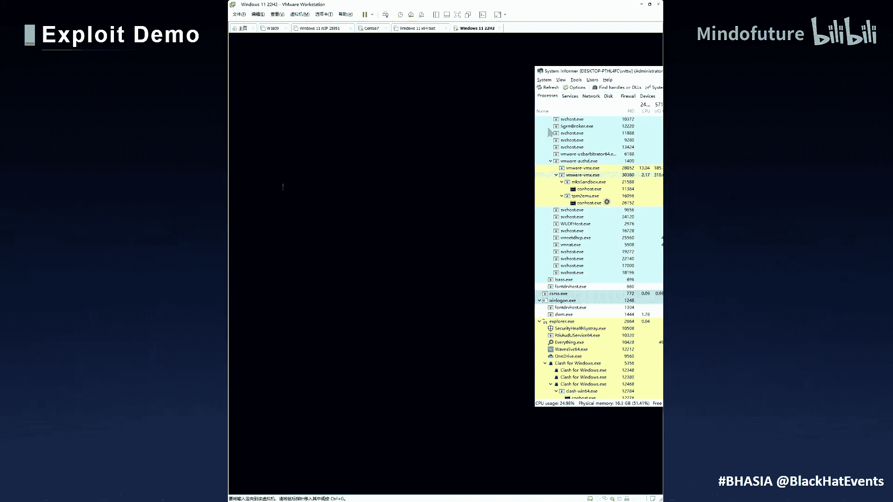
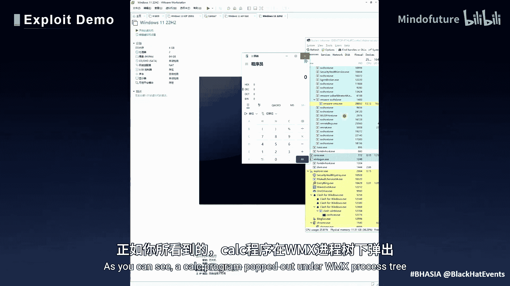

# 黑帽亚洲大会2024全集-•-中英｜Black-Hat-Asia-2024-p15-P16-Unveiling-the-Cracks-in-Virtualization,-Mastering-the-Host-System--VMware-Wo--BV1oyX7YnEhN_p15-

Hello， everyone。 My nickname is Victor Wei， and I'm excited to share my research finding with you all。

😊，Let's dive into our topic unveing the cracks in virtualization。

 master in the whole system dash when we workstation escape。First， let me introduce myself。

Here is my Twitter account。 I'm from Cyber Kunun， a company with several world class security researchers。

I many mainly focus on binary security research。 I completed when where workstation escaped three times in the competition of Tian Fu Cup。

😊，I rank in top3 of M SRC leaderboard for Q3， Q4 last year。 And also， I am the second。

Top 2 of this year， Q1。I also shared my security research at zero count， and hit B。In 2021。

 I completed a hyper escape。In the addition of security work workstation security research。

 I also found several well known products in。I also found several critical or important security bugs in several well known products。

Now， let's briefly summarize the topics we will cover。First。

 I will introduce some basic information about virtualization to help those who haven't encountered virtualization escape before。

 Next， I will discuss。Historic bugs in UH C I and both discovered by others and by me。 After that。

 I will use two vulnerabilities。I use at 10f Cup 2023 as a case study to explain how to exploit virtualization escape。

Finally， I will summarize my content to enforce your understanding。Let's get started。Part  one。

 verization， basic inform。When it comes to virtualization escape， there are three key questions。

We need to understand， first。How is the virtual machine constructed。Next。

 how is data transmitted between the gas system and the virtual device。

Then what is virtualizationscape。To address these questions， one by one。

Let's start with the first question。 How is virtual machine constructed。

 A virtual machine typically consists of a hypervisor and many virtual hardware devices。

For oneware workstation， a part of of its hypervisor is run in the kernel。

 and some parts are run in the user mode process。Most of its virtual hardware devices are implemented in the same user mode process。

So this diagram illustrates the software architecture of onewarere workstation。

 We can see a hypervisor with a multiple of virtual hardware devices here。😊。

The focus of our discussion today is the USB controller。Next， let's address the second question。

 How is data transmitted between the gas system and the virtual hardware devices。One。

 or there are two methods。 One is by directlyy reading and writing guest' physical memory。

The other is， through oil operations。Here， let'sner the first method。

The entire guest's physical memory is mapped as a segment of virtual memory space of V X process。😊。

Guess virtual address short for G V A is the address needed by programs in the guest virtual guest virtual machine。

In guess， programs use GVA assess its physical memory。Before being passed to V M X process。

 we need to get the guest physical address of G V A。In the VMX process。

It use whole press virtual address short for H V A of GP to access guests。

Gested with physical memory。The process of converting G to H V A is completed in the VM X process。

And the gift。Gets the system and Webax plus can access the same memory At the same time。

 It is really important。Opereration is the second method。Basically。

 almost all virtual hardware devices are implemented in the user mode process。

 So the interaction between the guest system and the virtual hardware devices is an interaction with the VM X process。

They can directly transfer data through I ports and I memory for I ports。

 These CPU instructions are used。😊，For our memory， it can be mapped to guess the virtual address for directly read and write in guest system。

😊，Our operations are fast， but transfer less data。So for large data。

 the address converting operation from the previous page is generally used。Next。

 let's tackle the last question， what is virtualizationscape？

Let's make a comparison with remote code execution。Virtualization。

 escape and remote code execution have many similarities。

In the exploitation of remote code execution， attacker sends data to the server and crack the structure of server process。

Then get leak data from receiving messages over network。

Then it sends another data to server and control。Spl R I P， then run R O P to get code execution。

So for virtualization escape， the， the most difference is。而 transmission is。

Our transmission of messages is facilitated through the guest's physical memory and our operation。😊。

So to complete a virtualization escape。Arbitrary address， read and write are often required。

After addressing the key questions， let's begin to explore USB controller。So far。

 We we has implemented three USB controller。USB 1 series known as UH C， I， USB 2。0， known as E H C。

 I， USB 3 series known as X， H C， I。 Perhaps in the future。

 we can see the implementation of USB4 series。😊，These are some public known saving numbers for when where that can be escaped。

So interested parties can look into them later。This slide shows the device information of XH CI and UHCI in a Linux virtual machine。

As you can see， X， H C I use I O memory for data transmitting while I port while U H C I use I port 2。

0， C 0。😊，This is the device relationship diagram of the UH CI controller。

The UHC controller has two default ports。 When a device is connected to one port。

 a hub is needed to expand for new USB devices。This。Is a USB architecture diagram。

In a when we workstation installed， Windows 10 gets the system。By default。

A virtual Bluetooth and a virtual USB hub are mounted under U H CI。

 A virtual Bluetooth A virtual USB mouse is mounted under X， H C I。So。

 and there is no device mounted under yet。And specifically。

W two Bluetooth required host enable Bluetooth。So if you are doing research on a desktop。

You may not find my bugs in the further presentation。And if we reject。E XHCI in the gas system。

The USB mouse will be mounted under USB hub。Here is the relationship diagram of message structure transmitted to the UHCI controller。

The device driver passes the guest physical address of frame list to the virtual device through our operations。

呃，The device driver。The frame list is an area。Each member stores the guest physical address of first Q H structure。

The Q H structure has two GPA addresses。Poining to the next huge structure or TD structure。

The last two bits indicates whether G points to a Q， H。5 TD。If the G is 0 and the last bit is one。

 it means this is the end of the list。The TD structures first 4 Bs。Is GPA 2。

 It points to the next TD structure， and the rest of TD structure are data。

Here is a simple example of a TD structure。DMA log is a function to allocate continuous physical memory。

😊，That returns G V A to。TD and assign science gets the physical address to the second parameter。

The frameless array stores the G of TD structure and sets the last bit to one。

Here is the TD structure。The T G structure first integer is set to one。

It means this is the last TD structure。And here it sets device I D。

 endpoint I D lens of extra buffer and TD structures type through bit shifting operation。😊。

And it sets the。Last integer with buffer of GP， A G of buffer。So when we start to explore a target。

 we usually begin by understanding its architecture and its implementation。

Now that we have already understood its architecture architecture。

 I will take everyone near a historic bug， inspired by this historic bug。

 I find a way to bypass some restriction and。Create a new bug。After further exploration。

 I find more bugs。Here。Let me introduce a historic bug。 C V E 20 19，5，5，1，9。 It's a time of check。

 time of use bug。 It was found by A Matt and Richard Zhu。 They use， they used it at Ptu on。

The purple area is a DNA map structure in VM X process。It stores the H V A of TD structure。

In the UH S thread， it reads the lens field of TD structure by H V A and calculates the total length of T G of TD structures。

Then it allocates U R B structure by countence。And read the lens field of T structure by H V A again。

So。The SV G thread is the implementation of virtual graphics card in WebM X process。

 It can assess guest physical memory at the same time。

If we use S3G thread to modify the lens field of TD structure at the same time。人。😊。

After the UHCI threat has finished content lens。when the USH thread access the TD structure second time。

It will read the modified lens。So we cause a hip overflow。So after analyzing their bugs。

 I start to reproduce their bugs and do more review of UHCI。Inspired by them。

 I realized I could bypass a restriction and create a new oneability。😊，Let's see how I did。Line 1，2。

3 is a while loop。 Line 2 is a while loop 2。If this function returns now0。

 it will increase variable I and continue the loop。😊，Here is the implementation of that function。

First， it， it gets frame index by frame star field and the parameter index。Then it reads the first Q。

 H。Structures G by reading guests physical memory。Then it sets the return value rate。

By frame index value。Here is the while loop。It gets the DNAA map structure。白GPA。

If the G has been converted before， this condition will hold， so it will skip the further operations。

Here it gets the endpoint structure by device I D and endpoint I D of TD structure。

If endpoint structures type is one， it will allocate an area to store each TD structures data。

And it use parameter index as every index。Here， if index is smaller than 4，0，0，0 or 4，0，0。

 it will set right to 1。So， it's obviously。When the index is smaller than 4，0，0。

This while loop will not stop。When the index reaches to ，4，0，0。If we set frame star to 3 F， F。

The frame index will be 3 F， F again。This condition will hold。 so the rate will be one。However。

 because frame index star repeat。 So the frame list， the GA of frame list will star repeat。

And this condition will hold。 It will skip further operations。So we can't overflow map area。

So if we compete to modify the value of frame list。

Then it will get different value at the second time。So we can overflow map every now。Because this。

Restriction will not hold。So in the further vulnerability research。

 we discovered an information leak in 2uc021。We were're going to use it at T Cup 2022， however。呃。

The competition was postponed， and canceled。And at point on 2023， Star Las use it。So it was a patch。

What a pity。 Allright， let's see。What the bug is。Here is the U RB structure。The sea field。

In indicates that the size of data the guest can read from U RB's buffer。😊，And the。

 this field is pointing to the buffer with some offset。The UB structure。

Is allocated through this function， and the buffer size is is decided by this parameter。

The UB structure is allocated by Maoc。 So the information of UB's buffer is not initialized。

Here is the function。TD structure is。Been get out from the map area。If TD structures type is set up。

And U RB has not been allocated。It will allocate a U RB structure， with controllable size。

And set size to the count lens counter size field。 The counter size field is a field here。

If TD structures type is output， it will copy data from extra buffer of TD structure to the UBs buffer。

If TD structures type is input。It will do nothing。So if all TD structures type is input。

 except for the first one。人。TD structures buffer will not be initialized at all。

In the first operation。The virtual Bluetooth device process the U RB structure。

 and it assigns the value of a field to the C field directly。

And it won't change it in the further operations。So the guests can read an initialized memory from UB's buffer。

😊，And here is a patch。They add codes under these operations。

 They set number 8 to see field for specific conditions。And。it's obviously。

 they don't understand what is wrong。They should reset the memory of Ubi buffer。So。

We can trick this bug in the virtual mouse device。And I used it at T F cup，2023。

So after discovering so many bugs， I felt certain that there must be more bugs in this module。😊，And。

I'mponing that it was possible to remove X，HCI。raising the guest。I found this bug。It's an UAF bug。

In this function。It takes out the next pointer from UH C I main structures link。

If it's not the beginning of the link。It gets the end point structure by subtracting variable next。

Then it obtains the next member of the link。Later， it handles the control type end point in the further operations。

In the implementation of virtual hub， it can reset the devices mounted under it。

The reset operation will free all endpoint structures。Of mounted devices。

And reapply a new control endpoint structure to it。

Remember the basic UHC architecture we mentioned before。When we removed X，H CI。

A virtual mouse is mounted under the USB hub。So if the endpoint here is the control endpoint over virtual to hub。

And the next is the endpoint of virtual mouth。If we reset the mounted devices of virtual hub in the further operation。

The endpoint of mouth will be freed。So the variable next will become a dangling pointer。Thus， we。

 we caused an U AF bug。So， after finding useful box。How should you exploit it。

Through this practical example， you must be able to explore bugs more smoothly。

In white Paper straight out when where， they mentioned a component for exploiting vulnerabilities。

In the SVG device， there's a surface structure。A surface can bind to a mop structure。

And mop structure saves the H V A of GPA。In addition， the surface can bind to a backend structure。

 too， and a backend structure can apply a backend heap。

If we let the buck he and backend structure into a same L F， H segment。

If the backhe can overflow right。If we are lucky， we can overflow the backend structure and change the pointer of backend he。

搜。Through SVG Commons， it's possible to copy data between two surface。

So we have the ability to read and write。Arbittry or VM X process he。

If we want to use this component。We just need to find a bug that can construct an autoer bounds。

 right。The bad news is that。This method is no no longer effective because the officials saw their report。

So they put the back structure into another process named Mk and books。

So this method is not valid again。In my speech， break out script of Westward。We propose a new method。

If the conversioning size of mop is 1000。When the mobile tries to convert GP to H V A。

 if the converting fails。It will apply a he with size 1000 S HV A。Through SV J comments。

 it's possible to copy data between two mobs。So。We have the same ability， again。

If we exploit the water bit to overflow the lens field of surface。Then we can out bound。

 read and write this hipap。With some memory arrangement。We can overflow more structure。

And change change the H V A value。So we can achieve up to address Read right again。And， of course。

 we can overflow mo structure directly because we don't know。

 We don't know an address of V M X process related。Unless you have information leak。However。

 this method also be blocked in when we workstation 17。

 they no longer apply for one sound heap for the mob structure。

 and the mob structure was also put into a large vector。Making， making it more hard to modify。

Fortunately， I finally find a way to achieve arbitrary address writing。😊。

Which is in the function of U HC C I for reading data from U RB。 I cut down unimportant codes。

A 2 is the endpoint structure。 It first gets the U RB structure。

Then gets the end point structure again from the U RB structure。Later。

 it gets a pointer from the endpoint structure。And gets the value from V 8。If this condition is okay。

A4bte assignment will follow。So if we can control an end point structure or U R B structure。

We can fake。 We ate。Then we can achieve arbitrary address， right。The drawback is。

 we must know the value of target address。Because of this condition。

The good news is that I have an information leak。 and through UAF， I can control endpoint structure。

😊，So with the idea and the vulnerability， let's start the exploitation。In this picture。

 we use SV J shader structure to do hip spray。And we leave a gap for normal UB structure。

And put a gap in front of the normal U RB。Then we free normal U RB and gap structure。So。

 they will merge。After that， we apply for a mouse U be again。

 making it just right to apply to the merge memory。So with the leaking bug。

 we can leak the uninitialized memory of mouse U RB so we can。😊，Lick the normal U RB structures data。

Then we can get a U RB hip related address by this field and V M X process related address by this field。

😊，Because endpoint structure is a dangling pointer and belongs to the L F，H he。

I compete to modify the value of end point through the illustrated method。First。

 extend the size of L F H segment。To the maximum， which is 4，1， F， F 0。

Then prepare as many virtual hub control comments as possible。Each command， resetting the。

Enpoint structure of virtual mouth。We use this way to expand the competition time gap。

At the same time， we use SV G thread to submit comments to allocate and release the same size he。

In this way， when the UH says spread。Assess the dangling pointer。

 It's likely to point to the end point structure that we control。Thus。

 we can achieve absolutely right。The failure possibility of this step is one in 40。Because the L， F。

H feature。So， with arbitrary writing。We modify the current b。Field of U RB structure。

 Let it point to the mop table。The mo， the mop table stores the mob structures pointer。

And once again， we use U AF bug， modify the mop table。嗯。Here why we， we let it point to more。

 Because the arbitrary writing need to know the value of target address。呃，人。Here we， once again。

 we use UF vulnerability。 modify the mo table to point to S3G global buffer。

What table is that now we can modify the content of。SVG global buffer， through SVG Commons。

To fake a mob structure。人。Once again， we leverage the power of mo structure to achieve arbitrary arbitrary address。

 read and write。Then you can find a function pointer of Webax process and link win E， X。

 E C function address。😊，And you can use win E X E C to bypass C FG。

So you can execute any comments you want。Here is the demo。First。

 I check the version in the guess system。And the version of one works station is 17。5。

Then I run a program in the guest。Here is a process tree in the host of Webm Pro。

As you can see， a Kk program popped out under Webex Express tree。

So we can run anything in holes now。Finally， let's summarize the knowledge points。

 the knowledge points mentioned earlier。First。Vulnerability， mining。Time of check and time of use。

 The data of H V A can compete。 You should pay attention on this when you do virtualization。

 security research。Next， UAF。Notice， reset operations。You can check a similar bug C V 2 son，204，0，0。

4。Second， exploitation techniques。First， use U RB structure to leak information you want。

 Even if you don't have an information leak bug， you can overflow U RB structure first field and。

Get a hip A get an information leak bug。Next。Use end point structure to achieve arbitrary right with the power of mop structure。

 you can achieve arbitrary， read and write again。And finally。

 how to defend against virtualizationscape。First。Remove unnecessary devices such as USB controller。

 soundcards， C D room。And disable unnecessary features， such as SV J 3D。The component I use。

For mo structure may need S V J 3D。And last， keep your software newest。This way。

 it's likely to avoid virtualization escape。You may think， oh。

 I use an old version so they can't attack me。Actually。The old version has more escape bugs。

 so don't use old version。And thank you for listening。Welcome to your questions。O。🎼Hell。

 thank you for our presentation。 And I would like to hear more about。 I see that。

🎼Two people are working on finding bug in your case。 You and your colleague， right。

 And I would like to know the strategy like。How you approach to find the box and。

To escape the virtualization。诶。Fund bug嗯。Like my question。

 are you fuuzzing a lot or it's more about code review model？

When you two people working on the to find the buck。Yes， they find bug in yet said。呃。The main。

Partrk of here is。To research in different environment is very， very important。

We lost the bugs I mentioned here， the， the first history bug， because we do research in desktop PC。

They don't have。 It don't have。 It doesn't have Bluetooth。 So that。Proceed function。 We can't go in。

 So we ignore it。So， we lost two bucks。And。Try。Try to do anything un normal。 For example， I remove X。

 H C I in guest。It's really un。 If I didn't do this， I don't know。

 USB mouse can mounted under virtual hub。 So the UF bug won't be triggered in default environment。

And。Do review as much as you can。First， the historic bugs。Then， understand。hardwareware architecture。

 by manual。UH C I Intel In has manual。 so you can read how they handle data from gas driver and how how they should do in the first operation。

The will， you and。You can learn this by Ga driverver in Linux system， too。They will implement the。

A menu in the gas driver。You can learn from it， too。 You。

 you should learn the gas driver first before。Be before digging bugs in hardware， virtual hardware。

I think is that a real problem。 Yeah， yeah， of course。 Okay， thank you。And Christian。Okay。

 that's all。Thank you。