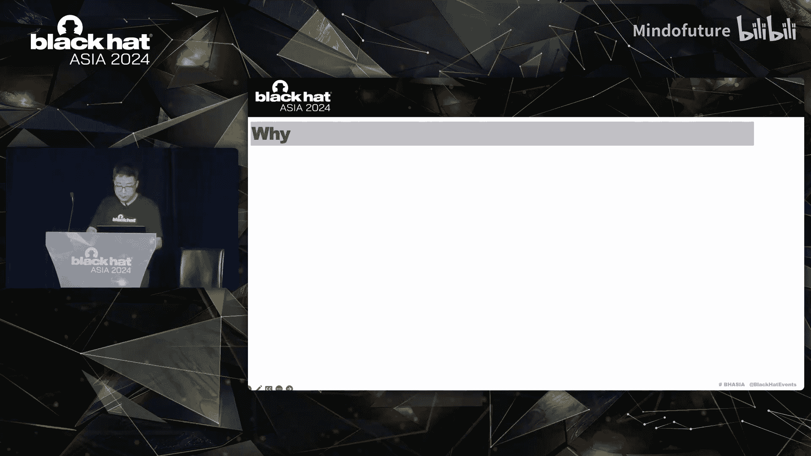
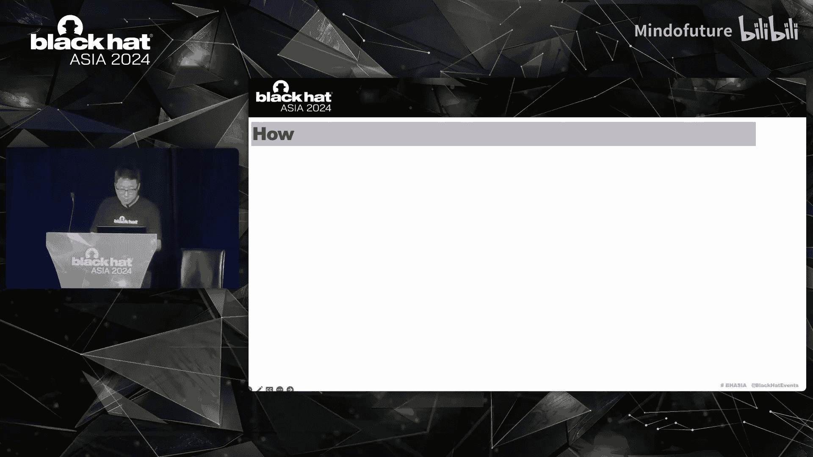

# 黑帽亚洲大会2024全集-•-中英｜Black-Hat-Asia-2024-p16-P17-The-Key-to-Remote-Vehicle-Control---Autonomous-Driving-Domain-Controller--BV1oyX7YnEhN_p16-

🎼Hello， everyone。 We are researchers from Baou Security La Today。 We are presenting on the topic。

 The key to remote vehicle control driving domain controller。First。

 let's look at the evolution of cars here。 you see a traditional car which leak electronic equipment。

 although this image may look fuur， it actually represents many of our current smart cars。

 which are equipped with intensive autonomous driving features。In the future。

 cats will undoubtedly be fully autonomous， not requiring human drivers at all。

 This slide shows the evolution of BMW 3 series electronic system。

 You can see that the screen are getting larger and the system more intelligent。

Modern smart carss have increasing more screens。 More screens may more embedded operating systems。

 which could lead to an increase in security vulnerabilities。

We have previously studied a large number of I systems say yes。

 we are adept at researching various controllers in class across multiple brands。

 we believe that broader research allows us to become more familiar with the structure and functions dive deeper and identify common security issues。

We also researched a considerable considerable amount of tea box devices and a lot of foreign modelss we have shared this topic at Blackhead before so today we will dive into the autonomous driving domain controller this type of devices has many names ADC ADM AADM and so on for simple we refer to it as ADS a common used abbreviation here you can see the installation position and actually picture of ADS。

This is online introduction to the structure of AAS。

 It might not be easy to understand at first glance。 However， through our presentation today。

 you will gain the deeper understanding of these devices。

So why do we study A D A S because it complex users use various new technologies and offers a great learning process and challenge。

 if A D S A S devices are not secure they could lead to scenario scenarios like those in the fast and the few aid as shown in the right image with a fleet of zombie cars。

 Additionally， it an excellent research direction for security researchers。

To the right is the PCB diagram of the NIL center computer cluster。

 We can see it hot five operating system and has over 1000 tops of computing power。

 It's more interesting than router smart speakers and the lack if we can crack it。

 We could even run stable diffusion on it。So this is the electrical diagram or an ADAS device。

 we can see it has many interfaces and connect to a lot of controllers。

 making it appear very complex。In terms of structure。

 early cars can use can bus to connect various EC devices。

 now smart cars are divided into multiple domains and domain controllers are interconnected where the Ethernet。

You can see that modern smart cars connect several key domain controllers， one。Isn't that。

And for this diagram， we can see that A DA S device are connected to the power power can and Chelsea can。

 so A DA S can naturally control vehicles。Now， let's look at what a AS A S controller is。

Similar to previous research this time through various channels。

 we have obtained a large number of adsS devices， the research is ongoing and we are here to share some of the issues we have already discovered。

So this is one of the earliest front assist driving cameras。

 It typically only has ACC and LK A features it using FPG for processing。Latertter。

 such devices begin to use arm processor with AI inference calls such as the mobile Q4 M and H journey 2。

For instance， the T I TD A 4 V M chip， which was used by many car manufacturers in the past two years。

 offers more computer power and supports more cameras。😔。

This is an A D S device using one H G3 or use3 H G G3。

 V3 for instance one might handle a parking function and while the other two managed the F SD。

 the full self driving。This is an interesting missed solution。

 One processor handles parking and another assists driving。This device used the2 T A4 VM chips。

And this is the more powerful T I chip， the T A4 V H with 32 tops of computer power。

 The the advantage is low cost estimated that this A S device cost no more than 300。

 This manufacturer had deployed a B V model on this 32 tops computer power chip。

So cheap and computer power is high。The previously mentioned solution have low computing power。

 The H J 5 offers 128 typess of computing power。So because immediate solution is widely used。

 Let's focused on that A was Aiddas early auto autonomous driving chip float used in the shopping P7。

 which with the 32 tops of computer power。wind or X is currently the most mainstream solution with 254 tops of computer power。

 Yes， we can see many automakers are using the or X solution。 It offers sufficient computer power。

 and it easier to develop with。If more computer power is needed， two or X chips can be used。

 for example， the popular Xiaomi Su 7 also use this configuration。

If even more power is needed will continue sticking CPU， AO was the first to use four O X chips。

However， O X is quite impressive， Inda recently introduced the O an。

 which has not yet hit the market， but we have already obtained several adsS controllers with this new chip。

We can see that the two PCBs use different CPUUs， but the interface are the same。

 to accommodate different configuration for the same vehicle model。

This is mobile S solution In recent years。 mobile ads solution have been used less and less。

 so we have not do much research on it。They said the interesting approach from Cocomm。

 which launched a new A D S chip solution to stay competitive with other chip manufacturer。😊。

So now that unlike the hardware structure of adsS devices。

 we can see that the structure is very complex with many chips and interface among the most important documents are components are UFs。

 MC， FK and Ethernet。This is the internal structure diagram of an ADS device。

 the main function is to recognize the environment using AI chips based on various sensor signals and the issue vehicle control signals。

 some key features include perception is the main and most computationally task and the sensor on the left use vehicle Enet and LVDS bus technologies。

 although the ADS device connect to the can bus， the sock need to send can signals through the MCU。

Just now， we talk about the internal structure of A D S device。 Now。

 let's look at how A D S fits into the overall structure of a car。

We can see that there are many controllers in a car。

 including some domain controllers with many functions like the AS autonomous driving domain controllers and the body domain controllers。

 among others are also some easy use with signal with single functions。

 the more complex controller are interconnected through the ethernet。

 the gateway act as ethernet switch。 Also all the controllers are connected are connected to different can buses。

This is overall culture of AS devices。 The top layer is the application layer for various perception tasks。

 The media layers includes the operating system and some autonomous driving frameworks and the button layer consists of various head rear device。

 the red section are circuit area to focus on such as the perception model control model operating system and M controllers。

So how to research the A D S， We can just analyze it as L T device。

 the system interfaces and signals。To study ADS， we first need to obtain the devices。

 we acquired a significant number around 30 through the sewage vehicles。

 water damage vehicles and tight vehicles。Some vendors also sell the parts to the left。

 you can see many N AM controllers。 Yes， those with 1000 tops of processing power。

After opening the device they need to power them on。

 this can be done by referencing the circuit diagram or analyzing the circuit。

Some devices also require a signal like can or K FD to wake them up。

What files are in the stories is also very important。 For example。

 O X devices typically have a E MC and UF S shortage。

Reading the E M S storage has become very mature。 It can be done。

 It can be done using a E M programmer or by directly sorting it onto a circuit board just as a car。

Compared to E M， U UF S devices are newer and typically used in smartphones， but now also in As。

 currently， we can only compare complete dumps and rat。

 but we cannot be modify a deleted like E MC storage。The U chips usually use the Miusa programmer。

 However， we have tested many chips， and the fastest are only5 M per second。

 dumping a or A D S device took us a whole day， which is too slow。

After a consult with smartphone repair technician， they recommend this program。

 which is 50 times faster。 The new tool can help us quickly dump chip。

After we complete a dump of the storage， we need to mount it for reading。

 for devices or have a standard partition table with which can be directly mounted。

If there is a part table， toolsth can as E X part。For devices without a part table like those with ors。

 we can use two to to reconstruct the part table。 We can use the test disk or other disk software。

Dealing with the Q X part is more troublesome， for example， with immediate as。

 we need to research to search using the Q X header magic number and extract part using the D D program。

Then tools like Q X mount can be used to mount theian， making the disk contents visible。 Currently。

 Q X can only be read， not written to。So we must read so why must we read from the story。

 it allows us to obtain the complete file system， including some sensitive files。

 We can reading files like E T C shadow to correct access password or abstract model file M C formatware and so on。

We have just discussed how to obtain the file system。 Now， let's look at how to get share access。

 Having share access makes it easier to under the system。

 We found that many I D S devices have access each service enabled or we can get share access where the the theory port。

For example， the orange DS。H enabled， but not with the default password using cache。

 we can't correct the password。 So we dumped the UF F storage and then modify the shadow file and set right to by pass the boot password modification process。

 Finally we got the access。Perhaps you might think that logging in through a theory part should not be an issue on A S devices。

 This is a very old security issue。 However， the reality is that many devices have US interface and most don't require authentication or can easy bypass the authentication。

So we also need to obtain network permission for AS devices。

 like conversionnet or onboard devices use vehicle internet。

 which use two core cable below three common interfaces。

So we need to use the vehicle internetnet adapter to connect。

 vehicle internetnet requires setting much or slightly more。

 It's best to use adapter with auto in auto capability。Of course。

 we also need to know the device I address。 We need to capture packets in pro mode to determine the stock I address。

 usually requiring setting the V I D Mac address binding。

Now let's look at the interface security issues。 Both often have many interfaces。

 especially U and de tag some auto makes clearly label them。Here are some interesting parts。

 for example， Some A D S devices have HDMI ports， allowing us to operate them like a computer。

 many also havex D A P port for reading and flashing the MC Cs。Let's look at the can transcer。

 The can interface pins can be identify from the can transr point out。

 If the A D S device isn't working， try sending some can message to the T G A 1，0，4，3 to wake it up。

This's about hacking the ladder devices。And if you are interested in automous driving simulation。

 please consider method like camera simulation injections。

Let's renew the security risks of A D S devices。For this image。

 we can see there are link of firmware， image and development documents。 For example。

 the deploy image contains all the programs running in the system so we can analyze them the we can analyze this for vulnerabilities。

Besides some scientific files and deployment files。

 there is also an issue with the leakage of autonomous driving frameworks。

 Every car manufacturer use different technology and frameworks every day。

 there are various new technology for autonomous driving in papers。

 but car manufacturer will use the best technology available。 The best choice。

Especially the the problem of model file leakage。 we found that almost all devices allow dump the model files。

 The image show the model leakage situation for all the four AI chip solutions。

Besides the leakage of Qas model lack and， we also discovered the leakage of role model models。

 These linkss help us more conveniently use models。

 especially the O N X files for training and optimization。

Let's it take a look at how model files are deployed and usedly。

 the car manufacturer needs to try the technical roomm。 For example。

 the most popular one currently is OCC night。 Then after intensive training。

 the doT model is obtained and deployed in the car。 During this process。

 the car manufacturer spends a lot of time and money。

Let's look at the main risks from model file leakage after extensive testing。

 the car manufacturer use the most stable and accurate model。

 So the model structure is very important。 We can now trying to obtain the model structure from the model files。

we reverse engineer in T files。 it defines multiple tags decoed with hard code。

 We need to per each tag using free to reverse engineer the lab N in so。

The left image shows the structure of the every model。

 The right is our reversed and a structure of a T R T model compared to the model。

 The structure is similar， but some layers are merged。Let's look at another AI chip model。

 We reversed the development to chain program。 So this program。

 we can clearly see how the model is loaded and computed。We use freedomda for reverse engineer。

 We found the op code and the corresponding computer operators。 For example。

 the origin part is a C NV computation。 We also found that some AI chips AI chip models can be directly analyzed with the nutrient。

Since we obtained a。Let see a video。 since we obtained a lot of model files We can What can we do with them。

 We bought a toy car with the process and then depart a vehicle vehicle grade model on it。

 Although the toy car is cheap。 it now use the very intensive technology。

 and we also don't need to train the model。At the time。Now， let's look at the M C U。

 we found that almost all controllers contain the T C 37 and T C 399， for example， in A D S。

 since the stock account sending casino signalss directly。

 the M C U is for sending and receiving casino signalss as well as some fault handling。

We found that many system contain M firmware files like or store H E X。

 Currently Gra can perform reverse analysis， but I D A pro we discovered that even every A D S circuit board has D AP read pins。

 We also designed M C reader board。From the image， Gi can recognize the H E X from where of the T I Co family。

 the right image shows that we reverse engineered the UDP receive functions and found out of bounds reading since it' used very widely in cars its very good research direction。

So how should we control a cat。Control vehicles is the ultimate goal of research A D S controllers。

 We will not demonstrate vehicle controllers in this talk。

 This precision aims to educate about A D S domain controllers。

 their related knowledge and security risks。First， let's see how cars are controlled by electric signals here。

 We use the well controlled cha technology。 for example。

 both A D S and drivers can control the wheel by electric signals。Electric casinos。

These electric signals mainly include key signals。 So if we want to control a vehicle。

 we can do it through controlling the EC C U， the gateway or A D S controller。

The red controller is the key。Besides is the gateway controller on an autonomous vehicle。

 It has a full linear system and several network of port。 However。

 such advanced gateways are rare and analyzing the controller signals is complex and not universal。

This is the accepted driving model a module similar to early A DS devices。 it can control a vehicle。

 but it lacks a network port and a full operating system。

 making it hard to control the vehicle through the capabilities。Through the。

We can see that AS has a full operating system。 It also has network interface and M C controller connect to the power chain key。

 allowing us to control the vehicle through a S devices。Remember this structure diagram。

 which includes important controllers in smart cars。 Now， we focus only on vehicle controls。

Once they remove unnecessary devices， there are two very effective attacks path。

 T box is a common and effective entry point for attack attacks。

 similar to a homemod attackers can access the T box directly， but not the device behind it。

 If we can gain network access through T box vulabilities。

 then controlling the AS device and finding the vehicle。 It's easy and universal。

Here is a complete example of how to control a vehicle。

 The key is to find vulnerabilities in the tea box and a devices to get root access。

 If this part goes smoothly， the right is easy。 the medium image show vulnerabilities we previously found in a 4G model on a vehicle which allow remote command equation。

execution at that time， the vehicle didn't have at this time， that time。

 the vehicle didn't have a A D S controller， so it could only open the car door and windows。

 the right image so shows a similar command injection we found on the A D A S devices。

 This type of issue is common。So if we find a， how do we employ it to ultimately control the vehicle using a4G fake base station is a very effective method because no matter the 4G or5 module。

 they all support the2 G M network。 Of course we have also listed a few other methods。

 especially the IPV 6 method， which we introduced at last year's behind with IPV6。

 we might not need T boxabil or a fake base station and can directly access the S devices now。now。

 let's make a summary， that summary。ADS controllers can control vehicles。

 but their security is often overlooked。 therefore their security needs to be enhanced to automakers。

 we recognize enhancing the overall security of A S devices for example。

 by those autonomous vehicle Rob taxi use boot fully diskception and high levelation。

 We hope other automakers will consider adopting similar approach to increase the cost and difficulty of an authorized research to security research。

 we have introduced many new tools and and as methods such as dumping the。

UF S storage and debugging m Cs learning new things always help us to grow and stay engaged。

 although we have not dived deeply into the security of smart vehicle particularly aS controllers。

 we hope to inspire further exploration in this field。Okay。

 it's our talk because our English is not very well。 If any question， please send e to us。

 Thank you very much。

