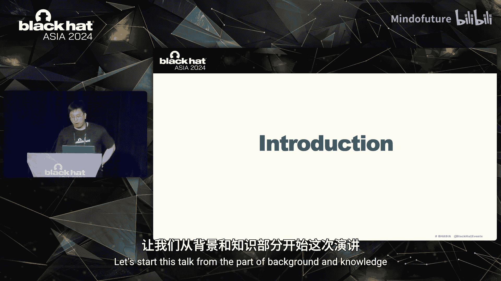
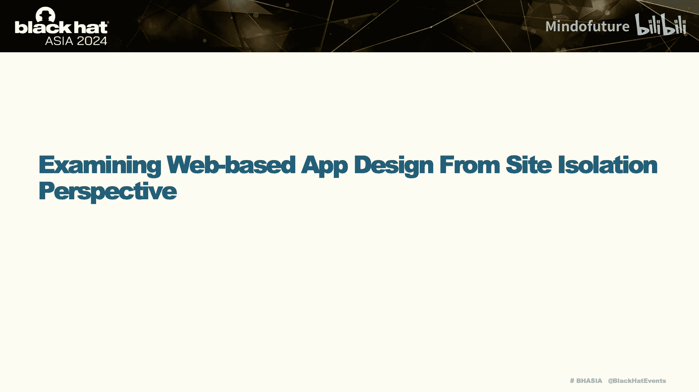
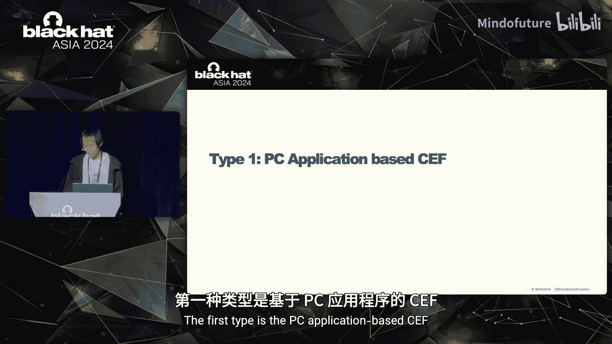
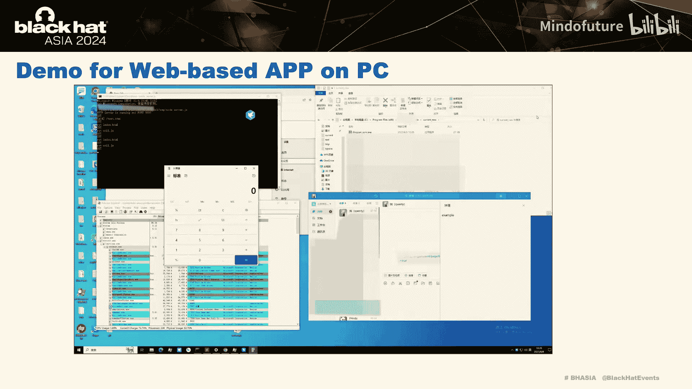
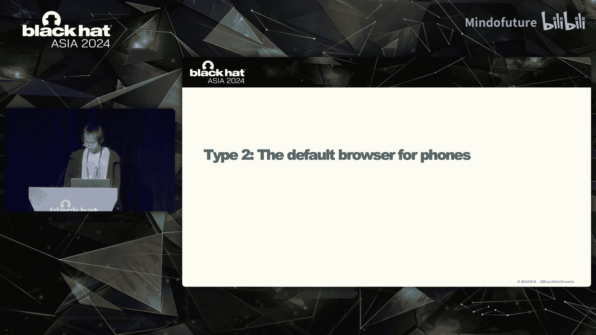
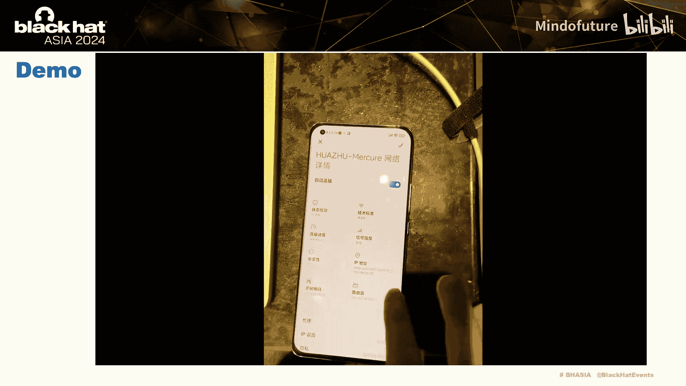
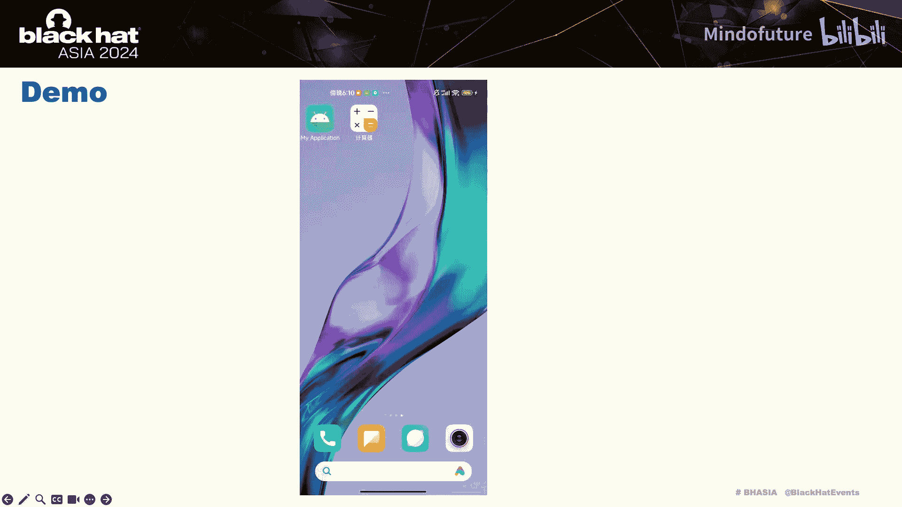
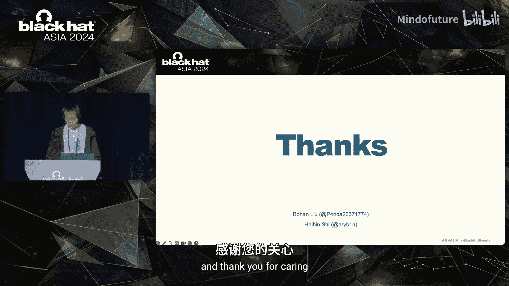

# 黑帽亚洲大会2024全集-•-中英｜Black-Hat-Asia-2024-p17-P18-The-Hole-in-Sandbox---Escape-Modern-Web-Based-App-Sandbox-From-Site-Isolatio--BV1oyX7YnEhN_p17-

Hello， everyone， welcome to our talk。 The hole in sandbox is skip more than Web ape sandbox from set isolation perspective。

😊，I'm Boha Liu。 This is my partner， Hainshi。 We are all security researchers at Tencent Security X La。

 I mainly engaged in browser security and also a Google Chrome bar Hunter。

 Habin focus on Android security mall。 So this is a talk combining browser security and Android security。

😊，Let's start this talk from the part of background and knowledge。

As shown in the picture， the Chrome is a multi precise size browser。

 we can see that when page is opened。 each process has different work to do and gently render the the page。

 for example， the browser process controls the interactive parts visible to the user。

 such as address bar， back and for button and also invisible parts such as network requires and file access the render process controls anything inside the type。

 where a website is displayed any code related to the page rendered here。

 including Javascript H T M L， C S S and so on。😊，As we can see。

 all code about the website was loaded in rendered page。 So if any bug here。

 a attacker can get all permissions of render process。😊，Therefore。

 Chrome uses a sandbox to limit render functions so attackers can't do much things。

The first main idea is do not re the view。 Therefore。

 the sandbox reuses the system restrictions to grant low power permissions to the render process。

For example， the integrated levels was used on Windows， Scom B P。

F on Linux and S A Linux are Android。😊，This makes sandbox meet the principle of list privilege。

 and the render process only can access limited resource and IPC or kernel interaction。

So what can hacker do after getting the render per the render R C E First。

 they can access the limited system call， for example。

 calling and protect to unlock memory with any permissions。

But they can't do really dangerous things like downloading any files， creating precise。

In this situation， hackers may evaluate their permissions where system bugs in the limit limited system call。

 Second， they can send I PC calls with evil parameters。

 If there are any bugs in browser process and when handling I PC attacker will element with their permissions by getting R C E in browser process。

 The above are popular ways to sendbox escape at present。 Of course， they are required another bug。😊。

Another capability is patching all code and data in render process。

 There is a special samplebox escape case from blackhead USA 2022。

 a tier can call any native node S As by modifying some data related to the ephm where this As。

 attacker can escape somebox of electron applications。😊。

What is the greatest capability of radar C itself， Can it only be used as the pre precondition for a symbol skip。

😊，This， this is all also the original intention of this talk。

 We hope to explore how to push the radar C itself to its limit according to the Chme vulnerability reward program rules。

 there are some other high risk bugs between sandbox escape and radar C here。

So can we increase our at the risk level of radar sea itself step by step and finally achieve some escape。

😊，They main two ways to choose here。 First is GPU or network process R C E。

 which is a process with medium permissions。But those process R C also requires a privilege ecapation bug。

 So can we try universal set across that scripting first。

So let's come to the part 2 with this problem。 I think everyone here may be very familiar with crossite screen。

 also known as X， S， S。😊，But what is universal access S。

 This is a simple simple picture to show the differences between them when there is a bug in the server server code of victim dot com here。

😊，The tiger tricks the user to load a link contain containing evil parameters。 After that。

 the access payload is injected into the page on the server side。

When the page is loaded in the browser， any Javascript code will be secureded in victim dot com。

 and the tir can steal the user's cookies。😊，As for universal X S S， the bugs is in browser。

 When universal S S S is loaded in the victim's browser。

 attacker will use the bug to inject just cry code into a victim dot com。

 even if the server has no bug。 the cookies can still be stolen。😊。

After analyzing the historical data， this type type of vulnerability began to exist as early as 2006。

From the figure below， we can see that from 2010 and 2024， I。e。 Safari。

 Fairfox and Chrome all had such vulnerabilities。In particular。

63 vnerability universal access bugs appeared in chrom long between 2014 and 2016。So universal S。

 S S is a kind of high responsibilities that has existed for a long time and affected many browsers。

So what stopped us injecting code from other domains。We can do a small。We can do a small experiment。

We know that the Dom tree contains all the code of a page。 We can visit it by the object document。

 First， we create a new aframem and set it a different domain from the parent page。

 such as X do X live dot Ten dot com when trying to read and write its Do tree from the parent page。

 We found it was blocked by the S， O P of browser。😊。

The same origin policy also known S O P is a critical security mechanism that restricts how a document can interact with a cross origin resource。

 It checks whether the triples of parent page and child are the same。

 The triples are applicable domain name and port。 In our case。

 the domain of Am is different from the parent page。 So the access is blocked。 Now。

 the questions is how to bypass S O P。Here is a case worth learning telling us how to use a radar R C E to bypass the S。

 O P in safari。It comes from a topic of blue hat，2020。

The tir can use a am to load Google dot com in the actor attacker dot com and then exploit a render C bug in parent page to inject a justscript code into Google dot com。

😊，There are three conditions of this attack pass。 The first is the attackers page and the victimm are in the same render process。

 And second is that the S O P check is in render process rather than in browser process。

 The third is that domain structure use by this check is also in render process。

 So attacker can modify data in render process to bypass S O P。 specifically。😊。

The attacker can all write am universal access of domain to bypass check of custom domain data access so the attacker can inject anyscript code into aframe page。

 Of course， X frame options will block set to be loaded in a a frame。 However。

 this check is also in the render process。 So aer can buy bypass this this check again using the same method and make any site loaded in a a frame。

😊，So comparing those two point， a attacker implied universal access S in safari。

It sounds of good news since Chrome and safari used to share the same render engine that was wiped。

 So this attack method in safari may affect Chrome as well。😊，However。

 Chrome designed a series of universal accesses harden to define against them。 First。

 Chrome introduces out of process frames。 It allowed a child frame of a page to be rendered by a different process rather than its parent process。

 So it cu a condition 1。 Second， Chrome introduce the P L Z navigate。

 It moves across a security checks to browser process。 So it kills condition 2 and 3。 What's more。

 Chrome introduces that isolation on 2080。 It limits its render process to load a single site。

 It is called the most promising measure against universal access attacks。😊。

Set isolation seems a problem we have to face。 So let's come to the set isolation。 Now。

 its principle is treating each website at a spirit security principle requiring a dedicated render process。

 So there are mainly five new features added in a set isolation， according to the paper。 Among them。

 set principles and dedicated processes are concept you used to define the implementation method of set isolation。

 Well， cross process navigation and out of process as are the scenarios in which that isolation is added。

😊，In out of precise Iframe scenario， when the parent page contain a cross or I frame or pop up page that are loaded in a new process。

😊，In cross precise navigation scenario， when the navigation target is cross origin。

 it will be loaded in a new process， too。Now， we understand the principle of that isolation。

 Let's take a look at its implementation。 We can find it in a start navigation method。

 We know that a render frame host represents a render in the browser process。 So during navigation。

 the render， which the new page is loaded will be determined based on the associated RF F H type marketing right here。

😊，It's determined by use current RF， F H in get room host from negation。

 And this is determined whether the current site instance and is constant with destination site instance。

Finally， we found that the generation process of destination set instance will be。

 will try to reduceuse the origin set instance。 If possible。

 it will be loaded in the old run frame host。 Otherwise， it will be loaded in a new one。

 which means a new process created。😊，The key to decide whether to reuse process is in use dedicated process for all sets method。

 for example。When the strict isolation set isolation mode is now meet。

 the new page will be loaded in a the original process of navigation。 So what is strict mode。

We can know it from the dock。 The strict mode is only for desktop platforms。

 So the process will be reused in the potential mode。

 such as Chrome for Android and this will also occur in all Android platforms， such as Web。😊。

That is to say we can reuse the same process after navigation in Android。😊，Now。

 hackers has the ability to patch all code and data based on the render C。

 and the following page can be in the same process attacker controlled。

 The next step is to find a way to inject justscript code into another page。

 There are many time to choose from the perspective of a page rendering。😊。

I chose the jascript compil fast。 The jascript code here is a string at this1 point。

 So what we need to do is finding and modifying them。😊，I found compile script internal method。

 the compilation function Chrome first。It takes out the just code and generate generates a V8 string object。

😊，Here。And then call compare method of script compiler。 This is good point to hook。

 So I hook this point， the core point into a evil with string。 This looks like a children house。

 when certain condition are meet E with string modifies the jascript code into our payload like alert pond。

 Otherwise， it compares normally to avoiding strange behaviors。😊。

So the whole attack part process is like this。 First。

 victim open the attacker's website and then attacker patches the code where run it injects a children house into compare script internal and then navigate to the victim side by reciting the location dot H R E F。

😊，When compelling this Javascript of victim page， the children host triggered and modified the jascript as anything controlled by the attacker。

 causing the universal access S。Okay， we take a step forward。

 We transferred the render R C into a universal access S。

 I make a demo on chromroe for Android 90 On this version。

 we can inject any code into some important important sites such as account do Google dot com。

 Let me play the video。😊，Okay， we can is Chrome 90。Okay。

 we the pond was shown on account Google dot com。After I talk about this method with Gong Gang on Tf Cup。

 he said he is similar to his another bug used on Pfest 20816。 This is very coincidence。

 So I also list his method here。😊，After I submit this issue to Google， however。

 Google set wont fix since they can't do anything。 They can't do much thing until they enable strict inside isolation or Android。

 But as usual， they users， they are still receive safe since Google use heuristics to isolate the sites that need isolation most from Chrome 92。

 This means we can't inject just cry code into sites that like count Google talk dot com after that。

😊，So。What are the sets that need isolation most， According to the Google store。

 it mainly provide a protects private data related to the user logging。

 such as the sites that use users logging by entering the password or sites with the industry standard or else particle says that what other unprotected but equally dangerous sites are there。

From the perspective of Android Chrome developers， just pro protecting those sites is not。

 But there is a category of apps called Web based E implemented by browser components using Chrome。😊。

Usually， why based ape has more complex functions。 Could this ape survived this under this this attack using similar protection。

 Okay， this is another question。 So let me give the lifetime to Habin。

 He will introduce how we escape the sandbox of web based ape using this method。 Okay， welcome Habin。

😊。

Hello， I'm Habin。 I'm going to show you how we escaped the samebox in real world software first。

 let analyze were based up from site isolation perspective。😊，Web based up。

 use a web view or other similar components like C E F to show web content。

The components are often based chrome。 such powerful components may cause more problem than native application。

我。Sometimes developers not only want web content display。

 but also interactive with their local resource。Therefore。

 web component also come with jascript interface， which can give jascript ability to call native code。

Some javascript interface actually implement very powerful function。

 such as install and open application。😊，If we can call these interface。

 its possible to achieve effect of sandbox escape。But developers also come up with this and limit use of privileged application interfaces to only website they trust。

The following is a code example。E like this。Before call privilege application interface， there is a。

 It seems very secure。Is it possible to break security assumption。呃。In a perfect site isolation。

 there is indeed no way to do that。However， after our research。

 we found that due to the implementation of site isolation。

 there are secure issues in many web based lab。Many apps don't implement full site isolation。

 We may use universal access as solution to call any privileged application interface to achieve effect of sandbox escape。

Now， let's show how to escape more than one based up。Sbox， from site isolation perspective。

Here are some software we care。 for example， PC application based C E F default mobile browser。

 application store and so on。The first， the first type is the PC application based Cf。

This is a web based app architecture with a following to feature。

 First privileged application interface mainly implement the common function of the client。Second。

 many implicit dip are registered in privileged domain resolution。For developers。

 the most important thing is running speed of the software。 So there will be many optimization。😊。

Especially regarding the process of loading page。A case is render process created when the app open and reused when website closed。

 It it kills the site isolation When only one type used hacker can get universal access in privileged domain using a render I E bug。

😊，And then we find bugs in privilege application interface。 First。

 we found two bugs in crypto application interface。We use。

 we use Windows U N C to control the input file as remote file。

We can also get past Tra when writing files so we can write any value to any file。😊。

And we found another interface which can start a process with a hard code name。😊，ch then， we got a C。

There is a exploit demo video。

What we are going to introduce next is the mobile browser。

Defa browser of mobile phone is prestled， so it is a tech entry point for P's mobile project。

 which may implied one click car C E。It's an attractive target for security researcher。

Each brand mobile phone will preinstyle their customer browser。 only Google Pixel 4。

 carry Android Chrome。Mobile vendor customer browser open secondary development based Android Chrome。

 which are potential set isolation， too。So we can achieve universal access in this target， too。

Then we need find some。 Then we need find some useful justscript interface。There is a case。

There are some advertising function in target app， which enable silent app， install and open。

 And after after analysis， we found that such powerful functions are implemented by javascript interface。

😊，But this high risk function can only be cu from privileged domain。

The following is target interface。The first is browser dot open app app can be opened based the app name string。

 Another is browser dot install app。 app can be installed based based on the app name string。

 and a callback for install app can be set。We can use this callback to open up， after install。

But this is not not good enough。 We found that only apps in the app store can be installed。

 That means we need to upload selfdevelop app with a back tool to app store。

 just like most of the Panto players in recent years。However。

 this method take more time and carry the risk of being being discovered by auditors。

 but we have to rush to participate into Tian Fu cup。Are there other ways to exploit it。

After analysis， we find a possible solution， we should control the device through app already in app store。

And the target app needs to be able to inter interact with us to achieve effect of execute attribute command。

Then we found the following application。Terminal application or script language interrupter。

We found that there is a such app that can execute the parameter。

Pass by deeplink as command like this。We get a reverse share by download and run busy box as Ne by start terminal with this。

 this step link。In order to start up with deeplink。

 we need a more powerful privileged application interface， and we found an interface like this。😊。

Brother dot start activity with deep link。Compared with interface。Open up。 this method can。

Can pass parameter and more flexible。 We can use it to launch terminal app and transfer data to revise share。

呃，来次 watch a video。

嗯。Finally， a case about a Web based Android app。Most of all Android based web can be launched from browser。

哦。But there are also some differences。 The browser can load the content of any website。

 but one based app can generally display some vendor related content。

When the app receives some untrusted content， it may even jump out to browser to open it。

The case is default app store or mobile phone。The target app is a vendors built app store application similar to the Google Play application。

 apps can be installed and opened silent from target app。And target app can be launched from browser。

 which means。Rosable。In summary， the target application is a good target for Pont too or Tfu cup。

Let's look at the first activity we found。It is export prousible and register for rich develop rich dip its handle intent and distribute to different web based activities。

The code is like this。Activity 1 divide links to following three types。诶。Untrusted website。

It will jump to browser， to open it。And vendor related site。

 it will open in activity with Web view with no privilege application interface。And finally。

 website related to app store business， it will open in activity of website overview with privileged application interface。

And then activity 2， we care。 it is an activity of web view with privileged application interface。

 but no way too load to untrusted domain。The code is like this。

And then we analyze the useful privileged application interface。

 One is market dot open up apps can be opened based on the string。😊。

Another is the market dot In app app can be opened based on the app。

 and a callback for install app can be set。 We can use this callback to open up after install。

But we didn't find a way to load our own website in activity。 too。

 We have to find a way to load our H P first。After some research， we found a target activity 3。

This is an activity with Web view with no privileged application interface。

 but vulnerability can be can inject。Attribute page content。Like， like this。诶。

What we have now first is activity 1。 It receives the intent set by browser and start activity 1 or activity 2。

😊，And activity， too， have privileged application interface to open and install app。😊。

And Act 3 can load the arbitrary website。Is it possible to attack one view in activity 2 through one view in activity 3。

After our test， web view between different app have complete site isolation。

 but there is only only one only one web view render process in the same app。

 That means there is no site isolation between different web view in an app。

So we complete the attack。That is broader to activity 1 than to activity 2。

 Then return to activity 1。 finally， jump to activity。3 and achieve sandbox escape。

Let's watch a video。

嗯。That's all demos。 There are our suggestion for app developers。First。

 make that isolation configur to protect a privilege domain。

Then perform same arrange judgment first and then decide whether to reuse the process。

And restrict privilege on javascript interface to prevent。Excuse， privilege。诶。

Use immutable code whenever possible to implement a high risk operation。And finally， time。

 timely fixed supply chain valuable。Vnerability， introduced by Chrome。

And there is a acknowledgeknowment。I would like to express our gratitude to the following people we have been have been helpful to the topic。

And thank you for hearing。

