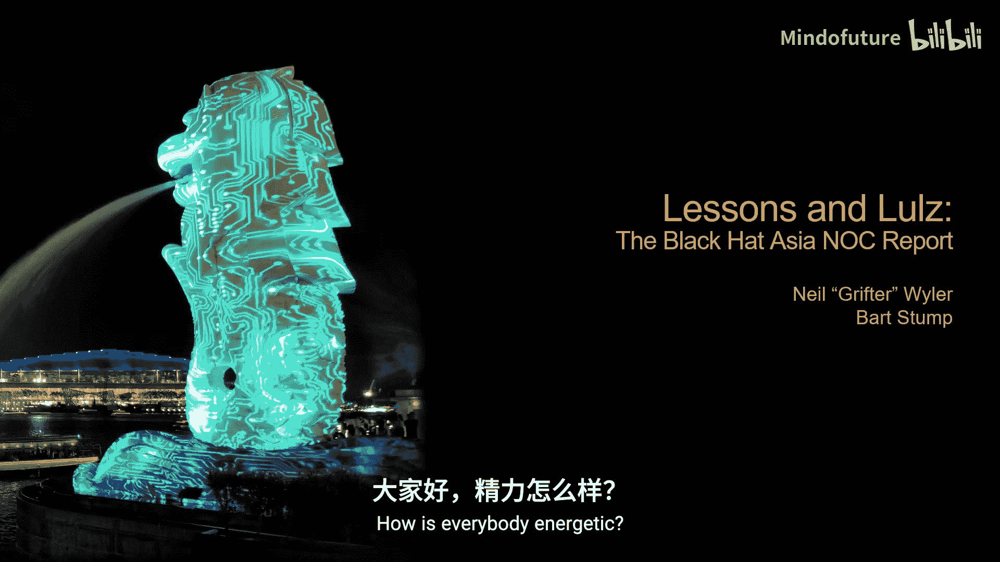
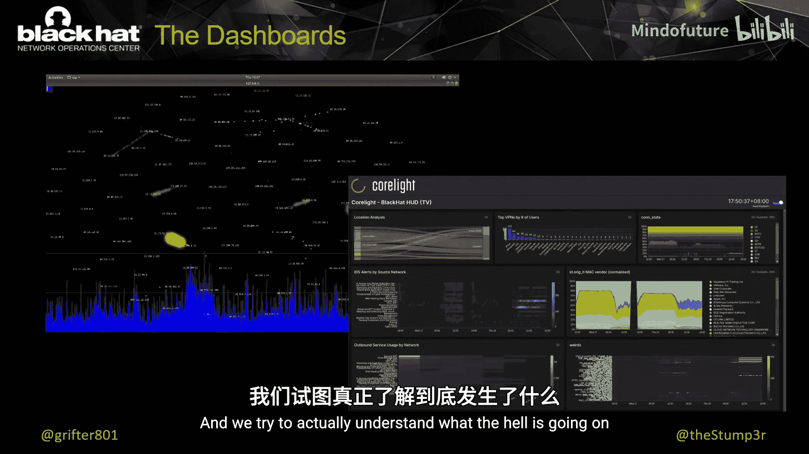

# 黑帽亚洲大会2024全集-•-中英｜Black-Hat-Asia-2024-p20-P21-The-Black-Hat-Asia-Network-Operations-Center-(NOC)-Report--BV1oyX7YnEhN_p20-

How is everybody。

Energetic， I like it。 All right， so we're just going to kick it off。 I got a bit to cover here。

 So welcome to the Blackhead Asia Kn report。😊，Who are we？Hello， hi， my mom named me Neil Weiller。

 but most people in the information security and hacker community know me as Grifter。

I by day I am the global lead of active threat assessments for IBM X Forcece so I run Xforce's threat hunting program around the world。

 but by night I do stuff like this as one of the Kn leads I've been running the black hatn for this US show will be my 23rd year。

 how many shows， we just looked at shows now we just counted up shows， this is my 78th black hat。

Yeah， that's wild。Yes， clap for my bad back。And receding hairline。On top of that。

 I also run the contest and events at Deffcon， I've written a few books。

 I speak at conferences around the world， and all of those things are super braggy。

 but really what they are trying to tell you is that I love security， I have always loved security。

 which is why it's really the only thing I do。I always like to find ways to make fun of his intro because mine's always shorter。

 so my mom named me Bart， everybody else here calls me Bart， so that works too。

I by day I'm a principal security solutions architect at CDW。 I used to do Deffcon at this point。

 definitely still go got that gold badge and said， I'm good， and now do all the other things。

 I've not wrote any books， but I think I'm still cool。You write what's You know。

 knowing what I know about you， you should write a children's book。I don't know how to take that。

All right， but we don't run the knock alone。 This is the Blackhead Asia 2024 knock team。 Yes。

 we should please， ya。And that that team is is made up of well really the couch that you see there are are the knock leads。

 and then all of the folks behind us there are our partners。 knock partners。

 So who are they So these are our partners。 As he said And again。

 Part is very specific word that we use here。 these are not people that come in and pay to be in the knock Grifter myself and Steve Fink。

 our Prince architectit work through to make sure what we use is what we need we go through get demos。

 if we have something a problem that we need to solve a solution we need to get as if we are running any other knock So。

 we go find out what product will best fit that need。

 So Arrista Cisco Coite Palo Alto and net Witness。 and then here in Singapore。

 My Republic provides the bandwidth， which here we have one gig。 So thank you very much to them。

 We clap for the team clap for them to。They definitely deserve。👏Yeah， I will say， as Bart mentioned。

 because they are partners and the way that we select them stuff， it's kind of cool。

 It's an interesting insight on a different part of what we do in our day jobs where we get to act as the customer or we're the ones going。

 and instead of purchasing power， what we trade is brand equity so we don't we don't pay for the equipment and they don't pay for us to use it it is genuinely a partnership and so far everybody that when we wanted to use the technology and we said。

 hey， can we use your stuff， they've said absolutely， and not only do they send gear。

 but they send folks to back us up as well。Look， those are pretty partner leads。 again。

 just trying to give give these guys a shadow because there's a ton of work that goes into this。

 We do plenty， but certainly a lot less than we used to。

 These guys all put in a heck of a lot of work， a heck of a lot of hours a whole lot of planning time calls work here and again。

 thank you to them。 These are the team leads those partners and the guys that we interact with on a very regular basis。

 We got a slack channel that runs all year。 It's not just here。 And we。

 we are often in communication again。 We appreciate the hell out of these people。

 Look how innocent Jonathan looks。 And he's actually like a really scary。

 Jimmy has all our dinosaurs behind him。 I wouldn't say he doesn't look too much more innocent。

All right， so let's talk about how this thing gets put together。 All right。

 so we've always lived by the principle， keep a simple stupid so it may look a little basic and that's totally the point。

 I won't read the numbers to you here。 you can go through and look at that we'll kind of walk through here really quick we do have again。

 our one gig internet from my Republic that goes into a switch that we use from Arrista for our breakout on those HA firewalls that are our W edge those come down to our core switches that Arrista provides and then ArrisIST also provides the tap south of that so you can see our tap invisibility into those tools off to the right。

From there we go down into this is a little unique compared to what we do in Las Vegas the US show。

 So here in London we actually ride the infrastructure of the venue。 So in this case。

 Marina Bay Sands we use their infrastructure as far as distribution switches and cables etc。

 so that's what we see there that goes out to our registration w-fi networks as well as arsenal that we have broke out and then we have our management network for all the tools and then the knock that we have there。

 The one thing I'll point out that is a little bit new on this diagram if you've been here before。

 you can see those little eyes that are there。 we've talked about it a bit but we are starting to use thousand eyes from Cisco they've provided that and it is become a pretty cool tool and talk about some other things there and what it provides it's basically giving us visibility into those networks where we place them So on w-fi at the core in classrooms etc we can do tests we can see what that network looks like at the time。

 so we're not waiting for somebody to come tell。Something's wrong。 Hopefully。

 we can proactively see that something's happening， Go fix it， and you'll never even notice。

While you were doing that I was smiling like an idiot and I'll tell you why in case you're wondering。

 why is he smiling so big up there， I checked my fly a couple years ago at the US show。

 my fly was down for the first 20 minutes of the talk and now I'm scarred by it and then I thought I did it and I was like was I slick enough and I started laughing and whatever but so there it is"。

All right so this is actually so that's a whole list of gear and this is how it gets put together so we come in early。

 we arrived last Thursday， so it's not very early but it's early enough we come in and we set up what is essentially an enterprise class network in two days right and so。

😊，This is how that all comes together。 I like this because when we're moving fast like that。

 it looks like we're busy。Its like right， like three days worth old。

 Don't we look like we're accomplishing the hell out of something right there。

 Like so if you before a performance review， your annual performance review。

 just record yourself at your desk for like a day and then show your boss the time laps。All right。

 so this is actually the integrations， this has got a lot deeper and we'll talk about some of these things and kind of where it is。

 but again we talk about that kind of high level overview of what the architecture looks like。

 but there is a whole lot going on kind of on the back end， if you will。

 the integrations between all these partners， the other thing to notice when you look at some of those names。

 you talk about Cisco and Palo Alto outside of these here walls。

 those guys that be fighting each other normally we're really proud to say that these guys are even hugging each other right now。

We love the hell out of them and there's a lot of things that we kind of brag about this network in the sense that there have genuinely been products that change because of the things that we see here at Black hat。

 There have been integrations that are added into products that you guys see in the real world that we see in our day jobs and talk to customers about because of the things that we've done here at Black hat and again。

 we appreciate that they're willing to do that kind of stuff that they're willing to work together。

 obviously not just Pao and Cisco， but again in general。

 you would not picture them playing well together if you would on playground。

 So won't dig through all of this。 We use a whole lot of tools on the backend。

 we are feeding a whole lot of things into each other。

 We're enriching we're going to talk a little bit here about how things have come along and where we're going today and will' make a lot more sense when we get to that point。

 but just understand we are doing a whole lot of automation enriching all of those other products with each other's data and then using that at actionable data to improve what we're doing here。

 Yeah I will make another point on that too， which is that。

From the very beginning when we brought the vendors in their partners in to help us they immediately started collaborating。

 which is really nice in some cases this is an environment where they're really they're the ones who are building these solutions right so this is a time where they're seeing it in an aggressive environment for the first time or how it hands off data to other products for really in a live environment for the first time so they look over and be like iss that what it looks like when I send that to you I'm so sorry will get it fixed and then they do。

Also， we stream the knock live on Twitch。We don't know why。

 really it started because when everything happened with COVID lockdown or we were behind closed doors and so people couldn't come in and look through the glass at us。

 they had us locked behind closed doors and we were like， okay。

 well we can put a TV outside and show them and we use Twitch and now we just stream every one so if you want to watch us at the US show or London in December。

That's the Twitch stream， and you can watch that time lapse in slow motion。All right。

 we use a significant amount of dashboards in there， like I said， we have a lot of solutions。

 doing a lot of things， collecting a lot of data and we try to actually understand what the hell is going on。

 and we do that in a number of ways。 what you see we'll start off with a peopop that's actually doing something So that is a project called OIP。

 It's an open source project。 And what it's doing is showing us essentially the most active hosts that are in the network and green traffic is TCP or those green little blobs of data going back and forth。

 Red is UDP ICMP is white。😊。

And we can see stuff going back and forth。 And if it。If we see a giant。

 like it will light up really sick and bright。 and we'll go， well， that's an awful lot of activity。

 What's going on there。 And we can turn to somebody like you know Co light or net witness and say。

 hey， will you take a look at I address， whatever and see what that is。 Also you know。

 scans look like fireworks because there is traffic shooting out from a host across the entire thing and we'll see that visually。

 So it does look very poop po po， but it does something size of those dots is also representative of the size of the packet。

 So again， there is information in all of that is。😊，Fancy as it might look。

 it's not necessarily the Norse P P， but it is useful， it's not the last piece of information。

 but provides that glance of the network。 Yeah， my favorite OIP PP story was like got a US show one time we just saw this weve just opened the knock and no one should be in classrooms but there was this giant like light sber of data being like past between some stuff and we're like what is that right so we wander down to the class because we know which I are tied to which classes and when we got down there。

I opened the door， and there was one guy sitting at a table， and he just went。

He like looks at me and I was like， oh， you're good。 man。

 We were just checking to see what was going here。 And he's like， okay。My我 but。So yeah， again。

 lots of shiny， lots of shiny on here right there。 But the data that's on here matters。

 And we'll get into some of it in more detail。 But we're looking at stuff like。

You know how many malware samples were， you know， sent for malware analytics is part of what we're doing is if we see something that's executable or like a P DF or something that could contain malware。

 we drop it into a sandbox， see what it does try to interact with it。

 And we had what is that 4137 different samples that we sent for analysis over the course of this show。

 or up until about noon today。 No， that's more。It it's going to be even more。All right， anyway， so。

They do look shiny and maybe we're just getting older and further in our careers where now those like the stoplighty。

 shiny dashboards that we used to make fun of actually mean something to us。

 but they do have significance in the data。Again， more and more。

 this is the dashboards that we get from Ne Wit， you know telling us things about how the alerts that we're getting or incidents that we're seeing are related to the Mitax framework where you in the world those things are coming from or going to that kind of stuff and it's all just in a quick reference and these dashboards are also available for you to see if you come into the front of the knock。

 they're just rotating on the screens in there so you can see what's going on in the network while you're here as well。

People find yourself on those dashboards。 So as we dig into this， there are also， see what I mean。

 is more。 So this was this was the updated malware Ana4800 We have some other stuff from Palo Alto。

 This is actually with the X I am we have started building some of that。 Again。

 we'll get into a little bit more depth here。 some of the automation into that。

 And the dashboard here kind of shows where we're getting those data feeds from How many incidents may have come from that。

 that data being correlated。 and then the severity of those kind of at the bottom right。

 So right here kind of simple。I bumped it。You're breaking stuff so right now kind of simple。

 we're hoping this will look pretty cool in Las Vegas with the amount of data points that we're going to have and kind of building that out And then again here you can see the meware analytics。

 just dashboard， any samples that were executed there and what that looks like。Yeah， plus it looks么意。

You again， we're beating the dashboards to death， but this one is actually like physical device location so you can see Marina Bay Sand's Convention center over there on a map with the devices that are being monitored our devices so we know where they are。

 this is very useful for us in Las Vegas where we have hundreds of different devices that we deploy and then like you'll see like four of them by the pool because somebody put something in their pockets0 off with it or whatever it says devices we're talking about the mobile devices used for registration and scanning your bay。

We're going to get into thousand eyes a little bit more so I'm going to jump past that one and thenooh what's that Bart all right。

 so speaking of Palo Alto， anybody here about anything that happened with them in the last week or so。

 speak cool they're in the room。So again， this this is something that happens， right， obviously。

 and this would happen to you if you're working in a normal sock， you have Palo Alto。

 you're gonna wake up one day and it's gonna be a real shitty day with what they announced， right。

 So what we did here is we actually went back。 We saw that while we were on a plane。

 We worked with these guys on site。 We actually do run global protect tier normally for some other things that we do externally。

😊，We thought that we had mitigated that in a sense。

 And what they provided in that initial CE was if you're running both global protect and telemetry。

 So we were easy enough to disable telemetry。 That's actually why we don't have some of the other stats and numbers that we do have。

 and then to our chagr。 I think it was Tuesday， Wednesday morning we woke up。

 and the C had been updated， which they said， oh， if you're even just running global protect your host。

 So we actually log in and you can see at the bottom there。

 we did have people trying to exploit that CE in the wild on our boxes here。

To very much apppoo's credit， This was all blocked。 They have signatures for everything already。

 We saw them。 Nothing happened there， but we did make sure and go kind of do a deep dive and see that there wasn't anything else of concern in the environment or in those devices。

 But this happens in the real world， right， Like it sucked for us showing up and having to do with that。

 And we've had some other situations that have really。

Pushed us to that because of Cs and put us into some sticky situations。 But yes， we。

 we absolutely had to deal with this。 We want to give Palo credit for what they've done to kind of clean that up and make sure that it was taken care of。

 but it's certainly something just like any other normal environment that we have to deal with this things come。

 And then once a C V 10 is announced right before we go in front of a whole bunch of hackers。

 Yeah there's certainly while we're on the damn plane。 right， Can you imagine our state of mind。

 we like look across at each other。 did you get the email。 I got the email。 Yeah， All right， great。

 fantastic。😊，So。All right， so DNS， right， there were what looks like a significant increase in the amount of DNS traffic this year。

 and the reason for that is that we basically were just forcing DNS back into umbrella so that we could capture that information。

 but we had 16。5 million DNS requests， looking at the a few different categories here on what those requests were for。

The number one app was Debian， number one for chat Slack， crypto mining nice hash， dating is Tinder。

 and then porn is whatever that is。I don't know that one。

 I didn't search for it when we were in the knock。WeCheck it later。You got receipts。

Number one in Asia， so these are some stats about just you know general usage of the Wifi。

 we saw approximately 1，500 unique wireless clients and then about 10 terabytes of traffic that traversed the network over the last several days we had sustained 500 to 750 megabits throughout the entire conference。

 but at different points we'd see a jump like a big spike and we maxed out。

 we had one gig of traffic here we maxed that out several times。

Not including the time that dark matter， testing some stuff and maxed out the action。す。

So we'll do it live， so yeah， and then the top user， somebody on the wireless。

 they transferred 700 gigs while they were here， I don't know。yaay for that person。

Maybe it was for that bottom category。Earlier so our。You can see how like as folks are here。

 obviously the amount of traffic that gets captured goes up and then the amount of events per second being at about 5000 on average。

 I mean， it's it's a fairly decent amount of traffic when you all start hitting it。 I think though。

 I mean， like we're we're just gonna to get more bandwidth next year， like that's the。Hey。

 black hat management， you are on notice。Your attendees would like more bandwidth。

 right so there we go。How about who wants more band encrypted all get crazy？

Encrypted versus decrypted traffic。 This has gotten a lot better over the years。

 but there's still some stupid stuff we'll touch on in this case， though， or're about 80% encryption。

Traditionally， it's been a lot higher here in this region at the Asia show。

 but that has kind of slipped， I would say it used to be like 90% that we saw there。

 so don't necessarily know what to attribute that to。 you can see that we had TlS1。2 and 1。

3 were the highest versions didn't see anything too crazy I don't know that we saw any1。

1 thankful we're getting better we could keep going there though as an industry make sure that we're doing that and we'll talk about some of those other things as well and then that graph on the right is the again encrypted versus decrypted where we do decrypt our own registration data in between there to make sure that there's nothing wild happening and monitor that as well So when you said that like it thought just popped my head it like he's right so for years we saw in the Asia region specifically 90 plus percent encryption and then over the last several years it's been on a steady decline like slowly coming down and now it's 80% and in my head when you said it I thought oh shitty apps。

Likely， we'll touch on that too in some sense， probably。This is， you know， again， stat， stat， stats。

Can't read that from over here and Wow， look at that。 There's stuff there。 you can't read it either。

 This is an exciting slide。 I don't know。 I can read this over here and this I'm going down here。

 Can I go down here， Sorry people on YouTube， sorry YouTubeers。So all right， there we go。

 So these are is broken up essentially by class。 So the way that we're doing like our subneting is so that we can take a look at a class and say。

 all right， this is how I mean I'm just complete YouTube do dance or something。

 So YouTube is changing your handle ofva。So。So we do it so that we can say， oh。

 if we see this type of activity， we know that it's classroom X YZ or whatever。

 but this allows us to see you know who's moving traffic where and who's doing the most stuff you can see that ETS is at the top there that's actually the audiovisual company so and they used one third of the bandwidth the entire show I don't know what they're doing I think you guys are crazy maybe just uploading all of this but。

But yeah， and then as far as applications， we always put this one up here because my favorite thing is that MS update right there。

 so 260 gigs worth of Microsoft updates， people just show up on site and then go， oh crap。

Start updating their machines。I've been there。I was， I was one of those。

 Mywords already updated then I got here。 and there's like a new windows update like I'm one of them。

 Allright， so again， just total traffic here， allowed traffic。 We allowed pretty much 97%。

 We talk about how it's very unique。 And if you've heard us before。

 talk about needle in a needle stack is what you're searching for， everything is bad。

 So if you see that one coming in the top left， that's the threats that were detected。 well。

All of them combined， and then those are actually from the classrooms。

 Our highest source was the advanced AP response training room。 So checks out， right。

 highest amount of threats that we saw come across the wire。

 generally working with labs in the cloud and other things like that。 And then in the middle。

 you've got the severity of all of those。And at the bottom， what's unique again。

 we talked about we're looking for that needle in a needle stack。

 so somebody attacking our infrastructure， somebody attacking one of you or somebody attacking somebody on the Internet that you're not supposed to more on that later。

 you would drop a whole lot of traffic in any other environment。Quick stuff here。

 we'll kind of fly through。 We're getting quick on time already。 Top AI。 this is really cool now。

 obviously the year of AI。 I'm gonna say it like I'm going out on a limb right。

 It's not the year of AI， but we're certainly starting to see a whole lot more of that and who's doing what social applications And then over here on the right。

 is dashboard that was built in that thousand eyes collection and we can actually see quickly if you're not gonna read that。

 But in those boxes those are each sensor So we can see in a classroom。

 They have this much latency as they went to download a file。

 that might be a concern compared to this classroom that looks just fine could be just everybody's on it at the same time。

 but this at least gives us again another quick visual indication something being wrong where everything kind of being where it should be and then we get into latency in some other DNS testing beyond that。

 So this has been super helpful and is kind of growing from here as well。

 But it's one of those quick is something wrong if everything's read you probably won't see any of us in there。

We're running away but this is good Yeah we're also with that it's calling out to the different cloud providers and stuff the training classes when people used to drag physical servers here all the time and set their stuff up and it took a long time and a lot of work to get trainers to believe that they could be on a stable network and this is just another thing that lets us make sure that we're providing stability and enough bandwidth and all of the things that they need to be able to conduct the labs the way that you all expect them to you paid a lot to be here and so we can see something going wrong then we'll take care of it hopefully before anybody in the room notices。

All right， we got to fly through this。 We've done this a few times。

 but this is kind of where we're coming from。 ready。 I'm going to do it right， We've gone。

Go so I said I've been doing this is my 78th show've been doing it for 23 years。 initiallynitially。

 the network was so unstable here。 It would fall over if you breathed on it。

 right So then I came in and I was like。 And then it stayed up。 and we were like。

 And then we were like， well now it's up。 we should try to secure it security。 h。

 So then we did added some additional security to things。 And we were like， oh， this is fantastic。

 But oh that classroom over here， keeps attacking this classroom over here。

 why do they keep doing that。 Oh because they're hackers。

 right And so this classroom learns a new thing and gets a new tool and they start launching it at these other guysmm bam。

 So we're like we have to separate these kids。 They cannot play in the same sandbox。

 We created a bunch of other sandbox and we put them in and we said， be nice。 Then we were like。

 all right， well， we heard that this network is really， really scary。

 So why don't we go see if that's true， Let's introduce threat hunting into this。

 And we brought in a bunch of hunters。 They're all right here。 And then we said。

 look for the actual bad inside the bed。 because the traffic at black hat is super scary。😊。

If it was directed at you， if it's directed at a lab environment or if it's a demo or it's all that kind of thing。

Not really that big of a deal， Right。 So let's go find the bad， bad。 And as Bart said。

 we describe it as looking for a needle in a needle stack。

 And all that hunting helps us do that While we're hunting， we find interesting things。 Oh， look。

 there's a file。 There's a thing。 What's that。 What's it do。 I don't know。

 Let's put it in this thing。 Pum， it was malware。 So we did malware sandboxing。😊。

We we ran into an issue years ago， So now everything stable。 It's secure。 We're hunting。

 We're doing all this stuff。 And the worst outage we've ever had was caused by one of our partners。

 And we were like， no because they had a C that popped up while we were on site right it wasn't pallo wasn't that right。

 So they did they ended up having a C that popped up。 They thought they were doing the right thing。

 They were like， we're gonna to patch all this stuff。 They didn't tell us。

 and they did it at midnight。 And they didn't test it。 So we were like， well。

 that can never happen again， we need to make sure that anytime somebody's committing something It's actually the person who's supposed to be doing it。

 Let's put identity and access management in there。 And we did it。 Then we're like， hey。

 what about endpoint。 we got to look at the registration machines。 boom， EDR ED EDR。

 But just on the stuff that we control because you're not gonna to let us install anything on your machines when we don't blame you Then we were like。

 all right， This is a lot of data。 The show keeps growing。

 The first show I did had 1500 people out in the US show and the show is now or 25000 people。

So an issue of scale popped up， right？You know what that means。 We can't do it all。

 What we need to be able to do it is a little bit of help and a little bit of automation。

 And with that， Im going to point at this guy right here and say， come tell us what we're gonna。

 Theres hope He's amazing。 He helps us out。 But he's actually kind of been spearheading with the partners here。

 getting our automation and workflow worked out here。 And we're gonna let him speak to kind of。

 the work he's done with them and where we're at this point。 It's been amazing。😊，Ho好。3，4。 everybody。

 I'm poppe。It's my last， it's my last name。 It's not a super elite hacker handle。 No。

 don't believe that。 He's the pope。 Anyway， talking about automation。

 We started building all these hunters and started providing a lot of data。

 And that turned into a workflow nightmare。😊，It's manageable in Europe。

 It's manageable in here in Asia。 Actually， I got even a little lost here on a few times。 But the US。

 we have such competent people coming， doing such thing。

 providing such value that it was just overwhelming our workflow， which was slack。😊。

What we had happened was。Partner would find something。

 One of the hunters would find something three days later。

 another hunter or even the same hunter would find the same thing。

 And we were duplicating effort and wasting a lot of time。 And I was trying to keep on top of it。

 and I was losing session of the entire thing。 trying to catch up too much。

 So I need something to handle workflow。 So I start looking at workflow options。

 We tested a whole bunch of even open source ones We're bumping through some And between US and Europe。

 That's the next show。 We arrive at Europe。 I'm looking at still options of what we should do on the side。

 we were doing some automation bits and trying to improve that And Palo shows up with like X IM tool Palo Alto X I like this does automation and workflow and all these things。

 And I was like， can we play with it。 So we start playing with it。

 And their cortex X or is like one of the best automations I've used。 And I've used a lot of them。

 It's excellent。 So started using that。 And then looking at the workflow。 And it was。😊，Allright。

 we got something here。 How do we take this further。 bring me。

 bring me a person who can help build this vision of ideas that I want。

 My MVP is I need to do some of this workflow stuff。 So let's test it out。

 So in Europe what we did is one of the hardest things that I had a hard time do is pinning somebody down is to which AP they were on And that's not the technology or the partner's problem。

 it's meeting that information to that person to get them to look it up to get me back while they're deploying As or doing something else。

 it would turn into this 30 minute process and Pao X IM they get to work。Go build a thing。

 and we go to slack bot and we do like， a slash。 Where are you type of thing？

 And they're on AP P G 20。 And it's in this classroom。Went from a 3040 minute exercise to a， hey。

 I know exactly where they're at。 Co。 We got something here。 We got a little bit of a magic。

 So this show， we start producing， how do we take this further。

 And the next thing I wanted to do is on these threat hunts。

 I want to know all the external tip information I can。

 And we got a luxury if I got I think we have three tips。 right So we got Cisco umbrella tip。

 We got Palo Alto and their threattel information and we got threat and we put them all together。

 And we in Slack can either just do a command lookup or we can go and pivot out directly into X I am。

 and we know everything about that external I Who it is。

 what they are where they're going based on lots of tips。 And some of these tips。

 have lots of other content underneath it。 So cool。 that was super useful。

 The next thing is I want context。 And by me context， I want internal things。

 I want to know everything I can about a person inside if they're doing something bad or wrong。

 So tell me what all of our partners。😊，Know about it。 What does umbrella know about it from DNS。

 What does corre light know about it from network， What does net witness know about it。

 What does Paa know about it from the firewall and DHCP logs Give me that context and those pieces are built and we have already ideas to improve and make them better and that we're gonna carry that into the US and then。

Tie this together with a bunch of availability things that are also hard。

 which is pulling in firewall information， switch information。

 A P information and all the thousand I stuff they're talking to。 Put them all together。

 And Mike Vir Do Matt is gonna like， own that and turn us into a pretty dope dashboard in the US。😊。

Here my passports。Oh yeah， you could see there I had what is happening。 There we go。

 Why are you clicking someone I didn't mean to。 I can't be trusted。

 There's question marks at the bottom right So what is next or what's the next part of the evolution。

 and it is this So our new robot overlords。 So this is everything we've been here in AI。

 we've talked about machine learning for a long time。 this is actually some machine learning。

 So a couple of our guys here at corelight are looking at some things that they're looking to do with machine learning in their product。

 They started playing with this here。 And this is really cool。

 So this one specifically is our traffic。 This is our backbone。

 This is everything that we see from our environment。

 And what you see there are just graphs of the services that we're measuring there。

 when we look at something So an example is that we're looking at the switch management on that top left。

 If you see all the tiny little things there。 and then a couple of dots。

 Those are outliers right This doesn't necessarily tell you exactly what it is。

 but we can go to those outlier dots。 we can click on it and we can see why that isn't out。😊。

erSo if everything is normal and everythings acting the same， you'll see a cluster of them up here。

 this A is acting this way。 And what we see is that somebody just Sd into that one right once or twice。

 and that's an outlier compared to what we see on those other backbone devices。

 So we can kind of narrow this down and have again， just another quick visual hey。

 everything's normal because those dots are all。 keep going here and I'll show you some other stuff that looks super unique。

 So this is training rooms。 So if we look at the training rooms and we see it based on alert。

 So what we're just talking about on the backbone。 That's all of our services。

 we see if there's a different service and an outlier and how someone's connecting to stuff。

 What we're looking at in the training rooms and the rest of the environment is alert。

 So if we have something that was alerted。 everybody's gonna get the same alerts in the advanced A response for the most part。

 they're messing with malware and you'll start to see those dots cluster。

 if you see here of that top right one。 that's pretty unique。

 That's what we would expect to see from a training room。 everybody's pretty much in the middle。

 you probably have an instructor。Somebody on the top left。

 a teacher's aid kind of in the bottom right。 and then the guy that was sleeping in the bottom left。

 whatever that is， right， we kind of know what we can dig into it。

 But if you look at the graph just below that。 So in the middle on the right。

 that's what we said was probably the most bored training room there is because nobody did the same thing。

 You see all those dots spread all over。 It doesn't necessarily mean anything bad。 But again。

 there's a quick visual representation and then dig in deeper， if there's something wild。

 So if we can go see a training room and all of a sudden， everything's locked in。

 and then there's some dots just flying off into the corner。

 in the world of these people doing and we can do that。 So。

Taking that time to investigate things down， getting all the automation and the pieces and the information that we already have and making that actionable right and so it allows the hunters to spend their time focused on the things that are truly outliers rather than spending time digging into the cluster in the center right It's like this little anomaly over here。

 let me click on that and see what that's doing and then that can spawn a new hunt so where if you don't know anything about the devices or any other information but you know。

 okay well these are all acting the same and this one's a wild card then you want to go check out the wild card so it's kind of nice so that's what's next。

 can't wait to see this continue to develop。So。What do we see you know on the network I'm tired of this grandpa we're so tired of seeing the same things show after show after show after show and what are those kinds of things well。

 you know we see people who have split tunneling and misconfigured they believe that they're using a VPN correctly and in reality they're dumping half of their stuff out into the clear we've had conversations with folks like that before where we go up and we say hey。

 we see all this stuff and they say no look at this little green icon in the system tray and you're like。

 you have just much left on your mortgage and they're like。So。

So make sure that you're actually that's a fact so make sure that you are taking a look and seeing that things are configured correctly right we see LDab out to the Internet why is it happening right it's a lot of government stuff。

 some pretty spooky ones as well like all of these things it's 2024， why can I see your email。

 why you have this incredible password good for you it's 23 characters long。

 but you just broadcast it across the network in the clear Oh my go every show。Every show。

So please take a look at the traffic that you're sending out， not from all of your devices， really。

 and try to ensure that they're not just leaking sensitive information。leak。 Allright。

 speaking a leak couple quick stories， couple minutes here。

 Hopefully we can give you some time to ask a couple quick questions。 But ignorance is blis。

 So again， verifying and checking things。 What happened here And what we saw was we had a mobile device that in multiple instances。

 there was a weather app。 and it was responding to the weather。😊，Connection。

 as far as where its latitude and longitude was in the。 We know exactly where that person is。

 That's the top。 right。 If you look over here in the middle and the left， there was。

I actually forgot what that one is。Oh， login again from that device。

 we're seeing something else on a mobile device that we're having a login in the clear to I forget what this is I'm missing sorry token is in the clear。

 whatever they were logging into and then at the bottom something was enumerating all of the apps that we on that device So again in the clear telling us every app that was on that device and enumerating it this may not be you。

 you may not be doing anything wrong， but you installed an app or you did something else。

 this is all we're trying to say verify， verify verify everything that you do go look at that on your home network right we're all in the industry。

 it's spin up some open NDr and just check out what's going on and see if you see the same stuff because you will So speaking of verifying and checking things whatever right most of the folks who are in the knock most of the team that you see in there are all doing some form of threat hunting it's critical to what we do because we can't rely on alerts if we alerted on the type of traffic that we see it would just be alert alert alert we'd never be able to do anything with it So we're。

For the types of things that make us go， that looks actually bad。

 And one of those things is when somebody plugs in their laptop to the network and it immediately starts calling out to command and control servers。

 right， And that's what happened in this case。 So this individual plugged into the network started just。

 just， man， it was bad。 There was a lot of stuff kicking off and。I think the slack message was。

 I don't know if this is a text box， but it screwed six ways to Sunday。 right。 And I quote。

So this is really bad right and we're like， oh， this is terrible。

 well let's see if we can figure out what's going on here and based on other traffic that this individual was sending we were able to figure out who they were and it turns out that they were currently on stage delivering a talk at Black Ha。

So。None of us are， you know， safe from the occasional Oopy。 It turned out that there was， in fact。

 a black hat speaker who came onto and joined the network and their device was， was very， very owned。

 And they were like， but I have this EDR solution。 And we were like。Yeah， it doesn't care。

It doesn't care yeah。Even if you have things on there， please look at your traffic。

 Please look at the types of things that you're sending from your devices。 And then finally， H2。

 Oh yeah， this was something。 So our， our last one here。😊，What happened was。

One of the hunters from Coite was like， hey， I just saw somebody log into something that they probably shouldn't log into it again。

 we're looking for outliers， they see them log into what turns out to be I'll just say critical infrastructure in the United States。

 So we're like well that's。That's not normal。 We should probably look into that。

 So we start an investigation。 We start pulling together all the information that we can again。

Due to the nature of the way that we're monitoring the network and the things that we're doing。

 we're able to pull together enough information that I could go to registration and say I need the contact information for this person at that point we contacted said person and we're like。

Hey， will you swing by the knock and then what happen？And then， theyd。

We approached them about what we saw and they admitted that they did it， said， yeah。

 well I logged into a water control plant and we said。

 well that's probably bad and kind of the moral the story is we will find it and if you do something illegal。

 it's still illegal even though you're on the Black Ha network。

 we see it all the time but please please please understand that we are watching we will see it and if it's illegal。

 it's still illegal here Yeah in this particular case the individual was super apologetic they were like oh again。

 people learn something new， they find a new tool， they have a new tool。

 they want to show something off to their friends， all their friends are here at black hats they like check this out and then they break international laws together。

Right， so super apologetic and we're like， yeah， I mean， we get it。Just in the future。

 if you're gonna demo something pointed at like a server you set up for that， not。You know。

 the critical infrastructure of another country， and that is what we have for you， thanks。

