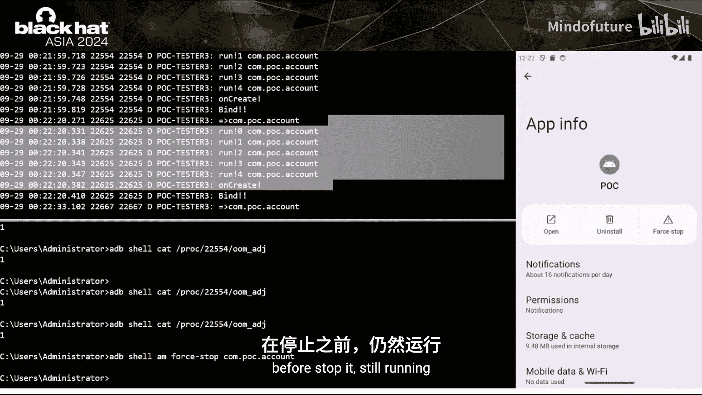
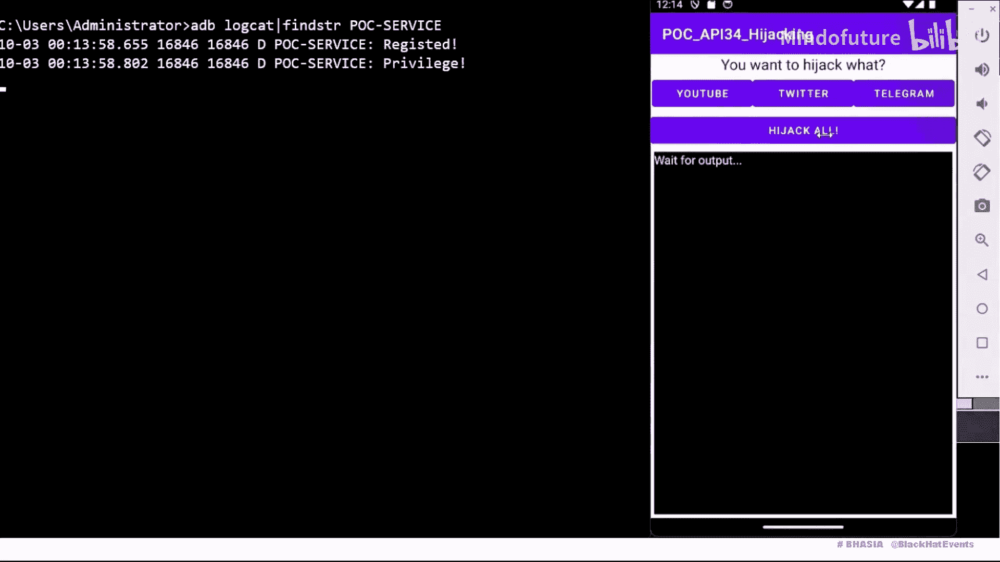

# 黑帽亚洲大会2024全集-•-中英｜Black-Hat-Asia-2024-p21-P22-SystemUI-As-EvilPiP---The-Hijacking-Attacks-on-Modern-Mobile-Devices--BV1oyX7YnEhN_p21-

Let's start。It's a great honor to be here and sharing this talk with you。

 So the session of talk today is about the flows and vabilities in system U I and sensor server。

 how to using the bugs and vabilities to bypass the restrictions to achieving hijackx tax on high version Android platform。

So simply introduce myself。 My name is Wei Min Cheng。 I'm a security researcher at Qian Xin Tian La。

 I focus on mobile and AOSP security searching。 It value is our group's leader helps a lot when I'm doing this research。

So agenda agenda contains four different part。 The first part。

 I will introduce what is actively hijack tech also called H and how the H A work on on old version Android platform。

 And next， I will introduce the security policies and restrictions released by Google this years and how these policies make HH notebook work。

The next part， I will bypass these restrictions by finding some new text office and vulabilities。

And in the end， I will combine all the bypass techniques to weapon fortune。

 and then we'll have a video demo for this。So about the AHA。

 it is an old and traditional attack scheme and many well mailware。

 such as theware ransomware bankboard， red likely to abuse this technically to injecting a evil content to trusted application。

 Then they can perform hijack to steal sensitive user data or dangerous runtime permission。That is。

 that is what A A can do。 And the hijack happens。 You usually don't know they are under attack。

We take a real world we take Android4 as a simple， and you can see called S in the screen。

 It is belong to a real world mailware real world ransomware S block。

 and you can see the same block creates a schedule and the schedule check the top activity per second。

 If the top activity is not the ransomware itself。 it will start activity with a special flag。

 the new task flag to see the foreground。After the foreground。

 the mailware can push the previous application takes into the background task。 Now。

ware can identity of trusted application。 It's kind of like a student student attack scheme。

But why may we have to see the foreground to perform a hija tech。Before we talk about this。

 we need know something about the test and backt。 and from from described in the developer document。

 the test deck is a collection of activities。 and use in the system。

 you usually separate the text into two type is a forground task and background task and user in most case。

 can only interact with only one forground task， such as you are using application one。

 and at least time you can interact the topics activity of the application one for ground task。

 but at the same time， you cannot you are able to interact other with other application in the background。

So that that is why for。 that is why the may have to see the foreground injecting to injecting a evil content to the screen。

I don't understand the related knowledge simulating a hydroja attack。We there is a user device。

 and the user has installed payment application in bank in his device。

 and mailware in background is keep keep leaking the runtime state or of all proxies。

At this time e bank user click e bank， the system should blow the e bank to user face。And also。

 at the same time， the mailware in background， detect the e bank comes to foreground。

 then injecting a fake e bank login page and see the foreground。

And it is a local high return attack scheme。 And in older Android devices。

 it affects almost all application。So we can conclude three three key factors of of H A。

 the ability such activity from background。Detecting runtime state from background and run in background persistently lose one of these risk factors we cannot achieving precise hydroja tech。

Of course， Google will not just not let this attack happen。 So this year。

 Google released a series of security policies and restrictions。

The first restructuring is about the runtime state leaking before API 22。

ware can link the runtime state of other other application directly by calling some special interface。

And you can see the pop code in the screen and it run it get all running tasks and all running boxes directly and without any permission。

But after A 22， this， this special interface can only return call data。But for API 26。

 there is still have still have chance to bypa these restrictions in a second way。

 Proxies can access the portfolio of other proxies in directly and and request no。

Soware can detecting the targets whether the targets come to foreground by access its O O M A DJ score。

In 2017， Google updated the S index policy。 The policy add to new line code the new line code rejected the application to access file in non domain。

 It's kind of like a high P I D to protection。 So mail where from now cannot access the O A DJ score from of otherxies。

But that's okay with you have a compromise scheme。 We take a real worldware mystery boat as example。

 We turn to use usage state manager to the long time state indirectly。

But these components request dangerous runtime permission and request companies use interaction。

 such as guide user into the setting app and guide them to search on search on options manually。

 and in some sur party alone the phone even will about a full screen to one user when granting such a permission。

The second restrict is about the B， A L。 after A B。

 I 29 application without privilege can start activity from background。 and no B。

 means we our mailware cannot inject in the screen from background and the mailware have to detecting the runtime state from background。

 So due to this restrict， many mailware and hydrojaware disappeared。

So the compromise is tend to use accessibility services or other system services。

 or we can use the system window permission to overlay the screen。

But all this request complex user interaction and dangerous runtime permission。

And the second scheme is we try to satisfy the B restrictions exception in the developer document。

 But all these restrictions such as request request bound by system or request whole system biology is almost in almost impossible to meet。

The third restructuring is about the background execution limits and L M KD。After API 26。

 background services cannot run in background precisely。

 and it will get the high out of memory A Z score。 and this high score means low priority。

 and this will this services will be considered as a background pro by system。

And the idol proxies will be killed by L M KD first to lease memory。

 And after A P 24 system Bro trick also get banned。This means malware cannot pull themselves up by。

 listening to the broadcast。A compromise scheme is provided by Google。

 Google adjust the developer to start the foreground services for for get a low， low。

 low O M A D Z score。But the the start， start forground services need to continuously notify user。

 and it can not even cannot run in background silently。Assuming we all use compromise scheme。

 which means will have to grant dangerous onetime permission and request companies user interaction。

 It even cannot run in background silent。 Then it means the tech will be detected by user Even we start forground in we we take a Xiaomi O S X example。

 when user clear the recent task from background。 Xiaomi will directly call full stop to allxies。

 which means our forground services even will get killed。So in this talk。

 what we need to do is bypass all the restructuring。

 achieving undetectable and and no permission required hija tech。

So the first highway we have to face is about the piano restrict。

 This is the most important part of the floor chain。

When mail will start activity from its app domain， the request will be handled by activity manager services。

 Then the system goes to the execute request function。 and you can see codeni in the in the screen。

 the function course should board the background activity start then return the result to restricted the B G activity member。

Next system will try to start targets component and in initial state function。

 the code will decide whether make the application come to foreground by by check the restricted B G activity。

 And you can see if the await move to front member is set to true。

 then in the site activity in the function。 The move to front function will now will never be called。

 So we still need to focus on the check function and find ways to bypass it。

And the developer document gives some exception for the check function。

 such as if application has a visible window， it can start active from background。

 The simplest example is to make application come to foreground and the list takes will be considered as visible for by system。

 but we do not consider list back to the check function and the check function call has active visible window function and return result to to the system。

 If the result is true the check function will return force for telling system do not prevent this application come to foreground。

Then next， the， the check function will call has active visible window inside the code。

 You can see the code， get the call U I D and try to access its window type。

If each window type is bigger than the first system window value。

 this window will be considered as visible by system。And the window type is related with its Z index。

 We take add window function as an example before system call add window。

 it will check the base between new window and existing window。 If the base。

 you can see the base member is higher and it z index will be higher。

 and you can see the base is related with the get window live on type。

 So now we can know the window type is bigger。 The Z index will be also bigger。

So the check function request us to get the system window and the system window and our non application are able to to get a system window。

 and usually it get a base application type type window。

 It is load the index and invisible in most time。 if we want to get the system window have we have to request a system lot window permission。

 it is request companies user interaction action。So the picture in picture feature is belong to Android system and also called pipe mode。

 It is a compromise scheme Google provided for developers。

 Any application without the saw permission can start and can get the system from window at any time and pin activity to a small pipe window at top of screen and the pipe window is handled by system U I。

 and， of course， it window type is bigger than than first window first system window value and request no permission of course。

 it it is a good good text service。We take we do app as an example。

 you can see app comes to background goes to background。

 but it it it goes to pipe pipe model and pin is activity in a small pipe window。

 So the system well considered is is invisible state because it's。

Because its window type is system and it's in pin in pin model。

But we still cannot use pipe directly because pipe window can hide from screen。

 And even we use the transparent theme in the pin activity。

 the system you I will make the pipe window visible for user。

And the user can remove the pipe window at any time。 So pipe is a highly detectable feature。

But the pipe still have a history bug。 We can set a his and weight in activity。

 Then the system will input a one pixel1 pixel object to pipe window。

 Then you you can see the screen。 There is a very small dot。 That is a pipe。 only for one one pixel。

But it is， it is invisible and untoable for user。 But interesting is it is visible for system。

So patch is quite simple。 You can see the pipe bonds algorithm component。

 It add some checks to check whether the pass in value is abnormal。 If it is abnormal。

 it will only returns the fixed value。So it is a nice bug to expanding a text surface。 Now。

 we no need to bypass window visible check because we can find a way to abuse pipe。

 such as create a legal legal system window。 but this window are user undetectable。People。

 before we finding very in pipe， we need to know how pipe works。

And the app core call inter pipe mode and system AMS will handle this。

 then the system will goes to move activity to pin function。 And in this function。

 you can see the code call set set window mode and pin and set the in pin model mode and then call set for text appear and inside the code it will will IP will IP with the system U side。

And the system US cycle on takes appeared callback function will be tricked and inside list code。

 the code the system will some pipe， such as a set up animation transition and set up window sites。

Anyway， pipe will be officially rendered here。So， so we can know the complete pipe train。

 pipe startup train here。 and we can get a simple sequence diagram。If we want to attack pipe。

 we need to take the weakest part in this trend。So our first scheme is try to prevent I PC。

 you can know we said before the A T M S will said the pin mode mode。

 and after after said the pin mode， the system will considered is visible。 then if we block I here。

 the system U I will not render the pipe pipe window， maybe we can get a undetectable。

 but still in pin state。Tste。But unfortunately， in user space。

 we almost have no way to affect the code execution in server。

So the second scheme is try to tackle the U I session U I side。

 like creating an abnormal window type。The set resource react hint is an interesting interface。

 It can auto scale and crop the activity window to a。

 to to a defined size to by the by pass in object。 So if we input a abnormal object。

 where we get a abnormal pipe window。Here we write the poke and the pop run in Android 13。 And。

 of course， it get one pixel rack it get one pixel window by the pass in one pixel rack object。

 But after half seconds， it come back to the normal size。

 So what happens inside the half half seconds and any ways to expanding the direction。

So we need to trace right object and inside the ont appeared call back function。

 and we can know the right object pass to the schedule anator Re pipe。And inside the code。

 the the code set up a transition and set the duration。

 This duration is a fixed value defined by system。 It's 4225。And after some debugging。

 we can know this transition will recite the pipe pipe window into the into the object defined sites。

 So what happened if after the threes。Then this transition object will set up a call back handleer。

 This call back handle the on pipe animation animated animation and interface。

 Then it will be called after the pipe animate played over。Within the code。

 it will call the finish list sites。Finish sites will create the window container transition object。

 also called W C T。 It will be passed to the prepare finish Re transition with a normal size object defined by system。

And then it will set the surface control transition and the and the system defined react to WC T。

Then system will carry WC T to I T IP PCCV system。Before I PC。

 the system U I side will the S T from the W C。 then carry this S T to I PC。

 then the system side well goes to set main window side transition。In this transition。

 the system will directly call me operator to rendering the LC C on the screen。

 This operate will cause pipe window resides to normal sites。

And now our targets is try to prevent the me。The first we want to。

 the first thing we is we want to try to prevent IPC， but not work。

So we compared the many branch of this， of this of this function。

 and we found the A 32 has a code change。And from its commit detail。

 we can know it is a functional patch instead of a skill patch。

 So it is still valuable to analyze A 32 and 32 do not call the merge operate。

And instead called the merge， it said the S city T to a global member。 and this global member will。

 and we follow the global member we can find the set surface boundaries locked function will get the S city。

 So we hope this function find what what happens in this culture。We found a familiar function。

 prepare surface of this， this function is belong to activity record components。

 This components is related with activity launch and rendering。

 So it this means we can indirectly control this culture chain from in the user space。Now。

 we know A 32 and 33 well finally goes to the set main window side transition function。

 and we know the 33 the this function will mergege。

 and we almost have no way to prevent the pipe to normal because the the train is handled by system U I。

But in32， the this function will set to said the to global member then in inside the activity operate。

 this operate will start up a chain and access list and then the code willge。

 So if we operate will maybe maybe the merge operator will not be kill will not be called。

So we get our first CE。 You can see there is very， very small dot in the screen。

 It is user undeable and invisible。This pipe can keep staying in the， in the stream。

 in the in the phone。 And because we for the， for the U I third。But this is still A 32 bypass。

 We want a bypass after A 33。So we look into the API D list。 We find a new text surface。

 Live function make launch into pipe。This function will returns activity options， object。This object。

 you can see it as additional options for activity launch。嗯。Then inside the code。

 the the function will will save the received pipe to package bundle object by a specific key。

 The key name is launch into pipe。 Then the packaged bundle can be used to set options for activity start。

We try slow bundle object。Inside the activity launch train。

 and you can see the bundle will finally we passed to function start activity inner。

 and about this function we have analyzed it before。

 It will call move to fund if the application pass B A L restructuring by restructuring check。

So what will the bundle object do inside the inside the code。So inside the code。

 the you can see the code call call is launched into pipe to check the bundle if the bundle is takes a specific key。

And after the trick， you can see code directly call move activity to pin the without any other trick and no B A L restrict trick。

So which means our mailware can start the activity from background at any time。

to and start activity into pie mode。 So we get our new C VE for after A 33。

So the second high we have to face is about the B is about the state breakinging state。After。

 after bypass the B A L， we have to， we have to do this。

This is the bug I meet when I'm doing developing。 you can see the。

 you can see the slot exception in the string。 The exception happens when I merge the code。

After merge code， the system tells me I try to start start services from background。

 but before I merge code， I， I use in the box position。

 I use bank services after merge I use start services。 After checking the developing document。

 we can now find services is not under limit of the background execution limitation。

So that's why I've crashed。And we can know background execution limitation well through exception when app try to start。

Background services。In this case， we can。Ive use this limitation to be a background detector by targets。

 exported services components。So you can see I write a pop code to start the targets from background。

 and if the if the target is in background， the system。

 the system side will return components name This men this components will cause the user user space through the exception。

 which means I can catch this exception in user space。

 So so I can detecting targets come to foreground by a second way and this issue is still waiting for C V。

And due to time with some other tricks， please see my white Paper。Next。

 we will break the M KD achieving persistently pro in background。Before we talk about M K D。

 we can we need to know something about the out of memory A DJ score。

 You can see we if we get the higher score means our boxes will have a lower priority。

 and you can see the screen。Our， our show keep checking the background keep keep checking background boxes。

 and this background boxes， its priority is lower and lower。 And in the end， it get killed by M KD。

But we can start forground services， but and least forground services usually get a 200 score。

 It's a high priority。But we said before it is no way to run in background central。

By analyzing the code of of calculating the priority in system。

 we know we can know if the proxy services is bound by third party and the third party priority is higher than self。

 code will check whether the client priority is higher than the visible visible application AJ value if true。

 the app can get a visible app priority。So is there any way to be bound by system system prox before we know this。

 We didnt need to know something about managers。 There is several managers in framework such as activity managers。

 window managers and package manager and nonp application can operate managers by correspond I bundle object。

And the managers usually run as a system user。 can。 So can we abuse managers。

We take accessibility services， as an example， the accessibility feature is handled by accessibility manager services。

And nonpdge application needs to declare declare specific inter filter before use this feature。

And this filter is pointing to a specific application services component。

Aessibility manager services will first all application wants to access the this feature by the inter filter。

 Then it will create create a connection objects inside the code and this object targets this application。

 Then code will call function to binding into to the app。W poke。 Now we get the high quality prox。

Because it's bound by system system proxies。 But this。

 this accessibility feature is request dangerous runtime permission。

 So we do not use this to achieving persistent proxies。

We found another manager called the account manager。 This is API edit from API 5。It's2 thousand09。

 and this is a manager use to this is a manager used to measure a device account by at the same same time they to use these components nonp application also need to declare specific filter。

 The key point is to use this components。 we do not need to request dangerous runtime permission。

So we have a chance to call a account interface by this manager。

 The system will create the system objects， targets this core application。

 Then system will call the function of this system object。

It will make the system back to our poll code。And our poke will get the high priority and user undetachable。

And theres some more tricks can make account manager keep binding to nonp application。

That the proxies are unable。Due to the time reason we do not talk about this。

 and the restrict can be found in my White Paper。And this is the code video demo for persistently poke。

First we， we we start we check the Android version is API 34。We start poke。 Pol start running。

 and we make this application comes to background。We try to check it out of ADZ score。

It's a high priority。We try to for stop its， for stop this application。

 but you can see the pork is still running。 It can be killed by。Any operate， even we call for stop。

We still check it out of memory A DJ。High priority。Then we try to kill it in A show。Before I stop it。

Still running。So that next is the fortune of hijack exploit。Ch Android version is 14。

We need to hijack all these three application。We first first run this application to make sure this app run normally。

Then， we start poke。

We click hijack or。 is that detecting the runntan state。After we click it。You get the hijacked。

You YouTube also， get hijacked。Telegram is also get hijacked。So this is the end。 Thank you。

