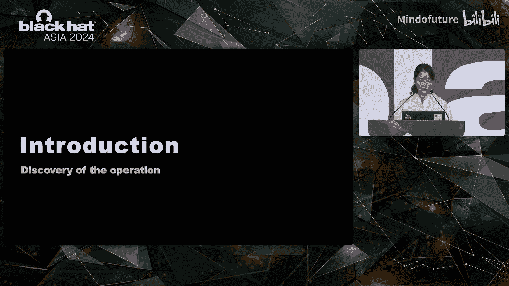
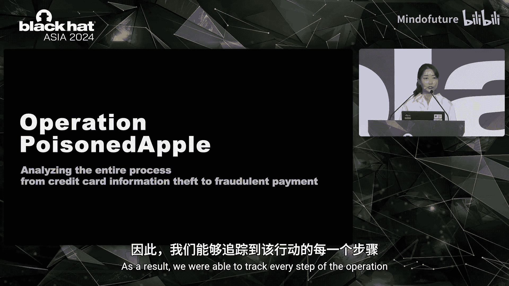
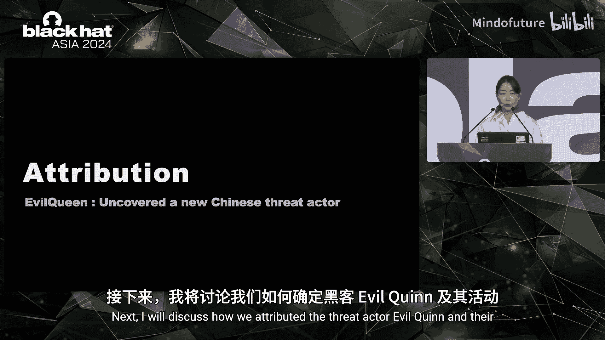
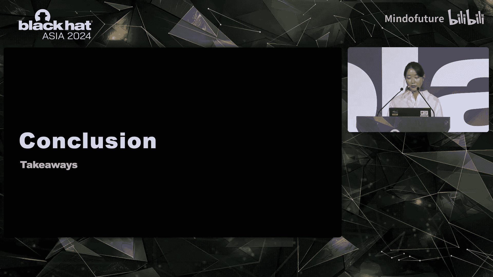

# 黑帽亚洲大会2024全集-•-中英｜Black-Hat-Asia-2024-p22-P23-Operation-PoisonedApple---Tracing-Credit-Card-Information-Theft-to-Payment-F--BV1oyX7YnEhN_p22-

Thank you for joining my presentation。 My name is Guan Kim。

 and today I will discussing the analysis of operation poison of cyber crime in Korea involving credit card information theft and fraudulent payments over the past two years。

😊，First， let me introduce ourselves。I'm a senior researcher at the Korea Financial Security Institute for on instant response in financial companies。

 digital forensics， and cyberstr intelligence for the past 10 years。

My coworker Hoo Tu is a principal researcher who coor a paper with me。

He has been conducting digital forensics， penetration tests and analyzing security incident for over 10 years。

Unfortunately， he was unable to attend today's conference because he is currently studying in the USA。

So here is the agenda for today's presentation。First， in the introduction。

 I will explain how we started our analysis and why this operation was special in Korea and then provide a complete analysis。

Next， I'll describe the a process of the threat actor。Finally， I will conclude with my findings。

Let's begin， with an introduction。

In September 2022， we discover a phishing payment page at an online store。

It was inserted into the normal checkout process， aiming to steal users credit card and personal information。

In the Korean financial sector， this type of fishingish page was new to me。So initially。

 this case was considered an isolated incident。After analyzing the page's functionality。

 we contacted the site to remove it。However， two months later。

The same page was found at other online stores。We realized it wasn't just an isolated incident anymore。

 but a wider issue。So we analyze the commonalities between the two compromised websites。At first。

 we suspected a major card group in famous forcard skicheming attacks using jascript injection。

However， we found that the serverrsside course was rejecting users to the phishing page upon checkout。

Indicating a different technique from me cards。Also。

 the online store building platform was widely used in Korea。Based on this。

 we developed a P O C code to detect the phishing payment pages。

We collected and analyzed over 5000 ecommerce-commerce platform domains using the UI features of Compd website。

As a result， we discovered over 50 additional online stores hosting the same ph page。

 indicating a significant scale of attack and prompting us to begin a detailed analysis。

We then uncover the following attack procedures。The ultimate objective of this operation was financial gain。

To achieve this， the threat actor analyzed Korea's online cutter payment system in advance。

Afterwards， they hack to online stores and inserted the phishing ph to scan users information。

They then monetized using the stolen information to commit fraudulent payments through ingenious schemes。

One of their schemes involved roing paper on second hand trading platforms using Apple products。

 similar to the which in the story， Snow White and the seven robes Roaring the princess with a poison apple。

Taking inspiration from this， we name this operation poisoned ever。Furthermore。

 we identified a new threat actor who carry out various attacks targeting Asian countries。

 including this operation。We named them Iberqui， and tracked their activities。

Before delving into the detailed analysis， let me explain why this operation is normalable。First。

 Korea's online card payment system is secure compared to other countries。While in other countries。

 online transactions only require physical car details like card number， expation date and CBC。

Korea requires additional authentication procedures。

Authentation here involves various information such as card pain。

 additional pests provided by cardiac shells。Mobile and even resident I D numbers。

Thera actor manage to gather all this information by a phishing payment page。

Demonstrated deep understanding of Korea's online payment。I am perfectly targeting the country。

Moreover， while mosters typically monetize stolen card information by selling it on the dark web。

This red actor went a step further。Instead of only steal credit cards。

 they engage in scams and fraudul payments themselves。

Resulting in higher profits than just selling car domes。As a result。

 we were able to track every step of the operation。

Now， let's dive into operation poison de。First， listed the resources developed by the threat actor。

We discovered their web server， which was utilized for storing tools。

 script and as a gateway to collect stolen information。They use Cloud flare。

 city and service to hide the rear of address。我地度。But they made a mistake by installing a welfare on their own server。

 which exposed the real server P address。They set up a web server on the hosting service per and created a phishing domain。

 resembling a real domain of a payment gateway company。

Their software contained various tools such as Aical Exp and database management tools like P P Myodmin and aminr。

Furthermore， it was later revealed that they also used stolen cards to make payments for registering their domains。

To gain initial access to online stores， the thread actor employed various methods。

They executed S injection using a map acquiring admin credentials。

They also created a web share using platform vulnerabilities that allowed them to create or own notifiers without authentication。

Additionally， they hacked into the website's administrator panel。South country。

 they onloaded circuit kits in compressed files containing all necessary phish related related components。

Both the websha and reverse share overed to the threat actor server were also installed on the compromised web server。

The Web share based on Chinese had basic functions such as viewing and onloading files。

 sending comments and diverse connections。Through this。

 the threat actor persistently access the victim system and executed command。Next。

 let's explain how a phishing payment page works。The compromised online stores were all based on P P web server。

After manipulating the payment pages， the thread actor collected information through multiple Mariitious PhGP files。

First， the thread actor replaced the payment gateway domain with their own domain on the store side rear payment page。

So。The user was redirected to their domain。At uncompromised website。

 clicking check out to users directly to the payment gateway his page。However， at compromisero site。

 the user was redirected to the phishing page。After entering their details there。

 which are then to the threat actors server， the user was directed to the rear payment page to complete the transaction。

Furthermore， they obtain the user's personal information。Including ideas Ds and passwords。

By calling session data in the stored database。They captured the user's IP addresses。

 project details and lit information utilizing PP in month variables。Finally。

 all collected information is transmitted to the threat actors server and stored in their database。

The stolen information was a total of 14 items， as listed in the table。In addition。

 the threat actor employed various evasion techniques to prevent store a or users from detecting the phishing pagee。

First， they created the phishing page's file name mass cor as a real payment module。

And then onloading it to the same path as a real one。Secondly。

 it was exposed only on week night and weekends。And it already appeared during the first user's access。

Upon the users's return visitget， the rear payment page was displayed by checking the website cookie。

As a result， the phishing payment page managed to remain active for a wrong time。😔。

The phishing page U I has evolved over time。Initially， they didn't copy particular companies。

Gradually， they began creating phishing pages identical to those of major card and payment gateway companies。

So users are unable to notice the phishing without carefully checking the website address。Alright。

 let's talk about their monetization tactic。It was the most interesting aspect of our investigation。

Their approach was nothing sure of ingenious。They used those stolen credit cards for making fraudul payments across3 different front platform。

Across each employing unique methods， a second hand trading platform on open marketplace and the online Apple store。

Let me explain each case。Here's the first case。Many Korean content trading platforms rooms provide card payment services。

So the threat actor made a fraudulent payment for an item listed on such a platform。

Then promptly contacted a seller with excuses such as I intended to give this as a gift。

 But my friend already has one。During this conversation， they asked for a refund， saying。

 I on ap for canceling the purchase， keep the $20 and re me $180。From the seller's perspective。

 it's like getting free money without any actual sales。

This leads them to deposit the money into the threat actor's account。

 ultimately resulting in the cardholderer's loss。Moving on to the second case。

The threat actor posted a sale on second hand trading platforms。

 offering gra new electronics at discounted prices。

Interested buyers contacted them through the platform chat。And transport the cash to their accounts。

The stopcon process was very clever。The threat actor initiated fraudulent payment for the third item using a stolen credit card on an online marketplace。

At that time， they entered the buyer's address at the shipping address to ensure direct delivery to the buyer。

That's clever。But what I'm going to describe nestest is even more noble。

Let's div into the third case。Here。The threat actor shipped their pro to selling Apples products。

And a fraudulent payment occurred on the online app store。During the time。

 I literally wanted to catch the thread actor。 So I spent night searching for a list of Apple watches。

 iPhones and iPad on second hand trading platforms。😊，Eventually。

 I found the actual threat actor sale and ch it with them。This screenshot shows a real conversation。

I asked the light away， if it was available。The next day。

 they responded that it was available and asked for my location。I said， I'm in sorrow。

 Then they sent， then they sent me messages explaining their scheme。

Their improved scheme is as follows。At Apple online stores。

 you can purchase items using credit card and or for someone else to pick them up。

 They ro people into buying every product in order to exploit this。When a buyer shows interest。

 they noticed that the buyer transferred the cash for the item and then pick out the new product at a nearby Apple store。

If the buyer agrees， they made fraudulent payments for their item on the online Apple store with a stolen card。

Entering the buyer's information in the recipient details failed。In fact。

This game caused the most financial damage in a short period of time。Next。

 I will discuss how we attributed the threat actor， Iber Qui and their activities。

We found that they made an operational security mistake by emvadding their email address directly into the source code or phishing payment pages。

They consistently used a unique niname from the email address。

 reading the exposure over multiple infrastructures。

This allowed us to uncover critical information about their identity and tactics。Based on this。

 we found multiple ever queen associated domains using various o tools。Especially。

 we found a website named Testa P P on the control server of poisoned E。

This web provides access to the server's entire file list。

 including sensitive database management pages like Myq PhP。Furthermore。

 one of the domains served as a common and contrast suburb for farming meware。

Cusing significant confin damage in Korea， in the past。

This domain was registered through a Chinese ISP， suggestinging ties to China。

As the Mario resources or in Chinese。As we into uncovering A Can Tra。

We stumbled upon credential storms containing their email addresses and passwords。

It appears their device was vulnerable， leading to their Olympic。

We identified the four additional image。Address and their associated domains expanding our understanding of their activities。

Also， between 2009 and 2016， they attempt hacking Korean websites through web share of node and Iframe injection attacks。

Some of these compromised sites are still accessible in Google's archives。Next。

 our company's Financial Security Institute has established its own intelligence through financial sector security monitoring and investigation。

By correlating our intelligence with indicators， it link to Iber Ke。

We uncovered world attack activities。This is entire attack， timeline。

We first identified their activity in 2023， but it became evident that they had been conducting a text from 2009。

Among their various attacks， operation poison at birth stands out。

 having the most significant impact， lasting a long time and generating substantial profits。

During operationeration poison de， they also continue other financially motivated attacks。

And recent observation indicate ongoing malicious activities。😊。

They have continued to utilize the infrastructure as the risk for operation poisoned ever。

And there are indications that they are building new infrastructure to launch new attacks。

Let's describe the details of their recent attacks。

After checking our list of domains linked to Iber King's email address。

 they recentlyent created the official website using the Me maskask theme。

Meowmk is a popular crypto across wireless service。

 and it appears that the thread actor intended to steer wallet related credentials。

As the phishing domains feature top level domains associated with Taiwan and China。

 suggesting a focus on targeting users in these regions。In May 2023。

 a domainin previously used in operation poison dier was repurposed impersonate a famous duty free shop in Korea。

It was developed using the Oaz U I platform， popular in China。

And this fishing site displayed content in Korean， but product prices were listed in Japanese Koreans。

 indicating a new approach。In July 2023， we discovered a fishing site mimicking a famous Korean outlet。

Offering various high value electronics at discounted prices。

The checkout process on this site included a page designed。

 still users's credit card and personal information。

Resembling the tactics employed in operation poison paper。Nably。

 rather than compromising your online stores， they built entirely new fishing sites。

This pattern persist with the creation of multiple ph sites， using different domains。

One of their recent activities involves distributing Maicious apps through Smithing。

A method that has risen in Korea since last December。This attack involves sending messages。

 announcing someone's death。And leading them to click on a link。

 which then installs on Mariicius app。We discovered multiple religious a。On Vi To。

 all signed with Iber Qui's called signing certificate。

C paper over stealing and controlling crucial pond data。In addition。

 we found a post on a Chinese dark from that was written using their niname。

And the thread actor wrote some parts of the phish pages， and simplified Chinese。

And domain registration details from 2015 contain a Chinese name and phone number suspected to be linked to the threat actor。

Beginning in 2022， they began hiding this information using a private protection service。However。

 we still found another Chinese name and phone number in their E mail for file。With these indicators。

 we infer that the threat actor has strong ties to China。In summary， Iberquin， a new threat actor。

 has been conducting cyber attacks， targeting Asian countries since the least 2009。

They primarily focused on stealing financial information for monetary profits。

Their maintenance piece include fishing， fraudulent payments。

 and a distribution of variousitious apps。Utilizing tools such as Webshare。

 pitch P based phish pages and exploit tools like Doo。

I will give you an interesting instant related to this。Recently， in Korea。

 a criminal used stolen physical credit card to make around $10000。

Fulent payments at an up Apple store and flat。Despite police requests。

 Apple declined to provide a security camera footage each。Citing internal policy。

While it's unclear if this incident is linked to Aberca。

It's evident that due to the high demand for Apple products， Cris often exploit them to cash out。

Interestingly， some of Apple's policies seem to unintentionally facilitate these activities。😊。

Therefore， we need to pay attention to the relevant threats。The wait is over。 Here's the conclusion。

Let's summarize this operation。 and let up。Tora actor Iber Qui orchestrated a cyber attacks。

 targeting online stores in Korea and Japan。Resulting in the compromise over 50 online stores。

 exposing 8000 credit cards and 5 million personal records。

The revenue from these fraudulent activities amounted to around $400000。

Our company compiled all relevant analysis into cyber thread intelligence， White Paper。Today。

 I also released online at the same time as this presentation。

Those interested can download the white Paper using this square code。Finally。

 as I analyze this operation， the butterfly effect came to mind from two perspectives。😊，Firsttly。

Through analysis starting from small clues， we ultimately discover phing pages spreading widely online。

And identified various of tech activities。We were able to prevent a potentially larger scale attack that could have caused an even greater butterfly effect。

Secondly， attackers are developing new noble schemes for financial gain。

 such as exploiting effortss policies， for schemes and monetization。😊。

This operation is just one example， implying that we may have only seen the flower of a tiny butterlyly。

To respond to upcoming greater threats， it is very important to continually explore and share new skills and tactics。

Lastly， the collaboration among stakeholders such as the Financial Security Institute。

Carte companies and the national police Agency played a crucial role in minimizing the impact of the attack。

We promptly share the stolen card information and fraudulent schemes with the card companies。

They reissureued all affected cards and reinforced the flood detection system。

 monitoring to prevent further attacks。Furthermore。

 we' provided all information regarding the threat actors to the authorities to assist in their investigation。

So I'd like to emphasize that this collaborative response is essential fornouncing resilience in the face of instant。

That concludes my presentation。As time is long in shortd， if you have any questions。

 please feel free to approach me below those days。 Thank you。😊。

