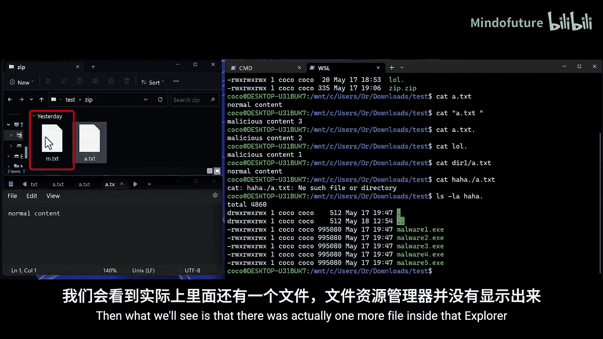
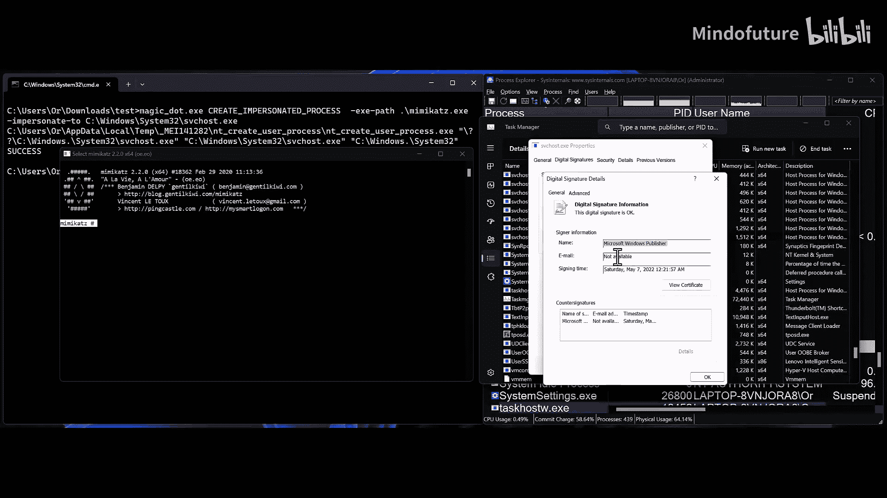
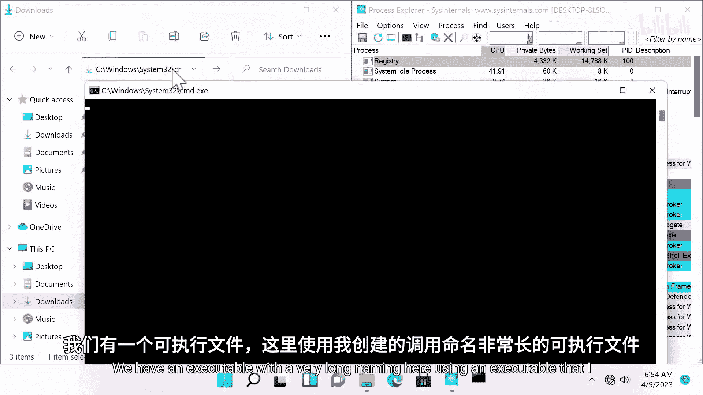
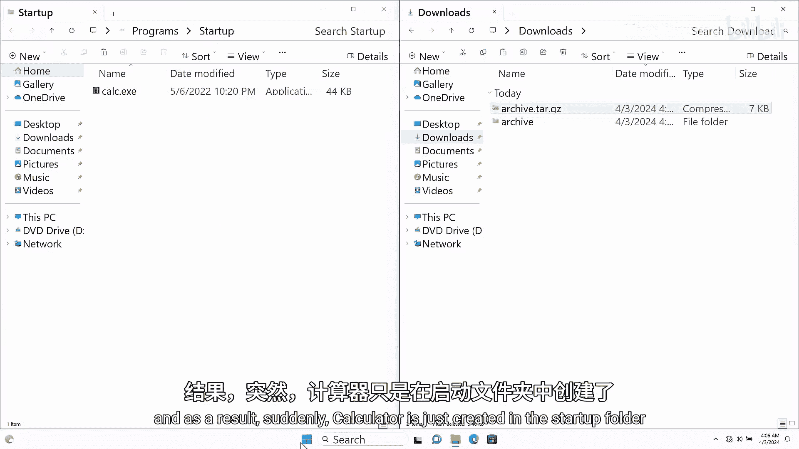
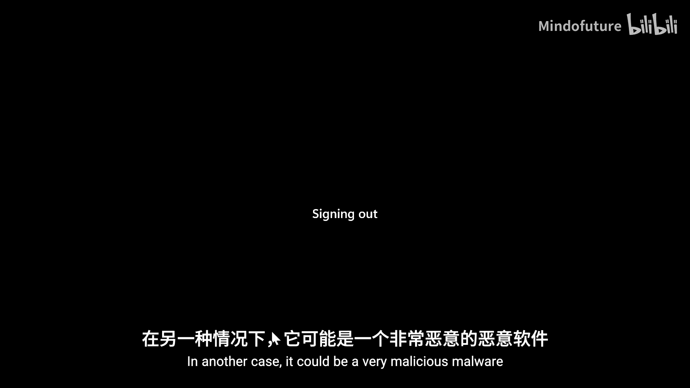
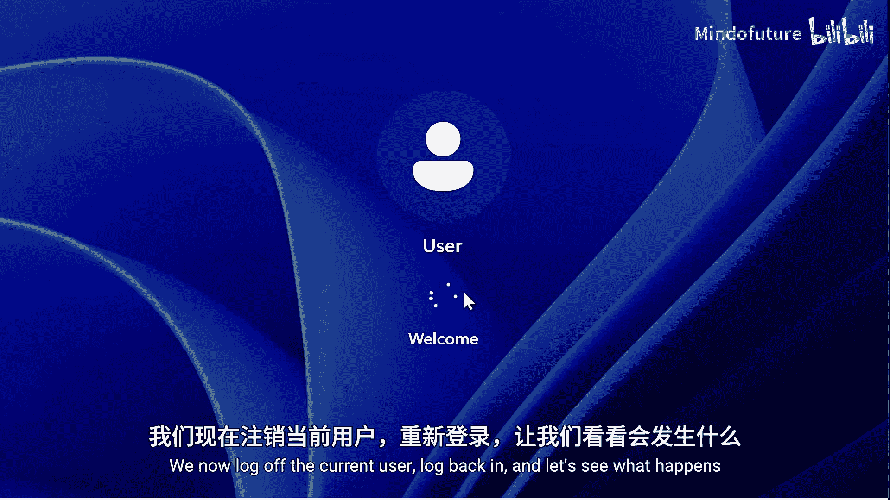

# 黑帽亚洲大会2024全集-•-中英｜Black-Hat-Asia-2024-p23-P24-Magicdot---A-Hackers-Magic-Show-of-Disappearing-Dots-and-Spaces--BV1oyX7YnEhN_p23-

Hi， everyone。And welcome to my talk， magicic Dot。Today。

 we'll see a hackers magic show and we'll together see how much magic。😊，Dots and spaces create。

But in this magic show， you'll also learn the tricks。So my name is Oria Ere。

 I'm the security Research team lead at Safebridge。

 I have more than six years of experience in cyberse。And in my past， I research Linux。

 embedded some and。And for the last three years， my main focus lies in Windows research。

But let's see what we're going to talk about today。

So we're going to start with an introduction about an unfixed known issue in Windows that exists for years。

Wwhich is also the base for this entire research， will then move on to specifying the research goals that I defined when I started a research。

Then move on to。To see the post exploitation techniques and vulnerabilities that I discovered based on this known issue and finally summarize with CVEs fixes。

 takeaways and provide a link to the GithA repository。So。

Backwards compatibility in Windows is a key element。 we all know that。

As the world's most popular desktop OS， Windows is trying to evolve while maintaining its already invested customer base by not breaking any third party software or features that they already use。

As a result， there must be some known issues left unfixed。

And this is exactly what I encountered while I worked on a different research project。Using NT API。

 you can see the gift too much， using NT API， which we'll later discuss I created two files with the same name。

 but one had a trailing dot。Then I deleted the one with the trailing dot。😡，And as a result。

 the one without the trailing dot was deleted Instead。 It looked like pure magic。

 So I decided to learn the magic primitive and create my new hackers magic show。😊。

Looking at Microsoft's documentation， I saw something that I had no idea about。

Microsoft explicitly asks users to not end a file name or a directory name with a space or a dot。

But as hackers， what do we do when someone tells us not to do something？Of course， we do it。

But before we dive into how we can utilize this known issue。

 we must first understand exactly how it works。So W 32 API calls。

That you'll normally use in user space。Usually do not do the actual operations themselves and instead call and underlying anti functions。

 as you may know。 Now， another fact is that。The WN 32 API calls that receive path arguments。

 we usually provide them with paths formatted as dose paths。

 this is the normal type of path that you usually use。However。

 anti functions do not work with those paths， and instead they work with a type of a path called antipath。

Therefore， the W 32 API calls must perform a conversion from those paths to antipaths when they call anti functions。

As far as my check goes， the conversion is performed by a famial function that all go through one function called RTLP Du path name to relative emptypath name。

And apparently， this function removes trailing dots and trading spaces in the following format。

So basically any trailing dot from any path element in the converted in the resulted emptypath is removed and trail spaces are removed only from the last path element。

😡，And here you can see some examples， so if we'll take a look at the top four。

 we can see that all do paths have trading spaces and dots in their last path argument。

 in the last path elements。And they are all removed after the conversion。

 if we look at the bottom too， we can see that in the second path element。

 we have once a dot and once a space。The dot is removed。

 but the space is not since it's not the last path element， sorry。

If you want to deeper dive into types of paths in windows and exactly how theyre converted to antipaths。

 then after I discovered this issue， I saw a very informative blog post by James Foshaw about this information so I really recommend diving into it。

But after I understood exactly how this known issue works。

It immediately hit me that such a magic primitive would be perfect for some rootki magic。😊。

The assumption was that if I use such problematic paths that are converted to other paths。

Then I will maybe be able to manipulate what users see。

So we all know that the primary target of the root kit is usually to conceal malicious elements。

 but in order to understand how this root kit would be different from normal root kits that we know。

 let's briefly go over them。A kernel space Rokit would run in the kernel and hook kernelspace API and manipulate information returned to users to conceal malicious information。

In order to run a kernel roototki， one would need administrative privileges and to handle obstacles and mitigations such as the driver signature enforcement feature。

 driver blocklist， HVCI， and more， and for this reason we barely see kernel rootkis in the wild。

These days。A user space roototki runs in user space， of course。

 and it injects itself into processes and then hooks API calls in them again in order to manipulate information retrieved by the caller。

In order to run aerospace rootki one would need， again。

 administrator privileges because a rootki would want to hide itself from all users on the system。

 meaning it would need to inject itself into processes that run with administrative privileges。

Thus administrative privileges are required。But then a question rises。

Doesn't it make sense that an attacker has managed to breach an endpoint？😡。

which is just fully patched and the attacker does not have a zero day privilege escalation vulnerability。

 doesn't it make sense that an attacker has managed to breach an endpoint and maybe does not even need administrative privileges to perform its goals。

Of course this can happen and with that being said。

 I could not find any root kit like abilities that are able to be performed by an unprivileged user in order to hide from all users on the system。

 including admins。😡，What I realized was that there could be a way to manipulate information retrieved by a caller without being a part of the chain of calls like any other rootie does。

😡，And without needing any privileges for that， because all we need to do is to name files and directories。

 however， we need to name them to name them， so because we have the issue in the converting function。

 we can affect it to be kind of our hook in the chain of goals that retrieve information。

And so the first research goal of my research was updated to not require any sort of administrative privileges。

So they will be able to be performed by unprivileged users as well。Now。

 the second research goal is much more obvious already。

 and that is to prove that such unfixed known issues that are left in windows for years。

A security risks， and the most simple way to prove that would be to find vulnerabilities based on this known issue。

So without further ado， let's see magic tricks to conceal files and directories。

So the first and most obvious thing we can do using this known issue is to just name a file using Antipath。

 of course， so the conversion will not occur， so just name them with dots and spaces or add dots or spaces to the end of an existing file name。

 and as a result， no file operations including read， write delete delete and so on。

 could be taken against this file。But we can take this even further。

 we can create what I call an impersonated follow directory。If， for example。

 we will name a file beign dot， so it has a trading dot in the end of its name。

And we'll create this file in a directory where another file called just B9 is present。

Then what will happen is that any file operation will that will be taken against benign dot will actually be taken against。

The benign file that was already there because the trailing dot will be removed。

And then the path will reference the original file， so if a user reads benign dot。

 it will be presented with the contents of benign without a dot。

And that is true for listing directory as well， deleting files and so on。Another feature。

 another backwards compatibility feature that we can leverage to hide files is called short names。

 AKA 8。3 file names。Basically， these names are a very old type of names present since very old versions of do and windows。

And they're not， of course， the default named nowadays。

 but we can still use them and reference them with paths。So let's see how we can use them。

Let's say that we have a file called a dot TXT in some directory。

 and then we want to create our own malicious file that will be hidden in some way。

And we want a user that will read our malicious file to be presented with the contents of A dot TxT instead of the real content that is present inside。

What we can do is to set the short name of A do TXT to be LOL， for example。

And then name our malicious filing the same directory。As LOL dot。Then as a result。

 when a user references LoOL dot with a DoOS path which is the most normal one。

 then the trailing dot will be removed， eventually the path will reference LoOL and LoOL is actually A dotTxD。

 so whoever reads LoOL dot will be presented with the contents of A do TXD and that is through also for any other file operation and for the directories as well。

Another way we can hide files is using Zep archives。Basically， a file Exper is the default extractor。

 the default archive extractor on the victim system。

Then because fileile Explorer has difficulties functioning with such problematic paths。

 then if we just name a file in a Z archive with a trading dot。or a directory with a trading dot。

 then when file Explorer lists the archive or extracts the archive。

 we won't see the filing there at all， so if you just name it with a training dot。

 nobody will see it。To demonstrate that all these capabilities together。

 I created a demonstration video with a presumably normal test directory。

 directory called test with some files， folders， and an archive inside。

In the first part of the video， we'll see how Windows views their content。

 and then in the second part we'll see their true content using WSL。

So in here we see the files in the directory， where print their content using the type command in CMD。

So we see we also have two directories， they both have one file， a dottXt。

 and there's one file inside the Zep archive。Also a DlTXD， we now present their content。

Using Notebed as well。And now let's see the same with WSL。

So we are starting to print the files using CAT。And suddenly。

 the files have malicious contents in them。And when we'll try to print the content of ATXT inside the directory called Haha。

 then we see that it's actually not there， and instead there are five different executables in this directory which we're not able to see in Windows when we extract the archive using GreenR and not file Explorer。

Then what we'll see is that there was actually one more file inside that Explorer did not show us。

Now let's move on to some magic tricks to conceal processes。

So the first and most obvious thing again that we can do is just to execute an executable from a path that we can do that with a function called anti-create user process。

 we can only run executables with antipaths if we use anti functions， but for example。

 in order to create such a process， which is untraceable。

 what we can do is to run an executable from a path that if referenced with a dose path。

 then it will be converted to a non-existent path， so in this case， for example。

 if we run an executable from C Windows dot， blah， blah， blah， blah， dottXC。

 then when reference with a dose path， the trading dot will be removed。

 referencing to a non-existent blah， blah directory inside the real Windows directory。result。

 the executable that is referenced by the image path of the process will not be able to perform any file operations against it。

 and also process listing tools such as task manager and Pro Explorer。😡。

Will not be able to view any properties or information about that executable。

But again we can take this even further， we can create what I call an impersonated process this time we'll run an executable from a path that if referenced by a dos path will be converted to an existing trusted and legitimate path for example。

 the path of the trusted SVC host executable so if we run an executable from C Windows dot system 32 SVC host then the trading dot will be removed again referencing the legitimate SVC host as a result any file operation taken against the execut reference by the image path of the process will be taken against as the SVC host executable and in addition process listing tools such as task manager and process Explorer。

Will tell us that the executable， the malicious executable that we ran。

Is verified and signed by Microsoft and also prefit analysis tools will show us information about that legitimate trusted SVC host executable。

So let's take a look at this ability。So in here we see Pro Explorer running and we see the magic dot tool and Micats。

 now we'll run MimicCas in a way that it will impersonate SVC host。So we ran minicas， we see it here。

 now let's find it in process Explorer。And Proces Explorer tells us that its path is the path of just SVC hostsse。

 your original one， and that it is verified and signed by Microsoft。Now。

 if we'll find the same PID in task Manager。Then let's see what happens here。

So we'll check its properties and again it tells us that it's located in the real System 32 folder and that it is signed by Microsoft。

So yes， we all know MinniCas is not signed by Microsoft。😡。

Now， as part of the exploration journey for bugs that I can find based on this known issue。

 I reversed the engineer process Explorer to see if I can find any such vulnerabilities or bugs and well I did not find any bug based on this known issue in there。

 but I did find a nice antiana analysis technique to add to my so-called unprivileged rootki abilities。

So。Basically， while reverse engineering process Explorer。

 I saw this line of code that copies a process name into a wide string buffer。

And limits the length the final length of the buffer to 256， y 256 because。

Processed names are determined by their executable names， NTFS allows a maximum file name of 255。

 so overall that makes sense， however， two lines of code after that。

 theres another copy of the PID of the process into the same wide stream buffer with again limiting the final length of the wide stream buffer to 256。

After a few seconds you can immediately notice that if we can name a process in the length of 255 characters。

 so we can certainly go over this limitation if we add a PID， but how would that help us because？

The WCS CAAT underscore S function is a safe C runtime functions。

And what are safe CR run time functions， so basically these are。

 of course more secure versions of normal CR run time functions that add a few extra security checks。

But what happens when these security checks fail， like we understood that we can do in this case to go over the limit of 256。

 if they fail， they invoke an error handleer， just like we can see in the case of WCS cat and score S。

 it calls the invalid the built-in invalid parameter handleer。

The built in invalid parameter handler calls the user assigned invalid parameter handler。

But if there is no one assigned by default， it calls invoke Watson。

 which just closes the application and generates a mini dump。Like we can see here。

 no Heer calls invoke Watson。So what does this actually mean。

 it means that if we name a process in the maximum length which is 255。

 and then the PID will be added to it， will go over the 256 limit and will cause process Explorer to close immediately and it will not be able to run at that moment and not to be run later too。

And the lesson that we can learn from it is that many of the developers use safety run time functions for validations。

 but actually if you don't perform the validations yourself prior to using safe to see runtime functions。

 or at least set up proper error handleers for these functions， then you can actually pivot from。

A buffer overflows security risk to a denial of service security risk， so you still leave a risk。

So let's take a look at this vulnerability in process Explorer。So we are running process Explorer。

 we have an executable with a very long nam in here using an executable that I created that calls anti create user process。

I ran this executable with a very long name。And process Explorer is just closed immediately and is not able to run later。

 and this can be done by an unprivileged user to make any instance of process Explorer also running by admins to be closed immediately and to not be able to be run again。

So we're done with simple magic tricks now we can move on to real magic， which is， in our case。

 vulnerabilities。For the first magic， the first magic act in this show。

It's called the Disappearing Act。For this act， I have a folder in here that is called demo。

Demo has two files inside A dotXD and B dottXD as an unprivileged user。

 I do not have permissions to take any file creation against those files， however。

 I do have permissions to create a folder in the demo folder。So what they do is that I create。

A directory called dot dot dot in a space， and I just placed any file inside。

It doesn't matter what's the name of the file， but now after I created the directory。

I need an administrator volunteer that I already filmed that back at home at this video we'll see what happens when the administrator volunteer tries to delete this very strange triple dot space directory that it just saw so the administrator goes into the demo folder suddenly see a very strange looking three dots directory that was not there before。

 deletes it then let's see what happens， so the entire demo folder was just deleted instead。

 the parent folder off the folder that the administrator just tried to delete。

But how did that happen？Basically， when fileile Explorer or any other tool that deletes folders re cosively。

First， lists all the files in the directory or reccursively。 So it starts by listing the first level。

 which is just a triple dot space directory。And then this is just equal to listing its parent directory because as part of the conversion。

 the last path element is completely removed and this is equal to just listing its parent directory。

 so it is another non-existent triple dot directory with a space inside this directory。

 so it lists it too。And then this actually lists the original triple dot space directory because in this case。

 that last path element is again completely removed。However， the path element before it。

It's not because as we mentioned at the beginning of the talk。😡。

Traing spaces are removed only from the last path element， so naming a directory with dotssp。

 but ending it with a space prevents an endless loop when recursively listing a directory。

Then after all the files were listed， fileile Explorer deletes each one of them and then finally deletes the top directory。

 but the top directory is just equal to deleting its parent directory because as we saw before。

 the last path element is completely removed， so file Explorer by accident deletes its parent directory。

So the second magic act of this hackers' magic show is in this magic act。

 I'm going to show you how Im able to change the memories of a shadow copy。More specifically。

 I'm going to show you how a shadow copy remembers the content of a benign test directoryate。

And then I'm able to replace its content to be malicious。😡。

So basically all that I need to do in order to do that is just to create another directory next to my target directory。

 so my target directory is CMO test， then I create test space next to my target directory。

And inside it， I create the same files， the files that I want to overwrite inside the test directory in the same locations and with the same names。

And I place the malicious contents inside them。Then let's see what happens when the same administrator volunteer from the last video creates a shadow copy。

 and then in a later point in time just restores the same shadow copy。

So we see both of the directories。We see the test has A dotXD and B dotXD inside an inner directory。

In deeper directory， we see that our content is innocent， the text innocent。

 now the admin creates just a simple shadow copy and now in a later point in time the admin wants to restore this shadow copy so the content should remain the same。

But the admin restores the shadow copy。And then let's see what happens。Yeah。

So now we print their content again and suddenlyly their content was changed to be delicious。

So we changed the memories of a shadow copy。So now we reach the grand finale of this magic show。

 and which we'll see how I'm able to hypnotize a remote computer to run my malicious code。

More specifically， we'll see how I'm able to craft a malicious archive that when extracted。

 will be able to write an executable to wherever it executable or any other file to wherever it wants on the disc。

Leading to code execution。Windows has a great attack surface for such a vulnerability now。

 since Windows just added support for many archives。Types that we've all been waiting for。

When I approached to searching for such a vulnerability。

 I considered symbolic links to be a very good lead。Sybolic links to be created。

 to create them in Windows， we do need to create symbolic links， userite or developer mode turned on。

However。They are supported by the newly added extractor that was just added to extract all of these types of archives。

 they are supported by all the popular extraction tools that we all use and they are widely used in open source code projects and open source yeah so basically a lot of stuff that are used by developers。

 so they are a very much valid attack surface and for the developers of course。

So symbolic links are not considered to be a big threat in archives because extractors do not allow the functionality of writing into them after they are extracted。

 but just to extract them。However， we have our magic dot magic。

So what I thought at the beginning was that I could potentially create an archive with two files inside named the same。

 but one that has a trading dot in the end of its name。

Then set the first file to be a symbolic link that points to wherever I want on the disc。

And then set the content of the second file to be the content that I want to write into the target of the symbolic link。

 and then hopefully when the second file is extracted。

 then the extractor will accidentally open the first file because the trailing dot will be removed and it will write its content into the target of the symbolic link。

A secure behavior against such an instruction。Would be that the extractor will notice that the file that it is now trying to extract already exists。

 and it will prompt a kind of message of this kind that basically asks the user if it wants to extract this file or not because it already exists。

 maybe so the filelic explore or the extractor asks the user if it wants to overwrite the existing file。

And this is exactly why the C file call that performs the extraction uses the create new create this position。

This is because the create new cur disposition affects the create file call to fail if the file already exists。

 however， the only flag given to this skull is the file attribute normal flag and not the open re point flag。

This fact means that if this call is performed against a symbolic link with a target that does not exist。

😡，So this call and the specific create new creatives position actually complies with these situations。

 with this situation where the target oflink does not exist， and instead of failing。

 it actually creates the target of the symbolic link。

So that means that what we can do is to create an archive with， again， two files。

They are named the same， the second one would have a trailing dot。

The first file will be a symbolic link that points to somewhere on the disk that does not exist to a nonexistent file。

 and in our case it would be great that it would point to an executable in the startup folder。

Then the second file with the trading dot would be the content that we run to write into this executable。

Then when the extraction is performed， the first file， which is the symbolic link is extracted。

Then the second file is extracted， the extractor accidentally， as a result。

 creates the target of the symbolic link that was extracted before and writes the content of the second file into it。

 leading to our code execution on a remote machine。

So let's take a look at the demo of this vulnerability。

So we see a normal Td GZP archive that we are now going to extract using file Explorer。

 and as a result， suddenly calculator is just created in the startup folder。

In this case， it would be calculator in another case。

 it could be a very malicious malware We now log off the current user。

 log back in and let's see what happens。

So calculator was run and we managed to run our malicious code on a remote machine。OkayK。

 so moving on to CVEs and responses。Microsoft basically issued CVs for these three vulnerabilities。

 so for the remote codes execution vulnerability， the elevation of copy。

 the elevation of privileged story using the shadow copy restoration。

 and for the denial service in process Explorer。They all were fixed。

 of course what was unfixed is the elevation of privilege to delete the upper folder。

 Microsoft did manage to confirm and reproduce it， but they just responded that it's below their service bar。

Regarding all the other post exploitation techniques。

 so Microsoft did identify them as post exploitation techniques， and so as we anticipated。

 they were not fixed since there are not vulnerabilities。

Now to the maybe most important slide of this talk。Takeaways， of course。

 and I think the most important takeaway that we can understand from this talk is that backwards compatibility and unknown and sorry and unfixed known issues that are left for years in many software products。

Do create security risks。Even if these known issues seem horriblerribly sometimes and we think they'll not cause any risk。

We should not underestimate them。Second。As we now saw。

 malware can be hidden even without administrative privileges and without being a part of the chain of calls that retrieve information。

Like any other rootki does。Third。Microsoft chose to not fix the known issue that is still present in Windows。

 They fixed just to they chose just to fix the specific vulnerabilities I showed that I showed。

 So that means that there could be many more。Potential vulnerabilities and post exploitation techniques to find。

 so I really encourage you to try and fight them before real attackers do， or maybe they already did。

Lastly， the best advice that I can give to software developers is to just use emptypaths instead of dust paths。

Basically， most users based API calls and the WN 32 API calls。Do support antipaths as well。

 it's just that most developers don't use them by using antipaths you can make sure 100% that you are referencing the right file and that you are not being manipulated。

And。Basically， this is the QR code and link to the Mag dot Gi repository。

 which will be published right after the talk。You' are welcome to take a picture of it。

 can it and save it as again it will be published。In the next hour。

 these are my contact details you are very welcome to message me in any way you would like。

 and I'll be here if you want to ask me questions or maybe you want to approach the microphones。

 but that is it。