# 黑帽亚洲大会2024全集-•-中英｜Black-Hat-Asia-2024-p24-P25-LLMs-at-the-Core---From-Attention-to-Action-in-Scaling-Security-Teams--BV1oyX7YnEhN_p24-

All right。So let's start in today's world， security teams are so stressed that if they were a yoga pose。

 they'd be called the eternal Scre。I spent an， at least an hour brainstorming with the ChaGBT to write this line。

 and it's still a little bit underwhelming。But here comess AI like a new caffeine appeal so that the security team can focus on real threats。

 but we're here to make sure that AI doesn't start flagging every mouse click as an existential crisis。

So a few things about ourselves， I'm Fodes， I'm a security engineer and the Red teammer。

 some highlights of my work include publishing a book on practical IoT hacking。

 I have a paper on Exploding TP published that FRC and I've also written an NC。

 the network authentication King tool of the NMP project。

I was also the first security engineer at Open AI， starting back when we had just released GBT3 in 2020。

 I was there before the ChaGBT hi， you were around the time of Codex right。

 our code generation model， I was there， Bo， I was there 3000 years ago。I was there when it was read。

 It's okay Ph， I understand a year here feels like 10 anywhere else。 and with so much happening。

 it just keeps going。 My background is in building and securing clouds， both public and private。

 I've also on the security team for several open source projects that everyone in the room uses every day。

 still I've never seen anything like this last year of growth working on product security here at Open AI。

 This talk is based on the work of our whole team， and we want to acknowledge the contributions of Colin Jake。

 Tiffany Harold and Will。 All right， let's move on to the talk。But first， a quick story。

When we released Chat G， millions of users flocked to the product。

 and we had a hard time keeping up with demand。 Also， we hadn't released an API yet。Predictably。

 many of our very excited attackers。 I mean， enthusiasts wanted to use the product in unauthorized ways。

 We played a cat and mouse game with them。 They would find new APIs to abuse。

 We would stop up the problem and improve our bot detection It was pretty exhausting。 One day。

 we noticed a very unique attacker signal。 And rather than just blocking the bots。

 We figured one of our engineers wanted to send all the incoming requests to a very small。

 very dumb model that only wanted to talk about cats。 And so Cat GT was born。😊。

Our attackers were a little bit perplexed， perhaps even unhappy。

 but we think they enjoyed the joke almost as much as we did。

 One user suggested we should haverick rolleded them。 But honestly， Cat GPT was funnier。

 There are many fun things you can do with L O Ls。 but this talk is about more practical topics。😊。

Enough of the work stuff， everything out from here on is strictly vendor neutral。

 So let's see what our talk is about。 While we appreciate good old traditional security tools。

 we found LO Ms can augment them very effectively。 AI isn't going to directly replace standard tooling。

 but enhanced workflows using LOMs can have a profound impact on a team's efficiency today。😊。

these are the key things we want you to take away。 We're talking about using the models to help humans go faster by reducing security friction。

 helping humans focus on the important parts of the defense。

 using LLMs to improve the way that we catch attackers and accelerating the drudgery of everyday security work。

And by the way， we're open sourcing three new tools today so you can get started doing this， too。

So what this talk is not about。 It's not about chat GP， the website， auto GP， Lang chainin。

 jail breaks， fine tuning。 These are all things you can do with off the shelf models。

 And it's not a vendor pitch。 These slides are the last time you'll see our company logo。

 and you should be able to do these things with any of your favorite model from your favorite vendor。

So we'll start with a quick refresher based on how most modern L Ms work today。

 The models are composed of tokens， which represent about three quarters of a word。

 The model weights encode relationships between those tokens and they're stored in the GPU。

 when you query a model， it happens through a single request response cycle。

 your query is encoded as tokens pass through to the GPU producing your response。

 This means that the model is stateless when you query these model weights don't change and model doesn't remember a prior conversation。

 It doesn't learn from what you pass through it。 So given all that， how does chat GT work context。😊。

Don't try to read this text。 It's deliberately too small。 Remember how I said the model is stateless。

 It doesn't actually remember thing between submissions to the GPs。 And instead。

 it just includes as much of the prior conversation as it can when it runs out of space， rather than。

Telling you it's got an error， it just starts deleting part of the history so that each request can fit into that single request response cycle。

 It doesn't change the weights in the GP。 And there's no magic there。

So that was a really cool story about the Nos and Kahibi Depot。

 but here I'd like to introduce you to Wolfofspeeak。

 so Wolfofspeeak is a company that makes AI powered dog collar that can translate wofs and barks to human speech I know some people would pay an infinite amount of money to have that kind of product and as we were watching this video of Huskies and Shibas roaming a cyberpk themed C wearing a wolfofspeak collar we're going to describe a scenario to demonstrate our LLM driven tools so the engineers of our wolfofspeak company are building a new inventory tracking system for the various versions of dog colors the company is producing。

嗯。Let's。And it is comprised of all the standard components you'd expect from such an app。

 So it uses a web UI with react as the front end， no J as the backend Mysql for storage or0 for user authentication authorization。

 and the most important thing is that this will be accessible only through the company's VPN。

 So it will be for employees only and there's not going to be any internet access。

 and surprise surprise the engineers are on a tight timeline to build all of this。

 The software development lifecycle is not going to be very linear for hopeak So the SDl the software development lifecycle is as you know。

 a structure process used for planning， creating testing and deploying software。

 but truly in practice， the SDlC is in a fast pace company can often seem like the world's most unpredictable recipe。

 Imagine trying to bake a cake， but the ingredients constantly keep changing the oven randomly adjust its own temperature and every now and then someone comes in to tell you they actually wanted a pie。

 So the security team has to be。in that cycle to be able to evaluate if a project or a feature that is being developed needs a human security review。

 But one of the biggest problems that the security teams face today is having very limited human bandwidth。

It's like playing Wamole， but if you miss， the mold steals your data and sells it on the dark web。

So for that reason we developed the SDLC Bo， a Slackbo that uses LLMs to help us with prioritizing which projects or features we as a security team need to access first。

 and we're open soourcing this。So here's how it works。

 it asks the user some basic security questions about the project。

 that part is optional by the way it covers and monitors important threads on Slack and it analyzes design documents relevant to the project so then with the help of the LLM it gives you a risk rating and a confidence level based on the above context let's see how this works in practice。

So here's an initial design document for the inventory tracking system。 You don't have to read this。

 This is a very boiler play design document that goes through some basic architectural decision about the project。

 So let's take a look at the important note that developers have left us there it says the system will be accessible from the company's VPN only and will not be exposed to to the Internet。

 So now let's tell our SDLC board about this project I'm going to type in some very basic information about the project a quick description link to the design document specify a point of contact and go to live date and we also by the way。

 as I said we have versions of the bo that skip this additional questions So after analyzing all of this context the model will now take its final decision and give us a risk score and a confidence score So based on the above you can see that the SDlC there decided this is like a medium risk kind of。

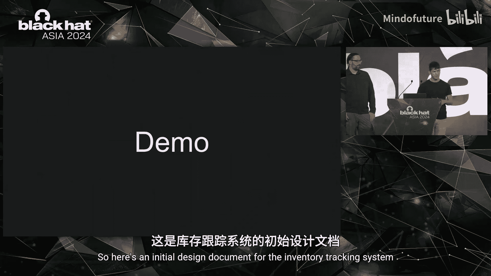

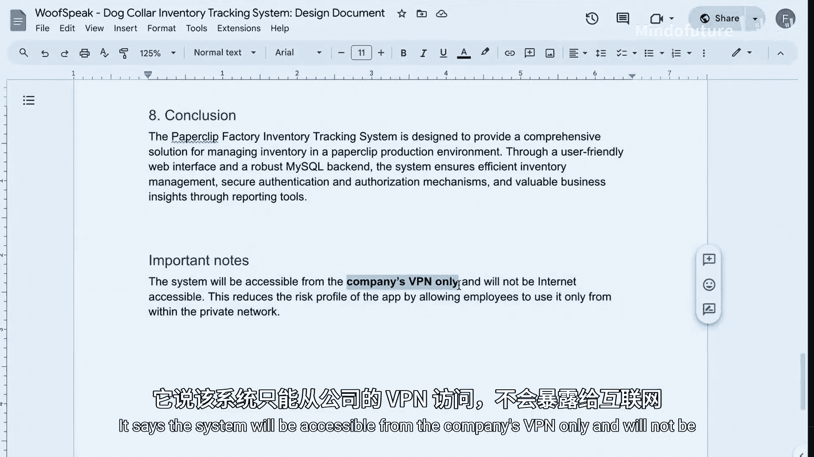

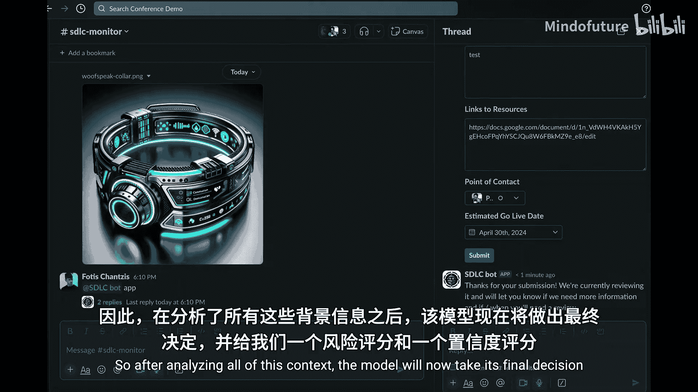

Medium risk score now in our story， the deadline is approaching fast and our engineers decide that there's no time to create private links for all the cloud components so that they can reside within the VPN。

 So but someone updates the document and this fundamental change will be detected by our STLC board and then the LLM will now make a new decision based on the updated context。

 So the new decision will say that okay this is this increases the risk of the project。And。

For if this is not visible， let's reiterate with。The next slide。 So this shows this in a bigger form。

 The model increased the risk score after the engineering team's decision to allow Internet access。

 So it went from a medium risk score of say 4 to a medium high risk of 7。

And so some of the things we learned， the model sometimes overfis on the initial questions so if you prompted with some starting security questions as examples。

 the model will not go too far away from those examples so it will ask it will usually ask some contextbased ones but it will overfit sometimes regarding prompt engineering this is probably the most important lesson we learned the more you tell the bot that they are an expert in the field。

 the better the responses are so it will give you better responses if you tell it theyre an expert cyberse engineer versus an average one。

 so praise your models is the lesson here， we also learned notice that the model gives us better results when asked to output scores and numbers instead of words so in a previous version like the original version of the SDLC bot we were asking it to answer in just a sentence format but when we ask it to give us confidence and riskcourse。

Their responses were of higher quality。We've also developed an extension to the SDLC board。

 So a better version of this is when it's enhanced with being able to monitor a slack channel on its own and automatically find the topics of interest。

 So that way， it has less user friction since it doesn't need to ask the developers any questions。

 We made an internal version of that。 And here's how it works。 So here， what will happen is that。😊。

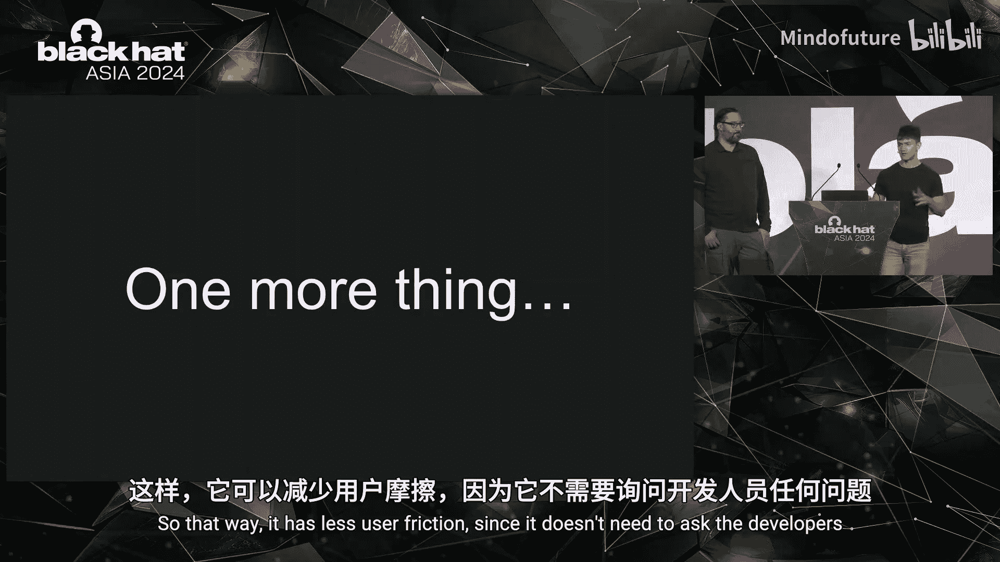

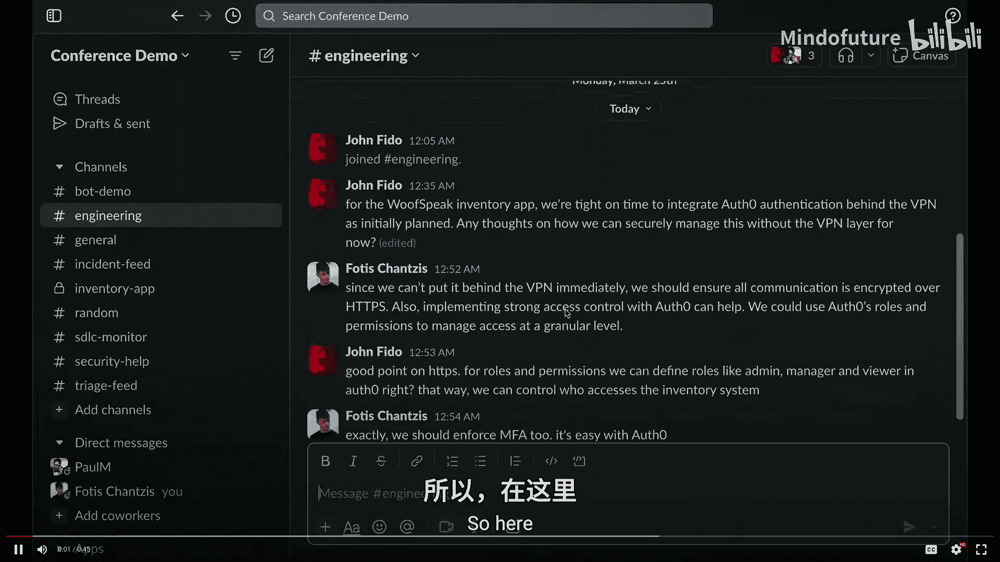

There is a discussion on Slack about the architecture of the Wofpeeak inventory app and someone mentions that HR sent their request to include an admin account that doesn't have MFA。

 anyway， yeah the SDLC board with the help of the model realized that this is something that should be further review and notifies my user about it。

 So let's see this boat in practice。 one of our application engineers new to the team has was recently locked out of their computer。

 So they ask on the security help Slack channel what they should do。

 The boat will respond that this is something that I can help with。

 There is also some app engineers working on the new inventory app that they need to deploy service on the cloud infrastructure and they need elevated permissions to do that。

 So our trios border medical response for them to go to gola access。

 which is our LLM driven access management system。

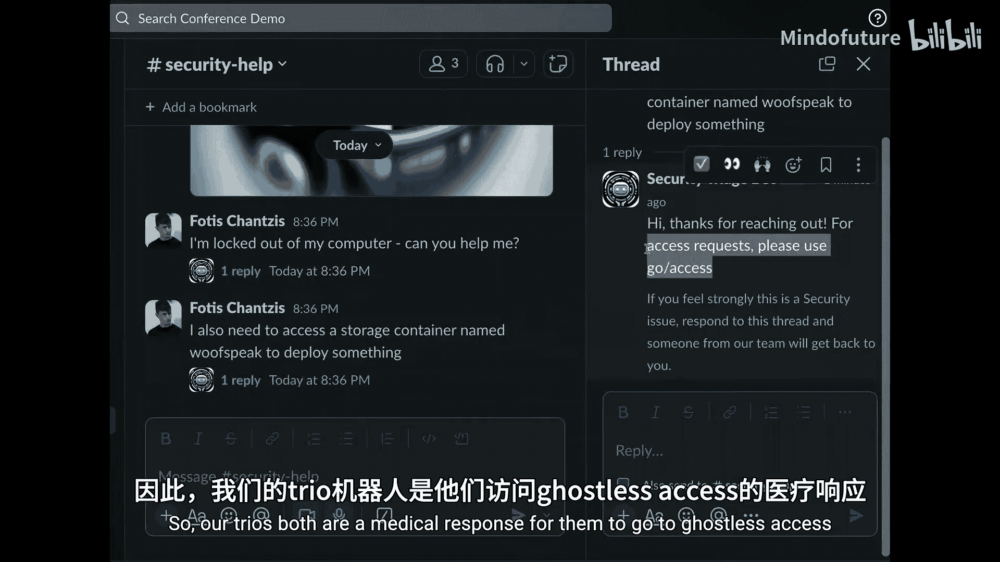

So now let's see the new feature our team developed。

 so where the bo also has context of Sla history with the channel and can respond in more detail about a user's questions based on how a similar issue was result in the past this is not by the way in the open source version because we didn't have a good way to publish this。

 the user asks about a specific storage container credential error that occurred when trying to access another storage container so here the bot not only does it suggest to the user that they should use access manager but also they offer another suggestion which is to restart the local DNS service。

 this is based on the context of Slack history and it seems to have been a step to debug and resolve a similar issue in the past。

Speaking of access management， we developed another tool to help us with this access manager helps users automatically find the right permissions without them having to know the name or details about the access group so it works with available group descriptions and metadata to find good conceptual matches and explain them to the user if they didn't use matching keywords in their query this is something that we expect to open source at the future date。

 so here our engineer tries to list the contents of the Azure storage container named whope they get a error because they don't have access to that account and then they use the access manager CLI to ask what's wrong so the access manager with a help of model suggests the group name to which the user should belong to in order to get access to that storage account and then even offers to send the access request on behalf of the user now the manager of that engineer when they see that pending request for that group they can click approve。

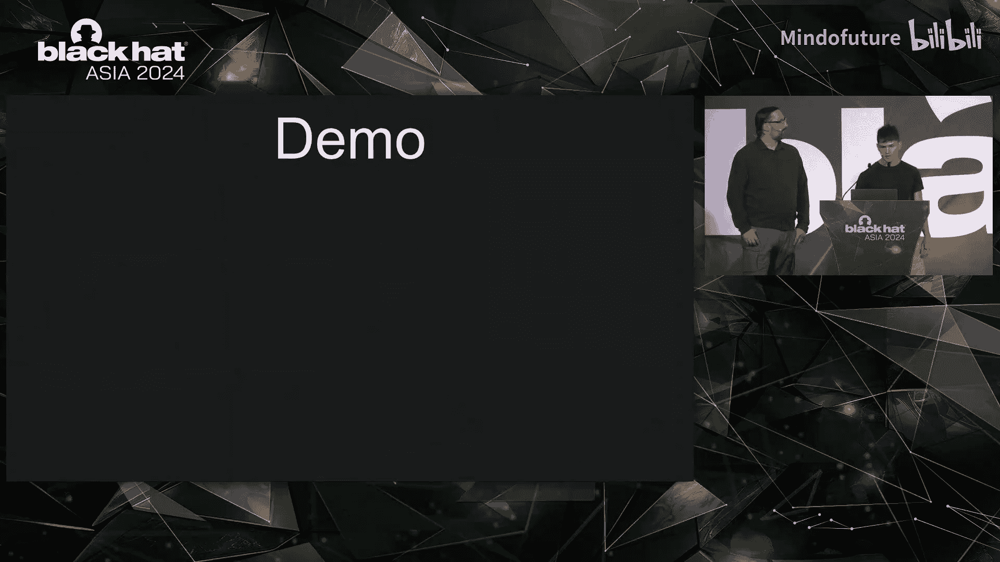

They can do that on Slag， and then the engineer will be granted access to that storage account。

 This is how the workflow works here。And then when the request is approved。

 when the user will again run the storage access tool。

 the engineer will be able to list the contents there as you see。

 and verifies they have access to the account and the access granting will be logged。

 creating a no trail for the access request and finally the access can be set to expire after a certain time。

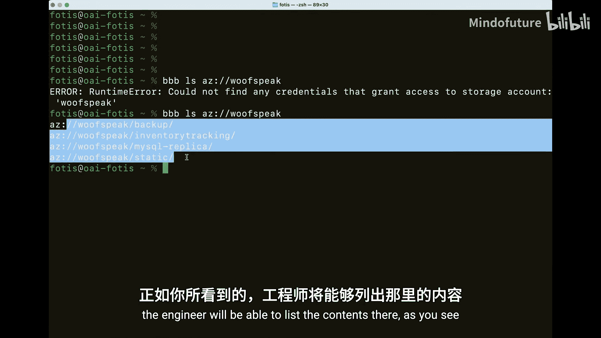

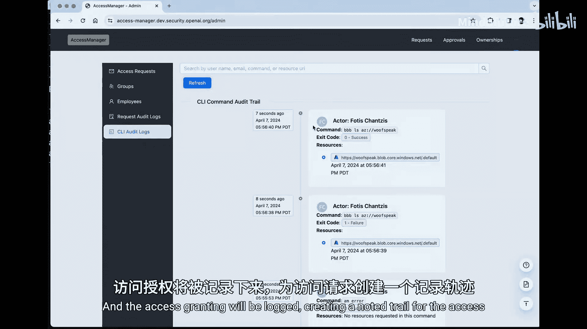

And there's more our team has also experimented with dynamic authorization where the decision of granting access is based on a number of factors including user contexts such as the location time or device or even the job role resource context。

 for example， the sensitivity of the access resource and even environmental context for example。

 the network conditions so if you compare a typical researchers access patterns versus like a security engineers they will be quite different。

 so this graph is showing the cosine similarity between the access patterns from an infrastructure engineer and the security engineer you can see that the groups the access on a daily basis are quite different。

 so meaning that a request for a group outside the normal patterns should probably trigger more scrutiny on the other hand request that look similar to a regular access may be able to automatically granted without further approval。

So another place we've used the model is to help us with triaging security reports。

 you can use it for bug banty， security disclosure， email aliases， even internal findings。

 The key thing is that not only can it help evaluate the reports。

 it can also help make those reports better and more actionable for your team。So back in April。

 we launched our bug bony。 It got a lot of attention。

 This is not a reasonable volume of reports for humans to triage。 If you can't see that top line。

 we were getting over 900 reports a day in our first week at the program。

 Shot out to our partners at bugg crowdrow who threw a bunch of humans at this to help us get the volume down。

 But this is not a reasonable thing for normal humans to be dealing with on a regular basis。

 Here are there our stats at the end of that first week。

 We fixed 32 real issues had 7 accepted open tickets we hadn't gotten to yet and closed nearly 3500 tickets as invalid。

 So that's a lot of not applicable reports for one reason or another。So as you may expect。

 given the topic， we turned to the model to help us rather than trying to get the model to try to figure out whether a security report was valid。

 we started with the lower hanging fruit， rejecting some reports that were not appropriate for a bug bounty and sorting them into different categories。

You start with model safety and correctness。 You ask the model。

 is this a report or a complaint about something related to model safety。

Is it a complaint about the answers the model is giving， harmful， factually incorrect。 If so。

 we've got a separate ingestion mechanism for that type of report。

 We want to make those improvements and get that data。

 but the bug pounding program is the wrong place to handle them。

The second category is this actually a request for customer service。

 Does the reporter have a question about the product， is there a problem with payment。

 subscription or refund， I it a report about a functional bug without any obvious security impact。

 If so， we send them to our customer support team。And then out of scope。

 bug reports that are out of scope， this one is harder to get right because it does require the model to make some judgments about the category of a security report falls under。

This is this uses our technical out of scope list， and we try to keep the list in the model in sync with what's actually in scope in our out of scope section in the bug bounty。

If the model precisely understands what are out of scope list means to it。

 hopefully also bug bounty hunters will precisely understand what's out of scope。

 This doesn't always work for the bug bounty hunters。

 but we hope they read This is for things like reports of missing server headers。

 missing SPF records for emails。 that don't send don't send email domains that don't send email server messages version strings。

 you know， usual things are out of scope for a program。

 And then the final final category we ask is does actually seem to be a legitimate security report。

 if it doesn't fall into any of the earlier categories， it should be in this one。

 So you've got things like XS CSRF subdomain takeovers， all the other security issues。

 Report in this category don't get an auto response。

 and instead go to our human triage team directly。And， of course。

 there's also some antiprompt injection work here， but we're not going to worry about that for right now。

 And it turns out that it's not a big deal for this use case since we're not making payment decisions and we're not having the model right responses。

 it's just making sure that users who report an issue in the wrong place。

 get sent to the right place using our prewritten messages。

 The worst you can do is get your triage ticketed into a triage moved into a rejected bucket。

 which honestly， if you do that to yourself， that's kind of on you。

So how do we figure out if we're getting good results。

 You can't just write a prompt and hope it does the right thing。

 You need data to show that you're making the problem better and you're not making your prompt worse。

 But Evals are surprisingly off and all you need。 So how do Evals work。

 You set up a set of questions with known good answers。

 and you ask the ask your model using your prompt。 You know。

 run the question through and the model gives you an answer。 The sky is blue。

Then what you do is you take the question， the known good answers and the model's answer。

 and you ask the model again is the answer the model gave correct。 And it will tell you， yes。

 the answer is correct。 And you can use this to build a system where the model judges itself to figure out whether or not you've gotten these right。

 and you can do this repeatedly as you tweak the prompt to get it to make it better。

 You can see when you've made it worse， too。😊，So practically。

 how do we double check our work for this at first。

 So I exported a CSV of the first couple thousand reports。

 I ran through them and hand sorted them into the different categories。

 And then we ran the model on it。This is another one you don't need to read in details here to help you look at the columns。

 You can see my human judgment in the middle left， the model's judgment in the middle right。

 as well as its explanation of why it made the decision。 Doing it in the spreadsheet is really fast。

 It's easy。 It's a low impact。 It's a great way to get answers about what you're doing quickly。

 By all means， use the fancier tools， but start with the easy ones。😊，So taking it further。

 there's a bunch of other data points you can analyze to in your program。

 You can look at commentary on historical tickets to help you detect whether the bot or humans made initial triage error。

 You can use the model to help detect human mistakes going forward as well。 But of course。

 the key thing for keeping is keeping this all fair。

 If someone disputes the model's autoclo reason a human always reviews it。

 always make sure there are humans in the loop when you do this。 the model isn't infallible。

 And if someone asks for a second， do it， they deserve it。

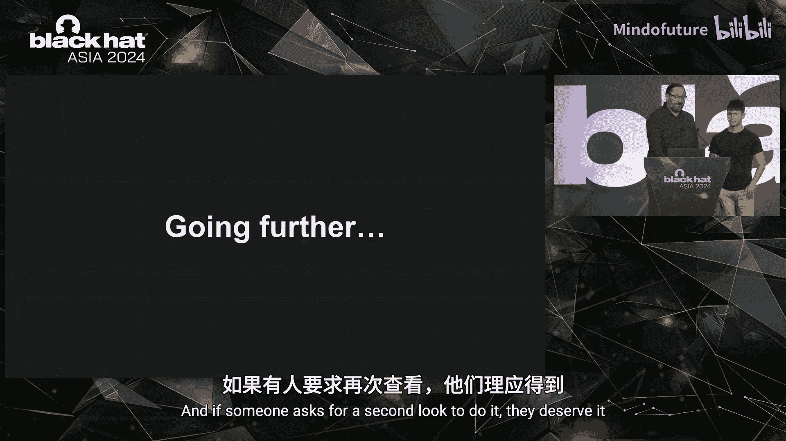

So these the next two things are things we've experimented with。

 but we haven't actually deployed yet。 Report quality is one of the recurring challenges with any bug boty program。

 Reporters are in a hurry。 They assume your psychic and often do not submit enough information to triage their bugs。

 The model can help report make sure that you have all the information you need。 For instance。

 you report it about product X。 We need a full URL to debug that。 You reported why。

 but we need your email address to go look that up。 Hey。

 it looks like you submit a template without changing much。

 Can you go back and give us more detail in your own words。

 These are all really common mistakes that reports include。 and we can also use it to help triage。

 focus on the important stuff。 bugty reports are sometimes worse than Internet recipe sites。

 and the reporters often confuse using lots of words with having an important bug Waiting through that is exhausting。

 So the model can help do things like automatically fix categorization。

 summarizeize the key points of a report。 Extract reproduction steps。

 provide suggestions for clarifying questions and it can even be used to。

Com reports into other types of tool queuees， for example。

 subdomain takeovers can often be tested and resolved almost entirely automatically。

 So let's take a look at a typical interaction with our bot here。

 So we've got a report pretty typical。 Why did you give Dave's chicken two stars。

 I think your moderation is wrong。 You should have give me at least4。 Well。

 we're not really in the business of selling chicken exactly。 And even if we were。

 this isn't a security issue。 So the reporter gets back our nice。

 polite bot response that says this isn't the right place to report it。

 We're not having the write these responses individually。

 It's selecting from the appropriate prewritten ones with our carefully vetted responses。Right。

 so another interesting use case is using the models to help find and catch attackers。

 so LLMs are consistently decent at finding the needle in the haystack while humans can be sometimes unreliable。

 they miss data， they get tired and they make mistakes so logs are often also really long noisy and frankly quite boring to go through。

So let's see an example of log analysis， we gave the model the following prompt。

 so summarize the session transcript and decided if this activity warrant's alerting security。

 so look for reverse shelves， looking for cigarettes and so on。

And here's a very small subset of a user's bash history， Ba history can be long and boring。

 you don't have to read this， but halfway through the user invokes a pearl one liner that basically pops a virtual shell back to a2。

 the model is pretty good at identifying this。The response from the model was okay we shoot alert security because a malicious reverseersal command was running in the middle of the session。

 so the first DNR use case for LLMs is to accelerate to accelerate long and boring log analysis the second part is to augment and accelerate incident response so to help our defense team with the large volume of alerts they have to deal with in their daily duties we developed a boat that helps with tri certain types of alerts so the bot ingests alerts from a traditional theme and for a certain subset of them like once that could be an accidental mistake it can start a chat with a user to inform them of the potential problem to be clear this bot does not do log analysis and it would only cover a small segment of a DNR pipeline by the way we're also opensourcing this。

So an example is the following， a user shared a potentially sensitive Google Drive document to the public。

 the bot alerts them about this action and asks them if this was their intention。

 giving them an opportunity to revert their chains if it was accidental。

 and then a notification will be sent to the detection and response backlog。

So let's see an example of a decent practice。 One of the Wolfspe engineers wanted to share a document named inventory De with sensitive information about the company with a contractor that signed an NA。

 the engineer though mistakenly decide to change the sharing settings to public then the alert will be created the alert is created through the traditional detection engineering our incident response bo will ingest and notify the DNR team and then the bot will ask the user if this was intentional。

 like if the user tries to avoid the question by say like something like what is your favorite color。

 the bot insists and doesn't mess around when the user responds with something then the conversation is summarized and by the models and then is sent back to the DNR team for followup so。

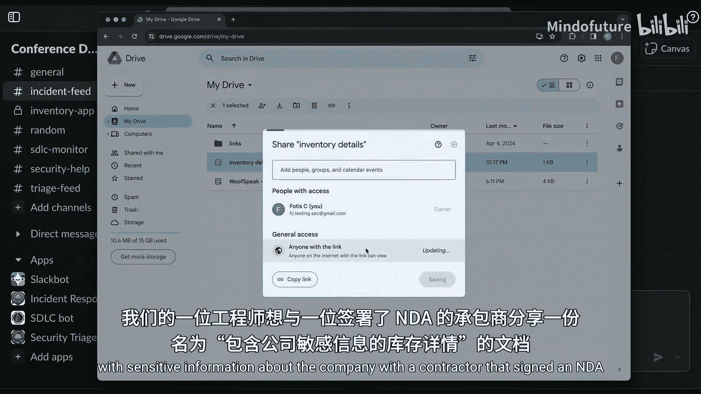

And this is how how how it works。 So this was our final demo。

 Let's see what the most important lessons were。

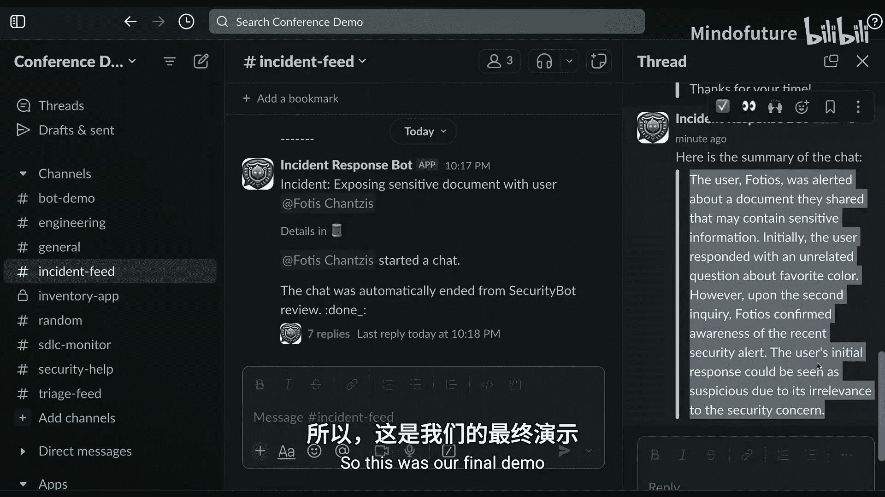

So some final thoughts。 the more high quality data you give the model， the better it can do。

 But don't just shove everything in there。 Models are better with more context for your environment。

 but that context has to be high quality In high trust environments。

 The model can do more externally。 you should be more restrained in how you use it because you may get more adversarial input。

 Tell your model that it's an expert。 use evals， find the right prompts and you'll get much further than just sort of yellowing your prompts and hoping that everything is good。

Yeah and also remember to always have a human in the loop。

 models are not infallible and can also make mistakes。

 even though they are powerful in augmenting these security workflows。

 we have to be mindful that models will not be 100% accurate， they can hallucinate。

 they can miss things， and yeah， humans are here to stay and finally like this is easier than you think you should go try it。

And this is the end of our talk， we're going to be open sourcing。

 allowing access to the repo sometime today， and these links will let you access them。嗯。

Time for questions。Yeah for the implementation of some of this you to send some of the context in like you said。

 using fine tuning for that， or you creating custom models to this is all off the shelf're just hand them lots of context。

 So32128 you can put a lot of context in there the make sure it's high quality if it's distracting you'll make your answers you don't have to fine tune anything is all the shelf in the SD but we also have like an example basically a wrapper function that can ask any kind of model not just our own So you can use that as a kind of framework to attach it to anything。

 So if you were doing large data analysis on same for example。

 rather than just specific events you triggering fine tuning the back of that would be a great place that you fine tuning after。

It just really so show you can do this without the really complicated stuff。 works really well。

 Awesome， thank you。Thanks for the presentation。 I would like to ask about the first use cases where you try to like give score some different projects based on their either risk assessment or vulnerability assessment。

 I would like to ask like how to evaluate the hallucination in this case since the given score is quite like subjective and also is quite hard to differentiate or correctly both based on categories etc。

 have you noticed humans are pretty subjective to I' found that with my team Yeah I mean's I mean。

 that's why we insist that humans should be in the loop these kind of tools can help with some sort of prioritization which is why we've created them and why we use them but at the end of the day yeah it's not perfect and you're still going to have to do some manual review there。

 Yeah I think this is the best way to do it。 Yeah so to add on this point when you identified the model doesn't like perform as expected So do you like revise the prompts to。

we use the EvalL framework and as we go， we don't have it in the bot yet。

 but what we're thinking about is adding the ability to track emoji reacts to help help us build the data set of the bot did well or the bot didn't do well and then we can do this to build examples and use that either for EVLs or fine tuning later so yeah on that note what Paul is saying we have like some internal versions where some of our team members that are working on say for example the triagebo they have kind of part of the workflow is that when know you first deploy it so that you see how well it performs it gives you basically a manual review process so it's like okay this is the recommended response that the bot would would give do you acknowledge that this is the correct it's good enough and so in the initial stage this I think it kind of an important step because it allows。

As to evaluate okay， like the body is doing well and otherwise we can we can do this sort of like evaluation process where we you know。

 kind of reconfigure the prompts to be to be better but this really lets us respect our engineers time by not giving them nonsense if it is going off the rails Yeah perfect。

 Thank you so much。Hey， guys awesome talk。 I have two questions。

The first one is that I've done a lot of interviews with academics in the AI space。

 especially what I call consumer AI， which you know could be construed as whatever。

 but in some of those interviews， especially with people who are in the academic community there's been a lot of research on the prompt engineering statement of being an expert and people have done whole white papers on benchmarks of does the model act better if you tell it's an expert of cybersecurity or not now my personal view is that it does。

 I've made many tools like you guys already doing this but academics say that it doesn't have any effect on the model have you guys actually benchmark this or is it just subjective based on your use cases I mean a couple thousand prompts that were hand graded versus you know I did with the bug boundary I told it that it was an expert treasure and you objectively it does better on my task when I tell it that I mean。

 there may be other ways to get the same output from the model but objective。

fullyThe numbers are better when I do that and then the other thing is that is when you're working with security bots and a lot of other type of bots are you finding that when you're asking for you your trios bo to do x y and z or whatever are you trying to lower any configuration settings like temperature or something like that to make sure that it is not too creative in its output in order to give you back technical data I think that that is you can do a lot of kind of calibration there but I think yeah kind of lowering the temperature makes a lot of sense this is part of the again the evaluation kind of process where we use the framework we say okay these are like a0 response from the model what happens if if we change the prompt like or if we change the temperature settings and so on but yeah it's kind of interesting when you use。

Another model to evaluate the model's response。 that is also something that we found really interesting。

 For example， we've done that with like the slackbos that we created。

 So its you can also use a second kind of testing process where instead of having a human review how good the responses are you also enlist the help of another model to assess these responses and it works quite well。

 The model also that does the evaluation doesn't even have to be as powerful as the model that created the responses。

 which is very interesting。 Very cool。 Thank you。Hello， yeah。

 thanks for the really insightful sharing。 So if I understand correctly。

 all these tools you are using in context learning， right。😊。

So when a and a very high traffic comes in， all of these result can be really overwhelming as well because all of these false positives。

 So do you see a need in full fine during the GT models for doing track detection or incident response helpers yeah。

I， I think we're gonna get there。 You know， these are， we pick these。

 particularly because they're stuff that we have gotten working and are using。 But yeah， I think。

 I think there's a lot of room for building that kind of thing out in the future。Yeah。

 we we found that they are really good at automated workflows and for mostly defensive applications。

 and like like we said in the presentation， it's like finding the needle in the haystag。

 they are decent at doing that。 I mean， and you know。

 you think about a traditional tier1 sock analyst who's just looking at alerts all day。

 If the model can help make sure that human is looking at the important ones。

 that's better for everyone involved。Don't bring your socket and let's sound out as fast。O。

 thank you。 Thank you。Hi， thanks for the presentation cool stuff。嗯。

It's more of an economical question。 I guess it's about how do you or how did you choose the use cases where you're gonna actually throw a。

 you know， full blown L M app。 When an engineer costs a couple hundred dollars an hour。

 L O M are really cheap。 Okay， so is that deco calculationulation that youve based this on。

 did you include the factor of actual compute that is spent for some of the。Relatively simple。

 deterministic problems， right， such as the say access management。

 One might argue that is a simple task， right， yeah， it's， it's the， the compute cost is negligible。

 If it， if it saves 10 minutes of an engineer's time， you've， you've had a huge impact。

 Do for dollar。 Allright， cool people are expensive。 I know。 and replaceable。对。

Thank you for your amazing talk。 I I think your the boats you have built quite amazing。

 And I think now， now AI models are using the vulnerability or security analysis tools。

 do you think how can we make these tools more usable for AIs instead of humans。

 Because now they are built for to to target the to to maximize the usability for humans。

 But now AIs are using these tools。 So do you think how can we make these a little bit of a long answer。

 But the the very short version of this is。😊，You can ask the AI to define how it would like the tool to behave and look。

 And then you can build the tool the AI defined。 And this works really。

 really well if you like sketch out some classes and just give it the types and be like。

 what else do you need here and then you have it solve problems with that and you add in what it asks for and you iterate with it back and forth。

 I'll talk to you more about it later。 but yeah， you can totally have the L M tell you what it wants to work with。

 And it works pretty well。 Okay， I see。 Thank you。Okay， thanks for your interesting talk。

 So I have noticed that you have designed the prompts to complete specific tasks in a specific format。

 So do you have any suggestions or advice on how to design specific prompts for those security related issues。

You mean can you elaborate a little bit I mean， do you have any advice on how to do a better prompt engineering for security related issue。

 I mean， this is again， we're gonna go back to the to the answer of using the evaluation framework like you basically start with a prompt。

 and then you kind of refine it as you go along and as you evaluate using this kind of framework。

 okay how well the responses are one thing that you can also do is use an LLM to create a prompt for another LLM。

 this actually works also pretty well。 And if you have the eval data。

 you can say have the LOM make 10 or 20 prompts， figure out which ones are good or if you have the data set。

 have a look at where your data is wrong where it got it wrong and have it make suggestions。

 So it doesn't make that mistake again。Okay， thank you。 Yeah， the the， the， the An。

 the answer always is like use data and kind of evaluate and don't do it vibes based。

 Do it like with data。 Okay， okay， thank you。YeahYou mentioned having humans in the loop。

 how are you collecting data on where those high leverage points are I'm thinking about your SDLC bo in particular do you have anyone filtering in front of like your bug bounty platform provider doing pretriage then doing posttriage yourself how have you thought about that and what kind of data are you collecting to figure out where those leverage points are we're starting by having the humans on the security team doing most of the review。

As we become more confident and as we find that the answers are consistently reliably good， then。

 you know， we start backing the humans off a little bit。

 we haven't haven't gotten to external treasures helping us with that。

 mostly because you need a lot of context on our environment to figure out whether the answers is right。

 So yeah， humans right now。 Yeah， thanks for taking those hot， fresh reports throughout the Internet。

 That's that's tough work， yeah。Hi， this is Tiu。 work as a security engineer。 First of all。

 your talk is great。 I was really blown away。 So my doubt is like there may be a situation where the developers may make a typo while submitting a requirement。

 So is it possible to for the LLM to train。😊，To identify the typos。

 which developers us make and then pro give us input to the slackboard。 I it possible。

So the question is， if you make a typo for what kind of thing。

 let's say the developers or make a security requirement and they make a typo in the document。

 they mention something like instead of the VP internal， they make it external。

 So they may the bo confuseds like the security may go down。

 So is it possible for that to detect the typos， which developers you can definitely have the context of the slack channel inform whether or not the change in the document seems seems to be in line。

 what we actually usually see is conversation in slack channels are much more up to date than docs So that's sort of where I think you take the ground truth。

 And you know again， the whole point is should I get a human involved。

 And if you get a human involved a little more often than you need to that's okay So better than the opposite。

 So yeah what is saying I was trying to show in the video when we had the demogos like being angry at us。

 But what the extension to the board was doing。Basically when you monitor a specific selectlack channel it says okay。

 like this is the conversation that the engineers are having and someone is mentioned that， oh。

 like we changed our decision and we have this request from HR to like add this account without multifactor authentication and then the SDL board will say okay。

 this is probably something that a security engineer should review because adding an account like that will probably lead to trouble so yeah。

And also， my second out is， it's really cool to see， you know。

 that Lm integrate with the the traaging the bug boundary process。 I'm a trader as well。

 So why will you open source this today that like above anything is already open source and open source the other things we talked about got it。

 I it fine to integrate with H11 bug group， right。😊，Right now。

 it's written for about Crowca that's who we use。 It wouldn't be hard to add it for each one。 Yeah。

 that sounds great。 And the E framework is also open source， by the way， to， you know。

 refine the problems using it。That's great。 Once again， your talk is really great。 Thank you。Hi。

 thank you。 We working on something vice to the DLC board。 This was great validation to see this。

 So quick question on evaluation Eval frameworks。 Do you think there's a risk of overfitting for the first five documents that you kind of scan and then。

😊，let's say you acquire another company and they write design documents differently then the odds of the accuracy going down is higher。

 How do you kind of account for changing documents and architectureural diagram styles Yeah I mean the one technique we used for at least the SD board was doing a little bit of sumization which by the way is also useful for when you don't have enough window right now we have like big enough windows but say if you import like I don't know like thousands of documents you're gonna need some sort of compression of that information into something that is shorter and that helps with that kind of thing that also the model doesn't overfi in the first or the last piece of information just following up on that。

 So you're still focused on summarizing and sending that to openi as opposed to using like a rag and the vector we use open to summarize and then that is to help us pull everything into vocal context do you think is a trade。

between doing that was to say embedding that into a vector database and doing a vector search and sending only the Yeah。

 I mean， you you can do both ways。 both ways are valid。

 We're just using the model and not doing right because we've got enough space Got it。 Yeah。

 the the fine tuning， Yeah will， will work。 but it is an additional step that， I mean。Takes。

 takes some， some， has some complexity。Thank you so much。Thank you， everyone。 right。 Thank you。

