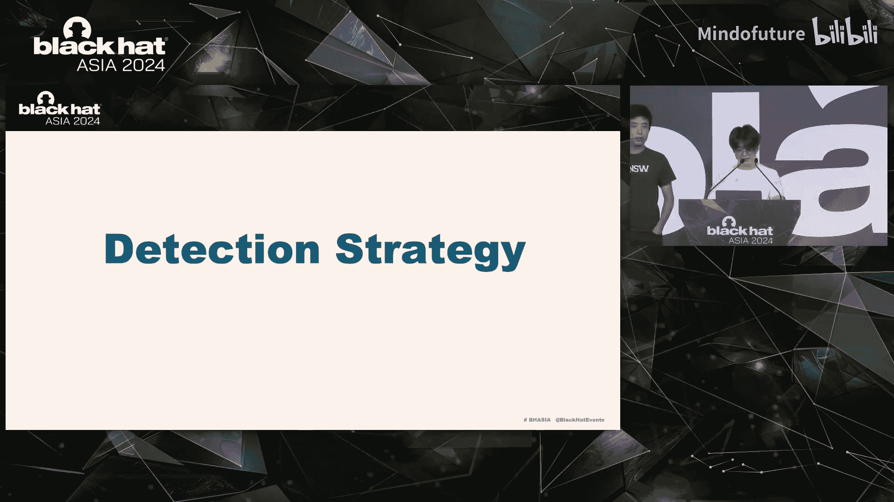
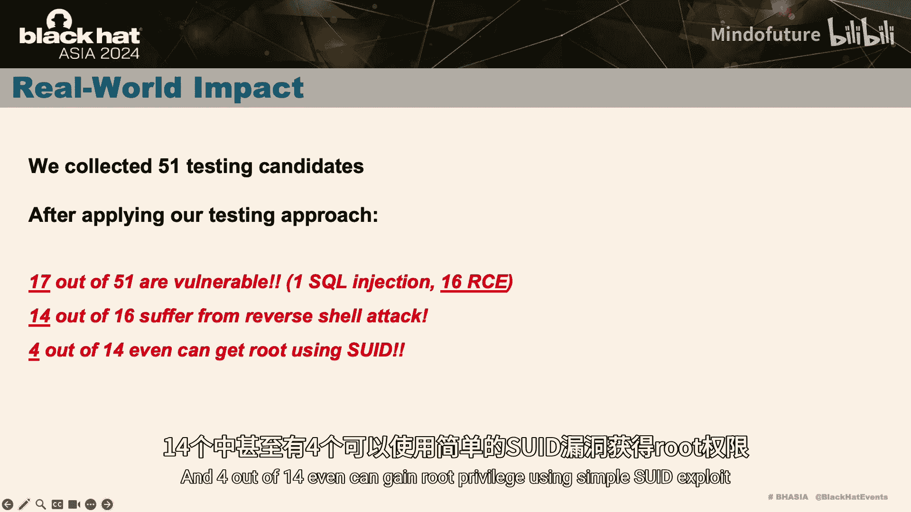
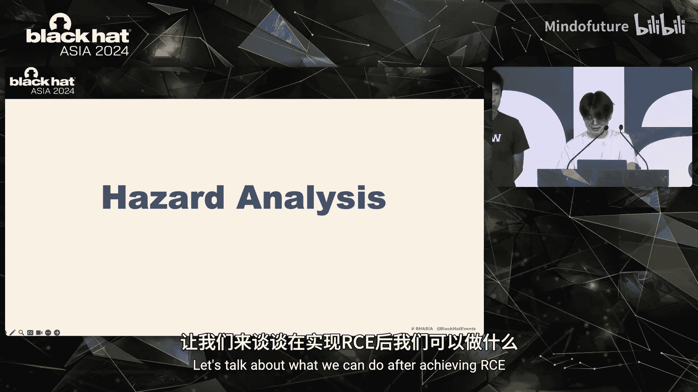
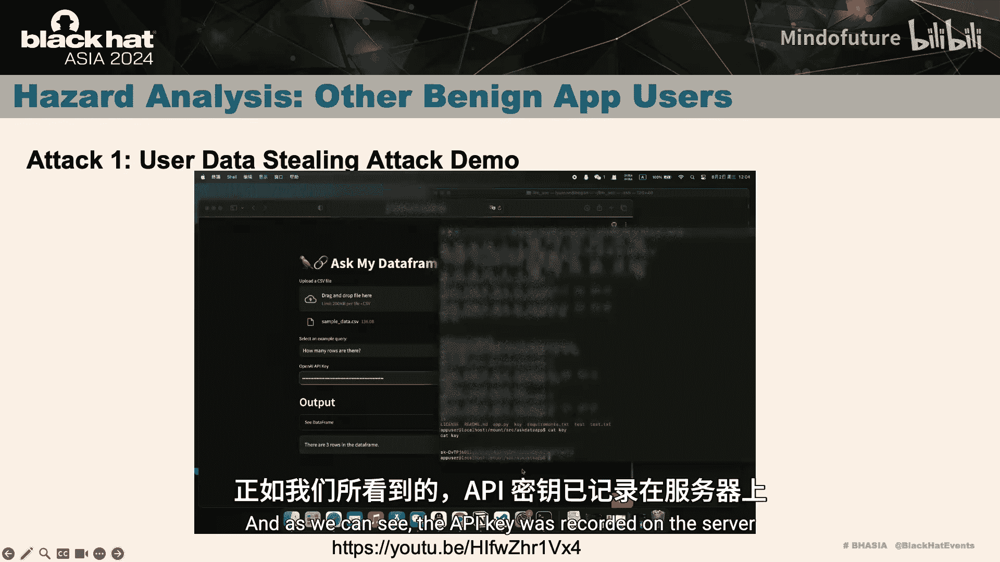
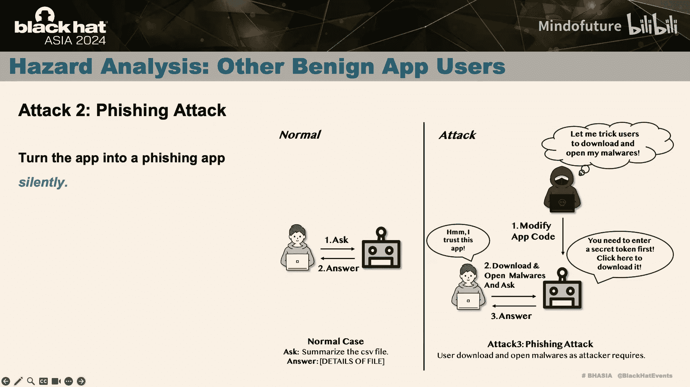
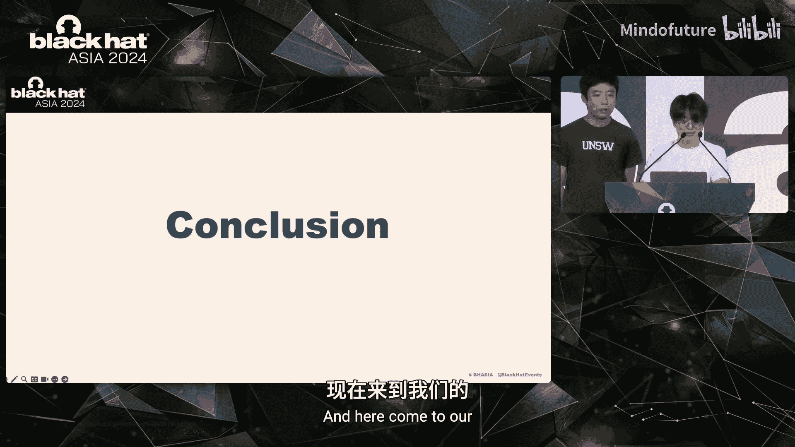

# 黑帽亚洲大会2024全集-•-中英｜Black-Hat-Asia-2024-p25-P26-LLM4Shell---Discovering-and-Exploiting-RCE-Vulnerabilities-in-Real-World-LLM--BV1oyX7YnEhN_p25-

H， hello， everyone。 welcome to our talk。 and it's very nice to see all of you here。

 So in today's talk， we are going to present you L I L L M for shell discovering and exploit R C E vulnerabilities in real world L an integrated frameworks and applications。

😊，As you can see， we have two speakers here。 first time we introduce Tong to introduce himself。

 hello everyone。 My name is Tong Liu， and I'm the first year Ph D student from University of Chinese academic and sciences。

 and my research interests mainly focus on AI plus security， which mainly。😊，Focus something。

 AI security and how we can use AI to assist tech security techniques like fuzzing。

 And in my spare time， Im a C TF player at now and shallhead。 And that's my introduction of myself。😊。

And as Tong said， he's a first year PhD student。 and I'm actually a first year lecturer。 I'm a。

 I'm currently a lecturer at University of New South Wales。

 and my research interest mainly lies in software testing and software security analysis。

 especially fast testing。And we have three contributors in for this work。 and。

 all of them are from University of Chinese Academy of Science。And here is today's outline。 So first。

 I will introduce you the background and the background and a motivating example of our study。

 And Tong will show you the technical details of the detection of this vulnerability。

 the expectation of this vulnerability and how to mitigate this type of vulnerability。So first。

 let's come to the introduction and background。So what is， so。

 so here we need to be clear about what is the subject we have studied here。 So as you can see。

The subject is a system made up of L， L， M integrated frameworks and L L M integrated applications。

Actually， like Web applications， most of the。L， L， I integrated applications applications nowadays are based on certain frameworks。

 and we are not studying arbitrary applications and frameworks。

 We are studying the frameworks that has the capability of generating and executing some code。

So you may wonder， why do we need to， Why do we need some applications to be able to generate。

 to ask large models to help us to generate code and execute code。 So you may wonder。

 why do we need this feature。Actually， the answer is because large language models themselves sometimes cannot answer certain questions from the user。

 For example， we all know that large language models are not good at mathematical solving as mathematical problems。

 but， but instead of answering the mathematical problem directly， they can generate a program。

 and execute that program to， to， to get us the mathematicalematic problem answer。

 So that's why in certain cases， we need to allow。😊。

Large language models to generate some code and use the code execution result。

As an augmentation for the final answer。 So that's why we need this。

And this is the subject of our study。 And here's a typical workflow of this system。So first。

 the user asks a question that would require code execution。

And then this question is passed to the relevant API of the framework。

And then the framework will ask the large language model to generate some code to solve the problem。

And then the language， the large商市 model will generate the code。

And this code is handled and executed by the framework。

And the execution result is passed back to the application。

And the application will combine everything together and present the final answer to the user。So。

 this is the system。Of what we are focused we are interested in。So the question here is。

 is this system really safe。So in order to understand the safety of this framework or the of this system。

 we need to know what are the existing attacks against large angry models。Actually。

 there are three main types of attacks， which are all related to prompt engineering。The。

 the first type of attack is called drillbreak。 actually， large models。 when they are trained， they。

 they need to go through before they are released to the public。

 They need to go through some safety training to avoid this language model of from generating harmful content。

For example， if a user asks， how should I build a bump， the， the。

 the large English model should answer， no， I can't help you with that。

 but some malicious users can craft。A prompt so that to allow the large language models to answer some forbidden questions。

And that is called drillbri。The second type of attack is called prompt leaking。

 It's also related to prompt engineering。So in， in some applications， there are system prompts。

 which serves as the context of the user provided question。And in some applications。

 this system prompt could contain sensitive information。Such as some copyright， such as some。

 some information protected by copyright or some user private data and。

Some and sometimes an attacker could leak this， could leak this system prompt via some prompt engineering techniques。

 and， and this prompt leaking。Is another type of attack here。

And the third type of attack is somehow similar to prompt leaking。 In some applications。

 the final prompt presented or possessed by the large language model。Is actually a combination of。

The applications template prompt， and the user provided question。And the user provide。

 and a malicious user can craft the questions such that it can hijack the entire logic of the final prompt。

😊，To allow the to， to manipulate the answer provided by the La model。

 And this is somehow similar to SQL injection。 So that's why it is called prompt injection。

 So this is the third type of existing attack。And now let's come back to our previous question。

 is this system really safe。Actually， the answer is definitely no， because。

This system has the capability of executing a piece of generated code。

And this piece of generated code as。As discussed in the existing attacks could be manipulated。

By malicious users。So this is very， very dangerous。And actually， at the time of this。

 at the time of conducting this study。Some， some of the frameworks and applications have adopted some mitigation strategies。

 but， but none of them is could prevent this type of attacks。

 And here are some mitigation strategies adopted by the。By the， by the applications and frameworks。

 But none of them are very suitable here。And now we know that， okay。

 there's such a potential attack here。 And let's come to a motivating example。

So power or P A L is a program aided language model。

 So it is essentially the key idea of power is to augment large language model with the capability of generating and executing a piece of code。

And， and it could the， the final， the， the， the final idea is to augment the answer with the code execution result。

To， to allow this large large model to solve some problem that could， that requires programming。

And this is， as you can see， it， is a very useful feature。

 and it is recognized by the Langcheng community as useful。

 And they decided to implement a chain called Powchn。😊，To allow users to。

To generate code through large， large language models and ex execute the code。 But。

 but this piece of executed code。Is not checked。So the content of the generated code is not track。

And this could lead to a potential attack because the user can use prompt injection techniques to manipulate the generated and executed code。

And this is just an example。 This is the CE related to this Pochen。

And what if let's think about this pro question， What if this P， Because it is integrated in longch。

 it， is a framework。 If it is used by some application。

 it could lead to potential remote code execution vulnerabilities。

And this type of vner could sometimes give us a reverse shell。 And it is very similar to Web shell。

So we call it I M shall。However， however， it is much more harmful than Websh， in our opinion。

 because， because。This type of attack doesn't require a very high。A level of understanding。

 security understanding from the attacker to launch。 An。

 an attacker can launch the attack by just using one or two sentences of natural language description。

 So that's very， very dangerous。And now I will pass on to Tong to discuss how can we detect this type of very harmful vulnerability。

And okay， after we have some background of this study。

 let me talk about some techniques that we used in this study。

 And first is how we detect these vulnerabilities。

And first， we have adopted a static analysis approach to help us do this as showing the picture in the right。

 our goal is to extract such vulnerable code chain and we can see that there is a code chain from create CCV agent。

 which is a user level API to the EXEC which is a dangerous function can exclude arbitrary code and this vulnerable chain is what we want。

 First， we identify the certain dangerous function and think， such as evil EXEC and so on。

 and then we extract code chains on the cograph and to improve the efficiency and accuracy of code chain extraction we have made some enhancement。

Typically static analysis requires analyzing the entire project directly。

 which can be time consuming。 and although most of static analysis tools provide the functionality of analyze specific files provided by the user to reduce the analyze time。

 this is not practical in the real world context in the context of real world vulnerability detection because we cannot predict the minimum set of files involved in the code chain and therefore to address this issue。

 we propose a new approach that can be somehow efficient and first we start from the code execution function。

 I think and search for the function string to identify which file may contain the color within the code base rather than generating all the cographs of the old files and then we conduct analysis analyze on this color files precisely。

And then we can figure out the color among these co graphs。

 and then we can iterate through this color by just taking them and call these for the next round and repeat the process。

And this is a backward strategy。 And thus， there is no need to analyze the whole project。

 but we can just analyze a small subset of the files。

And then we can write some rules to handle the potential in place the codes to improve the accuracy of the coaching extraction。

 And finally， once the coach chain was extracted， we manually verify the exploitability and reachability and conduct the exploit。

😊，As a result， among 8 popular L M integrated frameworks。

 we totally extracted 44 coachess and verified that。

37 of them can of them can trigger us vulnerabilities。

 and we detected 15 R vulnerabilities with which can be triggered through user level API。

 which is a very potential to be used in the backend of the app。

 And we obtained 11 CBs and some acknowledgecment from the framework maintainer。

But can we exploit this vulnerability in real world scenarios。And to exploit the vulnerability。

 we should first find the potential affected apps。 and for the open source apps。

 we can search for all repositories that used the vulnerable API on the code hosting platform such as Github。

 and then we can extract it automatically extracted their public deployed URLs because as for the website。

 the only entrance of this website is public deployed URLs。As illustrated in the figure。

 we can select a risky API from all the risky API we have identified earlier。 and in this example。

 which is create Pan data free agent， which can be very dangerous because it can trigger RE and we search for the called repository hosting platforms and we can find many of the app used these vulnerable API。

And then we can extract some key information such as reposory name descriptions， read me files。

 because public deployed apps typically include their deployment Us in these key informations and we can extract all the URLs from these informations first and then apply rules to filter out some noisy Us that we doesn't need。

 and thereby we can select the public deployed Us of the app。 and for the app that are closed source。

 we cannot access their source code directly so we can analyze the characteristic from the collected white box affected apps such as。

 for example， we find that many of the affected apps can is related to data analysis so we can summarize these categories as suspectable to vulnerabilities。

 and we can summarize some categories of functionalities of the app。

That can be potentially vulnerable。And we can collect these apps from public app markets。

And after collecting these testing candidates， how to sniff and exploit the vulnerabilities hidden in the apps back backend as we cannot just whether judge whether the app can be exploited by just looking at。

 we should test it。So to exploit these vulnerabilities while reducing the false positive and false negatives as much as possible。

 systematic workflow was designed。 And here is the overview of the whole process and。Next。

 we'll explain the insight about how and why we design these exploit strategy strategies one by one。

And the first strategy is basic usage test。 And because some of it are not allowed users to input custom prompts or may have broken due to lack of maintenance。

 and therefore， attackers has no entry to trigger the R C E。

 So it is necessary to exclude these abnormal apps at the beginning of the whole process。Thus。

 we should first test whether the app can be interact， interacted with prompt custom prompt。Normally。

 a straightforward way is to use the prompt to let the app do some simple tasks。

 some simple calculations to examine whether they can fulfill our quest。

After the app successfully passes the basic usage test。

 it can be considered functionally complete and it is ready for the normal use and interaction。

However， there is a big problem that can significantly trouble the testing。

 the L M hallucination problem。And during the initial phases of our research。

 we encountered some instances where certain apps exhibited hallucination issues as evidenced in this figure。

 While we were testing this app。 It generate some reasonable output。 as we can see。

 we let them let it to list the old files in the current directory。

 it generate some seemingly correct output。 However， this is however， this is due to。

The LM hallucination test after we further communicate with the developers and do some code review。

 and we found that L M cheated us to， and it generate some seemingly correct answer。

 but actually test it it has no capability to exclude code。

 So to mitigate potential interference caused by LM hallucination and prely confirm whether it can execute code。

 We design this hallucination test。 And this test is inspired the fact from the inspired from the fact that L M cannot calculate harsh functions independently。

😊，So the oracle can be if the LM can calculate the hush of the random string correctly。

 there must be a code execution behavior。And once the app passed the hallucination test。

 it indicates that it persistes the capability of code execution and code execution result are not generated by hallucination。

 And next， it is necessary to test whether the app can execute arbitrary code provided by us。

 And in this stage， we can directly confirm the existence of R C vulnerabilities we are straightforward prompt。

 such as we can tell tell it what is the final result of some malicious code or some targeted code to examine if it canful our request。

However， things don't always go smoothly。 during the testing。

 we found some straightforward prompt may fail to yield the expected as a result。

 But why does this happen， let's see an example and panda's AI framework because we can get some insight to an because many of them are built upon frameworks So we can get some insight about from why we cannot exploit the。

Framework to get insight about why we cannot get exploit the app。 And in pan framework。

 there are two challenges while we're trying to exploit it。

 First one is the pan framework includes the selfmade sandbox that aims to enhance security during the code execution by restricting the Python execution environment variable and filtering some suspicious keywords to prevent some malicious code and secondly。

 the system prompt template in pan I also significantly impacts our testing。

 because under this condition， our attack system prompt attack prompt will get embedded into this long and detailed system prompt。

 as we can see this system prompt is all about generate some data analysis data analyze code。

 But rather than our malicious code and our attack semantic。

Go got obfuscated and makes it more confusing to the LLM。 And as a result。

 IL M struggles to understand andful our request。And moreover。

 LL M itself can have certain safety alignment mechanism， even if we can bypass the。

 impact of system prompt LL M may still。Refuse to generate our malicious code， as we desire。

Thus here comes to the R CE test with this escape， which consists of LLM escape and code escape。

 and LLM escape aims to get rid of the system prompt of constraints interference and break the safety and moderation mechanism within the LLM。

 and this enables attackers to manipulate the LLM generated code into Malayious code。

And recall previously， we introduced some existing attack。

 And which one can be used here to achieve the goal。 Yes。

 and it they are pre prompt injection and gel brake。 Thus here。

 we use some several prompt injection techniques such as ignoring instance， contact manipulation。

 and several lightweight， but effective gel brake techniques such as prefix injection。

 payloaded payload splitting and persuasion and so on。😊。

But only L M escape is not enough because we just let the L M generated malicious code we want。

 But there are some potential code sandboxs。 So code escape to is to。

Escape these potential code execution sandbox by using some tricks learned from CTF P challenges such as Python class subclass inherentherance chain and building reload and some code semantic obation and so on。

By combining these two techniques， we can reliably achieve R C on Pan AI as shown in the diagram。

 using only code escape and only L M escape is not can cannot exploit the R E in Pan AI framework。😊。

And therefore， while testing the app， if I C without escape fails。

 then these two escape techniques can help us get out。

 get rid of this stack and bypass the potential。Protections as much as possible and increase the exploit success rate。

And great。 Now we can。 We have achieved R C on this app server。

 but R C E here can be categorized into limited R C。

 which permits the execution of certain commands and but not all the command and full R E。

 which may lead to a reverse shell attack。 thus's a network access test is。😊。

Is conducted to evaluate the exploitability level and hazard。

If the execution environment of the injected code has arbitrary external network access。

 the attacker can gain persistent control of the victim' server via reverse the shell。Otherwise。

 the impact can be limited。 And this attack， we can just induce the app to generate a curl code to send a request to our V P。

 If the VPS receive the request of the app。 the network access can is done。 And finally。

 let's plant a back door on the app server and the backdo test aims to download the back to script from our VPS and launch a reverse shell attack。

And first， we write a reverse shell script and force the app server to download it and execute it。

 So until now， the attacker can gain persistent control and full control of the app server。

And here is a demo video about how we exploit the app automatically after the inter interaction of the app is automatically。

And this is an open source app， and we deployed it locally。 And we can see the this video。

And at first， the attacker should pre do some preparation and such as launch H T TP servers for the PC download and。

O the port to listen and receive the reverse shell。 And now the attacker start to attack via prompt。

And this is， this attack has been automated。It opening the website。

The attacker should should do some preparations as the app requires， such as upload the file。

 enter his opening API I can and so on。Now he entered his open airI API key and start to test。

 and now is a basic usage test and hallucination test。And so on。As we can see， the exploit is done。

 and the V P received a reverse gel， and the attacker can execute arbitrary command on the app server。

So this is a reward examples。Thank you。AndAs a result。

 we totally obtain 55 suspicious testing apps and after applying our exploitation approach。

 we found that 17 out of 1555 are vulnerable and even more serious some of them are commercial apps and some are open sourced on the Github and it earns somehow 1000 stars on the GiHub and it is very popular and 16 out of 17 suffer from us vulnerability and 14 out of 16 can successfully exploited by reverse gel attack and gaining full control of the app server。

And 4 out of  14 even can gain root privilege using simple S U exploit。😊。

And do you think this is now for an attacker？ Absolutely， no。

 Let's talk about what we can do after achieving R C E。

After we achieve R E， we can divided the affected objects into two categories。

 and first one is app host server， which can be directly connect controlled。

 And the second one is other beign app users。And this is a new attack scenario we have proposed after achieving R C on the observer server。

 the attacker can silently attack other abusers。Let's see how a can affect， affect these two objects。

An attacker on attacks on the apps app host appears to be very straightforward。

 and first attacker can obtain sensitive information on the server。

 and many sensitive information are stored in files or environmental variables。 for instance。

 many apps store their opening an APII key in environment variables。

 which can be directly obtained by the attacker。 and they can still the developers opening an API key for their own usage。

Additionally， for black box apps， the source code is also stored on the server and leading to source code leakage and other sensitive information such as server Con。

 A W S， private keys， S， H H connection informations and more can be able to accessed by the attacker。

😊，And secondly， attackers may achieve privilege escalation via U idea or kernel exploitation to allow them obtain more sensitive informations。

😊，Unless attackers can plant back doors on the server as we talked previously。

 causing persistent control of the server and so on。 Now。

 let's have a look about how we can affect other benign abusers。And basically。

 these attacks targeting to other users are achieved by modifying the app source code。

 And first attack is user data stealing attack。 And this attack allows attacker to record user sensitive data silently。

 And this data can be users prompt， which may contain some I。

 and user uploaded files and even users open AI P I key。

The attacker begins with modifying the source code。

 And then after it modified the source code of the app， here comes to a new user。

 and he entered his open I key to use this app。 and the app and the API key was recorded by the attacker on the server。

 and it can read this API keys and。The user even can cannot notice the， they。

 their open I P key has been stolen。And let's see a video demo about how this attack occurred in real world scenarios。

 And this is also an open source app we deployed in the local and。And the app was modified by。

 by the attacker。And here comes to a new app user。 and he want to use this app。

 He first uploaded the upload his files， and he want to an analyze this file。

 and he opened and he entered his opening API key。After he entered his opening I APII key。

 it got record on the server。And as we can see， the API key was recorded on the server。

And the last one is phishing attack。 as shown in the figure。

 attackers can even turn this app into a phishing app silently。 And for example。

 the attack want to trick the user to download and open its malware。

 it modified the code first and here comes through an app user the modified app says every user should enter a secret token first to start use this app and the secret token can be obtained by downloading this file and actually the file is crafted by the attacker and this is malicious and it is a malware。

 if user trusted the app。 He will download it and try to open it。

 thus attacker can trick the user into opening its malware and other phishing attack are also feasible。

 such as foring some websites logging page to trick people into logging in with their private credential。

 And once the username and password entered。 they got leaked and result in some significant harm。

Losses。And after talking about how to exploit it， let's talk about some mitigations。

And for app users for app developers， there are various potential defense mechanism from different perspective。

 And firstly， developers should focus on access control and follow the principle of least privilege。

 setting users privilege to lowest possible level。 And for example。

 they should disable the permission to read and or write the app app source source code and its sensitive system files some partitions。

 And secondly， app app developers need to ensure the environment isolation by using some proper code sandbox or some some techniques to separate the code execution environment from the app servers running environment as much as possible to achieve this goal some。

Sandbox like process level sandboxes like pie pie sandbox Le。

 some cloud sandbox such as E2 B or some tools like Pidide that embedded the code execution in the browser。

 using some node J S and Wa technique， allowing the。

Code execution to run on the client side rather than the server side to prevent the code execution on the server。

And in addition， prompt level differences can also help for somehow to filter out some prompt with malicious intent。

And here come to our conclusion of this talk。

And we in this talk， we systematically introduce a new attack surface in LLM system。

 which can lead to R E。 And we call this L M for shell L M shell。

 And because it's similar to two web shell。 But in some situation。

 it is powerful than the more powerful than the web shell because the attacker can achieve R E by just using one line or two line natural languages。

Also， we talked about the exploitation in the real world scenarios and designed the exploitation workflow。

 And finally， we provided some potential mitigations for the developers to protect their products from different perspectives。

 And in one word， please be aware of your L integrated frameworks and apps。

 Pro them as possible as you can， because maybe one day the attacker can achieve R on your app server just using one line or two line natural languages。

 And thanks for your listening。 And this is our reference。 And thanks。😊。

