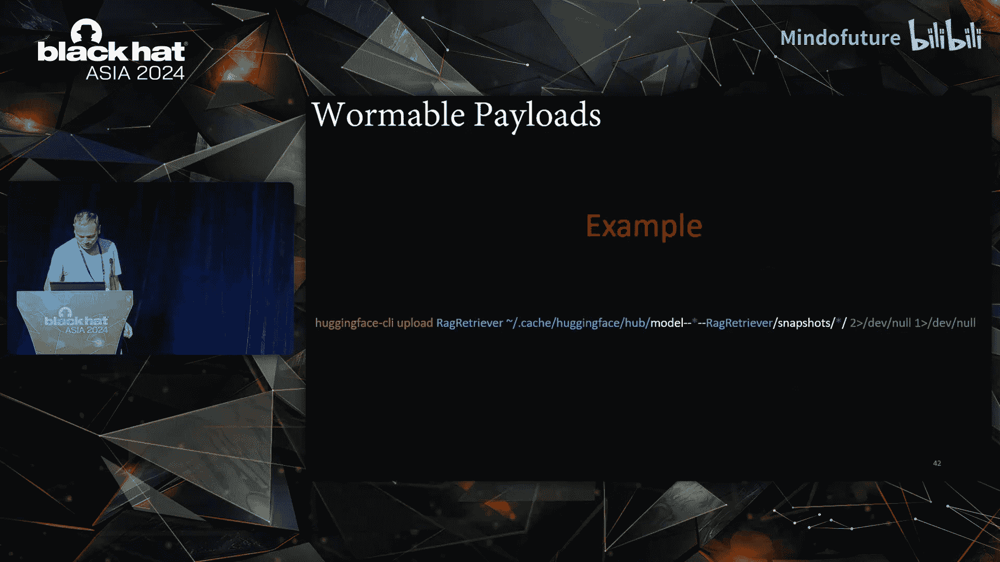
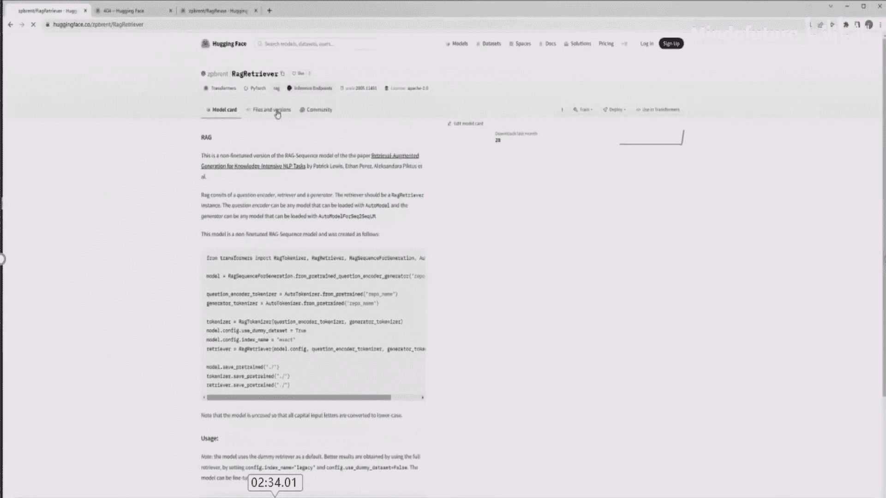
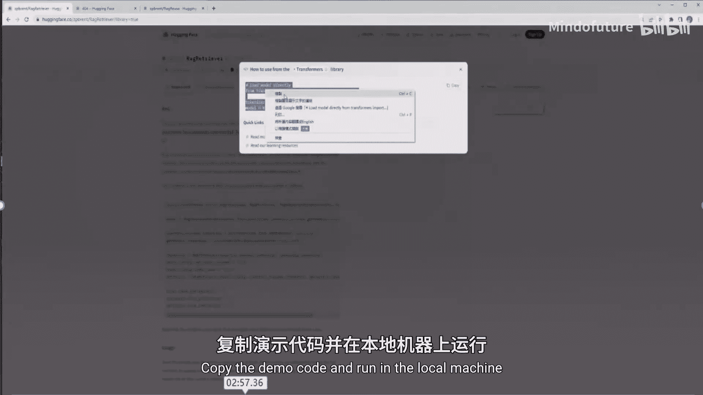
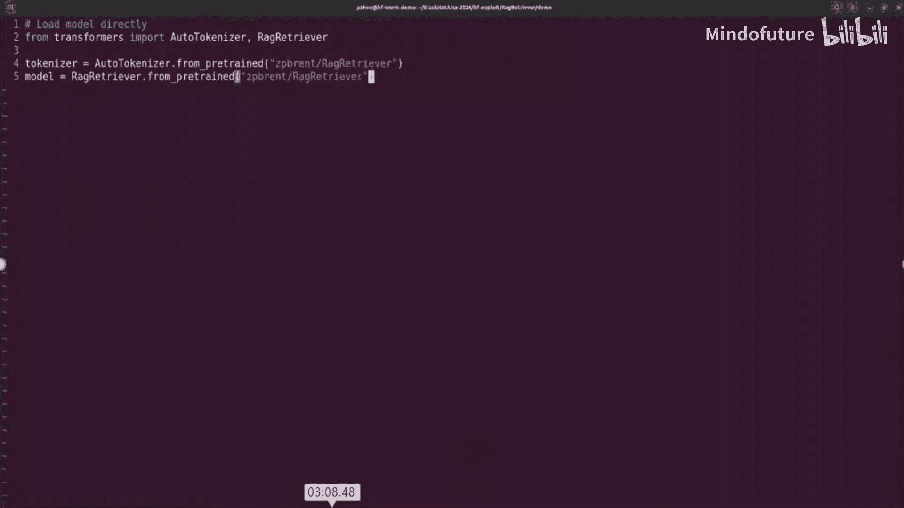
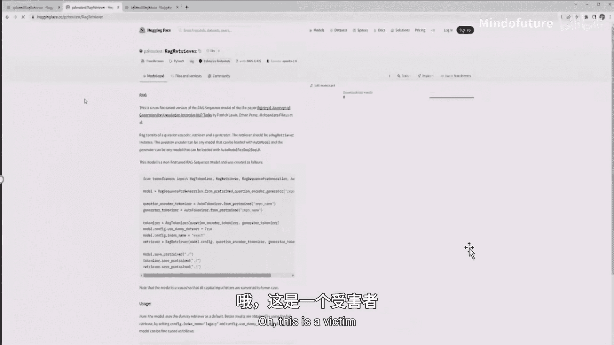

# 黑帽亚洲大会2024全集-•-中英｜Black-Hat-Asia-2024-p27-P28-How-to-Make-Hugging-Face-to-Hug-Worms---Discovering-and-Exploiting-Unsafe-Pi--BV1oyX7YnEhN_p27-

My topic is how to make hugging face to hug worms。 And in this talk。

 I will share some my experience on discovery and exploiting unsafe pick notes。Over the hugging face。

 especially to my knowledge。 The hug face is the largest pre trained large model hubs to date。

 and I will show some security insights behind it。 Who am I Im from Shanghai University。

 and my main job is do some research and teaching jobs in Shanghai。

 And also bug hunting is a part of my research。 And I have。

My current research interests focus on the web and AI security。 and in the past。

 I just have published some research publications in academic field。

 But this is my first time to present some topics in the industry field。

 And if you have interest to discover with me， you can reach me out at my email account。😊。

And the agenda for this talk， I will first brief some background of the hug face hub and the pickle model。

 And then I will show some the old knowledge that what is the pickle notes is unsafe and how to discover some point of it。

 and then I will elaborate on the details on how to exploit for the reverse R remote code execution by the pickle notes and also I think it is a very interesting part is how to bypass pickle pickle scanning deployed in the hug face because the hug face has the full full knowledge that the pickle notes is very dangerous and they launch the pickle pickle scanning in their website to avoid this kind of the threats and。

😊，I also go a step further to show you how to make our R C。Pload is warmable。

 That means we can abuse the hug face as。As an even weapon to infect the pinkle worms from one hug face account to another。

 and we will utilize some the hug face official command line to do it。 And at the end。

 I will show three case studies and demo， how we can do this kind of attacks。 Okay。

 let's begin The first hug face hub and the。😊，ピコモド。

Maybe some of you have some experience to use the hug face hub to get the models because the AI is very hot topic and you may find so many academic papers publish is in the。

 for example， the A AI C I and their authors may deploy their their models in the hug face to share across the AI community。

 And but I don't understand whether you can deep understanding how the hug face hub works。

In the background。 and I split in the hug face hub into two parts。

 One is the part the users can have the direct face。 That means you， if you access the hug website。

 you can find you can deploy the model repositories and you can also deploy some data and also the hug hub also provide the space you can run your A models in the space and let users to access them directly and have the direct experience of it。

 and also the hug provide some APIs that means you can the hug operations in your libraries And but if you go some for go some index into the。

 you can example， read the documentation in， you can find the hug face is open。😊。

form and it integrates a wide range of third party libraries。

 machine learning libraries into the hug face hub。 That means not all the not all the models running under the hug hug face control maybe you if you search the hug Gith。

 and you can find the transformer is the library deployed by the hug。 Theffusion deployed by the hug。

 but there are many other AI model libraries deployed maybe integrated in the hug。

 but not maintained by the hug team。 So this is a very interesting point how the hug face hub can show can ensure all the third party libraries are safe enough okay。

 and also if you see if you have the experience on the AI model， you can understand。

You should transmit or share your models with others。 You may use the serious format。

 there are so many serious format supported by the hug face。

 the the pickle is one of them and there are many others， for example。

 the and also the suggest all the others used safe sensors but my topic is focused on the pickle Okay。

 this is the my focus on that。 but that not means the other format is safe enough。 for example。

 we know the H5 has some unfixed numbers publicly and also the and the tensor format also have some the marll theization attacks also。

 but my focus is on the pickle because it is introduced by the。

 and I think it is widely used in the AI community。

And I have give some basic idea I have background knowledge if you do not understand。

 but if you understand you can ignore this part and how the pick works and I copy from the tutorial in the website。

 and this is just for some python objects and use the pick。

 it will transmit it to the better stream better stream and why we should serious this objects。

 because we should transmit the data over the network or store in the database or store in some files and the others may get this this data and to serious to the object Python objects to reuse this is the main purpose。

 why we should introduce the Python the pickle and if we go into the go into the some details we can find。

For this one。So this one is the pinkle is the pickle bad stream， and it is a normal stream。

 You can see that。 but the pinle puzzle can。Pass it and translate it to the pick O P code and stack like this way。

 like this way。 And and then they can reconstructed the stream back into the python object to re use。

And what is valuable code， If you go into the Pths native C Python source code。

 you can find publicly in the public。 there are two known exploit points。

 One is for the reduce and the other is for the set state。 I don't know whether the third one。

 but you maybe if you read the source code， you can find the third one。

 But I just copy the publicly two known points for your reference here。 And the the issue is that。

For this decization process， they reuse some strings provided by the user as the function number。

 as the function number， Python function number to execute the code。

 So it may leads to the arbitrary code execution in these two points。O。And。

Why the peoplele decization show the security issues to the AI community。

 and we should back to the pay toch because the pay implement their torch load and the tor load implement the pick load inside and the pick load where have the two decization attacks。

 I in the last slides。 but the， but this is a known problem。

 and when the introduced the pick lots and so many security experts compliant。

 and they have a a very hot topic to debate and finally， the pay patch their code。

 that means in my mind， currently the the pay load is not valuableable。

 But if you argue there need users to put some trust code。To launch the protect， it is another story。

 And the solution， the pet implement is the white list models。 And you can see。

Maybe and you can see the source code for the new。Py is implementation。Okay。

 but the war is not at end for the hug face because and the hugging face integrated so many third party libraries in inside their。

Open platform。 and these libraries no the even the hug phase cannot ensure they follow the secure coding for their implementation。

 And the bad news is that。So many third party libraries used the raw pinkles。

 Ple notess in their implementation， not the Pat tor load， okay。And。Okay， and in my understanding。

 in my understanding， I think if the third party， the third party libraries use the torch load。

 I think it is safe enough。 So I put it at the green。Its this one is safe。

 And if they use the raw pick notes， I think it'， is still on it still still valuable and。Also。

 as the open platform maintain， the hug phase also implement the pickle scanning to avoid this kind of attacks。

 And I call here iss in the yellow color because I will show you some the novel tricks to bypass this pickle scanning in my presentation later。

 So I just put it in the yellow color。😊，Not green， Not red。 Okay， and the next 1。

 I will show you how I discover the unsfe pick lotss。 It is before I。

Before I show the unsafe pink lots， I will define it。 What is the unsafe pink lots。

 Because if you read some code and use the pink lots and also the pinkle safe to read the memory read the data from the memory or serious the data store in the memory。

 It is safe because it， it a loop in your memory， not from the not from the user inputs。

 And I define the unsafe pink lots， is that there is some parameters under the。😊。

Theres the some parameters under the users control。 under the attackers control。 So I。

 I think this one， this one， this function， the convert must for checkpoint will read a pinle file。

 a pickle file and the file name under the user control。 I define it is unfe。

 but if the big nose is unsafe not means it can be exploit from the hug hub。

The difference is that you can not image the users is very stupid。 It's very silly。

 They will just read some pickle fire and read in their code to do that。

 So I define what kind of the pickle role can be exploit exploited by from the hug face is if the if the victim users can follow the hug face official guideline。

 official guideline to pre to fetch the pret model from the hug face hub。

 That means the users have no knowledge。 what happens behind rather than just downloading some models and the one entry point is that if you have the experience to use the hug face。

 you know， there is a code。😊，Okay， there is a use in for example， this is the transformers library。

 and the hug face is very friendly。 They will get the beginners beginners to use the hug face and they have the demo code here and the demo code for every nearly。

 nearly every third party libraries even the third party libraries you if you deploy the models in the hug face。

 You can have this kind of the demo code and this kind of demo code。

 you can click it and they will show the code here and the beginners will。😊。

Simply copy the code and to their to their local machine and excuse them to fetch models。

 This is one of the exploitable entry。 And the other is that because some third party libraries is not well integrated in the hug phase。

 and they have their are all command lines。 And so the hug have some documentation to teach the users how to use them。

 And this is the example code put on the hug face hub。 And I consider this is an the second chance。

 we can we can get the user to be pitched okay。😊，Okay， and how to discover the unsafe pinkle loads。

 It is very easy。 You can just use some For example。

 the patron or the other Is and download the libraries and you can search the pick loads and then you can quickly locate where the pick is and then you can this whether the user the function input the function input is under the user control or not it is under user control or from some files or from some and then we can consider are unafe but unsa meansable and for the exploit and I just just track or do some code review there is a code from the for example。

 the from pretrain function to the load if they。😊，These are code pass for this。

 We can consider they are exploitable。 and my results maybe this survey。

 the this code survey is conducted in the last November November。

 and in that time I just found 133 integrated third party libraries integrated in the phase。

 but currently maybe more because theres are continuously more libraries integrated into the hug phase。

 and I find I discovered 158 unsafe people load from the from 15 libraries and also can confirm 6 are exploitable。

😊，And before I show the real world examples， I will show the threat model。

Because how I define the attacks can do and how we define the victims can be attacked。

 And here is example。 the attacker is a normal hug face user。

 They register an account in the hug face。 and then they can deploy some model models in the hug face。

 and they use just used to push to the hub function to upload their models to show across the AI communities and they also can claim。

 oh， I have a paper I implement some paper published， for example。

 A AI or I AI and my implementation is very effective to to the users interests。

 this is a pitching attack。 and the victim users are the other hug face users。

 And if they by the attackers rap。They will use the from pre function provided by the hug face to get to fetch。

 to fetch the pre model and run in their local machines。And the attackers can。

 can embedded some pickle loads， pickle loads， pickle files。 sorry。

 pickle files in their malicious model in the。 And if the victim users download them。

 they are attack。😊，Okay， we can see the a very simple R E。

 This is very simple because if you come back to the 2011 blackhead conference。

 you can find find the original paper。 And I think everyone can write it simply。 But for this code。😊。

The hug fish do not allow it or can make some alerts to wake up the victim's a。Oh， they are unsafe。

 They are unsafe。 And this two is the， I just copy from the hug face hub。

 and they will use the red color and to display Oh they are on some unsafe pink notes and please do not download it。

 If you insisted to that。 you can take your own responsibility。 Okay， and okay。

 the next one is how to bypass the pink scanning。 I will show you the current hug face Ple scanning is not safe enough。

 is's not secure enough。Okay， to discover the ways to bypassing。

 we should first see how the pinle scanning works， how the pinle scanning works。

 And we can see this way。 I just copy from the hug face and。😊，You can find three cards。1 is the red。

1 is the black，1 is the orange。 that means。That means there are three list in the hug face Ple scanning。

 One is the blacklist，1 is the white list， but another is very interesting orange list。Okay。

 and sorry for the white list， for the blacklist， for the orange list。

 I think my demonstration is not comprehensive because I do not go through all the Python function functions 1 by one to check what the hug P scanning blacklist or what they are white list is it is not it is not complete。

 Sorry， and you can I just put some here， for example， for example。

 but the interesting part is that if it is white list， No alert displayed。 if it is。

 if it is in the blacklist。 there is an alert to wake up the you users。

AGnal said it is unsafe pinle filess。 But the interesting part is that if the functions are listed in the orange list。

The hack ways only display the function， the model name in the orange color， but no alert。

 but no alert。 This is the point we can exploit it later。 Okay， and I will show three， maybe 4。

 maybe4， but I will show you first three， and to bypass。 It is just a game for the head and sake。

 okay。The first one is a journal one， and I call it the code reuse。

 because there is an orange functions and orange functions No we are not trigger the unsafe fire alert。

 so we can re the orange function。That means we can reduce the original function to do some malicious actions。

 The easiest way is that if I， if we found some free from pre trained from pre trained function is can be exploit from the hug face hub。

 We can just deployed to hug face reposies， Wang is embedded some some some。😊。

1ang is just embedded some pickle files， but this pickle files embedded some embedded the the pre from pre trained function inside。

 and this from pre trained functions， We download another ra。 I I call it backend。 And for this。

 they have some blacklist functions inside。😊，Okay， and another way is that。

If we can also consider the origin functions as the gadgets。

Gagedges is very interesting because so many deization attacks used gaugedges to gauges trains to achieve their targets。

 And what how we defend gaugedges。 the gaugedges is the functions that this function is orange list。

 but inside this function， it will call some blacklist functions。😊，Okay。

 we call it the second one is， the second one and the third one。

 I think they are highly depends on which libraries you can use to launch this kind of text。

 Maybe they are more bypass tricks， but you I think we should read more source code of the integrated third party libraries to find more。

 and the second one the second one is I find from the I find from the。

Hgging face transformer library and they use the model， model。 and in this model。

 they will read the confi file， the con file in the reposies the model reposies and in the config file it interesting point is that it willdirect the download from current repository to another reposory and we can the malicious code Maicious model in the back in the second in the backend reposory this is I call it the cong abuse。

And the third one is more interesting because if we read some code。

 you can find some some third party some model library writers may use for example。

 the base 164 to encode the pink better string。 And by this way， And by this way。

 the hug face pin scanning do not think this is the pinle file。

 They just think it is some base base 164 coats。😊，Okay， I call it the format in code and。Okay。

 the next ones， I will show you some the warmable， how to make our attack vulnerable。 Make the worm。

😊，And。Okay， the thread model extended。 This is thread model。 we just launched R C E。

 but if the are because R E， we can run arbitrary commands arbitrary command that includes includes all the hug face command lines command lines and we can find someone and to let the victim users to push the same repository to the hug face again。

 using the victim hug face account。For this update。 and then。Make the warm， in fact， from one to one。

And the verable payoffs is very simple。We can use the hug face C， L， I and use the upload。

 But the interesting part is that how we can make the warm infection continuously。

 because if I deploy a worm in the hug face account。 And someone is。

 I call it the first victim can download it。 And the second victim may not download my。😊，My worm。

 they will download the the first victims。 So we should make the warmable pillows enough。

 That means every victims can be a warm source。Then we can read it in some details。

 and we should keep this sorry。This to write the， the rap name， the rap name。 Yeah。

 the rap name the same。 That means the first victim， the second victim。

 all the victims may use the same repository names to make the warm infection。 and for the cage。

 the cage pass。 The catch pass is that I use the default one because if you do not additional configuration on your hug face。

 and they will， for example， in the hug face transformer。

 They were in your home directors cage director。 and there is a hug face director with the hub。

 And maybe are someone argues if the users configure their all cage director。 No problem。

 because we can run the R， we can run the A C， you can just use the hug face C L I download。

This function to download again the the malicious rip in some specified directory。

 But my demonstration is just assume every default everything default。

 But if some victims do not use the default director， no problem。And and for this one， the the pupil。

 the pup star。 that means a different face user account has different username because my username is Z P print。

 and my simulated account is the P Z。 They are different。

 So we can use the star to match them to match them。😊，We do not care about what is the user name。

 And for the last one for this one。 That means when we make the warm infection。

 we put everything to the trash。No information displayed to the victims， O。

And this is a real world example。Okay。In fact， I have six demo and all deployed in my hug face use account they print。

 and I have make the public yesterday night。 and if you are interested。

 you can you can use it by yourself， but I must let you know that they are all worms worms。

 I just make them public for research purpose。 and please do not use them illegal if you use them。

 and you should take the full responsibility for the for your abuse， okay。And okay。

 I will show three demos here。Maybe times not。The first 1 I found from the hug face transformer。

 The model is the retrieve。 Maybe the rug is very very hot topic because there are so many human human feedback reinforcement learning there to to reinforce your models。

 And in this one。😊，嗯，O。In this one， I will use。ZP brand account to deploy my。To deploy my。

my attacking repositories in the D regular tri。 and I assume the victims follow the demo code to from from the hug face and then they will be infected and also exclude some command to touch hacked fire in your local system and also upload upload upload the same repository to your accounts to your accounts。

 and this is the code pass。 how I find them maybe it is very complicated but no problem。

 You should just catch three points。 One， what is the source The source is the the the function from the hug face official official guidelines。

 for example， from pre from pre function and the think where。

The pickle lots is called and also are injection point。

 because the attacksers have no way to additionally control where we can inject the malicious pin in the exploit train。

 So we should we should make sure the existing cold pipeline has do that by for ourselves。

 So we should locate where is the in point。 That means which pin fires。

We should make their malicious。 Okay， and this is the trick I use。 this 1。

 I use to trick to configurefi abuse because the regular travel use a Lexi pass to redirect the download the download of。

The download of the download of models from I call them the front end reposory to the back end one to the back end one。

And by yours， we have display in white， no alert。 Also， here， I will show you the fourth。

Tingle scanning by。 I call it long。 And I think this is the implementation error in the hug face website。

 I report to the hug face， but no response。 Okay， and you can see in the regular cable。

 I have two instruction points。 one is to the P S G S W 100 P K L， and another is this one。

Another is this one。The name is too long。 And you can see here。For this one。

The hug face pinkle scanning cannot detect it as a pinkle fire。Okay， and this is the demo。

I will because the time is limit， okay， and。For this one， I will show you how I will do that。

 and for the。This is my Z printer regular travel。 And for this one， you can see there is no。Okay。

 we can just down here。And I have two account is the is attack and another one is and he is the victim And if you can find here。

 there is the P those repository。 There is nothing here，40，4 and。Okay， okay。

Yes read me and then the victims people just copy the demo code， copy the demo code。Yes。

Yeah， here。 copy the demo code and run in the in their local machine。

And here you can see the downloading， the downloading from the hug face hub。

Maybe I run some VPN in when I record this， when I record this demo。And there are some time。

 But if you can directly connect to the hugging face， it will very fast， okay。😊。

And this is downloading。Okay， and there are some some but it is not the。Critical sensitive。

 because we can refine our pinle fire to avoid them。 There is no any crashes。

 That means you can successfully download the model and run in your。local machine， ok。And here。

We can find the hacked and hack， too。Can illegally make。And for this one。Yes， I wait here。

 If you should make the warm inspection， You should log in a hug face account with the red permission。

 red permission to upload your hug face repory。 Okay， this is a prerequisite。

 and we can run it again。ok。And in this one， we can find here。Oh。

 this a victim has the in the account， O。

Okay。Okay， I will stop here。 And because the time is limit， I will go quickly for the next。 Okay。

 the the second one is the paal N LP for the I tiny tiny。Model， and the same is here。

 And this is the code pass。 And here I just used the code reuse to bypass the pinkle scanning。

 P scanning。 and you can see I have re3 original functions。

 one is the reval URL reval and the second is oh the interesting one is that why we should use this one。

 because because when I re the another from Ple original function。

 we found it is a Python class member function。 if you call should call the Pyon class member function from the pinkle file。

 it will automatically translate to call some the built in built in get attribute。

 but the built in functions are blacklisted by the by the Ple scanning。 So we should for this case。

 we should find another gadget another gadget。 But lucky we can find it in the。😊。

Pal N LP functions okay and this demo I can ignore it。

 And the last one is the stable baseline3 overview。 and for this one。

 I just the format in code to the bypass by okay and I can go and take away take away we have three in this in this security issue sorry and you can see the different example what the third party should do and what the end users can do when I report the bug to the to the their first response that please do not use the format you can just use the sensor but for theers for the victims。

 they cannot control how the attackers use。What kind of the formats And for the some third party maintains。

 they just think it is a supply train attack。 You should ask the hug face to launch the catch。

 but unfortunately the hug face think it is not my response for the end users。 they are the victims。

 So for the hug， they think everything is okay for the third party maintain。

 they think it is the it is that's wrong the users and for the end users I trust the model why you ask me Okay。

 I have some suggestions for the hug may should launch some strict protections and for the third party maintain better to not use the safe people and for the end users。

 I think the trust is not enough。 they may have some more tools to launch the protection。

 And this is the blackhead better sorry for the late， Thank you very much。😊。

