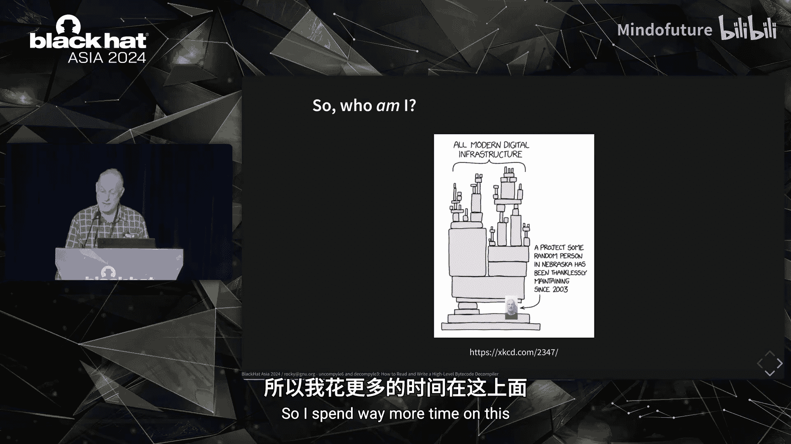
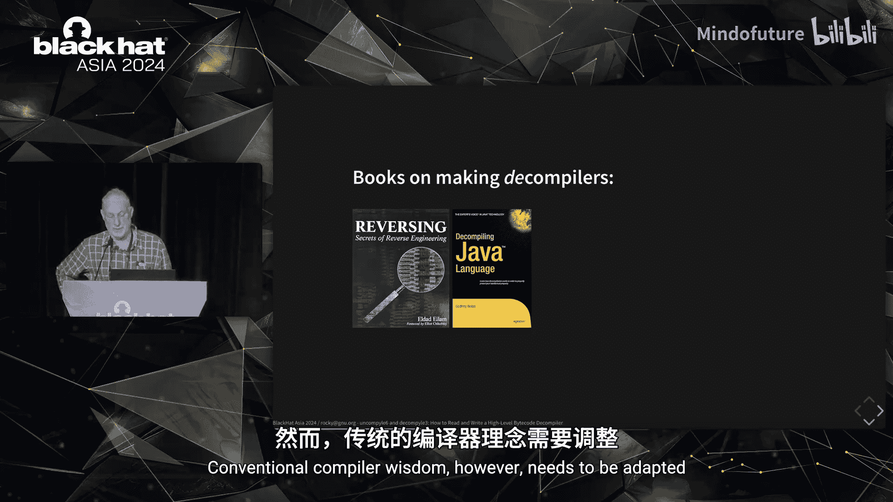
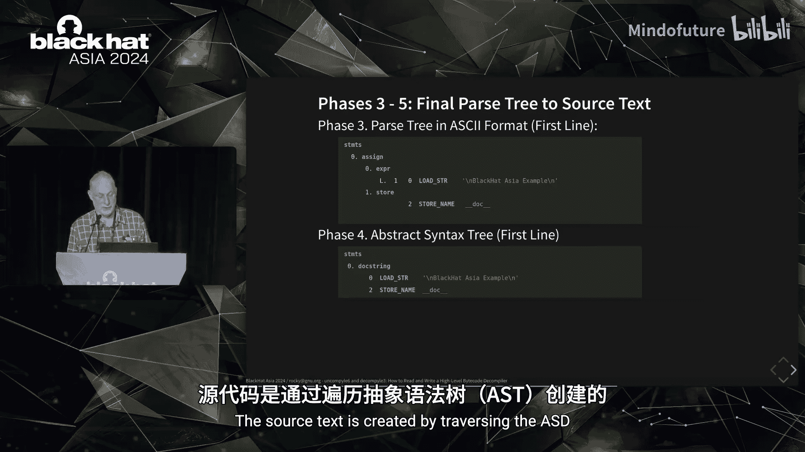
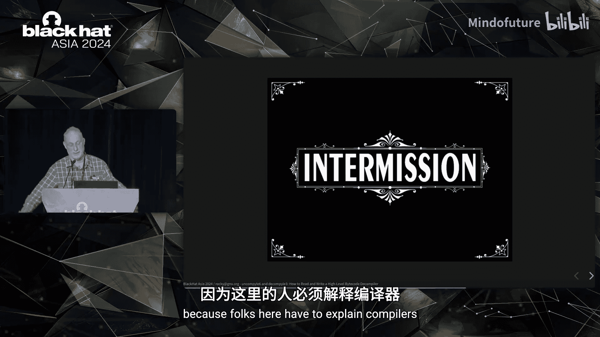
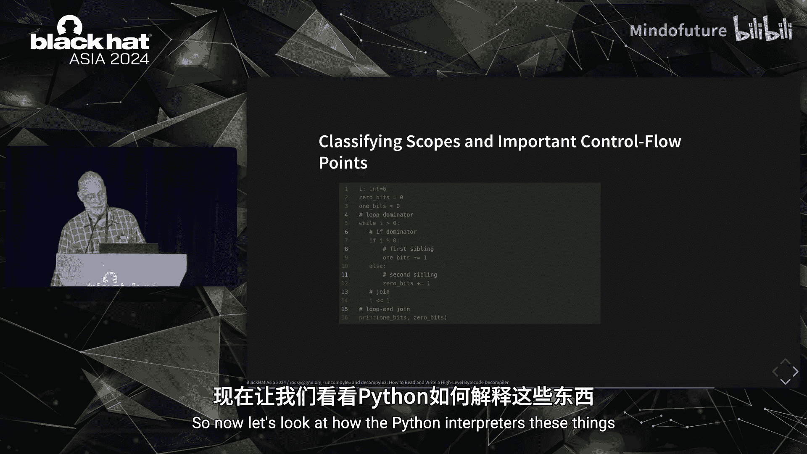
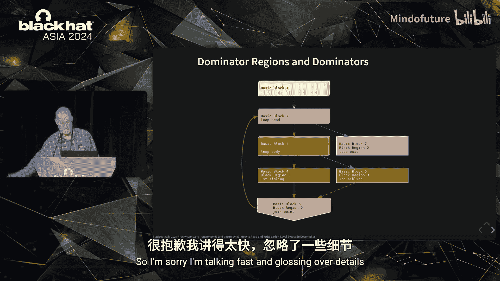
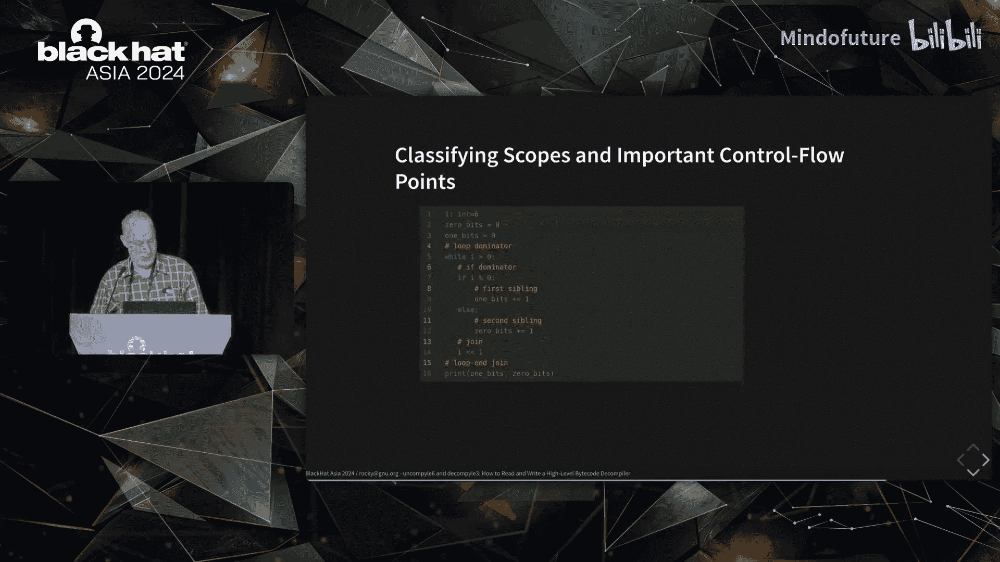
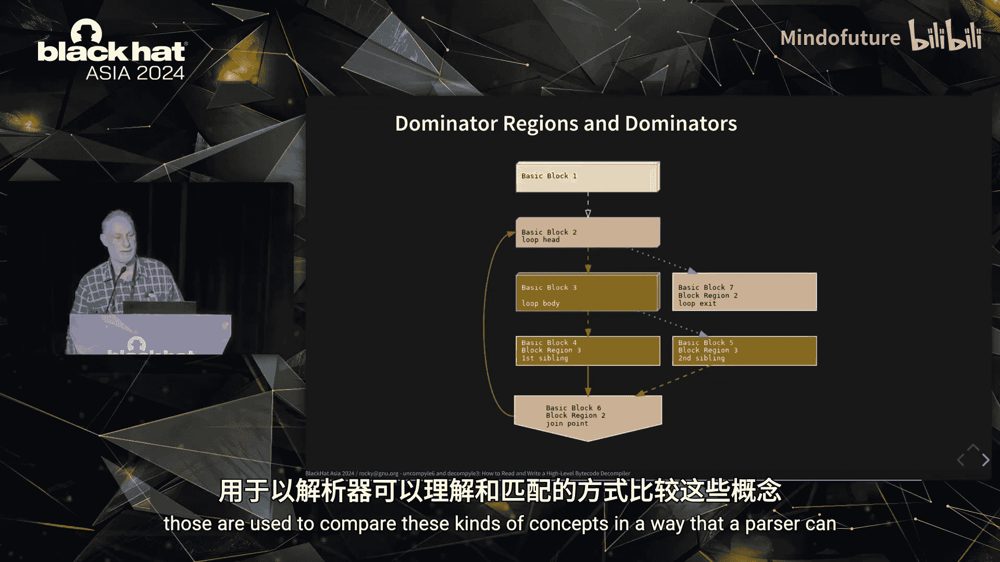
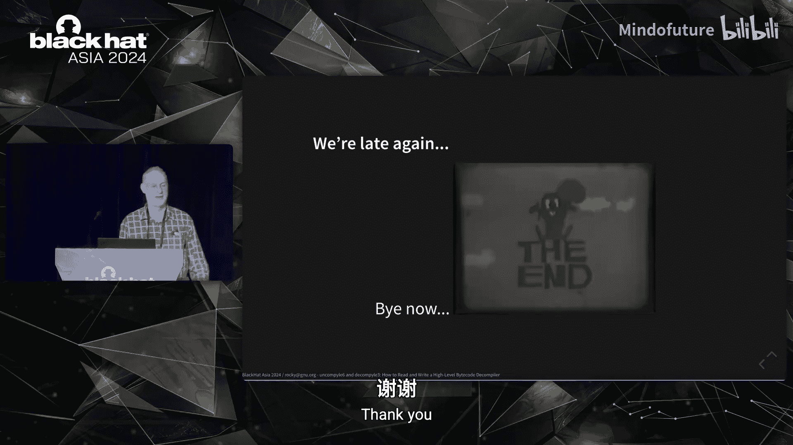

# 黑帽亚洲大会2024全集-•-中英｜Black-Hat-Asia-2024-p28-P29-How-to-Get-the-Most-Out-of-the-Python-Decompilers-Uncompyle6-and-Decompyle3--BV1oyX7YnEhN_p28-

What I'm going to say， what I'm going to say is going to go very， very fast。

 there's a lot of material here， basically what's going to happen is the first part in I dry runs。

 the first part people get， there's a lot of really， really technical stuff。You'll zone out。

We're doing this for the residuals not necessarily for the original presentation okay so everyone let's get started。

 I think it's already started and already okay I have a lot to get through times is going to be short。

 I may run over time Some I have to say is very compact and reviated and some of what I have to say is important so I'm going to talk fast I apologize in advance that therefore I strongly recommend that you follow along with the text in the blue link at the bottom so let's begin。

Let me start with a little survey， please raise your hand if you have used Hexra Itopro。

 Gidro or Bna Ninja， so raise your hands if you'。Okay， I see about 80% that's great。

 keep your hands up， keep your hands up for me， thank you。Okay， now。

 how many have you used any of those three to debug or dot mean to decompile Python bytecode to Python source text。

Wow， I actually， I see hands up， so。I'd appreciate it afterwards。

 you come talk to me because I don't know how to I don't know that it's not。 for this talk。

 I spoke to one of the founders of one of those tools， reverse engine toolmakers。

 and he confirmed or what he said was that all of the above kinds of decompilr tools that start from machine code are pretty bad when it comes to any interpreter that runs off of Btecode。

 Okay now， please raise your hand if you've used Uncompil 6 or decompile 3。Okay， okay， it's not zero。

 but there are some。And after this talk， all of you will know a little bit more about these。

I'm the current maintain and developer of Uncompos 6 and Decomp3。

 these are Python programs that you can get from Pipei I'm sorry from my really bad choice of names。

 project names the page shows Github commit activity from 2012 to now 31 people who contributed to this open source project submitting one or two pull request these are greatly appreciated and keep up the good work but what you see over the vast sea of time is that I've been working on this largely by myself my contributions are at the bottom left the person who is rank second and commits most are he's to the right and I haven't heard from him in a little over seven years back in 2016 I started this project on Github from a tar of a copy of from an archive from an obsolete version control system and at that time the code had been abandoned for about five years this counts for the big gap that you see off to the left very few people really understood the code in 2018 I gave a talk at a Python conference so you see a flurry of activity from 2018 in the middle of。

G and this code works for Python from the very first version in 1999 to 3。8。

 which is no longer current38 came on the scene a few years ago。

 but it's still supported and still in use so since this code is old and large and Python compilers have gotten more sophisticated this code needs better technology to keep up with Python so I forked the code I refactored it reduced its size and this accounts for the drop off in activity that you see on the far right of the graph from 2021 to now the for code goes under the name decompile 3 it only handles Python 37 and 38 a little fun fact on the extreme right you'll see a tiny uptick and activity and that's me working on the code in preparation for this talk there's a moral。

Of that but you can talk to me about this later unfortunately even the changes to decompile 3 weren't aggressive enough to track changes to Python bytecode and in the Python language。

 therefore I have an experimental decompiler for Python 38 to 310 towards the end of the talk I'll show a little bit of that。

Okay， so who am I that's me in the photo in this cartoon down at the bottom of the tower except I live in New York City and I've been doing open sourcefor in 2000 and when not doing my day job I do open source software but I'm retired now So I spend way more time on this in general。

 the code I've written has had plenty of time to spread around so I give software installed that matches any the logos on the first line。

 then you have code that I've written I don't have any cool logos for the software I'm going to be talking about today but the software of the logos on the left use a CD reading library called Live CDO I started that in 2000 and I still maintain it in fact I have a vulnerability that I need to fix when I get back to New York City I'm interested in other things like open source Mathematica and debugggers Most of the software I've written is GPL and I'm a member of the free So Foundation but enough about me let's get onto the topic at hand highlevel bycode is attractive for malL writersers because it's portable compact and impervy。

the standard general purpose analysis tools， I'll brought back a couple people from Microsoft contacting me regarding maloware Bonet that was active on Microsoft Wi。

 the malware was written in Python 27 as I mentioned before。

 the standard analysis those tools like Xrays or Gira were of no use to them。

And the situation has been getting worse， languages that use high levelvel bycode is not decreasing the Python language and bycode continues to change。

 Pyth's generated bycode has become more complex and harder to decompile decompilrs have been around since the dawn of programming languages in the early 1960s however the ideas that I'm going to present are somewhat new or little used and they represent my own personal research the seeds of these ideas were buried back in code going back 24 years as I've said the code was abandoned for five years before I came across it and it took me a while to distill correct and expand upon the ideas in the code and I'm not even sure I have a final word on this today。

There's theory in academic research， yeah， there's theory in academic research in what I call general purpose decompilrs。

 these are programs pseudo that convert machine code into pseudo source code。

 usually the resulting language is not something that you can run directly through a compiler。Yeah。

Let's see， okay。Okay there are systematic methods and tools for compiler construction these are just some of the books that you can find on Amazon。

 co I'm sorry the images are not larger， but here's a summary of them from left to right。

 some of these have gone through several additions over the decades。

 some come in several variations based on which programming language the books's compiler algorithms are written in some specialized for particular source or target language or a particular CPU architecture or for a particular operating system。

 some are aimed at writing interpreters while others are aimed at advanced compiler technology and finally some of them are no longer imprint because compiler writing technology has evolved over time the point here is that this is a well-trodden field。

Okay but none of the books in that last slide mentioned decompilr as far as I know。

 So how about books on decompilr or writing decompilrs for writing decocompilr construction。

 these are the only two that I can find both are about a decade old and neither is completely devoted to decompilrs and neither has gone through more than one edition by compilers and bytecode that are covered by these books。

 I'm sure that those have changed in the last 10 years。

 The topic on how to write a decompilr is about as rich and deep and is involved as a subject of how to write a compiler In fact。

 at core， a decompilr is cognitive of compiler， both take code expressed in one language and translate it into equivalent code in another language conventional compiler wisdom however。

 needs to be adapted and you'll get a small sense of this in this talk。

，Because of the need for， but scarcity of decompilrs。

 AI might seem like a possible way to get high level information from machine code。

 And for this talk， I recently looked at two Python decompilrs that use machine learning。

 So can AI save the day， Well know not yet。 However， if you're interested in how to fix this。

 I can share my ideas afterwards， okay。😊，So why am I here。

 Why am I giving this talk I've mentioned that General purpose decocompilrs kind in Gidra and binary Ninja or hexrays are of little to no use for Bcode languages。

 In fact， I've been trying to raise awareness of bycode decompilation as its own thing and that's a big reason and I'm here as I've come to understand bycode decompilation works very differently from general purpose decompilation and adding the modifier general purpose is my terminology right now this distinction is not widely accepted a couple years ago to raise awareness。

 I just started a discussion in the Wikipedia talk section for decompilrs unfortunately there's been no there hasn't been much discussion or moving on this。

Okay， that's raise awareness。 I'll soon describe the decompilation process and I will introduce a rarely used。

 if not entirely new approach to decompilation。 I treat decompilation as a human language translation problem。

 in some ways it can be like the kind of thing that Google translate does but the process will go through also follows as a pattern similar to the processes used by most compiler frontends。

 including the compiler for Python。 It is described in all of those compiler books that I showed images before。

 and I'm going to show this adapted to form decompilation。

 and I think this kind of adaption that I'm showing you it can be extended to create decompilrs for other highlel bycode。

At a more technical level， I hope you understand the phases of decompilation。

 at least for these decompilrs。 And this can be useful inting bug reports or fixing bugs。

 And there were a couple of people who have used us。

A common misconception that I see on reverse engineering forms is the confusion between decompilation and disassembly as we go through the process。

 I think the differences will be clear。 for those of you who are familiar with machine code I think it'll appreciate how high level byte code is very different from machine code。

 And finally， I think you'll get some ideas of the things that decompilrs can do and cannot do not only in Python but another similar programming languages。

 but before I get too deep into decompilation， I should say something about what it is briefly。

 decompilation starts out with machine code or bycode as input and produces source text this output in this slide。

 we have in Python。 Okay， so wheres the by code come in that gets introduced in a second。

 but let me first start out with some basics that go on when youre run a Python program And I'm going show you this simple program in the examples later。

 the program prints the output of calling a functioning5 okay。

I run the code using the Python interpreter， which is called C Python and we get the Exp output 5。

 and when I do this under the cover， Python translates or compiles the program into an intermediate form called Btecode and it interprets that internal form in this case。

 that in this particular case， that bycode stays internal， it's not written out to disk。

here are the bycode bytes for that main routine。 Here's what these instruction when you deco what the instructions do。

 they call for the creationtion of a function 5 in an interpreted language。

 there is no linker loader， like you have for statically compiled language is handled by general purpose analysis tools。

 Instead， this kind of thing is done at runtime。 after linking in function 5 into the main program。

 The P function is called。 And then finally and the function return value is then passed to the built in print function。

 which displays the output shown， okay。That that was tedious。

 But the instructions for doing all of that that I just said， it only takes up 25 B。

 For those of you who are familiar with machine code，25 B to do all of that is like really awesome。

 Okay， there are metadata sections that are in the bytecode。 and that adds up the space too。

 I haven't shown that， but we'll see some of this a bit later。😊，As I said。

 the interpreter doesn't run the source text directly， but it runs bycode。

 So one implication of this is that the source text doesn't need to exist after bycode compilation is done for certain kinds of source text called modules。

 the internal bytecode is written to disk automatically。 However。

 we can force bycode to get rid to disk using a standard Python library routine called compile the compileile module。

ok。That's the invocation a Bcode file is a Python code object which is serialized and then written out to disk using the standard Python library function called Marshall there's a little bit of extra data added and like the source text file name and the bycode version。

 the short name of this file here is5 doc Python dash38 dopyyC and that's a mouthful the file extension of this bycode usually ends in dot pyC as it is here or sometimes do p0。

AndNow that we have this bycode object， I can just run the bytecode。嗯。Okay there it is， sorry。

 and we get five again， okay。Go on。With this introduction。

 we can now do our first Python decompilation using Uncomped 6。

 the simplest invocation is uncomplied 6 with a bycode file name。

 this is what we created in the last slide。These lines in orange that start with sharper comments。

 the section at the top contains a little bit of metadata that I mentioned before。

 which is stored in the bycode file。 It is not part of the 25 byte instruction sequence that we saw in Hx before。

Each bycode has a unique number for the bycode variant here， that number is 3413。

 and this variant covers Python 3。8。Major releases of Python typically can alter the programming language and or the bycode and or the way the source text gets translated into the bycode Python bycode varies more than any other bycode that I've ever encountered so when you find a tool or read a blog about Python bycode。

 some of the ideas might be only relevant for a small number of versions around the time that the tool was developed or when the blog was written。

The drift in bycode from the very first release in 1996 in the most recent Virgins is about as dramatic as the drift from Latin into Italian。

 except that drift happens much quicker。Let's go back。

Although the name of the whitetecode is five move that's seen in white at the top。

 the name of the Python file that contained the source is5 by Py。

 and that's seen in orange made Day data a little down from the top。Something is。Yeah， okay。

As you can see here， the source text and the decompile code are pretty much the same。

 people are used to general purpose decompilrs， it just the one for Gidra or hexrays。

 are usually amazed at how close the two are， and this is one facet of high- levelvel bycode。

 a lot of source information like variable names along with their types and is preserved inside the bycode。

The main differences between the two are the comments produced。

 the comments from the source program on the left don't appear anywhere in the reconstructed result and that's because the comments just don't appear anywhere in bytecode line 11 on line 11 on the left doesn't appear anywhere on the right One of the things that these decompilrs do to increase the likelihood of getting exact source text is that they make an attempt to format in the same way that the standard format is for Python work we're more careful about this than other Python decompilrs but we don't always get the formatting exactly the same。

Now that we've given an example of Python decompilation， we show how our decompilers work。

 and with this you can follow along the decompillish thought process。

One of the unique features of these decompilrs is that we provide a means for following along the decompilation process。

 Mach language decompilrs， even though they have a language affinity like we have。

 they currently have no way to provide this level of detail。Okay。

 our decocompilrs go through five phases， the idea of running through phases or constructing a pipeline。

 is's also how most compilers work， the phases are。

get by code disassembly using Exs Exs is a crosswordads of disassembly library that I wrote to support these decompilrs。

 however it is also useful in other projects that work with Python bycodekenized the disassembly。

 tokenized as a compiler compiler centric term， in other decompilrs and code analysis tools。

 this process is sometimes called lifting as in lifting the disassembly or lifting the machine code。

se parse the tree into parse tokens into a parsse tree。

 abstract the parse tree into an abstract syntax tree and finally produce the source from the abstract syntax tree and don't worry if you don't understand the above steps I will go over to each step in more detail soon the scanning and parsing phases in the second and third steps are similar to the beginning steps that compilers use to produce code and this is the part that is different from decompilrs these decompilrs from from other decompilrs the first step in decompilation is carving bycode bytes into instructions here I'll use the bycode file that we generated earlier as input and for demonstration purposes I'll use a standalone program called pdiasm from the cross version disassembler package。

Okay， first you'll see that again， there are comments in orange at top， again。

 this is metadata about the Bte code。OkayIn fact， this particular metadata is exactly the same for example。

 the version of bycode that we have here in the first highlighted in line is the same as before 3413 okay now we get to the actual bycode instructions okay I'll go into this more detail later but the main thing to note here is that the first two instructions come from line one of the Python source text line one is indicated by one colon in white to the left in the part that's grayed out below the one colon you may see a six colon but that's because the source text that's the beginning of source text for line6 each bycode instruction contains of an operation name in blue for example load constant or store name and the operation name is followed by an optional operaand these are listed in parenthesis in a left panel you see instructions that result from decoding bycode from a library routine from the excessod practice because the compiler doesn't call the command line routine but instead of library API it has a disassembly structure on the left。

We're showing the print representation of that structure and this is happens to be the same output from the command line utility。

 but from this disassembly structure we need to massage and repackage the information to put in a form for parser input and this is shown in the right panel even though these two look almost the same internally the different structures on the left is again is output from phase one and on the right is parser input to phase two and parsing will be coming up the next slide oops。

Input to the parser is a stream of tokens but token is a standard compiler term for the input atoms that are fed into the parser a token is based on the operation name in blue and sometimes the operation name and the token name are the same however the end field the field in green to the right sometimes has parts of it folded into the token name and here are examples of this there's a good these are examples in the first instruction load constant is that offset zero offset numbers are in purple the load constant operation the load load constant operation at both offset zero and6 have been specialized on the right to load string in general a load constant operation can be any python constant literal like boolean value is true or false or maybe a couple of string time zone names this aspect shows another difference between by token。

and code， the instruction operations are register values， which can be numbers。

 addresses or parts of addresses。 In Python boat code， the operate are arbitrary objects。

The other operation that name that is different from the corresponding token name is make function and you see that in purple at offset8 towards the bottom it gets the suffix added to the name and becomes make function underscore zero zero is the bytecode encoded way to indicate that a function signature for this function doesn't take any parameters the instruction sequence leading up to make function would change depending on the number parameters that the function takes so a parser needs this rough parameter information to be able to match the sequence of instructions that lead up to make function。

in the last slide we just showed the first two phases which turn Bcode bytes into Btete instructions and then a stream of tokens。

 the next phase of scanning and parsing will be coming up next and it'll look familiar if you've developed compilers but I suspect that's a nichemark and I suspect nobody here knows anything about developing compilers if things go too quickly you may find some of this explained in more detail in one of the 40 books on Amazon。

com that I showed before。To simplify， we'll focus on just the source text on the very first line。

 the companionon materials have full output for all the lines of all the phases。

 but even though this is a small part of the code， it covers all the basic concepts very well。

In order to run， it helps to walk first， so let's start out with the first line of the Python program。

 It was just a simple Python dock string shown in green at the top。

 and let's start out with the first instruction。Of course。

 most Python expressions require more than one instruction to represent them in bycode。Oh， sorry。

 say， sorry。So note note that we just have the token name load string。

 the string value isn't relevant in parson that one instruction all by itself is the complete representation in bycode for a particular Python expression it would be what you would get if you typed the literal string expression。

 black hat Asia example and that was the only thing in the program for those of you who are familiar with programming language system that compiled a machine code again。

 this is pretty strange and machine code you rarely have one instruction covering one source code expression and again that's what makes this high level bytecode of course most most Python expression require more than one instruction to represent them in bycode。

Okay because load string is a complete expression the parsel matches that single token and emits a quote unquote  grammar reduction rule。

 this is the expert colon colon load string that you see here and this line is written in back its now a form you'll see this notation in both Python's grammar specification and it abstract syntax street specification more generally this is the way syntax is specified in most programming languages。

 but for the decompilrs that I've written they also use grammars to do their work and this is one of about 50 or so grammar rules for decompiling Python 38 the word the right of the right of the colon colon equal is called a grammar symbol。

 the colon colon equal is pronounced transforms into because the expert grammar symbol can transform into load a load stringing token but since we're really working bottom up or token up the parser recognizes reduction possibly only after the fact so the recognition is really from right to left or alternativeity from token or stream of token。

intoto a grammar symbol performing this reduction rule。

 the parser creates a simple okay so that's oh yes， so performing this reduction rule。

 the parser creates a simple tree created with the expert grammar symbol in yellow as the root of the tree and the load string token in blue as a single cha。

 So let's continue Here's I've just copied what we had before。

 Now let's get to the second white code instruction。😊。

A store name instruction is one of the kinds of tokens that form a store grammar symbol。

Okay so there we go although you won't find a store grammar symbol in a grammar for Python。

 you will find store with a capital S appearing in Python's AST documentation extra with a capital E also appears in Pyth's AST when possible we try to use the grammar symbol names have that are similar to the names that Pyth's AST uses over the two grammars have similarities at the top of the tree but they have to be different at the bottom if instead of store name we had store global token that would be another kind of instruction in the class of store grammar of quote unquote store grammar symbols okay to put this in terms that may be more familiar in English think about how a noun might be one of many words like bycar or bus and let's say store store name is like bike while store global is more like car as far as a sentence goes both bikes and cars or nouns noun is a grammar symbol that they both belong to the grammatical structure of a sentence doesn't change whether you replace bike。

Bike for car or even bus in any sentence。 Okay， to recap， we've now encountered two reduction rules。

 These are the lines in yellow。 the second reduction rule is theyve encountered。

 The little graph that the pars is building up on the side looks like this。 Okay。

 so now we have two little trees。 And let's continue。

 The parss match six from storage grammar symbols and build two trees on them。 so。

After finishing the store reduction rule， the parer now notices we have expert and store grammar symbols in succession。

 the grammar that I wrote for the decomps dictate and when these two are seen in succession that constitutes an assignment statement。

 so yet another rule triggers and these are the two trees that we had before joined to recap we master an assignment statement continuing an assignment statement is a kind of statement and we have a grammar rule to indicate that notice that after seeing the second store name in blue from early on。

 we kicked off a flurry of reduction rules， the lines that start in yellow。

 this kind of thing happens in bottom up pars when you get to the end of the token stream it is like a detective story where after the last couple of pages all the loose fragments and the mysteries of the entire book are finally wrapped up and the person who wants his code decompiled is cheers so here here's the final tree and so now let's see how this is shown in ASI output this is the As representation from the graph。

In the last slide， it shows more information shown in the graph。

 But that is because we're also showing token attributes in addition to token names。Okay for example。

 we now see the instruction that offset， we see instruction offsets and operaan values okay this is great but recall that we didn't have an assignment statement at the top of the source text and said what we had was a doc string however doc strings are implement in Python using this special kind of assignment to a string variable of that funny name called dock okay so where does this get it to change into just something for more familiar I am glad you asked because this becomes from the next phase phase four takes the par that we just created and transnes that into an abstract in tree we looked for tree patterns of this kind of special kind of excitement and when the process finds something of interest that matches that part of the tree is replaced in a sense we are abstracting the specifics that we found into something more the way a Python program wrote the program strictly speaking we don't have to do this here and sometimes this kind of thing can be a difference between the reconstructed and original source text however if you find a python source text that looks a little screwy。

or is it invalid python what may be going on is that this kind of transformation isn't being detected and I see this happen in another python decomp other a lot noticeice that we've simplified the tree as well we no longer have a grammar symbols extra and store what we could have tried to detect do rings earlier but that would have been mess here and finally we get to the actual source text remember the anybody remember okay。

The source text is why we were doing all of this， the source text is created by in the AST。

 calling routines based on the name of the grammar symbol。

 and here the grammar symbol of interest is called its doctrine ring in yellow。

Okay， to simplify the conversion of the ASD into a source string。

 there's a custom domain specific language or DSL that's used。

 This DSL is described in the project quickly。Okay。

 you've now finally successfully completed the first part of this talk which gives an overview and I'm going to go on。

 but there's nobody afterwards and you know， I'm sorry， so to some of you。

 if you're not familiar with how compile frontends work this first last part might have been a little bit intense。

 so relax。Okay， that's enough time because I'm over time and because what's coming up may be even rougher。

 I next to go over a disassembly in a little more detail and introduce a new idea for Python de compilers。

 unfortunately that's the stuff that's most important but I had to go through all this material because folks here have to explain compilers so the next stuff uses some advanced compiler technology。

I'But first I'm going to focus on a little on disassembly for one important reason there aren't good decompilers for the most recent Python versions and that's likely to continue forever so the reality is that you may have to understand bycode malware from a disassembly listing there's a disassembler in the standard Python library called dis most Novice decompilrs use is the first thing that comes to mind but that has some serious limitation。

 the biggest limitation is that it can only disassemble code for a single Python version。

 the version that's running the decompilr if you're running the latest version of Python such is 312 but the pcode you want to analyze is from an earlier version like bycode 27 then you're out of luck malware written in Python tends to use older version of Python and this was the situation when Microsoft folks contacting me to get on this limitation un compileile 6 and decompile3 mentioned extius which stands for cross Python disassembler that package comes with a disassembler on steroids and I're going to show that briefly in yellow our command line options that I use okay。

that's Xis and then in yellow are the command line options that I use for this im it's a basic interpretation of sequence zone instructions showing the actual bikecode and the ability to interminganglele the source text with assembly in reverse engineering most of time you'll not have the source text there's of course no harm for asking for the source text when it doesn't exist so now let's look at the output the top of the disassembly output is again there's some metadata in orange I went into this earlier so I've alllighted that in the slide a piece of metadata that。

呃。This is piece that。Should。AP of Mad any we saw implicitly before。

Was this value from the constant table The first instruction at purple offset0 is load constant。

 The string string operator for this instruction came from index 0 of this constant table。

 Now let's compare the assembly instructions if you're familiar with Pythonons just out。

 but this is similar。 okay， but there there are some differences and you'll see them soon。

Okay first in green， there's the source code that's a python doc string below that in white we have between vertical bars。

 the actual whitecode values and not seen in the top in Hex the first by the first instruction is 64 this is the code in Python 38 for large cons。

 the opera end value is0 but zero again is an index into the orange constant table above in the second instruction we see something interesting happening off to the far right after this is parenthesize the opera and value doc in green so this is additional text that says it's an assignment statement that starts in white doc equals black hat Asia example here what the disassembler is done is described the combined effect of the first two lines as I mentioned before this is how python implement doc strings here is a much more complicated example the companion materials show more detail and don't get confused between disassembly in decompilation even though there's some higher level。

Retation what we have here is disassembly internals of the interpreter exposed， for example。

 top of stack or top sequenceequ refers to the how the interpreter works and the pop top instruction。

 which is grayed out just below the last call function has no corresponding meaning in the source code Disassembly is easy and straightforward decompilation is hard However。

 decompilation usually starts out with disassembly however often the disassembler shown in the last slide it does have some limitation and here's an example of something that the dismbler can reconstruct while the disassembler is great with code that doesn't have jumps in it once we have jumps like highlight instruction。

 the disassembler has to stop combining instructions with each new python release decompilation of control flow is become increasingly more difficult nowadays about a third of the issues are raised in the compiler bug trackers are related to control flow grammars and the grammarbased approach that we use however handle parsing nested sequences of control structuresrs quite well if you mark them up So having a。

way to characterize control flow that fits into decompiling can give more precision and more accuracy that is just not available in general purpose decompilrs。

 I won't say much about how uncompile 6 and decomp3 handle difficulties betterizing control flow instead of using an approach in an experimental decompilr that I'm working on now below is the AsD for this experimental decompr the token is in white that start BB start BBn block and join or pseudo tokens they get inserted by a special control flow process that I'll show briefly next by the end of the next slides I hope you'll understand a little bit about basic blocks that you see in orange BB in the token name is an abbreviation for basic block I hope you get some idea of what sibling and join mean in the token names and what dominator means that's in the orange opera in the very last line now let's consider this python simple Python program to count the one bits in an insure if you're interested in algorithms you might find this code cool and interesting but the only thing that concerns this when thinking about control flow is that is a program with the following characteristic。

Nested inside the main body is a while loop。There it is nested inside the Y loop。

 there's an if an else statement and there's one more nesting level。

 which is then in else parts of the if here we have more than one item at the same nesting level even though the two blocks are at the same nesting level。

 the two blocks are distinct and separate in some programming languages like Java or Java variables declared in each block will be in different scopes what we want to do to make parsson easier is detect the nesting level or more precisely of the scope we want to mark scope boundaries inside the instruction sequence and that brings us to the orange comments these captured what I just said they mark scope boundaries but I'm doing this in the source sex rather than the bytecode instruction sequence Now suppose instead of the orange comment we have the word dominator so the words that have dominator in them suppose those were non-braranching instructions to get to any instruction that in the same scope or nested scope you have to pass through that dominator instruction it acts as a gatekeeper for the group of instructions。

Okay similarly in order to get to any instruction in the same scope or nested scope that follows you'd have to pass through one of the matching one of the comments that saysjo in it。

 so now let's look at how the python interpreter sasings this is control flow reconstruction from the bycode instruction this graph does come from a program called the Python control flow project I created this project to perform more accurate and faster decompilation of python control flow structures however this project can be used in other kinds of bycode control flow analysis instructions are or sequence of instruction are broken into basic blocks a basic block is straight line code if there's a jump to any instruction in that block of instruction it has to be to the first instruction and if a block contains any jumping instruction there can only be one and it's the last instruction so the first instruction acts as a choke point or a dominator that you have to go through to get to any of the other instruction。

In the basic block I don't have time to describe in the text boxes or what the colors and the line styles mean on the arrows for that you have to look in the companion materials here we have the control flow graph from before。

 but now altered to show dominator regions and dominators and this graph comes out of a later phase of the control flow project there's a lot going in here that I just don't have time to explain so C companion materials for this。

 but let me introduce two important terms dominator region and dominator the easiest term to explain the dominator region this is just another term for scope describing when this is another term for scope that we saw when showing the source code。

 but it is a property that is computed on a graph it's or more precisely a control flow graph like this this property is used quite a bit in compiler data flow analysis so Cbook on advanced compiler optimization for algorithms for how you can get this information。

What does the dominator part of dominator region mean。

 we kind of alluded to this before if something dominates if it acts as a gatekeeper。

 so an instruction like the first instruction of a basic block dominates other instruction in that basic block。

 but similarly a dominator block， dominates other blocks if you must pass through that block in order to get to the other blocks that are nested or at the same scope。

 the darker color a block is， the more nested it is inside other block regions so block3 is nested or dominated inside block regions two and one Dominator blocks have that 3D block box or shape the upside down how shape shows the join point and which is the exit of a dominator region this is where the scope ends companion materials to give a fuller explanation I'm really sorry one slide if you're taking pictures。

 this is the slide to take a picture of so I'm sorry I'm talking fast and glossing over details。

 this slide was my motivation for getting this talk and already over time because I have to give all this backgroundops。

ok。The doctor of the color a block is okay， So what I want to show here is how you can show nesting。

So how in an automated way， you can show nesting and block scope and the differences between alternation and at the instruction level。

 And so those wacky pseudo tokens that I showed briefly in that chain compares example。

 those are used to compared these kinds of concepts in a way that a parser can understand and match。

Okay now that I'm getting a worldwide tour of bycode decompilation for these Python decompilrs。

 let me back up and put this in place okay there are other decompils for Python they all start out with this assembly。

 even the one that I look for that uses machine learning many build a tree more or less based on the instructions from a disassembly and they all produce source text from the internal treeous structure however they are a bit more ad hoc。

 none of them uses the grammarbased approach here， the phases are fewer and a little less distinct general purpose decompilrs like you find in Gidra are largely different。

 they live in a more complicated world to be able to do things across a wide spectrum of machine languages and a wide spectrum of programming languages they have to give up on noticing any specific packet patterns of instructions like we showed in the chain comparison example。

 the ability to match specific patterns is what makes these decompilrs produce extremely intuitive and accurate results written in the programming language that the source code text was written in control flow in general purpose decompilrs that is。

Zone can phase， and that phase doesn't take into account the specific target programming language that produce the code or the specific set of control flows that are in that source code that source language our control flow is intimately tied with a control flow for a particular Python version。

Python has an extremely rich set of control flow structures I know of no canned control flow detection mechanism that would be able to cover all control flow mechanisms that Python includes such as else clauses on wild4 and tri blocks our approach uses tokenization to facilitate parsing this is similar to the lift phase in a general in general purpose decompilrs in general purpose decompilrs the lifting languages sometimes to LLVM or an LLVM like language in Python our intermediate language is very much tied to Python bycode in general that is true for all highlevel bycode decompilrs their intermediate code looks pretty much like the highlel bycode if there is an intermediate language。

Also， that intermediate language drifts over time， along with the language and the bycode。

Okay I've shown how the two and best the most popular decomps work。

 of course these have bugs in them， but by understanding how they work。

 hopefully you may be able to understand， pinpoint and report bugs bugger or even fix problems。

 begin to understand Python bycode in general and how the source text and the bytecode or relate it。

 extend this code for a newer or unsupported bycode。

 use these techniques to write a decomplier for other programming language such as Ethereum。

 soliddity， Lua， Ruby or various lists just to name a few。

 for the bikecode that you may be interested， there may not be a decompilr are available yet。

 hopefully with this information in a position to write one。

now we get to my favorite part way over but this is my favorite part。

 I'm just going to say the names so John Acottt and Hart Google。

 they wrote the version in know Crca 2000 and a candidate it but very， very important。

 Blackhead Asia reviewers and organizers I greatly appreciate them giving me these opportunity to present this topic which I personally think is very important because I said there are no general purpose tools for writing like Gidar Hex for any highlevel bycode language。

 I want to thank Phil Young and speaker coaching program。

 you know Phil high Philll thank you Lydia Giiano who organizes the speaker coaching program。

 I mean as bad as this is it would be a lot worse without them， who we see in AV。Hel me out。

 and the folks， folks down there。 I mean， I appreciate all that。

 Stuart Frank Al did some editing on this and terms this to English to the extent this。

 this is English。 Christina is also great。😊，In organizing。 And also， thank you all for， you know。

 listening。 And with this， I hope you do great stuff in the future。

 This is all the additional material。😊，Okay， now I'll show this little cartoon。

 but that this is this。Does anybody in the audience know who the little guy is。

 what the name of the little guy is？Nobody。It's my name Rocky。 he was a flying squirrel and。

There you go。 Thank you， but let me， let me go back to that。 Thank you。

I'll take， I'll take comments in these。