# 黑帽亚洲大会2024全集-•-中英｜Black-Hat-Asia-2024-p29-P30-Game-of-Cross-Cache---Lets-Win-It-in-a-More-Effective-Way!--BV1oyX7YnEhN_p29-

Hello， everyone。 and welcome to my talk。 game of cross catch。 Let's win it in a more effective way。

 And in this presentation， I will talk about how to solve challenges in cross catch attack and perform cross catch attack more efficiently。

And my name is Lu Wu。 You can follow me on Twitter and I am the author of 30 page table。

 and in this talk， I will use 30 page table again to exploit an NPU back on Samsung device。

And here is the agenda of the talk。 I will briefly introduce the crossc tag followed by highlighting two challenges in it。

 Next， I will delve into the most important part of this presentation using a specific vulnerability as an example to analyze how to address the two challenges in cross catch tag。

 Then I will demonstrate how to exploit the UAF with 30 page table on Samsung device。 Finally。

 I will make a summary。first of all， let's take a look at the cross catch attack。

 Here is a simple example of UEF。 we can trigger the U EF to get the victim object A。

 and then we can reclaim the victim slab to page allocator。After that。

 we can let K map catch B reuse the pages of victims lab by doing this。

 we can make victim object A to be reallocated as object B。 Now。

 if we perform operations on victim object A， we will corrupt object B。 Following this。

 we can make use of corrupted object B to get root。

 This is a simplified process for cross catch attack。in， in a more general context。

 object A or object B can be also be pages or other types of memory regions。

As we can see that cross catch attack is getting really popular， there are a few reason reasons。

 First， original vulnerable vulnerable object is not exploitable。Sometimes。

 so we have to use crossc attack。 Second， by cross catch attack。

 we can transform the unknown vulnerability to well known one to simplify the exploitation。 Third。

 with help of cross catch attack， we can build data only exploitation techniques to defeat growing mitigations for example。

 here are some widely used the exploitation techniques based on the cross catch attack。well。

 cross catch attack is known as an unstable technique because it involves many steps。

 and each of them may introduce some uncertainty。 So we start to think。

 are there some methods to make the entire process less unstable or in other words， more efficient。

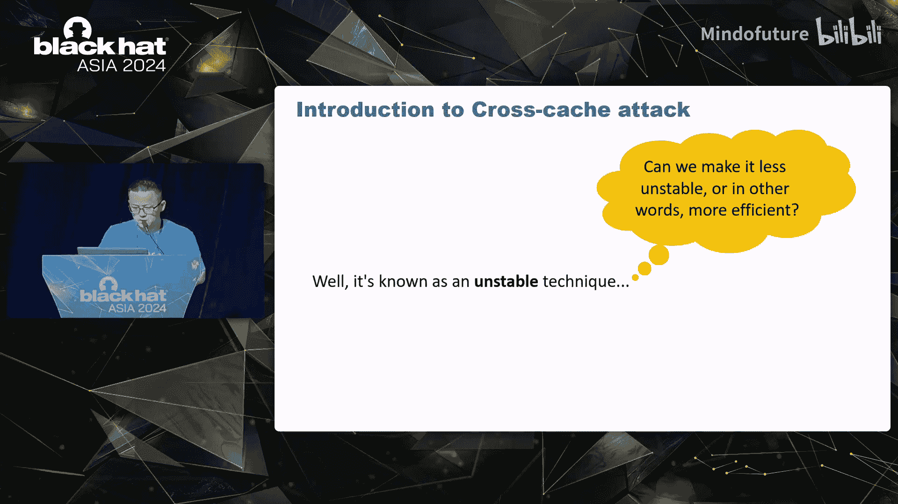

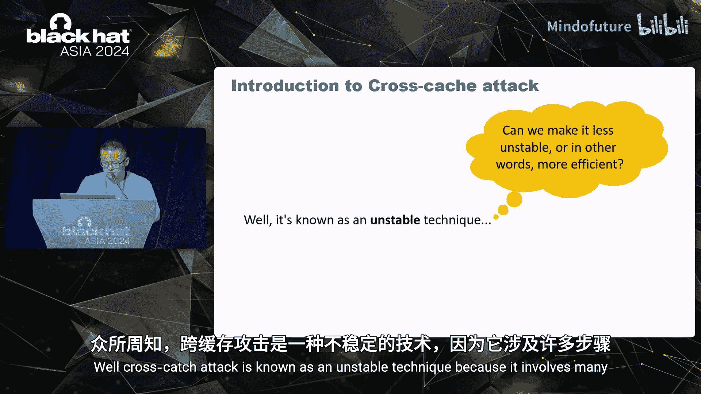

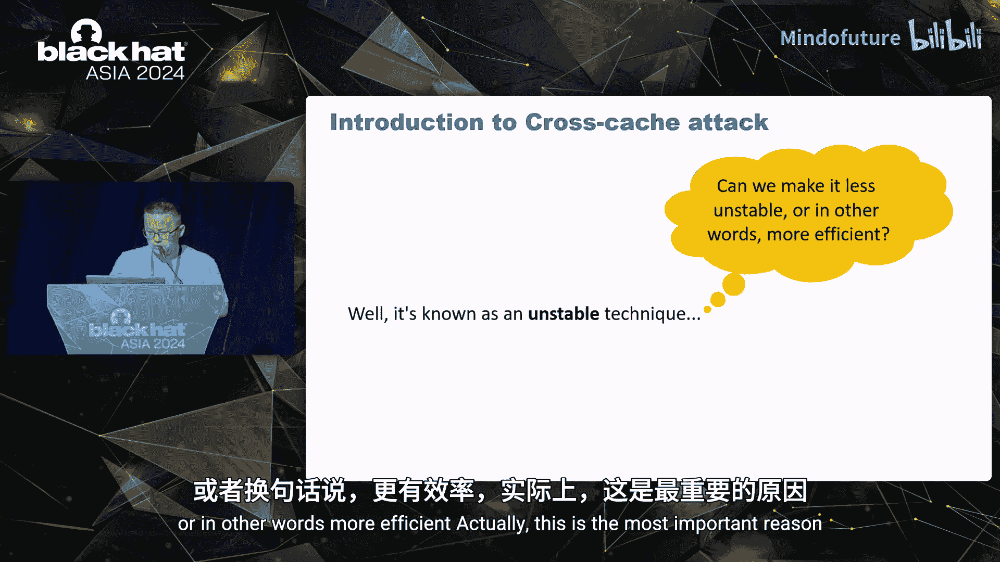

Actually， this is the most important reason why I start I want to delve into cross catch attack attacks and started this research。

Now， let's see the common workflow of， of course catch attack Before that。

 we need to know slab allocator a little bit。 Here is a brief view of for a slab。

 which we allocate objects from。 A slab could consist of multiple pages。

 and there are objects per slab objects in a slab for a catch。

 both objects per slab and order of pages are exported through this F S。

Here is the view of Kim M catch。 There are proec slabs for every CPU for accelerating allocation。

 We need to pay attention to the partial list， which may contain many slabs。

The per partial is really important part， which we need to manipulate during cross cache。

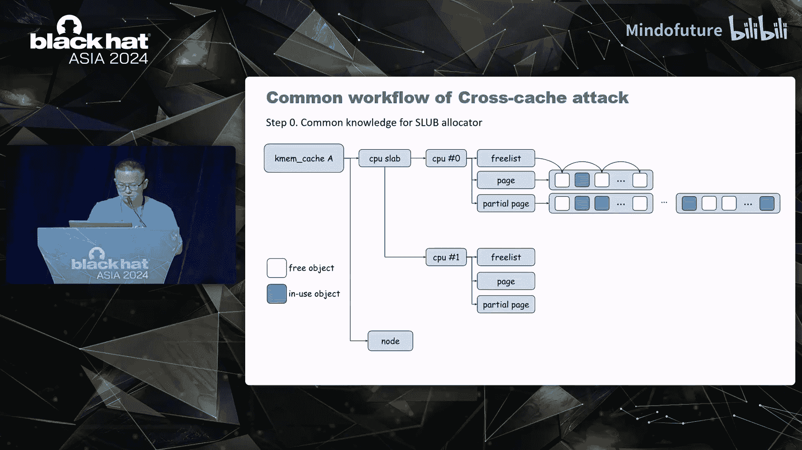

As for the partialist， there is a deterministic method to put a slab into it。

The first step is to create a full slab。And then pain the task on target CPUU， for example， CPU 0。

 After that， by releasing an any object on this four slab。

 we can put this slab into the partial list of CPU 0。

 This method is really useful for increasing the length of partial list。

The partial list also has a flashing feature， although it can contain many slabs。

 there is a maximum number of slabs it can hold， known as CPU partial。

 which is also exported through this F S。

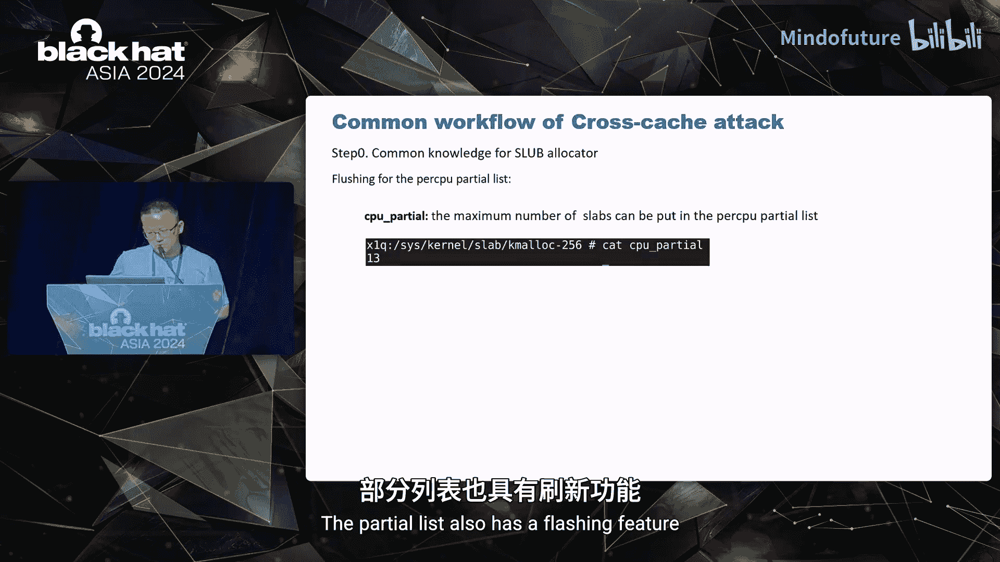

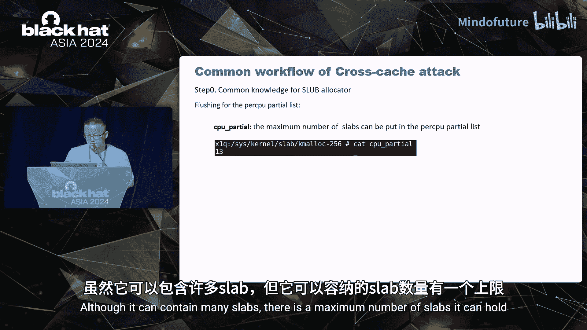

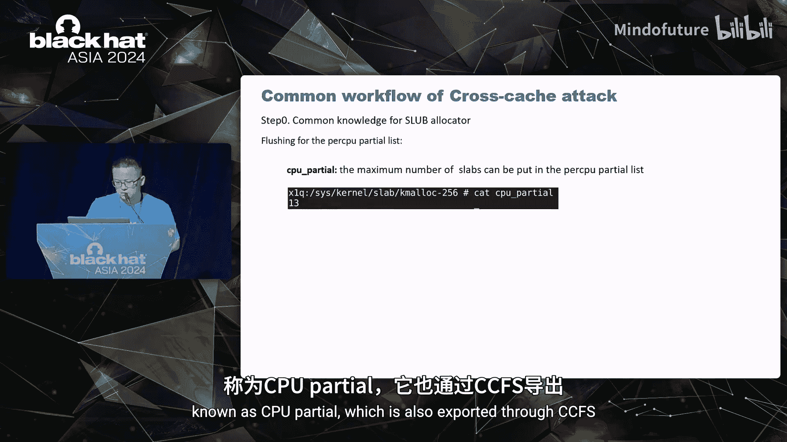

Once the number of ss in partial list exceeds the limit set by a CPU partial flashing for partial list occurs。

A slab with some in use objects are moved to slabs slabs per node partial list and slabs slabs that are empty are freed back to page allocator。

After knowing the common knowledge， let's see the common workflow， of course， catch attack。

stepep one， paying hour task to a single CPU， for example， CPUU 0。

step to perform def de fragmentation to drain partially free sbs of all their free objects。

step 3 allocate about objects per slab times CPU partial plus one objects for later use。

Step 4 allocate objects per slabr-1 objects as pre all objects。 step 5。

 allocate to the victim object。Step 6 trigger the vulnerability to release the victim object。

And step 7 allocate objects per slab plus one objects as post log objects。 After this。

 we can make the victim victims slab a full slab。And in step 8。

 release all the pre log and post log objects。 This step would put the victim's lab into partial list and also make sure the victim's lab become empty。

Step 9， a free one object per slab from the allocation made in step 3。

 Let's see this process more carefully。 If we release CPU partial-1 objects。

 s partial minus-1 slabs will be put into the partial list。

The flashing for partialists won't happen yet。And we， and if we released one more object。

 the flashing for per partial would be triggered。 and the empty victim slab will be reclaimed to page allocator。

Since the victim's slab has been reclaimed， we need to help three object B to occupy the victims lablab in step 10。

In this step， victim object A gets re relocated as object B。 Finally， in step 11。

 we can construct primitives for p privilege escalation。

After knowing the common workflow of cross catch attack， let's see the two challenges in it。

 The first challenge is how to discard the victim slaplab under a constrained allocation primitive。

 And the second challenge is to， is how to make high order slab reuse the low order sb deterministically。

Let's say the first one。 normally， we need to trigger the flashing for partial release to discard the victim's lab。

 This requires not only the A ability to allocate a large number of objects， but also the。

Ability to keep them unreleased for a while。However， these two conditions can hardly meet sometimes。

As for the ability to allocate a large number of objects。

 there are some mitigations like random kim caches。

 auto slab that prevent us from finding suitable allocation primitives。

 As for the ability to keep the large number of objects unreleased for a while。

 There are some temporary kernel objects， which get allocated and then released very quickly。

 So we we can't keep such objects unreleased for a long time。

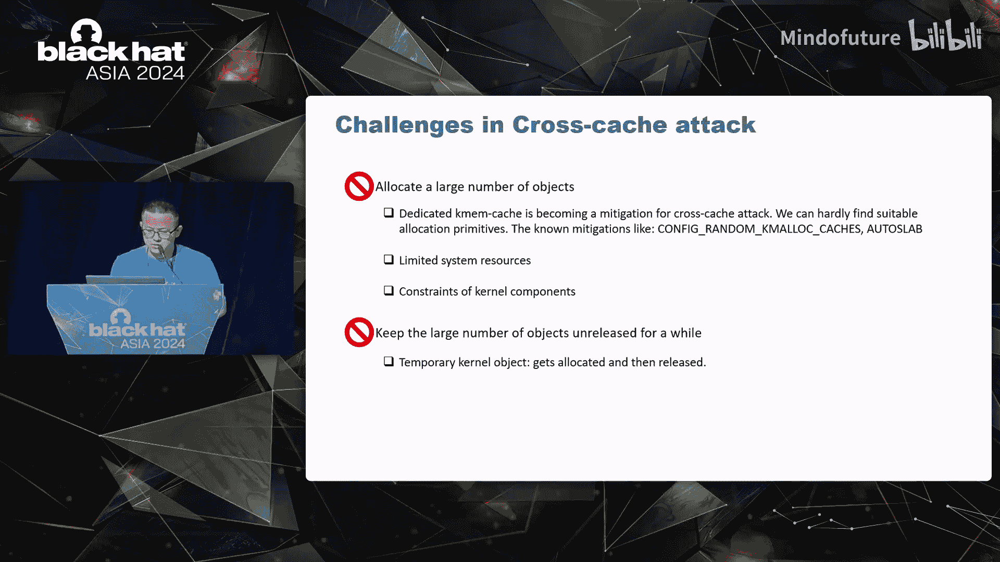

The second challenge is how to make high order slab reuse the load slab deterministically。

 usually if we are going to cross catch from a bigger slab to a smaller sb。

 we only need to discard the bigger slab and try to hipbury many smaller slabs to reuse the released bigger slab。

 In theory， the reusing would succeed if we hipsbury enough smaller slabs。But if we。

 but what if we cross catch from a smaller slab to a bigger one。

 simply allocating a large number of objects B doesn't work。 Instead。

 we need to get low order pages of smaller slabs compact into the high order pages of bigger slab。

And this requires hope shaping。Now， let's dive into the main point of this talk。

 advancing towards a more effective crossc attack。 And in this part。

 I will try to solve these two challenges。First of all， let's take a look at this vulnerability。

 which we were use to explain the technique details。

 This vulnerability is a MPU issue fund by my colleague Ye Zhang， and and it affects Qcomm 4。

14 kernelel。 this user could lead to a U AF or double3 For more details。

 please refer our percentage at Blackhead Euro last year。With this issue。

 we can get an arbitrary chmo catch free primitive。To use this primitive。

 we must prepare the content of victim object carefully。

 So this requiress us to perform cross catch attack。For this issue。

The victim object is MP U network command object， which is allocated from a dedicated K M catch。

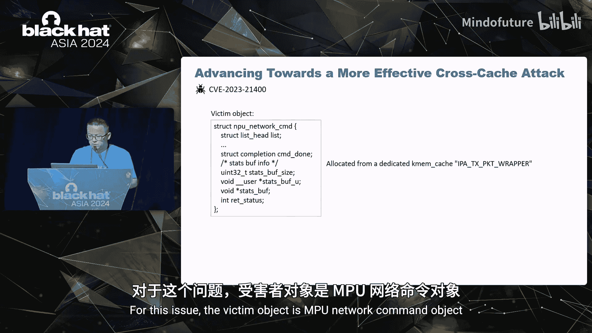

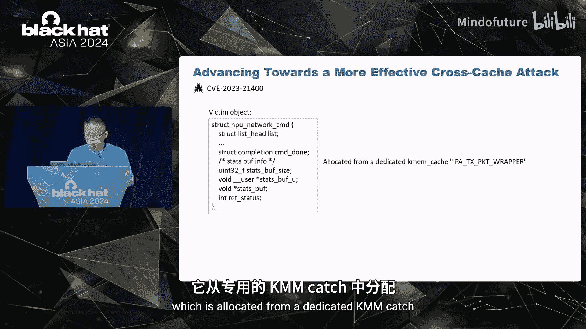

嗯。Some basic information about this dedicated K M catch is exported through C F S。 For example。

 we can know that the order of its slab is 0。 The object size is 104 B。

 There are 39 objects in one slab， and superial is 30。

We can also know how many slas in per CPU partial list for each CPUU。

 It turns out that this dedicate came up catch。Doesn't have much slabs on partial list。

 And it's an inactive K M catch。 This means it can be manipulated easily and not much noise getting involved。

And here is my exploit exp exploit plan for the issue。

 first to trigger the issue to get the victim object。

And then using cross catch attack to let file a reoccu the released victim object object。 After that。

 make use of arbitrary free。Actually， key free primitive to trigger a5 U A F。For this file U E F。

 we use 30 page table to exploit， exploit it and get root。This whole exploitation is data only。

 However， we rely on cross cache so heavily， which requires us to perform cross cache attack st to get a reliable reliable exploit。

So let's say our exploit step by step。 first trigger the issue and then start across catch attack。

 We choose Klock 8 k to allocate fiery from。 So this cross catch attack would call cross from the dedicated K M catch to Klock 8 k。

The slab size， slab size of dedicated k M catch is order 0， while the slab size of k 8 K is order 3。

This cross just contains two challenges we need to solve。Let's see the first one。

 how to discard the victim's order 0 slab under a constrained allocation primitive。

The MPU network command command object is a temporary con object that it quickly allocated and released。

 We can trigger the allocation and releasing of this object by。These MPU I control commands。

 this is a really constrained allocation primitive because we can't allocate a large number of MPU network command objects and keep them unreleased for a while。

Well， we found another kind of object sharing the same K M cache because of a slab merge。

 but it requires system privilege to access the cor corresponding driver。

 So we can to discard the victim's lab with the。The old method from on trust app。

our plan for solving the first challenge is to discard the M T slab in a risk way。First， we。

 let's see a really interesting slab move。S不 move。Move permitted。

 which can move the CPUU slab from one CPUU to another CPUUs partial list。For example， if want。

 if we want to move CPU partial CPU slab from CPUU 1 to CPUU 0。

 we need to paint our task on CPUU 1 first and then make CPU slab of CPUU 1 full by allocating objects per slab objects。

And then pay our task to CPU U 0。 After that， release all the objects allocated in step 2。

 step move just happens with this primitive， we can put one more slab into the partial list of target CPU by allocating objects per slab objects at most。

By repeating this slab move primitive， we can put controllable number of slabs into partial list of target CPUU。

By this new way of putting slabs into partial list， we can remove the step 3。

In common workflow of cross catch tag and the release replace the step 9 with repeating slamo primitive。

Now， we， we only need objects per slab objects to finish discarding a victims lablab by repeating slab move primitive。

 However， it's not good enough for this issue because we can only allocate one MP network command object and hold it for a very short time。

So we have to try harder。let's see such a risk risk scenario。 There are n task tasks。

N is bigger than objects per slab。 All of these tasks are pinning to CPUU1。

 and each of them keeps on allocating and releasing MP U network command object by calling corresponding NPI control。

There will come a time when at least objects per slab tasks have。

Have finished the allocation of objects and still wait for their release。

Since there are objects per slab allocations happening at the same time。

They must lead to a full slab getting created on CPU 1。

So if we just switch any of these tasks to CPUU 0， A release will happen on CPUU 0。

 this triggers a S move pre primitive。 So as a result。

 this full slab would be moved from CPUU 1 to the partial list of CPUU 0。

And we call this hope process as a risk style slab move primitive。And对。

Here is the actual model for style pre slab move primitive。 As we can see。

 there are n tax tasks repeat allocation and releasing on sp 0。

 and another single task is used for constantly switch some of these tasks to sp 0。With this model。

 we can manage to put some ss into the partial list of CBU 0。By adjusting the number of risk tasks。

 the number of tasks being switched and the risk time。

 we can move a relatively stable number of slabs into the partial list of CPU P 0。 So finally。

 we with this risk stylelab slab move permit。 we can add enough slas into partial list and then succeed in discard the empty slab with a really constrained allocation。

With the new method for discard discard the victim slab。

 we have a new optimised workflow for the cross catch tech for this issue。

 But step  one performed deraation with the re style slab move permitteditive to create a new slab。

step 2， allocate the victim object。 step 3 trigger the vulnerability to release the victim object。

St 4， move the victim's lap to the partial list of CPU1。

Don't trigger the flashing of partial list of CP1 yet。

Step 5 move the victim's lablab from the partial list of CPUU 1 to CPUU 0。

 trigger the flushing of the partial list of CPUU0。

Step 6 hips spray fire rays to occupy the victim's lapb。Now we have solved the first challenge。

 Let's see the second one。which is how to make order 3 slab。 reuse the order 0 slab deterministally。

first of all， let's get some pre knowledge of page allocator。

 Here is a simplified view of page allocateator for Android devices with the。

single PG data and single zone。 As you can see， Z normal Ha has several different mi migration types of free area。

In the free area， there are many different orders of pages。

 especially the per structure PCP list is created to accelerate the allocation and releasing of order0 pages。

Normally， kernel space would would allocate pages from unmovable free area by APII unlock pages。

While user space would allocate pages from movable free area by a map。

Some information of page allator is exported to user space through pro F S。 For example。

 by reading the file page typing for， we can get detailed information about the number of pages in。

 in the free area。However， the this page type in file is unreadable by on trust apps。

By reading the file zone info， we can know whatmarks of each zone and even。

And even the number of pages in on each PCP list。As you can see here， we can。

 we can know the high watermarks of a zoom， the current number of order 0 pages in PCP list and the maximum number of order order 0 pages that can be catched in PCP list and the specific number of order0 pages for PCP shrink bulk per operations。

As for piece P list， there are some characteristics to note。First。

 allocation and releasing of order 0 pages always use first。And it's designed in a stack like manner。

A second piece list would flash the pages that addtail if there are too many pages in it。

And there is another important feature we need to note。

 Page allocator intends to merge low order pages to high order pages when low order pages are reclaimed into free area。

Now that we have some basic knowledge about the pageeducator。

Let's start to see how to solve challenge 2 step by step。 The step  one pay hour task on CPUU 0。

 step 2 allocate many order 0 pages for triggering the flushing of piece list later。

 We choose to use pipe to do the allocation。Step 3 allocate a few hundreds of physically continuous order0。

 order zero pages from unmovable free area， just like this。Well。

 we still use pipe to allocate the this order，0 pages。

And here are some details for how to allocate in other zero pages with pipe。Being step 4。

 we create order 0 page page holes by releasing one order，0 page for every8 order，0 pages。

After step 4， the piece list of CPUU 0 would be like this。As you can see， there are many order。

0 page hole holes in pist。

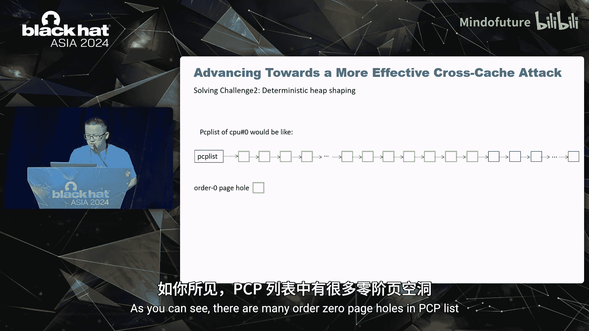

In step 5， we trigger the step  one in the new optimized workflow of cross catch attack。

 As you can see here， this empty slab would come from the order 0 page holes that we have just created。

After the step 5， the memory area would be like this。

One of the page hole has been reused as the new slab， which is also the victims slab。In step 6。

 we occupy all the other order，0 page holes。 This time， we choose I on to do the page allocation。

 and the memory area would be like， like this。No more page holes left in the memory area。In step 7。

 we need to finish the step 2 to step 5 of new optimized workflow of cross cash to discard the victim's lablab。

As you can see that， the page of victim' slip has been reclaimed to page allocator。In step 8。

 we release all the pages allocated in step 3， except those pages has been reoccupied by I O。

 After this， there must be one and only one other three pages here。

And and released victim' life must be in it。In step 9。

 release all the pages created in step 2 to force the flashing of a PCP list。After this。

 because victim lablab and other older zero pages are pages are reclaimed into free area。

 page merging will happen because deterministic page merging。

Since the order 0 page of victim lab has been merged into our order  three page。

 but can help spray lots of file arrays to occupy these order three pages and finish the cross catch。

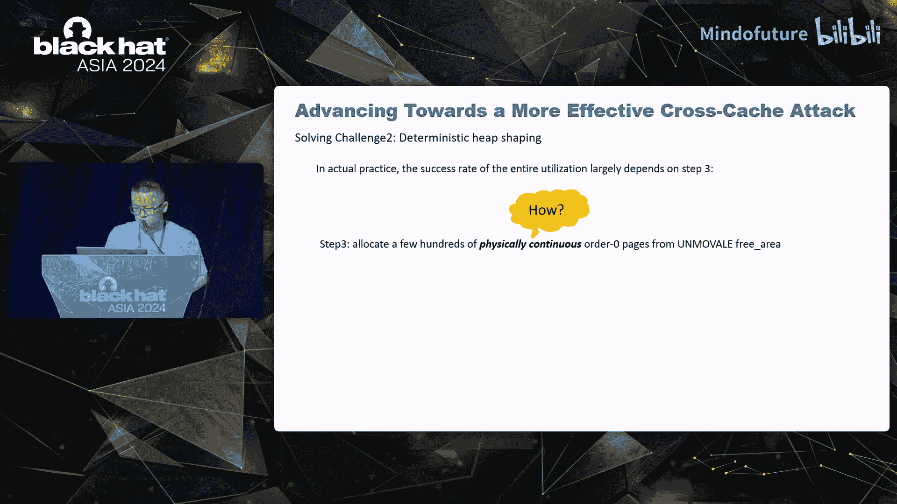

in in actual practice， the success rate of the entire exploitation largely depends on the step 3。

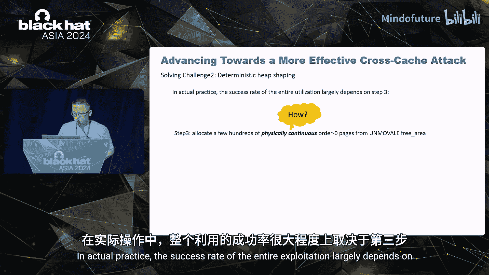

And there is a really important problem problem we haven't solved how to allocate hundreds of physically continuous order0 page pages from unmovable free area。

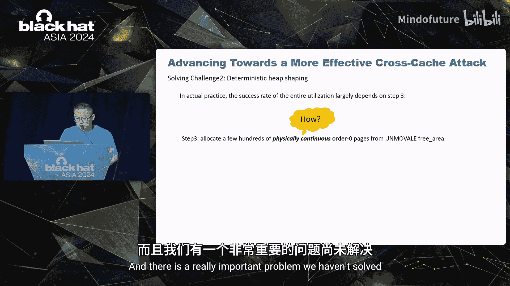

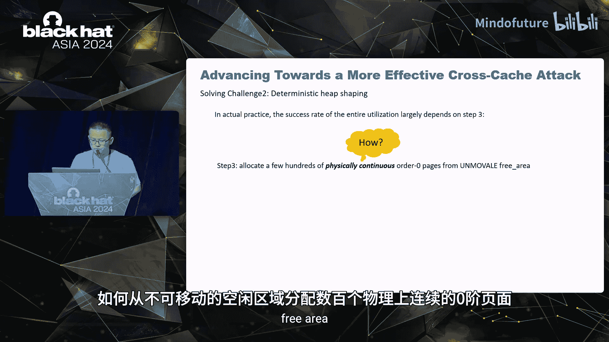

Luckily， we found， I found a new technique with， with which we can detect the status of the page allocator in a side channel way。

 Let's see a really interesting pattern of page allocator。

 If we keep allocating order0 page pages with K swapp D reclaim flag enabled from the un mobileable free area。

The page alligator would go through several states。The first stage。

 the order 0 page would be allocated directly from PCP list。And in state， state，2。

 because the peace release has become empty， the mobile。

The unmovable free area would be used to allocate the pages。And if we continue the allocation。

 the page allocator would enter state 3。The unmovable free area would become empty。

 and other migration type。Free areas will be used for allocation。 according to the fallback list。

 we need to note that when the fallback happens， Ki swapb D would be w woken up for re reclaiming pages if the number of free pages is below the high。

 high water watermark。Then if other mi migration migration type free areas become empty。

 the page allocator would enter slow path for allocation。 This is the date4。

 and there are several actions taken by kernel to reclaim free pages。

 including waking up K swapp D to reclaim pages and director reclaim and so on。Normally。

 Colonel would reclaim pages from several fixed locations。

 which includes four L R LR U list and shrinker list。And luckily。

 the number of pages in each of these lists are all exported by the file clock ma info and and the ma file is accessible from onrus apps。

So as a result， if we observe values in the pro info while while keeping on allocating order  zero pages。

 we will see these five values get reduced frequently at a very time point。If this happens。

 the page alligator might be in state 3 or state 4， which means a moable free area is almost empty。

And here is a test result on a device with kernel 4。14。 As you can see。

 we can detect the status of pageator and know the exact time when unmo free area is almost empty。

So here is the Str strategy for allocating a few hundreds of physical physically continuous order zero pages。

From a mobile free area， step  one reserve a a dozen of high order pages with the I tab to create and detect the empty state of a mobile free area with the the technique we mentioned。

A step 3 released the high order pages reserved in step 1。

 and step 4 allocate some order 0 pages to reduce noise。

 As step 5 allocate a few hundreds of physically continuous order0 pages from a mobile of the area。😔。

under this condition， order0 pages come from displaying of high order pages。

 This guarantees though these order zero pages will be physically continuous。

So we just solve the second challenge。After we succeed in the first stage cross catch。

 we will get a5 U EF。 It's time to exploit 5 EF with the 30 page table。 And this time。

 we use the old method to discard the victim5 P labla。

And occupy the released victim five P slaplab with a user page table by helping spraying many user page tables。

To improve the success rate of a cross catch， we use the man mentioned method to make the unmovable free area become almost empty in the first step。

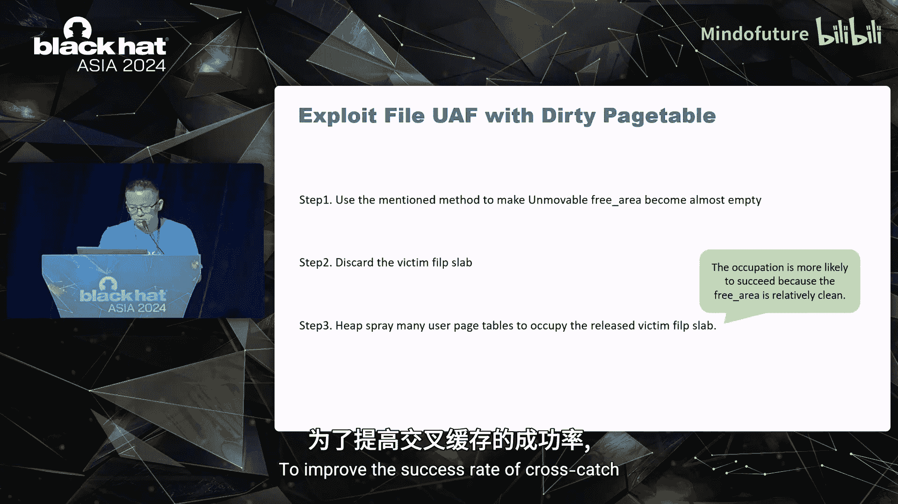

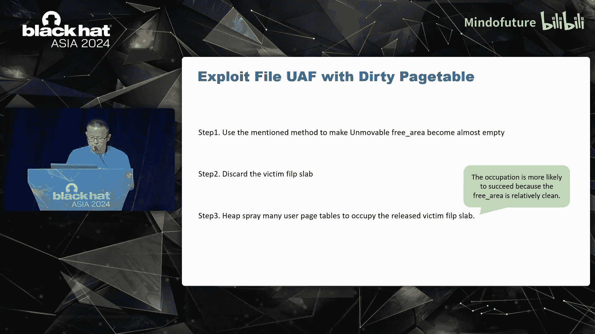

And as last year， we have demo。Sttraated how to route several Android devices with dirty0 page table。

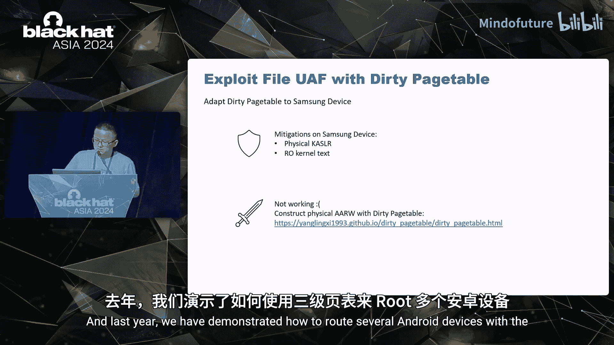

But we haven't demonstrated how to route Samsung device with 30 page ball yet。 So this time。

 let's do this for Samsung device， it has， has some mitigation such as physical K A SLR with only k text which prevent us from constructing physical AARW with 30 page table。

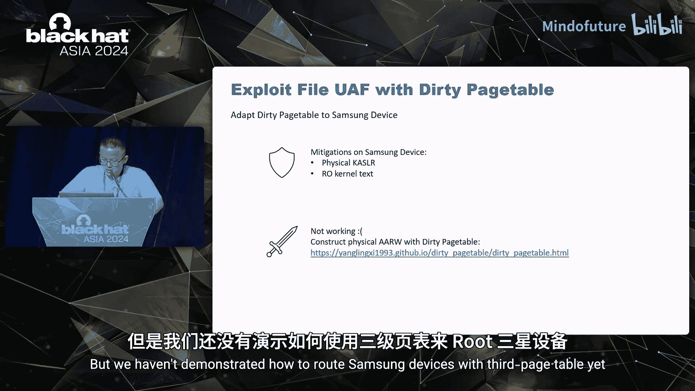

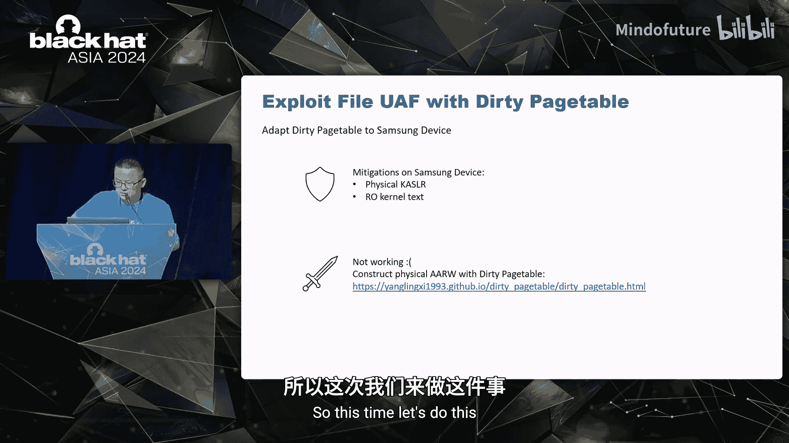

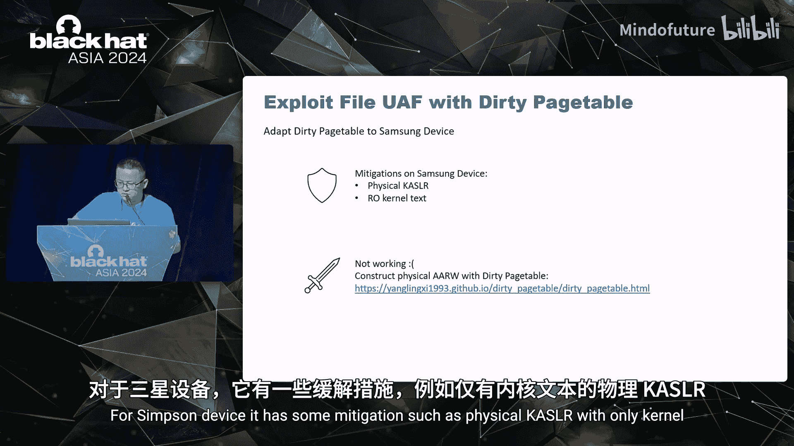

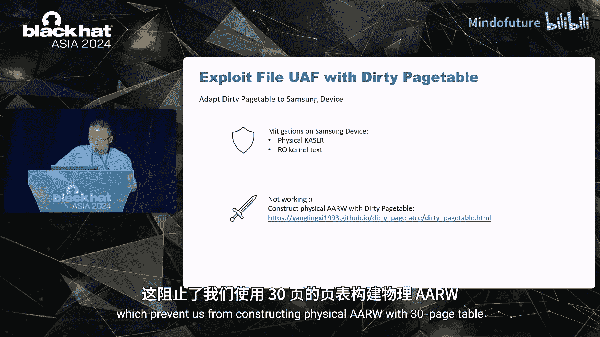

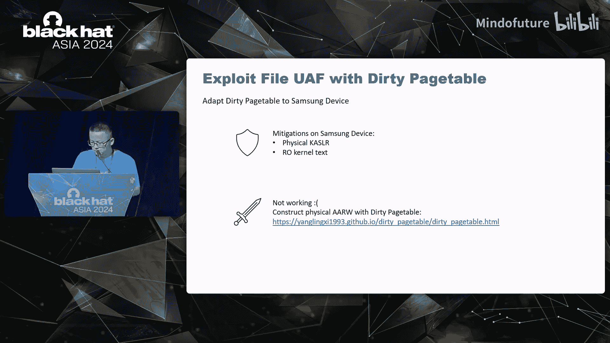

But we still can choose to corrupt K object to construct A ER W。

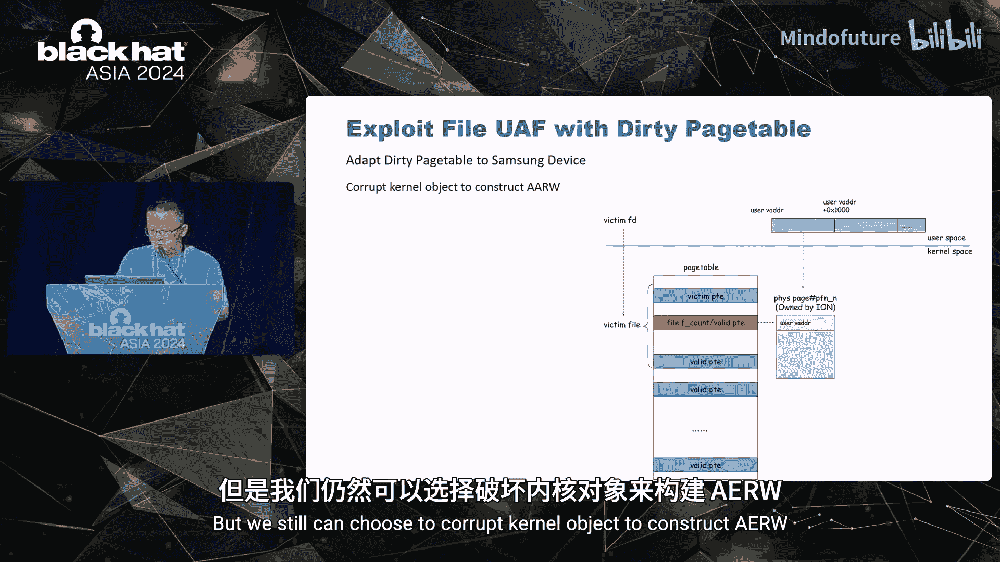

Here， we can easily get this seen by the page table。 As you can see， we control a valid PTTE。

 which co which corresponding to a physical page owned by i。

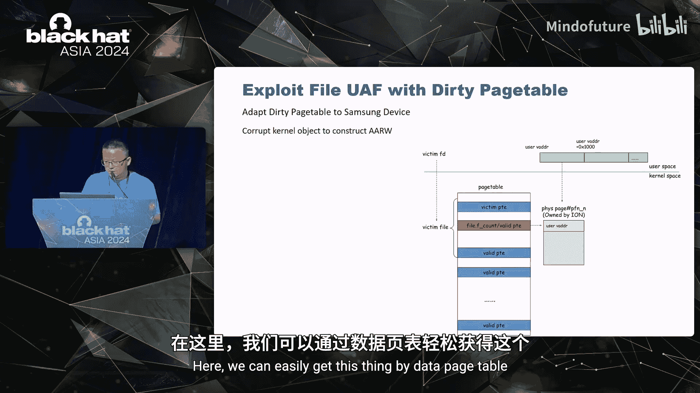

This physical page can be accessed with the user virtual address from user space。

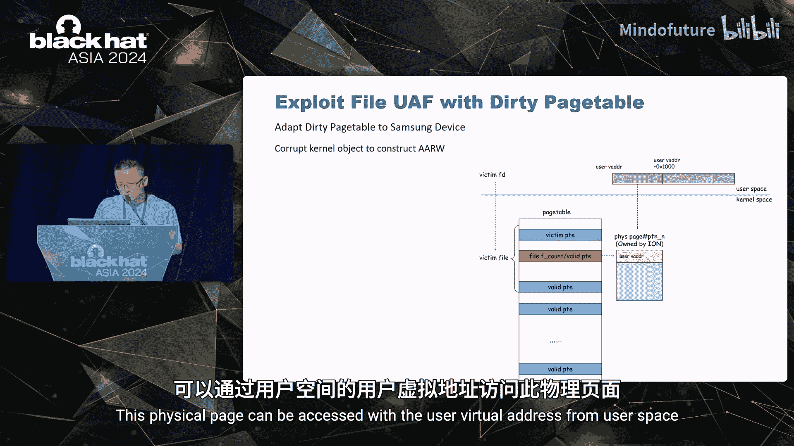

And we choose to corrupt pipe buffer to construct ARW to finish that we need to make the page of pipe buffer follow the page owned by I on。

 This can be done by using mentioned technique for allocating physically continuous order zero pages。

And then we add O X 1002。This victim PTE by by doing so， we can totally control the pipe buffer。

 and it would be easy to use a pipe primitive to construct ARW。

And for to bypass S Linux in Samsung device， we choose to attack the global data used in security compute A function。

 which is used to compute the AD。And finally， we won the game off a cross catch。

 We removed the requirement for system privilege。And improve the success rate of exploit to about 65%。

As for mitigating cross catch tag， there are actually many tech tech Tech available。

 The slab virtual is a really powerful one， which basically kill the game。

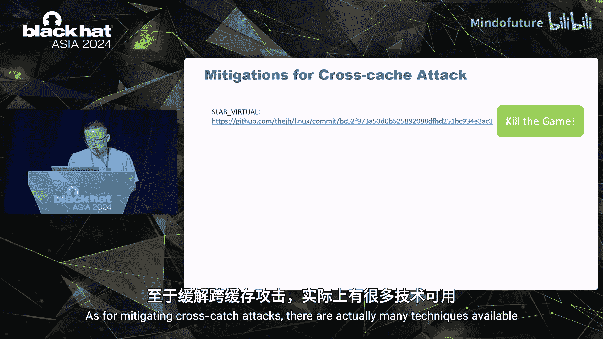

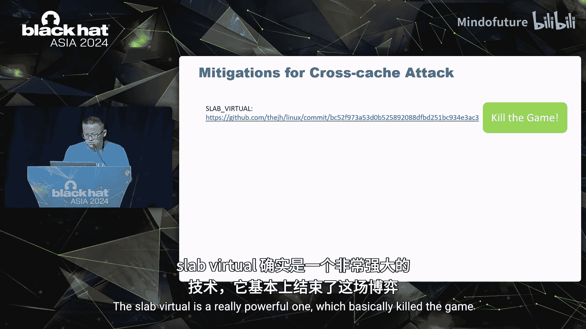

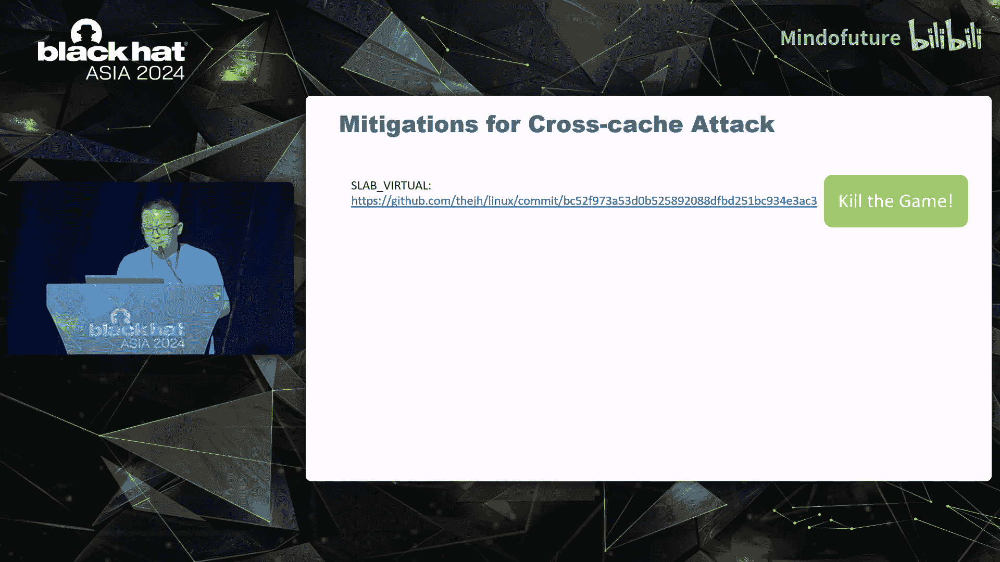

And here is the summary。In this talk， I solved two challenges in cross catch tech and adapt 30 page table to Samsung device。

And thanks Ye Zhang and teacher Jin for having me with my slides and the talk。

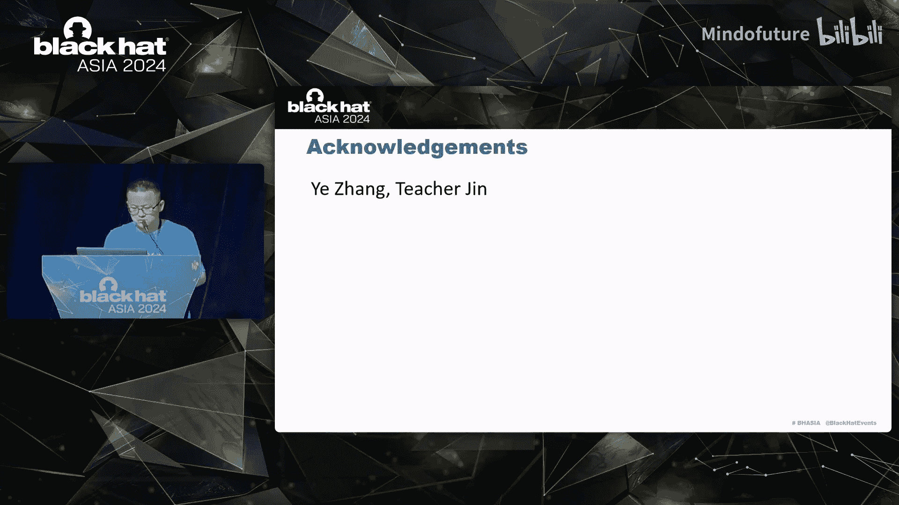

And thank you all for attending my presentation。So is there some questions。

Okay， okay， thank you all。