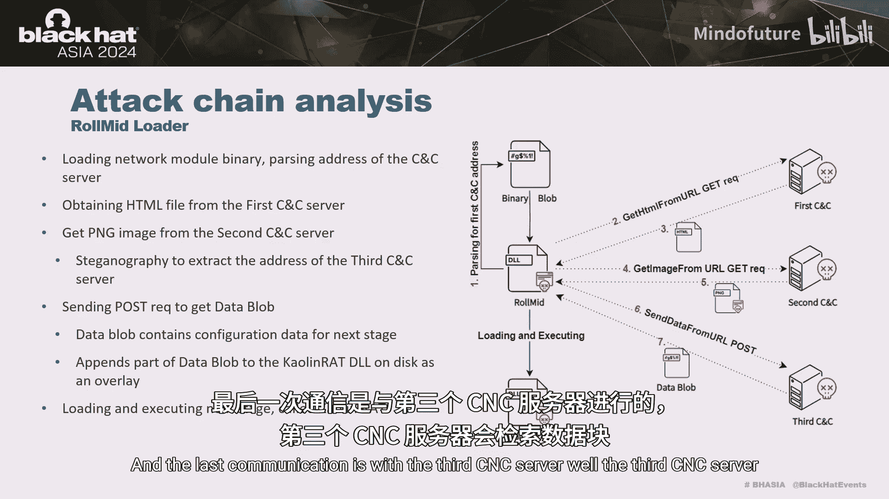
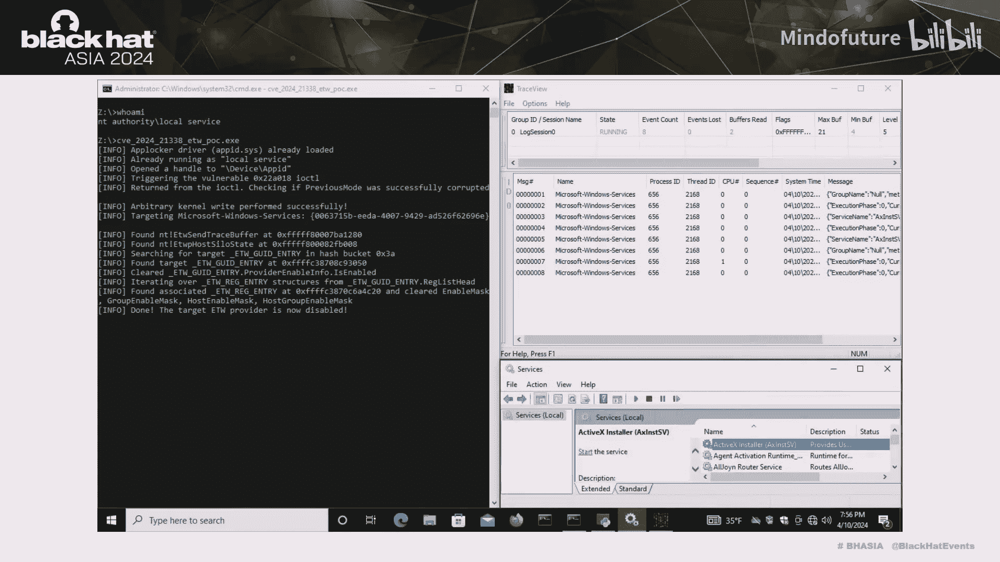

# 黑帽亚洲大会2024全集-•-中英｜Black-Hat-Asia-2024-p30-P31-From-BYOVD-to-a-0-day---Unveiling-Advanced-Exploits-in-Cyber-Recruiting-Scam--BV1oyX7YnEhN_p30-

Welcome to our talk。Where today we are going to talk about how La group are targeting specific individuals。

And how attackers were exploiting a zero day vulnerability to gain readwr prims to effectively blind security。

Vendors and security features。 My name is Luina Kamatra。

 and I'm a senior model researcher at Gen Digital focusing on analyzing and hunting ATs and various complex attacks。

And on this research were with me Yan Wetoshk， who is also senior mal researcher。Hello everyone。

 My name is Seor Morgan， and I'm a senior Mar researcher for Gen Digital。Thank you。

 So we first start with a quick introduction about previous research regarding to Lazas group Harvard targeting specific individuals。

 followed by attack chain analysis。 We' are going to describe each stage of the attack chain。

 and my colleague will tell you more about zero day vulnerability and also。

How with theic capabilities， they were blinding security solutions and security features。

As you already heard about this Lazarus group， they were targeting specific individuals。

 We have fabricated a job offer。 As you can see on the slides here。

 there are already various research about this topic and。All all day。

 they have the same common infection vector。 and that is true of fabricated the job offer。

Where in our case， was the same where the attacker initiated attack again by presenting a fabricated job offer where they used various communication platforms like LinkedIn。

 Whatsapp or emails。But， the victim has to first to show some skill， so。

What is the best way to to show your skills And that is through a challenge。

 So this challenge was sent by the attacker to the victim。

 and it was first a victim to mount this issoophil and execute Amazon VNC， ditch which。

Exs the malicious DL。 And this malicious D L is going to execute the payload。

 And this payload is going to communicate。Meddle heck website。

 which was utilized by the Lazarus group as a CNC server to download and execute a show called In memoryory。

Unfortunately， we couldn't obtain this show code。 but thanks to a really good telemetry alongside this show code executing a memory。

 we found two files。1 roving loader， another one is a file。The main idea of this show code。

Is actually to achieve the persistence by registeringroving order as a service。

And then the Roling loader is a actually kickstar of the whole execution chain， which needs to first。

 which which his main idea is actually load and execute the next stage， which is a Roling。

 But in order to get there it needs the first。Otain a so key by calling get system Inver table and after this call you get the 30 byte long key。

 which helps you to sort the NL file This NL file is basically encrypted rowlink。And after decption。

Theling now has everything and can load a rose link in the memory。But before。

And going to the analysis of the Ro link， I would like to also show you that this sample was already discussed。

By the Microsoft Research， where they share their research where the multiple Korean threators was exploiting vulnerability in the team city。

And as you can see on the slides here by in the left， there is a Microsoft sample。And on the right。

 there is our sample that we found in the victim machine and as you can see。

 there is a pretty strong code overlap between those two samples。

So let's go back to the analysis the the Roling。 So first of all， the Roling has， again。

 is another loader。 So his idea is load and execute the next stage。This roselink， first of all。

 needs to locate the binary blo， this binary blob。Hals。Another stage。

 which is remotem and also true encrypted modules。 One module is the network module。

 and another one is a part of the RAD module， which I will talk later and also the encrypted configurationation data。

And this binary blob is also very important to say that it was located without any file extension。So。

Roling has to locate this binary。 And what's the best， what's。

 was the way how the Roling was locating this binary blob is that it was enumating the folder and it was looking for a。

A file， which has a first 4 B。This for bys was indicating the size of how much data should be read from the binary blob。

And extract to the In memory。 And then it will， it will starting to search for a start action in this data。

 So as you can see， the after。All these conditions are met。 So they。

 they found the Roling found a start action in the export export function。

 It is now pretty confident to load the roll meat in the memory。As you can see on the slides here。

Another loader。And again， Armate does in order to load and execute another stage。

 it needs to communicate not with one or two， but three different CNC servers。So。

 and in order to communicate with all of the entry。

 it use different export function from the network module binary。

 which the raw will extract from the binary ball。So after this is done。And I forget， of course。

 it needs to also parse the address of the CNC server from the binary b in order to communicate with the first CNC server。

So。After the communication with the first instance server， it will retrieve the H T L file。

From the HTML file， it will extract the address of the second CNC server and from the second CN server we will retrieve the PNG file where thanks to a stography。

 it will extract the address of the throat CNC server。

And the last communication with the third census error。

 well the third census error will retrieve the data b。

Again， this data blo has contains configuration data for the next stage。

 but also contains the data to be able to create a calendar rat。

The roll meat needs to extract part of the cowing rat from the binary bulb。

 and part of the cowing rat will receive from the data will be in the data bulb。

 So after this it will happen together and it will create a cowing rat。

 which will be loaded and executed in the memory。And this call in rat。

 in order to communicate with the CNC server， and needs to， again。Lo network module。

 because thanks to the network module， it has API functions in order to communicate with the CNC server。

 where the all。Communication with the CNncC server is encrypt with as algorithm。

 and this is a custom rat， so it was developed by by the Lazarus group with the file compression capabilities。

 ability to upload file to a CNncC server change file's last F time stamp。

 but most important functionality of this rat is able to download the deal file from the CNC server and all memory。

 which means that in this case。We are high high confident that it was loading the exploit to gain read primitives and also to thanks to the exploit。

 it will also load the the f module where it was binding security vendors and security features。

 And now my my colleague will tell you more about exploit。Okay。

 so before we before we dig into the internals of fat module。

 let's quickly recap why threat actors are even interested in getting kernel level access and why in many cases to achieve that they use vulnerable drivers so from an attacker's perspective crossing from admin to kernel opens the whole new world of opportunities。

 it becomes possible to disrupt security software and hide indicators of infection such as files processes and network activity。

It also becomes possible to disable kernel mode telemetry and turn off different mitigations。

So even though Microsoft do not consider admin to kernelnal a security boundary。

 they have made a significant progress over the years in hardening this binary。

With the introduction of mitigations such as drivers signature enforcement and HVCI。

 it became very difficult to run your own custom code in kernelnal。

So attackers are being forced to to use data only attacks。

So what how can we solve this One of the ways would be actually sign your own malicious driver。

 and we definitely see these kind of drivers in the wild。

 but these kind of drivers can be detected during the verification process of the when signing the driver。

 So another way would be to actually abuse the vulnerable drivers。

 and this is the technique we are going to discuss today。

We can roughly divide this technique into three categories so the first one would be and they bring your own vulnerable driver so this one is the easiest one to pull off because there are plenty of well-known vulnerable drivers available for everyone to exploit and we have seen Lazarus exploiting this kind of drivers in previous campaigns more specifically drivers like debutil and ENI but on the other hand this is the most straightforward to detect because to load driver you have to first drop it on disk and Microsoft and other security vendors usually have their own blacklists of wellknown vulnerable drivers。

Another technique would be zero day bring your own vulnerable driver and this is much stealier than the previous one。

 but it requires an attack first to discover the zero day vulnerability in one of the already signed drivers。

But from the researchers， we can see it is not such a difficult task to accomplish。

It can also be detected in theory because loading some third party drivers can generate suspicious events in ideas or etc cea。

The best option would definitely be a zero day in the OS itself when you can abuse one of the building in Windows drivers this one is the most difficult one to achieve because finding zero day vulnerability in one of the Windows components is much more difficult the attack surface is much reduced comparing to the previous technique and the quality code quality is higher comparing to the third party vendors。

But this technique provides the the best level of self。

 And this is the technique that Lazarus used in this campaign。

So when analyzing malware from one of our victims， our colleague Janan Voteshk discovered that this one of the samples was exploiting zero day vulnerability in one of the Windows components。

We have successfully submitted this vulnerability to Microsoft and received this C for the vulnerability。

😊，More specifically， the vulnerability resides in IOal dispatcher of FI driver。

 which is a part of app locker feature Windows。So do exploit this vulnerability and entireger has to send specifically crafted octo to this driver and by doing so it is going to get ability to run arbitrary kernel functions and Antiger also has the partial control over the first argument of this function。

There are some limitations also， for instance， map prevents you from calling a user mode code and KCfG requires a valid target。

 so an attacker has to work a bit harder the Iocto itself is exposed through this specific device and to send Ioctos and a user has to have right access to this device and to have right access it should be running as a local service。

Let's see how they actually exploited this vulnerability before they start they make sure that the driver is loaded。

 they do it by writing a specific event to an app locker ETW provider then they wait sometime for the allow the driver to actually load after that they impersonate the local service account to gain the right access to this device and the next stage would be actually to exploit this vulnerability to gain right primitive and using this right primitive they are going to change the previous mode of the current thread so by doing so they effectively make it appear that the calls are coming from kernel mode。

And they are able to read and write arbitrary kernel memory using anti write virtual memory function。

😊，Microsoft addressed this vulnerability by introduction of EX get previous mode check in the aocyl dispatcher。

So Fa module， it is data only rootki， it is operating entirely from user space。

 The first version of Fa module was independently discovered by NLB and I set researchers and published in 2022。

So the first version was using bring your own vulnerable driver exploit and was implementing seven different data only rootki techniques。

 the new version is armed with zero day exploit and is implementing nine different kernel object manipulation techniques。

 so these are the techniques we are going to discuss now。

So the first technique is targeting registry callbacks。

 so these callbacks allow drivers to monitor and respond to changes in the registry and can be registered using a CM Regtry callback function。

So manipulation technique starts by resolving CM unregistered callback function。

 which is an export of NTOS kernel module， then is going to scan the function for this specific instruction which is loading an address of callback list head。

 which is pointing to a link list of CM Re callbackstructs。By going over this link at least。

 it is going to check where the callback function resides and skip all the white listed modules。

 all of the rest of the functions are going to be replaced with OB is kernel handle and unlinked from the list entirely。

The second technique is targeting object Colbeex and this technique has not changed in the previous version but let's see how it works。

 the object Colbes are meant for monitoring and responding to thread process and desktop handle operations this colex can be registered using OB registered Colex function and the technique starts by resolving of the OB get object type function。

 which is an export of anti O kernel module。Then it is going to look for OB type index table inside this function and it is pointing to an array of pointers to object type structures so each such tract represents a different system system object type and by going over the callback list it is possible or fat module can neutralize the callbacks by pointing there forward and backward pointers to itself。

Another technique is dealing with process thread and image callbacks。

 these callbacks are pretty important， they allow drivers to run the custom code in response to processes and threads being created and images being loaded such as DLs loaded by processes so these callbacks can be registered using the following functions and these callbacks are often used by by EDs。

So the technique starts by resolving all of the necessary structures and initially it is clearing out the PSP notify enable mask。

 this is already going to to disable the callbacks but it doesn't stop there。

 it is going to create a new array that is going to contain only callbacks from the white listed module。

 so eventually it is going to replace the original array with the array that contains only the white listed callbacks。

In the end， it is going to revert the value of a PSP notify enable maskask。

So file system mini filters is a mechanism for drivers to intercept file system operations。

It can be used in a variety of different scenarios including compression。

 encryption and antivirus scanning so in the early version of fat module it was patching the filter function directly which is not possible anymore with the presence of HVCI so they had to reimple this technique from scratch so they start by resolving FLT globals structure which is pointing to frame list it is a link at list of FLTP framestructs each suchstruct represents a single filter manager frame so by following attached volumes list we get to the list of FLT volumes each suchstruct is a representation of all the instances which are attached to single volume so by following Colbe's operations list。

We get to an array which is indexed by IRP major function codes。 And following that。

 we get to another list of callback notes we from which we can retrieve。An instance。

 And from an instance， from this instance， we get to the filter structure itself。

So fat module starts by checking the name of the filter and if the name belongs to Hitman Pro。

 it is going to unlink this note immediately， otherwise it is going to check if this name is on white list if it's not it's going to make the decision whether to remove it or not based on the default altitude of this filter。

So fat module is interested in two ranges of altitudes。

 The first range is FS filter activity monitor， and the second one is FS filter antivirus range。

If for all of the mini filters which are in these ranges。

 it is going to remove them from the link list and wipe up wipe the callbacks nodes entirely from FLT instant structure。

So next technique is working against Windows filtering platform。

 so Windows filtering platform is a set of APIs which are designed for host based network traffic filtering。

So it allows packet filtering， modification and the dropping of packets。

And that this specific technique is executing only when the Kasperssky drivers present on the system。

So they start by resolving GWFP globalstruct。 This tract is not documented。

 but it is not difficult to find an offset inside this tract。

 which is pointing to an array of callouts。So by going off over these callouts。

 a fat module can can set call out flag conditional on flows flag inside the call out object structures。

 and by according to the documentation， if this flag is set。

 the callout function is only going to be executed。

 if there is a context associated with the the data data flow。

 So some security vendors definitely set this flag by default。

 So this callouts are not going to be affected by this technique。

 So considering this and the initial check for Kasperssky drivers。

 we assume that this technique is specifically targeting Kasperssky。

Event tracing for Windows or ETW is a high performance mechanism for tracing and logging events。

So it is basically meant to connect between log providers and low consumers。

 and Microsoft provides few useful default providers， for instance。

 Microsoft Windows threat intelligence providers which can which provides logs for suspicious events such as processes writing into other processes memory。

So this specific technique is targeting Windows system loggers。And it is fairly simple。

 it is basically just zeroing out ETWP active system loggers。And eventually， disabling。

 disabling the。Disabling the loggers。Next technique is also targeting ETW。

 but it has a hard coded list of 95 different GUIDs for specific providers。

So it starts by resolving it W B wholesale estate， which is pointing to a structure which which contains。

Hsh table of GUIDs so following this hash table， we can discover ETW GUID entrystruct which contains the actual GUID so by going over this hash table we can find all of the GUIDs which are on our list and disable them by actually by zeroing out provider enabled info is enabled field of this structure。

It is also possible to， for these providers to actually supply the logs in。Different ways。

 So fat module is going to zero out the all of the following masks to to prevent it from happening。

So， here we have。A quick， quick demo。This is going to show。The。

 the last technique that that I have discussed。So we start by monitoring for the events from services log provider。

We can start the service and see the logs are coming。So now we are going to actually run the exploit。

whichch is going to disable the G U I D， which corresponds to the services。Yeah。

 and now you can see that we any don't get any new logs。

ok。Thanks。Another file module technique to disrupting is a image verification callbacks。

Image verification Goback is actually invoked every time a new driver image is loaded in the kernel memory。

 and it's a pretty useful functionality。For antim software to block malics or vulnerable drivers and to disrupt this fat moduleule is to first allocate a function called register image eviification callback in the kernel and then looking for a pointer which points to the global object and this global object has the element register callbacks which points to the linkist of callback registrations where callback functions resides。

And to disrupt this file module clears the entire list by making the register callbacks head this entry point point directly to。

 to itself。Now， let's talk about direct attacks on the security software， where in this case。

 it was targeting an anlab circuitity solution。where it first needs to locate the air process structure of the unlab and then to disrupt to this process is basically zing out the protection element and by this modification you are making it just a regular nonprotic process。

 which means。It can open up some further attacks from the user mode。

 and it also it can may disrupt links between the user mode and the kernel mode components。

But before the Fa module is going to disrupt another security solutions in order to increase stability of this attack。

 it needs to first do some small changes in his own process structure。And it first。

 it's basically zeroing out a mitigation flag in the process structure and also clears the flag in the handle table。

 which is enable handle exception。And now before we will I will explain to you how fat module was。

Directly targeting other security solutions。I would like to explain to you what is actually first handle table is used。

So when the new user mode codes， interacts with the kernel object such as process， files orexes。

The problem is that it typically doesn't work directly with the object itself。But， instead。

In the references them indirectly， through the handles。So internally。

 the kernel must be able to translate the handle to the corresponding kernel object。

 and this is actually where the handle table comes in。As as you can see on the slides。

 there is a pointer to the handle table entries， so the handle is actually indexed in those entries。

So， and this is per process table available in the process structure。Now， let's talk about the last。

Finally， the last fat module disruption technique to disrupt a security solution。And by doing this。

 the fat module creates first D threat with all access rights。

So as you can see on the slides by creating a thread which by itself is not interesting by creating this youre creating an entry in the handle table entries。

After is you are basically have you have a pointer which points to the handle table entry and object pointer bits points to the corresponding arbitrary object。

And with the readright primitives。AF module is able to modify object pointer bits。

 will it will point to targeted processes where targeted processes are。诶。Windows defender。

 crowd strike or hitman pro。So by doing this， the Fa module now can perform privilege operation on it。

 which means thatF module can now call any API functions to be able to suspend this targeted process。

And all threads that regarding this process。 And this is how fun module was disrupting。

The security solutions。So。In conclusion， our research has shown that the Lazarus group is still investing significant resources into developing sophisticated attacks。

 including discovery and weaponization of the zero days vulnerabilities to target higher value assets。

And despite existence of various mitigations， our findings indicates the kernel based security indicates it is still kernel based security solutions still remain vulnerable。

And despite those sophisticated attacks， Lazaros group is still using infection vector。

 still using fishing as infection vector to gain to the victim machine。

 So that's well both all from us。 Thank you for your attentions。

 And we are ready to answer some questions。Yes。Do you know what they were trying to？这。So。

So by the fact， because I'm the researcher。 So I'm really。

 by the fact we don't have the fact what we are trying to achieve。 But what I can say。

 what I think is。Their motivation， I think， was to get to the attacker to the corporate network。

 because I think they were trying to do is kind of bypass the， the。This first infection vector。

 not just by。In fact， the whole network， but， in fact， individual。

 and that individual may use corporate laptop as for indeed。For private。Stuff。

 And I think that's why they used also such as， such a sophisticated act to kind of disrupt these security solutions。

 because。I don't have in my private laptop crowd strike。

 So I think that's that can be one of the way。 And to， to achieve why targetrg specific company。

I think they were after， they were， they， they they were going after money。

 I think there was financial motivation since I think the Lazarus group is a pretty famous for this motivation。

Another。Yes， please。Yeah， yeah， yeah。 yourre。Yeah系咩。Sorry， I didn't hear you。Yeah。

 can you hear me now？First of all， thank you for the interesting presentation。

 My question is that before this malware， before this thought module。

 had you seen Lazarus using this sort of sophisticated kernelel mo malwares。again。

any other carel malvers you analyzed from Lazarus' group so far， I'm aware of the Fa module but。I， I。

 I， I'm not holding the whole history of the last group attacks in my， in my mind。 I mean。

 my head top of my head。 but I'm know about this fat module and previous module by the Fa module also discovered by another others。

 Amy vendor。 but this fatad module was。Newer version。 So they were through that only attack。

 they were， they were the way by binding security vendors and security solutions。Okay， thank you。Yes。

Hi thanks for the presentation yeah I was just curious because the1 techniques are nine。

 did you uncover them yourself or it was a bigger community that worked than this？

And which one did you enjoy？Firsting the most。It， it was discovery by myself， also by my colleague。

 Ian Vashk， but。That's also， we have， I have to say that the first discovery was the exploit。

And since we have a pretty good telemetry in the inner memory。Aside this shellco we had them dump。

 which alongside this exploit was a root kit as well。

And what was I think most interesting is how with that onlyling attack。

 how it was crafting the handle table。 So it was pretty interesting because on the first side。

 you don't understand but when youre going to dig deeper and understand more about Windows internals。

That this makes sense。Yes。Okay， good。 Thank you so much again。

