# 黑帽亚洲大会2024全集-•-中英｜Black-Hat-Asia-2024-p31-P32-EDR-Reloaded---Erase-Data-Remotely--BV1oyX7YnEhN_p31-

Hey everyone and welcome to our talk， EDR equals erase data remotely， this time we loaded。

And thank you for joining after lunch， you won't regret it。

So first well introduce ourselves and my name is Tom Baau and I'm the VP of security Research at Safebridge。

This talk is actually S 15 talk at Blacket。I'm a regular speaker at security conferences all around the world。

 including。Blackhead， Dfcon， and others。Hey everyone。

 I'm Schmel Cohen and I've been working in the cyber security industry for about six years now I began my career as a developer and later moved on to cyberse research position where I did an APT Marwell research and today my primary focus is vulnerability research at Sabridge back to Utono thank you okay so we'll start by introducing our research goal and approach。

Then we will detail step by step。On how we discover the vulnerability。

And then we'll explain and showcase 10 different attack vectors and explain how we bypassed this vulnerability and achieve even a second bypass and we'll save a special bonus surprise for later on。

We will close the talk with the takeaways， the vendor responses。

 and the Gi repository before leaving time for Q&A。

So our goal is to be able to confuse EDR products by remotely implanting MRware signature into legit files and making them believe the legit files are actually malicious。

For an analogy， defender usually recognize Ta Swift as benign right so we will try to implant a small malicious smoock and defender will think that Taylor is actually evil and do his best to eliminate it。

So our teaser is， what will you say if we can remotely delete your critical files？Over the Internet。

 without authentication at all。Even if you use different security controls or use Windows or Linux。

 fully patched servers。In this next hour， we are going to prove that this is definitely possible。

So at the beginning， we had three challenges。First of all。

 false positive or false alarms are known problems right， for long time and security control。

 which are installed on hundreds of millions of endpoints are already probably immune to false positive。

Moreover， the false positive we are aiming to achieve here are even more rare since we would like to trigger the byte signature engine。

 which consider to be the most trusted layer with the lowest false positive rate。

And our third and last challenge was how to trigger it from remote。Let's begin。

The goal of step1 is to find a signature that will trigger automatic deletion when appended to our am file。

We decided to use black box approach instead of a white box and not because it's a blacklit。

 since each security vendor product used a different proprietary database format and the research goal was to discover as many vulnerabilities in as many products as possible。

 so Black box was the best strategy。We also decided to focus first on Windows Defender。

 it's the default EDR installed everywhere right， we assume that Vitotal used Windows Defer same agent as the regular Windows defender on endpoints and Vitotal also provided us easy an capabilities。

 for example， as you can see a query for all detected Marls by Microsoft and we limit it by 200 bytes size binaries。

We ran the query and got 3，600 results。We decided to minimize the file to a minimal by signature that still triggers defender。

Let's go over a simple example to understand our technique。As we can see in the example。

We started with the string， x， AB C Y。Detected signature。

We removed the first letter X and wrote the files to disk in order to trigger defender to scan the file。

We still got a detection， so it means x is not a part of the signature。

 but when we removed the A and wanted to disk this time， we got no detection。

 so it's a essential part of the signature。B and C were essential too， and Y was not essential。

 so the minimal signature is ABC， we will use it later。Now。

 we decided to learn more about defender threat level by reading that documentation。

So we found the MP threat class。Which includes an interesting field named Se ID。

We found out that there are four levels of threat sities， low， moderate。And I am critical， and。

Default actions to be taken for each threat severity。

We assume that the most severe threat level will probably have a most severe default remediation action。

 and this is what we look for， and we verified our assumption was correct by a reversing defender。

As you can see on the right。This is the logic of the scanner。

 So our goal is to find a severe level signature that will trigger automatic deletion of our file。

We continue our manual search for the right signature。

 but it took us too much time and failed attempts。So we found a signature not required that required。

 sorry， manual remediation steps or signatures that causing only part of the file to be removed。

 so we understood that we should shift from manual process to an automatic process。

We downloaded all 3600 marers from our original VTant query。

 if you remember and developed a first basic tool to automatically extract the minimal signature from each modeler。

 the script was very， very basic， just automating the manual process。

Large part of the samples were actually a variants of the same Marer family。

 and eventually we found only 130 unique signatures。

But how do we select the best signatures for our needs？

Since we assume that they are going to be limitations in the implanting of the signature in legit filess。

We had to prioritize the different signatures in order to find the best signature in the database with the minimum limitations。

We believe that alphanumeric signatures will have less limitations。

 We also might have length limitations， so we would like to use very short signatures。

The first signature didn't work。It's a base 64 encoding of aR。

 which defender only deletes if it's the exact content without extra bytes before the signature or after the signature。

So we move on the second signature， which is only 15 characters length and consists of only two types of non alphanumeric characters。

 as s and accurately brackets。Let's try to manually add to our own amplifier。And it worked。

This algorithm caused the deletion of our own file。

It was actually the first time we managed to find a minimal signature。

 which successfully triggered automatic deletion of our file。

But deleting our own MP file is not interesting， right？So our next step was quite obvious。

Verifying that we can manually append this signature to a target legit file。

And we tried to manually append the signature in the middle of another existing document。

 and for our surprise， it didn't work。So we developed another faster minimizer。

 which caused defenders scan exported function instead of dping it iteration to disk and have to wait for a detection as we did in the first time。

This is much faster since defender does not quarant in files at all in this method。

 This tool reads the target Mar from excluded path and replace each byte with the letter Z。

And we scan it if the very tend to beign， then。We restore the Z to the original byte。

Let's see an example， we took Mimicka's binary。Run the code。

 and when we appended MimicK signature to the middle of a legit portable executor be file， it worked。

The problem is we could not think on any interesting attack vectors on PE。

 if the user already have privileges to write to a P file is probably can delete it anyway。

So we have to focus on non executable files and understand the reason why it failed to detect our own signature。

We developed additional tool to understand the non P E limitations。

The tool tried to embed the same signature in incremental offset from the beginning of the file。

To its end。We found out that in the case of a non PE file， Defer does not scan the entire file。

 probably for efficiency reasons。It scans only the first and last 4030 bys。

So it means that we must append our signatures to those sections in the target file。

 and if we can do that， we will be able to delete nonP files automatically。

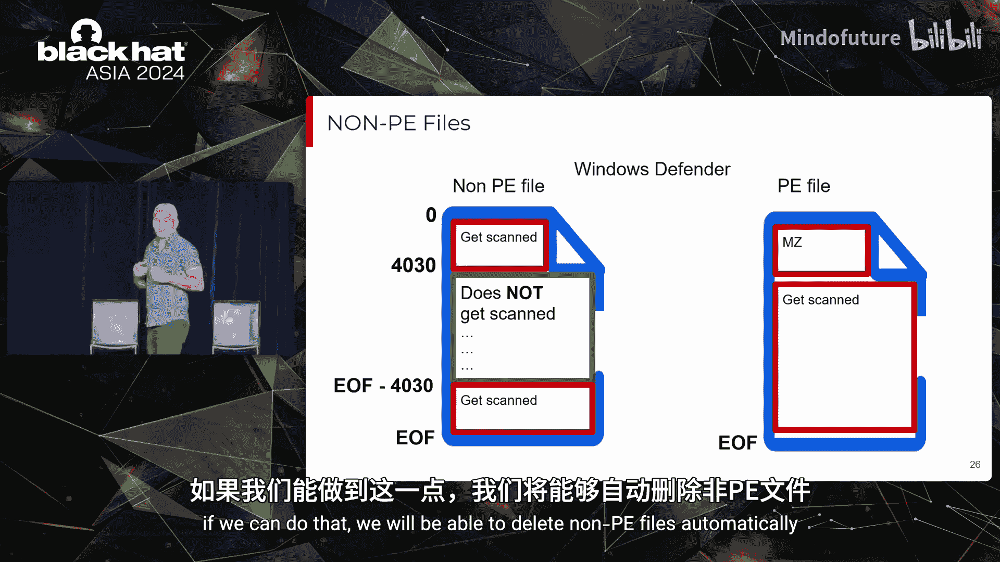

So， until this point。We focused on learning how to locally trigger automatic deletion。 Now。

 we should plan how to achieve remote attack vectors。

We needed a way to somehow make a privileged device。To write our data to a remote file。

The first idea that came into our mind were logs， if we will be able to send an HTP request with our own signature to a web server and this web server we log our request。

We will be able to trigger the remote defender。Installed on the Web server to delete the log file。

Okay， but which HTP field to use， so we looked at IIS logs and saw that the user agent field is a long free text string。

Which is written entirely to a daily single log file of all client request， not just our request。

 So this should be the perfect place to include the signature。

So now let's explore our first attack vector， well have many。

 and its remote deletion of IIS web server logs over the internet， Schmuel will introduce the demo。

Thank you， Donno。So。In this demo we will see a remote deletion of IIS web server logs。

 we ran this attack on Windows 11 and for first time taking the IP address of the victim machine and we can see that we can surf it easily and let's make sure that our logs was logged into a log file so navigating into the log file we can see that the current session was logged into the log file but this time let's try to attack the machine so using e eraser which is tool we utilize this attack by providing the IP address of the remote cell and we can see that after running the attack。

 the log file is no longer available and theer detected as a malicious file so this log file will be deleted after a rebutot to the machine。

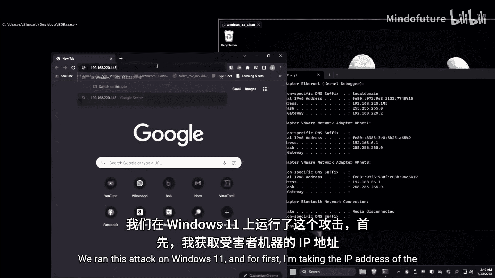

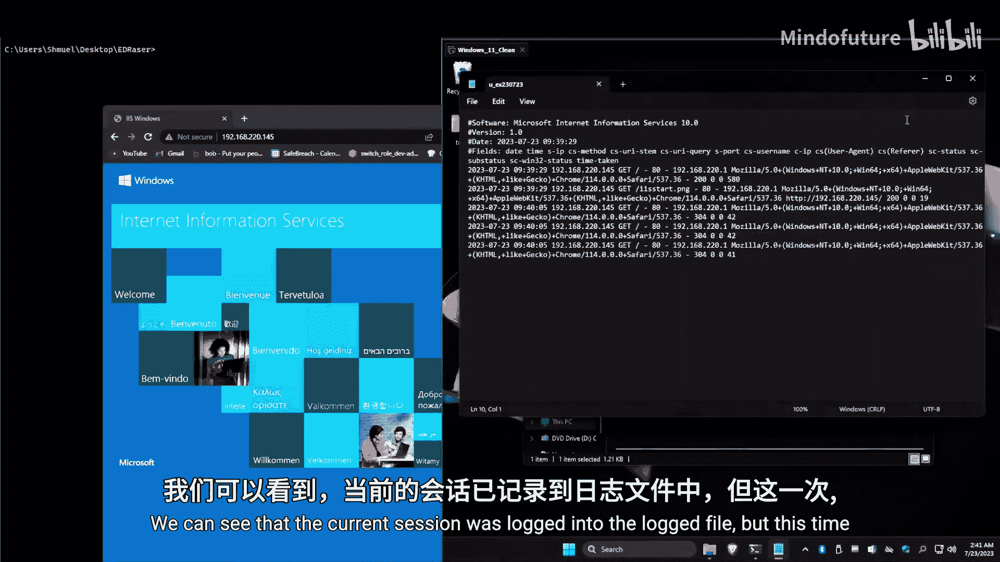

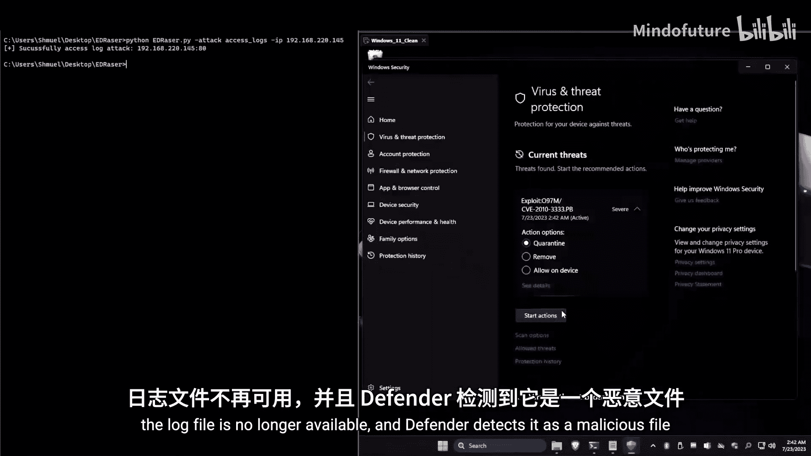

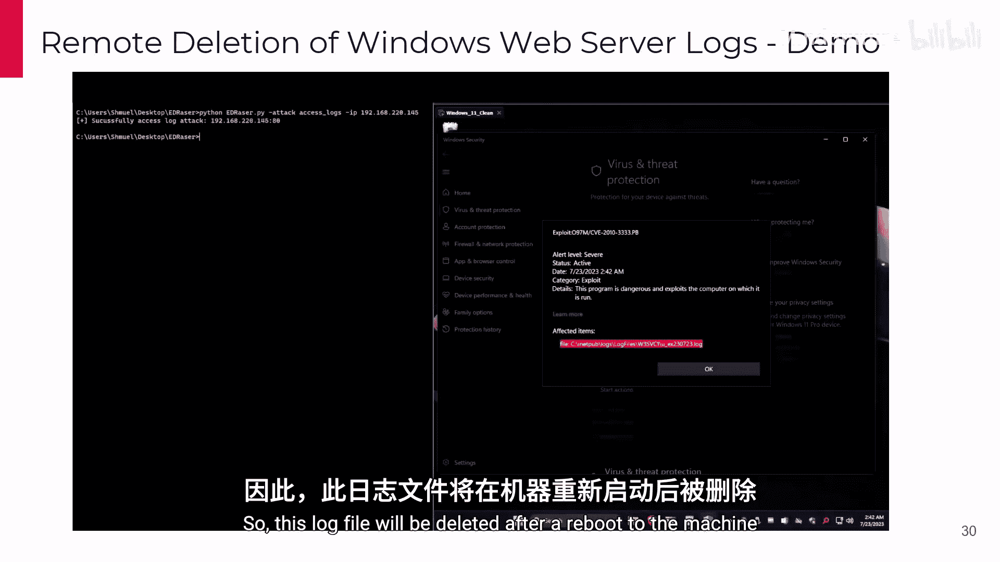

And as you saw on the demo you can see this picture。

 the Fe detects the IAS log as an RTF exploit and it will be deleted after a reboot。

 and IIS is a good example for Windows Ss， but most web servers are installed on Linux and in Linux there is no EL installed by default。

 so we aim to trigger other ADL solutions that are likely to be installed on large number of Linux webservs。

And as you can see， according to Garo Magic Quadant。

 these are the leading EDR products on the market， we aim them since they are likely to be installed on enterprise ss。

😡。

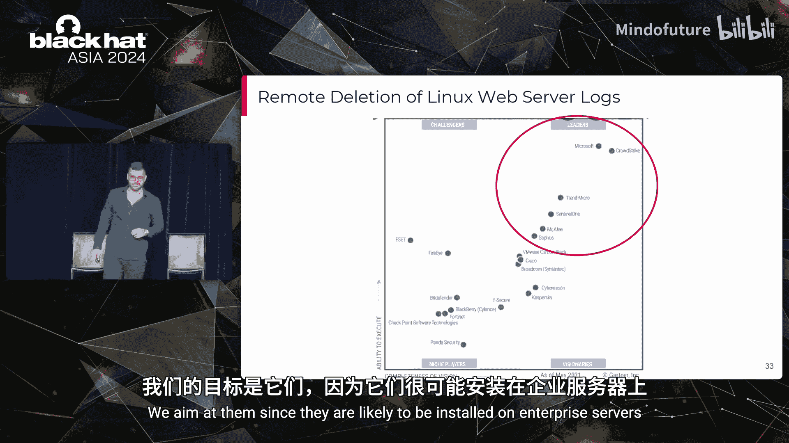

And as you saw， as of now， sorry， we confirmed the effectiveness of our technique and we now have the ability to automatically reduce the size of signature in a way that would trigger automatic deletion。

 with this knowledge， the next step was quite obvious was to create a database of what we name of evil signature for various leading IL vendors。

This database will allow us to perform signal signature queries capable of triggering most。

 if not all of the ER solutions， this method is beneficial for cases when we don't know which ER is installed on the remote machine so we can use this database and get a signature suit for this remote attack。

😡，So as we explored different EL solution， we noticed that variation in their behaviors probably caused by difference in their design。

 however， our investigation led us to discover that Kasperssky EDL demonstrated the exact behavior that we were searching for。

 therefore in the upcoming Linux example， we focus on targeting ss which Kaselsky EDL installed。

Another side goal that we had is to find a signature that would trigger most of vulnerable ELs。

 it will be perfect for a case when we don't know which EL is installed on the remote machine After some tries we found a signature for triggering Kaselsky but it's also a trigger defender。

😡，So let's now see what happens on a Linux machine using an engine X web server installed and also Kasilsky as an EL。

😡，In this image you can observe an Engine X S installed on Ubunto machine highlighted within the red box。

 you can see a malicious signature that I'm going to send to the victim using a basic Python script I sent the malicious payload disguised as a user agent to the Engine X web S and at the moment that I've executed this command。

 Kasspski instantly detected the load file as malicious and deleted it。

 the same method is effective on Apache web S as well。So in summary， by using a very short signature。

 we allegedly will be able to delete remotely delete up to 35% of web server logs in the world。

 that's pretty amazing results， we've demonstrated this with Kasperssky on Linux but it could potentially be extended to other security vendors as well。

😡，And the following slides we showcase brief examples of various attack vectors that we've identified。

The first one will be an FTP server， so not only web server logs are at risk。

 Filla FTP server will be at risk too， for example。

 this time by using a signature minimized from invoke Miics Palo Sha Marware。

 we we used it as a username to the FTP login， this malicious username was written to the FTP logs。

 which caused Defer to delete。Another one is an email attack scenario using Mozilla Tbilt。

 the attacker sends an email to the victim with a subject that includes the malicious signature。

 then as designed， Mozilla Tbil stops the entire database inside a single textual file on the disk and the local inbox will be removed by the ER and Tbilt will try to download it once again。

 this will cause a nonstop loop of downloading the entire inbox and then it will be deleted again by the ER and then downloading back again and then deleted it again。

😡，So another call vector is by executing a corrupted MSI file。😡。

The subject field in the MSI properties will include the evil signature。

 and this will cause a log record that contains the evil signature to be written into the application Windows Even log file。

 and this will trigger theer to delete this file。😡，But this is not the end。

 what about achieving a deletion of Windows logs file but this time remotely， is it possible。

 so the answer is yes， by attempting to perform a remote logging to the machine PIN SMB for example。

 using a malicious username， we can remotely insert malicious records into security event log and if we repeat this process enough times the records will end up at the end of the log file resulting their deletion。

😡，Let's see a demo of it。😡，So again， we're running on latest Windows 11 and this time I'm getting again the IP of the machine。

 the IP address of the V machine， and I'm running again with E eraser a remote attack this time trying to remotely log in to the machine via SMB with malicious username and after the script has done let us scan the logs folder in Windows and let's see what we will achieve。

So scanning the folder and we can see that it's found something malicious。

 let's see what it is exactly， and we can see that this time the security logs I will now consider as malicious and they will be deleted。

😊。

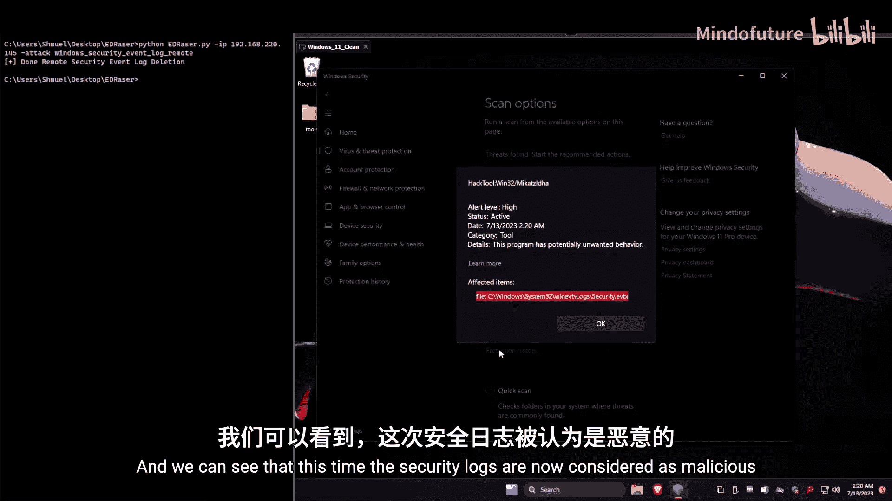

AndSelf cannibalism， how we may defender the its own detection logs。

 it was done from an unprivileged user when even an administrator don't have any permissions to even read the content of this folder。

😡。

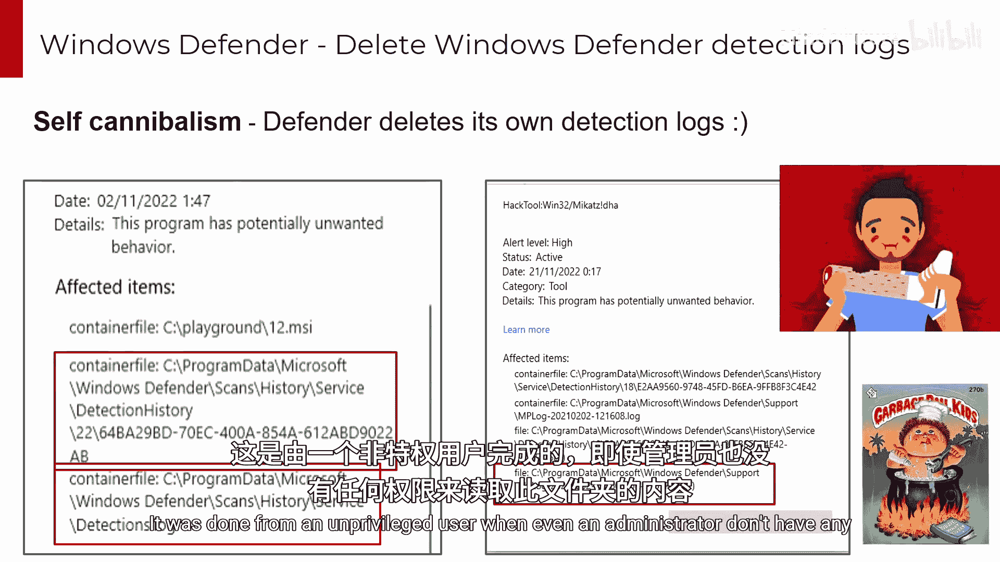

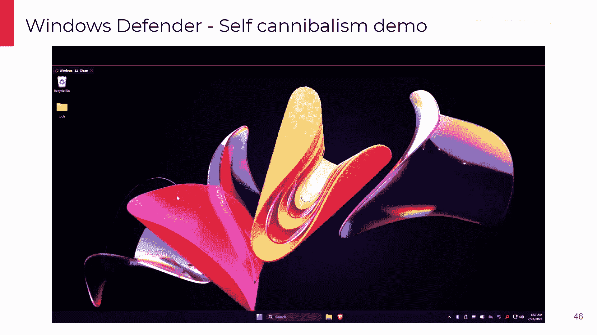

Let's see how we did it。So for start I'm just creating a new folder on desktop and name it with malicious Sign。

 so this bites on as you can see now will trigger defender。

 Defender detects this as a malicious file but the interesting part is that defender will log this incident into its own log files and now defender logs file will contain the malicious signature so if we now scan the logs files of defender。

 we will see that again it found something malicious， let's see what it is。😡。

So almost all log files of Defender are now considered as malicious。

 and it will be delete its own logs。

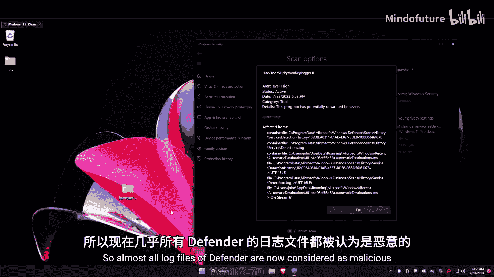

Okay， so now we understand that we can remotely delete logs， but we could achieve even more。

 let me ask you a question， what happens to logs on enterprises？Well， as all rivers flow to the sea。

 all logs flow to a same database。For example， Splk， which is a central point for monitor。

 search and analyze logs， let's see how we might trigger a domino effect against Splunk。😡。

We verified it by manually adding a log file with the name that includes an evil signature。

 Splk will write the name of the file to its own database。

 which will cause defender to delete the entire Splk DB。😡。

So this same goal can be achieved automatically as a resulting of the domino effect when an infected Windows event log will be collected by Splk。

 it will be added to Splk database， which again will cause Defer to delete it。😡。

Lologs are definitely not the only things that we can attack。

 Let's see a two virtual machines attack vectors done under Vmwheel。So for start。

 we started by taking a look at the V mix file on the guest machine。

 which is a configuration file of the VM。😡，This file is mandatory for the machine to boot up and without it the machine simply cannot boot up again。

 so we wanted to check if the guest machine can write data to this file in order to implant a malicious signature into it。

😡，Research for communication originated from the guest machine to the host machine。

 and after digging a little bit， we found out that VmW tools provide a tool called LPC tool that allows you to communicate with the host machine。

 and this can be done with a weak user。😡，One of the things that can be done with RPPC tool is set global variables。

 so one of them is called guest infofo dot detail do data。

 so you can set them these variables on the host machine and what will happen is，😡。

These variables will be inside the VMX file on the host machine so for example if you can see this command on the image I'm setting this guest info variable to be equal to either request a which is a malicious signature so this will bubble up to the VMX file and it will cause theer to delete this file resulting this error so at the moment that I've executed this command I got this error on the host machine and we can see that。

😊。

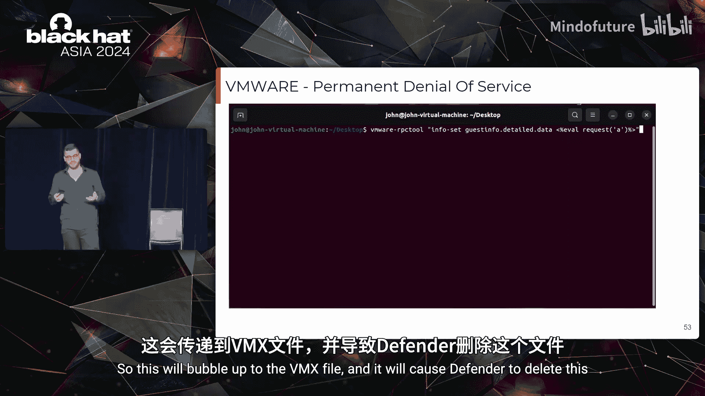

This error message saying that the Vmix file is unavailable。

 which means that the guest machine cannot boot up again。

But wait there's even more this attack is nice， but it targets only configuration file。

 What about targeting the entire virtual data itself， I it possible？😡，Of course it is。

 we did it by creating numerous amount of malicias found around 100。

000 files in this case on the guest machine， and this will cause those files to be written into the VMDK files of the guest machine and this will cause theer to detect those VMDK files as malicious and the defender will delete them。

 let's see at them of it。😡，So running this attack basically I put one malicious file inside this folder that you can see right now。

 so I'm taking from the host machine a malicious file。

 one single malicious file into this folder and I'm running this script that will only duplicate this file many times so after it duplicates this file as I said 100。

000 times I'm doing shutdown to the machine and we can see that at the moment the machine shutdown we got notifications from defender and defender found out that these files are now considered as malicious。

 we cannot boot up the machine again because these files are now considered as malicious and we don't have access to them。

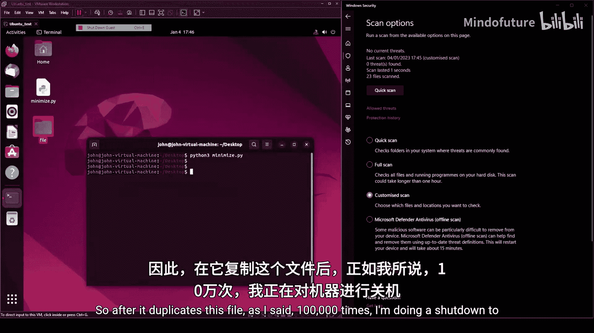

And。

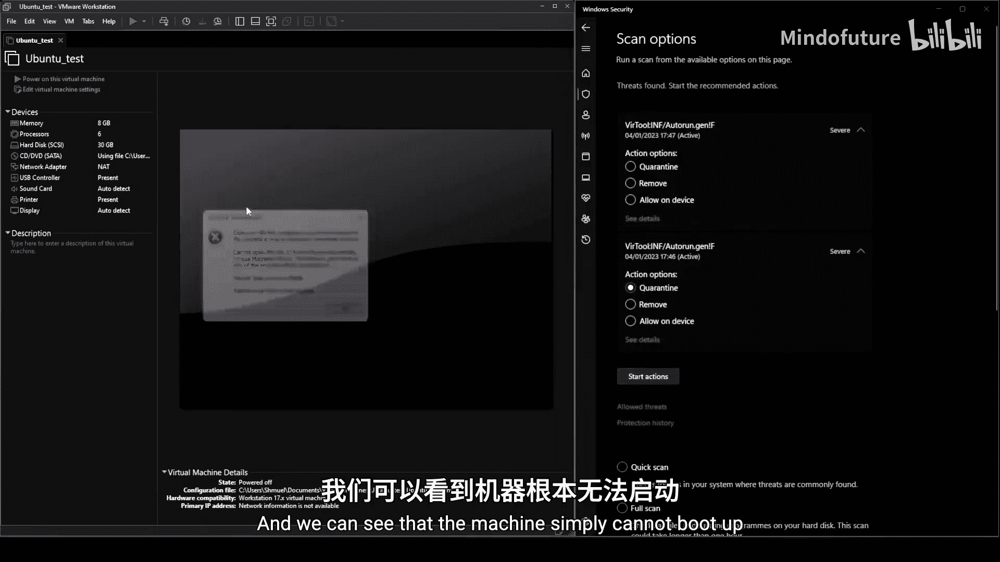

We can say that the machine simply cannot boot up。So the crown jewels of most organizations have not stored in files。

 rather they stored within databases。While we primarily focused on deleting logs and configuration files。

 the question arises， can we potentially delete an entire production database over the internet？

So typically users don't possess the privileges to directly insert queries into a remote database。

 however， it's common for websites to rely on a beend database for operations。For instance。

 consider a scenario where a website features a new user registration form by submitting our malicious data through this form into the database such as registering a new user。

 we will have the ability to remotely prompt defender to delete the entire database without requiring any form of authentication。

So let's see a demo off。So for this demo I created a small form of registration to a new database and we're using MySQL as a test database with Linux and Caselkin installed on the back end。

 so we can see that the database is actually working and we're able to insert new data to it。

 so let's insert a malicious signature to it。So after inserting a malicious signature as you can see it's prompted into the database。

 we can see that Kasperssky immediately and detects the database file。

 the critical database file as malicious， and we can see that at the moment Kaperssky identify them。

 we can't no more access to the database， the database service actually crashed。

 even if we try to restore those malicious files， Kasperssky again detects them as malicious and list them once again and this database is no longer available。

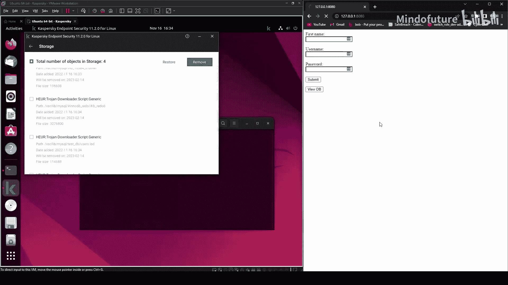

This attack is effective as well on Windows with defender or other vulnerable EL solutions upon implementing the mimicmic signature into the Maria database。

 Maria DB database sorry， and the database file is flagged as malicious。

 and this not only risk potential data loss， but it also cause the DB service to become inaccessible as we saw in the same demo on MysQL。

 even attempts to restore from quarantine or external backup will fail and we cannot restore its functionality back。

We've tested our attack against the most popular database around the world。And in the same way。

 we were able to remotely delete Postgret，QL， SQLite and MongoDB database on both Linux and Windows platforms with a vulnerable EL。

 while releasing the demos in our Gi repository， considering the widespread use of those different databases。

 and the potential impact on major website is significant。

Up until now we've explored a various remote tax vector targeting service and services。

 now we'll shift gears and demonstrate the reveal scenario when a web s can launch attack against a client browser。

Let's see how we did it， so when Ater sends a link to a victim once clicked the victim browser sent an HTTP request to the cell。

😡，The malicious web server then responds with a signature， perhaps even within a cookie file。

As a result， a victim browser logs this response into its local database。

 which then triggers defender to delete it。😡，This is an example of remote deletion of homeme history and the web data database。

 so we can see that these file is considered as malicious now。

We believe that these 10 attack vectors we've discovered are just the tip of the iceberg and regarding cloud attacks literally the ski is the limit and with defender embedded in numerous access point with defender embedded in numerous critical point all over the world。

 and the potential for damage is significant。We reported the relevant vendors at the beginning of 2023。

 Microsoft issued a fix to this vulnerability on April 2023， and this is the CVE number。

 Kaselski did not release a patch but they plan to mitigate those attacks as well。

 but this is not the end of our story and back to you now Donaldll。Thank you， Shau。

So here is the timeline of our findings so far。Immediately after the patch release on April 2023。

 we started to check the original attack vectors and found out that not all of them were fixed。

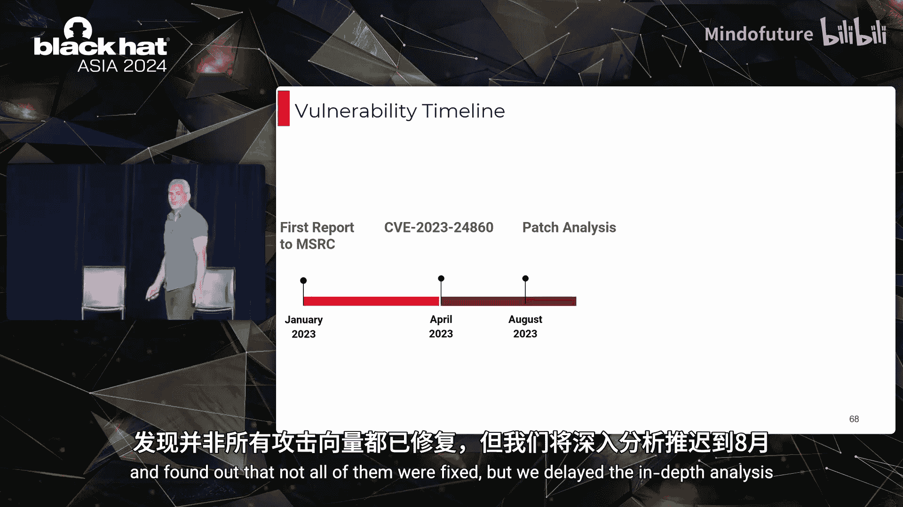

But we delayed the in depth analysis to August。So in this example。

 this is an unped deletion of defendender detection logs file。

 which was still possible on fully patched machine。By the time of the check。

 and I can tell you that it's still possible nowadays。After checking out each of the attack vectors。

 we originally reported on January 2023， we were able to see that almost half of the attack vectors are still valid。

 so on the left。Is a list of attack vectors that were fixed。

 and on the right is a list of attack vectors that were not fixed by the patch。

So we started focusing on MyQL database， which is one of the most prevalent databases in the world。

Myus 12 default storage engine is in ODB。 The file size is dynamic and inlarge once insertion of new data is reaching almost the end of the file。

 which。The default size is  three MB， causing the vulnerability not to be triggered since our signature is never written to allocation scanned by defender。

But you DB was not the default storage engine all the time。

 So my as was the default storage engine until my SQl version 5，5，5。

My as database file size is not dynamic， which。And when inserting new data。

 it will be appended to the end of the file， and this might be vulnerable。

 so we give it a shot and try to insert our signature to my SQL using my awesome storage。

Let's see a demo。

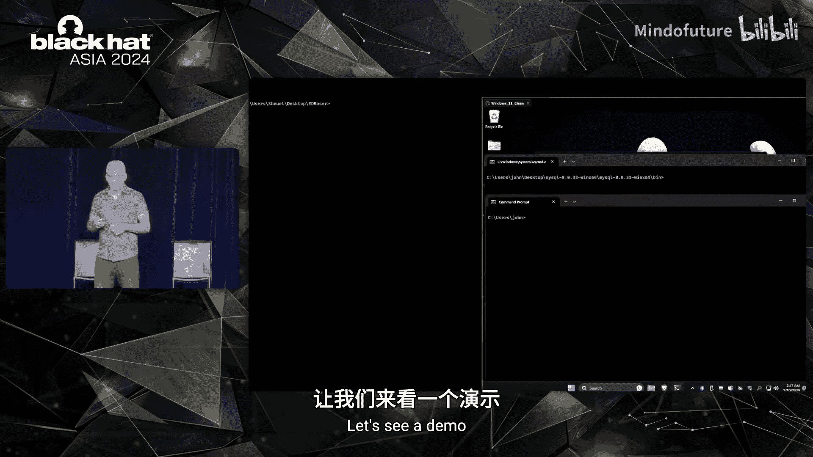

So。In this point， you know the drill will。First， take the remote IP of the target file。 We run my Sl。

 You can see that it's running。Now， let's verify that it's a fully patched machine in the time of the check。

 Remember， the patch was released on April。 We are at the end of July at that point。Rund the attack。

And immediately。The service is crashed。And。We can see that。Our file， the M D file。

 it's the central database。

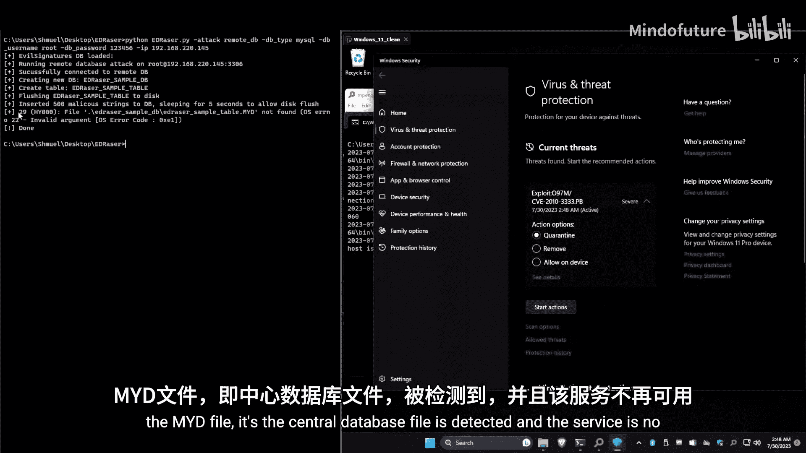

File is detected， and the service is。

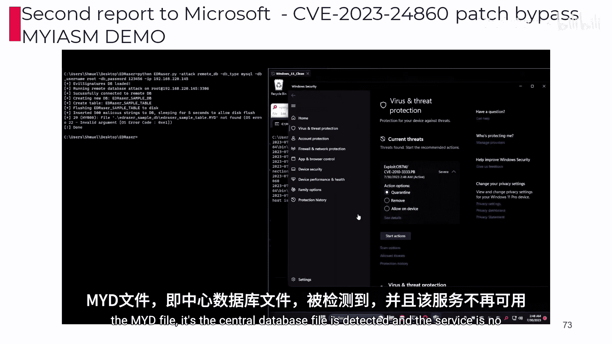

Not all yet available。The Fender detected the MD file as an MS office vulnerability and deleted the database file and caused denial denial of services as we saw in data loss。

But MySQL 5 is indeed very old， but there were very common installers like Wamp。

 which stands for Windows， Apache， MySQL and PHPsuit。

 which uses mySM as the default storage engine and made this attack still relevant today。

But this was just the first bypass of the pitch。But we wanted to be able to bypass myQL deletion and other databases。

 even if they use the latest default storage engine。When looking at the table。

 it's quite easy to see that all the files on the left and marked with green color are stored in binary format。

 right？And。While all the files on the right are stored in textual format。

 So it seems that the patch changed。Deefend our behavior when scanning a file。

It trigger a detection when a textual file includes the textual script based's malicious signature。

 but it ignores the same signature when the file is in binary format。What will happen。

If will use binary signatures on binary formatted databases。

We tried all the signatures we collected from our signature DB using a simple script and found a signature named Levinian Case Sign。

 which triggers the Feer to delete the database in a fully patched machine， let's see a demo。

So this is an E Db。My S2l server。So we did it on the same time， the end of July。我是被。

I P of the target。Run the My SQl and launch the attack。Okay， and again， the service crashed。

 and again， this time。It's the Levinion case signature triggering InODB files， you can see the InODB。

 and even if you try to restart out the service， restart the OS。

 try to backup up from an external backup， it won't work， the database is completely gone。

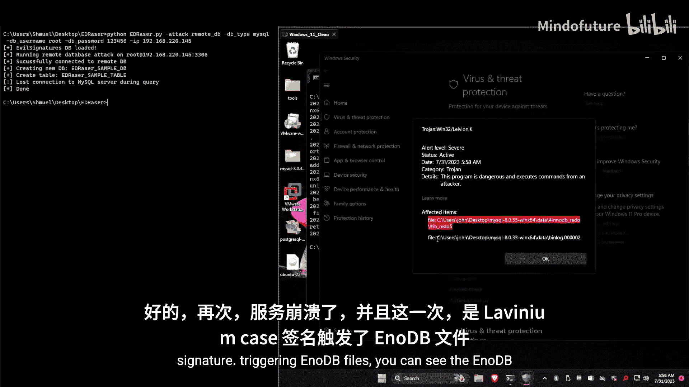

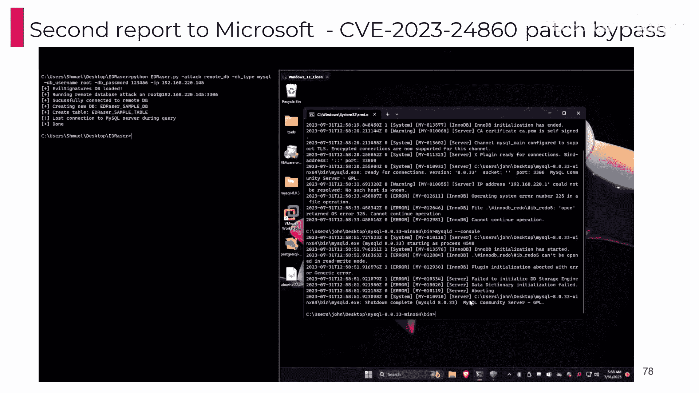

Don't want to work anymore。So Microsoft released a second patch， CVE 2023-36010 on December 2023。

 guess what was our next move， so of course we analyze the patch once again。

 let's see what we managed to achieve。The patch did not fix remote deletion of mySQL in ODB at all。

 you can see that it's a fully updated defender on December included the patch and the signature was inserted to the DB which triggers defender。

So let's see if the patch add logic to the myosQL my AS remote deletion。Okay。

 and we found out it indeed was focused on the myA database fix。

 adding a whitelisting algorithm based on the myasM file format。

 Defer checks if the scan file starts with FD byte and if the file size is aligned to 256 bytes。

 if both are true， it won't rig a detection， even if malicia signature was found。

So our goal is to bypass the whitelist to trigger the deletion of the database file。

We don't have control of course over the first bytes of the database。

 so we focus on the size of the record and the default length value of textual field is 256 bytes。

 but it's not true for any database that used non defaultult textual field length and according to myQL manual as you can see。

A text field can reach a length up to 65000 by。 What will happen if we。

 if the victim Db use a non default textual field。So as we can see。

 we were able to insert our Levinian case signature into a field larger than 256 bytes in the Myos2L my AScent database file and bypass the whitelisting logic。

So we were able to bypass almost all attack vector fixed by two different patches after a year from the original patch。

And report， of course。So beside byssing the second pitch。If you remember。

 we promised a special surprise for the end。 So we we'll introduce our security fixed launch by MSS C introduced a Windows Defer generic detection bypass。

😊，If you remember the white listing logic that we just showed， added by the second page。

 what if we can turn a non malicious IOC to be whitelisted by defender due to a security pitch？

We know that P files must start with the MZ to work， right， header magic。 So we focused on scripts。

 We tried to add FD byte to the beginning of the script。But its of course not a legit script command。

 so we looked for a solution for that and we found a Powerhe command called error action preference with a possible value of silently continue which means no effect the error message is not displayed and execution continues without interruption this is exactly what we waited for and we also added a comment to align the size of the Power shell size to 256 and comment can be any size right so please meet Power FD our tool the FD gives the malicious Power shellll superpowers to bypass defender is also fully undetectable so it's funny and it's only 17 lines of code so you can see all of the three steps that we implemented and bypass the pitch and make any power script become fully undetectable nice right？

So Microsoft tense us and confirmed all bypasses， but decided not to fix the last one and not to release the third CV instead they add improvements and configuration to reduce the risk of force positive and data loss here is the full。

Response。Regarding the defender bypass， Microsoft confirmed the generic bypass。

 but decided not to fix it since the attacker must also achieve initial access to the device before the attack。

So this is the final timeline to recap everything， almost or attack electrodes are still possible。

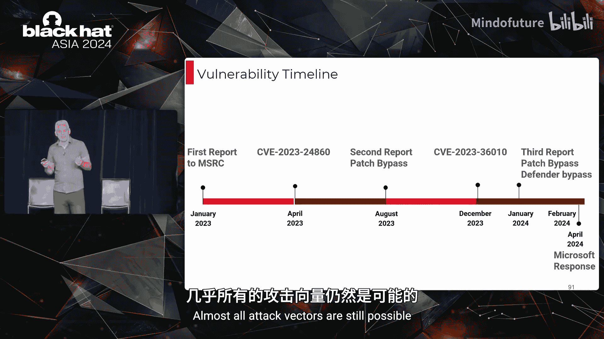

This is our Gi repository where you can find EDR erar。

 which supports all the things that we discovered and showcased。

 and you can also expand new attack vectors very easily， so please use it。

 we'll wait one more second to allow you to take a picture。Okay。

 so for the takeaways and I will conclude with that。

 remote deletion vulnerabilities are difficult to fix， as you can see。

 especially when security controls relies on by signature detections。😊。

Security patches might be incomplete， patching should not be treated as a magic bullet。

 and other security layers should be protecting against a single point of failure， and lastly。

 security patches fixing vulnerabilities in security controls。

Might introduce bypasses and unexpected behaviors。Thank you everyone， thank you。

