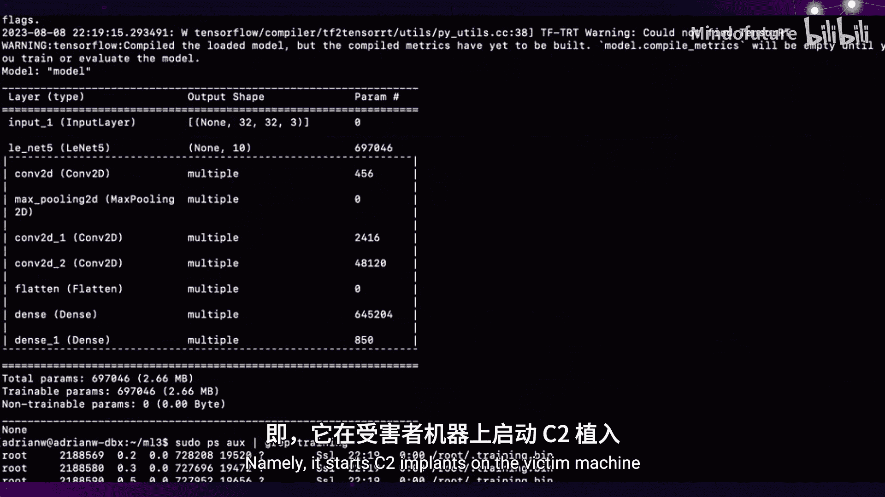
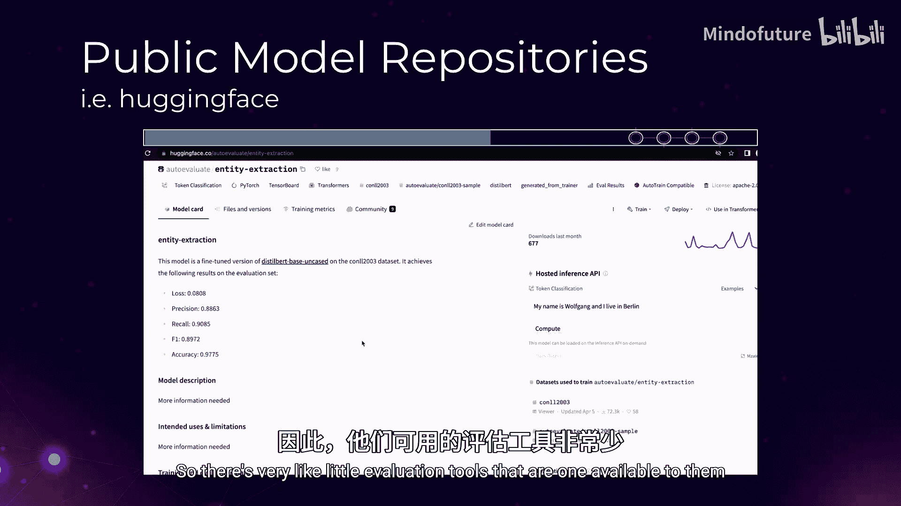
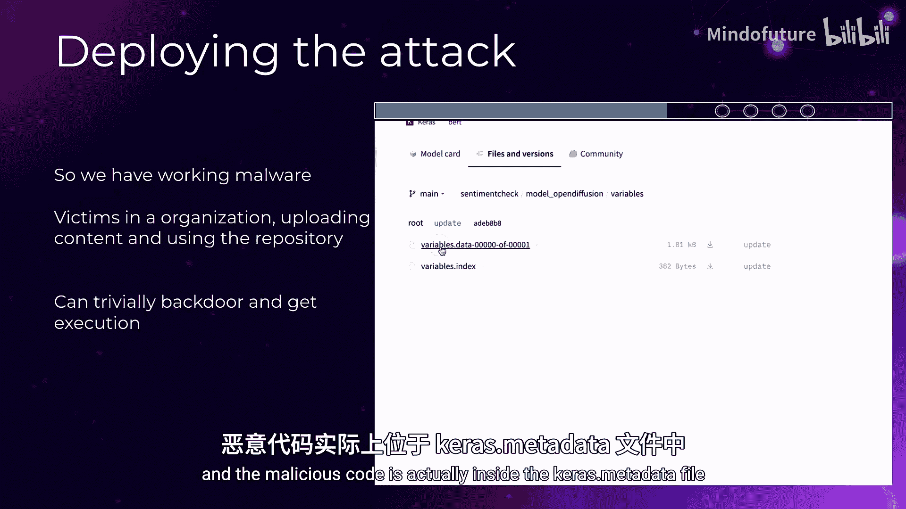

# 黑帽亚洲大会2024全集-•-中英｜Black-Hat-Asia-2024-p32-P33-Confused-Learning---Supply-Chain-Attacks-through-Machine-Learning-Models--BV1oyX7YnEhN_p32-

Hello， welcome to Confuse Learn。 Today， we're going to take you through some supply chain attacks on machine learning models。

My name is Mary Walker， I work as a security engineer at Dropbox on the threat Intelligence team prior to working at Dropbox。

 I worked at a big online retailer and my background is in malware analysis and digital forensics and incident response kind of things。

Hey everyone， I'm Adin， I work on the Dropbox red team。Eially these are offensive security。

 supply chain attacks， and I also work as Alum machine learning tech lead currently。

The first part of our talk will primarily be Adrian。He's going to walk us through the attacks。

 not only methods for creating machine learning models with malware embedded， but also motivations。

 target selection and potential actions on objectives that you can have with this attack vector The second part of our talk will be primarily my content I'll share the results of a threat hunt that I conducted on huggingface and go over the current state of defensive capability in this space。

There's a few key concepts we want to take you through before we kick the attack off。

The bottom line up front is that machine learning models can contain malware。Basically。

 all kinds of machine learning models barring a few exceptions are full blown software programs。

 they're not pure functions。What you see on screen is basically a machine learning model that has the perfect expected accuracy。

But in the background， it performs some extra steps。 namely。

 it starts C 2 implants on the victim machine。

So it's been well established for some time now that machine learning models can contain malware。

 but one of the missing pieces has been actually getting that onto the machine and that's going to be one of the things we cover in the first part of today。

These models they don't execute themselves。 You actually need a way to get them onto a victim machine reliably to do a supply chain attack。

So I found a way to do this for Bob G programs and also for Red team and was able to compromise more than 12 different companies through malicious models。

The first thing that you need if you have a malicious model is you need a victim， of course。

 and you need a method to encourage them or coerce them to run the malicious model。

 otherwise you just have a thing living out there in an ether doing nothing。

There are a lot of dispora roles in the ML space， all of which are great candidates to either fish or lure into using your model in particular machine learning engineers or great candidates。

 these are the people that are developing models， training models。

 perhaps pulling models from hugging face to test them in your own environment Another great option are the folks that are responsible for the care and feeding of your MLOs pipeline and these are your operational folks。

 they are standing up infrastructure， running pipelines， all that kind of thing。

So let's go through some target selectionleian steps of how we actually deliver the payloads。

The machine learning pipeline is the environment that we want to get into as attackers。

 it is an amazing place to operate in and you'll find yourself running a very short assessment if you get access to a machine learning pipeline。

The observationss I made both during buggroundty and Red teaming were that the access that you get gets you very close to a business's crown jewels。

 that is the data that makes the business what it is。

The second component is that machine learning environments， the pipeline。

Observability by defensive teams is very complex because of technology like Kubernetes， containers。

 virtual environments， and so on， it obfuscates your activity in the environment。

The M L pipeline and the teams that operate in there。 they're optimized for running experiments。

 You know， for a long time， machine learning had。诶。Jbious like qualities。

 which meant that teams were doing a lot of experimentation to just try and find stuff that worked that solved their problem。

 so they're pulling in things rapidly in order to experiment and that is what the environment is designed for。

😡，These teams don't think of themselves as running a production service often because of this experimental nature。

 but they do have all the data。 They often have more data than they really know what to do with。

To infuse malware into models requires no special machine learning expertise。

 you don't need to write your own model or even understand how a model works to use this vector。

 really all that you need to be able to do is operate a C2 framework。

When you target a machine learning pipeline， you get many benefits for free just by operating this environment。

The most important one is normalized data access you're living off the land， so to speak。

 you're using ML tools which are designed to rapidly access a lot of data to do as such。

You're sitting right on top of a lot of restricted information。

 so you don't have to do a lot of lateral movement or post exploitation steps。

 you kind of just get it for free。And of course， the low visibility that I mentioned before is another huge benefit。

So。Getting these on target。😡，Here are some of the things that I observed as an attacker performing these supply chain attacks。

Public model repositories like Huging face， make my life a lot easier。

On screen is a short demonstration of how many machine learning engineers go through the process of evaluating and selecting a model。

This machine learning engineer wants to do entity extraction， which is the process of。

Selecting like names and places from sentences。This project has the most amount of stars on Huging face。

 I think it has like seven or nine stars， so its social verification is not very high。

 but it's the most popular project。They'll skim the model card， which is basically a readme。

 and then they will download or deploy that and start experimenting。

So there's very like little evaluation tools that are one available to them or two that is expected of them。

Probably because they don't know that the models can have malware in them。

Some other features of hugging face make this easier。

If we look at Alex Buran's work in dependency confusion。

 we can effectively lift that and apply it to machine learning。We see things like namespaces。

 which are effectively organizations on hugging face。

 namespaces like on NPMJS or something like that。Many of them。

 for big names that you've all heard of will be available to be registered。

 and they can be registered by anyone with any email address。

Even the font choices on the sites make tricking people through typo squats much easier。

 and of course， the star and social verification system is all very low counts。

 which makes boing up a popular project very easy。Organization registration was the most effective technique for me during bug bounty and also red teamming。

That was where I would effectively make a user account with， say。

 like a random burner Gmail accounts。And I would go and create an organization for a target company。

There is a verification process for organizations， but it's optional and it gives you a little like gray outbox just to say that you verified the org。

 but it's not mandatory， you don't have to do it。And no one really seems to care。

Once you've created an organization。What tended to happen next was people who worked at those places would go。

 oh， my employer iss on hugging face， I should join that organization and start like working。

And so I was finding that people were just asking to join the repository that I was the administrator of。

 I let them in and gave them right permissions， which allowed them to create private repositories or public repositories。

Sometimes I would invite people， you know， to kick speed the process along or because I wanted a certain person。

And when you send that invitation， it originates from Huging face。

 and it doesn't include any information about the person who sent the invite。

 like a random person from a Gmail account。If you want to learn more about like the supply chain components and a step by step guide to doing what I just described。

 that QR code will take you there。So once I learned that malicious models were a thing。

 I immediately started digging into the supply chain， trying to find out what was possible。

I generally would prefer to do a supply chain attack than fish people。 I prefer the access。

 I think the accesses tended to be more permanent， it involves less lateral movement steps。

And it kicks you off endpoints， which is often a good thing and it removes a lot of complications。

And supply chain attacks work to an internal red team strength。

 which is time because they're not like on a consulting clock。And of course。

 you know working in MLOP stuff just seem fun and new and exciting， and yes。

 people do just give you their data。So now that we've talked about how to get models where we want them。

 let's talk about weaponizing them。Sometimes in the machine learning space。

 you might hear that an NL model is something like a pure function。

 something that when you give it one input， it's always going to give you the same output with nobiproducts。

 however， this just isn't true， machine learning models are full programs。

 though most of the formats are flexible and can contain all kinds of code through serialization。

So the code that I'm about to go through with you is publicly available， I'll share it at the end。

Many model formats are vulnerable to having malware inside them。

 I'm going to walk you through one of the more basic types of models that can be infected and it just is in the medium of this kind of conversation。

 this will just transfer better， I think。So。Because you own the attack and you own the repository。

 you can really attack someone with any model format that you like because you're coercing them yourself。

 they might share a model with you or a data set and you can backdoor that of course。

 but you can also just provide them a juicy looking model to run。What we do first here。

Is we are going to use a Tensorflow model and we're going to use formalacical careas。

Caas gives us a convenient way to run arbitrary expressions inside our machine learning model。

 and these expressions happen sort of above the model in like an architectural layer。

 which means that we can write our functions so that it is pass through。

 meaning that it happens but doesn't affect the underlying。

 say like arithmetic so to speak of the model。And。An interesting thing about what is on screen is you'll see that we have infusion。

 and then we define a Lada and then an exact payload。 And then we say， all X。

 that's how we make it pass through。And that exec can contain any pythonic code that you want。

 You can be as creative as you wish to be。So once we've done that。In the payload。

 my preferred method。Is to call out to a remote connection and download a binary like an implant or something like that for a C2 framework。

 And so we just define all of that inside the Lada layer and bundle it up。

So the couple of gifts that you've seen in this section there's actually a little bit of matter here。

These gifts are generated by a backdoored model that is inspecting itself。

 so the land delay is expressed by that final green， like a neuron that's pictured。

 but that g is actually built by an infected model that is inspecting itself。😡。

So now that we have payload working and defined inside a model。

 we can go ahead with the rest of the model。Which effectively is we give the model a name and we define some like other basic components about it。

 but really you can infect any model just by shoving in a landda layer somewhere in the code。

Since we're serving implants for a C2 framework。I want to be a little bit careful about who we share them with for ops reasons。

 We don't want to just like have defenders be able to download our payload whenever they feel like it。

 And we also want to control where our malware detonates。

And we do that on the serving endpoint by just basically defying the cider blocks of our targets and then only serving malware to people inside those cider blocks。

So， now that we have a。Machine learning model that's been backdoed with a malicious land layerer。

We can go ahead and deploy it。The post exploitation steps。

 as well as everything that I just described， there's a write up about it that I did at that QR code and the URL is also there if my QR code scare you。

So。We have to deploy the attack。 we're going deploy it on hugging face。

We basically have here our a malicious model deployed on hugging face。

 and the malicious code is actually inside the car start me out of file。😊。

Yeah， I'd like to stress here at this moment that the entire payload is in this metadata file。

 this protobuff， but if you're just looking at the model and hugging face， it looks normal。

 it looks benign。 There's nothing even if you cat the file to make you think that， hey。

 this contains malware， it's the right size， it looks just completely normal。

So to summarize what we've got so far is we have an attacker that's hosting malicious content on hugging face or a similar model repository。

And a victim environment that is grabbing and using that model either through coercion or through a watering attack。

And then when that model is executed in their environment。

 we had C2 infrastructure doing conditional serving。

 allowing me to assume control of whatever machine we've taken over。When a model detonates。

 a malicious model detonates inside a machine learning pipeline。

 the two most likely places that you'll see this detonation are either through a training and tuning phase。

 which might take place in something like a Jupiter notebook， Amazon SageMaker coab environment。

Or in a compute environment， which is going to be something like K serve or some sort of container that's being served through something like MLflow。

Really， I don't really care。 Both of these environments are awesome。

 and one isn't really preferential to the other to me。

So the post exploitation of these environments is really， really fast generally。

 and it's full of some very interesting opportunities I'd like to share with you。😊。

My goals during a red team assessment in these environments is to gain access to things like Spar and snowflake。

 you know， your data lakes， your big data tools。 These are where your business crown jewels are。

I also wanted to poison a model and I specifically wanted to poison an LOM。

 I thought it was a timely moment to do so to my business and also it seemed like a real challenge。

 like the idea of poisoning an LOM for someone who's not a machine learning engineer that seemed challenging。

And I also wanted to live off the land and use the native environment to exfiltrate。

In order to assess the environment， I found an NMap script by a fellow by the name Al Kate。

 and he had written an NMP script that helps you enumerate the contents of an ML pipeline。

 like where's the registry， where's this， where's that？

I noticed quite often in bug bounty unread teaming that inside of things like Jupiter notebooks or caseU environments。

 the environment variables had a lot of amazing secrets。

 which is a pretty consistent story with CICD pipelines。

 where you also see a lot of like great secrets for things like Ansible or Jenkins or whatever just sitting there。

Inside of Jupyter notebooks， the opted directory or the Ser directory often contains a lot of custom tooling for how the business interacts with their sparkark deployments or their model registry。

Because these environments are virtualized， I'm generally not scared to run a Gr command like that one down the bottom。

 because I'm feeling pretty confident that there's going to be low observability。Poisoning models。

 I was really， really nervous about doing this。 It seemed like a real stretch。

And then I discovered a tool called Easy Edit。Which was a recent project release from like a professor at a university。

And it's an LLM alignment tool， so it's designed to basically strip out certain say like words or phrases from an LLM that are considered unsafe or maybe a hazard。

 you know， kind of like bias related issues。The challenge was this was actually deploying it through a C2。

A lot of the methods of doing adversarial machine learning are really hard to do through C，2。

 because the people who wrote those tools assume like。

White box or like very pristine access that an attacker might have。

 whereas I just had a shell and Linux shells as you might know， can sometimes be very like finicky。

 they like that break sometimes you can overload them fairly easily。

 or maybe I'm just not very good at writing Linux shells。对。Easy edit。

Makes the process of poisoning an LOM or changing its behavior crazy， easy。

You effectively get this box on the left hand side of the screen。

Is literally what it looks like when you want to change the hyperparameter of an LLM。

You can basically in plain English， write the prompt and the expected answer。

 as well as the new target answer。This works on models like Lama， it works on mixture models。

That's what I mean by generalized is it just kind of works across the board and with Lma2 the benchmarked accuracy is 100%。

 so if you edit an LLM with this it's going to be very effective。

So now that we know that a model can contain arbitrary code and it can be successfully s into a modern production machine learning environment。

 it begs the question， how common is this？So Adrian's work started in 2023 or probably before that。

 but that's when I became aware of it。 and I started to think about how I as a thread andtel engineered。

 had basically no good examples in my knowledge base of something like this。

 I couldn't find any blogs about forensicating these kind of model formats or anything like that。

 so I set out to try to figure it out myself。 My primary goals were to understand the prevalence of this attack vector on huggingface and identify detection opportunities for a particular machine learning formats with this。

But generally， I just wanted to create and share thread and talk with the community。

When I started out， I knew nothing about machine learning and I thought。

 well I'll look at all of the models， everything on Huging F。

 but I quickly learned that that was not feasible for the amount of time I had to do it and then I thought I'll look at all of the TensorFlow models but even among TensorFlow there's a lot of diversity so I finally scope my project down to just looking at all of the TensorF models that use CAIS for the first pass and for those of you who don't know Caris is basically an API that can front TensorFlow to make working with TensorF easier。

Before diving into a model， I wanted to make some conscientious design decisions about where I would assess them。

 because the models were potentially。My biggest concern was isolation。

 I chose to use a cloud native approach and do all of my assessment in Amazon Web services。

This let me have a lab backed by Ins code， but was completely separate from my employer's production network。

When I started out， I was also quite concerned that I would generate a lot of data and then have difficulty analyzing that data。

 finding trends， figuring out what Id found， so I opted to create a simple database using DynamoDB to track everything。

 this table stores things like model name， the code itself， if a model contains code。

 the updated data of the model， all those kind of things。

 it also uses an audit logging strategy so that if a model changes and I assess it twice。

 I can see how the model changed。So once I had an EC2 instance configured how I wanted it。

 my assessment process was pretty simple， I pulled hugging face to find every model that I cared about that was in scope。

 I would download the metadata or the full model depending on what I needed。

 and then I would check for a Lambda layer in the model finally I would update my Dynamo DB table with all of this information that I'd found。

I want to mention， though， at this point， I've made no determination about if a model is malicious or not。

 The only thing that I've looked for is if it contains code。

And models do contain code that are benign。 This is a perfectly valid use case。

 The landda layer exists because people need it。 It's not just to implant malware and models。

But how are we actually analyzing if a model contains code？ Well。

 I'm going to talk about formats for just a moment。

Tenssorflow models saved in Ka or often used this dot save method。

 And that's what Adrian just showed us。This results in a CAIS_ metadata。pB file being generated。

 the file name is not adjustable， you have to use that like that is the name。

 if the name isn't that your model can't be loaded by somebody else。

And if you did include a Lambda layer in your model。

 Kas will dump that function for you using the code in the top right of the screen。

It uses marshals to dump the code。It then encodes it in base 64 using an ASI character set。

 and this is stored in the Keis Meadata PB file。The metadata files are always small。

 like less than a megin size， but they do contain the payload in its entirety。

 so this is really nice because from an analysis point of view。

 I can completely forget about the rest of the model and all of the data and all of the huge size of it。

 and I can just grab this one file to assess if the model contains code or not if you simply cat the file which is what is shown here on the bottom you can see the base 64 encoded blob that does include the payload but this looks is pretty normal。

But at this point， you might be thinking， and you would be correct。

 that this is pretty easy to parse and identify programmatically。

To consistently pull out the blob of base 64 encoded code。

 the simplest way is to use a standard Pro above method parse from string。

If you import the saved metadata Proto from TensorFlow into your Python。

 you can use the standard method to dump the data structure into JSON from there you can just traverse that structure to get to the code。

 This works consistently and is very， very simple， however to do it you need the saved metadata Proto in your environment which requires you to build TensorFlow This is like quite annoying for what we're trying to do but you can do it from a standard TensorFlow Docker container。

While models saved using dot save and the CAIS format extract out their metadata into this tiny little lovely file。

 authors can also choose to save CAIS Tensorflow models using the dot H5 file format。

 A CAis model saved using dot H5 will be just one file that contains everything。😊。

H5 is also a popular format for model weights because the H5 file format is just the large data structure thing。

 right？So they can be huge。 These are the whole models。 they can be hundreds of gigs in size。

 and that's completely normal。 So that's annoying to assess。

Another issue is that hugging face model cards and even the API descriptions of models are not terribly consistent。

So if we look at information about a model from the API。

 it's not clear if an H5 file is a full model or just model weights for something else。

 I don't care about model weights。Last but not least。

 H5 is kind of a legacy format for saving KaRS TensorFlow models。

 so there is a method that folks tended to use historically called saved underscore pretrained。

 which will save a model for portability in this H5 format but those models saved using that are quite difficult to assess because they do not encode the configuration layer in a standard way that makes assessing them without loading them very difficult and I really didn't want to load anything at this point。

However， model saved using the new method， the dot save method。

 which is in the CAS documentation from like last year or the year before。

 will always be loadable with H5 pi， which is lovely。

 and they always contain a model underscore config layer which we can load as JSON。

 we can walk through it the same kind of way we did with the protobuuff file that we were just talking about。

From here， we can you know。Extract out our code and put it into our database and go about our day。

 H5 models are convenient for authors because they're one file， and that's it。

 And that's all they have to worry about。 And it's really inconvenient from an analysis point of view because I have to download your whole model。

 So I don't like that。So our initial results from last year when I started this assessment ended up looking at just over 11000 files。

 And that does include a lot of model weights。 But we did look at about 890 protocol files and 400 H 5 models。

Since last year I've continued to look at metadata files on HugingFace， when a new one's added。

 I take a look at it because they're quite small and easy to look at。

I've been able to do this completely automated， and you can easily automate this in your own environment if you want to look at these things。

In our initial round of assessment， only 54 models were found to contain a code layer。

 either malicious or benign。In the 3，000 plus new models I've looked at since。

 only 24 new code bearing models have been found， so this is actually a drop from 6% in the original assessment down to less than 1%。

As I mentioned earlier， a model containing a Lambda layer does not mean that a model is necessarily malicious。

 We need to understand what that code is doing in order to make that determination。

To interpret the code， the easiest thing to do is simply tra reverse what the dumb function does in Caris。

 So know we're just loading it using marshals， and then we're looking at the Bte code using something like this。

But sometimes， so the dis output would be this purple square。But sometimes for whatever reason。

 this fails us and is unhappy and that's upsetting， but when it does happen。

 you can always base 64 decode that in the blob and then run strings across it and it'll pretty much tell you exactly what they're trying to do so you'll see strings like you OS or subprocess or whatever and get a great idea of what the person is trying to do I think it's like quite difficult to obfuscate what you're trying to do because of the way that the function is dumped。

So just looking at the code though， really showed that most models are doing very simple things。

 so the benign models are doing things like modifying an integer or something like that。

So around 78 models out a more than 4500 contained code looking at like 1。7%。

This demonstrates that a model with complex code is just not typical。And when this code is analysed。

 it becomes clear that the complex code， more than simple numeric manipulation， is even more unusual。

😊，As we've looked at models on Heging F， only a few。

 just six have bubbled up as attempts to abuse this attack vector。

 so is quite small still Adrian's model is actually the first one in this timeline。

 he's our pioneer and after his talk at the Dfcon AI Vi， which I think was last summer。

 we can see other folks starting to attempt to use this layer pasture mechanism and kind of there's been more and more prevalence for the we get along。

These do all kinds of things， some layers will just you know print that they've touched a file。

 some will try to set up a neck cat listener， pullla an implant like Adrian does。

 all kinds of things。One thing I do want to mention is that for these models。

 all of them are marked either as like a demo or a training file or there's a lot of information in the model card that like it's for security research purposes。

 please don't use it， I should have done that to but he didn't。So。

There are other model formats as I mentioned that contain malware。

 The most common one is pickle based models like Pitoch models。There's plenty of existing research。

 including most recently from JFrog about malicious pickle models。

The reason I think you should avoid this approach if you can if you have the option to infect someone with a model format。

 don't use pickles is because this is the most noticeable format to infect that an ML engineer will likely see because it affects model performance and can affect model accuracy and those are two things that they care a lot about so if you start messing with that it's going to have problems we're in like the XZ backdoor like the middlecon being noticed right like you don't want to be found that way。

Yeah， so now that we have some grasp about the current state of the model landscape。

 how can we ensure that this vector doesn't become widely abused。

 particularly in your own environments， And one thing to do is environmental hardening。Right。

Of course， I noticed during bug bounty and so on that。All of the victims obviously could phone home。

 I don't know how many didn't phone home relative the amount of payloads I put out there it was very high。

 So many M pipelines have direct Internet connectivity， which should obviously be avoided。

File formats， there is a model format called Safe tensors。

 which no one has been able to put malware in a safe tensor model。

 you would be limited to like actual model back doors at that point。

Evaluation of incoming models is really important。 We're seeing changes in the regulatory landscape that are suggesting like。

In the near future， you will have to do this。But currently evaluating models is not something we've made easy for machine learning engineers to do until now Mary has made some changes to this。

 which will hopefully help with thatrian is vastly overstating what my tool does so as part of my threat hunt and research I ended up writing a lot of scripts and writing some infrastructure is code to deploy stuff for myself and I wanted to go ahead and just share that with the community So that's what this is Dropbox was really actually great in letting me do that they're like yeah but whatever okay but yeah。

 include CDK you have some like E2 launch templates for any kind of analysis you want to do and then your rules to assess these files of course I do want to mention that Bt which the name is from final fantasy for my nerds it's pure static analysis so it doesn't execute load any models so it's all just very much like pattern matching kind of things and it's only gonna help you with Karis Tensorflow models at the moment I also just really want to quickly say on this side if you have any interest in this please come like Count。

We didn't make it better because I'm not a devaf， so this is just my own stuff， so come help。

Outside of my own little gremlin that I've put out there there are some other great tools available to you and one of them is going to be protecttect IIs tool model scan Model scan can analyze TensorFlow。

 Pytororch and KaIS models for you and it will identify an embedded lambmbda layer。

 it will identify it as a medium security finding but it won't extract a code which to me is like it's great but it's like a little useless because you want to see what the code is actually doing so。

😊，YRA is actually another really wonderful tool for this space。

 These things are like dumped in a consistent way and that makes them a great candidate to be identified via YRA so this ya rule that I have on the screen is really simple and it's just looking for the presence of that Lada layer that we've been talking about and then requests base 64 encoded which if you're using the requests library is going to be base 64 encoded as a string in your file so this ya rule will work across either H5 files or the protobu serialized files which is great and the bochi Ripo has some ya rules but definitely more need to be written someGP is a similar tool that I'll let you Google but could also do the same kind of work trailer bits has some great subG rules but nothing for this vector。

😊，Detectionuctions on hugging face。 they do some malware scanning right now。

 They can't really use Cla AV。The issues with ClaAV sort of out of the box are that it has pretty tightly scoped file limit of about  four gigabytes。

It's not renowned for being great with Linux malware。

 and it also doesn't claim to assess ML file formats。

On the right hand side of the screen you'll see a message that was from a sock from an EDR vendor and the EDR vendor has basically written about the discovery of my payload on the desk of a machine that I had infected that I had is actively communicating with that the detection was a false positive because this was a machine learning thing doing machine learning so it pulling down bins and doing stuff is normal Its training that bin how could it be malware？

So the EDR vendor's response to this malicious file landing and executing in the environment is just a crucial example of R and by R I mean security is lack of knowledge in this space Mach learning environments are usually a part of production in all of the ways that we care about production MenL engineers maybe think that they're scrappy in their experiments or whatever。

 but they have all the data so they're broad so。😊，We really need to prepare for incidents in this space。

 We need to make sure that we have logging and access and understanding of what normal looks like in this space so we can understand what abnormal looks like and how to respond to an event。

We can't do a lot about making this space less juicy for an attacker to target because it's going to continue to have the data。

 They need to have the data to do machine learning。

 but we can make it a more difficult place for threat actors to operate in if we can incorporate robust detection and response and good visibility in telemetry and all of that。

 And the thing that I really want to stress is that machine learning expertise is absolutely not required to craft detections or respond to events in this space or understand any of that。

 I still know nothing about machine learning， and I have some confidence now in this。

If you are in an unluckies situation and have an event happen in your environment it involves an H5 model which could be this huge massive horrible file。

 there are some tools that can help you， particularly visualization tools for H5 models which will let you look at the different layers of a model and see what the different layers are。

 so it's really nice。So you might be thinking if these are potentially malware。

 well why don't we sandbox them， it just won't work for like a whole host of reasons。

 particularly size， lack of libraries， lack of hardware in your sandbox all those things but one thing that you can do is use traditional behavioral malware analysis techniques basically I'm telling you to double click the model。

 double click the malware in an environment that you have instrumented nicely so that you can see what it does you might need to make this environment look like fraud so it does the needful。

 but you can look at it yourself basically it's what I'm telling you。For future work。

 there's a lot of work to be done this in this space。 so if you're interested。

 I just want to encourage you to dive in and start working。

 there's like YRA and somegri rules that we can be writing to look for these things as they're ingested into our environments there's a lot of DFIR tooling I think that can be written in this space and by that I mean like actual tools but also just blog posts be written about what model formats are because that's like not particularly well documented。

I think we can also do a much better job of improving static analysis at Hugingface。

 They do a great job of tagging some like pieytorrch models as onsafe for a variety of reasons。

 but that work doesn't seem to be mapped over to KeIS or for TensorF。

 so there's things to be done there。😊，In terms of model evaluation。

 we don't have standardized model cards in a machine readable format。

Every model can contain a model card written in a different way。

 and we don't have expectations about what kind of things should be documented。

 which makes a process of doing any kind of like provenance establishment or even safety or hazard。

Analysis of a model quite， quite difficult。 and we do need that。

 There are three competing standard standards right now that I'm aware of。

The front runner seems to be from cyclone DX。Who are working on like a standardized machine learning model card。

 which is like the basis of what we need for things like AI bombs and things like that。

Upcoming problems we're going to see are more complex malware attacks。

 there are quite sophisticated ways to hide malware in models。

 the most sophisticated way I know of and have working is neuron based attacks where the payload is actually spread through multiple neurons of a neural network and it's quite difficult to find and yeah。

 it's terrible and you know if attackers latch onto that one it won't be a great time。All right。

 so thank you so much for coming to our talk we have some QR codes geared neither are malware I promise if you want to check out the offt ML wki that Adrierian has and then there's my little code gremlin if you want to come make it better I think we're out of time to take questions in person but we'll both be out in the hall and are super happy to chat and Yeah answer Thank you very much thank you。

😊。