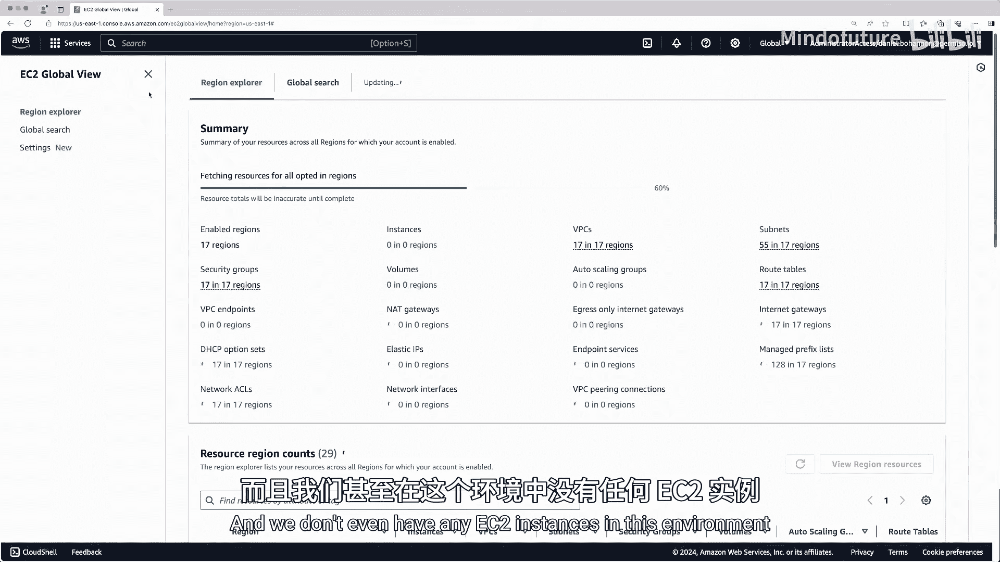
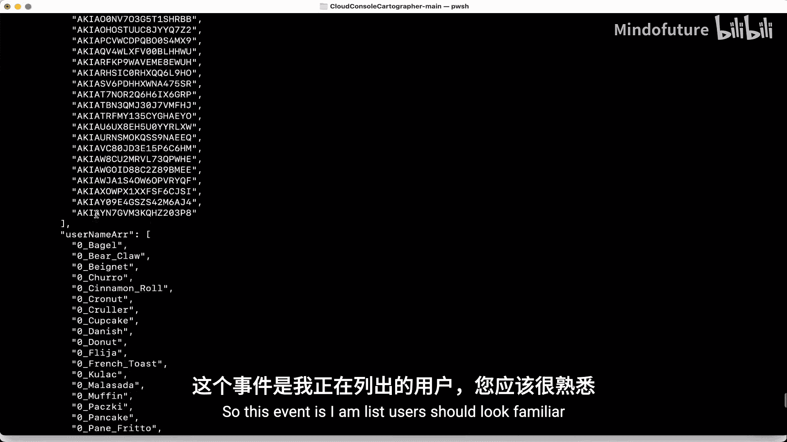
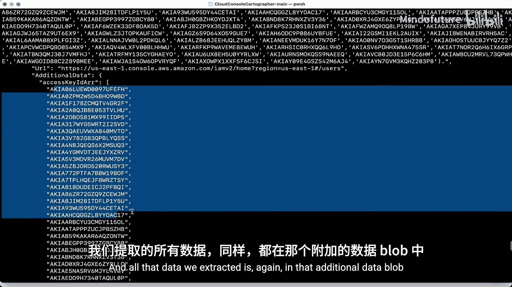
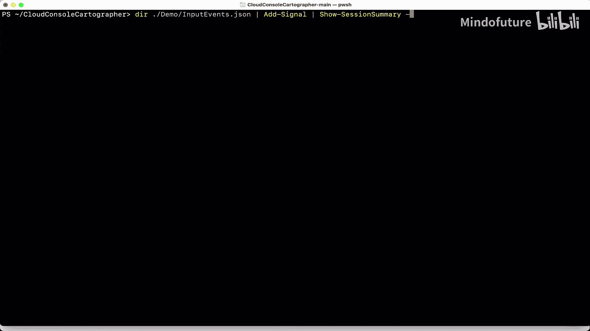
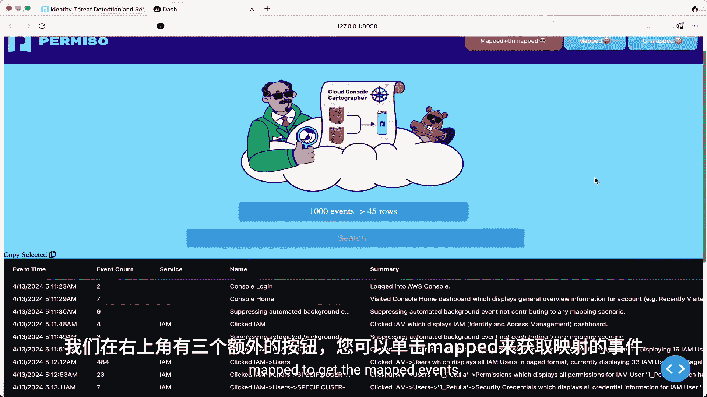
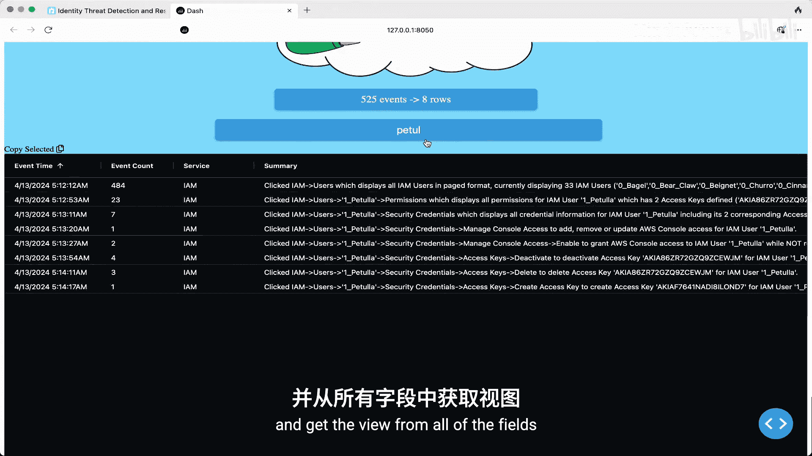
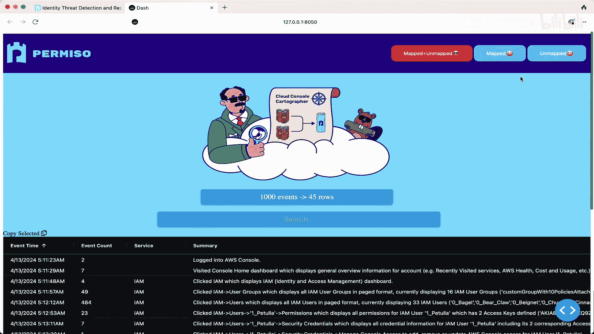

# 黑帽亚洲大会2024全集-•-中英｜Black-Hat-Asia-2024-p33-P34-Cloud-Console-Cartographer---Tapping-Into-Mapping--Slogging-Thru-Logging--BV1oyX7YnEhN_p33-

Awesome， well good morning everyone， thanks for your patience。

 really excited to be here today and welcome to Cloud consolesole cartographer tapping in the mapping is' greater than slogging through logging。

So first， the brief introduction， who are we and what are we going to be talking about？

everybody gotine sweet， my name is And Aitti， I live and work in Pritina Kosovo。

Recently graduated for computer engineering。Background。

I started working at Peral security almost a year ago as an associate F researcher。Recently。

 I published an open source tool called Cloudud Gtler。

 so you have the link below if you want to give it some love。And my name is Daniel Bohanan。

 I'm from the USA， I'm a principal threat researcher with Permio。

 I've been in the security industry for about 14 years now。

 the last couple roles I've been in were incident response and researcher at Mand and then also spent a couple years at Microsoft I've been at Permio for about a year and a half now and I'm a big fan of security research I love these conferences。

 I love open source tools and have a deep fascination with obfuscation and looking at common things and uncommon ways。

 I'm always taking an offensive approach to defensive mindset。

So with that being said logs you know we're here to talk for 40 minutes about logs and keep you interested and exciting so what's the role of logs well as a defender logs or visibility they tell me what has happened in an environment often people do not enable logs and typically attackers do not do this for you so know what logs you're capable of recording and turn them on secondly move them to anotherloc so that you have a duplication replication so it's harder for an attacker to go and remove those logs and then do something with them you don't just want to have logs to look at when it's been an incident you want to monitor them and see proactively is there something that is suspicious that you should be looking for。

I'm going to briefly talk about some of the differences in my opinion between on-prem and cloud logs now this is not the storage location。

 it's more of the data source so like what are some differences between like hostbased logs。

 network logs and then cloud logs from a host to network perspective they've been around a lot longer you have more options for forwarders for tools to look at the logs in my opinion there're a lot more granular think of how much information you can get from something like Smon we can get process information image loads。

 network connections， even the contents of files that attackers might be using for binaries or scripts so there are a lot of opportunities for fingerprints to be leftknowly by an attacker and in the world of instant response and forensics it's just a beautiful thing to find all these secondary effects that come from an initial action from an attacker but things get a little blurriier with cloud there's not quite as much control you are basically beholden to whatever the cloud provider gives you and typically most cloud providers break up their logs into control plane and data plane log control plane is。

Enabled by default and it gives you information about the management and configuration of everything within that environment data plane is typically not enabled by default so control plane can be like the configuration of an S3 bucket data plane is every time someone requests something from that bucket or upload something to it and it's typically not enabled by default just due to volume and cost。

There are also different retention limits which we'll talk about in the next slide。

 but typically they're a little less graniular because cloud logs are basically a record of an API call。

 it's not even something that is logging activity on an endpoint or device。

 it's already abstracted one layer so finding this fingerprints becomes more about grouping less precise information into a larger aggregate data。

So let's talk a little more about cloud logs for defenders， so if we' were to look at。

 let's say AWS and Azure， this is an example of doing something really simple。

 we're just creating a new user in this case called Pre Leva。

 we can see here there's kind of similarly named events and the name of the user that was created between these two logs。

So what about actually  queryering these logs how do you actually get to what we just saw where you have the opportunity to hit the API that the cloud providers give you one of the pros is it's the least delayed。

 you don't have to worry about getting in a secondary replication you can get it right from the source sometimes even a few minutes earlier than some other locations one of the cons though is retention AWS cloud trail you can go back 90 days Azure is only 30 does that matter to you。

 it's at least something you should think about and know what the limitations are。

Afforded though gives you the ability to have however much storage you want。

 you can retain it for five years，10 years if you want to and typically storage is not too expensive again it all depends on the volume that you're talking about there's also no API throttling so for example Cloudtra lookup events you can hit two times per second now that's still a lot but when you have a lot of different security tools competing for that you can hit API throttling pretty quickly。

It's also a bit easier to consume by other tools if it's already replicated onto an Azure storage bb or an S3 bucket。

 anyone can consume that data and you can control access to that storage location rather than giving someone access to build a hidden an API in your account One of the cons though is that sometimes you're actually missing metadata if you query logs from Cloudtrail then you'll actually get an entire different section of resources with a resource type and resource name if you forward those logs。

 that data is completely missing so it's important to kind of di the two options and see if that matters to you。

Also additional monitoring， anytime you introduce another step into the pipeline。

 you want to make sure that you're monitoring the health of that step to make sure that those logs are flowing correctly。

So when we use the word console， this talk is called cloud console cartographer。

 this is a bit confusing because typically console means like a terminal。

 a black terminal window or blue if you're a PowerShell user， but in this case，Consul。Hey。

 commission to go backl， Con is referring to the AWS management console。

 so it's the actual web browser that you log into to look at your configurations to manage your environment。

Hey can we move get some other batteries in this thank you so do people actually still use console the answer is yes。

 legitimate users and attackers still use console today there's two different threat groups that we've seen do this quite a bit luer3 and1 Luer3 is also known as scattered spiderroed octopus they actually use console pretty prolilificically sometimes maybe that's just because they might have PDFs sets's their run books and says click here to do this do that some attackers are still learning cloud it's lucrative enough for them to still break in because many organizations are not to advance in their cloud security configurations。

Sometimes there are also technical reasons why someone might use the console if we go to the next slide please。

 for example we've actually seen a case where an attacker got a they basically broke out of an ECS container and they had a federation token and what's interesting is that if you look at AWS documentation。

 if you have access in the federated token， there are some limitations like you cannot access the IAM service via the CLI or an SDK but that limitation does not apply to console and that's precisely what this attacker did as soon as they broke out of that ECS container they then went straight to the management console and then went right to the IM service to create a user login profile all the rest。

 so there are technical reasons why an attacker still might use the console。So cool。

 Depot showed us two examples of cloud logs， both in Asia and AWS。

 but how do they look from the log volume perspective， And for that。

 we're gonna do some enum process in AWS console listing some user policies。

 roles easy it to instances， and we'd be surprised on how many events are generated by those simple read on the clicks。

Azure， in the other hand， tends to do things differently。 They only log， change or update events。

 So if we were to do the same enumeration process in Azure portal。

 like listing user blobs or containers。We'd be muted and get no logs at all。

 And stand speaking from a security standpoint， you always want to know if an attacker is doing the enumeration process of your sensitive data in your environment。

And for that， Asia kind of gets a free pass from our problem。

 not because they are doing a better job， obviously。

 but since they don't provide us enough logs to actually make sense of what's happening in their environment and with that being said。

 we're going to focus only on the AWS part where we can actually get that information。

Let's jump down to the main part of the presentation， which is the problem of noisy console logs。

We all love logs here， they shine in our path towards the truth。But sometimes too much brightness。

Can't make you blind and leave your out in the dark。

But the main problem here is not the absence of logs。

 just like we discussed at Azure doesn't log many of these things。

 it's actually the sheer volume of loglogs that get generated from the console session in EWS and sometimes it feels just like playing the Tory super breakout game。

Where we can think that every single UI click that we do is just like when the ball goes from a pddle hits one brick。

 So you have that one to one correlation。 So one request to one response or even say better for each single U I click。

 You get only one event generated。But that's obviously not the case at all times。

 Sometimes the ball goes from a paedal goes way over to the top。 It tens。

 if not hundreds of API calls in the back end。 And we're going to see later on slides that's actually the use case in some of our console session。

Back to you。YouSo how did we come across this。 Well， we look at a lot of logs and we realized， wow。

 there's a lot here。 How do we even make sense of what happened in this 1000 event console session。

 And we see a lot of these events are occurring in the exact same timetamp。

 So what we decided to do was we created an identity called no permissions。

 And we gave it no permissions。 We only gave it a login profile and then started to go through the console。

 And what we found was many different errors started showing up。

 And you can see all these different widgets in the console have these different errors。

 So let's click to the I am dashboard。 We see even more errors。

 Let's just start to kind of pull those over to the side。

And basically try to understand are these consistent across every time you visit these different pages。

 So if we click on users， we have list users let's actually use this one as an example。

 if we focus just on list users then what if we give ourselves just that access So what if we can make it one step further like if we give ourselves an inline policy。

 now we can actually make a little more progress Now list the users but you'll notice that each column are more errors with different API calls So how do we actually approach this and say understanding list users。

 what what are these other events， how are they required， how do we figure this out。

Cool in order for us to be looking at the data that Debo just told。

 we need to crack open the hood and see what treasure is inside of it。 And from there。

 we extract full four golden rules that we live by First， full permissions。

 our user needs to have full permissions in order for us not to be losing time and giving ourselves manual permissions for every action we're trying to do new environment or a clean environment per each service。

 lots of Excel spreadsheet where we track our time of our actions and my favorite one。

 lots of coffee or any coffee and drink of your choice。

Let's go back to the IM user part where we have three scenarios。

 the first one where our user has no permissions at all besides breathing and just logging into the profile scenario B。

 where our user has only one action allowed and that's the IM list users and the loss scenario scenario see where our user has full permissions in the environment now let's see what events are generated in the back for each scenario。

For scenario A， we have only one event generated， and that's the IM list user。

 which was obviously denied due to lack of permission。 So nothing fancy going on here。

 If we moved down to scenario B， we obviously see more events generated。

And the difference between these two scenarios is that in the scenario B。

 the I M list user event was successful indeed。 And we see5 group five other grouping of events which occurred。

 but were denied due to lack of permissions again。Moving down to scenario C is where things start to get interesting。

 We obviously see that the first event is again successful。

 we have the five grouping of events which in this case were successful as they occurred once per identity so we know that occurred also in the previous scenario and in this scenario so we're going move them to our map on the site and now we shift our focus down to the two additional events at the bottom so we have the event get access key lost used and they occur only if the user has a access key present so a user may contain zero up to two access keys。

 but they may have none so this event might never occur。

Our approach to this problem is let's list these events in three groupings， the anchor event。

 which is the main event that must happen at all times。

 the required events and lost the optional events which are again are events that may happen。

 but if not， they won't be a deal breaker to us。So let's talk a little more about optional events we kind of break this up into two separate categories one is kind of the background health events if you're still logged in there's gonna be some events that show up so even just logging into the console home session we actually can define these into the events that are actually correlated to the click and then all these background health events so one of the things that we first do is to try to figure out the noise that exist in general and as Andy said in all those spreadsheets we need to do the same actions multiple times to start to understand which are consistent with the input action and which are just kind of events hanging around and we basically like to slide those events out of the way so that we're not accidentally putting those background health events as a required event into the definition of the signal itself。

The other kind of optional event is based on the context I think we're really hungry the day that we came up with this idea and basically we have the everything bagel and the plain bagel and what I mean by this is we're gonna create a user that has everything let's give every single thing we can think of to this identity and then compare the clicks so in this example this identity it has multiple group memberships has a permissions boundary we can see that group also grants different attached policies we give tags from a credentials perspective it has a login profile so we can login interactively we have an MFA device to active access keys。

 SS keys again get credentials key spaces， even some signing certificates Now the plain bagel has nothing no permissions not even a login profile so even less than our no permissions users So if we were to compare clicks looking at these different users what differences would we see Well if we click into the plain bagel into the permissions tab of the IM dashboard we can see these events and then everything bagel has just。

A few more events if we were to compare it also at the bottom。

 we have a similar scenario where the access key is mentioned to Andy's point just like in the last example if keys are present。

 oftentimes that will generate additional events， but here's what's funny is that even the user agents are different in some of these those are two different versions of the AWS internal user agent talking about the same key so there's a lot of interesting I wouldn't call them discrepancies but maybe some redundancies that we see and this is very。

 very different across many different services at AWS which makes sense there are many different teams that work on these different services and so even the kinds of background events that occur or even kind of the style of how the frontend and backend is programmed becomes a little more evident as you spend a lot of time going through these different services and seeing how they're mapped。

But if we're just to compare these events for everything bagel and plain bagel user we'll see in the green boxes are the common events that are there no matter what。

 and then in the yellow and purple we have the optional events that are dependent on the context。

If we click into the security credentials， we'll see a pretty similar story， again。

 most of these events， all the ones in green are the common ones no matter what。

 and then purple are the different events again， in this case。

 based on if an access key is present for that user。

So we were talking about the differences between two IM users。

 the everything bagel and the plain bagel。 But if we were trying to look at the bigger picture。

 let's just take a step back and see what's actually the difference between doing some some of the previous common events in CI versus the console。

 And for thatre we're going to look at from the AWS CI perspective， the Boto3 and the console。

Let's see what steps we need to produce。We need to create a user named Cliva。

 create a access key and attach a user policy to this user。

 What events are generated in the cloud trail。 We have only three events that are generated and with some differences between each other speaking on user agent terms because the event source and the event name are appended at the back of each user agent。

 So that's what makes them different going down to the bottle three where we are doing same exact steps。

 create a user， create a access key and attach a user policy to it。

 What events are generated the same three events with just one difference between between the previous scenario because the user agent is simpler now because it's not different across these actions。

Moving down to the last scenario where we have the console。

Where things start to get intense now we're not just going to show how much events will be occurring。

 but we also do a breakdown of each click that a user needs to make in order to recreate the same action we did earlier so buckle up and let's see what's going on The first click is the console home click or the homepage that we get redirected once we log in into the console so that's account for 13 events generated now let's put that to the site and keep track of the total number of events。

Typing into the search bar or searching for the IM service holds for one event。

 and immediately we get thrown at the I am dashboard for a total of8 events。

 So we have9 events going on there。 We have the I am user click or the user Bcr underneath the I am service。

 and that holds 18 events generated。 And we're gonna talk shortly about this worst key scenarios of clicking this Bcr。

 And this is a pretty good decent scenario since we had only three users available users to list。

 So we have 80 events there。Now we are starting the creation of the users until now we haven't even started the process and we got 30 plus events。

Create the create user button holds four events immediately creating or attaching a user policy to this user。

 which has 15 events。After this is the final step of this user creation。

 which has three events and immediately we get redirected to the permission tab of this newly created identity。

 So 13 events there。 and surprisingly we have only one event generated from the create access key action。

The user agents that were present are shown us we have only 10 events that are generated from our actual user browser and the other user agents consist of health AWS internal and some different AW Java CI user agents。

 and if we werent down to look closely on them highlighted in green and yellow。

 we'll see some differences between their versions。

 So for all of your threat hunters over here who are trying to do some sort of statistical data or baselining on this field。

 make sure to first do good data normalization on them。For comparison。3 input events。

3 output events for both A W S， C， I and bottle 3。 So very clean， very simple。

 and 73 events generated by those 9 clicks that we did in the console。

I mentioned the worst case scenario。 So here we go。

 We thought it would be interesting to approach this with a mathematical formula。

 So for this particular click， we have the constant one。

 which is referring to the anchor event5 times n， where 5 is the five grouping of events and n is the number of available users。

 So we have 15 there。 And again， the access keys where a user may contain0 up to two access keys。

 And in our case， we had only to。Evendvs for this。 So 18 in total。

Let's increase the number of IM user and start listing them for 20 IM users we get a total of 141 events。

 let's try now 50， we have 351 events and now let's try the maximum number of IM user in an account which is 100 and we get 701 events generated by that simple click。

We have approached this with other services as well。

 and we have the S3 service over here where if we have 100 buckets available and list them。

 we'll get 421 events generated back to you Debo。Thank you。

 So how do we make sense of all this noise。 You know， we've gone through。

 We have tons of Excel spreadsheets。 We've consumed lots of coffee。

 We've made tons of notes on all these different events。

 and we've broken it out into the anchor events， the required events， the optional events。

 But really， we're just trying to bring meaning to a messy situation and aggregate this knowledge so that we can take all these input pieces of information and say these or when I am users was clicked。

 or this is when a user was created。 or here's when an access key was created。 And by the way。

 we also want to be very particular about the events that we know are not associated with input action and let's move those health events out of the way。

😊，So what's the solution， mapping？The way that we approach this problem is kind of a twopa approach。

 The first pass is based on adding labels to individual event evaluation。

 and then we go back and evaluate all the neighboring labeled events。

 and that's where we have concept of a signal being created。 And when we say signal。

 we kind of mean like think of it like an alert or like a mapping a click has been mapped to this grouping of events。

So first how do we define the signal Well we focus first on that anchor event optional event and required event breakdown just like we showed in the previous slide and we also have metadata about the event what's the breadcrumb trail how do you get to this click in the AWS management console what's the URL what's the summary and are there fields that should be dynamically updated based on the anchor event or any of the optional events that are present in that click and then we have additional options down at the bottom for increasing or decreasing to look ahead and look behind when we're evaluating the signals for all the neighboring labeled events So past number one is adding labels So every single event is evaluated individually and then based on very specific criteria of user agent request parameters which ones are empty which ones are not to then say we're adding this label or as we can see here these labels are all being added in this very particular order to this one event these labels will come back in the second pass to then say let's now go back through all the events and we're。

Stop at every anchor event。 Think of an anchor event like one of the required events。

 So for every event， we evaluate all the labels。 if any of those labels said， hey。

 my definition says this is an anchor event for my scenario now that has received the anchor event equals true flag。

 So we go the second pass every event。 we stop at every anchor event and then we take the anchor event It is labels and we go label by label and then we evaluate the signal logic。

 So each label will say my logic says go backwards3 seconds and fors 10 seconds and look at every single event that also contains the same label。

 pull all those things together and then evaluate that against the signal。

 if all the criteria is met then create a signal for this and then mark all these events as accounted for。

 They have contributed to a signal they cannot contribute to another signal and that's how we group those together。

There's a long list of additional things that we thought would be cool to do。

 Most of them are things we just had to do。 There were so many weird situations that we had to account for。

 So as you saw in the signal definition， we can dynamically modify the URL the summary we basically want to provide as much easy to consume information to the users as possible。

 So you can literally see if they clicked on everything bagel user。

 here's the exact URL that has an information if they clicked on IM users and it was those 100 users。

 then we want to list those 100 users or list the access keys associated with them。

 all this extracting information we used to update the summary or the URL。

 we also have in Json object called additional data So you can always programmatically access all the information that we gathered for these signals。

 and we actually do that too because in the last bullet point we have the ability to do lookbacks。

 So sometimes we get to a certain signal。 we might look back and say actually we need to modify that last signal based on what our current signal is Other times the current signal could happen four or five。

😊，places in the management console。 So we need to know what's the last signal that just happened within the last 10 seconds。

 If that was I am users create user， then I need to basically pull information from that signal。

 like what's the username or what's the username that we're adding a key to or something like that。

 We also have the capability of merging existing signals。

 This is important for very long running long running signals where we don't want to define a super long look ahead。

 but we can basically merge adjacent signals that are identical have matching extracted data。

 And so yeah， there's a lot of， there's a lot of weird tricks that we had to do still give us some headaches to this day。

 But it's pretty cool was really a fun problem to try to solve。 So enough talking enough slides。

 What's actually look at demo。 So we have two quick demo videos here。😊，And so for the first one。

 we're basically just going to， if we can go and play that。

 we're basically just gonna walk through what， like， how does this all start。 Well。

 user logged into the management console and starts to click on some things。So we're gonna go really。

 really fast to cover a couple different examples。 So if a user goes in。

 they've signed in the console home。 they click the I am service。 they've listed some user groups。

 they clicked on users to list them， and let's just choose a user in this case zeropeula we clicked on the permissions tab security credentials。

 In this case， let's let's enable a login profile。 attackers like to do this。

 So now this identity can go in and access the console。

 Maybe we want to create an access key for ourselves。 Well。

 there's already two perfect deactivate one， delete it。

 and now let's go and create a new access key for ourselves。

 these are precisely some of the steps we attackers do once they log into a console session So now we have given ourselves login profile。

 we have created an access key。 Next， let's get a secrets manager。

 Let's start to enumerate some secrets and see what's available What values might I be able to extract from this environment。

 Another thing that we see a attackers do in this case there's only five secrets So we'll on this one open Ell look at the overview page and well click on the retrieve。

😊，Secret value so that we can look at that secret。 But you know what。 This is kind of boring。

 Let's actually open up Cloud shell， just like real attackers do and let's programmatically extract all these values into a file called secrets Json。

 And then conveniently we can just click and download that file out of the console。

 All these actions are recorded in very different ways and pulling all together another great headache。

 but as you'll see in the next video in just a minute it's pretty neat to see how all this can come together in a readable fashion。

 So there's a downloaded file。 next let's go to the S3 service。

 who doesn't like to look at some buckets。 So basically going list some buckets。

 and then we're gonna choose one in particular to click into And so kind of keep in mind these different names that we're clicking into。

 So zero F bucket we click on the objects tab permissions management access points。 And then lastly。

 let's go to e C2 this is one of my favorites。 The E2 dashboard is not super interesting from a volume perspective。

 But that second one there E2 global view。 This thing take so long to run。

 There's literally a status bar。 So you get。😊，Really interested in how many events are actually being generated behind here。

 The answer is over 300 just for this one click。 and we don't even have any E2 instances in this environment。

 So it's pretty pretty fun to watch。 So in the next video。

 we'll see is let's actually do something with these event logs。

 you can actually query event logs directly in the API and pipe them into our tool。 or in this case。

 we've actually downloaded this session and put it in the demo folder of the project。

 And so we're just gonna pipe that in to add signal。

 which is adding the labels to the individual events。

 It's doing that second pass and generating signals based on the aggregation of that data。

 Let's just look at a couple of these and convert to Json real quick。

 you can kind of see that we contain the original event。😊。

And we also contain the enrichment object on top of it。 In this case。

 this event wasn't part of a signal。 So let's actually update our query to look for some examples where a signal was generated。

 So we'll call this a signal bearing event。 So this event is I am list users should look familiar。

 And then our signal here is really big。 It is saying I am users was clicked。 by the way。

 it was 33 users that were shown here are the users。

62 access keys at this time were present with those identities。 And here they are。 Here's the URL。

 And all that data we extracted is again， in that additional data b。

 So you can programmatically access it however you want。

 So we have some interesting context about this environment without needing any additional API calls just from this offline log analysis。

Next， we're gonna do show event summary。 This is gonna show all these events color coded to see which ones were actually part of a signal。

 And then we can see the signal on top of each one pointing down。

 And this gives us a little slightly better view into what the signals were any extracted values are highlighted in green as well。

 But let's look at this one。 This is that secrets manager where we clicked on the opener user。

 So here we can see these four events。 Let's actually add a little more detail。

 And let's say show me details about each of those events。

 So now all four have a detailed block underneath。 so that first one is the anchor event that was evaluated first and we can see it had four labels。

 The first two labels to look ahead look behind failed。 The third one was successful。

 And we'll see all the other events were also successful for that label。

 That's why they were grouped together as part of this mapping。😊，And then anything in purple。

 these are really helpful values for creating the labels， request parameters， all that stuff。

 And so we wanted to make it easy to use whenever you're debugging or adding new new data to see what are the precise request parameters and user agents I need to define if I want these events to be part of a new or existing signal。

 Lastly is a session summary。 So just give you one line。

 how many events contributed to this line and then what are events that did not contribute to a signal So we can kind of see at a high level again。

 the extracting information is highlighted in a different color and then at the bottom we have some stats just on the number of labeled events。

 mapped events as well as what services were involved in the mappings and then for all the unmapped events。

 what were the services that were involved，6 minutes and that is our session。

So we were very motivated to do some front end work stuff in order to give you a more friendly approach。

 So here we are with our UI visualizer。 we have three additional buttons as the top right corner where you can click the mapped to get the mapped events。

 the unmapped events etc The table view is supported with dash A grid。

 So you have that all of these cool features of AG grid like filtering based on different conditionals rearranging the columns also even sorting on different columns。

 we also gave search filter where you can search as you type and get the view from all of the fields also instantly getting the。

Information on the place holder above it for in two different perspectives from the events and the total number of rows。

so if we can go back to the slides that's the tool we've spent almost a year developing this with many。

 many hundreds of hours。 And again， I think my eyes are still red from looking all those Excel spreadsheets So we're really excited to announce that this tool is now officially live We'll have the link on the next slide but let's wrap this up What are the three takeaways here Con sessions still matter。

 attackers still use them and probably more importantly for most organizations is normal users use them do you still have to look at that activity and no is this normal user activity actually normal is it something that we should be concerned about and we seek to bring clarity into those situations through this tool。

 The second is understanding what your cloud logging options are what are the limitations What are the retention issues do you need more attention from a policy perspective what tooling do you have available to look through these logs and are you doing anything with it Do you have the personnel or the capabilities to make sense of what's in the logs Lastly is we've released this tool so that。

Community can use it and hopefully benefit from it and even add your own signal mappings to it to basically help it be a more robust capability for the community。

And with that， we just want to say thank you so much for your time。

 thank you for your patience with it delay earlier。

 and this has been a lot of fun for us and here's the URL to the tool and here's our social media information we'd love before we ask for questions。

 we'd love just to say always feel free to reach out whether it's in this room if you see us walking around we have some fun stickers to give out but but yeah we definitely appreciate talking with the community and so look forward to saying hello and with that thank you so much for your time。

Any brave souls for some questions？Yes， I think there's microphones in the aisle there。

thank you guys。Thanks for being here。 I am background。

 I am a threat detection response cybersecurity analyst。

 So I am the ones that benefit from your kind of work。 But one question I do have。

 We often have to disable some alerts slash signals based on the amount of false positive alerts that we have。

 So based on your work here， what have you found that can decrease the number of false positives without increasing the risk of missing true positives。

😊，Yeah， that' that's a great question。 So nice to meet a fellow defender。

 So yeah the question was like how does our tool help reduce false false positives。

 So what I would say is our tool seeks to bring clarity to a lot of events and give you an information on what that event was I don't want to do any vendor bashing but for example。

 if were talking about guard duty alerts in AWS。 This is precisely the kind of scenario that we see a lot of false positives with when a console session occurs because there's all these crazy events that have never happened before。

 a lot of them are related to IA and a lot of those guard duty alerts will say anomalous I am privilege escalation stuff。

 And reality was you just click to view some users like that's it。

 So our tool does not directly change any alerts。 In fact。

 all the mappings are not we don't view them as alerts。

 we view them as a simplified way to say instead of there's a00 events there's 45 events。

 There's 45 clicks that occurred。 And now you can kind of decide is this is this normal or not And so in some ways the way that guard duty I'm assuming。

Baselining the activity we kind of I mean we view that in our team as how can we baseline these clicks instead of baselineing individually hundreds of events。

 how often was IM users clicked how often was S3 buckets。

 permissions clicked or objects or management So this does not change noisy alerts from other tools but hopefully even in the light of those noisy alerts you have a little better readable way to look at that information to say was there really something interesting going on in the session or were they just clicking around looking at some users and buckets and stuff like that I hope that at least partially answer to your question。

Thank you， great question， by the way。Yes， he guys。 awesome work， by the way。

 So I just wanted to ask like obviously cloud when there's data on' come to you and say， like， okay。

 we made a change to our logging。 things have changed。 So update your detection。

 So I haven't quite caught how you guys like， you know。

 is the signal creation process quite manual at the moment。

 have you guys considered maybe automating it。 And if you have what was the some of the channel challenges you guys found。

Would you say it's pretty manual？I mean， yeah yeah。

 yeah the question around is there any way that we can automate some of this because you are right。

 it is a very manual process today。 I would say some of that manual process probably is like quite personally my level of OCD and wanting to understand truly all the differences because we don't just want to group logs。

 we want to say what are the unique values from those logs we can pull out and say these are important context。

 but even some of the mappings we did a year ago and then retested some of them now some of those had slight differences like the E2 service where used to a certain event as the AW internal user agent now logs your web browser user agent in some of those clicks。

 So I think there will always be those kinds of scenarios to manually catch up。 Andy。

 I know one of the first things you did was actually I think your first when your first approaches was to have like a browser plug in or something looking for the request。

 but but I think kind of the pong scenario was there's only so much you can see browser side that gets bouncing around in the cloud engineering all those logs that are absent from that view。

 So we are certainly open for suggestions if there are。

More automated ways to do it and would love to spare people some pain from all those blinding Excel spreadsheets for our tracking。

Yeah， would love to hear your ideas if you have some around that， but great question。Perfect。

 sounds great。 Thank you。Any other questions？Awesome， well， thank you again for your time。

 And we'll be around to see us say hello。 And thank you again。 Have a great day。😊。

