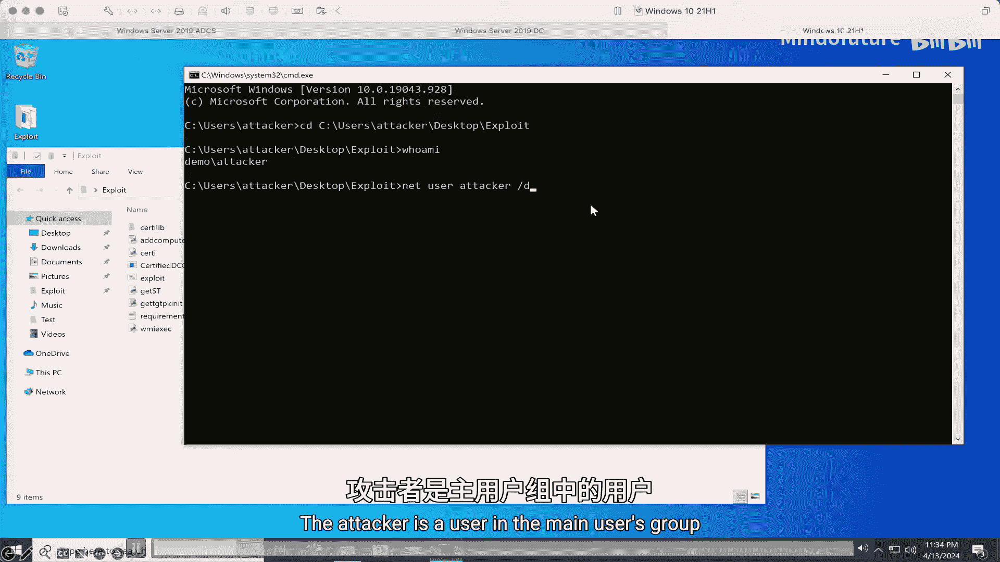
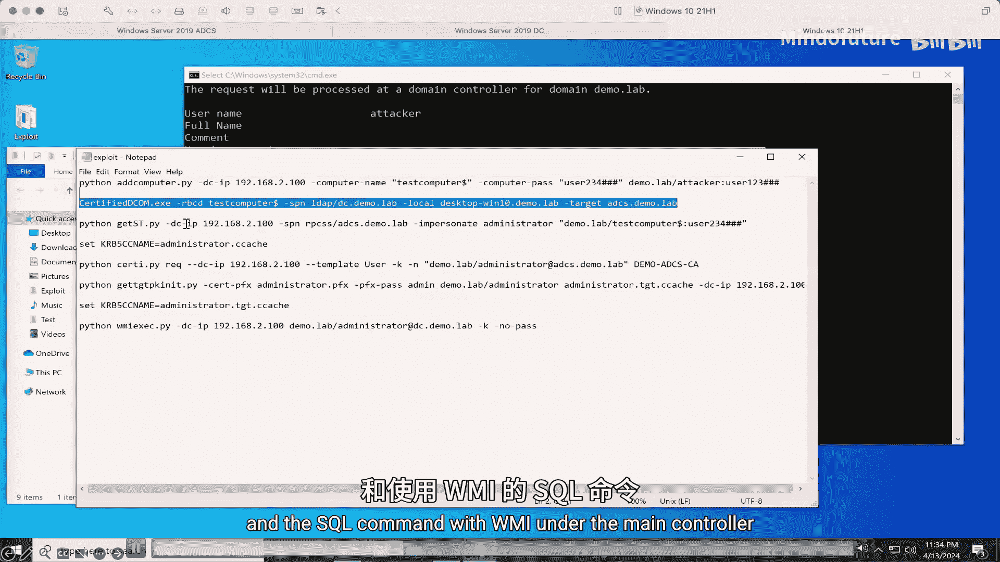
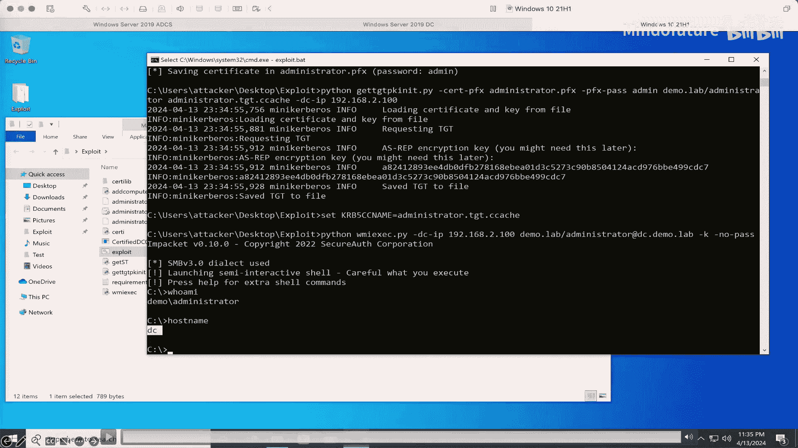

# 黑帽亚洲大会2024全集-•-中英｜Black-Hat-Asia-2024-p34-P37-CertifiedDCOM---The-Privilege-Escalation-Journey-to-Domain-Admin-with-DCOM--BV1oyX7YnEhN_p34-

Hello， everyone， welcomecome to my talk。 C Decom， the privilege escalation journey to domain domain。

 Today， I will uncover a new remote attack service of decom and D C S and show you how to abuse it to get domain main privileges。

😊，First， let me introduce myself。 I'm Tian Zedin。 I'm from Tenscent Security Xang La。

 My research is mainly about active director security， close security and web security。

Here is the agenda。 firstly I will introduce some basic knowledge and previous research。

 then I will work through how to discover the remote attack surface and how to exploit it。

And finally， saw you the patch and mitigations。So what is common in short。

 coming is something like a binary library。 It provides medals that can be called by the client。

 A Com server can be a dell or E S C with a common classes in it。

 A common object is an instance of a comb class， which is possesss one or more interfaces。

 The interface contains metal that can be called by the client。

The conserv can be in process out of process and even a remote process on a different machine。

in process server means some objects are running in the same process as the client。

Autto process means calm objects run runs in a different process。

 A con can even run a remote machine， which is also known as stick。

Revoking interface metals or in process co objects are processed as ordinary function calls。

 cross process across process co callss are handled by ARP andcom communication between different machines are made through R PC over T CPP P。

In the auto process column， when a client request a calm object。

 it will communicate with the R PCC S service first。

 the R PC S will check if the console server is running。 If not。

 it will start the console server and create a new calm object in it。

The process is called launch and activation。After the calm object is activated。

 the plant can interact with the calm object through ARPC。

The workflow of the deccom is similar to the auto process co。

 except that the client and server are on different machines。

 The client needs to communicate with the local A PC first the local app then process the request for the common to the app PCC on the remote machine。

The communication protocol between the two machines is is R PC C over T CPPI P。In recent years。

 potato attacks and curs relay are well known research on Windows com。

 The history of this attacks can be traced back to jam fossil M S 150，6，7，8 years ago。

 Its the first vulnerability to abuse Stecom activation using cogate instance from I storage API。

All of the fold potato attacks and copper relay abuse the same API is indeed a very powerful attack vector。

😊，But all this research is about the local attack surface。

 none of them talked about the Decom remote attack surface。

While local text a local privilege isolationcal is critical， I think people still prefer remote text。

 So where the forgotten remote tax surface。Let's first look at how co get instance from I storage works。

 Col get instance from I storage is an API for creating common objects。

 The difference between this API and other common creation API is that it receives an I storage interface pointer parameter and initialize the common object from the storage object。

An interface an interface pointer is actually a memory address。

 The interface pointer cannot be passed directly between the client and server in close process communication。

 because the memory of the client process and the server process are not shared as a solution interface pointer will be into a data structure named O B G IF custom。

On the class I D and the data of the O B G F custom can be customized by the clients with the gets a class medal and interface method。

On the common server side， it will em a shelter O B GF custom sent by the client to get the common object on the interface point。

A con client can set the class I D of the Michel data class to the class I of point moner and set the data to an O B G standard when the conserv am the O B G custom sent by the client。

 it will create a point moner object and call the interface medal to the O B G standard。

There are two important fields in O B G I standard。

 which is called stream binding and security binding。

The stream binding contains a network address shows where to find the object when when the server O B G standard。

 it will call resolve of S I2 to resolve the object Exp I and the PC S S will initiate an R connection to the address specified in the stream binding。

The Re OS S I2 can connect to a local or a remote server。 This depends on the streamlining。

The return value of the O S I D2 is O O S I D bindings。issOS SID bindings。

EWhich is also consist of stream bindings and security bindings。

The con server will then initiate a de connection based on the stream bindings and security bindings specified in the OS S ID bindings。

In previous research， the attacker's client and the victim's server are both local。

 The server use get instance from ice storage to trigger the highprid server to authentic to the attacker's local server。

 The attacker can then impersonate or related for local privilege escalation。

We we know that Dcom allow us to active common object remotely。

 does to get instance from eye storage through remote calm activation with Dcom。

When we looked into the definition of code get instance from my storage API。

 we can see that it allow user to set the class content to class contented remote server to active common objects on a remote machine and the co server infrastructure allows user to set the remote computer name。

 the information used in the decom communication。Also seems this API also supports remote calm activation。

So can we call us a remote computer connect to us and then perform NTM or cor related tag。

Suppose we have compromised a normal domain account。 we can authentic to any domain computer。

 But when we try to use co get instance from I storage to activate a common object on a remote domain computer。

 we got a access denied error。This because the default come security restrictions in Windows。

 there are two parts of As here。 the system wide A L and the process wide AL。

 These A define restrictions on launch activation access when a launch or activate or access their common object。

 The client needs to pass the system wide A L first。

AndThen pass the process wide is in the default system wide is settings。

 only user in specified highprid local groups like local administrator group distributed common users group are allowed to perform remote launch and remote activation。

Therefore， by default， a normal domain account cannot launch and activate any common object on a remote machine。

I believe this is why so little research has focused down the decon remote attack surface。

 So how to use the may privileges to launch remote attacks away the remote attack surface。

To perform remote attacks， we need to break the default common system wide restrictions first。

 let's think outside the box。 although Windows has strict common restrictions by default。

 there are many services in active directory that allow provide also provide a common access。

This service， this service also is the attack surface。Also next。

 we extend the attached service to active directory and try to find services that have customized to a security configuration other than the Windows default configuration。

The remote desktop service modified the Windows default security configuration。

 it allows some RDS groups to perform remote launch and remote activation。

 but in the RS default configuration， no low privileged domain accounts in these groups。

The SCCM also mod the Windows default common security configuration in order to provide a remote WMI access to SMS S admitmins。

 but by default， there is also no lowprid domain count in SMS S Admins group。Finally。

 AC S comes to rescue。 If ADC S is installed on a machine。

 the local certificate service become access group will be granted a remote activation privilege。

The the authentic users in the certificate service decom access group by default。

W whichch means any low privileged domain account have remote activation privileged on ACs。

Why is there such a special configuration on AC S that's because AC S need to provide certificate signing requests sent by the client。

 The active directory， all domain users and domain computers are allowed to send certificate signing request to generate a validate certificates。

 A DC S implements M SWCCE， which is a decom protocol to support the certificate signing。

And it grant grants all authentic users privilege privileges to activate the common object introduced by M。

 S WCC E。😊，And now we can pass A DC system wide A C check。 next。

 we need to find out which come classes can be exploited for further attacks。As we mentioned before。

 in addition to system at C， we also need to consider some process wide configurations。

The configurations contains process wide AC CL identity， authentic level， imperson level and others。

 These settings are defined in the registry by default and can also be overwritten by the Co initial security API。

The process wide ACL defines who can launch， activate and access the common object remotely as an exportable column。

 The process wide AC CL needs to low remote activation by low privileged domain accounts。

And the conservant must be already launched in AC S because certificate service become accessible。

 doesnt have remote launch privilege on AC S。the identity defines the user identity。

 The Com server wrong says。 it can be an interactive user。

 a system accounts or other specified users。 The Com server will use this identity for network authentic。

For an exportable common server， its identity can be set to any use except the local service。

 because the local service use anonymous user for network authentic that has no exportable value。

The default value of authentic level is RP PCC o level connect。

 which means signing and soing are not required in connections。

 this is very helpful for relay attacks。 the impersonation level determines whether the identity of the client can be impersonated by the server。

 Some services like I and S and B need to impersonate the client。

 These service require the client impersonation level to be set to R PCC imp level impersonate。

After reviewing all come classes on A C S， we found these exploitable classes search service request search service main are the come classes used by M S WCC E。

 they are installed in AC S by default O SCP request and O S P and main are classes introduced by the AC S online respond rule which is not a default rule of AC S you need install it manually。

All this is possible Com class has identity to set to system。

 which means the Com server will use the ADCS machine account for network communication。

The authentic level and level settings shows that we can relay the ACS authentic to L De service。

So if the attacker has compromised a domain count， he can use coge instance from I storage to activate an expable common object on AC S remotely When AC S connects back to the attacker。

 the attacker returns a forged O S ID binding to the AC S and set the stream binding to require N T M or curber。

ADC S will use the specified authentic method and AC S machine account or to the attacker。

The in in this decom connection will adhere to the process wide security configuration of the exportable con。

 The level will be connect and the imp level will be identity。

 So attacker can then relay the N T M or authentication to adapt and perform resource based delegation attack or shadow credentials attack with the AC S machine account。

Or here's the complete overview of this attack。The final step is to escalate privilege to domain。

 It's easy to get domain the main privilege after resource based delegation attack or shadow credentials attack。

 I I gave two attack passes here。 you can ask E on A S and escalate to domain with the golden certificate attack or you can request a domainmin certificate first and then use the certificate to request a domain admissionmin service ticket domain admit T G T with P and I T。

Finally， you go the domain， you go domain and you can take over the entire active directory and see on any domain computers。

Let me show you the demo of the second tapas。The attacker is a user in domain users group。

The mayo sof。Next， let's run the certificate decom export and execute command with WMI and the domain controller。

Okay， let's runner exploit。Now， you can see we can execute commands as the main men。嗯。

On domain controllers。

thank you。The patch for this vulnerability was released on October 2022。

The patch user decom to LD relay with A D C S。 It raised the authentic level to packet privacy in the certificate service。

 and a month later， decom authentic or released it automatically raised the authentic level for all non non anonymous activation request to packet it integrate。

This hardening also kills this vulnerability and can defend against the most de attacks。

 enable out of sign and channel binding can also protect you from this attack。

We just talk about relation depth。 How about other services。

We didn't find a common class that support decom with impersonation level set to impersonate。

 so we can't really decom to other services。 But how about the resolve of the O S ID2 R PCC。

 There are also authentic messages in this R PCC connection。

The imperson level of the resolve O S I2 R PC connection is R PC input level impersonate。

 so we can perform N relate to the A S AT ands and M I CPPR。

 But this requires two A server in the in the domain because we can。

 we can't relate N back to the same machine。How about cur Relay Can we set arbitrary SN in the security binding to make a resolve OS32 RC authentic with any service person name。

Actually， we can't because the machine name of the SPN in the resolve S I D2 RBC authentic is forced to the machine name in the stream binding。

 so we can't trigger covers re with security binding。How about other RBC protocol sequence？

We can also control the tower I of the stream binding。 The tower I determines the R PCC circumst。

IP support many transport transport circle type with different high level protocols like T CP， U GP。

 S， N B， H TP， etc cetera。 Can we abuse these protocols for N TR more。

After I checked all these RBC protocol circuits， I found the resolve over2 RBC support NC cN IP T C P and NC cN H T T P。

 decom connection support one more type NC cN N P。😊，NC ITCP is what we talked about before。

 How about others。The NC in HDDP is also called I PC over HDP。

The RC client will use over H T TP version 2 first。

 if version 2 field the client will fall back to the version 1 when using over H TP version 1 the client will establish an H TP connection with PC server and send the H TP request using PCC connect as the HDP request method。

This is a persistent HB connection。 The role RBC package will be sent in the same connection。

 One thing to notice is that there is no authentic in H T TP layer。

 The authentic is only in their RBC packets。RBC of HDP version 2 is a bit more complex than version 1。

 but the same as version 1， theres no authentic A GTP layer。 The authentic is only in the RBC packet。

So as for N S and HDP， we can relay N TM we can perform N TM relay covers relay to out depth with RBC packets in in the HDP connections。

 the same as RBC package over N andG CP。😊，In in comparison to in IP T C P。

 R PC over TD P has the potentials potential to bypass some network construction of NDR devices in some situation。

The decom connection also support RBC overnamed pipe。

 The RBC overnamed pipe use S B protocol as transport as the transport protocol and uses the machine account for in the S B layer。

The impersonation level of the authentic is security impersonation。

 which means the server can impersonate the client so we can we can perform N relay to the HP endpoint or MCPR in another AC server but they still need two AC servers and covers Relay still won't work in named pipe。

When I take a closer look at the patch for the vul we discussed before I found something interesting。

 The patch introduced a new function named initialized con in the third service。

The new function evoked the core initial initialized security to configure the process wide comes security。

 It changed the level of the search server search service to package privacy to patch the vulner and the imperson level is also be changed changed to the R PC level impersonate。

 The imperson level is exactly we want。So now we have decom authentic with impersonage with this patch we can relate decom to AC S H TP。

 O M S S PRR running on a different motion， but。For cor Relay。

 there's no restrictions for cors alterating to the same machine so we can perform cor reflection。

 relay k authentic back to the same AC server。Here's how the attack works。

 We can use use both inTCP in HDP as RC sequence here。

 and we can relay the location from the AC S back to itself。AC reflection is not a new vulnerability。

 but a new exploit technique to mitigate this attack just enable EPA on your A S H G T end points。

 E EPA A can protect you from both N TR relay andlay and keep just keep the default settings of the M S S PRR。

To， to， to defend this attack。Okay， in this talk， we introduced a new remote attack service of Decom and A S several several attacks。

 which can lead to privilege isolationscal from domain users to domain。

 We also take a couple relate to the next level， make it a real remote attack vector。

One thing to notice is that this search is in the default configuration in active directory。

 if you have some customized D with misconfigurations like allow any domin to activate your calm object mostly。

 this tag may also work。There are some miigations for you。 updateate your AC S to install the patch。

 updateate all your machines to enable deccom authentic hard。

 enable protections for related tag such as LDF sign and channel binding and EPA for AC S ATP and points。

And finally， check you check your customized system wide and process wide comes a query configuration。

My research is based on the remarkable work of these outstanding researchers。

 I'm just standing on their shoulders。 Thanks for their work。😊，Thank you for your time。

 Hope you enjoyed this talk。