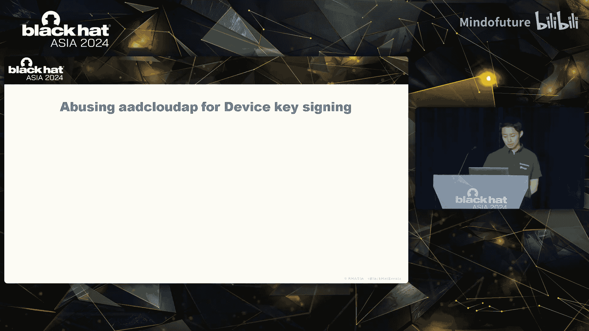
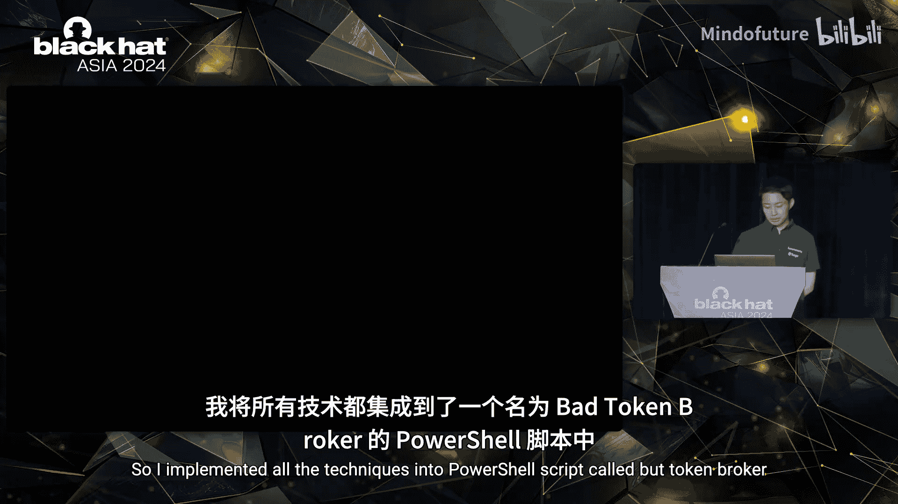
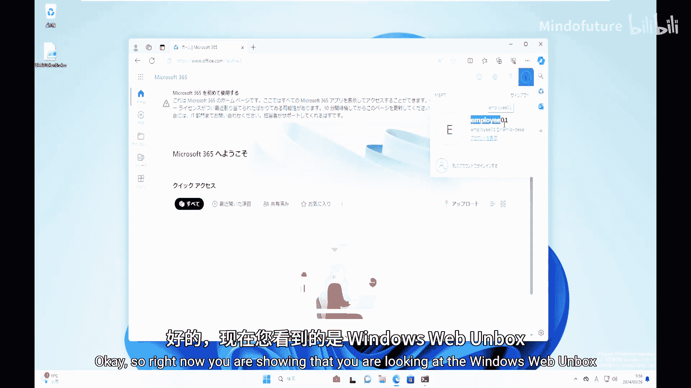
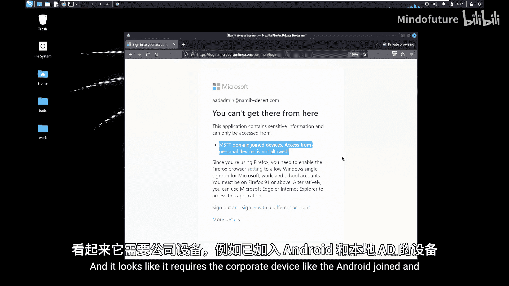
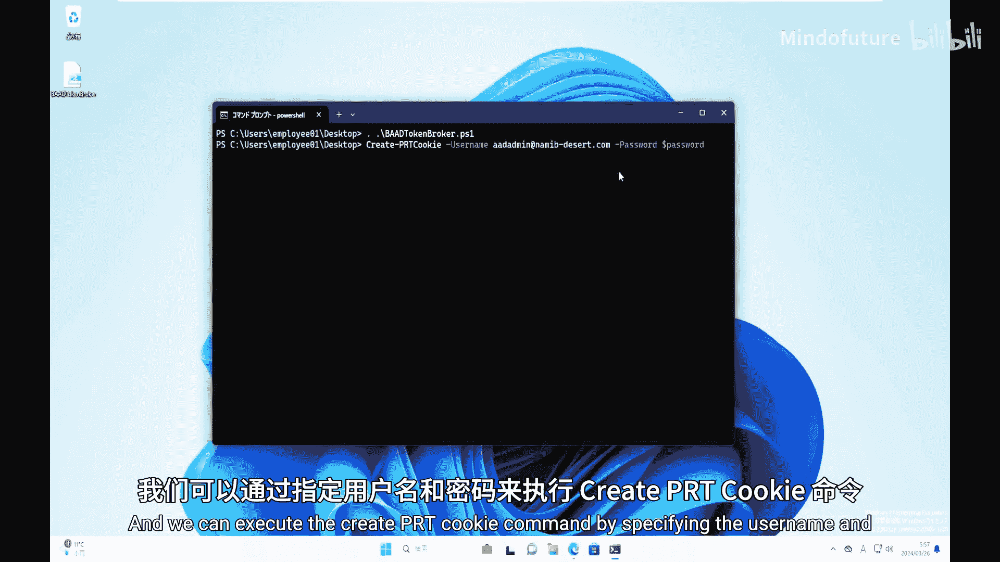
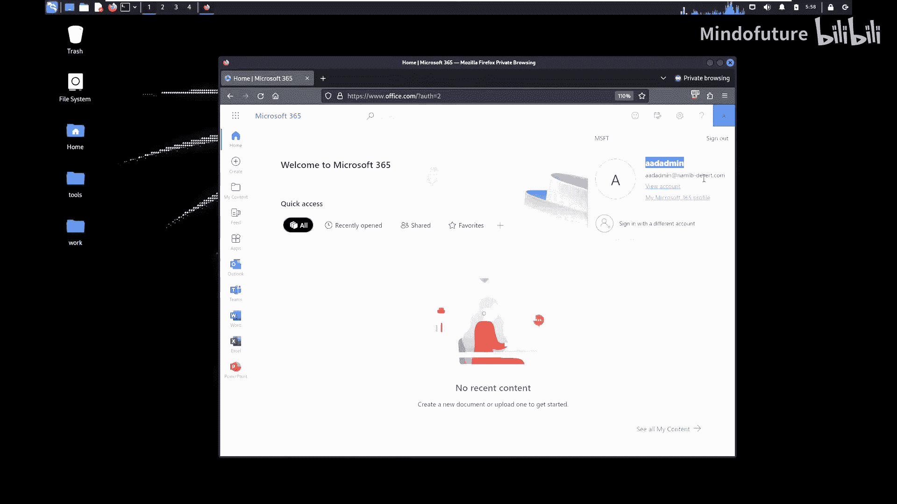
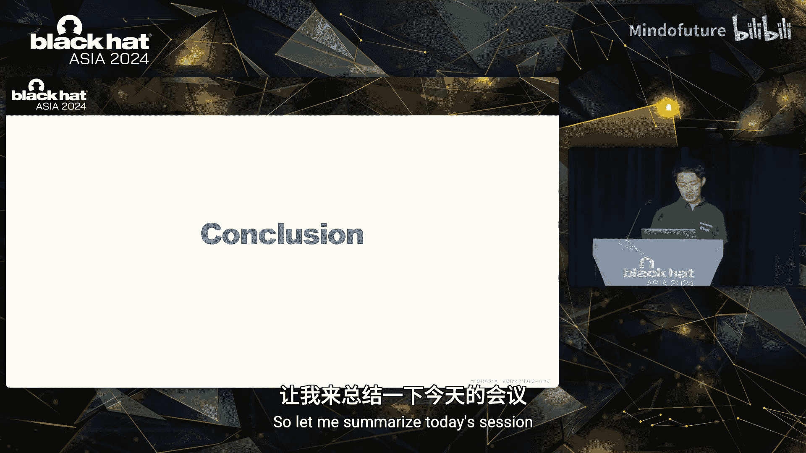

# 黑帽亚洲大会2024全集-•-中英｜Black-Hat-Asia-2024-p35-P38-Bypassing-Entra-ID-Conditional-Access-Like-APT---A-Deep-Dive-Into-Device-Aut--BV1oyX7YnEhN_p35-

My name is Yu Trudo， and I'm from Sere Works。And I provide retaining services for enterprises mainly in Japan。

 so for today's talk Id like to share one of the challenges that I had during our red team engagements and also Id like to share the solution to it。

Now， here are the agenda for today's talk。First， introduction， and then。

We will move on to the Dev an mechanism of the Microsoft En ID。

 and then after that we will dive into the Dev source internals， the Windows in tunnels。

 and also address to talk about how to abuse it with demo and mitigation binary conclusion。

So introduction。 So let me begin with a story from our victim engagement。So one day in Re engagement。

 we successfully spearfish and got one of the target machine infected with a Shiel grind。

 so from the machine we broke into its internal network and with some techniques。

 we compromised the target Act directory with some techniques and we got the domainamine privilege。

So after that， with the D privilege that we got， we dumped all the credentials from the active directory。

And in the dumped credentials， one of the credentials looked like amin account in Azure A， currently。

 which is known as the Microsoft Android ID。So if we can successfully log in with this admin account of the AI。

We might get admin access to enterI as well， right so we try to crack its password and we try to log into enterID with a credential。

However， the login was successful， but the access was blocked by one of the security features of Microsoft Android I。

 which is the conditional access。So what is condition access？

For those of you who are not familiar with the conditional access。

 this is a security feature by Microsoft that can control access to resources in the cloud。

Based on the signals like who you are and why your device is and what application you are using and why your network。

 etcter。So from the error message that we got， we can tell that the access was blocked by the devicebased Commission access policy and it seems it requires the Microsoft Android and onpre 80 Jo device。

 which means that we need as a taper， we need a corporate device for pivoting to the cloud。

So the question is， how can we bypass this kind of conditional access policy where you need a specific device？

So。From this engagement， I started researching into how we can bypass that device space connection access and gain access to resources as any user with a credential。

So we want to access to resources in the crowd as any user with a credential。

 not just only the lockdown user of the device。So that we can easily switch accounts。

 move rat between accounts for faster post exploitation activities in the crowd。

 so this is my research goal。So to get some ideas for the research goal。

 let's look into the mechanism of how AndroidID can identify device during the authentication。

So the important part of the device identification by the Android ID is the keys generated during the device registration。

So when devices registered to enter ID， two key setsets are generated。

 one is the device key and the other one is transport key。

And each of the keyset has its public key and also the private key。And during device registration。

 the public keys of the device key and also the transport key are sent to Android IDD and registered and AdaA Android IDD can identify device based on the usage of those keys during allation。

 so now let's look into the detail。Op the authentication flow when you access Microsoft with your browser and from your corporate device。

So first， when you want to authenticate to enter ID with your corporate device。

 and device sends the logan request signed by deviceki。

And the signed brokenn request is basically JWT， which is the J with token。

 and JWT has three parts and each part is base 64 URL encoded J valuess。And the one。

 the first one header defines the signing algorithm of the JWT。

And the second one payload contains username and password for the user syndiation。

And the last one is the signature， which is the J Web signature made by deviceki。

So EnID received this request and verified the very key usage of the device key and also the credentials in the period。

So by sending the assigned login request， entry IDD can identify device device an authentic a user。

 then entry IDD returns PLT， which is the primary refreshed token and also the session key。

And this is the response from the NID and in the response you can see there is the PLT and also the session key right there。

And one primary refresh talking is this can be used for single sign access to the， for example。

 Team or SharePoint or Al or whatever， you can use it for single sign on。

 but just sending PRD is not enough for the single sign on。You need to use the session key as well。

But in the response， session key is encrypted actually， and to use the session key。

Thevic decs the encrypt decision key by transport key。

So for the single sign access with your browser， first device decrypt the encrypt S key in the response and then use it to sign the POT。

 and this one is called the POT Quicky。And POT cookie is also the JWT as you can。

 and it contains the POT in the payload right this。In this POT cookie。

 its generallyT is signed by the S key which is founded to a specific device。

 so again EnID can identify which device is used from the key usage of the S key and also EnID can control the access to resources in the crowd based on the device information。

So after the device identification， you can access to Microsoft。

 you can access to the resources in the crowd like this。So， in summary。

During the device registration， device key and transport key are generated and registered to enter ID。

 and then Android IDD can identify which device is used by the signature of device key and also the S key。

But the session key and the response is encrypted， so device decpted by the register transport key and use it to sign a POT and create a POT good key。

So get impact to the research goal from this mechanism。

 we can say by signing any users's roing the Que and also the POT with those keys。

 then we can access to enter ID as a register device and bypass the device based connection access。

However。Those keys， the device key transport key and also the session key。

 all of them are secure stored in TPM， the trusted platform module。

 if the device has it and those keys cannot be exported， they are now exportable。

And there is a prior research and the exporting a derivative key of S key and created PT Cook is discovered by Benjamin Tophy and Direk Che。

 however， it is patched in 2021， so currently it is hard to export Doki and create PRT cookie。

But even if the keys are protected in TPM and not exportable。

 I believe that still those keys can be used from the device。And they can be accessed， I believe。

So if we can understand how the TPM stored keys are handled and used in the device internally。

 then we can still abuse them for creating any user's be cookie and fake device to access to AndroidD。

So this is why I started reverse engineering Windows OS to understand how those secret keys in TPM are used and how we can abuse that。

So let me talk about the analysis of the window internal tunnels and the ways of its abuse。First。

 I started researching how Google Chrome handles the browser single signal， specialist。

Especially it extension called the Windows accounts that handles the browsering sign for a user。

And so when you open the Google Chrome and access to Microsoft with it。

 what happens there is that first Google Chrome sponsors a new process code， browserqua。 EXc。

 and then browserqua。 E，dL code Microsoftsoftactokenproder。dL。And then browser codet E。

 execute a method inside a DL called Get cooking for for UI。In this method。

Get the PLTQ key of the lockdown user of the device and return it to a call process and return it to a Google Chrome。

So basically， this is the way of browser single signon for Google Chrome。

 and also this has been abused by attackers for PT cookie Seft。

What I mean by that is that attackers can use the browser code or EXc。

 or attacker can also use the DL and execute the method you said it。So。But for my research。

 I try to discover what the method that I get cooking for for UI does to internally get the PT cookie of the doctor user for my research。

嗯。So。You look at get to cooking for URL method in the DLL。

You can find that the method at the end calls the era circle called authentication package。

And this Windows API can communicate with the authentic provider loaded in Excel。

So this means the method to get cooking for for UI。

 it's sending some data to A to get the PLT cookie of the lockdown user。

And if you look at the data sent to El， then you can find some JSON data with core ID and also the payload values in it。

And if you also follow where the Json data goes， then you can tell that the JO data is first sent to the cloud authentication provider in A。

 and then the Json data is passed on to the。I really pra。And finally。

 the AgD plugin handles the Json data inside this function。And inside this function of AureD Prane。

 there is a switch statement。And based on the code number of the Json data。

One of the functions inside the aD per is executed。And this time the core number in JO is2。

 so the creative S cookie function inside the plugin is executed。

 and then this function returns the POT cookie of the lockdown user。

So let me summarize what we have seen so far， so during the browser single sign on Google Chrome runs a browser qua E and then browser call。

 E execute getcingfo for UI and then this method execute the Aa core authentication package to communicate with Aa。

 EX and by sending the JSON data。The JO data passed on to the aity plugin。

 then based on the core number of the JO data， the create key function is executed。

And this function returns a PT cookie to the Google Chrome。

So this is what happens during in browser single Sanion and in order to interact with the Aatop EX and also the AureAD Pra for my research。

I implemented a POC that can directly talk to Asa。exc without the browser Quadt Ec and also the DL。

By just quo the areaa called authentication package。And with this peyochi。

 I was able to call the create SSo cookie in the provinceing。

So by replicating the same flow as Google Chrome and by executing the functioning instead that I already plug in。

 I confirmed that we can steal the POT cookie of the lockdown user as you consider。So。Now I got。

 another way of peer cookie for the lockdown user。However。

The rhetoric P to cookie only allowed us to gain access to resources as a lockdown user of the device。

And to access to resources as any user with the credential， first。

 what we have to do is that we need to sign the user's roin request by deviceki。For this thing。

 there was an internal function in AD plugin called sine period function。

 and it looked like interesting and it looked like this might help with the research so for my research as a next step I started looking at the sine period function inside the AD plugin。

So this is a part of the compile version of the signine parallel function in the AzureD game。

You can see there are two functions called inside this function and one is the check package SID for request sign and the other one is build by source success。

So let's look at the second one first to understand what this same pay road function inside the plugin can do for us。

So what it does in the View device session is that first JSON data is sent to Aa。X。

 and then the device OSas gets this period value and basic for URL encoded like this。

 and at the same time JWT header is generated。And from the header and the pload。

 the signature of the device key is generated。And finally， combining all。

 JWT is created with the signature of the biki。So the sign period function literally can sign the content of the payload。

And make the ability with the signature of the bicycleki。So this means that with this function。

 if you include username and a password in the periodload of the JSO data。

 then through this internal function of AD plugin， you can get this login the quest with a signature of device key and you can use it to authenticate your enter ID。

However， there is another function， the check package SID for the sign。

And what this function does is that this function checks if a call process SID is the one specified here。

And if not the right SID， then the build device source assumption is not executed。

 and therefore sign period function does not return the device key sign roing request for us。However。

 by quickly researching the SID specified there， I found that the SID is for the container's SID and it is for the application called AzureD token Bro。

Since this SID is for the containers。With some techniques。

 we can impersonate this SID in the device and we can piass the SID check of this function。

So for example， from our sheet client， we can impersonate the AD token Bro SID to byfas the SID check。

 and then we can call the every authentication package and to execute this time the sign build function inside the plugin。

And if you include the username and the password and the JSO data sent to Aa。Xc， then you can。

Get the device key sign log rack loging request through this approach。

So I implemented a POC for this approach and generated sign log in liquid with a signature of device key。

Wrect this in the request and by sending this sign login request then I confirmed that we can get any the login users。

 we can get the PRRT of the user and we can also get the encrypt decision key in the response。

So to sum up， we can sign any users's log in the by device key through the internal function of AD plugin called sign payload。

So by sending the sign request， we can get the user's POD and also we can get the encrypt decision key。

For the browser single sign Access， we have one more thing to do。

 which is to decpt the encrypt session key in the response and use it to sign a PLT with it。

And so let's find out how we can do that。So by looking at the pre code。

 I found that undercomed API from cryptoene。dl are imported and used for handling the encrypted session key in the response。

Which are NGC import symmetric Pky and also the NGC sign with symmetric Pky。

I'm not going to cover all the technical details here， but the Uncomed API works as RPPC client and。

NGC importmetric Pkey can talk to Aa。c， and then Aa。

c works as RTC sub and input the encrypt accession key into TpM and depict it by the registered transport key in TPM。

And NGC sign with symmetricmetric PO P key can use the session key to in TPM and sign the signing input and get the signature of session key from the signing input。

So by analyzing the undercomment APIs， I figured out that we can use them to import and decor the session key in DPM。

Then。We can use the S key for signing。So with this approach。

 we can finally sign the PLT with the De decision key and we can also create our own PLT key。

So I implemented this into my POC and I confirmed that we can create our own POT cookie。

 as you can see here。Now we can create arbitrary users PLT cookie with a credential so we can gain browser single sign access to resources as any user if you have the credential。

So let me summarize what we have seen software far and how we can use them。First。

 we need to infect some corporate machine that is registered to enter ID。

 and then from the machine we can sign any userss logging request stored in device。

The sign by the device key。And then you can send a signed regression request with a signature of device key。

 and you can get the user's PT and also you can get the encrypt decisionuring key。And after that。

 you can import the session key to TPM and decrypt it by the transport key starting TPM thanks to the Uncument APIs。

Then you can sign the POT with it and you can create POT cookie。

And if attackers get the generated PT cookie with this approach。

 attackers turn people to the crowd as a user of the PT cookie and bypassing the device based condition access。

So with this approach， now we can gain the browser based single sign access。

But what if I want to have API access to EnID？So。There is another authentication flow that can give us up tokens for A access。

So by sending the PLT signed by Seinki， we can also acquire up tokens for APIX。However。

 these sub tokens in the response are encrypted and they cannot be used as they are for API。

But actually， you can decrypt the encrypted up tokens by the Sin key。

 and I found that there is another undercomment API used for us。

 which is the energy she decrypted with symmetry pop key。So by analyzing the usage of the Uncom API。

 I confirmed that we can decrypt the encrypted up tokens with the session key decrypted and stored in TPM。

 and we can acquire access token and also refresh token for A access to the cloud as well。So。

By abusing the TPM stored keys through the un APIs and also the internal function of AD plugin in As。

 we can create our own PLT cookie or also we can acquire up tokens with any user's credential。

And this attack approach does not require administrative privilege in the compromise device。

And using this approach， we can finally apply data by space condition access policy。

So now the initial goal is achieved。But let's explore more to find another ways of abusing the TPM strategies。

So another abuse of the TPM stored keys is password resource。

So I found that the other importer APIs allow us to interact with the Windows Hur for business keys stored also in TBM。

First， let's look at the Windows H for Business implementation to find out what this Encomment API can do for us。

So as you might know， Windows  H for business is used for password authentication。

 and when you want to use it， Windows  H for business keys called user key are generated and registered to enter ID。

And after that， this can be used to authenticate to enter ID without password。

And when alsoedating with Windows H for business， first， we need to send device key signed J。

That contains the user key sign there， I know this is kind of complicated。

 then entry IDD can return the PLT and also the session key。With this。

 we can create a PRD cookie as we have seen before。So let's look at the complicated sign data。

So this is a request to enter ID during the authentication。

And it has a device key sign JW in the request。And if you look at it， the JWD periodot contains data。

With a signature of Windows  H4 business keys， and En IDD received this request and with this request。

 En IDD can perform its authentic syn by validating the key usage of the device key and also the Windows  H4 business keys。

So by analyzing the undercom APIs and by interacting with all the secret keys stored TPM。

 I confirmed that we can also secate to Android IDD with Windows H for business keys without password and we can create PD cookies key。

And also， in addition to the PT cookie， you can。Also。

 receive access token with the Windows H for business keys。And if you look at the access token here。

Actually acquired by the this approach， this access token has MFA claims in its payload。

So this means that with this authentication approach。

 multifactor authentication is already completed， and also you can see there is a device ID here in the periodot。

 which means that device identification is also completed。With this authentication approach。

So to summarize， now we can create PLT cookie， or also we can acquire the app tokens through Windows  H for business keys without password。

And this approach allow us to bypast the device based condition access policy and also attackers can byfast the MFA enforcement policy in the condition access of the N IDD。

However， there is one website for the attackers， if you want to log in as other user。

 you want to switch accounts， then you need to compromise other device with Windows H for business keys stored。

So the Windows  H for business keys are bounded to a specific user and stored in other device。

 so if you want to move gradually between accounts in the cloud， then。

We have to compromise other devices with other users， Windows， telephones and skis stored。So。

Let me show you a demo。So I implemented all the techniques into Powerhell。

It'Scrpped called butt talkingken Bro， and let me show you what it's like。So。

Right now you are showing you are looking at the Windows ribbon box。

 and this is registered to Android ID so you can access to Microsoft。

And now there you can see attackers's machine。And。For the demo， first。

 I will try to log into the entry ID and people to the crowd with the stolen cledential in the introduction。

However， from the attacker's machine。The access is blocked by the condition access。

And it looks like it requires the corporate device， right， the intra joint and onpre AD joint device。

So， let's imagine the。We compromise the Windows web box， and we can open the partial session。

And we can import a about token broker script。Like this。嗯。

We can execute a create PRD cookie command by specifying the username and the password。

Once you execute it， you can get the POT cookie like this。

And then once you get the POT cookie with this approach。

You can go back to the attackers machine and you can configure the POT cookie in the browser cookie store。

Like this。And then once you configure the cookie， you can access the Microsoft again。And now。

 you can buy。こだよしかします。So this is all for the demo。

So I implemented all the techniques into the but token broker。Now it's public。

 so you can access to the URL specified here。So。This is all for the demo。 And finally。

 let me give you some tips for mitigation against this attack。

So this attack is implemented based on how Windows OS internally handles the secret piece stored it in TBM。

 so it's kind of like by design and Microsoft has responded this attack as an expected behavior。

 so there is no fix so far。However， for the mitigation。

 I recommend you should review and harden your conditional access policies for， for example。

 requiring MFA， not only just requiring corporate device。And this helps。

That this helps to make it harder for attackers to people to the crowd and move rat between accounts in crowd。

So during our routine engagement， we have seen a lot of companies require just only corporate device to access the crowd。

 only not require MFA。But if MFA is also required， then attackers have to do something like compromising as a device。

With the Windows  H4 business key is configured for switching accounts for their post exploitation activity。

 so I recommend you should require MFA and harden your commission access policies so that attackers will be hard to people to the cloud。

And to detect the attacks by the batroken broker， you should monitor suspicious RFC activity by using the internal function of AureD plugin。

 and also you should monitor the crypton agency and the commandA API calls。Also。

 if your corporate device is compromised， then it is a good idea to check if the device is used by attackers to bypass the device space connection access policy and move rat between accounts。

You can look at the multiple accounts sign logs from your device。Please refer to the K query。

 listed it here。So let me summarize today's session。

So we have seen how attackers can interact with the secret case even stored in TM。

 thanks to the RPC records and also the uncommented API。

And once your corporate devices is compromise， then0 attackers can easily abuse them for 5% of condition access policies。

 as we have seen it before。And for making it harder for attackers。

 I strongly recommend debut and harden your conditional access policies more and detect the suspicious activities in your endpoint。

So this is all my presentation and if you have any questions。

 I'll be around here so you can walk to me and ask any questions after the session or you can send some DM to Twitter or LinkedIn whatever anytime。

So this is all from my presentation and thank you very much for listening。

