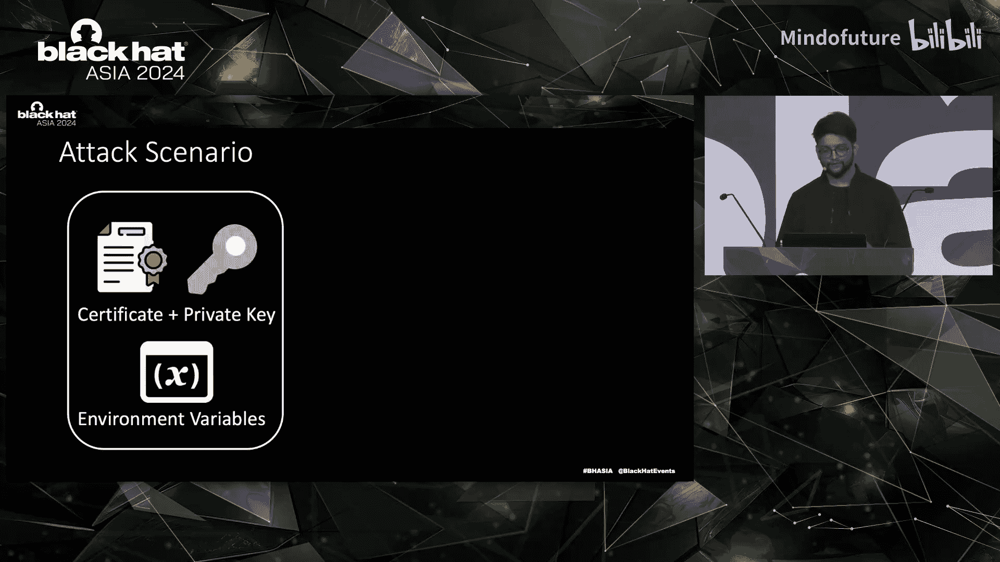
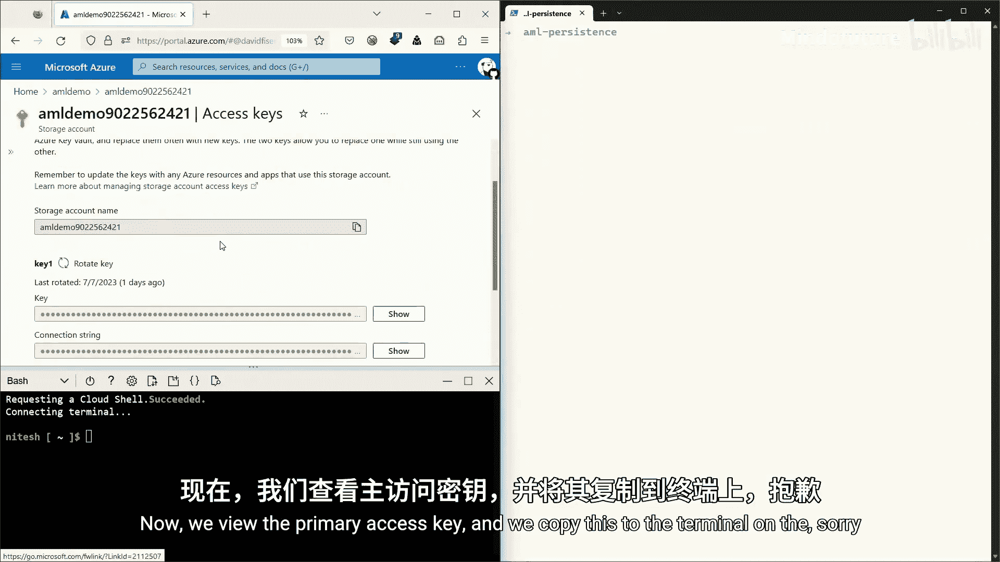
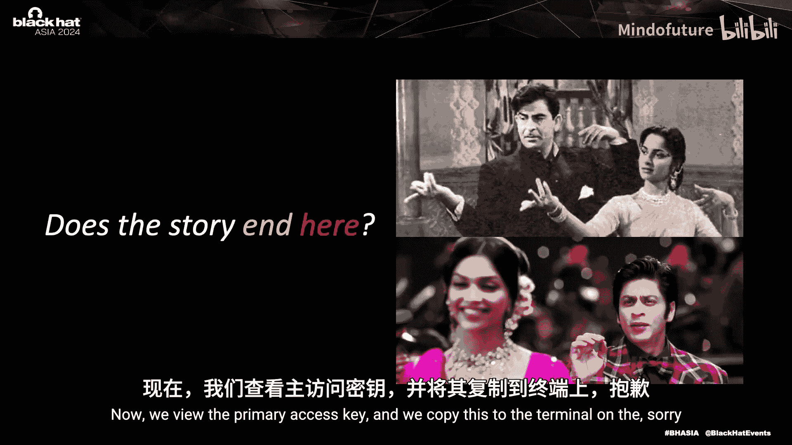
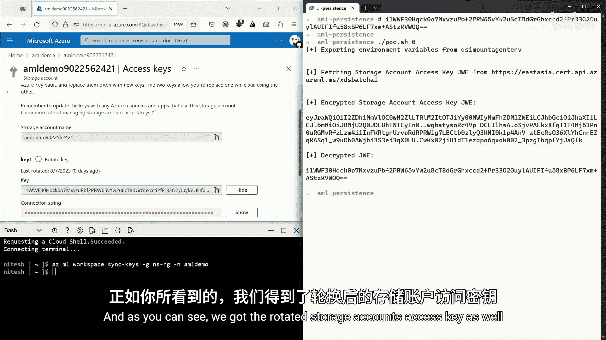
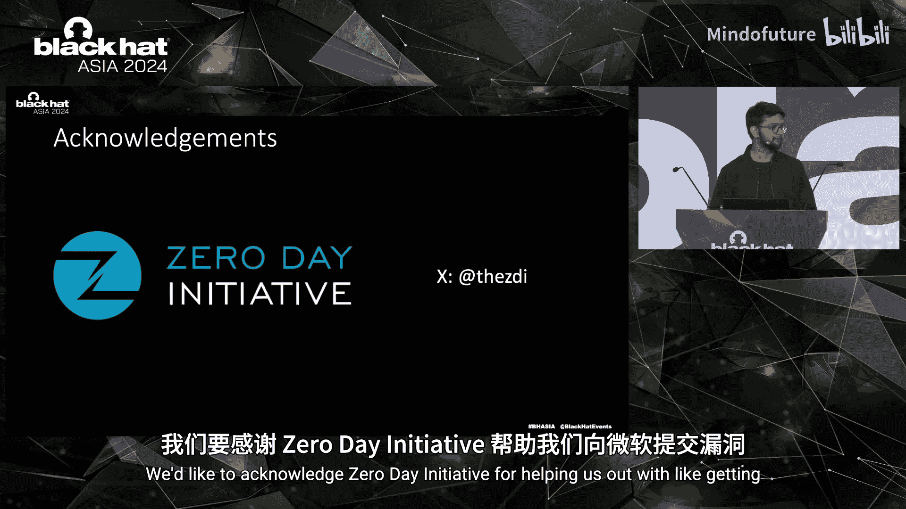

# 黑帽亚洲大会2024全集-•-中英｜Black-Hat-Asia-2024-p36-P39-Breaking-Managed-Identity-Barriers-In-Azure-Services--BV1oyX7YnEhN_p36-

So very good afternoon， everyone。 I hope you had a very good lunch and you're back to business again。

 So before we begin， don't worry， we're not going to ask you what do you have for lunch。 Instead。

 we'll be presenting our session on breaking manage identity barriers and azure services。😊。

So a little bit out about myself。 My name is Niish。 I'm from Sem， a beautiful state in India。

And we are actually really honored to be here at Black Artacia。

 This is our first time here at Black Eacia。😊，So at Trend Micro。

 I work on the security and threat research focusing on everything between code and cloud。

 so I've been presenting some of my work at conferences such as Blackout USA Ha in the boxox。

 Ha in Paris and lotmore。So we've been submitting vulnerabilities that have been found in cloud service providers and particularly Microsoft via the0 day initiative。

 I have been in the top 100 MSRC most valuable researchers for 2023 and hopefully for 2024 even now。

So you can find some of the fun stuff that I've worked on by going to my page。

 I also am on Twitter or X so yeah， so my findings range from vulnerabilities in home routers to Android apps and now onto cloud services apart from my work I'm mostly found playing bass and composing some vocals for my band and yeah。

Hello， everyone。 My name is David。I started my Ins journey back in 2010。

 starting as a malware analyst over the time I gained some experience presented on conferences such as AWR and Carro in the late 2017 I joined the Tren Mi and switched my focus more into the cloud threats and vulnerabilities。

And I presented some of our team's initial finding in 2019 and the security defense。

During the pandemic outbreak， I was one of the guys who was writing about the TTNT activities and especially their switch to cloud focus and stealing cloud credentials from time to time I find also a vulnerability and most importantly I tried to remain a human being。

So David found some issues in Azure functions， the Azure function service in a Microsoft Cloud。

And I found some issues in Azure Mach learning service。And particularly today。

 we are going to talk about the issues in the managed identity implementation and Azure functions and Azure machine learning service。

But before we will tell you about our findings， let's tell you something about how we got there because there is actually a funny story behind it。

 You know， in early 2022， the world was still recovering from the pandemic。

 And I was lockedgged down in the Philippines in the hotel room。

 although Philippines is very sunny country there was shared over the place。 And， you know。

 without the vitamin in the， it's just not doesn't feel the right。 And there was one particular。😊。

Thinkh that made me happy to the， that day。 And that was when I found these issues inside the Azure functions。

😊，Then， a couple of months later。Nash was digging deep down into the Azure machine learning and found lot of different issues。

 and。After that， time passed。 and in December last year， we met in Japan and go。

 we were going from a party sitting in a taxi and it， you know what， Nish， well。

 let's apply for a at Asia。 So here we are。😊，So， let me。

Walk you through my journey inside the Azure functions。But。

First question I have to ask myself was what are actually Azure functions， right？ Well。

 I did what I usually do。 I look up to the documentation and find out it's a serverless platform。

 but what is the server as right it doesn't run somewhere in theguise。

 So we find out it's nothing more that running our user provided code inside the cloud service provider on the managed platform。

Wait， David， did you just say running user code that one someone else's server， that to one cloud？

 Well， I know what you're thinking， right， There is one saying among the developers never trust user input。

 And now we are giving like executive double code。 What could go go wrong， right。So don't to worry。

 There are， you know， some mechanism that prevents everyone from executing alcohol。

 such as authenticification。 And， you know， we can hardening use it to triggers that there no doesn't need to be a public endpoint that execute our leisure functions。

So what we did since we are providing a code into our cloud service。

 we did a simulation of compromise because we assume that one at one point in the time。

 the user will bring the vulnerability to the code。😊，So basically。

 we designed our own serverless function， which was nothing more than a reverse share that connected to our contrite environment。

 And from that， we analyzed the underlying environment powering the serverless or Azure functions。😊。

And also executed some commands， right。And observe the configuration changes because not every feature inside the Azure function is available by default。

So， speaking of identification。Aure functions get several options， starting with。Functions tokens。

 There are two scopes of the tokens， function token。

 which are basically binded to the function itself。And host token with the host token。

 you can execute any function on your serverless environment。 And also。

 it provides you the capability to execute some of the API of the function host。😊，The second option。

ALi littlettle bit more secure is using client certificate。And there is also a third option。

 since we are actually providing the code for the executing the functions。

 we can implement a custom logic。 and the client certificate is actually using the custom logic。

 but they are。😊，Coat snippets already available。Speaking of triggers， don't worry。

 it's not a land mineine。The default one is H T TPS request。You can it's basically， public endpoint。

The second one are events that are bind that to the cloud， and we can imagine。Like database trigger。

 just like that。One thing。That we need to analyze as a researcher where the time out。

 you know how much time we do have inside the environment by default。

 It turns out that our river shell will be by default active for five minutes when the our request will expire after four and a half minutes due to the load balancer。

And one important thing， you can limit your execution time inside the hose dot Json file。

Speaking of environmental analysis。Oh， you know， what do you do when you pop up a shell， right？ Well。

 you ask， who am I， It turns out we are a root。 Okay， that sounds nice， right， But， you know。

 root isn't what it was before。 So we need to execute another command， such as mount and cap shell。

 And we find out that we by analyzing the output of this command that we are running inside the container Docker container and our capabilities are limited。

 Basically the default docker capabilities。😊，But there was one particular thing we this E And V command。

 which basically print out all of the environmental variables。

And there is the moment where it started to be interesting。

But before I will speak about the environment， our issues。

 it's important to speak about the environment variables itself， well。

You might know it's very popular practice among her deathtops。And it often stores with secrets。

 right， And believe it or not， there are some products that reference environment variable inside their documentation as a walls。

😊，And by all means， if they tell it to the world， then I am telling that it is the same like this was present for Pai cobar。

So let's speak about the underlyinging fundamentals of environment variables well you probably know that everything on layucux is a file right。

 so we can just list the pro file system and here's one file andviron and we can print it out that's basically the table of environment variables for the given process。

And。Basically。We can access。all of the environmental variables of the running user inside our process namespace。

 and there is one very important thing by default， the environmental variables are inherited into every child process unless the explicitly new environmental variable table are passed as an arguments。

We did a little demo for you。 This is nothing more than simple hello word in C plus plus， right。

 It doesn't even mention environment variables。 So we export our super secret API key。

Into environmental variable。R compile our application。

 run into the debugger and break it at my function。 And as you can see from the。RDX。

Is pointing on the stacks， just comparing the RPR Dx value。 And if we follow the RDx。

 we can see it's also pointing on the stack。 and there is something which notably similar to environmental variable。

 And if we print out the address range， we can find all of the environmental variables。

 including our superse API key。But isn't this something like just specific to the debugger。

 Is it inherited by every process from the first API ID itself。 That's a great question。 You know。

 we need to verify。 So what we did。 we actually analyze it。 like first thought it might be debugger。

 but unlikely， right because we got some knowledge。 And then okay， it can be， let's say。

ipy who is doing the job。 But we found out that's actually the kernel itself who pushes the environment variables on the stack。

 So this function is called when a new process is found in the Linuxux。

 And one of the code snippets from the large function is this where we can see actually how it's pushed into the stack。

So back to the several less functions， this is how the environmental variable。

Print out look like it's a lot， isnn't it hard to navigate。 So we got it a little bit for you。

Still isn't it。 But But for our security purposes， this is the most important bits。

 So let's start with the Asia Web job storage。So what， what is this environmental for。 Well。

 it turns out that for azure function， you need to store code somewhere。 And in a lot of cases。

 you will need a storage account。And the story check on。

Is used for storing the source code and the Azure function holds pull the source code。

 and then it executed， right， And this Azure web of storage is nothing more than connection string or access to can to the storage account。

 So， you know， we can copy paste to a cool tool called Azure storage Explorer。

 And what we can find out here。😊，Well， of course， the source called。Some some of the secrets。

 like function tokens， host tokens。And。You know， there's one thing unless we really harden it in the crowd。

 make the。Storage account not available to the public。 or let's say， disable the right access。

 What we can do。 We can just delete and upload。 But there is a bit。 if we do the hardening。Then。

You know， if it's not publicly available， it's more tricky or inconvenient for the developer to put。

 to put the source code there， you know， and if you remove the right permission。

 then if you are just using the V S code for pushing your source code or the server function。

Then it will not work， right。So。What you can do， you can completely rer the function itself and execute your own code。

 And then just by leaking your environmental variable。But next。

 and that is the most important interesting and important environment variable is this container star context is I URL。

 It's shortly URL。 And if we follow the URL， we get something like this。

 It's basically the container configuration encrypted context。😊，Well， looks nice， right？

 But what does it mean， Well， we did some digging。 and it's basically。

The encrypted context is AES encrypted payload where the first part is in Asia's film vector。

 the second part is the payload itself followed by the hash and guess what was the encryption key anyone。

Okay， I give you a hint。 It's the container and encryption key， the first environment variable。

 so we can decrypt it。 Okay， looks like that。 But what we can get out of it。 Well， of course。

 authenticification tokens。 But let's assume that we can execute the function anyway。

 So doesn't add so much value， right。😊，But most importantly， manage identity proxies， I think。

And we consider this should be hidden from the。From the server environment itself。So， be good。

Aial function。With our municipal， We got Asia function。 We got storage account。

 and we got very nice image。 And we want to work with this image。😊，It's our our as function。

 And we don't wanna。Put our credentials inside environment a。 So what do we do。

 We use manage identities。 This is how it looks like。

 The most important is it's running within the same container as the serverless function。

This is how the。Reply， looks like。So。But what is underneath， You got aszure functions。

 There is a binary running inside the same container。And because we decrypted the contents。

 we get all of the parameters of the proxy， including client certificate。

 endpoints and some other parameters。😊，And this is just forwarded from the binary to the per to the public endpoint。

 This is forwarded back to get the token。So to sum pump up what we found。

 a lot of environmental variables， including proxy parameters。But what does it mean， Well。

 it turned out we can obtain a valid JWD tokens and how we can do it outside the Azure environment itself。

 And this is actually where it breaks the security barrier because it should be hardening for inside the azure So just by leaking the environmental variables。

 you can obtain the tokens for the managed identities。 there's one important bit to mention。

 Of course， Azure is kind of secure platform。 And unless you explicitly specify the permissions for the managed identities。

 you might get the token， but it got no permission at all。😊，There's little demo。 So first of all。

 simulate the leakage of the environmental variables decrypted the encrypted context。

 As you can see here， this is the client certificate among anotherproxy parameters。

Then we use it in the side of another。 Ask for the token。Once we get the token。

 we contact our storage account and get some metada out of it。

 And this is whats all done outside the Azure。 The only communication with the Azure environment was first communicating with the vulnerable function and getting leak the environment of Arab itself。

😊，And there's one important question to answer。 why this all happens， right？ Well， obviously。

 the important bit is the environment variable popularity itself。You know。

 sometimes when I are looking on this issue， I get the feeling that we， you know。

 everyone feels it's safe。 We use it。 and we don't think what is underneath。

 And then there will be like slight goal chains that are I detect to change， you know， some stress。

 And then it's just inherit to the。To the say child process。 or maybe， yeah， some might don't know。

 maybe do know。 But， you know， it's accept for us。 And it's sometimes okay， right。But we。

 as a security people should know about the consequences and telling others。What could go wrong。

So that's a really strong statement of not knowing how to use an environment variable。

 What do you suggest， David。Well， in this particular example。Simplified architecture。

 We got the Azure function host。Which is basically container image and a process。

 which executes the language worker， which in our case was so Python。

 And then you execute your user code。 And because this container image is publicly accessible inside Microsoft container registry。

 we can play with little bit with it and also use it inside our new serverless function。

So what we did， we basically renamed our Python interpreter to Python in with the little hack and replace it with this compile binary。

 And with this component but it utilize pseudo utility to run in on the different role player user。

 And that's why because， well， obviously， weve。😊，If we got code execution， which is the worst part。

 we could still read the all of the environment or variables because we will running under same user because of the nature of the Uni。

 right。And then we pass a new environmental table。 And here we can see only one environment variable。

 So we did our testing。 and it turns out。😊，That。For our serverized function， it's not needed at all。

It was just me that。For the function hose， which actually sps our server functions。

 So it means it was just inherited。 Maybe it was not even intentional。 It just happened。

We wrote some article about it， back in then。Something about disclosure timeline。

 We originally find this issue in April 2022。 we shared with Microsoft。 But you know。

 at the time of being and we this vulnerab or security issues depends you call it。

 that is sometimes blue line because we are assuming that the function it's vulnerable by itself。

 know so the severity it's not that height。 It's not traditional R。 So we haven't been contacted bad。

 So we used the blog post a year later， net S folks discovered the same issue credit for them。

 they were much more persistent pushing the Microsoft Office the issue。 now it's fixed。

 and generally， the binary was taken outside the container and there was another container created。

 then if you contact managed id running somewhere else and the managed proxy。is somewhere else。

 although you can still get the credentials for the storage account from the environment the variables。

Okay， this is our original blog folks。 This is the blog post of the net SP folks。

And this is all for me。 And now it's time for Nitash。 So Nitash they swears。So thank you， David。

 I think the first episode was pretty good。 Now we begin episode two that is on the Azure machinech learning service。

So these days， AI is being sprinkled in almost everything that we are going to be used。

 going to use or going to be get going eventually。 And it's super cool。😊，By now。

 we have somewhere or the other been， you know， exposed to these services。Or at least， you know。

 tried your hands on or something。So these are all the services that are based on the Azure AI platform。

And it it depends on the Azure AI offerings。 So the applied AI services are the offerings which basically solve a business problem。

These are followed by the cognitive services that are the machine learning models that are offered as a service。

 which is consumed by the applied AI service and eventually the applications that we use。

And all of this is actually built on top of Azure machine learning service。😊，So well。

 aszure machine learning is a cloud based machine learning as a service offering from Microsoft in AML。

 you create a workspace and this workspace is basically the centralized place to do your machine learning operations。

 So MLOs eventually falls down to having some compute having some cloud storage and a way to monitor the logs and there are a few more other parameters to it。

😊，So the workspace is dependent on certain Azure services like the storage account。

 the Azure keyvault， the Azure container Rary， and the application In services。

So the storage account for each workspace a storage account is created where the storage account is used to keep your machine learning models and your machine learning dataset sets as well like dataset sets。

 Jupyter notebooks， logs， models， snapshots， Python scripts and all of these other things this is where you keep your stuff。

And there are various other compute options that Azure ML provides where you can run your code。

And compute instances are managed U2 virtual machines by managed。

 we mean that the security of the host OS S， everything is managed by Microsoft themselves。

So the OS S image contains like various tools used by developers such as Jupiter， Jupyter notebooks。

 V S code， Connda， Docker， Python and all of these other things。 Unlike Azure functions。

 we have complete route access to this virtual machine or the computer instance。Additionally。

 these compute instances contain certain programs or middleware agents that are created and maintained by the cloud service provider in this case。

 Microsoft， so these are like secret undocumented agents that are used to configure environments。

 diagnose environments and do a lot of other stuff and sometimes open up avenues of information disclosure and code execution as well。

So these may be open source like O M I， or these may be close source， as we'll see in a bit。

 So the compute instances where you run your code and the storage account is where you keep your stuff okay。

So the approach was not very magical since we had drew access to the computer instance。

 we wanted to inspect the network traffic that is going in and out when we do something。😊。

We want to check the running processes to find such agents。

Reverse those cloud service provided agents because they are not open source and maybe we can find some undocumented API or some overly permissive API。

And of course， explore the logs that are generated when we do something。So as David shared earlier。

 this is a similar example。 Let's say we have a function app and a compute instance in a user's subscription。

And we want these azure resources to access a storage account。

So one of the ways is to hard code credentials， but that's not a recommended way。

 We have a C W E for it。 and Microsoft recommends using something that is called a managed entity。

So the first type of manager entities is a user assigned manager entity。

 so this identity can span across resources and can be also used by multiple resources， for instance。

 in this case we can use one single user assigned manager entity to allow the function app and the compute instance to access the storage account。

The second type of marriage entities are system assigned marriage entities。

This identity is specific and tied to the life cycle of the resource to which you assign it。

 And these identities cannot span across resources。To get going with managed idities using Azure CLI。

 you can run A Z login followed by this flag of dash dash identity。😊。

Since we have road access to the virtual machine or the compute instance。

What happens when were run this command。A get request is sent to a local port which is 46808。

 and again， since we have root access， we are able to figure out which is the underlying process that is listening on this port In this case。

 it is identity responder D Well what is identity responder D。

It is a powerful demon it runs as root and it is also known as Azure batch AI identity responder demon。

 So does it respond with some identities， some tokens we'll see in a bit and it also fetches its configuration configurations that are stored as environment variables in files So these are the locations of the files。

So， these are some of the environment variables that are used by identitydent responder De to get going with a compute instance and particularly MSI endpoint。

 MSI secret and the C URL， these are the three important environment variables that we need to focus on。

Well， we just want to figure out how does the outbound traffic look like to see whether we can do something about it。

 So we have eventually this post request where the horse header is set and the post request body contains the certificate thumbprint。

And the compute instance name that is set as the instance Id and the resource for which we are。

 you know， getting their token for。And to talk to this end point。

 we need a pair of certificate and a private key from this hard coded port path on all compute instances that you will ever create。

So overall， we have this compute instance which contains a binary that is identity to respond to demon。

 remember that this is a closed source binary， we don't have any public code available for this。

 which talks to a public endpoint using a pair of certificate and a private key and in the response the managed identity JWTs can be F done used from the compute instance。

😊，Let's say the certificate and the key pair are compromised in an assumed breach scenario。

 like a post compromise scenario。 These are compromised and exfiltrated from the computer instance。😊。

Could an attacker still use the same pair of certificate and key pair to get the managed entity token from non environments。

 Let's try to bypass the security boundary right now。We found that we could not。

 So we got a 401 unauthorized。 So we were like， okay， so did Microsoft really win there。Let's see。

 So the certificate and the key pair。They are actually tied to the compute instance。

And these are unique per compute instances。 So like no two pairs of certificate and a private key will ever be equal。

But was that it， like we could have just， you know， packed our bags and left。 But no， just kidding。

So， enter DSI Mount。DSI mount agent is another binary that exists on all compute instances， which。

 again， runs as root。 It is known as batch AI batch batch AI D SI mount agent。😊。

And it also fetches its configuration from environment variables stored in files like the same environment variables。

 David。😊，So， yeah。So this is the same binary that same agent that we found vulnerability in last year for Blackhead USA。

 so we found a bug in the binary itself wherein a network agencys and attacker could basically fetch logs for any service and in this case you can see we can fetch these logs for Jupyter service because Jupyter is installed on all computer instances So let's say if you are a data scientist who is using compute instances and running some commands as pseudo using the Jupyter terminal they would get in the logs and these logs can be viewed by a network agentss and attacker。

And this issue was later fixed with this CBE。 Now， I'd like to present what was initially planned for last year's Blackhead USA。

 but things changed the last minute。So the configuration files for DSI Mount agent contain certain interesting environment variables like some symmetric key。

 some certificate cluster certificate， some cluster private key， some XDS endpoint。

 so what is happening here。😊，Well， the purpose of DSI mount agent is to make sure that the file share of the storage account for this workspace is mounted on the compute instance。

 and it does so by checking every two minutes So its job is just to make sure that the file share is mounted on the compute instance。

So it turns out， the DS SI Mount agent talks to the batch X D S end point using the same pair of certificate and the private key that identity responded demon uses。

And in the response， we get something。 What do we get。

So eventually the post request like the outbound traffic looks something like this。

 so we are not concerned about the post request or the headers and all。

 we'll just focus on the request body because from here onwards the certificates are the same the endpoint is the same。

 the UI is the same。So， yeah。Let's see。 what is the response for request type get workspace。

So we reversed the binary， DSI mount agent， and we found this function called clientsient get workspace info。

In this binary， and we have this request type set to get workspace， which is the post request body。

This request is sent to the batch A X J end point using the same pair of certificate and the private key that we saw earlier。

And in the response， we get the AM L workspaces metadata。

 This metadata contains information such as the storage accounts， resource Id， the key wallss。

 application insights， the tenant Ids， the subscription Id。

 So this can be thought of like the who am I of the AM L workspace。😊。

Later we come across another request which looks like this。

 So we have a function called get workspace secrets where the request type is set to get workspace secrets。

 Just note that this binary is not open source。 So we are able to find this after we have reversed the binary。

😊，And in the response， we get an encrypted form of these storage accounts， access key。

So the response is decrypted by certain environment variables that are again stored in files for the DSSI mount agent and the DSSI idle stop agent which is a different binary。

 So using these two environment variables， we get the decrypted symmetric key。

And using this decrypted symmetric key， we are able to decrypt the response that we saw and eventually obtain the storage accounts access key。

 And that's where David help me。 So You're welcome。 Thank you。😊。

So the attack scenario is something like this。

We have a certificate and a private key and a bunch of environment variables that are stored in files。

 These variables are used as configurations for for these middleware agents。😊。

And you can use these to get these storage accounts access key。

Let's say these three files are compromised。Now， what would you do to invalidate the storage accounts access key。

Well， Natash， what about if we rotate the key， right。HThat's a good idea。

 Let's see whether that works。So on the left， I have the AM workspace and on the right I have a batch terminal open on my laptop。

 So on the AM workspace I navigate to the storage account and I go to the access keys section。Now。

 we view the primary access key， and we copy this to the terminal on the sorry terminal on the Okay。

 let me just play this again。

So yeah， on the left， we have the M L workspace。 and we go to the storage account。

So after we go to the storage account， we go to the access keys。And we copy the first。

 like the primary access key that is being used with this storage account。

So after we have copied this， we will run the POC where have where I have exfiltated the certificate and the private key。

 so we are able to get the current storage accounts access key。😊，Now。

 what we will do is we will generate the storage account access key again。

 willll basically rotate the key。So now that the key has been rotated。

We will copy this newly generated key back to our terminal。

And now we will synchronize the AM L workspace to use this new storage accounts access key。

 So once this synchronization has completed， we will go back to our terminal and we will rerun the P O C to see whether we can get the rotated storage accounts access key。

 And as you can see， we got the rotated storage accounts access key as well。😊。

Does the story end here， like all the stories that could have been。

 This one does not really end so fast。So there were few more agents that talked to such public endpoints using a pair of certificate and a private key and in the response we get certain ground jewels like storage accounts access key。

 the AML Workspace， Mera information and a lot of other things。

There were a few more agents that we could look into and reverse and figure out what else can we fetch using the storage accounts access key using the certificates and the private keys。

 basically。So the idea was to find what else can we request and what else can be the the parameters for request type in the post request body。

So the function， for example， get workss with secrets calls another function that is generate X DS APII request schema。

So the post request's body is is generated by this function。

 So the request type parameter is populated by this function。

 So the idea was to look at all the cross references across all the binaries to this particular function and find out what else could be done。

And this is the list that we came up with。In this we have generate SAs， generate data to credentials。

 get ACR token， get C we so we pick get A U token because that's you know interesting and then back then I don't think Azure was renamed to enter so we were good。

So this function called get80 token， which is there in the hosts package for IT responder demon host tools and a lot of other binaries as well。

So this is how the request body looks like where we have the request types set to get a re token and the request body contains the resource for which we are fetching the token for。

This is sent to the same batch X G end point。And in the response。

 we get the enter I JWT of the manager entity that was assigned。This is how the response looked like。

And similarly， for fetching the user assigned manager entity。

 we just specify the client I D in the request and we get the enter I D JW of the assigned user assigned manage entity。

 Quick recap。 So we have certain binaries in compute instances that talk to public endpoints using a sp of certificate and a private key。

And we can fetch the。 So this is how the compute instance fetches the whoM I of the email L workspace。

 the storage account key， the JWs for the managed entities and a lot more other stuff。

 And if these credentials are compromised in a post compromise scenario。

 an attacker could do the same。😊，Wow， but we can use the logs， right。

 We can see the activity that something happened。 Okay， you deliver the logs。 Let， let's find out。

Well， let's do some legitimate activity。 This is using the Azure ML L SDDK。

 or you could just you know run easy Z login hyphenha identity from the compute instance。😊。

And using the certificate and the key pair from the same computer instance outside the computer instance。

 Let's say this is already compromised。 We run this request。And we get these logs。

 So the difference between the attacker logs and the compute instance logs。

Don't really signify something you know， important that we can bank on to figure out whether this request came in from the computer instance or from an attacker's environment。

And as you can see， the sign in details don't contain any information about the IP address。

 So that would have been one indicator that you could have， you know， banked on， but you can't。

So how do we detect that someone have stolen our certificates。You can't use the logs， David。

That's too bad。Yeah， well， but let me rese why， why， why is this even a vulnerability。

 Can you explain about that？ Okay， so when we go to the documentation for Microsoft。

 we came across this one particular mention about identity matter entries is that by design only the Azure resource to which we have assigned the identity can use this identity to request tokens from Azure A。

But we are able to use the certificates and the private keys to fetch tokens outside the resource to which the identity has been assigned。

😊，So trust。 But did you verify， you know， the documentation could be outdated We all know who develop software we don't like doing documentation。

 okay。Well， you know， everyone someday somewhere needs someone whom they can absolutely trust and believe in。

To confirm things from the Lords themselves。We dialed in azure support。

So we call Azure support and I asked them， like， why don't the marriage entity sign in logs contain any IP address。

And this is what they came back with。 So the assumption is that the managed entity tokens are fetched from a local endpoint。

 So just like I AW S， I MD S endpoint。So in this case， because of the feature of manager entities。

 the logs are not helpful that you can bank on。Later， just to be sure about things， it turns out。

That the certificate couldnt be figured out whether it came from。

 like where the request actually came from。 And again， they said like， okay。

 Microsoft En does not record the IP address because it is assumed that the signing happened from the targeted manager entity resource。

So like a quick note on the persistence so using the certificate and the private key you can get the rotated keys。

 the JWTs for managed entities the certificate is valid for two full years so if you have a compromise you wouldn't know for at least two years that you know somebody else had the back dooror access。

And yeah， to， to invalidate the certificate， you need to delete the compute instance。And obviously。

 these logging discrepancies can be really helpful for attackers。

So the disclosure timeline looks interesting for this。

 so we had planned to share this research with the community back in Blackhead USA。 However。

 the vulnerability was reproducible and not fixed before before the talk was recorded we reached out to Microsoft and they deemed the bug to be a of a low severity and later upon Microsoft's request we redacted the details although this bug was over the 90 day ZDI disclosure policy and it was reproducible as well。

 Microsoft has recently confirmed that the vulnerability has been passed and we have also validated on our end Currently the fix does not allow the certificate and the keypa to be used outside Comp instances。

😊，Later， we'll be releasing this blog by 22 April。 So stay tuned on that as well。

So how many services support manage I this anyway。Yeah， that's cool。

 There are over 50 plus Azure services that can support Azure managed entities。😊。

So we have looked into azure app services， azure machine learning service。 So possibly researchers。

 you can look into other services to find more variants and find logging discrepancies in the service。

😊，All right， time to wake up folks。 So back to the takeaways。 Yeah， so if you sleep till night。

There are key takeaway to take from this talk。 I'm not saying you can't use environmental variable inject secrets inside this。

 but you have to be very careful when you do it and know the consequences and that the things can get very bad。

 and it's definitely not a wall。Well， it's always good to threat model cloud service provider services to。

 to， you know， to get an idea of what could get wrong and perhaps create a action plan if something gets wrong。

 because， you know， if you hardco secrets and then you find a leak and you have to rotate that it。

 it's pain。😊，Yeah，But if you store them in the world， you can do it by one click。Also。

 one of the secretly share follow principle of least privilege。

 And this is especially important for the cloud deployments。

 because single access token could lead to the full。Cloud account compromise。

 especially if you get like high privilege or like service player in simple。

If you are a threat researcher， examine called APIs。

 find the box and make the whole environment even more secure。

So it's very important to test and secure your authentication and authorization scopes。

 So from where you can use these certificate based like authentication to work。

Definitely if we had the actionable logging， then we could have detected such sort of things and you know you could have been much more secure。

Such a human breach approach can lead to such security findings as well。

 and that would be really hard to detect。And obviously， challenge official documentation。

 and don't forget to college your support。We'd like to acknowledge zero day initiative for helping us out with tri like getting the bugs across Microsoft。

 And now we open the floor for any questions that you may have。😊。

I think we have one question， okay。I'm Paul， your colleague。

 So do you have a recommendation for those stolen certificates。 I mean， how the S， O C can detect it。

So based on the logs that we found， the SOC could not be able to detect whether the certificate abusers happening from an azure environment or from an attacker's environment because one of the factors that one would bank on would be an IP address but the IP address is not there in the sign in recorded it would have to detect the initial break in。

 but you would detect that something was leak， perhaps。Or used to you leak， maybe， but use not。Okay。

 alright。 thank you。If you have any other questions。

 we'll be down in the hallway and we'll be also back here tomorrow so we can connect there。

 These are our QR codes。 feel free to reach out and thank you for attending B manager entity barriers in Azure services Once again。

 We are David and Nish and we'll be back with some cool stuff。😊，Thank you。

