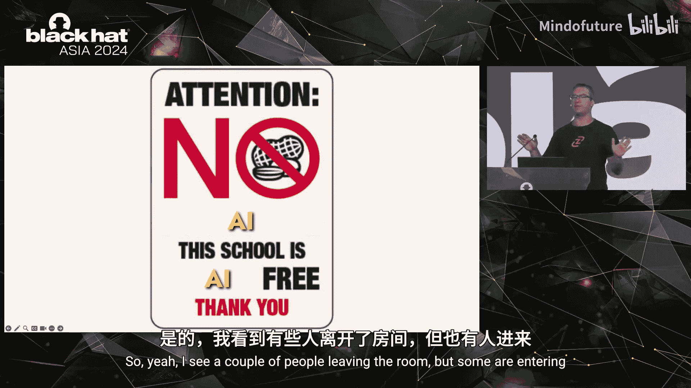
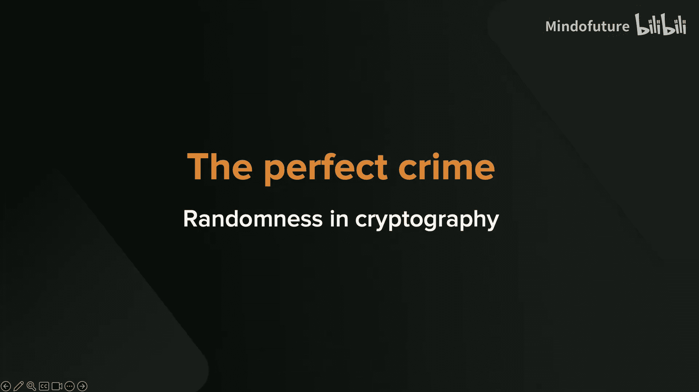
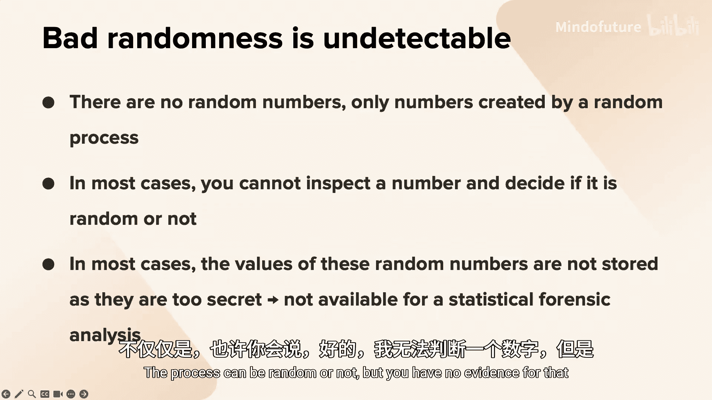
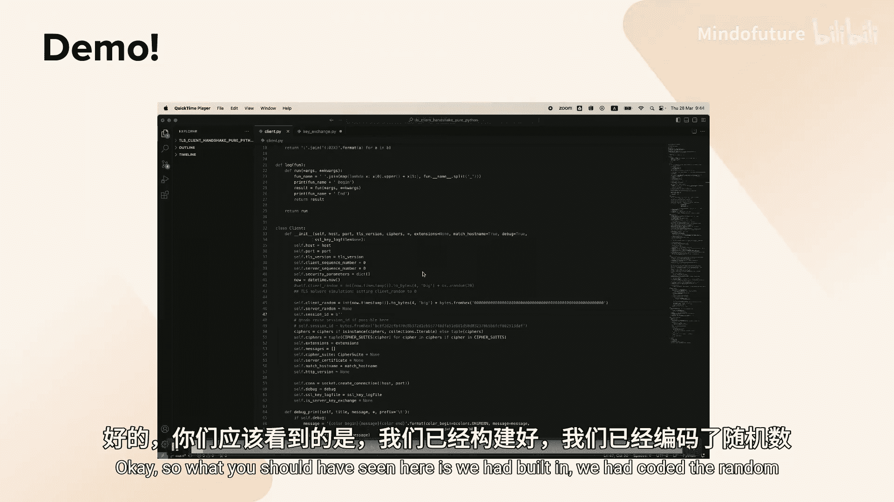

# 黑帽亚洲大会2024全集-•-中英｜Black-Hat-Asia-2024-p37-P40-Bad-Randomness---Protecting-Against-Cryptographys-Perfect-Crime--BV1oyX7YnEhN_p37-

Welcome to our talk about randomomness， Proect Agains cryptography Perfect Primeme。

 My name is Talber。 I'm the CEO and cofounder for Zengo in Zengo we make a very secure cryptocurrency Wall powered by NPC technology。

 We will touch it a little bit in the solution part of this talk and I'm really excited to be here。

 This is my first time in Blackhead Asia， really wonderful。😊，Even。

 but nine times in all other blackhead events。 So let's see。 So  firstt of all。

 I feel obliged to tell you there will be no AI in this talk， no machine learning， no L L M。 So yeah。

 I see a couple of people leaving the room。 But some are entering。 So thank you for coming。

 all the boomers， no no AI I'm boom myself。 So no shame in it。 Also。

 no Greek letter were harmed in making this talk。 So there will not be。

 although we're talking cryptography。 And I think we are maybe the only talk in the cryptography track。

 there will be no formulas， we' try to explain everything with load bearinging analogies。😊。

Okay， so after we talk about what will not be in this talk。

 let's talk about what actually is going to be in this talk。

 So we'll start by explaining why we claim that bed randomness is cryptography perfect crime。

 And then we move on to some true crimes and see how at least three examples for in the world。

 exploitation of this high profile vulnerabilities to in multiple fields。

 including cryptocurrency authentication and Internet security with T L S。

 And we will not leave you just with the problems， we also suggest some practical solutions to that。

 So let's start with a perfect crime。 What would make a crime， a perfect crime。 So first of all。

 it needs to be lethal。 It's not just shoplifting。 You have to do something really。

 really bad for it to be a perfect crime。 But this is。

You know， you can go to any other talks here。 We're all talking about vulnerabilities。

 take over computers and so on so forth。 So everything is little。

 But the most interesting point is the second point。 We want to do it in an undetectable manner。

 This is the important。 This is what makes a crime a perfect crime And we claim that bad randomness is indeed a perfect crime。

 So why is randomness is little because randomness is vital。 This is a quote from professor dos。

 Romness cryography is like the L we breathe。 You cannot do anything without it。

 So we can conclude the positively。😊，Randomness is vital。

 but the converse also holds like the lack of randomness。 is indeed very。

 very bad for the health of the system。 And this is because of K of principle。

 the security of cryptographic system only depend on the security of the of its private key。

And so therefore， kids should be kept secret and be unguessable。 You all know that。

 But what is the best way to make something unguesable， making it so hard that even yourself。

 you cannot guess it。 And the way to do it is by injecting。Injecting randomness into the process。

 So even I don't know and cannot recreate that key unless I story。 So it makes it unguesable。

 But the use of randomness is not limited just to kids， but also other cryptto parameters。

 such as nonsense， initialization vectors， Is and so on and so forth。

 And when these values that supposed to be random。 If they are not random。 then in most cases。

 it totally breaks the whole cryptographic system。 So we establish that bad randomness is a very critical and a big crime。

 Yeah， but is it。Untectable。 And the answer， yes， very much。

 because this is a famous Dilbert cartoon。 And the random generator says all the time，9，9，9。

 And said， is it really random， okay， we cannot really tell。 And this is， of course。

 takes to extreme， but。😊，The real problem is that there is no such thing as random number。 Okay。

 it's colliquialism。 like， it actually means this numbers that was created by a random process。

 and so this is actually randomness is the quality of the process。 not of the number。

 So when you get or your system gets a number， supposedly from the random number generator。

 it has no way to make sure it's actually random， right， because。😊。

The number in itself is not random。 The po that created it was random， but of course。

You cannot tell if a number is random or not。 Just the process can be random or not。

 but you have no evidence for that and。

It's not only maybe you saying， okay， I cannot tell for one number， but if it's9 all the time。

 then probably's something wrong there。 So I can look at the series and do something about it。

 But the and maybe I cannot do it in real time。 but I can collect forensic evidence post small time and analyze it。

 and this is really interesting， you will not have such evidences。

 because this evidence is not collect it by design。

 because if we collect the output of a random number generator that is used for keys that used for cryptographic elements。

 we create a new vulnerability， right， because attackers can take it and use it。

 So this is a perfect crime， not only we don't have the evidence。

 We are forbidden from collecting such evidence。 So indeed。

 you can create bad randomness as an attacker and no one will know。 So it's little。

 It's undetectable。 So let's start with first in the。Story of bad randomness。

So this is our first season。And in which we will attack bit addresses with bad randomness and see how it was。

 it actually explodeed in the world。 This is important。 It's not just a vulnerability。

 It actually exploded in the world。 All of these examples。

 So let's remind ourselves how bit addresses are born。 it all starts with the random 128 bit number。

 You add some check some to it。😊，And assign to each group of 11 bits。

 you assign award from a dictionary from B an dictionary to get the notorious infamous seed phrase so you can back up that that private key。

 And then you apply some key devation function to it，2000 round of Em Sha。😊，And finally。

 you can in order to have multiple address created from one single secret。

 you apply some hierarchical deterministic derivation out of it。 But this is all details。

 What's important to note is that it all starts with a random number。

 and all the security of of your bitco， the your private key control everything。 If you have it。

 you have everything。😊，If you don't have it， you have nothing。

 So all control is concentrated in this random number， but if it's not really random。

 then someone else can guess it and can break the whole system。 So we wanted before that。

 So this is actually happened。 this is a report from a few months ago from the Washington Post if you create a bitco wallet before20016。

 your money might be at risk because long story short because it was created with some bad randomness。

 it was jascript random number generator， which is not as random as we want to have。

 doesn't have enough entropy。 And also its since this is created private key and in bitco and cryptocurrency your private key determines your address。

 It's not something disposable， you have to keep reusing it。

 So even if you change wallet at the time。 And you just moved your。And by， again。

 using the see phrase to recreate your addresses from backup。

 You're carrying that vulnerability with you over this。

 So although you're not using the original wallet that introduced that vulnerability。

 you are still vulnerable to it。And there was quite a few quite a few incidents that people lost their money。

 But again， bed randomness is stealthy。 You don't know if the problem was bed randomness。

 or maybe they were negligent about keeping the sit phrase。

 Maybe they had male were on their computer。 So again， you see bed randomness is very。

 very stealthy attack。 very hard to prove it。 So we want to create such thing that will prove that there are people out there。

 There are bots out there that are really looking for it， actively looking for it。 So we thought。

 okay， let's create such vulnerable address。 Let's start with an anthtroy instead of randomizing。

 let's start with the number one， which quite appropriately creates the following seed phrase of abandoned。

 abandoned， abandoned， abandoned， which is quite prophetic。

 but also because the bi39 dictionary is lexiographically sorted。😊。

So the first word is start with A B， So it's abandoned， but it's quite nice。 Okay。

 and we made sure this address is pristine。 No one used that in the past。

 So no one should have the private key of it。 There is no evidence that someone had the key on it。

 And then we wanted to send money to it。And when as we send money， you can see the time here is in 9。

51。 then immediately the same split second this money was transferred from that address。

 resulting from the private key， which was not random and immediately transferred to another address。

 So it means that bedrodomness attackers a real their bots lurking for transaction of bed randomdomness addresses and monitoring the manpo in real time。

 waiting for a transaction to be broadcasted across the network。 And when they see it。

 they even fight over it。 like the was multiple bots trying to fight over the transaction paying the fees were all also going up and up and up and finally。

 someone went about it， if you want to read more about it。

 we published it in two block postss a few months ago。😊，Now， let's go to our second exploitation。

 which kind of kind of similar， but it has another element。

 So you would see it's not really only related。To， to private kids， also other elements of。

 of cryptographic protocol are vulnerable to bed randomness。And we'll talk about the EDA Nos。

 EDA signatures are used in many security related protocols， authentication， and also cryptocurrency。

 for example， Bitcoingoin and Ethereium uses that and。EThis nouns is must， And easy say has a no。

 It requires a nouns。 and that no must be secret。 So， again， let's make it completely random。

 So even I cannot guess it。Because if an nu is somewhat predictable， it's well known and in fact。

 presented a few years ago in Blackhead that even one bit of leakage from the nu can be really dangerous for the whole protocol and someone repeated the same exp that we did。

 He he reused a noun over the Ethereium network。 And again。

 he was his addresses were abused and immediately and money was immediately transferred right right from his transaction his account to another attacker controlled account。

 And there also like was another vulnerability in Yubiki that had the same issues It was not reported to be exploited。

 but had to recall all of their Yubikis back to the factory and reset everything。So。

 and now two completely different example。 So if you were bored， you're not into cryptocurrency。

 you say it's a hoax。Maybe you you， maybe you're right。 I know。

 But now we'll talk about something we all use。 And this is the T L S protocol。

 So we're starting something new， you can reconnect。O， so let's talk about the T L S Melware。

 The redductor Melor wasified by Kasperssky five years ago and attributed to the Tola A T group。

This meware patches the random number generator and also injects certificate authority certificate。

 which allows the enables the attacker to send the P， L S e encrypted and sign traffic。

 which is not actually from the actual website。😊，So， but let's， before we dive dive into the detail。

 let's remind ourselves of the basics of the T L S handshake。

 And we can see where randomness comes into play there。 So the first message this of course。

 sent in plain text because this is what you're doing。

 You're doing handshake in order to coordinate a key between Alice and Bob Cl and Sva is sent in it must be sent in plain and content the client R。

 which is represented by this lovely dice。😊，And what happens if the PR N G is infected。

 is is exploited and it's not really random。EIt means that a fixed value will be sent in plain text。

 which allows the attacker to identify the victim traffic out of the general public traffic。

And how do the attackers did that， This is still taken from Kasperssky original blog。

 So they just patched four different functions in different DL S。 It depends on which browsers。

 the victim were using。 So they just patch the PR And G with something that instead of randomness returned some known value that was calculated。

 It was specific for each user。And the result， if you look at it over the network。

 would be if we replace the random bytes， let's say by all zeros， it's visible over the network， so。

Let's do some cyber palontology， as Coin R for Kaperssky would say， and。With， you know。

 palellaontology， you take a bone from a dinoa some teeth and say， okay。

 this dinosaur was dead big and was doing like that。 And it was a grass eater or carnivoval or so on。

 So we know that the redductor me patches the parent and itjects certificate authority search。

 So what is it doing。 So it must be related to a silver monster in the middle。

 what we used to comment in the middle。 Now it monster in the middle。

 And let's see how we think how Kasper it worked。 So the attacker。😊，Infect their victims。

 but also has some presence over the ISP or somewhere upstream to the Internet。

 And so when they see a benign user not infected。 the client random is indeed random。

 they just let it pass and get the normal response out of the server。

 But when they see the victim sending a message。 And they know this is the victim because the random is something that the attacker expects。

 then the master in the middle can fiddle with the response and send something they sign in the name of the of the attack the website。

 And the client who trust because the mailware also knows to inject certificate authority certificates and everything works perfectly。

😊，So Apple T now， we just presented the original Kasperssky research。

 and there are some observations we need to take out of it。 So monsters。

 bed randomness attackers are real。 Okay， the some A，😊，Did actually did it。

 They played with the PR And G for their own causes。E and although you would， someone would say。

 okay， this is， if we hadn't had this case， someone might have said this is theoreic because。

Although like attackers can get everything， they're already presented on the victim's machine。

 They can take the traffic from there。 They can fiddle with the response from them。

 But they prefer to fiddle with net traffic。 So why do they do that， So and the first answer。

 it does not really matter the most important thing is， it does happen。

 like attacker have their own reasons for do that for doing that。

 therefore this is a valid attack scenario。 We， we should be worried about having a Melware on the victim side and having a tandem monster in the middle。

 Melware on the ISP。And， but if we want to resonate about it a little bit。

We can say that this is a very much more stealthy mode of operation。 if you if you do it it scale。

 So instead of doing all the dirty work on the client side and fiddling with traffic and exfiltrating data out of it。

 you can just you know， do as many manual walk as needed on， on， on the client。

 which where it is exposed to antivals in the hours and so on so forth。😊。

And do all the dirty work on the server where you are most like it's。

 it's much more sheltered environment from the attacker perspective。

 So you can we can conclude that this is a very important。

 like stealthiness is important for tall attackers。

And now we move on to our new findings on this old case。

So what we presented before was the classical T L S N check， But there were improvements to it。

 The T L S N check with E D H Ephemal difihman。 And in this case， there are another parameter。

 that needs to be random。 And this is the client。😊，Dfiman parameter。

 And why do we use difihelman to begin with， so。The point of E M Dfiman was to provide perfect false secrecy to T L S because prior to Dfihman。

 the attacker could， which is an eavesdper， can eavrop to the encrypted traffic and just store it hoard it on the side for years。

😊，they cannot read it， but they can store it。 And hopefully， for the attacker perspective， one day。

 they will be able to compromise the server， take the private key from the certificate and read all your past communication with this server and。

😊，With Dfiman， the client also participating in creating the that key。

 and it's also ephemeral like it's not stored in any place。 So because of that process。

 this eliminates that attack vector because if you store that E D H equippeded the traffic We it's useless。

 afterward， even if you compromise the server certificate。 And how how do Dhman achieves that。

 So if you look at the right hand side， at least for me also tell it right hand side。

 you can see Alice and Bob， and let's do some color analogy。 So there is one common color。

 everybody knows it， this is yellow。 But the Alice and Bob picks color and random。

 let's say Alice picked red， and Bob selected a random blue。😊，Then， and then they are mixing it。

Privately， they're mixing it。 and the security of this protocol is because mixing is one way function。

 You it's easy to mix two colors together， but it's very hard to separate them to separate them。

 So then bos El sent to Bob， they' mixed the color mixture。

 the orange and bo and the the green color mixture。 And then each of them adds to it。

 the a mix again， the private color again， the secret color again。

 So they both get a mixture of yellow red and and and blue， finally， which creates a brown。

 But if Robert that listen to this traffic， knows it sees the yellow， it sees。😊，Green。

 it seems orange， but。It cannot。ECombine them together to get the brown。 But obviously， if。

E Aliceice color， the client color red， it become known to that。 maybe。They choose red 4 Els。

 Then it's become trivial to to get the the resulting brown color。

 because the attacker knows that El selected red and it sees over the wire that bo public。

 the mixture is green。 And it can and the attacker can do the same as Els and get the the common secret together。

 And this is exactly the attacker And that's what we think tallla was doing because redactor attackers could probably passively eavesdrop because as you can see。

 even if they didn't mean it and I think they meant it。

 But even minute because they were patching the random number generator for the client random。

 it also affect the client the H parameter。 And the client D H parameter is also nonrandom and known to the attacker in the same manner that the client random was known to it。

😊，So how we think it actually， like in addition， of course。

 you can to attackers can be also active men in the middle。

 And that's why they had their C A the C A injection capability in the middle。

 But they can also passive eavesdrop。 So again， in this setup when a benign user set the request the the monster in the middle just ignore that。

 Yeah， and lets the request just flow。 But when a victim send the traffic the the man in the middle knows it can see the result of it because it knows that if you have that random。

 then your di parameter is something that is known to the attacker。

And can get readability to the request and responses。 So this is demo time。

And I call it the recipe。 You can look at it up afterwards， but let's switch to the demo itself。

So in order to simulate， I hope you can see if not， I will also describe what's going on， so。

In order to simulate a client， a vulnerable client， we took a Python script that implement Dfi Heman。

Is it playing。I don't know。The blame。有不有许。有の。O。So谓。Yeah， okay， it's playing。

 And instead of creating client random at random， we just how coded all zeros to it。😊，Okay， so what。

 what you should have seen here is we， we the。

EB， we had built in。 we outd the random numbers and also the private Dfi humanman key。

 And we created that vulnerable client for Dfi humanman key exchange。

And then we created another tool。 All of them are free and open source and we included in this presentation that actually decrypt the traffic。

 And given just the public data and the knowledge of that private key。

 So if the demo would actually walk， that it was the place that you would clap。 But let's go on。😊，So。

😊，Thank you。 Thank you。Thank you guys， you're very gracious， thank you。

So what are the additional observation out of this process。 So better randomness is so undetectable。

 They were not even sure what the attackers have done。 like five years has passed。

 And this discovery slipped the eyes of Kasperssky but we cannot even I I cannot think about evidence that will positively show us。

exceptcept if we would some catch that server component of this of this attack and or someone from that A T group said。

 okay， this is what we've done。 So it's very， very stealthy attack and attacker are even more stealthy now because Pass is the ultimate stealth mode。

And what in another general lesson from that in， in cryptography and security as a whole that。

It's hard to talk about what is more secure than others because like say， okay。

 PF S perfectet for future secrecy is great， right。

 because it for some attack model of attacker holding our traffic from a lot of times it helps。

 But on the other hand， for this attack model where the attacker can play with the random number generator and has some master in the middle setup。

 which is real as shown like for this， it reduces the secrecy because attacker can now passively dec that without needing to compromise the original server。

 So it's interesting to say like that security is multidimensional。 So when you add in one place。

 maybe you create new vulnerabilities in another place。😊，So let's talk about solutions。

 And let's start with solutions that doesn't work。 Best solution。 So maybe when。

 when you thought about it， okay， you said， I cannot trust anyone。 even I cannot even trust my。

 my random number of generator。 I will create my own randomness on my own。And then。

Like its inspired by this X K city， I can create a path that will create enough anthtropy in it。😊。

And people actually did it。 It was called brain wallets。 and entropy was generated from passwords。

 And over a decade ago， Rank Casalucci showed on death con death。He can probably guess many of that。

 And he found 700， more than 700 bitco。 So in today's value or yesterday's value。

 And it start of the month's value， it was like $50 million。

 Ryan could have been a very rich man if it wasn't so， you know， obsessed with ethics and stuff。

 But for example， down the rabbit hole held about 80 bitco in July。

 So it's like $5 million in today's value， so。You， as the bit Wiki concludes。

 humans are not a good source of antroy。 So although we want to reduce our dependence dependency in random number generator。

 we still need them。 We cannot be our own random number generators， okay。

What actually works is if we reuse existing good good randomness。 So more， let's say sustainability。

 let's not overuse that scarce resource of randomness because each time we use randomness we give another opportunity for the attackers to attack us。

 So， for example， instead of randomizing the norms that we saw for ED SA。

 we can just deterministically derive them from the anthtropy of the private key and the message。

 So this is secure and use many wallet。 same trick can also be applied to some T L S communication also。

 it called the Naxos trick and instead of the server creating randomness again。

 directly from from the dome number generator， it takes it from its private key again with one way function some sort of H mark and another parameters metals。

 So it so we don't。😊，We， we don't ask the random number generator for more and more randomness。

 but reuse the existing randomness。So this works。And additionally， obviously。

 we need to protect the random number generator itself。

 It's as important as protecting the secret because that actually generates the secret。

So one way is to just dig deeper。 You know， if you store your private key in a secure hardware。

 then your random number generator is part of that secure number。

 But this is limited because let's say you want even more security。 how do get it。

 You cannot get any。More hardware into it。 And the way to scale it is， is。It's kind of like in AW S。

 you need， oh sorry， cloud services， like it's better to scale horizontally because you can add more and more machines instead of you know scale vertically and and building bigger bigger machine because this is limited。

 So if we distribute random number generation， then we can easily scale it because the motivation behind it is if you add up a lot of numbers。

 and one of them is random， then the whole sum is random in itself。

 right So one one honest party can save even if all the other parties are cooperativeed。

 So let's do distributedbutively it need to be in a non naive manner like so it requires multipart computation and this project for example。

 D run distributed is doing just that so。😊，Again， and it's very much easier to scale that because if you're worried。

 okay， someone could infect all of my the the parties， like I'm using two parties。

 two parties is not enough attacker can in parallel In fact， this。

 the first party and the second party。 Okay， I can add a third fourth and so on and so forth。 So。

 I hope you convinced that this is easily scalable。And this is exactly what we're doing， you know。

 Zgo wallet and others are doing in MPC computation for ECD SA。 So with MPC。

 the key generation is distributed。 So bed randomness of a single party will still create a random key because the the。

😊，The noncorrupt party， the healthy party save the corrupted party and also signing is distributed because we have randomness in signing also if you remember the nouns that is used to say sign。

 So again， the randomness of it comes from two parties as part of the protocol and our implementation for it by the way is open source and you can just use it and we documented in many other blogs。

 So to sum up MPC wallets had no single point of failure， the key generation is distributed。

 So even if Maware is presented is present in one of the parties that actually generated the key still the other it doesn't have hold over the other party because the very different different operating system and so on and so forth。

 and but not only against Margware， but also。😊，Protection。Also against bed randomness。 Again。

 this is because of the secure design of the system。

 like secure security architecture is very important because we。

 we didn't had in mind the problem of bed randomness。 We didn't think about it， but because。

you create a very secure architecture of this that is doing key generation and designing in distributed manner。

 It also helps in the randomness， because， again， the randomness in itself is also distributed。 Okay。

 and even if one party is compromised or its random number is getting compromised Still。

 the other party is enough to save it。😊，可。So， just to sum up。

Bed randomness is indeed crypto perfect crime because A it's lethal and B， it's undetectable。

 It's actually being exploited in the wild。 we show an an example of A T attacks on T L S that uses bad randomness Bitcoincoin duck forest attackers。

 It term detectorers Also other we mentioned honorable mentioned for UB key authentication。

 vulnerability you to bad randomness。 And the solution we suggest is protect your PR And G remove unnecessary randomness requirement。

 not everything needs to be randomized from the beginning。

 you just you can just derive it from randomized values you had in the past and use multiparty computation and distribute the computer。

😊，Computing to avoiding a point of failure。 And last but not least。

 always make sure that your video is working before the talk。 So I conclude with that。

 And if there are question， I would be happy to take them if someone wants to take to ask。

 take the microphone。😊，Thank you。Hi， I have a question。 My name is Aron。 I am from Intel。 I mean。

 I saw in your talk you talk about PR NG， which is the pseudo random number generator have you in any of this work that you talked about today has any T R NG or a true random number or a D R NG or has been used in any of these any of this work and the random number generators that you talk about in your second part of the question right。

 So the random number generators that you talk about have they passed the N randomness。Test suite。

So this is， this is a great question。 And also， let's assume like the random generator is actually good。

 Okay， like provide value。 But the attackers maybe can slip like they take like you have a good random number generator needs to prove。

 It's a true random number generator， takes it from lava that you know， that then perform there。

 nothing going with that。 But then the attacker， instead of giving you like the output of that random number generator just plugs in their value。

 Okay， so just bypassing it in itself。 So you are right。

 like there are certain type of problems that arise from defunct random number generator。

 And so if you protect against it， it also it's also good。

 But like the hardest part is to protect against maliciously。😊。

Random number generator jump like you had the N， random number generator and someone just， you know。

 plugs in something else instead。 So thank you。 Very good question。 Thank you。😊，Okay， thank you。

 guys。 If you want to talk to me， I'm here。 And also， you have my Twitter handle。 So thank you。

 And I hope you enjoyed the talk。😊。