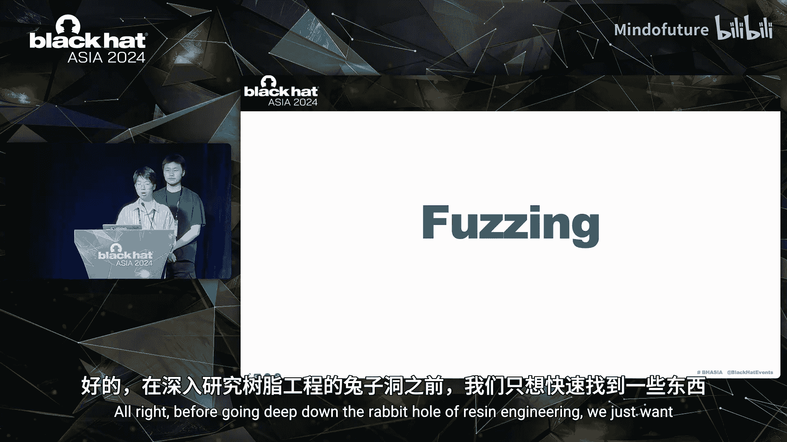
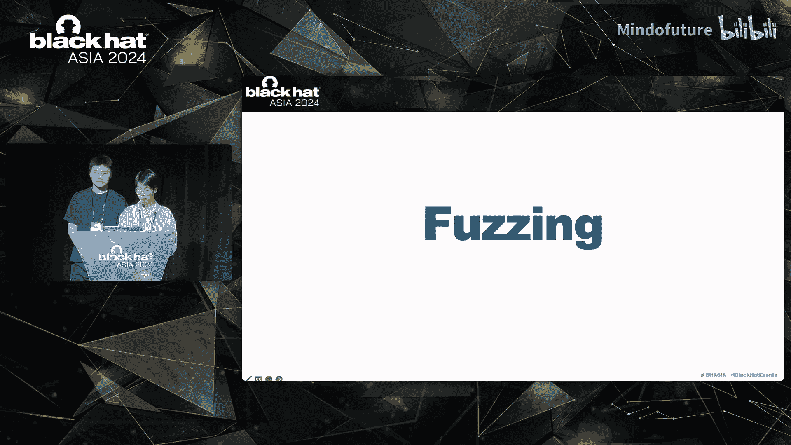

# 黑帽亚洲大会2024全集-•-中英｜Black-Hat-Asia-2024-p40-P43-A-Glimpse-Into-The-Protocol---Fuzz-Windows-RDP-Client-For-Fun-And-Profit--BV1oyX7YnEhN_p40-

Hello， everyone。 I'm glad to share our research with you here today。

 The title of our presentation is games into the protocol for the Windows RP client for fun and profit。

😊，My name is Ming Jia Liu， and I'm here with my partner Ying Q Shi， as US S team members。

 including our leader Quan Jin， For Internet Si Yuan Liu and senior security engineer Guo Xianzhong。

 We are from the DAPP secret Weib Bin La。Alright， let's get to the point。

 What we are going to share is quite simple。 It is an entire process of fuzzing Windows RP client。

 Our presentation includes five parts motivation， introduction， the fuzzing process。

 case studies and the future works。😊，So why did we choose RP as our target。Firstly。

 it is a very popular and widely used remote protocol with a large use base。 Secondly。

 it is a very traditional and old protocol project as the RP protocol first appeared with a terminal services in Windows N T 4。

0 server。😊，The third reason is that there are some RP vulnerabilities in the past few years。

 such as the famous blue keeper。On the other side， there are no muchnerabilities related to RP in the past year means that we have may have some chance in this area。

Actually， in order to assist everyone's learning， we need to understand some basic concepts。😊。

The Microsoft remote desktop protocol provides a remote display and input capabilities for Windows based applications running on a server via a network connection。

 This is its main purpose。After continued updates， the current RP includes features such as smart card。

 audio drive， port and network printer redirect and more。😊。

Through our research we learned that there are two attacked scenarios。

 The first scenario is that a hacker sending a text pillows to the remote server through a client。

 causing the remote server to crash or taken control without re。

The second scenario is that a hacker takes control the RP client from the remote server。

 You can also understand it as a counter measure。 It could also be used for honeypot purpose。Okay。

 now we have two options。 Do we choose client or server。

After a careful think we choose the client as our target， the reason is as follows。 Firstly。

 the code of client is mainly implemented in M T C X point D L。 it means we have a clear target。

 Secondly， there are official API interfaces that can be used to test client。Certainly。

 compared with server， the client is relatively simple。 And finally。

 there are more previous works for reference on client。 So it is easy to get started。😊。

Here are some existing research on Windows RP。 We read the materials carefully and learned a lot from them。

We then turn our attention to the watching channel。

 channel is an extension channel that can be used to add functionality enhancements to remote desktop service service applications。

 channel is divided into static channel and dynamic watching channel。

 the server exchanges data with the client through the channel。 and this data are known as Ps。

Acting as a bridge between the client and the server。

And you need to know the different channels are needed for different expansion functions。

You can see that there are many protocol documents for different channels。For example。

 the RP S N D watch channel that we will mention later provides a transmission channel for audio。

 the RP D R provides an interaction channel for hardware devices。

 and the T SM F provides a channel for video data transmission。

 and there there are more other channels。But how we how do we open these channels and utilize them。

Fortunately， Microsoft provides an API for this interaction。 It's called WT S API。

 We just need to realize the WT S API to open a watch channel。

 and write data to or data to the watch channel。 and finally close the watch channel to complete data communication between the server and client。

 Okay， the above are all the knowledge is needed to understand what we need to learn later。 Next。

 that my partner Shi to continue showing。Alright， before going tips down the rabb hole of engine。

 we just want to fighting start fighting quickly。

So we found two of fathers for RP。Both based on Windows A F L。

 So we resource and understand their changes。 After that。

 we distilled two further architectures for existing RP phuzzing。Loop mode and proxy mode， we。

The first 1 I call loop mode。 Yes， that loop， I means， let's move on In this mode。

 we need to manually track function or use two other tools。

Then reset R IP register at the end of the function。We will infinitely execute the target function。

 to achieve。For example， when trying， when we trying to find RP S N D channel， Yeah。

 it's transmission channel for audio。So when trying to find ITP S N D。

 we need to play music on the server track at manually。The second 1， I call proxy mode。

 You can see that we have replaced trigger with something we call W T S sender。

 It's different from loop mode。😊，The W T S sender receives muted data from the father and then send it back to the client through the W T S API。

 Okay， we have to make a choice Now， which one do we choose loop or proxy。

We choose to use a loop mode further first， which is simple enough。

 It's the fastestest solution for us to start with。Even so loop mode may not as stable as proxy mode。

Next， we prepared a the target function and seeds。How did we find the target。

We draw from our collection of materials， identifying petition targets。 For example。

 channel message handler named on data received in the class function。And the seeds。

The seeds came easily from example， in the official manuals。 It's veryable mine， isn't it。

And now we also need to prepare a fast environment that contains client and server。😊，You know。

 client is our target for fuzzing server as trigger only。As you see。Based on what we know。

 we have two ways to de the environment。The first one is the most direct。

We prepare to virtual merchant， one as our client and the other as a server。Yeah。

 we use client connect server。That's easy enough。The second one is orbitted from Talk in Hex account 2022。

 Its use RDP rep to enable merchant to be used as both a client and server at the same time。I mean。

 RP rep。Tempers with the server in order to allow local connections and even concurrent seasons。

If we use the second method， we only need to prepare virtual matching， yeah。You know， this。

 this is at least better than the first method。 However， I must say RP rep is a third party tool。

 And you know， if we use the latest visual of Windows or no one shares the parameters。 Yeah。

 I mean con file of our windows visual。We must to modify the con configuration file manually。

I want to say a little bit more。About con file， it contains binary code of our patch。

The location of patch and more。So， you know， we must do reversing and find a patch target offset it's。

You know， it's crazy。 No， that's not what we want。That's too troublesome。

But these are our only options now。 So we have to make a choice。Finally， in our initial attempt。

 we still choose the first one。It's easy enough。 Of course， in our later， later explorations。

 we had a different way to start the environment。 We will talk about that later。 Now， let's see。😊。

Let's start the father。All right。After completing these steps， we can finally start our fathers。

 We had the time to think more when we successfully launched a father。 So next。😊，We have a problem。

We want to solve it first。 How to conduct batch。You know。

 we have a computer and we want to start more otherss。

But the first method is not searchable for batchs。So second method is our only choice， Anything else。

Yeah， sure。 We can use Windows server。 As you know， Windows server has remote desktop services。

 It supports multi user connections。 Oh， that's cool。

 So we can build our virtual and add R D S roles and client。 That's all。😊，It's easy。 Okay。

 so we choose to use Windows server to simplify the environment configuration。Okay。

 now let's go back to fuzzing。Okay， you know， when we are trying to solve other problems。

 fastuzzing is also going。Now， let's see how lucky we are。As you see。It's nice work。

I means we found a bug。No， we not。 We uncovered a bug in the RDPS S N D channel。 It's true。

 but in the end。After our analysis and confirmation， we found it's， it's unpatched and historically。

Okay， this makes us very sad。 So， so this is a useless discovery。I don't think it so。

Because at least it remind us that we are working in the first steps of our processorcesors。Next。

 we still decided to continue。 Let's keep going。We will transplant the mutation strategy of hunger fast to our RDP father。

 which lies the code passes for us to assess fast in quality。

We switched from loop mode to proxy mode and added network header constants to enhance fastuzz efficiency。

We persist in reversing engineering， and constantly reading manuals。We did a lot of hard work。

 trying to get something。But。Unfortunately， we still haven't been able to achieve the desired outcome。

But our dream。Is to start from here。We discovered a minibu。In our processing， in our ph process。

 we have discovered a new reliability caused by a non point deliverence。When we first trigger。

This function。The entriess in the dynamic are really are set to now。 It seems normal， but。

When we trigger this function again。We get an address with content， as now。So。

One program different the non entry， the client has been crashed。Yeah， after long wait。

This is our earlier achievement。Yeah， it's easy and useless。That means it's not kernelonelbergs。

We are trapped in endless pain and doubt。I mean， is this whole end。This is just。

 just a worthless bug。 It has no， it has no reward。 No， we can't take it。Fortunately。

 things have changed。It， it's almost a coincide。 We were fortunate to discover that Yuki Chen mentioned the new responsibility form of race condition in his speech at Blackhead USA 2023。

😊，It has caught our attention。We see that Chen has achieved something with just a very simple father。

Some thread and send some related messages you can create， destroy our setting。You know。

 that shocked us。So we said， well， the simplest way is the best。

 I means the greatest truth is the simplest。 So after that。We develop a simple father， too。

We have some thread。 We send something to control something， to open something， to close something。

 to write something and read something。 And we try to send message out of order that we are interested in。

It looks like magic。 We know we are creating miracles。😊，The fact is， it's truly a miracle。 Oh。

 it's crazy。We are entered a new world。Therefore， we have received some crash reports。

 so we start to manually audit them and make some progress。Even though it's， it's regretable。

 some crash cannot be reproduced。Anyway， let us talk about the cases below。

When we looked at the crash logs， we found several different code stacks。

They all have to the same top level function， as you see。

The function symbol means to operate I O asynchronously。 So maybe it it's the key。 Sure。

 it's the key。It's true。After we further analysis， we found that this is a user at free bug。 Yeah。

 it's a risk condition with when we tried to operate the printer， we found that it was a synchronous。

It could be open， right and close， but these functions did not lock the print handle。

 So when we opened printer operated the printer to write and close at the same time。Pong。

 a crash orchard。It's very simple。 So we start thinking whether it could become an idea to help us better manual audit。

Next， let me partner Liu tell case 2 until the end。Okay。

 since there exist a rest condition vulnerability， are there are more other rest condition vulnerabilities。

 given that it is a conditional rest， the operation of creating threat must be a sensitive behavior。

And there may be other conditional ranks in the implementation of creating threads。 Therefore。

 we looked at the cross reference of the create thread function and referred to your kitchens rest model to find code that has used and releases but no look。

This approach may seem somewhat clumsy。 However， during the filtering and searching process。

 we discovered an interesting bug。Look here under the path of the previous rest condition point。

 there is an implementation of other， another function， which is specifically for X， P S printers。

 We filter and examined its class implementation and found that there is no look throughout the X。

 P S code。Is it a new vulnerability point。By reading the documentation。

 we found the method to arrive it。Then by carefully auditing the release logic in the X，PS S printer。

close operation。 we found that there is a risk window when opening the X， P， S printer。Therefore。

 by triggering the close function when opening X，PS S printer， we succeed in triggering a crush。

Through reverse analysis， we can describe the rank model as follows。

The code presented reveal bug that when31 open an X， P S printer， it will lose X， P。

 S printer point DL。Then it enters a rest window within which we attempt to start thread2。

 The purpose of thread2 is to invoke the close function for the X。

PS S printer due to the lack of proper locking on the code。 The X。

 P S printer is closed by32 causing the model to be unloaded then if thread one attempts to some pointer within the X。

PS S printer model。An exception will be triggered。Then we reported these two condition vulnerabilities to MS SRC。

 Microsoft addressed both all vulnerabilities in the January 2024 update。 The number is C V E 20242。

1，3，0，7。Through binary D， we were able to understand Microsoft page for these vulnerabilities。😊。

The solution was relatively simple。 It only enter critical section and leave critical section operations to the code。

This is a common method for fixing risk condition， availability。Finally。

 we look look forward to the future visions of our work。😊，In this research。

 we we focused specifically on WindowsP client and only target several channels in depths。

 moving forward， We plan to exploit the R TP server and conduct security audits on more virtual channels。

Additionally， by using similar research methods， we can also conduct security research on more network protocols。

At the end of this speech， let me briefly summarize our blackhead sound biass。 Firstly。

 we have shared some skills on fuuzzing Windows RP。 Secondly。

 we have shared our latest research on Windows RP client vulnerability。 Thirdly。

 we have showed the significance of rest condition in vulnerability discovery。😊。

Thanks for listening to us。 Do you have any questions。Okay， if you have any question。

 you can contact contact contact with me on Sw card。 Oh， okay， can I have one question。

 So I understand that in the end， you used race condition。

 not really fuzzing the data sent to the client。 I that correct。 Yeah， yes， yes， Okay。

 so you will you continue doing data fuuzzing as well。

Or do you think this approach is too complicated？呃。Yes， yes， we。we要 try就是 try。

To make another father to test another protocol。Yeah。

So eventually it was not really the protocol father itself right， it was more on。

I don't know how to put right， and I'm not very from the domain of on research。

 but I understand you just use concurrency issues。With your father。Maybe we can。

 we can take it off line。 I don't want to put an extra。 Thank you for your talk。 Okay， if you want。

 you can later to talk with me on Twitter or Sw card。 Okay， thank you。

